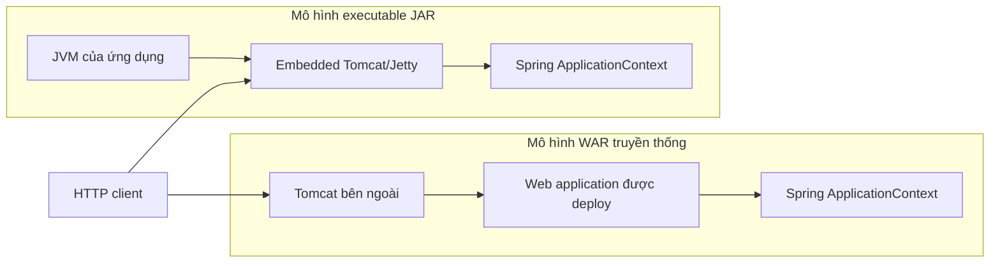
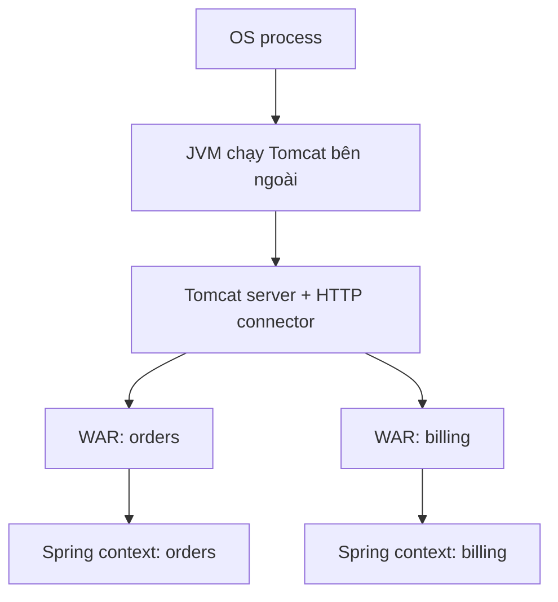

# WAR truyền thống và executable JAR: nhận diện mô hình triển khai

> **Spring Boot Fundamentals · Chạy và đóng gói**  
> Cùng một ứng dụng Spring Boot có thể được triển khai bằng nhiều mô hình. Với **executable JAR**, ứng dụng thường mang theo embedded web server và khởi động như một tiến trình Java độc lập. Với **WAR truyền thống**, ứng dụng được đóng gói để một Servlet container bên ngoài nạp và vận hành. Ngoài ra, Spring Boot còn hỗ trợ **executable WAR**: một WAR được đóng gói theo quy ước đặc biệt để vừa có thể triển khai lên container phù hợp, vừa có thể chạy bằng `java -jar` trong những điều kiện thích hợp. Muốn chọn và vận hành đúng, phải nhận diện **ai sở hữu web server, JVM, classpath, cổng mạng và vòng đời ứng dụng**, chứ không chỉ nhìn đuôi file `.jar` hay `.war`.

## 1. Bài toán triển khai: code giống nhau, vòng đời khác nhau

Giả sử một ứng dụng có REST API:

```java
package com.example.orders;

import org.springframework.boot.SpringApplication;
import org.springframework.boot.autoconfigure.SpringBootApplication;

@SpringBootApplication
public class OrdersApplication {

    public static void main(String[] args) {
        SpringApplication.run(OrdersApplication.class, args);
    }
}
```

Và một controller:

```java
package com.example.orders;

import org.springframework.web.bind.annotation.GetMapping;
import org.springframework.web.bind.annotation.RestController;

@RestController
public class HealthDemoController {

    @GetMapping("/hello")
    public String hello() {
        return "Hello from Orders";
    }
}
```

Đây là code ứng dụng, **chưa nói lên mô hình triển khai**. Nếu build executable JAR, một lệnh có thể khởi động ứng dụng cùng Tomcat nhúng. Nếu build WAR truyền thống, một Tomcat bên ngoài sẽ nạp ứng dụng và chuyển request tới Spring MVC. Nếu build executable WAR, cách khởi động quyết định nó dùng chế độ nào.

Ví dụ đường đi request:



Sự khác biệt quan trọng không nằm ở controller. Sự khác biệt là **ai tạo web server và ai quản lý vòng đời web application**.

### 1.1. Ba hình thức cần phân biệt

| Hình thức | Artifact | Cách khởi động thông thường | Ai sở hữu servlet container? |
| --- | --- | --- | --- |
| Executable JAR | `.jar` có Spring Boot launcher và dependency | `java -jar orders.jar` | Ứng dụng tạo embedded server |
| WAR truyền thống | `.war` theo cấu trúc Servlet web application | Deploy vào Tomcat/container tương thích | Servlet container bên ngoài |
| Executable WAR | `.war` được Spring Boot repackage | `java -jar orders.war` **hoặc** deploy ngoài, nếu cấu hình đúng | Phụ thuộc cách chạy |

Một WAR có thể chứa main class và Spring Boot launcher nhưng vẫn hỗ trợ external deployment. Vì vậy, không được suy luận rằng “đuôi WAR luôn phải có Tomcat bên ngoài”, cũng không suy luận rằng “mọi file WAR đều chạy được bằng `java -jar`”.

### 1.2. Nhận diện từ câu hỏi vận hành

Khi tiếp nhận một ứng dụng chưa quen, hãy hỏi:

1. Lệnh khởi động thực tế là `java -jar` hay container deploy?
2. Web server được khởi tạo trong JVM của ứng dụng hay có sẵn bên ngoài?
3. Ai quyết định port HTTP?
4. Artifact có cấu trúc `BOOT-INF` hay `WEB-INF`?
5. Container và app dùng chung một JVM hay có process tách biệt?
6. Khi cập nhật ứng dụng, đội vận hành thay JAR rồi restart process hay deploy lại WAR?
7. Dependency server là một phần runtime của ứng dụng hay do container cung cấp?
8. Nếu chạy trên cloud/container image, image trực tiếp chạy Java hay chạy Tomcat và copy WAR vào `webapps`?

Trả lời những câu đó thường chính xác hơn việc đoán mô hình từ tên repository.

## 2. Executable JAR là gì?

**Executable JAR** của Spring Boot là một JAR được đóng gói với các thành phần cần thiết để khởi động ứng dụng bằng một Java command, thường gồm:

- Application classes và resources.
- Dependency JARs, theo cấu trúc lồng trong artifact.
- Spring Boot launcher tương ứng phiên bản plugin.
- Manifest chỉ dẫn launcher và application start class.

Trong mô hình web Spring MVC phổ biến, executable JAR thường mang theo embedded Tomcat thông qua dependency `spring-boot-starter-web`. Ứng dụng cũng có thể thay embedded server bằng Jetty hoặc server phù hợp khác nếu được cấu hình.

### 2.1. Quy trình chạy

```bash
java -jar orders-app.jar
```

Spring Boot launcher xây dựng classpath từ archive, gọi entry point của ứng dụng, khởi tạo Spring ApplicationContext, tạo embedded servlet container và bắt đầu nhận request theo cấu hình.

Mô hình logic:

```text
OS process
└── java -jar orders-app.jar
    └── JVM
        ├── Spring Boot launcher
        ├── application classes
        ├── dependency JARs
        ├── Spring ApplicationContext
        └── Embedded servlet container
            └── HTTP port, ví dụ 8080
```

Thông thường, dừng tiến trình Java đồng nghĩa dừng embedded web server và ứng dụng, với điều kiện shutdown được thực hiện thích hợp.

### 2.2. Ví dụ cấu hình cổng

```yaml
server:
  port: 8085
  servlet:
    context-path: /orders
```

Với ứng dụng servlet chạy bằng embedded server, cấu hình này thường khiến endpoint trở thành:

```text
http://localhost:8085/orders/hello
```

Nếu chạy sau reverse proxy hoặc ingress, URL người dùng thấy có thể khác do proxy routing. Cần phân biệt **cổng của ứng dụng** và **cổng public phía ngoài**.

### 2.3. Cấu trúc executable JAR

Một Spring Boot executable JAR thường có cấu trúc khái niệm:

```text
orders-app.jar
├── META-INF/
│   └── MANIFEST.MF
├── org/springframework/boot/loader/...
└── BOOT-INF/
    ├── classes/
    │   ├── com/example/orders/OrdersApplication.class
    │   └── application.yml
    ├── lib/
    │   ├── spring-context-....jar
    │   ├── spring-webmvc-....jar
    │   └── tomcat-embed-....jar
    └── classpath.idx          # có thể có
```

Tên launcher package và file metadata phụ thuộc thế hệ Spring Boot. Điểm nhận diện ổn định ở nhiều phiên bản hiện đại là **BOOT-INF/classes** dành cho code ứng dụng và **BOOT-INF/lib** dành cho dependency.

### 2.4. Executable JAR khác plain JAR

Không phải JAR nào cũng được chạy bằng `java -jar`.

Một **plain library JAR** thường chứa class và resource theo cấu trúc thư viện thông thường, không nhất thiết có startup main class hay các dependency đi kèm.

Ví dụ:

```text
acme-client.jar
└── com/acme/client/PartnerClient.class
```

Nếu chạy:

```bash
java -jar acme-client.jar
```

có thể gặp thông báo thiếu `Main-Class` hoặc không có entry point hợp lệ. Điều đó không khiến JAR là “hỏng”; đơn giản nó không được thiết kế là executable application archive.

Spring Boot Maven Plugin `repackage` hoặc Gradle `bootJar` thường được dùng để tạo executable JAR theo quy ước Boot.

## 3. WAR truyền thống là gì?

**WAR** (Web Application Archive) là định dạng đóng gói web application dựa trên Servlet specification. Trong mô hình truyền thống, một Servlet container như Tomcat được khởi động trước; container sau đó nạp một hay nhiều WAR tương thích.

Ví dụ quy trình vận hành:

```text
1. Cài hoặc khởi động Tomcat.
2. Copy/deploy orders.war vào deployment location của Tomcat.
3. Tomcat giải nén hoặc nạp web application.
4. Servlet startup mechanism khởi tạo Spring application.
5. Tomcat điều phối HTTP requests vào web application.
```

### 3.1. Ai tạo server?

Với WAR triển khai bên ngoài, **Servlet container bên ngoài** quản lý listener, HTTP connector, thread pool, server port và phần lớn lifecycle server. Spring Boot khởi tạo ApplicationContext cho web application đã được container nạp.



Một container có thể host nhiều webapps. Điều đó không có nghĩa mọi tổ chức nên deploy nhiều ứng dụng chung một JVM: resource isolation, security boundary và cách nâng cấp thường phức tạp hơn.

### 3.2. Cấu trúc WAR thông thường

```text
orders.war
├── META-INF/
├── WEB-INF/
│   ├── classes/
│   │   ├── com/example/orders/OrdersApplication.class
│   │   └── application.yml
│   ├── lib/
│   │   ├── spring-context-....jar
│   │   └── spring-webmvc-....jar
│   └── web.xml              # tùy ứng dụng; không bắt buộc với Servlet hiện đại
└── ...                     # static resources, nếu có
```

Với Spring Boot trên Servlet API hiện đại, cấu hình khởi động không bắt buộc phải dùng `web.xml`. Java-based servlet initialization có thể được thực hiện qua `SpringBootServletInitializer`.

### 3.3. Container là thành phần độc lập với artifact

Một file WAR **không tự tạo HTTP listener** khi bạn chỉ copy file ra một thư mục bất kỳ. Container phải nhận biết và deploy nó.

Ví dụ một instance Tomcat tự cấu hình có thể có thư mục:

```text
tomcat/
├── bin/
├── conf/
├── lib/
├── logs/
└── webapps/
    └── orders.war
```

Tùy cấu hình auto-deploy và server setup, Tomcat có thể triển khai WAR đó thành context `/orders`. Các hệ thống production có thể sử dụng Tomcat Manager, deployment pipeline, context descriptors hoặc server orchestration thay vì copy thủ công.

### 3.4. Servlet container không nhất thiết là một Java EE application server đầy đủ

Apache Tomcat là một Servlet container, không phải tất cả các Java/Jakarta EE services đều có sẵn như trong một full application server. Một Spring Boot WAR có thể chạy trên servlet container phù hợp, nhưng không nên giả định tất cả các platform Java enterprise có cùng classpath, module loading, JNDI hoặc transaction infrastructure.

Nếu ứng dụng dựa vào service của container, deployment contract cần liệt kê cụ thể các service đó.

## 4. Spring Boot ứng dụng WAR nhận entry point ở đâu?

Với executable JAR, entry point quen thuộc là `public static void main(String[] args)`.

Với WAR truyền thống, container **không chạy `main()` như khi gọi `java -jar`**. Container cần một cơ chế khởi tạo web application thông qua Servlet APIs.

Spring Boot cung cấp `SpringBootServletInitializer` để ứng dụng tham gia cách khởi động đó.

### 4.1. Lớp khởi động hỗ trợ external WAR

```java
package com.example.orders;

import org.springframework.boot.SpringApplication;
import org.springframework.boot.autoconfigure.SpringBootApplication;
import org.springframework.boot.builder.SpringApplicationBuilder;
import org.springframework.boot.web.servlet.support.SpringBootServletInitializer;

@SpringBootApplication
public class OrdersApplication extends SpringBootServletInitializer {

    @Override
    protected SpringApplicationBuilder configure(
            SpringApplicationBuilder builder) {
        return builder.sources(OrdersApplication.class);
    }

    public static void main(String[] args) {
        SpringApplication.run(OrdersApplication.class, args);
    }
}
```

Có hai đường khởi động khác nhau:

- Khi gọi `java -jar` với artifact executable được đóng gói phù hợp, Spring Boot launcher gọi entry point ứng dụng.
- Khi triển khai WAR vào Servlet container tương thích, servlet startup infrastructure gọi initializer và Spring Boot tạo context theo cách đó.

Giữ `main()` hữu ích khi muốn một ứng dụng vừa có khả năng chạy executable vừa có khả năng deploy WAR ngoài. Với ứng dụng WAR truyền thống chỉ dành cho external container, `main()` không phải điểm khởi động mà container sẽ gọi.

### 4.2. Vì sao phải override `configure`?

Method `configure(SpringApplicationBuilder)` chỉ định những application sources nào được dùng khi khởi động qua Servlet container. Trong ví dụ, `OrdersApplication.class` chứa `@SpringBootApplication` nên là source phù hợp.

Nếu quên cấu hình nguồn cho một WAR cần external startup, container có thể không khởi tạo đúng Spring application hoặc không tìm được configuration cần thiết.

### 4.3. Controller và service có cần viết lại không?

Thông thường không. Cùng controller:

```java
@RestController
@RequestMapping("/api/orders")
public class OrderController {

    @GetMapping("/{id}")
    public String find(@PathVariable String id) {
        return "Order " + id;
    }
}
```

có thể phục vụ cả hai mô hình khi dependencies, servlet stack và application context được cấu hình tương thích.

Những phần hay cần đổi là **packaging**, **startup integration**, **embedded server dependency scope**, **container compatibility** và **deployment configuration**, không phải toàn bộ business layer.

## 5. Maven: tạo executable JAR

Ví dụ Maven project Spring Boot 3.x, Java 17 hoặc phiên bản Java tương thích. Nếu dùng Spring Boot parent/BOM, dependency versions có thể được quản lý tập trung.

```xml
<project xmlns="http://maven.apache.org/POM/4.0.0"
         xmlns:xsi="http://www.w3.org/2001/XMLSchema-instance"
         xsi:schemaLocation="http://maven.apache.org/POM/4.0.0
                             https://maven.apache.org/xsd/maven-4.0.0.xsd">
    <modelVersion>4.0.0</modelVersion>

    <parent>
        <groupId>org.springframework.boot</groupId>
        <artifactId>spring-boot-starter-parent</artifactId>
        <version>3.5.0</version>
        <relativePath/>
    </parent>

    <groupId>com.example</groupId>
    <artifactId>orders-app</artifactId>
    <version>1.0.0</version>
    <packaging>jar</packaging>

    <properties>
        <java.version>17</java.version>
    </properties>

    <dependencies>
        <dependency>
            <groupId>org.springframework.boot</groupId>
            <artifactId>spring-boot-starter-web</artifactId>
        </dependency>

        <dependency>
            <groupId>org.springframework.boot</groupId>
            <artifactId>spring-boot-starter-test</artifactId>
            <scope>test</scope>
        </dependency>
    </dependencies>

    <build>
        <plugins>
            <plugin>
                <groupId>org.springframework.boot</groupId>
                <artifactId>spring-boot-maven-plugin</artifactId>
            </plugin>
        </plugins>
    </build>
</project>
```

`3.5.0` trong ví dụ chỉ là một phiên bản minh họa của dòng Spring Boot 3. Dự án thật cần chọn phiên bản được hỗ trợ và kiểm chứng theo dependency policy của tổ chức.

### 5.1. Build và chạy

```bash
./mvnw clean package
java -jar target/orders-app-1.0.0.jar
```

Với cấu hình Spring Boot parent và Maven plugin phù hợp, lifecycle build có thể thực hiện `repackage` để biến JAR thông thường thành executable Spring Boot archive.

### 5.2. Vai trò của `repackage`

`spring-boot-maven-plugin` có goal `repackage`. Nó làm việc với artifact đã được build, bổ sung loader/metadata và sắp xếp classpath theo quy ước executable archive.

Nếu chỉ dùng Maven JAR Plugin và tạo plain JAR, bạn có thể có ứng dụng có `main()` nhưng thiếu dependencies runtime trong artifact. Kết quả là `java -jar` không nhất thiết chạy thành công.

Không nhầm:

```text
Maven jar packaging    = chọn kiểu archive
Spring Boot repackage  = biến archive thành executable Boot archive
```

Cả hai có thể cùng tham gia vào lifecycle.

### 5.3. Khi nào không nên dùng executable JAR?

Một số môi trường yêu cầu bắt buộc triển khai ứng dụng vào container đã được vận hành tập trung, hoặc cung cấp integration đặc thù qua servlet container. Trong trường hợp đó, WAR truyền thống có thể phù hợp hơn.

Nhưng đừng chọn WAR chỉ vì ứng dụng “là web app”. Spring Boot web applications hoàn toàn có thể chạy với embedded server trong executable JAR.

## 6. Maven: tạo WAR để triển khai lên external container

Để build WAR, thay packaging và xử lý embedded servlet container dependency đúng cách.

### 6.1. Cấu hình POM mẫu

```xml
<project xmlns="http://maven.apache.org/POM/4.0.0"
         xmlns:xsi="http://www.w3.org/2001/XMLSchema-instance"
         xsi:schemaLocation="http://maven.apache.org/POM/4.0.0
                             https://maven.apache.org/xsd/maven-4.0.0.xsd">
    <modelVersion>4.0.0</modelVersion>

    <parent>
        <groupId>org.springframework.boot</groupId>
        <artifactId>spring-boot-starter-parent</artifactId>
        <version>3.5.0</version>
        <relativePath/>
    </parent>

    <groupId>com.example</groupId>
    <artifactId>orders-app</artifactId>
    <version>1.0.0</version>
    <packaging>war</packaging>

    <properties>
        <java.version>17</java.version>
    </properties>

    <dependencies>
        <dependency>
            <groupId>org.springframework.boot</groupId>
            <artifactId>spring-boot-starter-web</artifactId>
        </dependency>

        <dependency>
            <groupId>org.springframework.boot</groupId>
            <artifactId>spring-boot-starter-tomcat</artifactId>
            <scope>provided</scope>
        </dependency>

        <dependency>
            <groupId>org.springframework.boot</groupId>
            <artifactId>spring-boot-starter-test</artifactId>
            <scope>test</scope>
        </dependency>
    </dependencies>

    <build>
        <plugins>
            <plugin>
                <groupId>org.springframework.boot</groupId>
                <artifactId>spring-boot-maven-plugin</artifactId>
            </plugin>
        </plugins>
    </build>
</project>
```

Cấu hình này giữ starter web cho Spring MVC nhưng đánh dấu embedded Tomcat starter ở scope `provided`. Artifact WAR có thể tận dụng servlet container bên ngoài khi được deploy.

### 6.2. `provided` có nghĩa gì?

Maven `provided` mô tả dependency được dùng khi compile/test nhưng được kỳ vọng do môi trường runtime tương ứng cung cấp, thay vì là dependency runtime thông thường cho consumer.

Với một WAR triển khai lên Tomcat bên ngoài:

- Tomcat bên ngoài cung cấp Servlet engine và các API liên quan.
- Ứng dụng mang theo những dependency business/framework cần thiết.
- Không nên cố đóng gói thêm một embedded server hoàn chỉnh như một thư viện webapp runtime bình thường trong `WEB-INF/lib`.

Nếu đóng gói nhầm servlet engine hoặc Servlet API phiên bản xung đột vào WAR, ứng dụng có thể gặp classloading/linkage issues.

### 6.3. Vì sao dùng `spring-boot-starter-tomcat` cùng `provided` dù starter-web kéo Tomcat?

`spring-boot-starter-web` thông thường kéo embedded Tomcat starter một cách bắc cầu. Khai báo rõ `spring-boot-starter-tomcat` ở scope `provided` là một cách điều chỉnh effective dependency scope phù hợp cho WAR deployment theo hướng dẫn Spring Boot.

Khi build, cần kiểm tra **effective dependency graph** thay vì chỉ đọc từng dependency trong POM, đặc biệt nếu project có thêm servlet container khác hoặc dependency management tùy chỉnh.

### 6.4. Build WAR

```bash
./mvnw clean package
```

Artifact có thể nằm tại:

```text
target/orders-app-1.0.0.war
```

Tuy nhiên, việc WAR là **traditional-only** hay **executable WAR** còn phụ thuộc vào cấu hình `spring-boot-maven-plugin` có chạy `repackage` không. Một WAR có đuôi `.war` nhưng được repackage bởi Spring Boot không giống hệt plain WAR ở mọi chi tiết cấu trúc.

## 7. Executable WAR: phương án lai cần nhận diện riêng

Spring Boot cho phép đóng gói WAR theo dạng có thể chạy bằng:

```bash
java -jar target/orders-app-1.0.0.war
```

Khi cấu hình đúng, cùng artifact cũng có thể được deploy lên external Servlet container tương thích.

**Điểm mấu chốt:** executable WAR là một WAR mang thêm Boot launcher và cấu trúc dependency phù hợp cho cả hai đường chạy, không phải một định dạng “JAR đổi đuôi thành WAR”.

### 7.1. Vai trò của `WEB-INF/lib-provided`

Một WAR được Spring Boot repackage để có khả năng executable thường có cấu trúc minh họa:

```text
orders-app-1.0.0.war
├── META-INF/
│   └── MANIFEST.MF
├── org/springframework/boot/loader/...
└── WEB-INF/
    ├── classes/
    │   └── com/example/orders/...
    ├── lib/
    │   ├── spring-context-....jar
    │   └── spring-webmvc-....jar
    └── lib-provided/
        └── tomcat-embed-....jar
```

Với Spring Boot executable WAR, các dependency `provided` có thể được đặt ở `WEB-INF/lib-provided`.

Khi chạy `java -jar`, Boot launcher có thể bổ sung các dependency đó vào classpath để khởi động embedded servlet container. Khi deploy WAR vào external Servlet container, đường dẫn `WEB-INF/lib-provided` không được container xử lý như các dependency webapp trong `WEB-INF/lib` thông thường; container sử dụng server runtime của chính nó.

### 7.2. Không phải WAR nào có `main()` cũng tự chạy được

Để chạy `java -jar file.war`, artifact phải có cấu trúc executable và manifest phù hợp. Chỉ thêm `main()` trong `OrdersApplication` chưa đủ nếu build vẫn tạo plain WAR không có Boot launcher.

Ngược lại, một executable WAR cần được kiểm thử theo **cả hai chế độ** nếu bạn hứa hỗ trợ cả hai. Chạy tốt với embedded Tomcat không bảo đảm không có vấn đề Servlet API hoặc classpath khi deploy lên Tomcat bên ngoài.

### 7.3. Có nên luôn dùng executable WAR?

Không nhất thiết. Nếu production chỉ deploy external WAR và chính sách tổ chức không cần chạy WAR bằng `java -jar`, plain WAR có thể là output đơn giản hơn. Nếu muốn một artifact vừa chạy local độc lập vừa chạy external container, executable WAR là lựa chọn thực tế.

Tuy nhiên, cần kiểm chứng cả startup path và tương thích container. Không nên xem executable WAR là phương án mặc định tốt hơn executable JAR trong mọi ứng dụng mới.

## 8. Gradle: phân biệt `bootJar`, `war` và `bootWar`

Trong Gradle, các task và plugin quyết định artifact được tạo.

### 8.1. Project executable JAR

Ví dụ `build.gradle` Groovy DSL:

```groovy
plugins {
    id 'java'
    id 'org.springframework.boot' version '3.5.0'
    id 'io.spring.dependency-management' version '1.1.7'
}

group = 'com.example'
version = '1.0.0'

java {
    toolchain {
        languageVersion = JavaLanguageVersion.of(17)
    }
}

dependencies {
    implementation 'org.springframework.boot:spring-boot-starter-web'
    testImplementation 'org.springframework.boot:spring-boot-starter-test'
}

tasks.named('test') {
    useJUnitPlatform()
}
```

Build:

```bash
./gradlew bootJar
```

Artifact thường nằm trong `build/libs` với cấu trúc executable JAR. Tên file thực tế phụ thuộc project name/version/archive classifier.

### 8.2. Project hỗ trợ WAR

Thêm plugin `war` và `providedRuntime` cho container được cung cấp ở external deployment:

```groovy
plugins {
    id 'java'
    id 'war'
    id 'org.springframework.boot' version '3.5.0'
    id 'io.spring.dependency-management' version '1.1.7'
}

group = 'com.example'
version = '1.0.0'

dependencies {
    implementation 'org.springframework.boot:spring-boot-starter-web'

    providedRuntime 'org.springframework.boot:spring-boot-starter-tomcat'

    testImplementation 'org.springframework.boot:spring-boot-starter-test'
}

tasks.named('test') {
    useJUnitPlatform()
}
```

Với Spring Boot Gradle plugin và WAR plugin tương thích, `bootWar` tạo executable WAR; task `war` của Gradle cung cấp WAR theo quy trình packaging thông thường.

```bash
./gradlew bootWar
./gradlew war
```

Hai task có thể tạo artifact khác nhau, thường phân biệt bằng classifier hoặc archive name. Đừng mặc định file nào được deploy chỉ từ tên; hãy xem task output cụ thể trong build và nội dung archive.

### 8.3. `providedRuntime` khác `implementation`

`implementation` cho phép dependency tham gia compile/runtime của module theo cấu hình Gradle tương ứng. `providedRuntime` của WAR build mô tả dependency được kỳ vọng có sẵn khi chạy trong external container.

Trong `bootWar`, Boot có thể đặt các dependency được cung cấp bởi môi trường ngoài vào khu vực riêng hỗ trợ executable WAR; trong plain WAR, các dependency đó không được đóng gói như thư viện runtime webapp thông thường.

Không dùng `compileOnly` một cách máy móc thay cho `providedRuntime` trong WAR project: các configuration có ảnh hưởng khác nhau đến test runtime, WAR packaging và dependency graph. Chọn theo cơ chế plugin thực tế.

### 8.4. Version plugin chỉ là ví dụ

Các version Gradle plugin nêu trên là ví dụ cho một dòng Spring Boot 3.x. Khi dùng dự án thật, cần chọn bộ Java, Gradle, Spring Boot, dependency-management plugin tương thích và tuân theo version catalog/BOM hiện có.

Không giải quyết lỗi packaging bằng cách đổi ngẫu nhiên các version plugin mà chưa đọc dependency resolution hoặc task output.

## 9. Cách đọc Manifest và cấu trúc artifact

Định dạng file giúp nhận diện, nhưng **nội dung bên trong và lệnh khởi động** mới là bằng chứng mạnh.

### 9.1. Xem entries trong JAR/WAR

```bash
jar tf target/orders-app-1.0.0.jar
```

Hoặc:

```bash
jar tf target/orders-app-1.0.0.war
```

Khi output quá dài, có thể lọc những đường dẫn quan trọng bằng công cụ shell phù hợp:

```bash
jar tf target/orders-app-1.0.0.jar | grep -E 'BOOT-INF|META-INF/MANIFEST'
jar tf target/orders-app-1.0.0.war | grep -E 'WEB-INF|META-INF/MANIFEST'
```

Lệnh `grep` minh họa cho Unix-like shell; trong PowerShell có thể dùng `Select-String`.

### 9.2. Đọc manifest

```bash
unzip -p target/orders-app-1.0.0.jar META-INF/MANIFEST.MF
```

Một executable Spring Boot archive có thể chứa entries như:

```text
Main-Class: org.springframework.boot.loader.launch.JarLauncher
Start-Class: com.example.orders.OrdersApplication
```

Với executable WAR, launcher thường là `WarLauncher` thay vì `JarLauncher`. Tên class launcher thay đổi theo một số phiên bản Spring Boot, nên hãy đọc manifest thực tế và đối chiếu với plugin được dùng, không viết automation dựa vào một đường dẫn duy nhất của mọi thế hệ.

### 9.3. Đừng nhầm `Main-Class` và `Start-Class`

Trong executable Boot archive:

- `Main-Class` thường chỉ tới **Boot launcher**.
- `Start-Class` có thể chỉ tới application class chứa entry point ứng dụng.

Nếu application class có `main()` nhưng archive không có launcher và dependency layout đúng, `java -jar` vẫn có thể không hoạt động như mong đợi.

### 9.4. Nhận diện với một bảng quyết định

| Quan sát | Nhận định ban đầu | Cần xác nhận thêm |
| --- | --- | --- |
| `BOOT-INF/classes` và `BOOT-INF/lib` | Spring Boot executable JAR | Manifest và lệnh chạy |
| `WEB-INF/classes`, `WEB-INF/lib` | WAR web application | External-only hay executable? |
| `WEB-INF/lib-provided` và Boot launcher | Thường là executable WAR | Chạy thử hai chế độ nếu cần |
| Chỉ class và resource ở JAR root | Có thể là plain JAR | Main-Class, classpath và plugin |
| `java -jar app.jar` đang chạy | Executable standalone model | Embedded server loại gì? |
| WAR được Tomcat deploy vào context | External servlet deployment | Container version, context path |
| Dockerfile `ENTRYPOINT ["java","-jar",...]` | Image chạy ứng dụng trực tiếp | Artifact và runtime libs |
| Dockerfile copy WAR vào `webapps` | Image chạy external container | Image base Tomcat và config |

Những dấu hiệu đó cho phép điều tra ban đầu, không thay thế kiểm thử startup.

## 10. Cấu hình port và context path: điểm khác biệt dễ gây nhầm

### 10.1. Executable JAR thường điều khiển embedded port

```yaml
server:
  port: 9090
  servlet:
    context-path: /shop
```

Trong embedded servlet container, `server.port` thường đặt port listener của ứng dụng và `server.servlet.context-path` đặt context path của web application.

Ví dụ:

```text
http://localhost:9090/shop/hello
```

### 10.2. External WAR chịu port của container

Giả sử Tomcat bên ngoài đang lắng nghe port `8080` theo `server.xml` và WAR được deploy dưới context `/orders`.

URL có thể là:

```text
http://localhost:8080/orders/hello
```

Lúc này việc đặt:

```properties
server.port=9090
```

trong `application.properties` của WAR **không tự buộc Tomcat bên ngoài đổi connector từ 8080 sang 9090**. External container điều khiển connector.

Đây là lỗi cấu hình điển hình khi chuyển executable JAR sang WAR.

### 10.3. Tên WAR và context path

Nhiều cấu hình Tomcat mặc định dùng tên WAR để xác định context path:

```text
orders.war -> /orders
ROOT.war   -> /
```

Tuy nhiên, thực tế phụ thuộc context descriptor, host configuration, cách deploy và các quy tắc Tomcat đang dùng. Một hệ thống có thể deploy `orders.war` nhưng map nó tới context khác.

Vì vậy, **không đồng nhất tên WAR và URL public như một bất biến**.

### 10.4. `server.servlet.context-path` trong external WAR

Thuộc tính `server.servlet.context-path` thường dùng khi Spring Boot cấu hình embedded servlet container. Khi deploy WAR vào external container, context path do cơ chế deployment/container quyết định.

Nếu thấy `server.servlet.context-path` trong WAR nhưng URL không đổi, hãy kiểm tra cấu hình context của Tomcat hoặc container tương ứng, không mặc định đó là bug của Spring MVC.

### 10.5. Reverse proxy và ingress thêm một tầng

Ví dụ:

```text
https://api.example.com/orders/hello
         |
         v
NGINX / Load balancer / Ingress
         |
         v
http://orders-app:8080/hello
```

URL public có thể không khớp port hoặc context path nội bộ. Reverse proxy có thể rewrite path, terminate TLS và gắn forward headers.

Điều này áp dụng **cả executable JAR lẫn WAR**. Đừng suy luận cấu trúc triển khai chỉ từ URL người dùng nhìn thấy.

## 11. Vai trò của Servlet API và khả năng tương thích

WAR truyền thống có một ràng buộc rõ ràng: **container bên ngoài phải hỗ trợ Servlet API/Jakarta Servlet tương thích với ứng dụng và Spring Boot version**.

### 11.1. Chuyển từ `javax.servlet` sang `jakarta.servlet`

Các ứng dụng dùng Spring Boot 2.x thường gắn với hệ sinh thái Servlet API mang namespace `javax.servlet`. Spring Boot 3.x dựa trên Spring Framework 6 và hệ sinh thái Jakarta EE, sử dụng namespace `jakarta.servlet`.

Ví dụ import trong thế hệ mới:

```java
import jakarta.servlet.Filter;
import jakarta.servlet.ServletException;
```

Thay vì các import `javax.servlet.*` trong ứng dụng cũ.

Điều này có ảnh hưởng lớn đến external WAR deployment. Một WAR build với Spring Boot 3.x không thể đơn giản được deploy lên một Tomcat 9.x vốn cung cấp Servlet API thế hệ `javax.*` rồi kỳ vọng mọi thứ hoạt động như trước.

### 11.2. Tomcat 10+ không phải chỉ là đổi tên file

Bước chuyển namespace có thể ảnh hưởng:

- Servlet API dependencies.
- Filters và listeners.
- Thư viện security.
- Validation, JPA hoặc các API Jakarta khác.
- Legacy code dùng `javax.servlet.*`.
- Container-specific integrations.

Trong Spring Boot 3.x, Tomcat 10.1 là một ví dụ về Servlet container thuộc thế hệ Jakarta phù hợp với nhiều phiên bản Boot 3, nhưng **phải kiểm tra compatibility matrix của chính Boot release đang dùng**. Không mặc định mọi Tomcat 10.x hoặc mọi container mới đều tương thích với mọi Boot version.

### 11.3. Java version cũng là yêu cầu của runtime

Một WAR được biên dịch cho Java 17 không thể chạy trên JVM chỉ hỗ trợ Java 8. Container có thể tương thích Servlet API nhưng JVM của nó không đáp ứng bytecode level.

Ví dụ:

```text
UnsupportedClassVersionError
```

có thể cho thấy bytecode ứng dụng/library được biên dịch cho Java mới hơn runtime của container.

Cần so sánh:

1. Java version lúc compile.
2. Java version thực tế của Tomcat process.
3. Spring Boot và Spring Framework compatibility.
4. Servlet/Jakarta API version của container.
5. Version các dependency tích hợp.

### 11.4. Không đóng gói Servlet API xung đột

Nếu external container cung cấp Servlet API, việc đưa thêm API JAR không tương thích vào `WEB-INF/lib` có thể tạo conflict. Dùng dependency scopes đúng, kiểm tra transitive dependencies và cấu trúc WAR.

Không copy tùy tiện những JAR hệ thống của container vào ứng dụng chỉ để xử lý lỗi compile.

## 12. Vòng đời tiến trình: một service một process hay nhiều app chung Tomcat?

### 12.1. Executable JAR

Trong mô hình phổ biến:

```text
orders service -> một JVM
billing service -> một JVM khác
inventory service -> một JVM khác
```

Mỗi service có:

- Process memory riêng.
- Embedded server riêng.
- JVM flags riêng.
- Version Java và dependency riêng trong phạm vi platform cho phép.
- Cách restart/scale riêng.

Điều này phù hợp với containerized deployments và nhiều kiến trúc microservice, nhưng cũng có chi phí mỗi JVM riêng.

### 12.2. WAR trên external Tomcat dùng chung

Một Tomcat có thể host:

```text
Tomcat JVM
├── /orders
├── /billing
└── /inventory
```

Lợi ích có thể là quản lý central connector hoặc triển khai theo platform hiện hữu.

Đổi lại, cần chú ý:

- Resource isolation yếu hơn khi các webapp dùng chung JVM.
- Một lỗi cấu hình server có thể ảnh hưởng nhiều ứng dụng.
- Port, TLS connector, shared thread pool hoặc server upgrade do nhóm vận hành quản lý.
- Dependency/classloader conflict khi dùng shared libraries không phù hợp.
- Deploy/redeploy phải quản lý lifecycle để tránh classloader leaks.

Không phải mọi external WAR đều dùng chung JVM với nhiều ứng dụng. Bạn hoàn toàn có thể chạy một Tomcat instance cho một WAR, kể cả trong Docker. **Mô hình external WAR nói về ai sở hữu container, không bắt buộc số lượng ứng dụng trên container.**

### 12.3. Chiến lược scale

Với executable JAR, một đơn vị scale thường là instance/process hoặc container riêng của ứng dụng.

Với WAR, đơn vị scale có thể là:

- Một Tomcat instance chứa một WAR.
- Một Tomcat instance chứa nhiều WAR.
- Nhiều bản sao Tomcat/server.
- Một platform vận hành chung, mỗi bản sao deploy app tương ứng.

Khi thiết kế scaling, phải xem đơn vị deployment thực tế chứ không chỉ loại archive.

## 13. Docker và Kubernetes không bắt buộc một định dạng artifact

Có thể containerize cả executable JAR lẫn external WAR.

### 13.1. Dockerfile kiểu executable JAR

Ví dụ minh họa:

```dockerfile
FROM eclipse-temurin:17-jre

WORKDIR /app
COPY target/orders-app-1.0.0.jar app.jar

EXPOSE 8080
ENTRYPOINT ["java", "-jar", "/app/app.jar"]
```

Image chứa Java runtime và executable JAR. HTTP server được ứng dụng tạo khi Spring Boot chạy.

`EXPOSE 8080` là metadata về port dự kiến, không tự publish port hoặc bảo đảm app đang nghe đúng port. Khi chạy container, cần cấu hình port mapping/service/ingress theo platform.

### 13.2. Dockerfile kiểu external Tomcat + WAR

```dockerfile
FROM tomcat:10.1-jdk17-temurin

COPY target/orders-app-1.0.0.war \
     /usr/local/tomcat/webapps/orders.war

EXPOSE 8080
```

Image Tomcat base đã có startup command phù hợp; WAR được đặt vào deployment directory của image theo quy ước của base image đó.

Điểm cần kiểm tra:

- Version Tomcat và Java có tương thích với Spring Boot WAR không?
- Image base đang cấu hình auto-deploy hay cần cấu hình khác?
- Context `/orders` có đúng mong muốn không?
- Ứng dụng có sử dụng file ngoài JAR/WAR hoặc secrets cần mount không?

### 13.3. K8s nhìn thấy container, không quan tâm tên archive

Trong Kubernetes, Deployment chạy container image. Container đó có thể chạy:

- `java -jar` với embedded server.
- Tomcat với WAR được copy vào `webapps`.
- Một entrypoint tùy chỉnh phù hợp platform.

Kubernetes Service/Ingress định tuyến tới port của container. Vì vậy, cấu trúc Deployment YAML không đủ để suy luận archive type; cần xem Dockerfile, image entrypoint và artifact.

### 13.4. Chọn định dạng theo vận hành, không theo xu hướng

Executable JAR thường thuận tiện cho image có một Java process và triển khai độc lập. WAR phù hợp khi tổ chức có external Servlet container và quy trình deploy WAR bắt buộc.

Chỉ đổi WAR sang JAR không tự giải quyết vấn đề scaling, observability, secret management hay cấu hình network. Những concern này cần được thiết kế riêng.

## 14. Cấu hình môi trường: khác vị trí, không khác mục đích

Dù là JAR hay WAR, ứng dụng vẫn cần:

- Database URL.
- Credential/secret.
- Active profile.
- Endpoint dịch vụ khác.
- Timeout, pool size, feature flags.
- Logging, monitoring và health checks.

Khác biệt là **nguồn cấu hình đến từ đâu và ai kiểm soát process**.

### 14.1. Với executable JAR

```bash
export SPRING_PROFILES_ACTIVE=prod
export DB_URL='jdbc:postgresql://db.example:5432/orders'
java -jar orders-app.jar --server.port=8080
```

Trong ứng dụng:

```yaml
spring:
  datasource:
    url: ${DB_URL}
```

Biến môi trường và command-line args thường do service manager/container orchestrator cung cấp.

### 14.2. Với WAR bên ngoài

`SPRING_PROFILES_ACTIVE` hoặc Java system properties của **Tomcat process** có thể ảnh hưởng những webapps trong cùng JVM.

Ví dụ Tomcat được khởi động với:

```text
-Dspring.profiles.active=prod
```

Nếu nhiều ứng dụng cùng nằm trong container đó và đều đọc property tương ứng, chúng có thể bị ảnh hưởng chung. Đây là khác biệt vận hành quan trọng so với mỗi service một JVM.

Nếu mỗi WAR cần cấu hình riêng, cần chiến lược isolation phù hợp: external config location riêng, servlet context parameters được hỗ trợ, JNDI hoặc cơ chế quản lý cấu hình có chủ đích. Không nên đặt secrets chung trong file config public của container.

### 14.3. Chú ý working directory và file ngoài

`./config/application.yml` được resolve theo working directory của tiến trình. Với executable JAR chạy từ một service manager, working directory có thể do unit file quy định. Với WAR, working directory thuộc Tomcat process, không nhất thiết là thư mục chứa WAR.

Nếu file ngoài không được nạp, hãy kiểm tra đường dẫn thực tế của process và config data location, không giả định file cạnh archive tự được đọc.

### 14.4. Khi có nhiều WAR chung JVM

Những Java system properties và OS environment variables vốn gắn với process có thể ảnh hưởng đồng thời nhiều webapps. Nếu một ứng dụng dùng key chung như `app.mode`, cần tránh xung đột và xác định rõ precedence.

Không sử dụng một giải pháp configuration isolation khi chưa kiểm thử trên container thực tế.

## 15. Startup, shutdown và nâng cấp phiên bản

### 15.1. Executable JAR

Quy trình phổ biến:

```text
Build artifact
    ↓
Chuyển artifact hoặc build image
    ↓
Tạo process/container
    ↓
Readiness/health checks
    ↓
Route traffic
    ↓
Shutdown process cũ theo chiến lược deployment
```

Service manager (systemd, platform runtime hoặc container orchestrator) quản lý process, restart policy và tín hiệu dừng. Spring Boot quản lý embedded server lifecycle theo cấu hình ứng dụng.

### 15.2. WAR truyền thống

Quy trình phổ biến:

```text
Build WAR
    ↓
Upload/deploy vào external container
    ↓
Container tạo web application context
    ↓
Health checks và route traffic
    ↓
Undeploy/redeploy WAR khi nâng cấp
```

Một số external container có hỗ trợ hot deployment, nhưng production upgrade cần kiểm soát rõ lifecycle, session state và connection drain. Không mặc định copy đè WAR đang chạy luôn tạo zero-downtime deployment an toàn.

### 15.3. Rollback

Rollback executable JAR thường là khởi chạy lại version artifact/container image trước đó.

Rollback WAR thường là redeploy WAR version trước và bảo đảm container context/server state phù hợp.

Trong cả hai mô hình, database schema và dữ liệu đã thay đổi có thể khiến rollback ứng dụng không đủ. Cần chiến lược migration backward compatibility nếu có thay đổi schema.

### 15.4. Graceful shutdown

Spring Boot có khả năng hỗ trợ graceful shutdown với embedded server phù hợp; external servlet container có lifecycle shutdown/undeploy riêng.

Không suy luận rằng đặt một property shutdown trong application sẽ thay thế hoàn toàn quy trình dừng connector của Tomcat bên ngoài. Phải thử với deployment thật, đặc biệt khi có long-running requests, scheduler, message consumer và database transaction.

## 16. Testing: chạy được ở một mô hình chưa chắc ở mô hình kia

### 16.1. Test unit không xác nhận packaging

JUnit test chạy service hoặc controller logic giúp kiểm tra code, nhưng không chứng minh:

- Boot executable archive có manifest/classpath đúng.
- WAR có initializer và dependency scope đúng.
- Tomcat bên ngoài cung cấp Servlet API tương thích.
- URL/context path khớp deployment.
- Artifact không thiếu JAR runtime.

Cần thêm smoke test ở cấp archive/deployment.

### 16.2. Smoke test executable JAR

Build executable JAR:

```bash
./mvnw clean package
java -jar target/orders-app-1.0.0.jar \
  --server.port=18080
```

Từ terminal khác:

```bash
curl -i http://localhost:18080/hello
```

Nếu API trả kết quả mong đợi và application log ghi embedded server đã khởi động, đó là bằng chứng mô hình standalone đang hoạt động.

### 16.3. Smoke test WAR ngoài container

Các bước:

1. Build WAR.
2. Chọn Tomcat/container tương thích Java và Jakarta Servlet.
3. Deploy WAR vào context mong muốn.
4. Đọc log startup của container và Spring.
5. Gọi URL kèm context path.
6. Undeploy và kiểm tra resource được giải phóng.
7. Redeploy version mới hoặc cùng version và gọi lại endpoint.

Với `orders.war` deploy dưới `/orders`:

```bash
curl -i http://localhost:8080/orders/hello
```

Cổng và context chỉ là ví dụ, không phải giá trị bảo đảm trên mọi container.

### 16.4. Smoke test executable WAR hai chế độ

Nếu artifact được công bố là executable WAR, kiểm thử:

```bash
java -jar target/orders-app-1.0.0.war \
  --server.port=18081
```

Sau đó, ở một test deployment riêng, deploy **chính artifact WAR đó** vào external Tomcat tương thích và gọi URL từ container.

Một chế độ thành công không đủ chứng minh chế độ kia. Đặc biệt, dependency scope và servlet compatibility có thể làm một đường chạy thành công, đường còn lại lỗi.

### 16.5. Test profile và config bên ngoài

Chạy cùng artifact với `dev` và `prod` profile, bảo đảm application đọc config phù hợp. Với WAR, nên thử property do Tomcat process cung cấp vì đó là đường vận hành thực tế.

Test secret handling và cleanup, không commit credential thật vào test fixtures.

## 17. Những lỗi thường gặp và nguyên nhân

| Hiện tượng | Nguyên nhân có thể | Điều tra đầu tiên |
| --- | --- | --- |
| `java -jar app.jar` báo no main manifest attribute | Plain JAR, không có entry point/launcher | Manifest và `repackage`/`bootJar` |
| `java -jar` báo thiếu class | Dependency không nằm trong executable archive hoặc classpath sai | `BOOT-INF/lib`, plugin/task output |
| WAR deploy nhưng 404 | Context path khác dự kiến, app chưa khởi tạo hoặc route không khớp | Tomcat logs, deployment name, mapping |
| WAR deploy nhưng Spring context không tạo | Thiếu hoặc sai `SpringBootServletInitializer`/source config | Initializer, log startup |
| `server.port` trong WAR không đổi cổng Tomcat | Port thuộc connector của external container | Container configuration |
| `javax.servlet`/`jakarta.servlet` conflict | Boot/Framework không tương thích container | Boot release và Servlet API của server |
| `UnsupportedClassVersionError` | Java runtime quá cũ cho bytecode | Java version của process/container |
| `ClassNotFoundException` trong WAR | Dependency thiếu hoặc scope/loader sai | `WEB-INF/lib`, container libs, dependency tree |
| Embedded Tomcat bị đóng gói sai vào WAR | Dependency scope không phù hợp | `provided`/`providedRuntime` |
| Executable WAR chạy ngoài container nhưng `java -jar` lỗi | WAR không được repackage hoặc thiếu dependency ở runtime | Manifest, `WEB-INF/lib-provided` |
| `WEB-INF/lib-provided` xuất hiện | Boot executable WAR layout | Phân biệt với `WEB-INF/lib` |
| Đổi dependency nhưng app vẫn dùng version cũ | Artifact/image/server deployment cũ | Build output, deploy version, classpath |
| Không tìm thấy `application.yml` bên ngoài | Working directory/config location khác | Process cwd và config data logs |
| Same WAR chạy local nhưng lỗi production | External server/JVM/API versions khác | Compatibility matrix, env |
| Two WARs dùng chung container ảnh hưởng nhau | Shared JVM properties/resources/classloader policies | Server config, env, isolation |
| Hành vi session khác khi scale | Sticky session hoặc shared session store chưa phù hợp | Load balancer/session design |
| Container không dừng thread khi undeploy | Scheduler/executor chưa cleanup | Lifecycle hooks, thread dump |
| Chỉ chạy được khi IDE launch | IDE classpath khác packaged artifact | Reproduce bằng build artifact thật |
| Docker container khởi động rồi exit | Entry point thất bại hoặc app dừng | Container logs, command, exit code |
| Build JAR thay vì WAR | Packaging/plugin không đúng model | POM packaging, Gradle tasks |

### 17.1. “Port already in use” trong executable JAR

Nếu embedded Tomcat không bind được port, có thể đã có process khác sử dụng cổng. Kiểm tra log và process network binding. Trong WAR external, lỗi bind port thường thuộc Tomcat connector thay vì property `server.port` trong WAR.

### 17.2. “ServletWebServerFactory bean missing” có luôn là lỗi WAR?

Không thể kết luận chỉ từ tên lỗi. Thông báo liên quan `ServletWebServerFactory` có thể xuất hiện khi một application context muốn khởi động embedded servlet server nhưng không có factory phù hợp hoặc dependency server đã bị loại sai.

Với external WAR, startup path cần đúng loại context và servlet initializer. Nếu có lỗi, cần xem full exception chain, cách khởi động và dependency tree.

### 17.3. “WAR deploy thành công” nhưng endpoint không trả kết quả

Container có thể nhận file WAR nhưng Spring context thất bại sau đó. Hoặc app chạy bình thường nhưng URL bị sai context path. Hoặc controller không được component scan. Vì vậy cần đọc:

- Container deployment logs.
- Spring startup logs.
- Context path thực tế.
- HTTP status và response body.
- Exception trong lần gọi request.

Không đánh đồng việc file nằm trong `webapps` với việc toàn bộ business application đã healthy.

### 17.4. Lỗi do đóng gói trùng dependency

External container có classloader riêng và thường cung cấp Servlet API. Nếu WAR mang các API/framework JAR không phù hợp, có thể gặp `NoSuchMethodError`, `LinkageError` hoặc `ClassCastException`.

Cần xác định classloader và version của class gây lỗi thay vì xóa dependency ngẫu nhiên. Một dependency có thể cần ở app nhưng không được trùng với server's provided API.

## 18. Khi nào nên chọn executable JAR?

Executable JAR thường hợp lý khi:

- Ứng dụng được phát triển mới theo kiểu Spring Boot standalone.
- Muốn một artifact tự chạy với Java runtime phù hợp.
- Mỗi ứng dụng được quản lý như một process/service riêng.
- Dùng Docker/Kubernetes hoặc platform deploy một application per container.
- Muốn kiểm soát embedded server version cùng application dependency graph.
- Muốn khởi động/đổi version/rollback tương đối độc lập.
- Không có yêu cầu deploy WAR vào external servlet infrastructure.

### 18.1. Ưu điểm thực tế

- Startup contract đơn giản: `java -jar` hoặc container entrypoint.
- Không cần cài Tomcat riêng chỉ để chạy ứng dụng.
- Dễ mô tả quy trình deploy trong source repository/image build.
- Embedded server version được quản lý trong dependency/BOM của ứng dụng.
- Tiện chạy integration smoke test của chính archive sẽ deploy.

### 18.2. Những điều vẫn phải quản lý

Executable JAR **không phải giải pháp “không cần vận hành”**. Bạn vẫn phải quản lý:

- Java runtime và cập nhật bảo mật.
- Port, TLS/reverse proxy, load balancer.
- Resource limits và JVM memory.
- Observability, log aggregation, metrics.
- Secrets và cấu hình môi trường.
- Shutdown, health/readiness probes.
- Artifact provenance và rollback.

Embedded server không làm biến mất các yêu cầu production.

## 19. Khi nào nên chọn WAR truyền thống?

WAR bên ngoài có thể phù hợp khi:

- Tổ chức đã có Servlet container/platform với quy trình vận hành chuẩn.
- Chính sách triển khai yêu cầu WAR và quản lý container tập trung.
- Có integration container-specific không dễ chuyển sang standalone.
- Cần dùng cơ chế authentication, JNDI hoặc resource configuration hiện hữu của container.
- Có ứng dụng legacy cần nâng cấp dần mà vẫn giữ deployment model trong giai đoạn chuyển tiếp.

### 19.1. Ưu điểm thực tế

- Tích hợp vào deployment pipeline container đã có.
- Container owner có thể quản lý connectors, TLS termination và lifecycle theo policy.
- Có thể phù hợp môi trường legacy đã đầu tư nhiều vào vận hành servlet containers.
- Có thể triển khai nhiều webapps trên một container nếu đó là quyết định có chủ đích.

### 19.2. Đánh đổi

- Phải kiểm tra compatibility giữa Boot, Java và Servlet container.
- Port/context path thuộc server ngoài, dễ gây nhầm với cấu hình embedded.
- Có thể có shared resource coupling giữa nhiều webapps.
- Debug classloading/phân phối dependency khó hơn khi container có shared libraries.
- Container upgrades có thể ảnh hưởng nhiều ứng dụng.
- Deploy/redeploy phải xử lý stale sessions, threads và resource cleanup.

WAR không phải “công nghệ cũ luôn sai”, nhưng cần có lý do kiến trúc và vận hành phù hợp.

## 20. Chuyển một project từ executable JAR sang WAR

Giả sử project đã chạy Spring Boot Web bằng executable JAR và có yêu cầu chuyển sang external Tomcat.

### Bước 1 — Xác định runtime compatibility

Ghi lại:

- Spring Boot/Framework version.
- Java version compile/runtime.
- Servlet/Jakarta API version.
- External Tomcat/container version.
- Các dependency mang tính container-specific.
- Có dùng embedded-server-only settings hay không.

Nếu không tương thích, đừng đổi packaging rồi hy vọng mọi thứ tự hoạt động.

### Bước 2 — Đổi packaging trong build

Maven đổi:

```xml
<packaging>war</packaging>
```

Gradle dùng `war` plugin và task phù hợp. Đây chỉ là bước đầu.

### Bước 3 — Cấu hình servlet container dependency

Maven:

```xml
<dependency>
    <groupId>org.springframework.boot</groupId>
    <artifactId>spring-boot-starter-tomcat</artifactId>
    <scope>provided</scope>
</dependency>
```

Gradle WAR:

```groovy
providedRuntime 'org.springframework.boot:spring-boot-starter-tomcat'
```

Nếu ứng dụng dùng Jetty thay Tomcat, cần chọn dependency và container compatibility tương ứng; không giữ một dependency Tomcat chỉ vì mẫu code dùng Tomcat.

### Bước 4 — Thêm `SpringBootServletInitializer`

```java
@SpringBootApplication
public class OrdersApplication extends SpringBootServletInitializer {

    @Override
    protected SpringApplicationBuilder configure(
            SpringApplicationBuilder builder) {
        return builder.sources(OrdersApplication.class);
    }

    public static void main(String[] args) {
        SpringApplication.run(OrdersApplication.class, args);
    }
}
```

### Bước 5 — Kiểm tra cấu hình web

Rà soát:

- `server.port` và cấu hình connector.
- Context path và URL mapping.
- Session/cookie settings.
- Access logging và request forwarding.
- Servlet filters/listeners.
- Error handling.
- Resource locations và file upload paths.
- Startup/shutdown resource lifecycle.

Những thuộc tính dành cho embedded server có thể không điều khiển external Tomcat giống như trước.

### Bước 6 — Build và inspect WAR

```bash
./mvnw clean package
jar tf target/orders-app-1.0.0.war
```

Kiểm tra `WEB-INF/classes`, `WEB-INF/lib`, file launcher nếu dùng executable WAR và `WEB-INF/lib-provided` nếu phù hợp.

### Bước 7 — Deploy trên container tương thích

Triển khai WAR và kiểm tra:

- Container logs.
- Spring ApplicationContext startup.
- Context path.
- Endpoint health và business endpoints.
- Database/network connectivity.
- Secrets và active profile.

### Bước 8 — Test lifecycle

Undeploy/redeploy vài lần, kiểm tra task scheduler, background threads, connection pools, session và memory. WAR hot deployment thường dễ bộc lộ resource leaks không xuất hiện khi dừng hẳn một JVM mỗi lần nâng cấp.

### Bước 9 — Quyết định có cần executable WAR hay không

Nếu muốn hỗ trợ thêm `java -jar app.war`, cấu hình Boot repackage/`bootWar` và test chế độ đó riêng. Nếu chỉ external deployment, có thể dùng plain WAR theo deployment policy.

## 21. Chuyển từ WAR trở lại executable JAR

Nếu dự án muốn chuyển khỏi shared external Tomcat:

1. Bảo đảm Spring Boot application có `main()`.
2. Chọn `jar` packaging hoặc `bootJar`.
3. Đưa embedded servlet server phù hợp trở lại runtime dependency, bỏ scope `provided` nếu không còn phù hợp.
4. Kiểm tra code có phụ thuộc JNDI, shared container resources hoặc ServletContext params không.
5. Chuyển cấu hình port và context path sang embedded server theo nhu cầu.
6. Chuyển quản lý TLS/connector hoặc reverse proxy sang platform mới.
7. Build và chạy executable JAR thật.
8. Kiểm tra health, session, file upload, logging và shutdown.
9. Cập nhật deployment manifests, service manager hoặc Dockerfile.
10. Tái kiểm tra compatibility và regression tests trước rollout.

Chuyển WAR sang JAR không chỉ là đổi tên file. Nếu ứng dụng dựa vào container-provided datasource, security realm hoặc shared JNDI resources, phải thay thế bằng cấu hình/infrastructure phù hợp.

## 22. Bài thực hành: nhận diện ba artifact

### Mục tiêu

Tạo một ứng dụng `orders-app` có endpoint `/hello`, sau đó quan sát sự khác nhau giữa executable JAR, traditional WAR và executable WAR. Bài tập nên thực hiện trong môi trường phát triển, không sử dụng server production.

### Phần A — Executable JAR

1. Tạo Spring Boot Web project có `OrdersApplication.main` và `HealthDemoController`.
2. Build bằng Spring Boot Maven Plugin hoặc Gradle `bootJar`.
3. Xem `BOOT-INF/classes` và `BOOT-INF/lib`.
4. Đọc manifest và tìm launcher/start class.
5. Chạy `java -jar`.
6. Gọi `http://localhost:8080/hello` hoặc URL theo port được cấu hình.
7. Ghi ai quản lý cổng và process.

### Phần B — Traditional WAR

1. Chuyển packaging sang WAR.
2. Thêm `SpringBootServletInitializer`.
3. Đưa Tomcat starter vào scope `provided`/`providedRuntime` thích hợp.
4. Build WAR; nếu cần traditional-only, dùng task/plugin option không thêm executable launcher.
5. Kiểm tra `WEB-INF/classes` và `WEB-INF/lib`.
6. Deploy lên Tomcat tương thích.
7. Gọi URL kèm context path thực tế.
8. Thử đặt `server.port` trong application file và quan sát external connector không tự đổi.
9. Undeploy WAR và kiểm tra shutdown.

### Phần C — Executable WAR

1. Bật Spring Boot WAR repackaging hoặc dùng Gradle `bootWar`.
2. Xem manifest và `WEB-INF/lib-provided`.
3. Chạy `java -jar orders-app.war` trong test environment.
4. Gọi endpoint của embedded server.
5. Deploy cùng WAR vào Tomcat bên ngoài tương thích.
6. Gọi endpoint của external container.
7. Giải thích vì sao cùng artifact có thể đi theo hai startup paths.

### Phần D — So sánh kết quả

Điền bảng sau theo quan sát:

| Tiêu chí | Executable JAR | Traditional WAR | Executable WAR |
| --- | --- | --- | --- |
| File extension | .jar | .war | .war |
| Lệnh khởi động | ? | ? | ? |
| Vai trò `main()` | ? | ? | ? |
| Vai trò `SpringBootServletInitializer` | ? | ? | ? |
| Web server được cung cấp bởi | ? | ? | ? |
| Cấu trúc classpath chính | ? | ? | ? |
| Ai quản lý port | ? | ? | ? |
| Ai quản lý context path | ? | ? | ? |
| Cần test tương thích external Servlet API | ? | ? | ? |
| Phù hợp một-process-per-service | ? | ? | ? |

Không ghi cùng một kết quả cho executable WAR ở hai chế độ: server owner và port owner thay đổi theo cách khởi động.

### Câu hỏi tự kiểm tra

1. Điểm khác biệt lớn nhất giữa executable JAR và WAR truyền thống là gì?
2. Một `.war` có thể chạy bằng `java -jar` không? Trong điều kiện nào?
3. Plain JAR và Spring Boot executable JAR khác nhau như thế nào?
4. `BOOT-INF/classes` thường là dấu hiệu của kiểu archive nào?
5. `WEB-INF/lib-provided` có vai trò gì trong executable WAR?
6. Vì sao external Servlet container không gọi `main()` như `java -jar`?
7. `SpringBootServletInitializer.configure` cung cấp thông tin gì?
8. Vì sao cần `provided` hoặc `providedRuntime` cho embedded Tomcat khi build WAR external?
9. Nếu WAR chạy trên Tomcat port 8080, `server.port=9090` trong ứng dụng có tự đổi port không?
10. Vì sao context path của WAR có thể khác tên WAR?
11. Spring Boot 3.x đòi hỏi lưu ý gì về `jakarta.servlet`?
12. Vì sao WAR dùng Spring Boot 3.x có thể không chạy trên Tomcat 9.x?
13. Nếu Java compile level cao hơn JVM của container, lỗi nào có thể xuất hiện?
14. `@RestController` có cần sửa khi chuyển từ JAR sang WAR không?
15. Tại sao chỉ nhìn Docker Deployment YAML chưa đủ để xác định app là JAR hay WAR?
16. Hai WAR trong một Tomcat có dùng chung mọi thứ không? Điều gì được chia sẻ ở mức JVM?
17. Khi build một WAR nhưng manifest không có launcher, `java -jar` có chắc chạy được không?
18. Cần kiểm thử những gì khi một executable WAR tuyên bố hỗ trợ dual deployment?
19. Rollback WAR và executable JAR khác nhau ở đơn vị deployment như thế nào?
20. Khi nào tổ chức có lý do hợp lý để tiếp tục dùng WAR truyền thống?

## 23. Bảng ghi nhớ nhanh

| Thuật ngữ | Ghi nhớ |
| --- | --- |
| Executable JAR | Spring Boot archive chạy độc lập bằng `java -jar` |
| Embedded server | HTTP server được tạo trong process của ứng dụng |
| Traditional WAR | Webapp archive do external Servlet container deploy |
| Executable WAR | WAR được Boot repackage, có thể hỗ trợ standalone và external deployment |
| `main()` | Entry point cho đường chạy standalone |
| `SpringBootServletInitializer` | Cầu nối khởi tạo Boot app khi deploy WAR lên Servlet container |
| `<packaging>jar</packaging>` | Maven chọn JAR archive |
| `<packaging>war</packaging>` | Maven chọn WAR archive |
| `spring-boot-maven-plugin` | Cung cấp `repackage` để làm executable Boot archive |
| Gradle `bootJar` | Tạo Boot executable JAR |
| Gradle `war` | Tạo WAR theo plugin WAR |
| Gradle `bootWar` | Tạo Boot executable WAR |
| Maven `provided` | Dependency được kỳ vọng từ môi trường runtime ngoài |
| Gradle `providedRuntime` | Cấu hình dependency phù hợp external WAR |
| `BOOT-INF` | Layout phổ biến của executable Boot JAR |
| `WEB-INF` | Layout theo Servlet WAR |
| `WEB-INF/lib-provided` | Dependency provided được Boot giữ riêng cho executable WAR |
| Servlet/Jakarta API | Phải tương thích với container bên ngoài |
| `javax.servlet` vs `jakarta.servlet` | Ranh giới quan trọng giữa hệ sinh thái Boot 2 và Boot 3 |
| `server.port` | Điều khiển embedded listener; không trực tiếp đổi connector external Tomcat |
| Context path WAR | Thường do external deployment/container quyết định |
| Docker/Kubernetes | Có thể triển khai cả JAR và WAR |
| Smoke test | Phải chạy đúng artifact theo đúng mô hình production |
| Chọn mô hình | Dựa trên server owner, lifecycle, platform, compatibility và vận hành |

## 24. Kết luận

**Executable JAR** giúp một ứng dụng Spring Boot tự mang embedded servlet server và chạy thành process Java độc lập. **WAR truyền thống** giao việc tạo server và quản lý deployment cho Servlet container bên ngoài; ứng dụng cần Servlet initializer và dependency scope phù hợp. **Executable WAR** là phương án lai, không phải mặc định của mọi WAR, và phải được kiểm chứng riêng ở cả hai startup paths khi cần.

Khi nhận diện một hệ thống, hãy nhìn **artifact layout, launcher/manifest, lệnh start, classpath, Servlet API, port/context path ownership và lifecycle deployment**. Chọn mô hình phù hợp với hạ tầng và yêu cầu quản lý, thay vì quyết định chỉ từ đuôi file. Điều quan trọng nhất là **build ra đúng artifact, chạy đúng đường khởi động và thử nghiệm trong môi trường giống production**.
