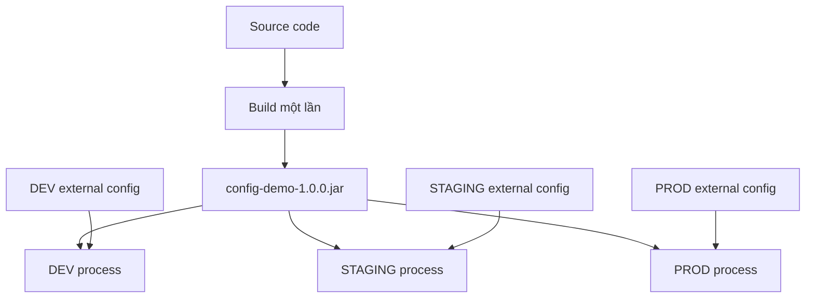
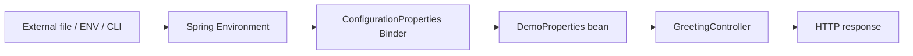
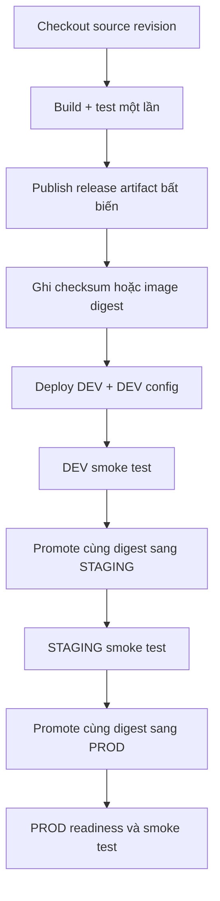

# Kiểm chứng cùng artifact chạy ở nhiều môi trường bằng cấu hình bên ngoài

Một nguyên tắc quan trọng khi đóng gói và triển khai Spring Boot là **build một lần, triển khai nhiều lần** (*build once, deploy many*). DEV, STAGING và PROD có thể sử dụng **cùng một executable JAR** hoặc cùng container image, nhưng được cấp port, timeout, URL dịch vụ, feature flag và credential khác nhau **ở thời điểm chạy**.

Điểm cần chứng minh không chỉ là “ứng dụng chạy trên ba máy”. Một phép kiểm chứng đủ mạnh trả lời được ba câu hỏi:

1. **Artifact có thực sự giống hệt nhau không?** So sánh SHA-256 của JAR hoặc digest của container image.
2. **Cấu hình có thật sự đến từ bên ngoài artifact không?** Xác định location, environment variables, CLI và nguồn property cuối cùng.
3. **Runtime có dùng đúng cấu hình không?** Đọc giá trị đã bind và quan sát hành vi thực tế bằng smoke test.

Một ứng dụng có thể có checksum JAR giống nhau ở ba môi trường nhưng PROD vẫn đọc nhầm cấu hình DEV. Ngược lại, ba ứng dụng trả kết quả đúng nhưng được rebuild riêng vẫn không đạt tiêu chí “cùng artifact”.

## 1. Artifact và runtime configuration khác nhau thế nào?

**Artifact** là đầu ra của quá trình build, chẳng hạn:

- Executable Spring Boot JAR do Gradle `bootJar` tạo.
- Executable JAR được Maven Spring Boot Plugin repackage.
- Container image đã publish tới registry với digest cụ thể.

**Runtime configuration** là các giá trị ứng dụng nhận lúc triển khai/chạy:

```properties
server.port=18081
demo.environment=dev
demo.message=Xin chào từ DEV
demo.request-timeout=2s
```

Cấu hình có thể đến từ file trên filesystem, OS environment, Java system property, command-line argument, secret mount hoặc hệ thống config data tương thích Spring Boot.



Nếu bạn sửa `src/main/resources/application-prod.yml` rồi build thêm một JAR mới, bạn đã thay artifact. Dù source code và version không đổi, binary có thể khác.

### 1.1. Vì sao không nên build từng môi trường?

Một quy trình không mong muốn:

```text
source + dev resources     -> app-dev.jar
source + staging resources -> app-staging.jar
source + prod resources    -> app-prod.jar
```

Vấn đề:

- JAR được kiểm thử trên staging không chắc là JAR được deploy production.
- Dependency, compile flag hoặc resource có thể khác giữa các lần build.
- Bí mật của production có thể bị đưa vào archive.
- Rollback khó vì không biết chính xác file nào đã được phát hành.
- Người vận hành dễ nhầm “cùng version” với “cùng bytes”.

Mô hình tốt hơn là **publish một release artifact bất biến** và promote đúng artifact đó qua các môi trường, kèm cấu hình và secret riêng.

## 2. Cùng tên không có nghĩa cùng artifact

| Dấu hiệu | Điều chứng minh | Giới hạn |
|---|---|---|
| Cùng tên JAR | Tên giống nhau | File có thể bị ghi đè |
| Cùng version | Nhãn release giống nhau | Có thể rebuild cùng version |
| Cùng Git commit | Source revision giống nhau | Build input có thể khác |
| Cùng SHA-256 | Bytes của file giống nhau với độ tin cậy thực tế rất cao | Chưa chứng minh config runtime |
| Cùng kết quả HTTP | Một hành vi được quan sát | Chưa chứng minh JAR giống nhau |
| SHA-256 + smoke test | Artifact và hành vi theo môi trường | Cần kiểm tra đúng file/process |

Với container image, nên kiểm tra **image digest**. Tag như `config-demo:1.0.0` có thể bị gán lại cho image khác.

## 3. Thiết kế ví dụ thực hành

Ta tạo một ứng dụng Spring Boot nhỏ, có endpoint:

```http
GET /greeting
```

Nó trả ba giá trị không nhạy cảm:

- `environment`: tên môi trường từ config.
- `message`: message từ config.
- `requestTimeout`: thời gian đã bind thành `Duration`.

Ba môi trường thử:

| Môi trường | Port | Message | Timeout |
|---|---:|---|---|
| DEV | 18081 | Xin chào từ DEV | 2s |
| STAGING | 18082 | Xin chào từ STAGING | 5s |
| PROD giả lập | 18083 | Xin chào từ PROD | 8s |

Các port khác nhau chỉ để chạy đồng thời trên một máy; nhiều container ở máy khác nhau vẫn có thể dùng cùng internal port 8080.

Cấu trúc:

```text
config-demo/
├── build.gradle.kts
├── src/main/java/com/example/configdemo/
│   ├── ConfigDemoApplication.java
│   ├── DemoProperties.java
│   └── GreetingController.java
├── src/main/resources/application.yml
├── deploy-config/
│   ├── dev/application.yml
│   ├── staging/application.yml
│   └── prod/application.yml
└── build/libs/config-demo-1.0.0.jar
```

Thư mục `deploy-config` nằm ngoài `src/main/resources` nên thông thường không được đóng gói vào JAR. Trong sản phẩm thật, production config nên do hệ thống triển khai quản lý bên ngoài source repository.

## 4. Dependencies

Trong Spring Boot project đã có plugin/dependency management, phần Gradle Kotlin DSL:

```kotlin
dependencies {
    implementation("org.springframework.boot:spring-boot-starter-web")
    implementation("org.springframework.boot:spring-boot-starter-validation")
    testImplementation("org.springframework.boot:spring-boot-starter-test")
}
```

Ví dụ sử dụng Java 17, record và `jakarta.validation` theo hệ sinh thái Spring Boot 3.x. Với dự án dùng dòng Boot khác, áp dụng import/API tương ứng phiên bản thực tế.

Không cần database hay API bên ngoài cho phép thử này, vì mục đích là tách artifact khỏi config và kiểm tra property binding.

## 5. Tạo @ConfigurationProperties có kiểu

File `DemoProperties.java`:

```java
package com.example.configdemo;

import java.time.Duration;

import jakarta.validation.constraints.NotBlank;
import jakarta.validation.constraints.NotNull;

import org.springframework.boot.context.properties.ConfigurationProperties;
import org.springframework.validation.annotation.Validated;

@Validated
@ConfigurationProperties(prefix = "demo")
public record DemoProperties(
        @NotBlank String environment,
        @NotBlank String message,
        @NotNull Duration requestTimeout
) {
}
```

Spring Boot bind:

```properties
demo.environment=dev
demo.message=Xin chào từ DEV
demo.request-timeout=2s
```

vào record này. `request-timeout` được map tới `requestTimeout` theo relaxed binding và `2s` chuyển thành `Duration`.

`@Validated` giúp ứng dụng fail fast khi cấu hình bắt buộc bị thiếu hoặc không hợp lệ. Constraint `@NotNull` chỉ kiểm tra `Duration` hiện diện; nếu nghiệp vụ yêu cầu timeout phải dương, cần bổ sung ràng buộc tương ứng.

### 5.1. Đăng ký properties bean

File `ConfigDemoApplication.java`:

```java
package com.example.configdemo;

import org.springframework.boot.SpringApplication;
import org.springframework.boot.autoconfigure.SpringBootApplication;
import org.springframework.boot.context.properties.EnableConfigurationProperties;

@SpringBootApplication
@EnableConfigurationProperties(DemoProperties.class)
public class ConfigDemoApplication {

    public static void main(String[] args) {
        SpringApplication.run(ConfigDemoApplication.class, args);
    }
}
```

Đây là cách tường minh để Spring quản lý `DemoProperties`. Trong ứng dụng có nhiều properties class, `@ConfigurationPropertiesScan` cũng là lựa chọn phù hợp.

## 6. Endpoint quan sát giá trị runtime

File `GreetingController.java`:

```java
package com.example.configdemo;

import java.util.Map;

import org.springframework.web.bind.annotation.GetMapping;
import org.springframework.web.bind.annotation.RestController;

@RestController
public class GreetingController {

    private final DemoProperties properties;

    public GreetingController(DemoProperties properties) {
        this.properties = properties;
    }

    @GetMapping("/greeting")
    public Map<String, String> greeting() {
        return Map.of(
                "environment", properties.environment(),
                "message", properties.message(),
                "requestTimeout", properties.requestTimeout().toString()
        );
    }
}
```

Endpoint sử dụng bean được Spring bind, không mở file trực tiếp. Thứ cần quan sát là **giá trị cuối cùng mà runtime nhận được**, vì một nguồn property khác có thể override nội dung file ngoài.



**Giới hạn an toàn:** đây là endpoint dành cho demo, chỉ trả thông tin không nhạy cảm. Không đưa credential, internal secret hoặc token vào response khi áp dụng cách kiểm chứng này trên hệ thống thật.

## 7. Cấu hình được đóng gói trong artifact

File `src/main/resources/application.yml` chỉ cần giá trị chung:

```yaml
spring:
  application:
    name: config-demo
```

Ta cố ý không đóng gói `demo.environment`, `demo.message` và `demo.request-timeout` để mỗi runtime phải cung cấp chúng từ bên ngoài.

Có thể đặt default an toàn cho nhiều môi trường trong JAR nếu phù hợp. Nhưng tránh đặt secret hoặc config production bắt buộc dưới `src/main/resources`.

**Tách bạch:**

- Code và resource chung → artifact.
- URL/timeout/port/feature flag theo môi trường → external config.
- API key/password/private key → secret source có kiểm soát.

## 8. Ba bộ external config

File `deploy-config/dev/application.yml`:

```yaml
server:
  port: 18081

demo:
  environment: dev
  message: "Xin chào từ DEV"
  request-timeout: 2s
```

File `deploy-config/staging/application.yml`:

```yaml
server:
  port: 18082

demo:
  environment: staging
  message: "Xin chào từ STAGING"
  request-timeout: 5s
```

File `deploy-config/prod/application.yml`:

```yaml
server:
  port: 18083

demo:
  environment: prod
  message: "Xin chào từ PROD"
  request-timeout: 8s
```

Những file này khác nhau là điều mong muốn. Mục tiêu là ba process có behavior khác nhưng cùng release binary.

## 9. Build JAR đúng một lần

Với Gradle wrapper:

```bash
./gradlew clean bootJar
```

Ví dụ artifact:

```text
build/libs/config-demo-1.0.0.jar
```

Tên thực tế phụ thuộc project name/version; dùng path mà build tạo ra.

Với Maven:

```bash
./mvnw clean package
```

Khi Spring Boot Maven Plugin repackage executable JAR, artifact thường nằm trong `target/`.

**Sau build, không thay file JAR và không chạy build lại giữa DEV, STAGING và PROD.**

## 10. Kiểm chứng SHA-256

Trên Linux/macOS:

```bash
sha256sum build/libs/config-demo-1.0.0.jar
```

Trên Windows PowerShell:

```powershell
Get-FileHash -Algorithm SHA256 -LiteralPath ".\build\libs\config-demo-1.0.0.jar"
```

Lưu digest thực tế. Nếu artifact được copy tới nhiều host, tính SHA-256 trên từng bản sao và so sánh:

```bash
sha256sum /releases/dev/config-demo-1.0.0.jar
sha256sum /releases/staging/config-demo-1.0.0.jar
sha256sum /releases/prod/config-demo-1.0.0.jar
```

Ba digest phải trùng nhau. Không chỉ so sánh tên file hoặc version.

Một release report có thể ghi:

```text
artifact: config-demo-1.0.0.jar
sha256: <digest-tinh-tu-file-that>
source-revision: <commit-that>
configuration-revision: <revision-cua-moi-truong>
```

Các giá trị trong dấu ngoặc là placeholder, không phải kết quả đã đo.

## 11. Chạy DEV từ cùng JAR

Mở terminal ở thư mục project:

```bash
java -jar build/libs/config-demo-1.0.0.jar \
  --spring.config.additional-location=file:./deploy-config/dev/
```

Giải thích:

- `--spring.config.additional-location` thêm config data location bên ngoài các location mặc định.
- `file:./deploy-config/dev/` là **directory** trên filesystem.
- Dấu `/` ở cuối quan trọng đối với directory location.
- Relative path được resolve theo **working directory của process**, không tự động theo vị trí JAR.

Trong terminal khác:

```bash
curl -s http://localhost:18081/greeting
```

Dự kiến (JSON key order có thể khác):

```json
{
  "environment": "dev",
  "message": "Xin chào từ DEV",
  "requestTimeout": "PT2S"
}
```

Đây là phép thử runtime: Spring nạp file DEV và controller thấy bean đã bind đúng.

## 12. Chạy STAGING từ chính JAR đó

Không build lại. Chạy trong terminal khác:

```bash
java -jar build/libs/config-demo-1.0.0.jar \
  --spring.config.additional-location=file:./deploy-config/staging/
```

Kiểm tra:

```bash
curl -s http://localhost:18082/greeting
```

Kết quả mong đợi:

```json
{
  "environment": "staging",
  "message": "Xin chào từ STAGING",
  "requestTimeout": "PT5S"
}
```

Không cần sửa Java code, resource trong JAR hoặc một build flag riêng cho staging.

## 13. Chạy PROD giả lập từ chính JAR đó

Vẫn giữ file JAR cũ:

```bash
java -jar build/libs/config-demo-1.0.0.jar \
  --spring.config.additional-location=file:./deploy-config/prod/
```

Kiểm tra:

```bash
curl -s http://localhost:18083/greeting
```

Kết quả dự kiến:

```json
{
  "environment": "prod",
  "message": "Xin chào từ PROD",
  "requestTimeout": "PT8S"
}
```

Đây chỉ là mô phỏng PROD bằng port và config trên máy local. Trên production thật, endpoint chẩn đoán cần được loại bỏ hoặc bảo vệ phù hợp.

### 13.1. Tập hợp bằng chứng

| Quan sát | DEV | STAGING | PROD giả lập |
|---|---|---|---|
| JAR | Cùng path/bản copy đã hash | Cùng digest | Cùng digest |
| External config | dev/ | staging/ | prod/ |
| Port | 18081 | 18082 | 18083 |
| Environment | dev | staging | prod |
| Timeout | PT2S | PT5S | PT8S |
| HTTP smoke test | PASS nếu đúng response | PASS nếu đúng response | PASS nếu đúng response |

Chỉ ghi trạng thái PASS khi đã chạy lệnh kiểm tra trong môi trường thực tế. Bảng trên là điều kiện mong đợi của bài thực hành, không phải kết quả đã kiểm chứng thay người học.

## 14. location và additional-location

Hai property hay bị nhầm:

| Property | Ý nghĩa |
|---|---|
| `spring.config.location` | Thay thế những location config mặc định theo cơ chế config data |
| `spring.config.additional-location` | Bổ sung location bên ngoài các location mặc định |
| `spring.config.name` | Thay tên cơ sở của file được tìm |
| `spring.config.import` | Import thêm nguồn config data từ một document đã được nạp |

Demo dùng `additional-location` vì muốn giữ những default chung trong JAR rồi bổ sung cấu hình runtime.

### 14.1. Khi nào dùng optional:?

Ví dụ:

```text
optional:file:./deploy-config/dev/
```

Prefix `optional:` cho phép location thiếu mà không tự làm startup thất bại vì location missing. Điều này hữu ích với nguồn phụ không bắt buộc.

Nếu folder môi trường chứa cấu hình bắt buộc, không nên thêm `optional:` một cách máy móc. Thiếu folder cần được báo rõ để tránh chạy nhầm config.

### 14.2. Config location được xử lý rất sớm

Các property xác định nơi Spring tìm config phải có từ sớm, ví dụ qua CLI, environment hoặc system properties. Không đặt `spring.config.additional-location` trong một file mà Spring chưa có cách tìm rồi kỳ vọng file đó tự được nạp.

## 15. Dùng environment variables

Spring Boot hỗ trợ relaxed binding từ environment:

| OS environment | Property |
|---|---|
| `SERVER_PORT` | `server.port` |
| `DEMO_ENVIRONMENT` | `demo.environment` |
| `DEMO_MESSAGE` | `demo.message` |
| `DEMO_REQUEST_TIMEOUT` | `demo.request-timeout` |

Linux/macOS:

```bash
SERVER_PORT=18091 \
DEMO_ENVIRONMENT=dev \
DEMO_MESSAGE="Xin chào từ ENV" \
DEMO_REQUEST_TIMEOUT=2s \
java -jar build/libs/config-demo-1.0.0.jar
```

PowerShell:

```powershell
$env:SERVER_PORT = "18092"
$env:DEMO_ENVIRONMENT = "staging"
$env:DEMO_MESSAGE = "Xin chào từ PowerShell"
$env:DEMO_REQUEST_TIMEOUT = "5s"

java -jar ".\build\libs\config-demo-1.0.0.jar"
```

Trước thử nghiệm tiếp theo, dùng terminal sạch hoặc đặt lại biến môi trường vì các biến trong PowerShell session vẫn có thể còn.

Trong container, các instance có thể cùng lắng nghe port 8080 bên trong nhưng được map ra host port khác nhau.

## 16. Command line và property precedence

Không cần file bên ngoài vẫn có thể truyền config qua CLI:

```bash
java -jar build/libs/config-demo-1.0.0.jar \
  --server.port=18093 \
  --demo.environment=cli \
  --demo.message="Từ command line" \
  --demo.request-timeout=3s
```

Trong các property source thường dùng với executable JAR, độ ưu tiên tương đối từ cao xuống thấp thường là:

1. Spring command-line arguments.
2. `SPRING_APPLICATION_JSON`.
3. Java system properties.
4. OS environment variables.
5. Config data như `application.yml`.
6. Default properties có ưu tiên thấp hơn.

Spring Boot có thêm nguồn khác trong test/servlet/DevTools; bảng trên chỉ tập trung vào những nguồn chính của ví dụ.

Chạy:

```bash
DEMO_MESSAGE="Từ ENV" \
java -jar build/libs/config-demo-1.0.0.jar \
  --spring.config.additional-location=file:./deploy-config/dev/ \
  --demo.message="Từ CLI"
```

Theo precedence thông thường, message là `Từ CLI`. Bỏ CLI override để thấy ENV thắng file; bỏ cả ENV để thấy giá trị DEV từ external file.

**Đọc file bằng mắt không đủ chứng minh runtime đang dùng file đó.** Một nguồn ưu tiên cao hơn có thể override giá trị của file.

## 17. Cùng artifact với Spring profiles

Có thể tổ chức file cấu hình profile-specific **ngoài JAR**:

```text
/etc/config-demo/
├── application.yml
├── application-dev.yml
├── application-staging.yml
└── application-prod.yml
```

Chạy:

```bash
java -jar /opt/config-demo/app.jar \
  --spring.config.additional-location=file:/etc/config-demo/ \
  --spring.profiles.active=staging
```

Spring Boot sẽ xét active profiles khi nạp config data. Cùng một JAR vẫn có thể dùng profile khác.

### 17.1. Profile và label không phải một

```text
demo.environment=prod
```

là custom property của ví dụ, **không tự bật** Spring profile `prod`.

```text
spring.profiles.active=prod
```

mới là property kích hoạt profile tương ứng khi đặt ở nguồn hợp lệ.

Không nên đặt `spring.profiles.active` tùy tiện trong các document chỉ được kích hoạt theo profile. Hãy để profile được chọn từ CLI, environment hoặc cấu hình nền hợp lệ, tránh vòng lặp lựa chọn.

### 17.2. Cùng binary nhưng có thể khác bean graph

`@Profile`, `@ConditionalOnProperty` và auto-configuration có thể tạo bean khác nhau theo config. “Cùng artifact” cam kết binary giống nhau, **không** cam kết mỗi môi trường có cùng object graph hoặc state.

## 18. Relative path và đường dẫn tuyệt đối

Nếu ứng dụng chạy từ một working directory khác, `file:./deploy-config/prod/` có thể trỏ sai nơi.

Ví dụ JAR ở `/opt/app/app.jar`, config ở `/etc/app/prod/application.yml`:

```bash
java -jar /opt/app/app.jar \
  --spring.config.additional-location=file:/etc/app/prod/
```

Absolute location thường đáng tin cậy hơn trong systemd/container.

Kiểm tra:

- File có tồn tại không?
- Process user có quyền đọc không?
- Path là directory hay file?
- Directory location có dấu `/` cuối không?
- Có biến môi trường/CLI nào override không?
- Working directory thực tế là gì?

## 19. Secret không nên nằm trong artifact

Mỗi môi trường có thể dùng credential riêng:

```text
SPRING_DATASOURCE_URL
SPRING_DATASOURCE_USERNAME
SPRING_DATASOURCE_PASSWORD
```

Nên dùng secret manager, Kubernetes Secret, file mount có quyền hạn chế hoặc secret injection của nền tảng. Không commit mật khẩu production vào `src/main/resources/application-prod.yml`.

Spring Boot hỗ trợ `configtree:` cho secret dạng file:

```properties
spring.config.import=optional:configtree:/run/secrets/
```

Ví dụ file `/run/secrets/demo.api-key` có thể được ánh xạ thành property `demo.api-key`.

Environment variables cũng không tự động hoàn toàn an toàn: chúng có thể lộ trong diagnostic dump hoặc log. Tránh in toàn bộ environment, secret hoặc request body vào log.

**Không để endpoint demo trả credential.** Các Actuator endpoint `env` và `configprops` nếu cần dùng để chẩn đoán phải được bảo vệ, kiểm soát exposure và sanitization đúng.

### 19.1. Thay config file có hot reload không?

Không mặc định. Việc sửa YAML ngoài JAR trong khi JVM đang chạy **không đảm bảo** mọi bean `@ConfigurationProperties` tự rebind ngay. Thường cần rollout/restart process hoặc một cơ chế refresh có thiết kế rõ ràng.

Tương tự, Kubernetes env vars được cấp cho process lúc khởi động; đổi ConfigMap/Secret không tự thay giá trị environment đã được process nhận.

## 20. Cùng Docker image, cấu hình khác nhau

Dockerfile minh họa:

```dockerfile
FROM eclipse-temurin:17-jre
WORKDIR /app
COPY build/libs/config-demo-1.0.0.jar app.jar
ENTRYPOINT ["java", "-jar", "/app/app.jar"]
```

Build image một lần:

```bash
docker build -t config-demo:1.0.0 .
```

Chạy DEV:

```bash
docker run --rm \
  -p 18081:8080 \
  -e SERVER_PORT=8080 \
  -e DEMO_ENVIRONMENT=dev \
  -e DEMO_MESSAGE="Xin chào DEV container" \
  -e DEMO_REQUEST_TIMEOUT=2s \
  config-demo:1.0.0
```

Chạy STAGING bằng **cùng image**:

```bash
docker run --rm \
  -p 18082:8080 \
  -e SERVER_PORT=8080 \
  -e DEMO_ENVIRONMENT=staging \
  -e DEMO_MESSAGE="Xin chào STAGING container" \
  -e DEMO_REQUEST_TIMEOUT=5s \
  config-demo:1.0.0
```

Hai instance có config khác nhau nhưng image không rebuild. Trong pipeline thực tế, dùng image digest để chứng minh hai deployment nhận cùng image; tag có thể mutable.

## 21. Smoke test có thể tự động hóa

Sau khi khởi chạy ba process với external config:

```bash
curl -fsS http://localhost:18081/greeting
curl -fsS http://localhost:18082/greeting
curl -fsS http://localhost:18083/greeting
```

Nếu có `jq`:

```bash
curl -fsS http://localhost:18081/greeting \
  | jq -e '.environment == "dev" and .requestTimeout == "PT2S"'

curl -fsS http://localhost:18082/greeting \
  | jq -e '.environment == "staging" and .requestTimeout == "PT5S"'

curl -fsS http://localhost:18083/greeting \
  | jq -e '.environment == "prod" and .requestTimeout == "PT8S"'
```

Lệnh `jq -e` có exit status khác 0 khi biểu thức không thỏa, thích hợp cho CI smoke test.

### 21.1. Runtime test khác artifact identity

- SHA-256 chứng minh **file giống nhau**.
- Smoke test chứng minh **hành vi mong đợi**.
- Health/readiness chứng minh **ứng dụng đủ sẵn sàng** theo probe.
- Config revision chứng minh **bộ cấu hình đã triển khai**.

Không dùng một kiểm tra thay thế cả bốn.

## 22. Test property binding trong Spring Boot

Một integration test cho Binder:

```java
import java.time.Duration;

import org.junit.jupiter.api.Test;
import org.springframework.beans.factory.annotation.Autowired;
import org.springframework.boot.test.context.SpringBootTest;

import static org.assertj.core.api.Assertions.assertThat;

@SpringBootTest(properties = {
        "demo.environment=test",
        "demo.message=Xin chào TEST",
        "demo.request-timeout=4s"
})
class DemoPropertiesTest {

    @Autowired
    DemoProperties properties;

    @Test
    void bindsRuntimeSettings() {
        assertThat(properties.environment()).isEqualTo("test");
        assertThat(properties.message()).isEqualTo("Xin chào TEST");
        assertThat(properties.requestTimeout())
                .isEqualTo(Duration.ofSeconds(4));
    }
}
```

Test xác nhận binding hoạt động, nhưng **không tự chứng minh** JAR đã deploy trên ba môi trường giống nhau. Điều đó cần digest file/image tại deployment và smoke test trên runtime thật.

Có thể bổ sung test thiếu `demo.environment` để xác nhận validation/fail-fast, nhưng cần khởi tạo context tách biệt để không kế thừa giá trị từ test properties khác.

## 23. Kịch bản CI/CD build once, deploy many



Điểm kiểm soát:

1. Không rebuild giữa staging và production.
2. Không ghi đè JAR/image dưới cùng release identity.
3. Không chèn secret vào artifact trong build.
4. Ghi hash/digest thật ở từng deployment.
5. Ghi config revision hoặc nguồn config.
6. Chạy smoke test trên artifact đã deploy.
7. Có quy trình rollback cả artifact lẫn config tương ứng.

Vì cùng artifact có thể hoạt động khác nhau khi config thay đổi, **config revision** cũng quan trọng khi tái hiện sự cố.

## 24. Lỗi thường gặp

| Hiện tượng | Nguyên nhân khả dĩ | Hướng kiểm tra |
|---|---|---|
| Ba môi trường trả cùng message | Config ngoài không được nạp hoặc bị override | Kiểm tra location, CLI, ENV và response |
| Port sai | `SERVER_PORT` hoặc CLI có ưu tiên cao hơn file | Kiểm tra process args/env |
| JAR cùng version nhưng SHA-256 khác | Rebuild hoặc file bị thay đổi | So sánh digest file thực tế |
| Config directory không thấy | Sai path/working directory hoặc quyền đọc | Dùng absolute path, kiểm tra dấu `/` |
| Ứng dụng chạy dù config bắt buộc thiếu | `optional:` hoặc default được dùng | Định nghĩa fail-fast rõ ràng |
| Profile prod nhưng dữ liệu dev | Source precedence hoặc dependency bị cấu hình sai | Xác minh property cuối cùng và endpoint |
| Đổi ConfigMap nhưng app không đổi | Không có refresh/restart | Rollout lại hoặc dùng cơ chế refresh chủ đích |
| Secret có trong JAR | File resources bị đóng gói | Kiểm tra build và secret management |
| Docker tag giống nhưng image khác | Tag bị gán lại | Dùng image digest |
| Test context pass, deployment fail | Runtime config/dependency khác | Test trên process thật |
| HTTP 200 nhưng datasource không khỏe | Endpoint demo không kiểm tra DB | Dùng health/readiness riêng |

### 24.1. Không suy diễn bảo mật từ profile

`demo.environment=dev` hoặc `spring.profiles.active=dev` không tự bảo đảm database, queue và object storage đều là tài nguyên DEV. Cần kiểm tra URL/identity quan trọng, đồng thời tách quyền credential và network giữa các môi trường.

## 25. Bài tập thực hành

### Bài 1. Xác nhận cùng JAR

Build một lần, ghi SHA-256, chạy JAR với config DEV, STAGING và PROD giả lập. Ghi ba response và tính lại SHA-256.

**Tiêu chí đạt:** hash không đổi, ba response khác nhau đúng theo config và không có bước rebuild ở giữa.

### Bài 2. Property precedence

Trong file DEV khai báo:

```yaml
demo:
  environment: dev
  message: "Từ file"
  request-timeout: 2s
```

Chạy:

```bash
DEMO_MESSAGE="Từ ENV" \
java -jar build/libs/config-demo-1.0.0.jar \
  --spring.config.additional-location=file:./deploy-config/dev/ \
  --demo.message="Từ CLI"
```

**Dự kiến:** message là `Từ CLI`. Bỏ CLI override để thấy ENV, rồi bỏ ENV để thấy giá trị file.

### Bài 3. Fail-fast khi thiếu folder

```bash
java -jar build/libs/config-demo-1.0.0.jar \
  --spring.config.additional-location=file:./deploy-config/missing/
```

**Câu hỏi:** Có nên để runtime dùng nhầm default DEV?

**Đáp án:** Không. Nếu external location là bắt buộc, để Spring báo lỗi location missing/validation thay vì âm thầm dùng môi trường khác.

### Bài 4. Đổi config mà không rebuild

Sửa message và timeout trong DEV YAML, dừng rồi chạy lại cùng JAR. Response phải thay đổi nhưng SHA-256 vẫn giữ nguyên. Không giả định một bean đang chạy tự nhận file thay đổi nếu không có cơ chế refresh.

### Bài 5. Cùng Docker image

Build image một lần, chạy hai container với `DEMO_ENVIRONMENT` khác nhau, kiểm tra response, lưu image digest.

**Câu hỏi:** Cùng tag đã đủ chưa?

**Đáp án:** Chưa; tag mutable nên cần digest khi xác nhận cùng artifact.

## 26. Câu hỏi tự kiểm tra

**1. Cùng filename và version có chắc là cùng JAR?**

Không. Phải kiểm tra digest hoặc bytes file.

**2. Chỉ thấy response DEV và PROD khác nhau đã chứng minh build once/deploy many chưa?**

Chưa. Hai binary khác nhau vẫn có thể trả response đúng. Cần hash.

**3. `spring.config.additional-location` khác `spring.config.location` ra sao?**

Additional-location bổ sung nơi tìm config; location thay thế location mặc định theo cơ chế Boot.

**4. `file:./deploy-config/prod/` được tính từ đâu?**

Từ working directory của process.

**5. Khi một property có trong ENV và CLI, nguồn nào thường thắng?**

CLI trong runtime Spring Boot thông thường.

**6. `demo.environment=prod` có tự kích hoạt profile prod không?**

Không. Active profiles thuộc `spring.profiles.active` hoặc cơ chế tương ứng.

**7. File external YAML đổi khi app đang chạy có cập nhật bean ngay không?**

Không có bảo đảm mặc định; cần restart/refresh có thiết kế rõ ràng.

**8. Tag Docker giống nhau có đủ khẳng định image giống nhau không?**

Không. Cần image digest thực tế.

**9. Cùng JAR có thể tạo bean khác nhau theo profile không?**

Có. Artifact giống nhau, còn runtime profile/condition quyết định bean graph.

**10. Khi SHA-256 đúng nhưng staging không ready, có cần rebuild ngay không?**

Không nhất thiết. Cần kiểm tra external config, secret, dependency health, runtime environment và log.

## 27. Checklist triển khai

- [ ] Artifact được build và publish đúng một lần.
- [ ] SHA-256 JAR hoặc image digest được ghi nhận thực tế.
- [ ] DEV/STAGING/PROD dùng cùng digest.
- [ ] External config nằm ngoài artifact và được cấp đúng location.
- [ ] Property bắt buộc có validation/fail-fast.
- [ ] Port, message, timeout hoặc behavior được smoke test.
- [ ] Property precedence và profile được kiểm soát.
- [ ] Credential không nằm trong artifact, log hoặc endpoint.
- [ ] Dependency/credential identity đúng môi trường.
- [ ] Readiness được kiểm chứng tách biệt.
- [ ] Config revision được ghi cùng release.
- [ ] Rollback có thể khôi phục đúng artifact và config.
- [ ] Quy trình thay config có restart/refresh rõ ràng.

## 28. Ghi nhớ

- **Build once, deploy many:** cùng artifact, nhiều cấu hình runtime.
- **Checksum/digest:** chứng minh artifact identity mạnh hơn filename/version.
- **External configuration:** đến từ file, environment, system properties, CLI hoặc config data khác.
- **@ConfigurationProperties:** bind có kiểu và có thể validation để phát hiện thiếu/sai cấu hình.
- **Additional-location:** thêm nơi tìm config; **location:** thay thế location mặc định.
- **Relative path:** phụ thuộc process working directory.
- **Precedence:** CLI/ENV có thể override external file; phải kiểm tra giá trị runtime cuối cùng.
- **Profiles:** giúp chọn cấu hình/bean nhưng không thay thế isolation bảo mật.
- **Secrets:** phải được cung cấp ngoài artifact bằng cơ chế bảo mật phù hợp.
- **Runtime config change:** không đồng nghĩa tự hot reload.
- **Smoke test, digest và readiness:** ba lớp bằng chứng riêng biệt.
- **Containers:** promote cùng image digest, không rebuild cho từng môi trường.
- **Rollback:** lưu cả artifact digest và configuration revision.

Khi kết luận một release đã được kiểm chứng ở nhiều môi trường, hãy tự hỏi: **“Bytes của artifact có giống nhau không? Spring có nhận đúng external config không? Ứng dụng có thực sự hoạt động đúng với config ấy không?”** Chỉ khi cả ba câu trả lời được xác nhận, quy trình build once/deploy many mới có bằng chứng đáng tin cậy.
