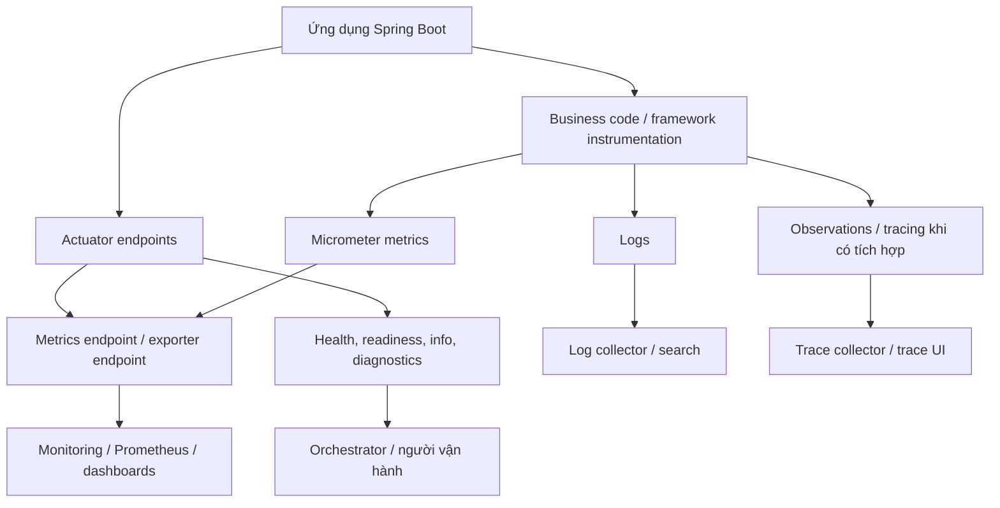
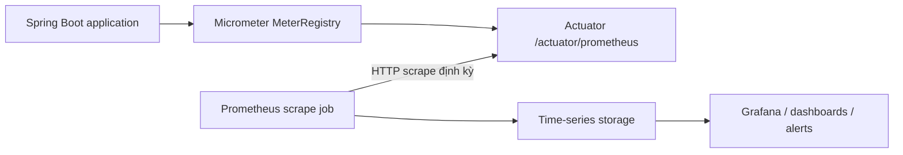
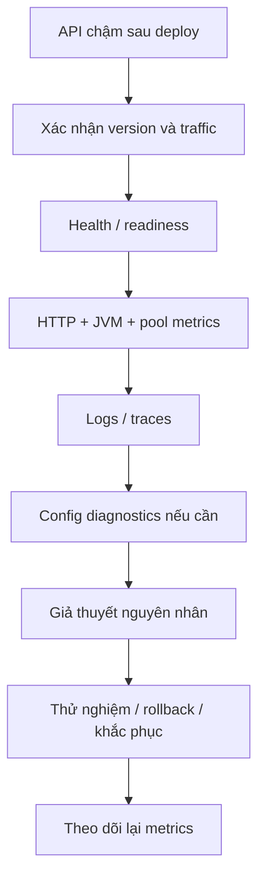

# Actuator bổ sung khả năng quan sát gì cho ứng dụng

Một ứng dụng Spring Boot có thể khởi động thành công, trả về HTTP 200 và vẫn đang gặp vấn đề: database chập chờn, thread pool gần cạn, bộ nhớ tăng dần, request chậm bất thường hoặc một dependency ngoài không hoạt động. Ngược lại, khi một ứng dụng trả lỗi 500, chỉ biết “có lỗi” chưa đủ để xác định nên kiểm tra thành phần nào trước.

Trong chương **Quan sát ứng dụng** của *Spring Boot Fundamentals*, **Spring Boot Actuator** là một mảnh ghép quan trọng giúp ứng dụng **cung cấp thông tin vận hành một cách có cấu trúc**. Nó bổ sung các endpoint và tích hợp phục vụ quản lý, theo dõi và chẩn đoán: tình trạng sống/sẵn sàng, thông tin ứng dụng, metrics, mức logging, trạng thái cấu hình, bean, request mapping và những dữ liệu kỹ thuật khác.

Actuator không tự biến mọi ứng dụng thành một hệ thống observability hoàn chỉnh. Nó tạo ra **điểm truy cập và khả năng tích hợp** để người phát triển và người vận hành thấy điều gì đang diễn ra bên trong ứng dụng. Muốn có dashboard, cảnh báo, distributed tracing hay lưu trữ lịch sử metrics, thông thường vẫn cần các công cụ và dependency khác.

Sau bài học, người đọc có thể giải thích: Actuator giải quyết vấn đề gì, endpoint nào phục vụ nhu cầu nào, vì sao health khác readiness, metrics khác logs, cần thêm gì để Prometheus lấy số liệu, và vì sao phải bảo vệ các endpoint quản trị khi triển khai thật.

## 1. “Quan sát ứng dụng” nghĩa là gì?

Khi một hệ thống chạy trong production, ta không thể đứng cạnh debugger để xem từng bước xử lý. Ta cần quan sát từ bên ngoài thông qua những tín hiệu do ứng dụng phát ra.

Ba nhóm tín hiệu quen thuộc:

- **Logs:** các sự kiện riêng lẻ, ví dụ một request bị từ chối, một đơn hàng được tạo hoặc một kết nối lỗi.
- **Metrics:** giá trị đo và chuỗi số liệu tổng hợp theo thời gian, ví dụ request count, latency, heap usage hoặc số kết nối database đang hoạt động.
- **Traces:** hành trình của một giao dịch/request qua nhiều thành phần hoặc service, gồm các span và thời gian ở từng chặng.

Ngoài ba nhóm trên, người vận hành còn cần biết **trạng thái tức thời và cấu trúc nội bộ**: instance đã sẵn sàng nhận traffic chưa, những bean nào được tạo, route nào đang được đăng ký, property nào được áp dụng, logger nào đang bật DEBUG.

### 1.1. Actuator nằm ở đâu trong bức tranh này?



Actuator chủ yếu cung cấp **management endpoints**, quản lý trạng thái và tích hợp với hạ tầng metrics/observations của Spring Boot. Nó không phải một UI duy nhất tự lưu mọi logs, traces và metrics vĩnh viễn.

### 1.2. Ví dụ bài toán vận hành

Giả sử một service đặt hàng có hiện tượng request chậm. Các câu hỏi có thể là:

1. **Ứng dụng còn sống không?** Health/liveness.
2. **Có nên tiếp tục gửi request mới tới instance này không?** Readiness.
3. **Độ trễ tăng trên toàn hệ thống hay chỉ một endpoint?** HTTP metrics và dashboard.
4. **Database có phải nút thắt không?** Connection-pool metrics, health và logs.
5. **Có exception cụ thể nào?** Application logs, exception details và tracing nếu được cấu hình.
6. **Thay đổi cấu hình nào vừa xảy ra?** Config diagnostics, deployment metadata và hệ thống quản lý cấu hình.

Actuator đóng góp nhiều thông tin trong chuỗi điều tra này; các công cụ còn lại giúp xem xu hướng dài hạn và liên hệ nguyên nhân.

## 2. Nếu không dùng Actuator, ứng dụng thiếu những gì?

Một ứng dụng Spring Boot có thể vẫn:

- Ghi log bằng SLF4J/Logback.
- Trả các API nghiệp vụ thông thường.
- Có thread, heap, connection pool và servlet container.
- Được JVM hoặc OS cung cấp một số số liệu hệ thống.

Nhưng khi chưa có Actuator, nó thường **không tự cung cấp một bộ management endpoints theo quy ước Spring Boot** để truy vấn health, beans, metrics, loggers, mappings, configuration properties và các thông tin kỹ thuật khác.

Ví dụ một API `GET /api/orders` có thể chứng minh luồng lấy đơn hàng đang chạy, nhưng không phải cách tốt để đo health hoặc lấy số JVM heap của instance.

Actuator tạo nên một **giao diện quản trị/quan sát tách khỏi API nghiệp vụ**, giúp công cụ vận hành truy cập thông tin theo một cách thống nhất giữa nhiều ứng dụng Spring Boot.

### 2.1. Actuator không phải chỉ là một endpoint /health

Nếu tự viết:

```java
@RestController
class PingController {
    @GetMapping("/ping")
    String ping() {
        return "OK";
    }
}
```

thì `/ping` chỉ chứng minh rằng controller và phần web stack đủ hoạt động để trả một response. Nó không tự tích hợp health indicators, status aggregation, metrics hoặc probes.

Actuator cung cấp abstraction để nhiều thành phần đóng góp trạng thái và kết hợp thành kết quả health. Đồng thời, nó có những nhóm endpoint khác ngoài health.

### 2.2. Actuator không thay thế logic nghiệp vụ

Actuator không biết “đơn hàng được tạo đúng chính sách” hay “số tiền thanh toán đã khớp hóa đơn” chỉ vì đã có starter. Các bất biến nghiệp vụ vẫn thuộc domain/application services. Nếu muốn quan sát một khía cạnh nghiệp vụ, có thể bổ sung **custom metric**, **custom health indicator** hoặc event/log có ngữ nghĩa phù hợp.

## 3. Thêm Spring Boot Actuator vào project

Trong project Spring Boot thông dụng, ta thêm starter:

```text
org.springframework.boot:spring-boot-starter-actuator
```

### 3.1. Maven

```xml
<dependency>
    <groupId>org.springframework.boot</groupId>
    <artifactId>spring-boot-starter-actuator</artifactId>
</dependency>
```

Nếu project đã dùng Spring Boot BOM hoặc parent quản lý dependency, thường không cần tự pin version starter. Các phiên bản thư viện nên tương thích với dòng Spring Boot đang chạy.

### 3.2. Gradle

```groovy
dependencies {
    implementation 'org.springframework.boot:spring-boot-starter-actuator'
}
```

### 3.3. Sau khi thêm dependency thì sao?

Khi ứng dụng khởi động, Actuator có thể auto-configure các endpoint phù hợp dựa trên:

- Dependency và web stack có mặt.
- Các bean/hạ tầng hiện có.
- Thuộc tính `management.*`.
- Endpoint được bật hay bị tắt.
- Endpoint có được expose qua HTTP/JMX hay không.
- Security configuration.

Không phải mọi endpoint đều có nội dung hữu ích trong mọi ứng dụng. Ví dụ `/actuator/prometheus` cần registry dependency phù hợp, `/actuator/logfile` phụ thuộc file logging đã được cấu hình, và một số endpoint đòi hỏi infrastructure/repository tương ứng.

### 3.4. Thử health endpoint

Trong một ứng dụng web với cấu hình mặc định thông thường, endpoint:

```http
GET http://localhost:8080/actuator/health
```

có thể trả:

```json
{
  "status": "UP"
}
```

Đây là output minh họa. Các thành phần health được đăng ký, trạng thái thực tế và chính sách hiển thị details có thể làm response khác đi.

**Một status `UP` không chứng minh mọi use case nghiệp vụ đúng hoặc mọi dependency bên ngoài đều đã được kiểm tra.** Nó chỉ phản ánh health indicators mà Actuator hiện có và cách chúng được tổng hợp.

## 4. Endpoint trong Actuator là gì?

**Actuator endpoint** là một điểm truy cập có mục đích quản lý/quan sát. Endpoint có ID, ví dụ `health`, `info` hoặc `metrics`. Nó có thể được expose qua các công nghệ quản lý phù hợp, phổ biến nhất là HTTP và trong một số setup là JMX.

Mặc định, web endpoints thường có base path:

```text
/actuator
```

Vì vậy:

```text
health  -> /actuator/health
info    -> /actuator/info
metrics -> /actuator/metrics
loggers -> /actuator/loggers
```

Tuy nhiên, **endpoint tồn tại trong context**, **endpoint được bật** và **endpoint được expose qua HTTP** là ba khái niệm khác nhau.

### 4.1. Endpoint có sẵn nhưng không expose qua web

Một ứng dụng có thể đăng ký endpoint `metrics` nhưng không cho truy cập `/actuator/metrics` qua HTTP vì web exposure policy chỉ cho phép `health`.

Do đó, response 404 không nhất thiết có nghĩa thiếu Actuator starter. Có thể endpoint chưa được expose, đã bị disable hoặc URL/base path khác.

### 4.2. Endpoint được expose nhưng vẫn bị security chặn

Khi endpoint đã expose, Spring Security hoặc network security có thể tiếp tục yêu cầu xác thực/ủy quyền. Nếu `GET /actuator/metrics` trả 401/403, lỗi có thể nằm ở authorization, **không phải do thiếu metric**.

### 4.3. Endpoint không nhất thiết chỉ đọc

Một số management endpoints có thao tác có thể thay đổi runtime state, ví dụ chỉnh level logger qua `loggers` khi quyền truy cập và endpoint operations cho phép.

Do đó, không thể bảo vệ Actuator bằng giả định “toàn bộ Actuator chỉ GET và vô hại”. Khi triển khai cần xét từng endpoint và từng loại operation.

## 5. Các nhóm endpoint thường gặp

Một số endpoint phổ biến:

| Endpoint | Nó giúp quan sát điều gì? | Lưu ý |
| --- | --- | --- |
| `health` | Trạng thái tổng hợp của ứng dụng và health contributors | Có thể có subcomponents/details; cần chính sách hiển thị |
| `info` | Metadata ứng dụng như tên, phiên bản, build, Git khi được cấu hình | Không phải mọi metadata đều xuất hiện tự động |
| `metrics` | Danh sách meter và số liệu được đăng ký | Để xem số liệu; không phải hệ thống lưu time series lâu dài |
| `prometheus` | Dạng dữ liệu cho Prometheus scrape | Cần registry Prometheus tương ứng và exposure |
| `loggers` | Logger levels hiện tại; một số operation cho phép thay đổi level runtime | Cần giới hạn quyền rất chặt |
| `env` | Property sources và property values theo chính sách hiển thị | Có thể lộ cấu trúc cấu hình; rủi ro thông tin nhạy cảm |
| `configprops` | Bean được bind bằng `@ConfigurationProperties` | Cần kiểm soát exposure và sanitization |
| `beans` | Danh sách beans trong Spring context | Bộc lộ cấu trúc nội bộ ứng dụng |
| `mappings` | Request mappings đã đăng ký | Bộc lộ routes và controller structure |
| `conditions` | Condition evaluation report cho auto-configuration | Hữu ích khi tự động cấu hình không như mong đợi |
| `caches` | Thông tin cache managers và caches | Phụ thuộc cache infrastructure |
| `scheduledtasks` | Scheduled tasks mà Spring quản lý | Không chứng minh mọi background job ở mọi hệ thống |
| `threaddump` | Thông tin thread của JVM | Hỗ trợ điều tra block/deadlock; nhạy cảm |
| `heapdump` | Heap dump của JVM | Có thể chứa dữ liệu và secrets trong bộ nhớ; cực kỳ nhạy cảm |
| `httpexchanges` | Những HTTP exchanges đã lưu nếu có repository phù hợp | Không phải mọi app đều bật hoặc lưu request history |
| `auditevents` | Audit events nếu hạ tầng/repository thích hợp được cấu hình | Không thay thế audit trail nghiệp vụ đầy đủ |
| `logfile` | Nội dung log file nếu ứng dụng ghi log ra file theo cấu hình hỗ trợ | Không tồn tại trong mọi setup |
| `startup` | Dữ liệu về các bước startup khi cơ chế ghi nhận startup được bật | Cần cấu hình startup recording phù hợp |

Danh sách là **những khả năng phổ biến qua các dòng Spring Boot**; tên endpoint và điều kiện khả dụng có thể khác ở các bản phát hành. Ví dụ dòng Spring Boot 2.x cũ có endpoint `httptrace`, còn các dòng mới dùng mô hình `httpexchanges`. Khi làm việc với project cụ thể, cần xem phiên bản và endpoint catalog tương ứng.

### 5.1. Đừng expose tất cả chỉ vì muốn khám phá

Lệnh hoặc cấu hình bật mọi endpoint có thể thuận tiện trong môi trường local cô lập nhưng nguy hiểm trong production. Một số endpoint cung cấp dữ liệu cấu hình, chi tiết nội bộ, heap dump hoặc quyền thay đổi logging.

Hãy áp dụng nguyên tắc **chỉ expose thứ cần thiết, cho đúng đối tượng được phép dùng**.

## 6. Health endpoint: ứng dụng có đang khỏe không?

`health` là endpoint đầu tiên thường được sử dụng. Nó tổng hợp kết quả từ các **HealthIndicator/HealthContributor** được đăng ký.

Một số health contributors có thể liên quan tới:

- `db`: khả năng kết nối/kiểm tra database theo indicator phù hợp.
- `diskSpace`: dung lượng đĩa còn lại theo rule đã cấu hình.
- `ping`: thành phần health cơ bản.
- Message broker, cache hoặc service khác nếu có indicator được auto-configure hoặc khai báo riêng.

Kết quả ví dụ:

```json
{
  "status": "UP"
}
```

Nếu chính sách hiển thị details cho phép:

```json
{
  "status": "UP",
  "components": {
    "db": {
      "status": "UP"
    },
    "diskSpace": {
      "status": "UP"
    }
  }
}
```

Đây là ví dụ; không phải mọi ứng dụng có `db` hoặc các component trên. Nếu không có datasource, sẽ không thể kỳ vọng database indicator được tạo mặc định.

### 6.1. Những trạng thái health thông thường

Một số status phổ biến:

- `UP`: contributor báo đang hoạt động.
- `DOWN`: contributor báo lỗi/không khả dụng.
- `OUT_OF_SERVICE`: contributor chủ động báo không phục vụ.
- `UNKNOWN`: chưa xác định được trạng thái.

Ứng dụng có thể bổ sung custom statuses nếu thực sự cần. Actuator sử dụng cơ chế tổng hợp trạng thái; **đừng tự suy luận HTTP status từ tên status nếu dự án đã tùy biến status-to-HTTP mapping**.

### 6.2. Health status và HTTP response status

Trong cấu hình thông dụng, health `UP` thường map sang HTTP 200. Những trạng thái như `DOWN` hoặc `OUT_OF_SERVICE` thường map sang HTTP 503, phản ánh service không khả dụng.

Nhưng health response và HTTP status là hai lớp khác nhau:

```http
HTTP/1.1 503 Service Unavailable
Content-Type: application/json

{"status":"DOWN"}
```

Ví dụ này chỉ có ý nghĩa khi health contributor thực sự báo `DOWN` và policy mapping tương ứng.

### 6.3. Health không tương đương “request nghiệp vụ sẽ luôn thành công”

Một database indicator có thể kiểm tra kết nối được mở, nhưng không biết đơn hàng sắp tạo có đủ tồn kho hay không. Một service đối tác có thể báo reachable nhưng phản hồi sai dữ liệu trong một use case.

Health nên phản ánh **khả năng vận hành cần thiết ở mức hệ thống**, không dùng để mô phỏng mọi giao dịch nghiệp vụ.

### 6.4. Đừng làm health check quá đắt

Nếu mỗi lần gọi `/actuator/health` thực hiện một query lớn, gọi API với timeout nhiều giây hoặc kiểm tra toàn bộ bảng dữ liệu, hệ thống giám sát có thể tạo thêm tải và khuếch đại sự cố.

Health checks nên **nhanh, giới hạn thời gian và trả kết quả có ý nghĩa**. Khi cần kiểm tra sâu, hãy có cơ chế kiểm tra/chẩn đoán riêng thay vì đưa mọi công việc vào endpoint bị gọi thường xuyên.

## 7. Liveness và readiness: hai câu hỏi khác nhau

Trong môi trường container/Kubernetes, phân biệt liveness và readiness là rất quan trọng.

**Liveness:** “Tiến trình này có còn ở trạng thái có khả năng hoạt động/được phục hồi hay không?”

**Readiness:** “Instance này hiện có nên nhận thêm traffic hay công việc mới không?”

Một instance đang drain request để dừng có kiểm soát có thể còn **sống** nhưng **không sẵn sàng**.

| Trạng thái | Liveness | Readiness | Ý nghĩa vận hành |
| --- | --- | --- | --- |
| Ứng dụng chạy bình thường | Thường tốt | Thường tốt | Có thể nhận traffic |
| Đang khởi động/chưa chuẩn bị xong | Có thể sống | Chưa ready | Chưa nên route traffic |
| Đang dừng có kiểm soát | Có thể sống | Không ready | Ngừng nhận việc mới |
| JVM gặp trạng thái không thể phục hồi | Có thể fail | Có thể fail | Cần cơ chế phục hồi phù hợp |
| Một downstream phụ trợ tạm thời lỗi | Không nhất thiết fail | Tùy chức năng | Cần chính sách phụ thuộc thực tế |

### 7.1. Actuator health probes

Trong những dòng Spring Boot hỗ trợ probes, các endpoint có thể là:

```text
/actuator/health/liveness
/actuator/health/readiness
```

Spring Boot tích hợp **ApplicationAvailability** với các health groups tương ứng. Trong môi trường Kubernetes phù hợp, Boot có thể bật probes tự động; ở môi trường khác có thể bật bằng cấu hình:

```properties
management.endpoint.health.probes.enabled=true
```

Hoặc YAML:

```yaml
management:
  endpoint:
    health:
      probes:
        enabled: true
```

Các đường dẫn và khả năng sẵn có cần được xác nhận theo phiên bản Spring Boot và web exposure/security configuration.

### 7.2. Vì sao không đưa database vào liveness một cách tùy tiện?

Giả sử database trung tâm bị gián đoạn tạm thời. Nếu liveness của mọi replica phụ thuộc vào database, cả hệ thống có thể bị orchestrator restart đồng loạt. Việc restart thường **không sửa được database đang lỗi** và có thể làm tình hình nặng hơn.

Liveness nên tránh phụ thuộc vào những hệ thống bên ngoài mà restart instance không thể khắc phục. Readiness có thể cân nhắc dependency thiết yếu, nhưng cũng cần đánh giá nguy cơ tất cả replica cùng bị rút khỏi traffic.

### 7.3. Có thể mở rộng readiness group

Với những bản Spring Boot hỗ trợ, một nhóm readiness có thể bổ sung health indicators phù hợp:

```properties
management.endpoint.health.group.readiness.include=readinessState,db
```

Ví dụ yêu cầu group xét readiness state của ứng dụng cùng database indicator. Nó chỉ thích hợp nếu ứng dụng thật sự không thể xử lý request khi database mất kết nối, và health check đủ nhanh, ổn định.

**Đừng copy cấu hình này cho mọi service:** một API chỉ đọc cache hoặc một consumer có cơ chế retry có thể có yêu cầu readiness khác.

### 7.4. Probes trên management port riêng

Nếu Actuator chạy ở cổng quản trị khác cổng HTTP nghiệp vụ, một probe trên management port thành công không hoàn toàn chứng minh cổng web chính đang phục vụ request. Một số dòng Spring Boot có cấu hình đưa additional probe paths lên main server port, chẳng hạn:

```properties
management.endpoint.health.probes.add-additional-paths=true
```

Khi được hỗ trợ, các đường dẫn bổ sung kiểu `/livez` và `/readyz` có thể được đăng ký trên server chính. Điều này giúp kiểm tra gần đường phục vụ traffic hơn.

Không nên mặc định mọi bản Boot có cùng property hoặc cùng đường dẫn; hãy đối chiếu tài liệu của phiên bản đang chạy.

## 8. Tạo custom HealthIndicator

Actuator có sẵn nhiều health contributors, nhưng nó không thể biết mọi dependency đặc thù của ứng dụng. Nếu ứng dụng phụ thuộc vào một resource hoặc subsystem nội bộ có ý nghĩa với việc vận hành, có thể bổ sung `HealthIndicator`.

Ví dụ:

```java
package com.example.catalog.observability;

import org.springframework.boot.actuate.health.Health;
import org.springframework.boot.actuate.health.HealthIndicator;
import org.springframework.stereotype.Component;

@Component
public class CatalogIndexHealthIndicator implements HealthIndicator {

    private final CatalogIndexService catalogIndex;

    public CatalogIndexHealthIndicator(CatalogIndexService catalogIndex) {
        this.catalogIndex = catalogIndex;
    }

    @Override
    public Health health() {
        if (catalogIndex.isReady()) {
            return Health.up().build();
        }

        return Health.down()
                .withDetail("reason", "index-not-ready")
                .build();
    }
}
```

`CatalogIndexService` là service minh họa do ứng dụng định nghĩa. Method `isReady()` nên phản ánh một trạng thái có sẵn hoặc thực hiện kiểm tra **nhanh và có timeout**, không mở một job tái lập chỉ mục khi người vận hành gọi health.

Spring Boot có thể đăng ký contributor theo convention tên bean, và tên health component có thể xuất hiện theo cách bỏ suffix `HealthIndicator`. Hãy kiểm tra tên thực tế trong endpoint thay vì dựa vào suy đoán.

### 8.1. Khi nào nên dùng HealthIndicator tùy chỉnh?

Phù hợp khi hệ thống cần một điều kiện vận hành rõ ràng:

- Bảng tra cứu thiết yếu đã nạp xong.
- Một tài nguyên nội bộ bắt buộc đã sẵn sàng.
- Worker đã hoàn thành initialization tối thiểu.
- Hàng đợi nội bộ không ở trạng thái hỏng không thể phục hồi.

Không phù hợp để trả thông tin nghiệp vụ chi tiết của người dùng, chạy báo cáo dài hoặc đưa secrets vào output.

### 8.2. Không lộ thông tin nhạy cảm qua details

`withDetail(...)` có thể chứa thông tin người vận hành cần để chẩn đoán, nhưng không nên chứa mật khẩu, token, connection strings có secret hoặc dữ liệu khách hàng.

Việc ai được thấy details phụ thuộc `management.endpoint.health.show-details` và security. **Sanitization/visibility policy không phải giấy phép đưa dữ liệu nhạy cảm vào health details.**

### 8.3. Custom health có thể làm hệ thống “DOWN”

Khi một indicator báo `DOWN`, health group chứa nó có thể bị tổng hợp thành `DOWN`. Đây là hành vi cần thiết nếu dependency thực sự thiết yếu, nhưng có thể tạo false alarms nếu kiểm tra quá khắt khe hoặc chập chờn.

Trước khi thêm indicator vào readiness, hãy xác định: nếu kiểm tra thất bại, có thật sự nên rút instance khỏi lưu lượng không?

## 9. Info endpoint: metadata ứng dụng và bản triển khai

Endpoint `info` giúp công bố metadata phi nhạy cảm về ứng dụng, ví dụ:

- Tên service.
- Phiên bản build.
- Thời điểm build.
- Git commit ID.
- Thông tin release hoặc môi trường được phép tiết lộ.

Ví dụ có thể cấu hình:

```properties
info.app.name=catalog-service
info.app.description=Catalog API
info.app.version=1.4.2
management.info.env.enabled=true
```

Nếu web exposure cho phép, `GET /actuator/info` có thể trả nội dung như:

```json
{
  "app": {
    "name": "catalog-service",
    "description": "Catalog API",
    "version": "1.4.2"
  }
}
```

### 9.1. Tại sao có thể nhận {}

Một ứng dụng đã thêm Actuator nhưng `/actuator/info` trả `{}` không nhất thiết bị lỗi. Các `InfoContributor` cụ thể có thể chưa được kích hoạt hoặc không có metadata để đưa vào output. Trong những dòng Spring Boot hiện đại, info từ `info.*` có thể cần bật contributor environment qua `management.info.env.enabled=true`.

Thêm starter **không tự biết version nghiệp vụ mà đội ngũ muốn công bố**.

### 9.2. Build/Git info

Spring Boot có thể sử dụng thông tin build hoặc Git được tạo qua cơ chế build plugin phù hợp để đóng góp metadata vào Actuator info.

Ví dụ, khi project tạo `build-info.properties` theo cơ chế plugin, endpoint info có thể hiển thị build metadata tương ứng nếu contributor được bật. Nội dung cụ thể và việc có công bố Git commit hay không phụ thuộc build setup và phiên bản.

### 9.3. Vì sao metadata giúp vận hành?

Trong rolling deployment, hai replica có thể cùng tên service nhưng chạy hai phiên bản khác nhau. Một endpoint info được thiết kế tốt giúp xác nhận instance nào đang chạy build nào, phối hợp với deployment labels và logs.

Không nên đặt thông tin nhạy cảm như access token, internal credentials hoặc thông tin cá nhân trong `info.*` chỉ vì endpoint có vẻ đơn giản.

## 10. Metrics endpoint: ứng dụng đang hoạt động ra sao?

Nếu health trả lời “đang hoạt động không?”, **metrics** trả lời “đang hoạt động như thế nào và xu hướng ra sao?”.

Actuator tích hợp với **Micrometer** để cung cấp và quản lý các meters. Một số meter thường có thể đo:

- Heap/non-heap memory.
- JVM garbage collection và thread counts.
- CPU/process utilization.
- HTTP server request count và duration.
- Executor/task metrics.
- Connection pool metrics khi tích hợp phù hợp.
- Custom counters, timers, gauges.

Các số liệu xuất hiện phụ thuộc classpath, instrumentation, runtime và cấu hình. Không có nghĩa mọi meter bên dưới đều luôn tồn tại trong mọi ứng dụng.

### 10.1. Liệt kê meters

Khi endpoint được expose:

```http
GET /actuator/metrics
```

Output ví dụ:

```json
{
  "names": [
    "jvm.memory.used",
    "jvm.threads.live",
    "process.cpu.usage",
    "http.server.requests"
  ]
}
```

Đây là danh sách minh họa, không phải danh sách cố định của mọi phiên bản. Nếu ứng dụng không dùng web server hoặc chưa tạo HTTP observations, một meter liên quan HTTP có thể không có.

### 10.2. Xem một meter

```http
GET /actuator/metrics/jvm.memory.used
```

Response thường chứa tên meter, mô tả, các measurements, available tags hoặc thông tin tương ứng. Ví dụ rút gọn:

```json
{
  "name": "jvm.memory.used",
  "measurements": [
    {
      "statistic": "VALUE",
      "value": 67108864.0
    }
  ]
}
```

Kết quả trong thực tế có thể gồm nhiều measurements hoặc tags như vùng heap/nonheap và memory pool. Đừng đọc con số ví dụ là mức tiêu thụ cố định của JVM.

### 10.3. Tags giúp lọc số liệu

Một meter có thể có nhiều tổ hợp tags:

```text
http.server.requests
  method=GET
  uri=/api/products
  status=200
```

Khi endpoint cho phép, có thể truy vấn với tham số `tag`:

```http
GET /actuator/metrics/http.server.requests?tag=method:GET
```

Tùy instrumentation, số liệu có thể được gắn thêm tags như URI template, status hoặc outcome. Không nên giả định tag key và tên meter bất biến giữa mọi Spring Boot/Spring Framework release.

### 10.4. Metrics không phải log từng request

Giả sử API nhận 10.000 requests. Một metric timer/counter có thể biểu diễn số lượng và phân bố thời gian xử lý, chứ không lưu đầy đủ request body, exception stack trace hay customer ID của từng request.

Đây là lợi thế: metrics có thể tổng hợp hiệu quả và phục vụ dashboard/cảnh báo. Nhưng khi cần điều tra **một request cụ thể**, logs và tracing thường phù hợp hơn.

## 11. Micrometer đóng vai trò gì?

**Micrometer** là abstraction phổ biến để instrument metrics trên JVM và trong Spring Boot. Nó cung cấp những khái niệm như:

- **Counter:** số lượng sự kiện tăng theo thời gian.
- **Timer:** đo duration và số lần thực hiện.
- **Gauge:** một giá trị đang biến đổi như queue depth.
- **DistributionSummary:** thống kê phân bố giá trị đo không nhất thiết là thời gian.
- **MeterRegistry:** nơi đăng ký meters và tích hợp với hệ thống thu thập/ghi nhận.

Actuator cung cấp endpoint và tích hợp quanh metrics, còn Micrometer cung cấp API instrumentation và registry.

### 11.1. Vì sao chỉ thêm Actuator chưa đủ để có dashboard lịch sử?

Một endpoint `/actuator/metrics` có thể trả snapshot từ registry hiện tại. Nó không tự lưu một database time series qua nhiều ngày, không tự thiết lập lịch scrape và không tự tạo alert.

Để có biểu đồ 7 ngày:

1. Ứng dụng instrument metrics.
2. Registry/exporter cung cấp dữ liệu.
3. Monitoring system lấy hoặc nhận số liệu theo thời gian.
4. Storage giữ các samples.
5. Dashboard/alerting query và hiển thị.

Actuator là một mắt xích của chuỗi này.

### 11.2. Meter name và tags là contract vận hành

Khi dashboard dựa vào `orders.created` hoặc `http.server.requests`, việc đổi tên meter/tag keys có thể làm biểu đồ trống. Những metric do ứng dụng tự tạo nên có naming convention rõ và tránh thay đổi tùy tiện.

Metric từ framework cũng có thể đổi theo version hoặc instrumentation configuration; khi nâng cấp Spring Boot cần xác minh dashboard và alerts tương thích.

## 12. Tự tạo custom business metrics

Một ứng dụng không nên chỉ theo dõi JVM memory. Người vận hành có thể muốn biết:

- Có bao nhiêu đơn hàng được tạo?
- Import catalog mất bao lâu?
- Bao nhiêu thanh toán bị từ chối?
- Queue nội bộ đang có bao nhiêu item?

Micrometer giúp instrument những tín hiệu đó.

### 12.1. Counter cho số đơn hàng

Ví dụ:

```java
package com.example.catalog.observability;

import io.micrometer.core.instrument.Counter;
import io.micrometer.core.instrument.MeterRegistry;
import org.springframework.stereotype.Component;

@Component
public class OrderMetrics {

    private final Counter createdOrders;

    public OrderMetrics(MeterRegistry registry) {
        this.createdOrders = Counter.builder("orders.created")
                .description("Number of successfully created orders")
                .tag("channel", "api")
                .register(registry);
    }

    public void recordOrderCreated() {
        createdOrders.increment();
    }
}
```

Service gọi `recordOrderCreated()` **khi đơn hàng đã thành công theo contract nghiệp vụ**. Không nên tăng counter quá sớm rồi sau đó transaction rollback mà metric vẫn ghi nhận là đơn thành công.

Trong hệ thống có transaction và asynchronous messaging, cần xác định chính xác “created” là trước/sau commit hay sau sự kiện nào. Metric phải phản ánh một định nghĩa nghiệp vụ nhất quán.

### 12.2. Timer đo độ trễ

```java
package com.example.catalog.observability;

import io.micrometer.core.instrument.MeterRegistry;
import io.micrometer.core.instrument.Timer;
import java.util.List;
import org.springframework.stereotype.Component;

@Component
public class CatalogImportMetrics {

    private final Timer batchTimer;

    public CatalogImportMetrics(MeterRegistry registry) {
        this.batchTimer = Timer.builder("catalog.import.batch.duration")
                .description("Time to process one catalog import batch")
                .register(registry);
    }

    public void recordBatch(Runnable importBatch) {
        batchTimer.record(importBatch);
    }
}
```

Ví dụ sử dụng:

```java
metrics.recordBatch(() -> importService.importNextBatch());
```

`Timer` ghi nhận thời gian của lời gọi. Nếu code ném exception, timer có thể vẫn ghi duration theo cơ chế thực thi của API, nhưng nên có metric outcome/success/failure riêng khi muốn phân biệt kết quả.

### 12.3. Gauge cho queue depth

Nếu ứng dụng giữ một queue nội bộ:

```java
Gauge.builder("catalog.queue.depth", queue, Queue::size)
        .description("Items currently waiting in the queue")
        .register(meterRegistry);
```

Đây là ví dụ cần `Queue` và `Gauge` từ các package phù hợp. Gauge phản ánh **giá trị tại thời điểm đo**; nếu đối tượng đo bị garbage collected hoặc không được giữ tham chiếu phù hợp, meter có thể không còn giá trị như dự kiến.

### 12.4. Đừng dùng tags có cardinality vô hạn

Ví dụ **không nên**:

```java
Counter.builder("orders.created")
        .tag("orderId", orderId)
        .register(registry)
        .increment();
```

Mỗi `orderId` là một giá trị mới, tạo lượng time series rất lớn. Điều này tăng chi phí bộ nhớ, lưu trữ và có thể khiến monitoring system quá tải.

Thay vào đó, dùng tags **ít giá trị và có giới hạn** như `channel=api|batch`, `result=success|failure` hoặc `region=...` với tập giá trị được quản lý.

Order ID cụ thể nên được ghi trong log hoặc span với chính sách bảo mật phù hợp, **không phải tag của mọi metric**.

## 13. Prometheus endpoint: đưa metrics ra hệ thống thu thập

Prometheus là hệ thống monitoring phổ biến với mô hình **scrape**: nó định kỳ gọi một HTTP endpoint để lấy số liệu rồi lưu trong time-series database.

Actuator có thể cung cấp endpoint `prometheus`, nhưng cần registry Prometheus tương ứng.

### 13.1. Thêm dependency

Maven:

```xml
<dependency>
    <groupId>io.micrometer</groupId>
    <artifactId>micrometer-registry-prometheus</artifactId>
</dependency>
```

Gradle:

```groovy
implementation 'io.micrometer:micrometer-registry-prometheus'
```

Để Spring Boot BOM quản lý version tương thích khi phù hợp; không tự trộn những major Micrometer không được phiên bản Boot hỗ trợ.

### 13.2. Expose endpoint có kiểm soát

Ví dụ dành cho môi trường phát triển hoặc môi trường có network/security phù hợp:

```properties
management.endpoints.web.exposure.include=health,info,metrics,prometheus
```

Sau đó endpoint có thể là:

```http
GET /actuator/prometheus
```

Nó trả dữ liệu theo exposition format mà Prometheus có thể thu thập, không phải response JSON giống `/actuator/metrics`.

### 13.3. Sơ đồ triển khai



### 13.4. Ví dụ scrape config

```yaml
scrape_configs:
  - job_name: catalog-service
    metrics_path: /actuator/prometheus
    static_configs:
      - targets: ["localhost:8080"]
```

Đây là ví dụ khái niệm khi Prometheus và ứng dụng có thể kết nối tới địa chỉ `localhost:8080` từ cùng network namespace. **Trong Docker hoặc Kubernetes, `localhost` của Prometheus có thể không phải localhost của service Spring Boot**. Khi triển khai thật cần chọn service discovery, host/port, TLS và cơ chế xác thực thích hợp.

### 13.5. Thêm registry không tự có Prometheus server

Dependency `micrometer-registry-prometheus` và endpoint chỉ khiến ứng dụng có khả năng xuất metrics. Nó không tự cài đặt Prometheus, không tạo dashboard và không thiết lập cảnh báo.

Nếu `/actuator/prometheus` trả 404, cần kiểm tra ít nhất: registry dependency, endpoint enablement, web exposure, base path và cấu hình security. Đừng chỉ kết luận “Prometheus bị lỗi”.

## 14. Health và metrics không thay thế nhau

Giả sử số connection pool đang hoạt động tăng liên tục đến giới hạn:

- **Health:** có thể vẫn `UP` nếu datasource ping thành công.
- **Metrics:** cho thấy active connections, idle connections hoặc pending requests tùy instrumentation.
- **Logs:** có thể xuất hiện timeout khi pool cạn.
- **Tracing:** nếu đã cấu hình, có thể cho thấy những request mất thời gian ở database.

Từng tín hiệu hỗ trợ một kiểu câu hỏi:

| Tín hiệu | Câu hỏi mạnh nhất | Điểm yếu nếu dùng một mình |
| --- | --- | --- |
| Health | Instance hiện có đáp ứng một tập điều kiện vận hành không? | Không thể hiện đầy đủ xu hướng và nguyên nhân |
| Metrics | Số liệu đang thay đổi thế nào theo thời gian? | Không cho biết mọi chi tiết của một request |
| Logs | Sự kiện hoặc lỗi cụ thể là gì? | Tìm xu hướng số liệu từ hàng triệu log có thể tốn kém |
| Traces | Request trải qua những bước nào và chậm ở đâu? | Cần instrumentation, propagation, sampling và collector |
| Config/beans/mappings | Cấu trúc runtime là gì? | Không trực tiếp chứng minh nghiệp vụ đúng |

Một dashboard hiển thị `health=UP` không có nghĩa API có latency tốt. Một metric latency tốt không có nghĩa không có lỗi bảo mật hoặc sai quy tắc nghiệp vụ.

## 15. Logging và endpoint loggers

Ứng dụng Spring Boot đã có logging qua backend như Logback hoặc Log4j 2 theo dependency. Actuator bổ sung khả năng **quan sát và trong một số cấu hình điều chỉnh logger levels ở runtime** qua endpoint `loggers`.

Ví dụ:

```http
GET /actuator/loggers
```

hoặc:

```http
GET /actuator/loggers/com.example.catalog
```

Response có thể mô tả configured level và effective level của logger.

### 15.1. Configured level khác effective level

Giả sử:

```properties
logging.level.root=INFO
```

Package `com.example.catalog` không có level override. Logger của package đó có thể có:

- **Configured level:** không được đặt riêng.
- **Effective level:** `INFO` do kế thừa từ root/logger cha.

Nếu đặt `logging.level.com.example.catalog=DEBUG`, configured level có thể là `DEBUG` và effective level cũng tương ứng.

### 15.2. Điều chỉnh level khi đang chạy

Với những bản Actuator hỗ trợ operation và security cho phép, có thể gửi request kiểu:

```http
POST /actuator/loggers/com.example.catalog
Content-Type: application/json

{
  "configuredLevel": "DEBUG"
}
```

Đây là thao tác **quản trị có tác dụng thay đổi runtime**. Nó không nhất thiết cập nhật file `application.yml` và có thể mất hiệu lực sau restart.

Muốn trả logger về cơ chế kế thừa, API ở những phiên bản hỗ trợ có thể nhận `configuredLevel` bằng `null`.

### 15.3. Những rủi ro khi mở loggers endpoint

- Bật DEBUG/TRACE có thể tăng log volume rất lớn.
- Một số ứng dụng có logging nội dung request/headers nhạy cảm.
- Runtime changes có thể làm output khác giữa các replica.
- Nếu endpoint bị truy cập trái phép, kẻ tấn công có thể làm khó công tác vận hành hoặc gây lộ thông tin.

Không nên expose `loggers` công khai. Với hệ thống có nhiều instance, đổi logger level của một instance chưa chắc đổi ở tất cả replicas.

### 15.4. Actuator không phải hệ thống đọc mọi log từ xa

`loggers` quản lý levels, không phải công cụ full-text search. `logfile` có thể đọc file logging trong những cấu hình hỗ trợ, nhưng không thay thế log aggregation/search platform.

## 16. Quan sát cấu hình: env và configprops

Khi một property có giá trị bất ngờ, câu hỏi thường là:

- Giá trị đến từ `application.yml` hay biến môi trường?
- Profile nào đang active?
- Có command-line argument ghi đè không?
- `@ConfigurationProperties` đã bind đúng object chưa?

Actuator có những endpoint chẩn đoán liên quan.

### 16.1. env

Endpoint `env` giúp điều tra các property sources trong Spring Environment và có thể tra cứu một property cụ thể theo cơ chế endpoint.

Ví dụ đường dẫn:

```text
/actuator/env
/actuator/env/server.port
```

Response và khả năng hiển thị giá trị phụ thuộc endpoint version/security/sanitization policy.

### 16.2. configprops

Endpoint `configprops` giúp quan sát các bean `@ConfigurationProperties` đã được Spring quản lý và những property được bind, trong giới hạn hiển thị.

Ví dụ:

```java
@ConfigurationProperties(prefix = "app.import")
public record ImportProperties(
        int batchSize,
        Duration timeout
) {
}
```

Khi bean `ImportProperties` được đăng ký, `configprops` có thể hỗ trợ điều tra những giá trị bind thực tế.

### 16.3. Không phụ thuộc hoàn toàn vào việc endpoint trả giá trị thô

Spring Boot có chính sách **sanitization** hoặc chỉ hiển thị property values cho những đối tượng được ủy quyền theo cấu hình. Những thuộc tính như password, token hay secret có thể bị ẩn, và một số dòng Boot che nhiều giá trị hơn theo mặc định.

Đó là hành vi bảo vệ cần thiết, không phải lỗi mà nên “sửa” bằng cách cho mọi người xem mọi secrets.

### 16.4. Khi nào dùng?

Hai endpoint này hữu ích khi:

- Profile được chọn không đúng.
- Timeout nhận giá trị khác file cấu hình.
- Environment variable đang override property.
- Một bean không bind đúng prefix.
- Ứng dụng mới deploy nhưng dùng config cũ.

Nhưng chúng cũng bộc lộ cấu trúc và metadata nội bộ. Trong production, chỉ bật cho người vận hành có quyền khi thực sự cần, với kiểm soát network và authorization phù hợp.

## 17. Quan sát Spring context: beans, mappings và conditions

Một application context có thể chứa hàng trăm hoặc hàng nghìn bean do ứng dụng và auto-configuration đăng ký. Khi một dependency không hoạt động, chỉ đọc log lỗi không phải lúc nào cũng đủ.

### 17.1. beans

Endpoint `beans` giúp thấy bean definitions/beans trong context và những metadata thích hợp.

Nó có thể hỗ trợ câu hỏi:

- `PricingService` có được đăng ký không?
- Application context hiện có bean nào liên quan tới datasource?
- Auto-configuration đã thêm những thành phần nào?

Đây là công cụ chẩn đoán cấu trúc, không phải API dùng để thay thế dependency injection trong code.

### 17.2. mappings

Endpoint `mappings` cho biết request handler mappings mà framework đăng ký.

Ví dụ ứng dụng có:

```java
@RestController
@RequestMapping("/api/products")
class ProductController {

    @GetMapping("/{id}")
    ProductResponse get(@PathVariable String id) {
        // ...
    }
}
```

Nếu `GET /api/products/P-100` trả 404, mappings endpoint có thể giúp xác định route thật đã được đăng ký hay chưa, điều kiện HTTP method hoặc mapping path có đúng không.

### 17.3. conditions

Endpoint `conditions` cung cấp thông tin về kết quả đánh giá điều kiện auto-configuration. Nó hữu ích khi:

- Một configuration không active vì thiếu class.
- Một bean mặc định không được tạo vì ứng dụng đã định nghĩa bean khác.
- Một property làm condition không khớp.
- Một starter có trên classpath nhưng tính năng chưa được enable.

Nó bổ sung cho cơ chế xem Condition Evaluation Report trong startup logs/debug mode.

### 17.4. Không expose sơ đồ kiến trúc nội bộ cho mọi client

Bean names, request mappings và configuration conditions có thể cung cấp nhiều thông tin về công nghệ và kiến trúc. Những endpoint này thường phù hợp cho debugging nội bộ hơn là endpoint public.

## 18. Quan sát tài nguyên JVM: threaddump và heapdump

Khi ứng dụng chậm hoặc memory tăng bất thường, người vận hành đôi khi cần thông tin kỹ thuật sâu hơn.

### 18.1. Thread dump

`threaddump` cung cấp ảnh chụp trạng thái threads trong JVM ở thời điểm lấy dữ liệu, có thể giúp điều tra:

- Thread bị blocked.
- Deadlock hoặc nghi vấn lock contention.
- Nhiều thread đang chờ cùng một resource.
- Thread pool đang bận với các call chậm.

Một thread dump là **snapshot tại một thời điểm**; nhiều lần lấy có thể cần thiết để nhận diện một thread thực sự bị treo, và kết quả cần được phân tích trong ngữ cảnh.

### 18.2. Heap dump

`heapdump` cho phép lấy ảnh chụp heap khi endpoint được hỗ trợ và expose.

Đây là dữ liệu **rất nhạy cảm** vì bộ nhớ có thể chứa:

- Access tokens.
- Passwords hoặc connection credentials còn nằm trong object.
- Dữ liệu cá nhân.
- Nội dung request.
- Session hoặc cached business data.

Không nên expose heapdump qua Internet. Ngay cả quyền nội bộ cũng nên giới hạn, có quy trình lưu trữ an toàn và xóa đúng thời hạn.

### 18.3. Actuator không phải Java profiler đầy đủ

Thread/heap dumps giúp điều tra nhưng không tự chỉ ra mọi nguyên nhân CPU spike, memory leak hoặc latency. Có thể cần Java Flight Recorder, profiler hoặc phân tích heap chuyên dụng.

Actuator cung cấp **điểm lấy dữ liệu chẩn đoán**; việc suy luận nguyên nhân và khắc phục vẫn cần công cụ phù hợp.

## 19. Startup, scheduled tasks và các endpoint chuyên biệt

Một số trường hợp vận hành không chỉ liên quan HTTP requests.

### 19.1. Quan sát startup

Khi ứng dụng khởi động chậm, có thể cần biết quá trình tạo context tốn thời gian ở đâu. Spring Boot hỗ trợ cơ chế startup recording, và endpoint `startup` có thể trình bày dữ liệu nếu đã cấu hình `ApplicationStartup` thích hợp.

Ví dụ Java minh họa:

```java
import org.springframework.boot.SpringApplication;
import org.springframework.boot.context.metrics.buffering.BufferingApplicationStartup;

public class CatalogApplication {

    public static void main(String[] args) {
        SpringApplication app = new SpringApplication(
                CatalogApplication.class
        );
        app.setApplicationStartup(new BufferingApplicationStartup(2048));
        app.run(args);
    }
}
```

Trong một ứng dụng thật, `CatalogApplication` còn cần cấu hình Spring Boot phù hợp, chẳng hạn `@SpringBootApplication`; ví dụ ở đây chỉ minh họa dòng cài đặt startup recorder.

Khi dùng `BufferingApplicationStartup`, cần chú ý kích thước buffer, overhead và quyền truy cập dữ liệu. Đây không phải công cụ luôn bật ở mọi ứng dụng chỉ vì Actuator được thêm vào.

### 19.2. scheduledtasks

Endpoint `scheduledtasks` có thể giúp xem những task mà hạ tầng Spring scheduling đã đăng ký, chẳng hạn method `@Scheduled`.

Nó không thay thế lịch sử chạy jobs, job execution log, retry count hoặc trạng thái của một hệ thống batch/queue bên ngoài.

### 19.3. caches

Endpoint `caches` có thể hỗ trợ xem cache managers và caches đang được Spring quản lý. Nhưng nó không mặc nhiên cung cấp mọi hit/miss metrics hoặc nội dung cache.

Muốn biết hiệu quả cache, cần instrumentation và registry phù hợp.

### 19.4. httpexchanges và audit events

Một số endpoint cần repository hoặc infrastructure đặc thù để giữ dữ liệu:

- `httpexchanges` phục vụ quan sát các HTTP exchanges đã được ghi nhận.
- `auditevents` phục vụ audit events theo cơ chế Spring Boot hỗ trợ.

Đừng nhầm chúng với request logging đầy đủ hoặc hệ thống audit nghiệp vụ có yêu cầu tuân thủ, bất biến dữ liệu và retention rõ ràng.

## 20. Exposure và enablement: tại sao endpoint trả 404?

Actuator có nhiều endpoint, nhưng Spring Boot thường áp dụng chính sách exposure hạn chế qua HTTP. Trong cấu hình tiêu chuẩn thông dụng, **`health` là endpoint web được expose mặc định**; muốn dùng `info`, `metrics` hoặc `prometheus` qua HTTP thường phải expose rõ.

Ví dụ cấu hình:

```yaml
management:
  endpoints:
    web:
      exposure:
        include: health,info,metrics
```

Lúc đó:

```text
GET /actuator/health
GET /actuator/info
GET /actuator/metrics
```

có thể có mapping tương ứng nếu endpoints tồn tại, được bật và security cho phép.

### 20.1. Chỉ bật những gì cần dùng

Với một ứng dụng có monitoring ngoài, có thể chỉ cần:

```properties
management.endpoints.web.exposure.include=health,info,prometheus
```

Đây là ví dụ cho môi trường có bảo vệ HTTP management endpoints thích hợp, **không phải cấu hình “mở cho Internet”**.

### 20.2. Exclude cụ thể

Nếu một cấu hình rộng đã được chọn trong môi trường thử nghiệm, có thể loại một endpoint:

```properties
management.endpoints.web.exposure.exclude=env,heapdump
```

Nhưng trong production, tốt hơn là chủ động liệt kê endpoint cần expose thay vì mở rộng rồi cố chặn một vài endpoint nguy hiểm.

### 20.3. Endpoint có thể bị vô hiệu hóa

Một endpoint bị disable thì không xuất hiện qua các technology exposure, kể cả khi tên của nó có trong exposure list. Một số dòng Spring Boot hỗ trợ thuộc tính enablement ở mức endpoint, ví dụ:

```properties
management.endpoint.health.enabled=true
```

Không nên tự thay đổi tất cả các `management.endpoint.*.enabled` khi chưa biết endpoint nào thật sự được cần đến.

### 20.4. Base path có thể thay đổi

Ví dụ:

```properties
management.endpoints.web.base-path=/manage
```

Khi cấu hình này có hiệu lực:

```text
/actuator/health  -> /manage/health
```

Vì thế nếu một đường dẫn mặc định trả 404, hãy kiểm tra base path trước khi cho rằng endpoint bị hỏng.

## 21. Chạy management endpoints trên cổng riêng

Một ứng dụng có thể muốn tách traffic nghiệp vụ khỏi traffic quản trị.

Ví dụ:

```properties
server.port=8080
management.server.port=9091
management.endpoints.web.exposure.include=health,info,metrics,prometheus
```

Khi dùng một web application với cấu hình hỗ trợ, endpoint nghiệp vụ có thể chạy ở `8080`, còn Actuator web endpoints ở `9091`.

Sơ đồ:

```text
Application traffic:
  http://localhost:8080/api/products

Management traffic:
  http://localhost:9091/actuator/health
  http://localhost:9091/actuator/metrics
```

### 21.1. Cổng riêng không phải security hoàn chỉnh

Tách port có thể thuận tiện cho network policy, nhưng nếu cổng quản trị vẫn được mở công khai, nguy cơ lộ dữ liệu vẫn tồn tại.

Nên kết hợp:

- Network restrictions (private subnet, firewall, security group).
- Authentication và authorization.
- TLS khi cần.
- Giới hạn endpoint được expose.
- Monitoring/audit đối với truy cập quản trị.

### 21.2. Tại sao readiness trên cổng riêng có hạn chế?

Management server có thể trả health response bình thường trong khi cổng HTTP chính bị lỗi hoặc không nhận request. Vì vậy, khi dùng health probes để quyết định route traffic, cần xem probe có kiểm tra đúng đường phục vụ của ứng dụng không.

Spring Boot có các tùy chọn đưa health probe lên cổng chính ở những phiên bản hỗ trợ; cần cân nhắc thay vì tự suy luận “management health 200 nghĩa là app port chắc chắn phục vụ được”.

## 22. Bảo vệ endpoint Actuator trong production

Một số endpoints công bố dữ liệu kỹ thuật rất nhạy cảm. Ví dụ:

- `env` và `configprops` cho thấy cấu trúc cấu hình và metadata của property sources.
- `beans`, `mappings`, `conditions` bộc lộ cấu trúc runtime.
- `heapdump` có thể chứa dữ liệu trong bộ nhớ.
- `loggers` có thể thay đổi mức logging.
- `logfile` có thể đưa log vận hành ra HTTP.

**Không nên expose toàn bộ bằng `management.endpoints.web.exposure.include=*` trên một ứng dụng truy cập công khai**.

### 22.1. Security tự động và cấu hình tùy chỉnh

Trong một số setup có Spring Security, Spring Boot có auto-configuration bảo vệ Actuator endpoints theo mặc định thích hợp. Tuy nhiên, **khi ứng dụng tự định nghĩa `SecurityFilterChain`, nó phải chủ động bảo vệ management endpoints**; đừng mặc định security auto-configuration sẽ tiếp tục làm toàn bộ thay mình.

Với HTTP management endpoints được expose, hãy chọn policy rõ:

- Health/liveness/readiness: cho orchestrator truy cập từ network phù hợp.
- Info: chỉ công bố metadata được phép tiết lộ.
- Metrics/Prometheus: chỉ monitoring service được phép scrape.
- Loggers/env/configprops/heapdump: hạn chế cho operator/administrator cần thiết hoặc không expose.

### 22.2. Ví dụ Spring Security cho ứng dụng servlet

Một cấu hình minh họa với Spring Boot 3.x và Spring Security tương ứng:

```java
package com.example.catalog.security;

import org.springframework.boot.actuate.autoconfigure.security.servlet.EndpointRequest;
import org.springframework.context.annotation.Bean;
import org.springframework.context.annotation.Configuration;
import org.springframework.security.config.annotation.web.builders.HttpSecurity;
import org.springframework.security.web.SecurityFilterChain;

@Configuration(proxyBeanMethods = false)
public class SecurityConfiguration {

    @Bean
    SecurityFilterChain applicationSecurity(HttpSecurity http)
            throws Exception {
        http.authorizeHttpRequests(auth -> auth
                .requestMatchers(EndpointRequest.to("health")).permitAll()
                .requestMatchers(EndpointRequest.toAnyEndpoint())
                    .hasRole("OPS")
                .anyRequest().authenticated()
        );

        http.httpBasic(basic -> {});
        return http.build();
    }
}
```

Ví dụ chỉ thể hiện **ý định authorization**: health được phép xem, các Actuator endpoints còn lại cần role `OPS`. Trong ứng dụng thật phải cấu hình authentication source, TLS/network policies và các phương thức xác thực phù hợp. Nếu có management context/port riêng, nhiều filter chains hoặc resource server, cách cấu hình cần được thiết kế theo topology đó.

Đối với những operations thay đổi state bằng POST, cần hiểu thêm CSRF protection và chính sách dành cho non-browser clients; không nên tắt CSRF toàn cục chỉ để endpoint loggers nhận request.

### 22.3. Cấm lộ secrets kể cả khi health được public

Nếu cho phép mọi người gọi `/actuator/health`, nên giữ nội dung public tối giản. Ví dụ:

```properties
management.endpoint.health.show-details=never
```

Khi cần details cho operator:

```properties
management.endpoint.health.show-details=when-authorized
management.endpoint.health.roles=OPS
```

Đây là cơ chế kiểm soát hiển thị health details, **không thay thế việc xác thực/ủy quyền truy cập endpoint hoặc mạng quản trị**.

## 23. Tùy chỉnh health details và status

Actuator có những thuộc tính liên quan tới việc hiển thị và nhóm health:

```properties
management.endpoint.health.show-details=when-authorized
management.endpoint.health.roles=OPS
```

Một số status và nhóm có thể có policy mapping riêng khi ứng dụng thực sự cần. Nhưng trước khi thay status/HTTP mapping mặc định, hãy hỏi:

- Monitoring/orchestrator đang đọc status ở tầng HTTP hay JSON body?
- Một status tùy chỉnh có gây false alarm không?
- Có ứng dụng nào phụ thuộc endpoint health từ bên ngoài không?
- Health group nào phải phản ánh dependency nào?

### 23.1. Không đưa mọi thứ vào global health

Nếu một dependency không quan trọng với chức năng cốt lõi, đưa nó vào aggregate health toàn ứng dụng có thể khiến instance báo `DOWN` và bị rút traffic dù vẫn phục vụ phần lớn request.

Có thể cân nhắc health groups theo đối tượng sử dụng:

- Nhóm liveness dành cho JVM/process viability.
- Nhóm readiness dành cho quyết định nhận traffic.
- Nhóm kiểm tra chuyên sâu cho operator.

Mỗi nhóm trả lời một câu hỏi vận hành, không phải danh sách tùy tiện các kết nối đang tồn tại.

### 23.2. Custom health cần timeout và tính ổn định

Không nên gọi một đối tác bên ngoài với timeout không giới hạn từ `HealthIndicator.health()`. Nếu probe được gọi liên tục, nó có thể làm tăng số request tới đối tác đang lỗi và kéo dài thời gian trả health.

Nếu không cần kiểm tra realtime từng lần, có thể dựa vào trạng thái quan sát từ worker có thời hạn cập nhật hoặc sử dụng cached assessment phù hợp.

## 24. Actuator và tracing: điểm giao nhau nhưng không trùng nhau

Spring Boot có hệ thống observation/metrics và có thể tích hợp **Micrometer Tracing** cùng tracing bridge/exporter phù hợp.

Actuator hữu ích trong bức tranh observability, nhưng chỉ thêm `spring-boot-starter-actuator` **không tự bảo đảm có end-to-end distributed tracing**.

Để có traces xuyên service, thông thường cần:

1. Instrumentation hoặc observation cho các operation quan trọng.
2. Tracing bridge/provider tương ứng.
3. Context propagation qua HTTP/message boundaries.
4. Sampling policy.
5. Trace exporter/collector.
6. Trace UI/backend để tìm kiếm.

### 24.1. Metrics và traces cùng liên quan request latency

`http.server.requests` (hoặc tên tương ứng của phiên bản/instrumentation) giúp đo số request và thời gian xử lý ở mức tổng hợp.

Một trace của request cụ thể giúp thấy thời gian ở controller, service, HTTP client hoặc database span nếu đã instrument.

Khi hệ thống phản hồi chậm:

- Dùng metrics để biết **bao nhiêu request bị ảnh hưởng và xu hướng**.
- Dùng traces/logs để tìm **request nào và bước nào** gây độ trễ.

### 24.2. Trace ID trong logs không phải mặc định của mọi setup

Khi tracing được cấu hình, trace/span IDs có thể xuất hiện trong log pattern hoặc MDC theo cơ chế tích hợp. Nếu chỉ có logging thông thường và Actuator health/metrics, không nên mặc định log nào cũng có trace ID.

### 24.3. Observability cần naming và sampling hợp lý

Gắn user ID hoặc request ID độc nhất vào metric tags gây cardinality quá cao. Các định danh cụ thể nên đặt ở tracing/logging context theo policy bảo mật và retention phù hợp. Traces có thể được sampling, vì vậy không phải mọi request đều có trace lưu trong collector.

## 25. Actuator giúp chẩn đoán startup và auto-configuration

Giả sử ứng dụng thất bại vì thiếu bean:

```text
No qualifying bean of type ...
```

Nếu ứng dụng **không khởi động được**, các HTTP Actuator endpoints của instance đó có thể chưa sẵn sàng. Không thể coi `/actuator/beans` là công cụ luôn dùng được để điều tra startup failure.

Khi ấy cần:

- Đọc exception chain trong startup logs.
- Sử dụng debug/condition evaluation report khi phù hợp.
- Kiểm tra dependency tree, profile và bean registrations.
- Nếu ứng dụng khởi động được, dùng `conditions` và `beans` để xác minh runtime structure.

### 25.1. Conditions giải thích “vì sao” một auto-config được chọn

Ví dụ có datasource dependency nhưng auto-configuration không tạo bean vì một property hoặc condition không khớp. Endpoint conditions có thể cho biết những positive/negative matches.

Nó không thay thế kiến thức về `@ConditionalOnClass`, `@ConditionalOnMissingBean` hoặc `@ConditionalOnProperty`, nhưng giúp nhìn kết quả đánh giá trong application context đang chạy.

### 25.2. Actuator không cứu được process đã crash

Nếu JVM đã chết vì `OutOfMemoryError` hoặc OS kill, HTTP Actuator của instance đó không còn đáp ứng. Cần monitoring bên ngoài, container exit reason, logs/metrics đã được thu thập từ trước và hệ thống lưu trữ độc lập.

Vì vậy, **expose một endpoint không đủ để có khả năng điều tra sau sự cố**. Phải đưa dữ liệu quan trọng ra collector/storage phù hợp khi ứng dụng còn chạy.

## 26. Ví dụ thực hành: thêm Actuator vào Catalog API

Một project demo gồm:

```text
catalog-service/
├── pom.xml
└── src/main/
    ├── java/com/example/catalog/
    │   ├── CatalogApplication.java
    │   ├── ProductController.java
    │   └── OrderMetrics.java
    └── resources/application.yml
```

### 26.1. Dependencies

```xml
<dependencies>
    <dependency>
        <groupId>org.springframework.boot</groupId>
        <artifactId>spring-boot-starter-web</artifactId>
    </dependency>
    <dependency>
        <groupId>org.springframework.boot</groupId>
        <artifactId>spring-boot-starter-actuator</artifactId>
    </dependency>
    <dependency>
        <groupId>io.micrometer</groupId>
        <artifactId>micrometer-registry-prometheus</artifactId>
    </dependency>
</dependencies>
```

Ví dụ dùng cấu trúc starter thường gặp trong Spring Boot 3.x. Với dòng Boot mới có tổ chức starter khác, hãy đối chiếu artifact web/MVC tương ứng; mục tiêu của demo là hiểu Actuator, không phải pin phiên bản thư viện.

### 26.2. Application class

```java
package com.example.catalog;

import org.springframework.boot.SpringApplication;
import org.springframework.boot.autoconfigure.SpringBootApplication;

@SpringBootApplication
public class CatalogApplication {

    public static void main(String[] args) {
        SpringApplication.run(CatalogApplication.class, args);
    }
}
```

### 26.3. ProductController

```java
package com.example.catalog;

import java.util.List;
import org.springframework.web.bind.annotation.GetMapping;
import org.springframework.web.bind.annotation.RequestMapping;
import org.springframework.web.bind.annotation.RestController;

@RestController
@RequestMapping("/api/products")
public class ProductController {

    @GetMapping
    public List<String> all() {
        return List.of("P-100", "P-101", "P-102");
    }
}
```

### 26.4. Cấu hình local demo

```yaml
management:
  endpoints:
    web:
      exposure:
        include: health,info,metrics,prometheus
  endpoint:
    health:
      probes:
        enabled: true
      show-details: never
  info:
    env:
      enabled: true

info:
  app:
    name: catalog-service
    version: "1.0-demo"
```

**Cấu hình dành cho local demo.** Trong production, phải thiết kế authentication, authorization, network restriction và mức exposure phù hợp thay vì mặc định đưa tất cả endpoint ra Internet.

### 26.5. Thử các URL

Khởi động project, sau đó dùng browser hoặc công cụ HTTP:

```bash
curl http://localhost:8080/actuator/health
curl http://localhost:8080/actuator/info
curl http://localhost:8080/actuator/metrics
curl http://localhost:8080/api/products
curl http://localhost:8080/actuator/metrics/http.server.requests
curl http://localhost:8080/actuator/prometheus
```

Khi gọi `/api/products` trước, dữ liệu về HTTP requests có thể xuất hiện trong meter liên quan nếu web instrumentation được bật. Tên meter, tags và measurements có thể khác tùy version và runtime.

### 26.6. Đọc kết quả

- `/actuator/health`: trạng thái tổng hợp của instance.
- `/actuator/info`: metadata đã khai báo.
- `/actuator/metrics`: tên meters hiện có.
- `/actuator/metrics/http.server.requests`: số liệu HTTP khi meter tương ứng tồn tại.
- `/actuator/prometheus`: exposition metrics dành cho Prometheus.

**Cần hiểu bản chất:** có endpoint không đồng nghĩa đã có dashboard, lịch sử, cảnh báo hay tracing.

## 27. Kịch bản điều tra: API chậm sau deploy

Giả sử có báo cáo: “API lấy sản phẩm chậm hơn từ sau bản deploy mới”.

Một quy trình quan sát hợp lý:

### Bước 1 — Kiểm tra instance và phiên bản

Xem deployment status và metadata phiên bản từ pipeline hoặc `/actuator/info` đã được cấu hình. Mục tiêu là xác nhận instance nào đang chạy bản mới.

### Bước 2 — Kiểm tra readiness/health

Xác nhận instance còn nhận traffic và health status. Nếu health `DOWN`, xem các contributors được phép hiển thị hoặc log để biết thành phần nào lỗi.

### Bước 3 — Kiểm tra metrics HTTP

Xem request latency, count và lỗi theo endpoint/method/status trong monitoring system. Nếu chỉ có Actuator metrics snapshot, có thể chưa đủ dữ liệu lịch sử để so sánh “trước và sau deploy”.

### Bước 4 — Kiểm tra JVM/resources

Quan sát heap, CPU, GC, thread counts, connection pool nếu có. Một số metric có thể chỉ ra pool gần cạn hoặc GC pressure tăng.

### Bước 5 — Xem logs và traces

Tìm exception hoặc timeout tương ứng với thời gian metric bất thường. Nếu tracing được triển khai, xem spans để xác định phần lớn latency nằm ở API, database hay downstream.

### Bước 6 — Kiểm tra configuration

Nếu latency thay đổi cùng deployment, xác minh profile, timeout, pool size hoặc feature flag trong `Environment`/configprops với quyền operator phù hợp.

### Bước 7 — Xác định hành động

Có thể rollback, thay resource limit, tăng pool hợp lý, sửa query hoặc xử lý downstream. Actuator không tự chọn cách sửa: nó cung cấp dữ liệu để quyết định dựa trên bằng chứng.



## 28. Những hiểu lầm thường gặp

| Hiểu lầm | Cách hiểu đúng |
| --- | --- |
| “Thêm Actuator là có monitoring hoàn chỉnh.” | Actuator có endpoints/integration; cần collector/storage/dashboard/alerts cho hệ thống monitoring đầy đủ |
| “Health UP nghĩa là mọi API đều đúng.” | Health phản ánh tập indicators được cấu hình, không kiểm tra mọi use case |
| “Liveness và readiness là một.” | Liveness hỏi ứng dụng còn có khả năng hoạt động; readiness hỏi có nên nhận traffic mới |
| “Database lỗi thì luôn làm liveness DOWN.” | Dependency ngoài không nên tùy tiện quyết định restart của instance |
| “Metrics là logs được gom lại.” | Metrics là số liệu định lượng theo meter/tags; logs là sự kiện cụ thể |
| “Có `/actuator/metrics` là Prometheus tự scrape.” | Cần Prometheus registry/export endpoint và scrape configuration |
| “Có Actuator là có distributed tracing.” | Tracing cần provider/bridge, instrumentation, propagation và collector phù hợp |
| “Mọi endpoint đều được expose qua HTTP.” | Enablement, exposure và security là các tầng riêng |
| “Endpoint 404 nghĩa là thiếu starter.” | Có thể do base path, exposure, endpoint disabled hoặc dependency điều kiện |
| “Cổng quản trị riêng là đủ an toàn.” | Vẫn cần hạn chế mạng, TLS/authentication và authorization |
| “`loggers` chỉ xem, không thể thay đổi gì.” | Một số operations cho phép đổi level runtime nếu được bật và được phép |
| “Có `heapdump` là nên expose cho mọi dev.” | Heap dump có thể chứa secrets và dữ liệu cá nhân |
| “Info endpoint luôn có Git commit.” | Cần build/Git metadata và contributor/config thích hợp |
| “Metrics tags càng chi tiết càng tốt.” | Tags có cardinality quá cao có thể làm hỏng hiệu năng monitoring |
| “Metrics trong instance tồn tại sau khi process chết.” | Cần collector/storage ngoài tiến trình để giữ dữ liệu lịch sử |

## 29. Những giới hạn của Actuator

Actuator mạnh nhưng cần hiểu giới hạn:

### 29.1. Không tự hiểu toàn bộ nghiệp vụ

Health `UP` không chứng minh đơn hàng được tính giá đúng. Custom metrics có thể đo số đơn hàng thành công, nhưng logic đúng/sai vẫn cần domain rules, tests và business monitoring.

### 29.2. Không tự tạo long-term retention

Nhiều metrics ở trong registry của process hiện tại. Khi process restart, counter cục bộ có thể bắt đầu lại, trừ khi hệ thống ngoài có quy tắc tổng hợp dữ liệu phù hợp. Dashboard lịch sử cần nơi lưu độc lập.

### 29.3. Không tự bảo đảm security

Việc thêm Actuator không phải giấy phép expose các endpoint quản trị. Mức độ an toàn phụ thuộc exposure policy, security configuration và topology mạng.

### 29.4. Không thay thế profiling sâu

Thread dump và metrics là điểm khởi đầu. Một vấn đề memory leak có thể cần heap analysis; CPU hotspot có thể cần profiler hoặc JFR.

### 29.5. Không thể trả HTTP khi JVM đã chết

Nếu process không còn sống, chính endpoint Actuator của nó cũng không hoạt động. Cần external monitoring và health checks từ phía platform để phát hiện instance biến mất.

### 29.6. Không tự tạo SLA/SLO

Metrics hỗ trợ đo độ trễ, lỗi và traffic. Nhưng SLI/SLO phải do hệ thống/nghiệp vụ xác định: request nào được tính “thành công”, ngưỡng latency nào chấp nhận được, window đánh giá ra sao và mức error budget là gì.

### 29.7. Không thay thế test và validation

Actuator hữu ích khi vận hành, không thay thế unit tests, integration tests, performance tests, security tests hoặc deployment verification.

## 30. Các bài tập thực hành

### Bài tập 1 — Bổ sung Actuator

Tạo một Spring Boot web application có `/api/ping`. Thêm `spring-boot-starter-actuator`, chạy ứng dụng và gọi `/actuator/health`.

Giải thích sự khác nhau giữa response `/api/ping` do bạn tự viết và health endpoint do Actuator cung cấp.

### Bài tập 2 — Enablement, exposure và security

Thử gọi `/actuator/metrics` khi chưa expose. Sau đó thêm `management.endpoints.web.exposure.include=health,info,metrics`.

Xác định vì sao một endpoint có thể trả 404, 401, 403 hoặc 200 trong các cấu hình khác nhau. Không mở các endpoint nhạy cảm ra mạng công cộng.

### Bài tập 3 — Info metadata

Khai báo `info.app.name`, `info.app.version` và bật contributor environment phù hợp. Gọi `/actuator/info`.

Giải thích vì sao một ứng dụng có thể trả `{}` khi chưa cung cấp metadata/InfoContributor.

### Bài tập 4 — Health indicator tùy chỉnh

Tạo một `HealthIndicator` phản ánh trạng thái khởi tạo của một in-memory index. Thử trả `UP` và `DOWN`. Quan sát aggregate health và response HTTP status theo policy hiện tại.

Giải thích vì sao health check nên nhanh và không tiết lộ secrets.

### Bài tập 5 — Readiness và liveness

Bật health probes trong một ứng dụng demo. Quan sát `/actuator/health/liveness` và `/actuator/health/readiness`.

Giải thích vì sao một database tạm thời không kết nối được **không nên luôn** làm liveness fail, và khi nào readiness cần tính đến dependency đó.

### Bài tập 6 — Metrics có sẵn

Gọi `/actuator/metrics` và xem các meter JVM memory, threads và HTTP requests nếu có. Gửi thêm HTTP requests vào `/api/ping` rồi quan sát số liệu thay đổi.

Xác định meter name và tag keys **theo phiên bản Boot đang chạy**, không chỉ chép tên trong ví dụ.

### Bài tập 7 — Custom counter

Thêm một counter `orders.created` chỉ tăng khi một đơn hàng được tạo thành công. Gọi endpoint tạo đơn nhiều lần và quan sát meter.

Giải thích vì sao không nên gắn `orderId` vào tag.

### Bài tập 8 — Custom timer

Đo thời gian import một batch dữ liệu bằng Micrometer `Timer`. Phân biệt count, total duration và latency của từng lần import.

Nếu import thất bại, quyết định có cần thêm outcome tag hoặc failure counter hay không.

### Bài tập 9 — Prometheus

Thêm `micrometer-registry-prometheus` và expose endpoint `prometheus` trong môi trường local. So sánh output `/actuator/metrics` với `/actuator/prometheus`.

Tạo một scrape job demo và giải thích vì sao “Actuator endpoint tồn tại” chưa đồng nghĩa “đã có Prometheus server lưu metrics”.

### Bài tập 10 — Logger levels

Trong môi trường thử nghiệm nội bộ, expose `loggers` có authentication phù hợp. Xem effective level của một package, thử đổi sang DEBUG rồi đưa về level ban đầu.

Giải thích vì sao thay đổi runtime không nhất thiết tồn tại sau restart hoặc đồng bộ trên mọi replica.

### Bài tập 11 — Config diagnostics

Tạo `@ConfigurationProperties` với `app.import.batch-size`. Cấp một giá trị từ `application.yml` và một giá trị ghi đè từ biến môi trường/CLI. Dùng cách chẩn đoán an toàn để xác nhận property source và giá trị được bind.

Giải thích vì sao không nên vô hiệu hóa sanitization chỉ để nhìn thấy giá trị bí mật.

### Bài tập 12 — Chẩn đoán 404 và 503

Tạo một endpoint health luôn `UP` và thử một custom indicator `DOWN`, sau đó gọi URL bị tắt exposure.

Phân biệt:

- 404 vì endpoint không được expose hoặc sai base path.
- 503 vì health báo không khả dụng theo HTTP mapping.
- 401/403 vì security không cho phép truy cập.

### Bài tập 13 — Quản trị cổng riêng

Chạy API trên 8080 và management endpoints trên 9091 trong local demo. Xác định endpoint nào đi qua cổng nào.

Thảo luận về việc thiết lập network policy và vì sao management health thành công trên cổng riêng không chứng minh mọi HTTP route ở cổng chính đều hoạt động.

### Bài tập 14 — Quan sát ứng dụng chậm

Tạo endpoint demo có độ trễ ngẫu nhiên nhưng không làm quá tải môi trường. Ghi nhận HTTP request metrics, log request lỗi và dùng dashboard thử nghiệm nếu có.

Phân biệt thông tin nào lấy được từ metrics, thông tin nào cần logs hoặc traces.

### Bài tập 15 — Bảo mật management endpoints

Thiết kế ma trận quyền cho `health`, `info`, `metrics`, `prometheus`, `loggers`, `env` và `heapdump`. Nêu những endpoint nên không expose hoặc chỉ dùng qua network/operator channel.

Giải thích vì sao `management.endpoints.web.exposure.include=*` không phù hợp cho một public production service.

## 31. Quy trình quyết định nên bật endpoint nào

Trước khi bật một endpoint Actuator trong môi trường thật, hãy trả lời:

1. **Mục đích:** endpoint này giải đáp câu hỏi vận hành nào?
2. **Người sử dụng:** orchestrator, monitoring collector hay operator?
3. **Network path:** endpoint có cần Internet hay chỉ cần nội bộ?
4. **Dữ liệu lộ ra:** có thể chứa cấu hình, secret, heap, routes hoặc metadata nhạy cảm không?
5. **Quyền thay đổi:** có operation nào thay đổi runtime state không?
6. **Tải hệ thống:** endpoint có thực hiện health check/serialization đắt đỏ không?
7. **Lịch sử:** dữ liệu có cần được scrape hoặc đẩy tới storage ngoài không?
8. **Version:** tên, behavior và dependency có khớp Spring Boot release hiện tại không?
9. **Kiểm chứng:** có test để xác nhận endpoint, security và routing như kỳ vọng không?

Ví dụ ma trận triển khai tối giản:

| Mục đích | Endpoint | Đối tượng truy cập | Nguyên tắc |
| --- | --- | --- | --- |
| Kiểm tra instance còn hoạt động | `health/liveness` | Orchestrator | Trả nhanh, ít thông tin |
| Quyết định route traffic | `health/readiness` | Orchestrator/load balancer | Phù hợp semantics của service |
| Thu thập time series | `prometheus` | Monitoring collector | Chỉ expose trong mạng/quyền cho collector |
| Xác minh phiên bản deploy | `info` | Operator, hoặc public giới hạn nếu chủ đích | Không đưa secrets |
| Debug property/beans | `env`, `configprops`, `beans` | Operator có quyền | Chỉ khi cần, có kiểm soát |
| Chẩn đoán sâu | `threaddump`, `heapdump` | Người được ủy quyền đặc biệt | Giới hạn nghiêm ngặt, có quy trình xử lý dữ liệu |

## 32. Tổng kết

**Actuator bổ sung khả năng quan sát và quản lý runtime có cấu trúc cho ứng dụng Spring Boot** thông qua một tập management endpoints và tích hợp với hạ tầng observability. Nó giúp trả lời nhiều câu hỏi vận hành mà API nghiệp vụ không nên chịu trách nhiệm trực tiếp:

- **Health và probes:** instance đang `UP`/`DOWN`, còn sống và có sẵn sàng nhận traffic mới không?
- **Info:** đang chạy ứng dụng, build hoặc phiên bản nào?
- **Metrics/Micrometer:** mức sử dụng tài nguyên, số request, thời gian xử lý và các business meters thay đổi thế nào?
- **Prometheus integration:** làm sao công cụ monitoring lấy metrics để lưu lịch sử và lập dashboard?
- **Loggers:** logger nào đang dùng level nào, có thể điều chỉnh mức logging runtime theo quyền phù hợp không?
- **Env/configprops/beans/mappings/conditions:** application context, cấu hình và auto-configuration thực tế trông như thế nào?
- **Thread/heap/startup diagnostics:** cần lấy thông tin kỹ thuật gì khi JVM chậm, memory tăng hoặc startup mất nhiều thời gian?

Actuator **không đồng nghĩa** với distributed tracing hoàn chỉnh, log aggregation, Prometheus server, dashboard, alerting hay khả năng tự sửa sự cố. Muốn quan sát đầy đủ cần kết hợp instrumentation, registry/exporter, collector/storage, logs, traces và chính sách vận hành.

Cuối cùng, **khả năng quan sát phải đi cùng bảo mật**. Chỉ expose endpoint cần thiết, giới hạn quyền và mạng phù hợp, giữ health public tối giản, tránh lộ cấu hình/heap/secrets và kiểm tra behavior theo đúng phiên bản Spring Boot đang dùng.

Một cách ghi nhớ thực tế: **Actuator cho ứng dụng một “cửa sổ vận hành” chuẩn hóa; Micrometer và các integration cung cấp số liệu; hệ thống monitoring lưu và phân tích; còn application/domain code vẫn chịu trách nhiệm về tính đúng đắn nghiệp vụ.** Hiểu đúng vai trò mỗi phần giúp xây dựng Spring Boot service vừa dễ vận hành, vừa an toàn và có thể chẩn đoán khi sự cố xảy ra.
