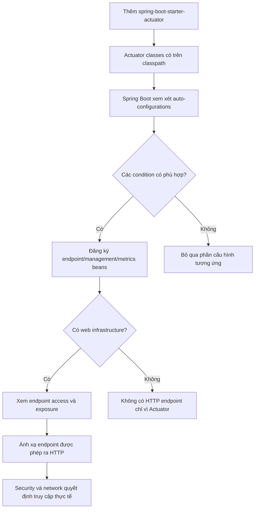
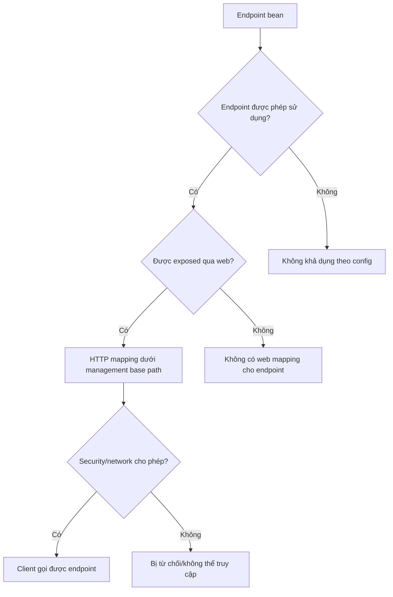
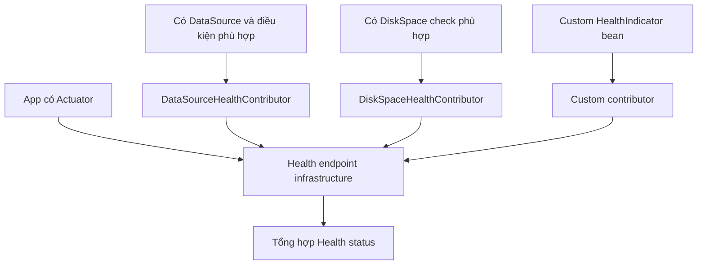

# Dependency Actuator và quan hệ với auto-configuration

Khi một ứng dụng Spring Boot đang chạy, lập trình viên và người vận hành thường muốn biết: ứng dụng có còn khỏe không, có sẵn sàng nhận request không, đang sử dụng những bean và cấu hình nào, có những metric gì, và vì sao một auto-configuration được bật hoặc bị bỏ qua. **Spring Boot Actuator** cung cấp những khả năng quan sát và quản lý ứng dụng phục vụ các câu hỏi đó.

Điều thú vị là trong nhiều dự án Spring Boot, bạn chỉ cần thêm dependency:

```groovy
implementation 'org.springframework.boot:spring-boot-starter-actuator'
```

Sau đó khởi động lại ứng dụng, endpoint `/actuator/health` có thể xuất hiện mà bạn **không cần tự viết controller**. Vì sao chỉ thêm một thư viện lại thay đổi hành vi runtime?

Đó chính là quan hệ giữa **dependency trên classpath** và **cơ chế auto-configuration** của Spring Boot:

1. Dependency Actuator đưa các class và thành phần cần thiết vào classpath.
2. Spring Boot xem xét các auto-configuration được đăng ký.
3. Những điều kiện như có class, có bean, không có bean, giá trị property và loại ứng dụng quyết định cấu hình nào phù hợp.
4. Auto-configuration có thể đăng ký health endpoint, metric infrastructure và các management component.
5. Với ứng dụng web, những endpoint phù hợp mới được ánh xạ thành đường dẫn HTTP, tùy quy tắc **enablement/access**, **exposure** và **security**.

Bài học thuộc chương **Quan sát ứng dụng** trong *Spring Boot Fundamentals*. Ta sẽ kết nối các khái niệm starter dependency, classpath, conditional auto-configuration, Actuator endpoints, Micrometer, health contributors, endpoint exposure và những công cụ kiểm tra cấu hình đang có hiệu lực.

Các ví dụ tập trung vào **Spring Boot 3.x với Java 17 trở lên**. Cơ chế access/enablement, tập endpoint, tên auto-configuration và mặc định bảo mật có thể thay đổi giữa phiên bản; hãy kiểm tra phiên bản dự án khi áp dụng một property hoặc kết luận về điều kiện cụ thể.

## 1. Bài toán: Quan sát ứng dụng mà không tự xây hàng loạt API

Giả sử có REST API:

```java
package com.example.catalog;

import org.springframework.boot.SpringApplication;
import org.springframework.boot.autoconfigure.SpringBootApplication;

@SpringBootApplication
public class CatalogApplication {

    public static void main(String[] args) {
        SpringApplication.run(CatalogApplication.class, args);
    }
}
```

Ứng dụng có một số controller và service nghiệp vụ. Khi triển khai lên máy chủ, hệ thống vận hành cần câu trả lời cho các vấn đề:

- JVM còn sống và application context có hoạt động không?
- Database hoặc một dependency quan trọng có sẵn sàng không?
- Instance có nên được load balancer gửi request đến không?
- Số request và thời gian phản hồi đang thay đổi thế nào?
- Property cấu hình nào có hiệu lực?
- Auto-configuration nào đã match hoặc không match?
- Bean nào đang tồn tại trong context?

Có thể tự viết `@RestController` cho từng câu hỏi. Nhưng làm như vậy dẫn đến nhiều việc lặp:

- Tự thiết kế format của health response.
- Tự tổng hợp status từ các dependency.
- Tự xây lớp thu thập metric.
- Tự tạo endpoint liệt kê cấu hình và bean.
- Tự xử lý quyền truy cập, thông tin nhạy cảm, lỗi và bảo trì.

Actuator cung cấp một bộ hạ tầng chung để đáp ứng các nhu cầu quan sát phổ biến, đồng thời tích hợp với lifecycle và auto-configuration của Spring Boot. Nó **không thay thế hoàn toàn hệ thống monitoring** hoặc kiểm tra nghiệp vụ, nhưng giảm công việc phải tự triển khai.

## 2. Actuator là gì và không phải là gì?

**Spring Boot Actuator** là tập thành phần hỗ trợ production-ready features, đặc biệt là monitoring và management của một Spring Boot application. Nó có thể cung cấp:

| Nhóm | Ví dụ | Câu hỏi được trả lời |
|---|---|---|
| Health | `health` | Ứng dụng/dependency đang có trạng thái gì? |
| Information | `info` | Ứng dụng công bố metadata gì? |
| Metrics | `metrics` | Các metric JVM, HTTP hoặc nghiệp vụ đang được thu thập thế nào? |
| Configuration diagnostics | `env`, `configprops`, `conditions` | Runtime đang có property nào, bean cấu hình nào và điều kiện auto-config nào đã match? |
| Container diagnostics | `beans`, `mappings` | Có những Spring bean nào và HTTP mapping nào? |
| Runtime diagnostics | `threaddump`, `heapdump`, `loggers` | Trạng thái thread, heap và logger ra sao? |

Đây là **tên endpoint ví dụ**, không phải lời hứa chúng đều được bật, exposed hoặc có thể truy cập qua HTTP trong mọi project.

### 2.1. Actuator không tự động tạo dashboard

Thêm Actuator không tự sinh một hệ thống lưu metric lâu dài hoặc dashboard đầy đủ. Actuator có thể cung cấp thông tin và tích hợp Micrometer; để lưu metric qua thời gian, thường cần thêm registry/exporter và hệ thống bên ngoài như Prometheus cùng công cụ hiển thị phù hợp.

### 2.2. Actuator không làm mọi dependency bên ngoài tự động khỏe mạnh

Endpoint health có thể tổng hợp những `HealthIndicator`/`HealthContributor` được đăng ký. Việc Actuator trả `UP` chỉ nói các kiểm tra hiện được thực hiện cho ra trạng thái đó. Nó không đảm bảo mọi nghiệp vụ và mọi hệ thống bên ngoài đều đang vận hành đúng.

### 2.3. Actuator không phải Spring Boot DevTools

Hai dependency phục vụ mục tiêu khác nhau:

| Dependency | Mục đích chính |
|---|---|
| `spring-boot-starter-actuator` | Quan sát, health, metrics và management endpoint cho ứng dụng. |
| `spring-boot-devtools` | Hỗ trợ vòng lặp phát triển như restart, LiveReload và development-time properties. |

Actuator thường được sử dụng cả ở production, nhưng cần cấu hình exposure, authorization và network boundary phù hợp. DevTools chủ yếu phục vụ môi trường phát triển.

## 3. Thêm Actuator dependency

### 3.1. Gradle với Groovy DSL

Trong `build.gradle`:

```groovy
dependencies {
    implementation 'org.springframework.boot:spring-boot-starter-web'
    implementation 'org.springframework.boot:spring-boot-starter-actuator'
}
```

### 3.2. Gradle với Kotlin DSL

Trong `build.gradle.kts`:

```kotlin
dependencies {
    implementation("org.springframework.boot:spring-boot-starter-web")
    implementation("org.springframework.boot:spring-boot-starter-actuator")
}
```

### 3.3. Maven

Trong `pom.xml`:

```xml
<dependencies>
    <dependency>
        <groupId>org.springframework.boot</groupId>
        <artifactId>spring-boot-starter-web</artifactId>
    </dependency>
    <dependency>
        <groupId>org.springframework.boot</groupId>
        <artifactId>spring-boot-starter-actuator</artifactId>
    </dependency>
</dependencies>
```

Các ví dụ giả định project có Spring Boot plugin/parent hoặc BOM quản lý phiên bản; không cần khai báo version riêng cho từng starter trong trường hợp đã có dependency management phù hợp.

### 3.4. Vì sao gọi là starter?

Một **starter** là dependency thuận tiện, tập hợp các dependency thường dùng cho một tính năng. Thay vì tự chọn từng module Actuator, Micrometer và tích hợp liên quan, bạn thêm starter để nhận tập dependency tương thích với phiên bản Boot.

Ở mức khái niệm:

```text
Ứng dụng Spring Boot
    |
    +-- spring-boot-starter-web       (nếu cần servlet HTTP)
    |
    +-- spring-boot-starter-actuator
          |
          +-- Spring Boot Actuator
          +-- Actuator auto-configuration
          +-- Micrometer / observation infrastructure liên quan
          +-- Các dependency nền cần thiết
```

**Danh sách dependency chuyển tiếp thực tế là thuộc tính của từng phiên bản.** Khi cần biết chính xác module nào được đưa vào, hãy xem dependency tree của bản build thay vì đoán từ sơ đồ.

### 3.5. Kiểm tra dependency tree

Với Gradle, lệnh tham khảo:

```bash
./gradlew dependencies --configuration runtimeClasspath
```

Hoặc tìm dependency cụ thể:

```bash
./gradlew dependencyInsight --dependency spring-boot-actuator --configuration runtimeClasspath
```

Với Maven:

```bash
./mvnw dependency:tree
```

Những lệnh này phục vụ kiểm tra dependency ở project của bạn. Kết quả giúp phân biệt **starter được khai báo** với **module đã thực sự có mặt trong runtimeClasspath**.

## 4. Thêm dependency ảnh hưởng tới auto-configuration như thế nào?

Annotation thường thấy ở class main là:

```java
@SpringBootApplication
public class CatalogApplication {
    public static void main(String[] args) {
        SpringApplication.run(CatalogApplication.class, args);
    }
}
```

`@SpringBootApplication` bao gồm cơ chế bật auto-configuration của Spring Boot. Boot tìm các auto-configuration candidates được khai báo bởi các module tương ứng trên classpath, sau đó đánh giá những điều kiện để quyết định đăng ký cấu hình hay bỏ qua.

Một auto-configuration có thể dùng các loại điều kiện:

| Điều kiện | Ý nghĩa khái quát |
|---|---|
| `@ConditionalOnClass` | Chỉ áp dụng khi có một class liên quan trên classpath. |
| `@ConditionalOnBean` | Chỉ áp dụng khi một bean cần thiết đã có trong context ở thời điểm đánh giá. |
| `@ConditionalOnMissingBean` | Thường “back off” nếu ứng dụng đã cung cấp bean tương ứng. |
| `@ConditionalOnProperty` | Phụ thuộc giá trị của property. |
| `@ConditionalOnWebApplication` | Chỉ áp dụng cho loại web application phù hợp. |
| Các điều kiện endpoint/management | Phụ thuộc trạng thái enablement/access/exposure và hạ tầng management theo phiên bản. |

**Thêm dependency thay đổi classpath.** Khi classpath thay đổi, một số điều kiện trước đây không phù hợp có thể bắt đầu phù hợp. Đây là một nguyên nhân chính khiến những bean hạ tầng Actuator xuất hiện sau khi thêm starter.

### 4.1. Luồng tổng thể



Sơ đồ cho thấy **dependency là điều kiện cần trong nhiều trường hợp, không phải điều kiện đủ** để mọi endpoint xuất hiện và công khai.

### 4.2. Không cần tự thêm một controller cho /actuator/health

Khi hạ tầng phù hợp được tạo, Spring Boot Actuator cung cấp `HealthEndpoint` và cơ chế ánh xạ management endpoint vào web. Vì vậy bạn thường không cần viết:

```java
@GetMapping("/actuator/health")
public String health() {
    return "UP";
}
```

Thực tế **không nên tự tạo endpoint thay thế một cách tùy tiện** nếu mục tiêu là sử dụng hệ thống health aggregation và các quy tắc access/security của Actuator. Nếu cần custom health check, nên mở rộng thông qua `HealthIndicator` hoặc `HealthContributor` phù hợp.

### 4.3. Không phải auto-configuration luôn “thắng” cấu hình ứng dụng

Nhiều auto-configuration được thiết kế để **lùi lại** khi ứng dụng đã cung cấp bean hoặc cấu hình tùy chỉnh. Tuy vậy, không phải mọi bean đều có cùng quy tắc back-off.

Do đó:

- Thêm starter không bảo đảm một bean cụ thể sẽ được đăng ký.
- Có một bean tùy chỉnh có thể làm một phần auto-configuration không tạo bean mặc định.
- Hai module có thể cùng ảnh hưởng các điều kiện.
- Kết quả cần được xác minh trong ApplicationContext thực tế.

## 5. Auto-configuration của Actuator được đưa vào ở giai đoạn nào?

Trong quá trình `SpringApplication.run(...)`:

1. Boot chuẩn bị `Environment` và tạo ApplicationContext.
2. Context được refresh.
3. Spring phân tích configuration classes và auto-configuration imports.
4. Những conditional configurations phù hợp được xử lý và đăng ký bean definitions.
5. Bean infrastructure và singleton cần thiết được tạo.
6. Management endpoint infrastructure được hoàn tất theo lifecycle của context.
7. Với web app, những endpoint đủ điều kiện có thể được map ra HTTP.

Đây là mô tả **khái quát**, không có nghĩa mọi bean Actuator đều được tạo cùng một thời điểm hoặc tất cả mapper được thiết lập theo đúng một thứ tự cố định giữa các phiên bản.

### 5.1. Những class của Actuator không đồng nghĩa endpoint đã sẵn sàng

Cần phân biệt:

| Trạng thái | Điều chứng minh được |
|---|---|
| JAR có trên runtime classpath | Code Actuator có thể được tải. |
| Auto-configuration candidate được tìm thấy | Boot có thể xem xét cấu hình. |
| Condition matched | Cấu hình đủ điều kiện ở lần đánh giá đó. |
| Endpoint bean được đăng ký | Endpoint tồn tại trong context theo điều kiện. |
| Endpoint được exposed qua HTTP | Có web mapping cho endpoint phù hợp. |
| Request trả HTTP 200 | Đường dẫn, security và trạng thái endpoint cho phép request đó thành công. |

Những bước này không tự suy ra lẫn nhau. Đặc biệt, **“có bean” khác “ai cũng gọi được qua HTTP”**.

### 5.2. Thêm starter có thay đổi ứng dụng không web?

Ví dụ một batch application chỉ sử dụng:

```groovy
implementation 'org.springframework.boot:spring-boot-starter'
implementation 'org.springframework.boot:spring-boot-starter-actuator'
```

thì có thể có một số management endpoint beans và metric infrastructure; nhưng nếu không có servlet/reactive web server, việc thêm Actuator **không tự tạo một HTTP server** chỉ để mở `/actuator/health`.

Đường truy cập management qua HTTP yêu cầu web infrastructure phù hợp; một số management khả năng khác có thể được cung cấp qua JMX khi cấu hình cho phép. Không nên kiểm tra sự có mặt của Actuator chỉ bằng một lệnh `curl` trong batch application không web.

## 6. Endpoint là gì? HealthEndpoint và web mapping khác nhau thế nào?

Một **Actuator endpoint** là thành phần diễn đạt một khả năng quản lý/quan sát. Nó không nhất thiết là `@RestController`.

Ví dụ:

- `HealthEndpoint` cung cấp hoạt động kiểm tra health.
- `InfoEndpoint` cung cấp thông tin từ các info contributors.
- `MetricsEndpoint` cung cấp truy vấn metric đang có.

Hạ tầng Actuator có thể phát hiện endpoint bean và đưa operation của nó tới các technology tương ứng như web hoặc JMX, tùy module và cấu hình.

### 6.1. Ba ranh giới quan trọng



Đây là mô hình tinh gọn để hiểu việc một endpoint có thể tồn tại trong code nhưng không hiển thị trên HTTP. Thuật ngữ property chính xác về “access” hay “enabled” cần đối chiếu với phiên bản Boot.

### 6.2. Endpoint discovery page

Trong web application có Actuator, đường dẫn:

```text
GET /actuator
```

có thể trả discovery document chứa links tới những web endpoint được expose, nếu discovery được bật và response không bị chặn bởi security.

Sự hiện diện hoặc nội dung discovery page còn phụ thuộc management base path, server port, đường dẫn và cấu hình endpoint. Nếu `/actuator` không trả danh sách như kỳ vọng, không có nghĩa starter chắc chắn bị thiếu.

## 7. Thử nghiệm đầu tiên: /actuator/health

Giả sử ứng dụng dùng `spring-boot-starter-web` và `spring-boot-starter-actuator`. Khi khởi động với cấu hình thông dụng, bạn có thể truy cập:

```bash
curl http://localhost:8080/actuator/health
```

Response minh họa:

```json
{
  "status": "UP"
}
```

Đây là trường hợp một ứng dụng thử nghiệm có các health checks trả `UP` và endpoint có thể truy cập. Nếu một health contributor báo `DOWN`, HTTP status và nội dung có thể khác; không nên coi `200/UP` là đáp án cố định.

### 7.1. Mặc định HTTP exposure không phải “tất cả”

Trong nhiều phiên bản Spring Boot 3.x, chỉ endpoint `health` được expose qua HTTP theo mặc định. Vì vậy, sau khi thêm dependency:

```text
GET /actuator/health
```

có thể hoạt động trong khi:

```text
GET /actuator/metrics
GET /actuator/env
GET /actuator/beans
```

chưa được expose.

Không nên kết luận `metrics` hoặc `env` “chưa được cài đặt” chỉ vì `curl` nhận HTTP 404; trước hết hãy kiểm tra management exposure, endpoint availability, web mapping và security.

### 7.2. Health trả một trạng thái tổng hợp

Health có thể gom kết quả của nhiều contributor:

```text
health
  +-- diskSpace
  +-- ping
  +-- db (khi phù hợp và được cấu hình)
  +-- custom contributor
```

Tập contributor thực tế phụ thuộc các dependency, bean và cấu hình đang có. Nếu ứng dụng không dùng database và không có `DataSource`, đừng giả định luôn có health contributor tên `db`.

## 8. Endpoint enabled/access, exposure và security: ba vấn đề khác nhau

Đây là phần quan trọng nhất khi kết nối dependency với trải nghiệm runtime.

### 8.1. Endpoint có được enable/cho phép truy cập ở cấp quản lý?

Spring Boot có các cơ chế điều khiển availability của endpoint. Ở nhiều phiên bản Boot 3.x, bạn có thể gặp:

```properties
management.endpoint.health.enabled=true
management.endpoint.info.enabled=true
```

Những phiên bản mới hơn có thể dùng hệ thống access-control properties như `management.endpoint.<id>.access`; cách đặt tên và precedence cần đối chiếu theo phiên bản.

Về mặt khái niệm, việc endpoint bị disable hoặc bị từ chối access ở lớp quản lý có thể khiến hạ tầng không cung cấp endpoint như bình thường, ngay cả khi dependency có trên classpath.

### 8.2. Endpoint có được expose qua HTTP không?

Trong Spring Boot 3.x, cấu hình web exposure thường là:

```yaml
management:
  endpoints:
    web:
      exposure:
        include: health,info,metrics
```

Khi endpoint tương ứng được enable/cho phép, hạ tầng web có mặt và không bị chặn bởi security, các URL có thể bao gồm:

```text
GET /actuator/health
GET /actuator/info
GET /actuator/metrics
```

**`include` không tự làm một endpoint bất kỳ xuất hiện nếu module, bean hoặc điều kiện để tạo endpoint đó không có.** Nó chỉ điều khiển việc expose một endpoint đủ điều kiện.

Bạn cũng có thể có cấu hình exclude:

```yaml
management:
  endpoints:
    web:
      exposure:
        include: health,info,metrics
        exclude: metrics
```

Theo cách cấu hình này, metrics bị loại khỏi danh sách web exposure dù đã được liệt kê trong include.

### 8.3. Endpoint có bị security bảo vệ không?

Ngay cả khi `/actuator/env` được expose, ứng dụng vẫn có thể dùng Spring Security để yêu cầu authentication/authorization hoặc giới hạn network.

Ví dụ request:

```text
GET /actuator/env
```

có thể trả 401/403 thay vì 200 vì security policy. Không nên tắt security chỉ để “sửa lỗi Actuator”.

Với Spring Security, nếu ứng dụng tự định nghĩa `SecurityFilterChain`, trách nhiệm bảo vệ management endpoints cần được xem xét trong chain tương ứng. Auto-configuration bảo mật mặc định của Boot không nhất thiết còn áp dụng cùng một cách khi bạn tự cung cấp security configuration.

### 8.4. Bảng chẩn đoán nhanh

| Hiện tượng | Những nguyên nhân cần kiểm tra |
|---|---|
| `/actuator/health` trả 404 | Không có web infrastructure, base path khác, endpoint không exposed/không enabled, context path khác. |
| `/actuator/metrics` trả 404 | Metrics chưa exposed, endpoint không khả dụng, hoặc management server/path khác. |
| `/actuator/env` trả 401 | Endpoint có thể được expose nhưng yêu cầu authentication. |
| `/actuator/env` trả 403 | Security policy từ chối quyền truy cập. |
| `/actuator/health` trả 503 | Health có thể đang `DOWN` hoặc trạng thái được ánh xạ thành HTTP 503. |
| `/actuator/info` trả `{}` | Info endpoint có thể hoạt động nhưng chưa có contributor cung cấp metadata. |

Không thể xác định duy nhất nguyên nhân từ một status code; cần xét đường dẫn, logs, security và cấu hình.

## 9. Cấu hình exposure tối thiểu và an toàn

Một cấu hình minh họa cho môi trường local:

```yaml
spring:
  application:
    name: catalog-service

management:
  endpoints:
    web:
      exposure:
        include: health,info,metrics
  endpoint:
    health:
      show-details: when_authorized
```

Trong môi trường thử nghiệm có kiểm soát, bạn có thể mở thêm `conditions` để quan sát tại sao auto-configuration được bật:

```yaml
management:
  endpoints:
    web:
      exposure:
        include: health,info,metrics,conditions
```

**Không mở `*` cho tất cả endpoint ở production một cách tùy tiện.** Các endpoint `env`, `configprops`, `beans`, `heapdump`, `threaddump` và `loggers` có thể tiết lộ thông tin nội bộ hoặc tăng bề mặt tấn công. Việc sanitize giá trị giúp giảm rủi ro nhưng không thay thế xác thực, phân quyền và giới hạn mạng.

### 9.1. Cẩn thận khi dùng include: "*"

Một ví dụ thường thấy trong tài liệu thử nghiệm:

```yaml
management:
  endpoints:
    web:
      exposure:
        include: "*"
```

Đây **không phải cấu hình khuyến nghị cho production**. Nó có thể expose nhiều endpoint quản trị hơn dự kiến. Chỉ sử dụng trong môi trường cô lập, hiểu rõ security và những endpoint đã được tạo.

### 9.2. Giấu thông tin nhạy cảm trong health details

Trong một ứng dụng công khai, health status tổng quát có thể cần hiển thị, nhưng details của database, disk hoặc dependency không nên tự do lộ ra bên ngoài. `management.endpoint.health.show-details` có thể giúp kiểm soát hiển thị chi tiết tùy policy/version; nếu chọn `when_authorized`, cần thiết kế vai trò và security cho phù hợp.

## 10. Health auto-configuration nhận biết dependency như thế nào?

Một đặc điểm quan trọng của Actuator là các health contributors có thể được cấu hình có điều kiện dựa trên hạ tầng hiện có.

Ví dụ một ứng dụng chỉ có web starter và Actuator có thể có health contribution tổng quát về disk space hoặc ping. Sau khi thêm JDBC starter và cung cấp một `DataSource` hợp lệ, auto-configuration có thể phát hiện hạ tầng datasource để tạo `DataSourceHealthIndicator` khi điều kiện phù hợp.

Sơ đồ khái niệm:



Tên bean và loại contributor thực tế có thể thay đổi theo phiên bản hoặc topology, đặc biệt khi có nhiều datasource. Trọng tâm là **dependency và beans có sẵn ảnh hưởng tới những health contributors được tự động đăng ký**.

### 10.1. Vì sao thêm JDBC starter có thể thay đổi health response?

Trước đó, Actuator không có bean datasource để kiểm tra. Sau khi bạn thêm dependency và cấu hình datasource, điều kiện cho health contributor liên quan database có thể khớp.

Kết quả:

- Một health check mới tham gia vào tổng hợp.
- Health status có thể chuyển từ `UP` sang `DOWN` nếu database không truy cập được.
- Endpoint `/actuator/health` có thể trả HTTP status khác theo status mapping.

Vì vậy, **thay đổi dependency có thể làm thay đổi behavior của một endpoint Actuator mà bạn không sửa controller nào**.

### 10.2. Tắt contributor tự động cụ thể

Khi đã hiểu mục tiêu vận hành, có thể xem các property kiểu:

```properties
management.health.db.enabled=false
```

Đối với các phiên bản Spring Boot 3.x hỗ trợ property này, nó điều khiển health contributor database tự động phù hợp. Tuy nhiên, việc tắt DB health check để “làm xanh dashboard” có thể che đi dependency đang hỏng. Hãy chỉ làm khi rõ ràng rằng DB không phải điều kiện liveness/readiness của dịch vụ hoặc bạn có health policy phù hợp hơn.

### 10.3. Health status không tự đồng nghĩa business readiness

Một ứng dụng có thể mở được kết nối DB nhưng vẫn không xử lý được request vì:

- Cấu hình nghiệp vụ chưa hợp lệ.
- Cache dữ liệu bắt buộc chưa được chuẩn bị.
- Một downstream service quan trọng chưa sẵn sàng.
- Một event consumer đã ngừng xử lý.

Nếu dependency đó là điều kiện phục vụ traffic, nên thiết kế health/readiness contributor và nhóm health phù hợp. Tránh tạo health check có network call không giới hạn timeout hoặc gây quá nhiều tải.

## 11. Viết một HealthIndicator tùy chỉnh

Thay vì tự viết endpoint `/health`, bạn có thể cung cấp một bean `HealthIndicator`:

```java
package com.example.catalog.health;

import org.springframework.boot.actuate.health.Health;
import org.springframework.boot.actuate.health.HealthIndicator;
import org.springframework.stereotype.Component;

@Component
public class CatalogIndexHealthIndicator implements HealthIndicator {

    private final CatalogIndexState indexState;

    public CatalogIndexHealthIndicator(CatalogIndexState indexState) {
        this.indexState = indexState;
    }

    @Override
    public Health health() {
        if (indexState.isReady()) {
            return Health.up().build();
        }
        return Health.down()
                .withDetail("reason", "catalog-index-not-ready")
                .build();
    }
}
```

`CatalogIndexState` là một service ứng dụng do bạn triển khai, ví dụ quản lý cờ trạng thái chỉ mục đã nạp hay chưa. Khi bean `CatalogIndexHealthIndicator` được đăng ký và được hệ thống health contribution phát hiện theo quy tắc hiện hành, kết quả của nó có thể tham gia vào health endpoint.

### 11.1. Vì sao dùng HealthIndicator?

- Tái sử dụng hạ tầng health aggregation của Actuator.
- Có thể tham gia health groups phù hợp.
- Không tự viết HTTP mapping và status code.
- Kết hợp được với những contributor mặc định.
- Có thể kiểm thử logic health dưới dạng service/bean.

### 11.2. Không đưa secret vào health details

`withDetail(...)` có thể hiển thị trong response khi cấu hình cho phép health details. Không ghi password, connection string có credential, API key hoặc stack trace nhạy cảm vào các details.

### 11.3. Liveness và readiness không nên bị trộn tùy tiện

Liveness thường trả lời “process có cần restart không?”, còn readiness trả lời “instance có thể nhận traffic không?”. Một dependency bên ngoài tạm thời thất bại không phải lúc nào cũng có nghĩa process cần bị restart.

Spring Boot có hệ thống availability và health groups để hỗ trợ các mục tiêu khác nhau. Việc bật và expose probes phụ thuộc môi trường và cấu hình, ví dụ ứng dụng triển khai trên Kubernetes có thể có các health groups `liveness` và `readiness` trong điều kiện phù hợp.

Đừng tự động thêm mọi external dependency vào liveness rồi để orchestrator restart không cần thiết mỗi khi mạng chập chờn.

## 12. Metrics và Micrometer: mối quan hệ với starter

Một lợi ích quan trọng khác của Actuator là tích hợp **Micrometer** và hệ thống quan sát của Spring Boot.

Trong cách dùng phổ biến:

1. Actuator starter đưa hạ tầng metrics và observation tương thích vào classpath.
2. Metrics auto-configuration đánh giá điều kiện và thiết lập `MeterRegistry` hoặc các bean liên quan khi phù hợp.
3. Những binder/instrumentation phù hợp có thể tạo metric cho JVM, process, HTTP server hoặc các thành phần khác.
4. `MetricsEndpoint` có thể cung cấp thông tin metric đang có qua management endpoint.
5. Muốn xuất dữ liệu sang hệ thống bên ngoài, bạn cần cấu hình registry/exporter phù hợp.

### 12.1. Endpoint metrics không phải dashboard

Khi `metrics` được expose, có thể thử:

```bash
curl http://localhost:8080/actuator/metrics
```

Một response minh họa:

```json
{
  "names": [
    "jvm.memory.used",
    "process.cpu.usage",
    "http.server.requests"
  ]
}
```

Tập metric thực tế **không cố định**: phụ thuộc dependency, phiên bản, registry, các binder được bật và hoạt động đã diễn ra. Một metric HTTP có thể chưa xuất hiện nếu chưa có request được ghi nhận hoặc instrumentation tương ứng không hoạt động.

### 12.2. Truy vấn một metric

Ví dụ:

```bash
curl http://localhost:8080/actuator/metrics/jvm.memory.used
```

Tùy metric, response có thể chứa tên, mô tả, measurements và available tags.

### 12.3. Thêm Prometheus registry

Nếu muốn xuất metric dạng Prometheus, với Spring Boot 3.x có thể thêm:

```groovy
dependencies {
    implementation 'org.springframework.boot:spring-boot-starter-actuator'
    runtimeOnly 'io.micrometer:micrometer-registry-prometheus'
}
```

Sau đó, nếu các điều kiện phù hợp, Prometheus actuator endpoint có thể được auto-configured. Để HTTP clients truy cập, cần expose nó:

```yaml
management:
  endpoints:
    web:
      exposure:
        include: health,info,prometheus
```

Lệnh thử:

```bash
curl http://localhost:8080/actuator/prometheus
```

Nếu chỉ thêm `spring-boot-starter-actuator` nhưng **không có Prometheus registry** trên classpath, đừng kỳ vọng `/actuator/prometheus` luôn xuất hiện. Một lần nữa, dependency ảnh hưởng điều kiện auto-configuration.

### 12.4. MeterRegistry và endpoint không hoàn toàn giống nhau

`MeterRegistry` là nơi đăng ký và đọc metric theo cơ chế Micrometer. `MetricsEndpoint` là một cách truy vấn metric phục vụ management. Bạn có thể sử dụng Micrometer trong code hoặc export metric qua registry mà không nhất thiết phải công khai `/actuator/metrics` ra HTTP.

Không nên coi việc endpoint web bị 404 là bằng chứng hệ thống hoàn toàn không thu thập metric.

## 13. Dependency thay đổi có thể kéo theo nhiều auto-configuration

Xét ba mốc phát triển của cùng ứng dụng:

### Giai đoạn A — Chỉ có web starter

```groovy
implementation 'org.springframework.boot:spring-boot-starter-web'
```

Ứng dụng có REST controller, embedded server và những auto-configuration liên quan web. Nhưng không nên giả định có mọi Actuator endpoint nếu chưa thêm Actuator infrastructure.

### Giai đoạn B — Thêm Actuator starter

```groovy
implementation 'org.springframework.boot:spring-boot-starter-actuator'
```

Classpath có thêm Actuator/Micrometer infrastructure. Những auto-configuration tương ứng có thể tạo management endpoint beans, health contributors và metrics infrastructure theo điều kiện.

### Giai đoạn C — Thêm JDBC hoặc Prometheus registry

```groovy
implementation 'org.springframework.boot:spring-boot-starter-jdbc'
runtimeOnly 'io.micrometer:micrometer-registry-prometheus'
```

Nếu có cấu hình datasource phù hợp và registry tương ứng:

- JDBC auto-configuration có thể tạo datasource.
- Health auto-configuration có thể tạo DB health contributor.
- Metrics registry auto-configuration có thể tạo Prometheus registry/exporter.
- Prometheus management endpoint có thể trở nên khả dụng và được expose nếu cấu hình cho phép.

Đây là mô hình **dependency → condition → bean/configuration → endpoint/behavior**.

### 13.1. Dependency không bảo đảm auto-configuration thành công

Ví dụ thêm JDBC starter mà không có datasource URL hoặc embedded DB hợp lệ có thể khiến ứng dụng **khởi động thất bại** vì cấu hình datasource không đầy đủ. Không được hiểu rằng “thêm JDBC thì Actuator tự kết nối được database”.

Thành phần nền phải được cấu hình hợp lệ; Actuator chỉ quan sát hoặc tổng hợp trạng thái theo các check phù hợp.

## 14. Condition Evaluation Report: giải thích auto-configuration

Khi nghi ngờ dependency đã có nhưng bean hoặc endpoint vẫn không xuất hiện, một công cụ quan trọng là **Condition Evaluation Report**.

Trong môi trường development, chạy:

```bash
./gradlew bootRun --args='--debug'
```

Hoặc với JAR:

```bash
java -jar app.jar --debug
```

Theo cấu hình và phiên bản, Spring Boot có thể in Condition Evaluation Report trong log, cho biết những auto-configuration nào matched và vì sao các cấu hình khác không matched.

### 14.1. Một ví dụ suy luận từ điều kiện

Giả sử bạn kỳ vọng Prometheus endpoint nhưng không thấy:

```text
Observation 1: Có spring-boot-starter-actuator
Observation 2: Không có micrometer-registry-prometheus
Observation 3: /actuator/prometheus không khả dụng
```

Một hướng điều tra hợp lý là **thiếu Prometheus registry class** khiến auto-configuration liên quan không match. Sau khi thêm dependency, vẫn cần kiểm tra enablement/access, exposure và security.

### 14.2. Positive matches và negative matches

Condition report thường giúp nhận diện:

- **Positive matches:** cấu hình đáp ứng điều kiện.
- **Negative matches:** một hoặc nhiều điều kiện không thỏa.
- **Unconditional classes hoặc các phần khác:** phụ thuộc phiên bản và kiểu report.

Đừng suy luận rằng “positive match” đồng nghĩa endpoint chắc chắn public. Nó có thể chỉ chứng minh **một phần cấu hình** đã đáp ứng các condition.

### 14.3. Điều kiện chỉ được đánh giá trong ngữ cảnh thực tế

Kết quả match có thể khác giữa:

- Ứng dụng local và production.
- Web app và batch app.
- Có/không có một dependency.
- Có/không có bean tự định nghĩa.
- Active profiles khác nhau.
- Config property bật/tắt các tính năng.

Vì vậy, report phải được lấy từ **đúng cách chạy** đang gặp vấn đề.

## 15. Dùng /actuator/conditions để kiểm tra

Actuator có endpoint `conditions` phục vụ việc xem condition evaluation theo ngữ cảnh đang chạy khi endpoint này khả dụng và được expose.

Trong local environment được bảo vệ:

```yaml
management:
  endpoints:
    web:
      exposure:
        include: health,conditions
```

Sau đó thử:

```bash
curl http://localhost:8080/actuator/conditions
```

Response có thể chứa phần cho positive và negative matches với tên auto-configuration và thông tin giải thích.

### 15.1. Vì sao conditions hữu ích?

Khi một bean được tự động tạo “không như dự kiến” hoặc không được tạo:

1. Tìm auto-configuration liên quan trong report.
2. Xem class/bean/property nào là điều kiện.
3. Kiểm tra dependency thực sự có trên classpath.
4. Kiểm tra giá trị Environment.
5. Kiểm tra có bean do ứng dụng cung cấp làm auto-configuration back off không.

### 15.2. Bảo vệ conditions endpoint

Report có thể tiết lộ package, class, dependency và cấu trúc cấu hình của ứng dụng. Không nên expose công khai ở production. Nếu cần điều tra trên một instance thật, dùng kết nối an toàn và phân quyền phù hợp.

## 16. Quan hệ giữa Actuator và auto-configuration khác trong Boot

Actuator không hoạt động biệt lập. Nó quan sát và phụ thuộc vào những thành phần do application auto-configuration tạo ra.

Ví dụ:

| Tính năng ứng dụng | Điều kiện/hạ tầng liên quan | Tác động Actuator có thể thấy |
|---|---|---|
| JDBC | Có `DataSource` hợp lệ | DB health contributor hoặc datasource metrics nếu điều kiện phù hợp. |
| Servlet MVC | Có servlet web server và web mappings | HTTP server metrics và web endpoint mappings nếu được hỗ trợ. |
| JVM | JVM metrics binders phù hợp | Metric heap, GC, thread hoặc process. |
| Micrometer registry | Registry dependency và config phù hợp | Export metric ra backend tương ứng. |
| Spring Security | Security filter chains | Quyết định ai có quyền gọi management endpoints. |
| Custom `HealthIndicator` | Bean health contributor do ứng dụng khai báo | Bổ sung health component trong tổng hợp. |
| Custom bean theo `@ConfigurationProperties` | Binding và Actuator configprops endpoint | Có thể quan sát cấu hình đã bind (theo security/sanitization). |

Thêm một starter khác có thể thay đổi Actuator mà không cần sửa dependency Actuator. Đây là đặc tính của hệ thống conditional auto-configuration trong Spring Boot.

### 16.1. Auto-configuration giúp mở rộng theo module

Các module mới có thể khai báo auto-configuration để tích hợp với Actuator, ví dụ health indicator hoặc metrics binder riêng. Điều này khiến cùng một ứng dụng có tập observability phong phú hơn khi classpath mở rộng.

### 16.2. Auto-configuration cũng có giới hạn

Framework không tự biết một số trạng thái nghiệp vụ:

- Khả năng xử lý đơn hàng mới có phụ thuộc vào một cache đã warmup chưa?
- Hệ thống có nhận được dữ liệu giá từ nguồn ngoài không?
- Một background consumer có đang bị dừng không?

Những trạng thái đó cần custom health/metrics/observation được thiết kế dựa trên yêu cầu nghiệp vụ.

## 17. Thay đổi management base path và port

Theo cấu hình web management phổ biến, endpoint xuất hiện dưới base path `/actuator`. Bạn có thể tùy chỉnh:

```yaml
management:
  endpoints:
    web:
      base-path: /manage
      exposure:
        include: health,info
```

Khi đó URL có thể là:

```text
GET /manage/health
GET /manage/info
```

Nếu vẫn thử `/actuator/health`, có thể nhận 404 dù Actuator đang hoạt động.

### 17.1. Management server port riêng

Trong một servlet web application phù hợp, có thể đặt:

```yaml
server:
  port: 8080

management:
  server:
    port: 8081
  endpoints:
    web:
      exposure:
        include: health,info
```

Các URL quản lý có thể được phục vụ ở port 8081 thay vì 8080:

```text
http://localhost:8081/actuator/health
```

Một management server riêng có thể có context và network/security considerations riêng. Đây không phải một cơ chế bảo mật tự động; cần kiểm soát cổng, binding address, firewall, reverse proxy và authentication phù hợp.

### 17.2. Context path và reverse proxy

Nếu ứng dụng hoặc proxy thêm một path prefix, URL nhìn từ client có thể khác đường dẫn nội bộ. Khi gặp 404, kiểm tra các tầng:

```text
Client URL -> reverse proxy -> app context path -> management base path
```

Không suy luận “Actuator không được auto-configured” chỉ vì gõ một URL chưa đúng.

## 18. Kiểm tra bean Actuator có trong context không

Một cách học trực tiếp là inject `ApplicationContext` và kiểm tra bean type phù hợp.

```java
package com.example.catalog.diagnostics;

import java.util.Arrays;
import org.springframework.boot.ApplicationArguments;
import org.springframework.boot.ApplicationRunner;
import org.springframework.boot.actuate.health.HealthEndpoint;
import org.springframework.context.ApplicationContext;
import org.springframework.stereotype.Component;

@Component
public class ActuatorBeanReporter implements ApplicationRunner {

    private final ApplicationContext context;

    public ActuatorBeanReporter(ApplicationContext context) {
        this.context = context;
    }

    @Override
    public void run(ApplicationArguments args) {
        String[] names = context.getBeanNamesForType(HealthEndpoint.class);
        System.out.println("HealthEndpoint beans: "
                + Arrays.toString(names));
    }
}
```

Khi endpoint bean được tạo trong context này, code có thể in tên bean tương ứng. Nhưng nếu management context nằm riêng, hoặc endpoint không được tạo do access/enablement conditions, danh sách ở application context đang kiểm tra có thể không như kỳ vọng.

### 18.1. Vì sao không nên tự tạo HealthEndpoint?

Actuator đã có infrastructure chuyên biệt cho health aggregation. Bạn thường nên đóng góp một `HealthIndicator` hoặc cấu hình health group, không tạo một `HealthEndpoint` thay thế chỉ để đổi một thông điệp.

### 18.2. Bean hiện diện không bảo đảm HTTP mapping

Ngay cả nếu `getBeanNamesForType(HealthEndpoint.class)` trả tên bean, bạn vẫn cần kiểm tra:

- Web management context.
- Endpoint exposure.
- Base path/management port.
- Security policy.

Bean-level introspection và HTTP-level smoke test trả lời hai câu hỏi khác nhau.

## 19. Kiểm thử tích hợp: xác nhận endpoint health được phục vụ

Đối với một ứng dụng thử nghiệm dùng `spring-boot-starter-web`, `spring-boot-starter-actuator` và `spring-boot-starter-test`, có thể tạo integration test:

```java
package com.example.catalog;

import static org.assertj.core.api.Assertions.assertThat;

import org.junit.jupiter.api.Test;
import org.springframework.beans.factory.annotation.Autowired;
import org.springframework.boot.test.context.SpringBootTest;
import org.springframework.boot.test.web.client.TestRestTemplate;
import org.springframework.http.ResponseEntity;

@SpringBootTest(
        webEnvironment = SpringBootTest.WebEnvironment.RANDOM_PORT,
        properties = "management.endpoints.web.exposure.include=health,info")
class ActuatorHealthSmokeTest {

    @Autowired
    TestRestTemplate http;

    @Test
    void healthEndpointIsReachable() {
        ResponseEntity<String> response =
                http.getForEntity("/actuator/health", String.class);

        assertThat(response.getStatusCode().is2xxSuccessful()).isTrue();
        assertThat(response.getBody()).contains("\"status\"");
    }
}
```

Trong project demo có health contributors khỏe và không có security cản trở, test có thể xác nhận health endpoint đã được ánh xạ qua HTTP. Nếu project có dependency không khỏe, status có thể là `DOWN` và test cần thể hiện kỳ vọng vận hành cụ thể thay vì mặc định mọi context đều `UP`.

### 19.1. Test này không chứng minh gì?

Nó **không** kiểm tra đầy đủ:

- Health indicator của mọi dependency.
- Mọi Actuator endpoint.
- Permission của người dùng trên production.
- Hành vi của management port/context riêng.
- Việc export metric tới một monitoring backend.

Một test HTTP thành công chỉ xác nhận đường đi đã được thử nghiệm trong môi trường test cụ thể.

### 19.2. Kiểm thử cấu hình thiếu dependency

Một cách so sánh có ý nghĩa là tạo hai cấu hình ứng dụng nhỏ:

- A có `spring-boot-starter-web` nhưng không có Actuator.
- B có thêm `spring-boot-starter-actuator`.

Quan sát những bean/endpoints xuất hiện khác nhau. Không cần giả định rằng chỉ thêm starter luôn làm tất cả endpoint được expose.

## 20. Khi thêm starter nhưng không thấy /actuator/health

Hãy điều tra theo đúng chuỗi nguyên nhân, thay vì chỉnh ngẫu nhiên các property.

### 20.1. Bước 1 — Xác nhận dependency có trên runtime classpath

Kiểm tra dependency tree. Có thể project khai báo starter dưới `testImplementation`, `developmentOnly` hoặc một cấu hình không tham gia runtime mong muốn.

### 20.2. Bước 2 — Kiểm tra loại ứng dụng

Nếu đây là batch ứng dụng không web hoặc có `spring.main.web-application-type=none`, đừng mong có HTTP endpoint nếu không có web server.

### 20.3. Bước 3 — Xác nhận ứng dụng khởi động thành công

Nếu application context thất bại trong refresh vì thiếu database URL hoặc một bean khác, embedded server và Actuator endpoint có thể chưa sẵn sàng để nhận request.

### 20.4. Bước 4 — Kiểm tra endpoint access/enablement và exposure

Kiểm tra:

```text
management.endpoint.health.enabled
management.endpoints.web.exposure.include
management.endpoints.web.exposure.exclude
```

Tùy Spring Boot version, có thể cần xem thêm management endpoint access properties. Kiểm tra giá trị hiệu lực qua `Environment`, không chỉ nhìn một file cấu hình.

### 20.5. Bước 5 — Kiểm tra đường dẫn và cổng

Có đổi `management.endpoints.web.base-path`, `management.server.port`, app context path hoặc proxy prefix không?

### 20.6. Bước 6 — Kiểm tra security

Nếu response là 401/403, đây có thể là dấu hiệu **endpoint tồn tại nhưng bị bảo vệ**. Không biến một endpoint management thành public chỉ để dễ thử `curl`.

### 20.7. Bước 7 — Xem Condition Evaluation Report

Nếu nghi auto-configuration không tạo endpoint bean, xem `--debug` hoặc endpoint `conditions` được bảo vệ để hiểu điều kiện nào không phù hợp.

### 20.8. Bước 8 — Phân biệt endpoint có mặt và health status

Nếu `/actuator/health` trả 503 và body báo `DOWN`, đó khác hoàn toàn 404. Endpoint có thể đã hoạt động chính xác bằng cách báo rằng một health contributor không khỏe.

## 21. Nếu /actuator/info rỗng thì có phải auto-configuration lỗi?

Không nhất thiết. `InfoEndpoint` tổng hợp dữ liệu từ những `InfoContributor`. Nếu chưa có contributor thích hợp hoặc các contributor bị vô hiệu, response có thể là object rỗng:

```json
{}
```

Bạn có thể cung cấp thông tin ứng dụng qua những cách được Boot hỗ trợ. Ví dụ:

```yaml
management:
  info:
    env:
      enabled: true

info:
  app:
    name: catalog-service
    purpose: product-catalog
```

Với version và contributor tương ứng, endpoint info có thể hiển thị metadata đó sau khi được expose. Không cần nhầm **endpoint tạo thành công nhưng chưa có dữ liệu** với **auto-configuration thất bại**.

### 21.1. Không công bố dữ liệu nhạy cảm ở info

Thông tin `info` có thể được gọi bởi monitoring hoặc người dùng tùy security setup. Tránh đặt environment variables bí mật, internal credentials hoặc topology nhạy cảm vào `info.*`.

## 22. Có thể viết endpoint Actuator tùy chỉnh không?

Có. Nhưng hãy tách hai mục tiêu:

- **Custom health:** cung cấp `HealthIndicator` phù hợp.
- **Custom management operation:** cân nhắc xây một Actuator endpoint chuyên biệt khi cần chức năng quản trị độc lập với REST nghiệp vụ.

Ví dụ endpoint đọc trạng thái đơn giản:

```java
package com.example.catalog.management;

import java.util.Map;
import org.springframework.boot.actuate.endpoint.annotation.Endpoint;
import org.springframework.boot.actuate.endpoint.annotation.ReadOperation;
import org.springframework.stereotype.Component;

@Component
@Endpoint(id = "catalogstatus")
public class CatalogStatusEndpoint {

    @ReadOperation
    public Map<String, Object> status() {
        return Map.of("catalogLoaded", true);
    }
}
```

Trong ứng dụng có Actuator, endpoint tùy chỉnh này có thể được phát hiện như một bean endpoint. **Nó không tự động công khai qua web** chỉ vì có `@Endpoint` và `@Component`. Cần xét enablement/access, exposure và security theo đúng cách như các endpoint có sẵn.

Ví dụ cấu hình local:

```yaml
management:
  endpoints:
    web:
      exposure:
        include: health,catalogstatus
```

Khi đủ điều kiện, URL có thể là:

```text
GET /actuator/catalogstatus
```

### 22.1. Khi nào nên dùng @Endpoint thay cho @RestController?

`@Endpoint` phù hợp với **management/observability capability** cần hòa vào hệ thống Actuator và chịu các quy tắc exposure/access. `@RestController` phù hợp với REST API nghiệp vụ dành cho client.

Đừng đưa API nghiệp vụ nhạy cảm vào Actuator chỉ để tận dụng đường dẫn `/actuator`; management operations có contract và đối tượng sử dụng khác.

## 23. Bảo mật: Actuator là hạ tầng vận hành, không phải API công khai mặc định

Các endpoint management có giá trị chẩn đoán rất lớn, nhưng cũng có thể cung cấp thông tin nhạy cảm.

Ví dụ rủi ro:

- `env` cho biết tên các property và có thể hiển thị một số giá trị.
- `configprops` cho thấy cấu hình bind vào bean.
- `beans` hé lộ cấu trúc application context.
- `mappings` cho thấy các HTTP mappings.
- `heapdump` có thể chứa dữ liệu runtime nhạy cảm.
- `loggers` có thể cho phép xem hoặc thay đổi logging level theo cấu hình.

### 23.1. Quy tắc nên áp dụng

1. Chỉ expose endpoint thật sự cần.
2. Bảo vệ các management endpoint nhạy cảm bằng authentication và authorization.
3. Giới hạn truy cập mạng nếu có management port hoặc internal gateway.
4. Không tắt masking/sanitization một cách tùy tiện.
5. Không hiển thị token, password và secrets trong health details hoặc info.
6. Kiểm thử security của management endpoints sau khi thêm `SecurityFilterChain` tùy chỉnh.
7. Xem lại exposure khi nâng cấp phiên bản Spring Boot hoặc thêm starter.

### 23.2. Bật Spring Security có đủ chưa?

Không thể trả lời bằng một câu “có” cho mọi project. Khi Spring Security có mặt, Boot có thể auto-configure một số hành vi bảo vệ mặc định; nhưng khi ứng dụng tự khai báo security configuration, những quy tắc đó có thể thay đổi.

Mọi deployment cần xác nhận thực tế endpoint nào:

- Truy cập được ẩn danh.
- Cần đăng nhập.
- Cần role/authority đặc biệt.
- Bị chặn hoàn toàn từ network bên ngoài.

**Security cần được kiểm chứng bằng request thực tế và cấu hình đang chạy**, không chỉ bởi sự hiện diện của dependency.

## 24. Phân biệt auto-configuration và “kích hoạt tất cả tính năng”

Một điều dễ hiểu sai là Spring Boot tự động cấu hình có nghĩa bạn không cần quan tâm điều kiện. Ngược lại, auto-configuration là cách framework **mô tả điều kiện cho từng phần cấu hình**.

Ví dụ:

```text
Thêm Actuator starter
    |
    +-- HealthEndpoint có thể được đăng ký
    |
    +-- Metrics infrastructure có thể được đăng ký
    |
    +-- Prometheus endpoint? Cần registry và điều kiện phù hợp
    |
    +-- DB health contributor? Cần datasource và điều kiện phù hợp
    |
    +-- HTTP endpoint? Cần web app, exposure và security cho phép
```

Auto-configuration không đồng nghĩa:

- Bỏ qua dependency tree.
- Tự tạo mọi external service.
- Tự công khai mọi endpoint.
- Tự giải quyết authentication.
- Tự biết health policy của nghiệp vụ.

Thay vào đó, nó làm cho cấu hình **mở rộng theo những thứ đang hiện diện trong ứng dụng**.

### 24.1. Vì sao tính chất có điều kiện rất quan trọng?

Cùng một codebase có thể chạy ở nhiều môi trường:

- Local không dùng database thật.
- Test dùng embedded database.
- Production dùng PostgreSQL.
- Một phiên bản có Prometheus registry.
- Một phiên bản khác dùng backend metrics khác.

Auto-configuration cho phép ứng dụng lắp ghép hạ tầng tương ứng qua dependency và property, nhưng vẫn cần kiểm tra trạng thái thực tế để tránh hiểu sai.

## 25. Một kịch bản chẩn đoán hoàn chỉnh

**Tình huống:** nhóm phát triển vừa thêm `spring-boot-starter-actuator`. `/actuator/health` hoạt động, nhưng `/actuator/prometheus` trả 404.

### Bước 1 — Đọc dependency tree

Kiểm tra runtimeClasspath và phát hiện có starter Actuator nhưng chưa có `micrometer-registry-prometheus`.

### Bước 2 — Hiểu điều kiện auto-configuration

Prometheus endpoint phụ thuộc hạ tầng Prometheus registry phù hợp. Khi thiếu registry class/bean, auto-configuration liên quan có thể không tạo endpoint.

### Bước 3 — Thêm dependency phù hợp

```groovy
runtimeOnly 'io.micrometer:micrometer-registry-prometheus'
```

### Bước 4 — Kiểm tra exposure

```yaml
management:
  endpoints:
    web:
      exposure:
        include: health,prometheus
```

### Bước 5 — Kiểm tra security và đường dẫn

Ứng dụng có management port hoặc base path riêng không? Endpoint có được security cho phép truy cập từ monitoring agent không?

### Bước 6 — Kiểm tra request

```bash
curl http://localhost:8080/actuator/prometheus
```

Nếu có output theo định dạng Prometheus, web exposure đã hoạt động trong điều kiện thử nghiệm. Nếu chưa có, xem logs/conditions và cấu hình registry.

### Kết luận rút ra

**Thêm starter mới là bước mở khả năng tích hợp.** Endpoint thực sự xuất hiện khi auto-configuration có đủ dependency và điều kiện, sau đó được expose qua HTTP và có đường truy cập được cho phép.

## 26. Bài thực hành tổng hợp

Tạo một Spring Boot application nhỏ với `spring-boot-starter-web`. Thực hiện theo từng bước:

**Bước A — Baseline.** Chạy ứng dụng không có Actuator starter. Thử `GET /actuator/health` và ghi nhận kết quả.

**Bước B — Thêm dependency.** Khai báo `spring-boot-starter-actuator`, chạy lại và thử `GET /actuator/health`.

**Bước C — Kiểm tra discovery.** Thử `GET /actuator` và quan sát links có sẵn trong điều kiện web/security hiện tại.

**Bước D — Exposure.** Đặt `management.endpoints.web.exposure.include=health,info,metrics`; thử từng URL và phân biệt 200/404/401/403.

**Bước E — Custom HealthIndicator.** Viết một `HealthIndicator` dựa trên trạng thái một service thử nghiệm. Đổi cờ ready và quan sát health tổng hợp.

**Bước F — JDBC.** Thêm một dependency và datasource thử nghiệm phù hợp; xem những health contributors được thêm vào nếu điều kiện khớp.

**Bước G — Metrics.** Gọi một REST endpoint vài lần, sau đó kiểm tra `/actuator/metrics` và một metric có sẵn của JVM/HTTP.

**Bước H — Prometheus.** Thêm `micrometer-registry-prometheus`, expose endpoint và kiểm tra output.

**Bước I — Conditions.** Bật `--debug` trong môi trường local; xem positive/negative matches liên quan Actuator.

**Bước J — Tắt hoặc loại khỏi exposure.** Thử `management.endpoints.web.exposure.exclude=metrics` để thấy endpoint không còn web mapping dù dependency vẫn có.

**Bước K — Base path/port.** Đổi `management.endpoints.web.base-path` hoặc management port và thử URL mới.

**Bước L — Security.** Nếu có Spring Security, xác nhận endpoint nào được anonymous access và endpoint nào cần credentials. Không expose các endpoint nhạy cảm công khai.

**Bước M — Non-web.** Chạy một ứng dụng `WebApplicationType.NONE` có Actuator và so sánh việc tồn tại bean với sự vắng mặt của HTTP server.

**Bước N — Tóm tắt.** Với từng endpoint, ghi lại bốn thông tin: **dependency cần thiết — condition có khớp không — endpoint có web exposure không — security có cho phép truy cập không**.

## 27. Câu hỏi tự đánh giá

1. Vì sao chỉ thêm `spring-boot-starter-actuator` lại có thể làm `/actuator/health` xuất hiện?
2. Sự khác nhau giữa một starter và module triển khai chi tiết là gì?
3. Actuator và DevTools phục vụ những mục tiêu khác nhau thế nào?
4. `@SpringBootApplication` liên hệ với auto-configuration như thế nào?
5. `@ConditionalOnClass` và `@ConditionalOnMissingBean` ảnh hưởng tới việc tạo bean ra sao?
6. Vì sao một auto-configuration candidate có trên classpath vẫn có thể không đăng ký bean?
7. Có `HealthEndpoint` bean có đồng nghĩa `GET /actuator/health` luôn truy cập được không?
8. Endpoint enablement/access, HTTP exposure và Spring Security khác nhau thế nào?
9. Tại sao `/actuator/metrics` có thể trả 404 dù đã thêm Actuator starter?
10. Khi `/actuator/health` trả 503, điều đó khác gì 404?
11. Vì sao thêm JDBC starter có thể làm health response thay đổi?
12. Khi nào bạn nên tự viết `HealthIndicator` thay vì REST controller `/health`?
13. Micrometer `MeterRegistry` và `MetricsEndpoint` có vai trò khác nhau ra sao?
14. Vì sao `/actuator/prometheus` còn cần một registry dependency phù hợp?
15. `--debug` và Condition Evaluation Report giúp chẩn đoán auto-configuration như thế nào?
16. Endpoint `conditions` có nên expose công khai trên Internet không?
17. Vì sao một ứng dụng không web có Actuator chưa chắc có HTTP management URL?
18. Khi `/actuator/info` trả object rỗng, có thể suy ra auto-configuration hỏng không?
19. Vì sao cấu hình `management.endpoints.web.exposure.include="*"` có thể nguy hiểm ở production?
20. Nếu ứng dụng khai báo `SecurityFilterChain` riêng, bạn cần kiểm tra điều gì đối với management endpoints?
21. Management port và base path ảnh hưởng thế nào tới URL mà client truy cập?
22. Vì sao một endpoint có thể đang thu thập metric dù không được exposed qua HTTP?
23. Nếu thêm dependency mới làm xuất hiện một health check không mong muốn, cần xem những lớp điều kiện nào?
24. Vì sao “classpath có dependency” và “tính năng runtime đã được kích hoạt” không phải cùng một điều?

### Mẫu giải thích hoàn chỉnh

> Spring Boot Actuator cung cấp hạ tầng observability và management như health, info, metrics và các endpoint chẩn đoán. Khi thêm `spring-boot-starter-actuator`, runtime classpath có thêm những module và class cần thiết, khiến các conditional auto-configuration tương ứng được Spring Boot xem xét. Nếu điều kiện về classpath, bean, property và loại application phù hợp, Boot có thể đăng ký endpoint beans, health contributors hoặc metrics infrastructure. Nhưng sự có mặt của dependency hoặc endpoint bean **không đồng nghĩa endpoint tự động được công khai qua HTTP**. Cần phân biệt điều kiện tạo endpoint, enablement/access, web exposure, đường dẫn management và security. Hệ thống Actuator còn phản ứng với những dependency khác: khi có datasource hợp lệ, DB health contributor có thể xuất hiện; khi có Prometheus registry, Prometheus endpoint có thể được tạo. Để tìm lý do một tính năng xuất hiện hoặc bị bỏ qua, kiểm tra dependency tree, `Environment`, Condition Evaluation Report, endpoint `conditions` và request thực tế trong môi trường được bảo vệ.

Khi bạn hiểu chuỗi **dependency → classpath → conditional auto-configuration → bean/endpoint → exposure → security → hành vi thực tế**, bạn đã nắm được **quan hệ giữa dependency Actuator và auto-configuration** trong Spring Boot, đồng thời biết cách chẩn đoán các trường hợp endpoint xuất hiện hoặc biến mất mà không phải phỏng đoán.
