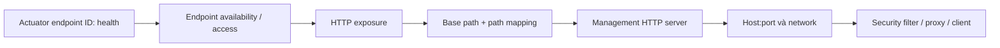
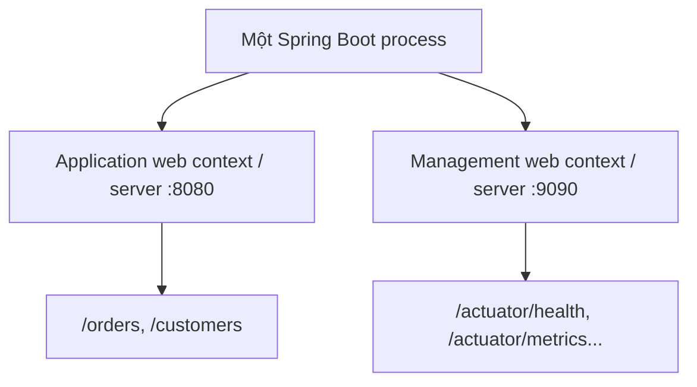
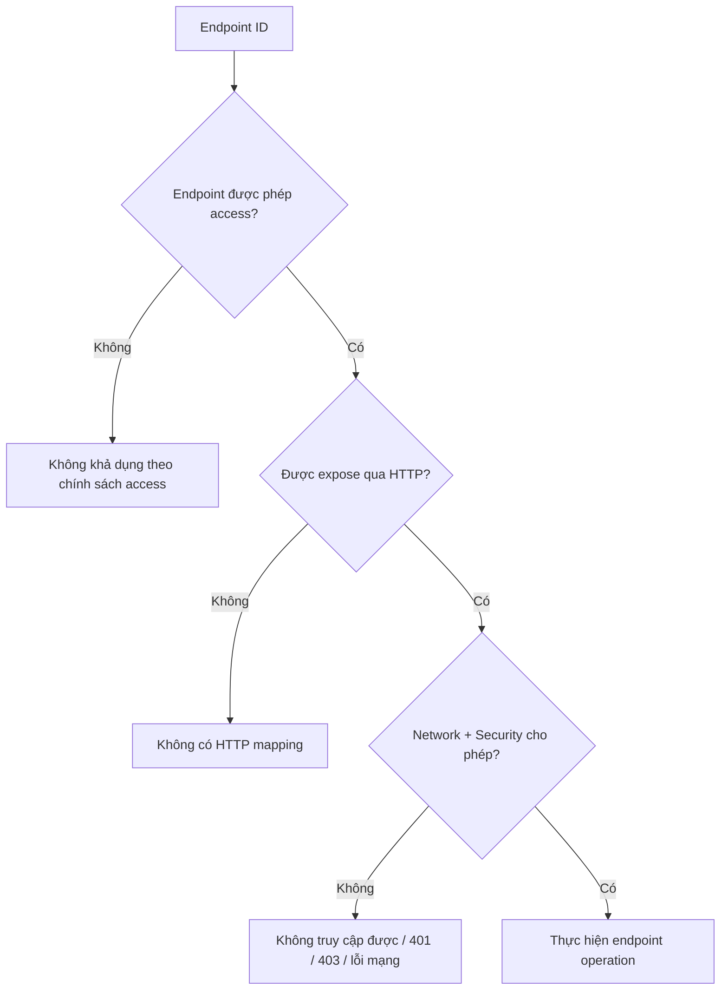
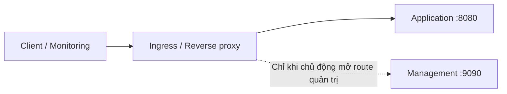
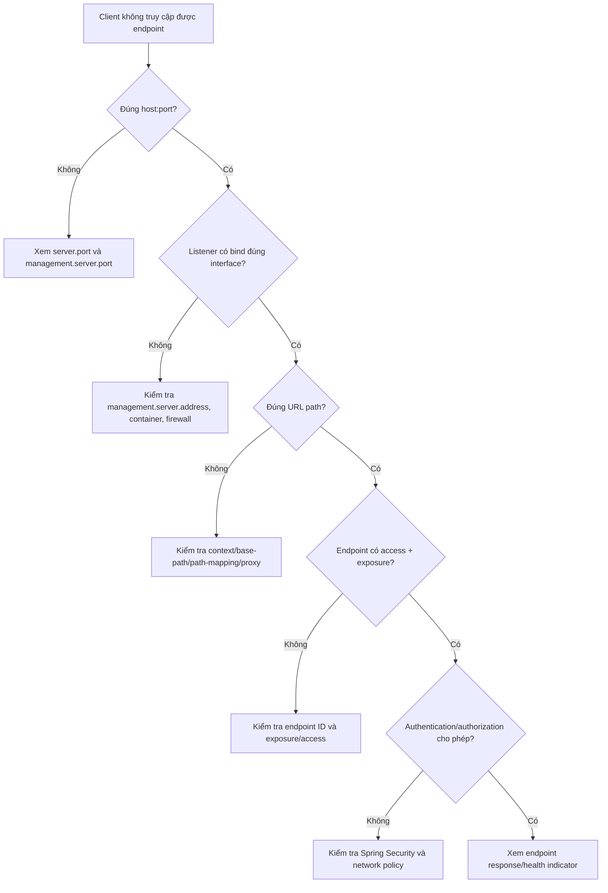
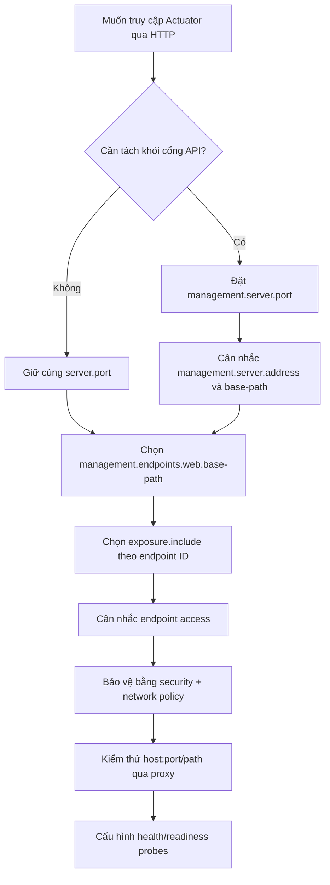

# Management path, port và phạm vi cấu hình cơ bản

Khi triển khai một ứng dụng Spring Boot, ngoài các API nghiệp vụ như `/orders` hay `/customers`, đội vận hành còn cần biết ứng dụng có khỏe không, đang chạy phiên bản nào, có những metric nào và liệu một instance đã sẵn sàng nhận request hay chưa. **Spring Boot Actuator** cung cấp các endpoint phục vụ quan sát và quản trị đó.

Ví dụ, sau khi thêm Actuator, một endpoint quen thuộc là:

```text
GET http://localhost:8080/actuator/health
```

Tuy nhiên, trong thực tế bạn có thể cần:

- Đổi tiền tố `/actuator` thành `/manage`.
- Chuyển những endpoint quản trị sang cổng `9090`, tách khỏi cổng nghiệp vụ `8080`.
- Chỉ cho truy cập từ mạng nội bộ hoặc `localhost`.
- Chọn endpoint nào thực sự được mở qua HTTP.
- Giữ health/readiness probe có thể kiểm tra được nhưng không công khai các endpoint nhạy cảm.
- Xác định URL cuối cùng khi ứng dụng có `server.servlet.context-path`, reverse proxy hoặc management server riêng.

Các yêu cầu này liên quan đến **những nhóm property khác nhau**. Đổi path không tương đương đổi port; đổi port không tự bảo vệ endpoint; một endpoint tồn tại trong ứng dụng cũng không có nghĩa nó đã được expose qua HTTP.

Bài học sẽ xây dựng mô hình rõ ràng cho management **path**, **port**, **address**, **exposure** và **access**, minh họa các cấu hình Spring Boot thường gặp, rồi giải thích cách lựa chọn hợp lý cho local development, máy chủ nội bộ và môi trường container.

## 1. Actuator endpoint là gì?

Spring Boot Actuator là tập chức năng quan sát và quản lý ứng dụng. Khi dependency và auto-configuration phù hợp có trên classpath, Boot cung cấp các endpoint với **ID** riêng.

Ví dụ:

| Endpoint ID | Công dụng phổ biến |
|---|---|
| `health` | Trạng thái sức khỏe của ứng dụng và các health indicator |
| `info` | Thông tin ứng dụng được cấu hình công bố |
| `metrics` | Liệt kê và xem các metric qua Micrometer |
| `prometheus` | Metric theo định dạng Prometheus; cần registry dependency tương ứng |
| `loggers` | Quan sát hoặc điều chỉnh mức log của logger |
| `env` | Xem thông tin về Environment/property sources theo chính sách bảo mật |
| `beans` | Thông tin các Bean trong ApplicationContext |
| `mappings` | Các request mapping của ứng dụng |
| `threaddump` | Thread dump phục vụ chẩn đoán |
| `heapdump` | Heap dump; có rủi ro lộ dữ liệu trong bộ nhớ |

Không phải mọi endpoint đều luôn được tạo hoặc khả dụng. Một số phụ thuộc vào thư viện bổ sung, loại ứng dụng, cấu hình truy cập và các điều kiện của Spring Boot.

Đối với HTTP, URL mặc định tuân theo quy ước:

```text
/{management-base-path}/{endpoint-id}

Ví dụ:
/actuator/health
/actuator/info
/actuator/metrics
```

Trong cách diễn đạt trên, `/actuator` là **base path của các web endpoint**, còn `health`, `info`, `metrics` là **endpoint IDs**. Không nên đánh đồng ID với phần đường dẫn có thể tùy chỉnh.

### Actuator không chỉ có HTTP

Spring Boot còn có thể expose endpoint qua JMX. Cấu hình HTTP exposure chỉ điều khiển **đường HTTP**, không nhất thiết vô hiệu hóa cùng endpoint trên mọi công nghệ khác.

Vì vậy câu hỏi “endpoint có tồn tại không?” khác với “endpoint có được HTTP expose không?” và khác với “ai được phép truy cập endpoint?”. Ta sẽ phân biệt các lớp đó ở những phần tiếp theo.

## 2. Thêm Actuator vào ứng dụng

Với một dự án Spring Boot dùng Gradle Groovy DSL, khai báo dependency trong module ứng dụng:

```groovy
dependencies {
    implementation 'org.springframework.boot:spring-boot-starter-web'
    implementation 'org.springframework.boot:spring-boot-starter-actuator'
}
```

Nếu dùng Maven:

```xml
<dependency>
    <groupId>org.springframework.boot</groupId>
    <artifactId>spring-boot-starter-actuator</artifactId>
</dependency>
```

Giả định project đã có Spring Boot plugin/dependency management phù hợp. Starter web chỉ là ví dụ cho một ứng dụng Servlet REST; Actuator cũng hỗ trợ Spring WebFlux và các loại tích hợp khác.

Một ứng dụng tối thiểu:

```java
package com.example.shop;

import org.springframework.boot.SpringApplication;
import org.springframework.boot.autoconfigure.SpringBootApplication;

@SpringBootApplication
public class ShopApplication {
    public static void main(String[] args) {
        SpringApplication.run(ShopApplication.class, args);
    }
}
```

Với ứng dụng web chạy ở cổng mặc định, thử:

```bash
curl -i http://localhost:8080/actuator/health
```

Kết quả minh họa khi health là `UP`:

```http
HTTP/1.1 200
Content-Type: application/vnd.spring-boot.actuator.v3+json

{"status":"UP"}
```

Header, media type và body thực tế có thể khác theo phiên bản Spring Boot, thư viện web, health indicators và cấu hình bảo mật. Điều quan trọng là bạn hiểu endpoint `health` được gắn với path mặc định `/actuator/health`.

**Mặc định trong Spring Boot hiện đại, chỉ endpoint `health` được expose qua HTTP.** Muốn truy cập `info`, `metrics` hoặc endpoint khác, cần xem cấu hình exposure và access. Cài Actuator không có nghĩa mọi URL `/actuator/{id}` đã được mở công khai.

## 3. Ba nhóm cấu hình: path, port và exposure

Đây là bảng phân loại quan trọng nhất của bài:

| Property | Điều chỉnh | Ví dụ |
|---|---|---|
| `management.endpoints.web.base-path` | Tiền tố đường dẫn các management endpoint qua HTTP | `/manage` |
| `management.endpoints.web.path-mapping.<id>` | Đường dẫn cụ thể của một endpoint | `health=healthcheck` |
| `management.server.port` | Cổng HTTP dành cho management endpoint | `9090` |
| `management.server.address` | Địa chỉ mạng management server lắng nghe; yêu cầu dùng cổng riêng | `127.0.0.1` |
| `management.server.base-path` | Base path của management server khi dùng cổng riêng | `/ops` |
| `management.endpoints.web.exposure.include` | Endpoint IDs được expose qua HTTP | `health,info,metrics` |
| `management.endpoints.web.exposure.exclude` | Endpoint IDs bị loại khỏi HTTP exposure | `env,heapdump` |
| `management.endpoint.<id>.access` | Quyền truy cập endpoint ở các dòng Boot có API access tương ứng | `read-only`, `none` |
| `management.endpoint.health.show-details` | Mức chi tiết health response | `never`, `when-authorized`, `always` |

Nhóm thứ nhất quyết định **URL trông như thế nào**. Nhóm thứ hai điều khiển **server/cổng mạng**. Nhóm thứ ba điều chỉnh **endpoint nào có thể được truy cập và mức chi tiết thông tin**.



Một path hợp lệ không bảo đảm endpoint được expose. Một endpoint được expose không bảo đảm mạng cho phép tới được. Và đến được qua mạng không có nghĩa người gọi đã được ủy quyền sử dụng endpoint.

## 4. Đổi management base path trên cùng cổng

Mặc định, endpoint health có URL:

```text
http://localhost:8080/actuator/health
```

Đổi tiền tố thành `/manage`:

**application.properties**

```properties
management.endpoints.web.base-path=/manage
```

**application.yml**

```yaml
management:
  endpoints:
    web:
      base-path: /manage
```

Sau khi cấu hình:

```text
GET http://localhost:8080/manage/health
```

và nếu `info` được phép truy cập cũng như được expose:

```text
GET http://localhost:8080/manage/info
```

Việc này **không đổi endpoint ID**. ID vẫn là `health` hoặc `info`, chỉ đường dẫn HTTP thay đổi.

### Không nhầm path với bảo mật

Đổi `/actuator` thành một tên khó đoán không phải biện pháp bảo mật. Người dùng có thể khám phá path qua log, proxy rule, source/configuration hoặc các nguồn thông tin khác. Những endpoint nhạy cảm vẫn cần xác thực, phân quyền và giới hạn mạng.

### Base path=/ nghĩa là gì?

Bạn có thể muốn health endpoint ở ngay gốc:

```properties
management.endpoints.web.base-path=/
```

Khi đó endpoint `health` có thể được map thành `/health` trên HTTP server tương ứng nếu không có context path hoặc mapping khác. Nhưng cần tránh xung đột với controller hoặc resource cùng path. Trong ứng dụng có endpoint nghiệp vụ `/health`, hãy kiểm tra mapping trước khi chọn base path là `/`.

## 5. Đổi riêng đường dẫn của một endpoint

Không cần thay base path cho mọi endpoint khi bạn chỉ muốn đổi health URL.

Ví dụ:

```properties
management.endpoints.web.path-mapping.health=healthcheck
```

Nếu base path mặc định còn là `/actuator`, đường dẫn health trở thành:

```text
/actuator/healthcheck
```

Muốn health ngay tại `/healthcheck`:

```properties
management.endpoints.web.base-path=/
management.endpoints.web.path-mapping.health=healthcheck
```

Tương đương YAML:

```yaml
management:
  endpoints:
    web:
      base-path: /
      path-mapping:
        health: healthcheck
```

Điều này chỉ đổi **HTTP mapping** của endpoint. Khi đặt exposure, access hoặc các property khác liên quan tới endpoint, bạn vẫn dùng endpoint ID `health`:

```properties
management.endpoints.web.exposure.include=health,info
```

Không thay ID thành `healthcheck` trong `exposure.include` chỉ vì URL đã được remap. Đây là lỗi cấu hình dễ gặp khi tổ chức ingress hoặc health probe.

## 6. Đặt context path cho ứng dụng và ảnh hưởng tới Actuator

Một Servlet web application có thể có:

```properties
server.port=8080
server.servlet.context-path=/shop
```

Ứng dụng nghiệp vụ khi đó thường nhận request dưới context path `/shop`:

```text
http://localhost:8080/shop/orders
```

Nếu management endpoint **dùng cùng cổng web** và base path là mặc định `/actuator`, URL health thường là:

```text
http://localhost:8080/shop/actuator/health
```

Nếu tiếp tục cấu hình:

```properties
management.endpoints.web.base-path=/manage
```

URL chuyển thành:

```text
http://localhost:8080/shop/manage/health
```

**Quy tắc quan trọng:** khi management endpoint dùng **cùng HTTP port** trong Servlet application, `management.endpoints.web.base-path` được tính tương đối so với `server.servlet.context-path`.

Với **Spring WebFlux**, tài liệu Boot dùng `spring.webflux.base-path` làm cơ sở tương ứng trong trường hợp cùng port, không phải `server.servlet.context-path`.

### Bảng URL ở chế độ cùng cổng

| `server.servlet.context-path` | `management.endpoints.web.base-path` | Health URL path |
|---|---|---|
| Không đặt | `/actuator` | `/actuator/health` |
| `/shop` | `/actuator` | `/shop/actuator/health` |
| `/shop` | `/manage` | `/shop/manage/health` |
| Không đặt | `/manage` | `/manage/health` |
| `/shop` | `/` | `/shop/health` |

Các ví dụ giả định endpoint `health` đã được expose, không bị remap và không có rewrite path ở reverse proxy. URL external mà client nhìn thấy còn phụ thuộc ingress/gateway.

## 7. Tách cổng quản trị khỏi cổng ứng dụng

Khi muốn API nghiệp vụ chạy ở `8080` nhưng Actuator ở `9090`:

```properties
server.port=8080
management.server.port=9090
```

Kết quả minh họa:

```text
Ứng dụng:
  http://localhost:8080/orders

Management:
  http://localhost:9090/actuator/health
```

Tách cổng là lựa chọn hữu ích khi hệ thống mạng hoặc firewall có thể giới hạn traffic tới cổng quản trị khác với cổng nghiệp vụ.

### Hai web contexts trong cùng một process

Khi management port khác application port, Spring Boot có thể tổ chức management web server qua một **management ApplicationContext riêng**. Context quản trị có quan hệ lifecycle và configuration với ứng dụng chính, nhưng không nên coi cả hai là một URL namespace duy nhất.



Đây là sơ đồ khái niệm. Cấu trúc context có thể khác theo phiên bản/loại web stack. Điều thực tế cần nhớ: tách management port dẫn tới một HTTP listener riêng và **quy tắc tính management base path thay đổi**.

### Management path khi dùng cổng riêng

Nếu ứng dụng có:

```properties
server.port=8080
server.servlet.context-path=/shop
management.server.port=9090
management.endpoints.web.base-path=/manage
```

Thì URL management dự kiến là:

```text
http://localhost:9090/manage/health
```

**Không tự động là** `/shop/manage/health`, vì management endpoint giờ sử dụng server riêng. Trong trường hợp này, `management.endpoints.web.base-path` được tính tương đối so với `management.server.base-path`, không phải `server.servlet.context-path` của cổng ứng dụng.

Muốn có tiền tố ở cấp management server:

```properties
management.server.port=9090
management.server.base-path=/ops
management.endpoints.web.base-path=/manage
```

Theo quy tắc cộng path của management server riêng, URL health thành:

```text
http://localhost:9090/ops/manage/health
```

Đừng cộng thêm `/shop` của ứng dụng nghiệp vụ vào URL quản trị ở cổng khác.

### Khi nào nên giữ cùng cổng?

Trong nhiều môi trường cloud, việc triển khai và quản lý firewall/probe dễ hơn khi cả API và management endpoint ở cùng cổng. Với một số platform, chỉ một cổng được expose thuận tiện; mở thêm cổng quản trị có thể đòi hỏi network rule, service/ingress hoặc route riêng.

Tách cổng là một công cụ kiến trúc, không phải mặc định bắt buộc cho mọi ứng dụng. Quyết định dựa vào mô hình vận hành và quyền truy cập, không chỉ thói quen.

## 8. Giới hạn interface bằng management.server.address

Chuyển Actuator sang cổng riêng chưa chắc đã đủ: nếu cổng quản trị bind vào mọi interface mạng, máy khác có thể kết nối tới nó khi firewall cho phép.

Ví dụ chỉ cho management server lắng nghe ở loopback:

```properties
server.port=8080
management.server.port=9090
management.server.address=127.0.0.1
```

Khi đó, trong mô hình mạng thông thường:

- Client chạy cùng máy có thể gọi `http://127.0.0.1:9090/actuator/health`.
- Client từ máy khác không thể trực tiếp kết nối tới địa chỉ loopback đó chỉ qua IP mạng ngoài.
- API nghiệp vụ trên `server.port=8080` vẫn có thể dùng địa chỉ bind riêng của nó.

**Điều kiện quan trọng:** Spring Boot chỉ cho cấu hình `management.server.address` thành địa chỉ khác theo cách này **khi management port khác application port**. Không nên đặt `management.server.address=127.0.0.1` trong khi dùng cùng port rồi kỳ vọng có hai listener độc lập.

### address không phải chính sách phân quyền

Bind địa chỉ mạng chỉ giới hạn nơi server lắng nghe. Nó **không** thay thế:

- Firewall/security group.
- Xác thực và phân quyền HTTP.
- NetworkPolicy trong Kubernetes.
- Cơ chế bảo vệ truy cập qua proxy hoặc service mesh.
- Chính sách không đưa endpoint nhạy cảm ra Internet.

Khi chạy trong container, `127.0.0.1` là loopback **của container hoặc network namespace tương ứng**, không nhất thiết là loopback của máy host hoặc một container khác. Nếu monitoring agent chạy ngoài container, nó có thể không tới được management port nếu server chỉ bind loopback.

Đừng đổi sang `0.0.0.0` chỉ để “cho Prometheus truy cập được” mà không kiểm soát đường mạng. Khi bind trên mọi interface, cần thiết kế rõ ai được phép kết nối.

## 9. Exposure: endpoint nào được mở qua HTTP?

Trong Spring Boot Actuator hiện đại, **mặc định chỉ `health` được expose qua HTTP**. Các endpoint khác không tự công khai trên web chỉ vì thư viện đã nằm trên classpath.

Muốn expose `health`, `info` và `metrics`:

```properties
management.endpoints.web.exposure.include=health,info,metrics
```

Tương đương:

```yaml
management:
  endpoints:
    web:
      exposure:
        include: health,info,metrics
```

Khi các endpoint đó tồn tại và được phép truy cập, URL mặc định có thể là:

```text
/actuator/health
/actuator/info
/actuator/metrics
```

Nếu bạn chỉ thay path:

```properties
management.endpoints.web.base-path=/manage
```

thì việc đó **không tự expose thêm** `info` hoặc `metrics`. Exposure vẫn là cơ chế độc lập.

### Exposure theo ID, không theo path

Giả sử:

```properties
management.endpoints.web.base-path=/manage
management.endpoints.web.path-mapping.health=check
management.endpoints.web.exposure.include=health,info
```

Endpoint IDs vẫn là `health` và `info`, còn URL tương ứng:

```text
/manage/check
/manage/info
```

Trong `exposure.include`, bạn phải viết `health` chứ không phải `check` hoặc `/manage/check`.

### Exclude được ưu tiên

Bạn cũng có thể loại một số endpoint khỏi HTTP exposure:

```properties
management.endpoints.web.exposure.include=health,info,metrics,env
management.endpoints.web.exposure.exclude=env
```

Trong cấu hình này, `env` không được expose qua HTTP dù xuất hiện ở cả include và exclude. **Exclude thắng include**.

### Tại sao không nên expose tất cả?

Ví dụ:

```properties
management.endpoints.web.exposure.include=*
```

có thể khiến mọi endpoint khả dụng trở thành HTTP-exposed theo cấu hình access tương ứng. Điều đó làm tăng bề mặt tấn công và nguy cơ lộ cấu hình hoặc dữ liệu runtime. Các endpoint như `env`, `beans`, `heapdump`, `loggers`, `mappings` hoặc `threaddump` cần được đánh giá rất kỹ.

Nếu biểu diễn dấu `*` trong YAML, phải đặt trong dấu nháy:

```yaml
management:
  endpoints:
    web:
      exposure:
        include: "*"
```

Với YAML, dấu sao không được quote có ý nghĩa cú pháp khác nên có thể gây lỗi parse. Trong production, ưu tiên **allowlist hẹp** thay vì expose mọi endpoint rồi mới tìm cách chặn.

### Tắt HTTP management endpoint

Một cách là loại tất cả endpoint khỏi web exposure:

```properties
management.endpoints.web.exposure.exclude=*
```

Hoặc tắt management HTTP port theo cấu hình Boot:

```properties
management.server.port=-1
```

Đây là hai cách khác nhau. `exposure.exclude=*` ngăn các endpoint Actuator được expose qua HTTP; `management.server.port=-1` tắt management HTTP endpoints qua cổng quản trị. Chúng **không đồng nghĩa vô hiệu hóa mọi tính năng nội bộ hoặc mọi kênh quản trị như JMX**.

## 10. Phân biệt endpoint access, exposure và Spring Security

Ba lớp kiểm soát thường bị gộp chung:

1. **Endpoint access/availability:** endpoint có được phép sử dụng hoặc bị loại khỏi context không?
2. **HTTP exposure:** endpoint có được map ra HTTP không?
3. **HTTP security/network:** request đến endpoint đó có được chấp nhận theo authentication, authorization và network policy không?



### Access trong các dòng Spring Boot mới

Spring Boot hiện đại có những property như:

```properties
management.endpoints.access.default=none
management.endpoint.health.access=read-only
management.endpoint.info.access=read-only
```

Ý tưởng: mặc định không cho endpoint access, rồi chỉ mở quyền đọc đối với những endpoint cần thiết. Các giá trị và phạm vi áp dụng phải được đối chiếu với dòng Boot thực tế; đặc biệt, không lấy property của dòng mới rồi giả định mọi phiên bản Boot 2.x đều hỗ trợ.

Một ví dụ khác:

```properties
management.endpoints.access.max-permitted=read-only
```

Thuộc tính này giới hạn mức access tối đa để không endpoint nào được phép thực thi write operation qua chính sách access đó. Nó **không thay thế** cơ chế HTTP authentication/authorization.

**Khác biệt quan trọng:** khi endpoint access bị đặt thành `none` theo cơ chế hỗ trợ, endpoint có thể bị loại khỏi ApplicationContext. Ngược lại, `management.endpoints.web.exposure.exclude=...` chỉ nói rằng không có HTTP exposure cho ID đó; endpoint có thể còn tồn tại theo cơ chế khác.

### Mặc định bảo mật cần được hiểu theo ứng dụng

Nếu Spring Security có mặt trên classpath và **ứng dụng không tự định nghĩa SecurityFilterChain**, Spring Boot có thể tự áp dụng bảo vệ mặc định cho nhiều Actuator endpoints, trong khi health thường được phép truy cập theo chính sách mặc định.

Nhưng nếu bạn tự định nghĩa `SecurityFilterChain`, Spring Boot thường **nhường việc cấu hình web security cho bạn**. Khi đó không nên giả định Actuator vẫn được bảo vệ chính xác như trong ứng dụng chưa có custom security chain.

Vì vậy:

- Chỉ expose endpoint cần thiết.
- Thiết kế HTTP security rõ ràng.
- Hạn chế truy cập qua network.
- Kiểm tra endpoint từ cả phía nội bộ và phía Internet/external ingress.
- Không coi việc đổi path thành một cách bảo mật.

### Không nhầm 404, 401 và 403

Khi gọi `/actuator/metrics` thất bại:

| Dấu hiệu | Có thể có nghĩa |
|---|---|
| HTTP 404 | Endpoint chưa được expose, không tồn tại, path sai, hoặc routing không đúng |
| HTTP 401 | Security yêu cầu xác thực |
| HTTP 403 | Đã đến security layer nhưng bị từ chối quyền, hoặc chính sách bảo vệ khác |
| Connection refused | Không có listener trên host/port được gọi, hoặc bị từ chối ở tầng kết nối |
| Timeout | Đường mạng, firewall, proxy hoặc server không phản hồi trong thời hạn |

Không thể xác định nguyên nhân chỉ từ một status code nếu không biết toàn bộ network/security topology. Ví dụ HTTP 404 cũng có thể do ingress không route tới server quản trị đúng cổng.

## 11. Health endpoint và phạm vi thông tin phản hồi

`/actuator/health` thường là endpoint được expose mặc định để hệ thống giám sát biết trạng thái tổng thể.

Phản hồi tối giản:

```json
{
  "status": "UP"
}
```

Bạn có thể điều chỉnh mức chi tiết hiển thị:

```properties
management.endpoint.health.show-details=never
```

Các giá trị phổ biến:

| Giá trị | Ý nghĩa |
|---|---|
| `never` | Không hiển thị chi tiết thành phần/health indicators |
| `when-authorized` | Chỉ hiển thị chi tiết khi người gọi đáp ứng điều kiện phân quyền |
| `always` | Cho phép trả chi tiết theo cấu hình health endpoint |

Ví dụ:

```properties
management.endpoint.health.show-details=when-authorized
management.endpoint.health.roles=OPS
```

Đây là một lựa chọn dành cho ứng dụng có cơ chế security/role phù hợp. Hãy kiểm tra cách Spring Boot xác định authorized user ở phiên bản và security stack thực tế.

**Cảnh báo:** cấu hình `always` có thể làm lộ thông tin về database, cache, dịch vụ ngoài hoặc cấu trúc hệ thống, tùy HealthIndicator và sanitization. Với endpoint health công khai cho probe, thường chỉ cần trạng thái tổng thể hoặc thông tin tối thiểu.

### Health status không đồng nhất với HTTP 200 trong mọi trường hợp

Một HealthIndicator có thể trả `UP`, `DOWN`, `OUT_OF_SERVICE` hoặc trạng thái tùy chỉnh. Spring Boot có thể map một số trạng thái như `DOWN`/`OUT_OF_SERVICE` thành HTTP 503 theo cấu hình status mapper.

Vì vậy khi kiểm thử endpoint health, hãy xem cả HTTP status và JSON body. Đừng hardcode một assumption rằng mọi response health đều là HTTP 200 hoặc rằng một lỗi kết nối nhất thiết là endpoint không tồn tại.

## 12. Liveness, readiness và health groups

Trong môi trường orchestration như Kubernetes, một health check tổng thể không luôn phù hợp cho mọi quyết định vận hành:

- **Liveness:** tiến trình có cần bị khởi động lại không?
- **Readiness:** instance có sẵn sàng nhận traffic mới không?

Spring Boot Actuator có thể công bố các health groups dành cho probes:

```text
/actuator/health/liveness
/actuator/health/readiness
```

Để chủ động bật probe support khi phù hợp:

```properties
management.endpoint.health.probes.enabled=true
```

Trong Kubernetes, Boot có thể tự phát hiện môi trường và bật cấu hình probes tương ứng; property tường minh hữu ích khi cần thử ngoài Kubernetes.

### Khi management port riêng: cẩn thận kết luận sai

Nếu `management.server.port=9090` và application port `8080`, health request trên port quản trị có thể thành công trong khi một thành phần của web server chính không thể nhận traffic. Lý do: probe chạy trên **management web server riêng**, không nhất thiết đi qua toàn bộ connector/path mà client nghiệp vụ dùng.

Để kiểm tra liveness/readiness **trên cổng ứng dụng chính** khi Boot hỗ trợ, có thể dùng:

```properties
management.endpoint.health.probes.enabled=true
management.endpoint.health.probes.add-additional-paths=true
```

Các additional paths thường được cung cấp trên main application port:

```text
/livez
/readyz
```

Đây là cách đưa probe về đường web server chính mà không cần expose toàn bộ management endpoints trên cổng đó. URL cuối cùng có thể phụ thuộc context path và mapping framework.

Trong Kubernetes, hãy kiểm tra readiness/liveness probe có thực sự gọi **đúng port, đúng path và đúng server** hay không. Một endpoint `/actuator/health/readiness` tồn tại ở management port không có nghĩa kubelet tự động biết phải gọi nó.

### Không thêm mọi external dependency vào liveness

Nếu liveness kiểm tra database hoặc broker bên ngoài và chúng tạm thời gặp sự cố, Kubernetes có thể restart hàng loạt instance mặc dù bản thân ứng dụng vẫn có thể phục hồi khi dependency trở lại. Thường nên giữ liveness tập trung vào trạng thái nội bộ cho khả năng tiếp tục hoạt động.

Readiness có thể có quy tắc khác vì mục đích là ngăn gửi traffic vào instance chưa sẵn sàng, nhưng cũng cần cân nhắc việc loại toàn bộ instance khỏi service khi một dependency chung gặp lỗi. Cấu hình health group cần dựa vào kiến trúc và mục tiêu vận hành.

## 13. TLS/SSL cho management server riêng

Khi ứng dụng dùng HTTPS nhưng Actuator phục vụ qua một cổng khác, có thể cấu hình TLS riêng cho management web server.

Ví dụ ý tưởng:

```properties
# Cổng nghiệp vụ dùng HTTPS
server.port=8443
server.ssl.enabled=true
server.ssl.key-store=classpath:certs/app.p12
server.ssl.key-store-type=PKCS12

# Cổng quản trị độc lập
management.server.port=9090
management.server.ssl.enabled=true
management.server.ssl.key-store=classpath:certs/management.p12
management.server.ssl.key-store-type=PKCS12
```

Ví dụ giả định certificate/key-store hợp lệ và password được cung cấp an toàn bằng property source bí mật hoặc hệ thống quản lý secret. **Không đưa key-store password thật vào tài liệu hay commit source**.

Khi dùng cổng riêng, bạn cũng có thể lựa chọn mô hình khác, chẳng hạn app HTTPS nhưng management HTTP chỉ trong mạng private do proxy/service mesh bảo vệ. Điều đó phải được quyết định theo threat model và topology, không phải mặc định rằng cổng quản trị “nội bộ” luôn an toàn.

### Không kết luận management SSL từ server.ssl

`server.ssl.*` cấu hình TLS của application web server. Khi management server dùng cổng riêng, các property `management.server.ssl.*` phục vụ TLS riêng của management listener. Không nên mặc định bật `server.ssl.enabled=true` rồi management port chắc chắn dùng cùng TLS, hoặc ngược lại.

Các trường hợp cần phân biệt:

| Application | Management | Ví dụ URL |
|---|---|---|
| HTTP port 8080 | Cùng HTTP port | `http://localhost:8080/actuator/health` |
| HTTPS port 8443 | Cùng HTTPS port | `https://localhost:8443/actuator/health` |
| HTTPS port 8443 | HTTP port 9090 riêng | `http://localhost:9090/actuator/health` |
| HTTPS port 8443 | HTTPS port 9090 riêng | `https://localhost:9090/actuator/health` |

Những URL trên là ví dụ khi cấu hình đã tương ứng, listener có thể kết nối và endpoint health được expose. Với TLS, client còn cần kiểm tra certificate, hostname và trust store.

## 14. Reverse proxy và ingress: URL nội bộ khác URL công khai

Trong deployment thật, người dùng thường không gọi thẳng embedded server. Một reverse proxy, API gateway hoặc ingress nhận request trước:



Giả sử ứng dụng nội bộ dùng:

```text
http://app-container:8080/shop/orders
http://app-container:9090/actuator/health
```

Một reverse proxy có thể public URL theo prefix khác:

```text
https://api.example.com/orders
https://ops.internal.example.com/health
```

**URL client nhìn thấy không nhất thiết trùng URL mà Spring Boot đã map.** Proxy có thể strip prefix, rewrite path, terminate TLS và chuyển request sang cổng khác.

Do đó, để xác định health endpoint phải gọi:

1. Xem `server.port` và `management.server.port`.
2. Xem base path, context path và path mapping của Spring Boot.
3. Xem reverse-proxy rewrite rule.
4. Xem target port mà Service/Ingress/LB đang trỏ đến.
5. Kiểm tra security, HTTP method và IP/network access.

Không nên “sửa” lỗi reverse proxy bằng cách ngẫu nhiên đổi `management.endpoints.web.base-path` cho tới khi URL chạy được. Làm vậy có thể vô tình đưa Actuator lên một path không mong muốn.

### Cùng cổng không có nghĩa buộc công khai mọi path

Nếu application và Actuator cùng lắng nghe cổng 8080, reverse proxy vẫn có thể chặn route `/actuator/**` đối với Internet và chỉ cho mạng quản trị truy cập. Nhưng đây là policy của proxy/firewall, không phải do Spring Boot tự bảo vệ chỉ nhờ dùng chung cổng.

Đồng thời, application security cũng phải bao phủ Actuator phù hợp: không nên dựa hoàn toàn vào một lớp proxy nếu có đường trực tiếp khác tới backend.

### Cổng riêng nhưng sai Kubernetes Service

Ví dụ container lắng nghe:

```text
Application port: 8080
Management port: 9090
```

Nếu Kubernetes Service chỉ forward `port: 80 -> targetPort: 8080`, yêu cầu tới cổng 9090 qua Service đó sẽ không tự tới management server. Muốn monitoring scrape management port, cần có Service/port/rule riêng phù hợp hoặc monitor trực tiếp đúng Pod endpoint theo topology.

Không cần expose 9090 ra public ingress chỉ để kubelet thực hiện health probe. Kubelet có thể probe qua Pod IP và port phù hợp nếu management server bind đúng address và network policy cho phép.

## 15. Ví dụ cấu hình A — Local development trên một cổng

Đây là cấu hình nhẹ để lập trình và kiểm tra API:

**application.yml**

```yaml
server:
  port: 8080

management:
  endpoints:
    web:
      base-path: /actuator
      exposure:
        include: health,info,metrics
  endpoint:
    health:
      show-details: always
```

Các URL dự kiến:

```text
http://localhost:8080/actuator/health
http://localhost:8080/actuator/info
http://localhost:8080/actuator/metrics
```

Ví dụ dùng `show-details: always` **chỉ cho môi trường phát triển được kiểm soát**, để dễ quan sát health indicators. Khi đưa lên môi trường chia sẻ hoặc production, thường nên thu hẹp detail và exposure.

Nếu `/actuator/info` trả object trống, chưa chắc có lỗi. Endpoint info có thể không có contributor nào công bố thông tin. Nếu `/actuator/metrics` không có những metric bạn kỳ vọng, cần xem Micrometer instrumentation và dependency phù hợp.

## 16. Ví dụ cấu hình B — API và management dùng cổng riêng

**application.yml**

```yaml
server:
  port: 8080
  servlet:
    context-path: /shop

management:
  server:
    port: 9090
    address: 127.0.0.1
    base-path: /ops
  endpoints:
    web:
      base-path: /manage
      exposure:
        include: health,info
  endpoint:
    health:
      show-details: never
```

Với Servlet web stack, đường dẫn dự kiến:

```text
Nghiệp vụ:
  http://localhost:8080/shop/orders

Quản trị:
  http://127.0.0.1:9090/ops/manage/health
  http://127.0.0.1:9090/ops/manage/info
```

Điểm đáng chú ý:

- Management port là `9090`, không phải `8080`.
- Management listener chỉ bind `127.0.0.1` trong môi trường mạng thông thường.
- `/ops` là base path của management server riêng.
- `/manage` là base path của Actuator HTTP endpoints.
- `/shop` thuộc application Servlet context path, không tự cộng vào URL management ở cổng riêng.
- Health không công khai details; chỉ health và info được HTTP-expose.

Nếu ứng dụng được chạy trong container, cấu hình `address: 127.0.0.1` có thể khiến agent bên ngoài container không tới được endpoint. Đây là chủ ý bảo mật hoặc lỗi reachability tùy mô hình triển khai.

## 17. Ví dụ cấu hình C — Monitoring metrics bằng Prometheus

Nếu cần Prometheus scrape, thông thường cần thêm registry dependency:

```groovy
dependencies {
    implementation 'org.springframework.boot:spring-boot-starter-actuator'
    runtimeOnly 'io.micrometer:micrometer-registry-prometheus'
}
```

Sau đó expose endpoint:

```properties
management.endpoints.web.exposure.include=health,prometheus
```

Nếu dùng cấu hình cùng cổng mặc định, scrape path dự kiến:

```text
GET /actuator/prometheus
```

Nếu đổi:

```properties
management.server.port=9090
management.endpoints.web.base-path=/manage
```

thì scrape URL bên trong mạng có thể là:

```text
http://<host>:9090/manage/prometheus
```

Thay `<host>` bằng hostname/IP có thể truy cập từ Prometheus; hostname ở đây là ký hiệu minh họa, không phải cấu hình Java.

**Quan trọng:** chỉ thêm `prometheus` vào `exposure.include` không tự tạo endpoint nếu ứng dụng chưa có registry/dependency cần thiết. Ngoài ra, Prometheus có thể cần network permission và authentication tương ứng; không nên biến scrape endpoint thành một public URL không bảo vệ.

## 18. Ví dụ cấu hình D — Bật health probes trên cổng ứng dụng

Giả sử một container chạy API trên 8080 và Actuator trên 9090, nhưng hệ thống orchestration muốn probe ngay trên cổng thực sự nhận HTTP nghiệp vụ.

```properties
server.port=8080
management.server.port=9090

management.endpoints.web.exposure.include=health,info
management.endpoint.health.probes.enabled=true
management.endpoint.health.probes.add-additional-paths=true
```

Khi framework hỗ trợ cấu hình probes này, các URL có thể là:

```text
API server :8080
  /livez
  /readyz

Management server :9090
  /actuator/health
  /actuator/health/liveness
  /actuator/health/readiness
```

Trong hệ thống có application context path hoặc reverse proxy, xác nhận path thực tế trước khi viết health-probe configuration. Đừng giả định kubelet tự tìm được endpoint chỉ vì Spring Boot đã tạo nó.

### Tại sao không luôn probe qua management port?

Một management server có thể vẫn khỏe trong khi application server gặp lỗi trên connector riêng. Probe trên cổng quản trị có thể không đại diện hoàn toàn cho khả năng nhận traffic của web server chính. Additional health paths trên main port giúp kiểm tra một đường truy cập gần hơn với traffic nghiệp vụ.

Tuy nhiên, probe chỉ là tín hiệu vận hành, không thay thế integration test hay kiểm tra nghiệp vụ từ góc nhìn client bên ngoài.

## 19. Scope của property: ứng dụng chính và management context

Trong ứng dụng có management server riêng, cần phân biệt **property nào mô tả application server** và **property nào mô tả management server**.

| Nhóm | Ví dụ property | Ảnh hưởng chính |
|---|---|---|
| Application server | `server.port`, `server.address` | Cổng và địa chỉ nhận request nghiệp vụ |
| Servlet application context | `server.servlet.context-path` | Prefix servlet context khi sử dụng server Servlet |
| Reactive application base path | `spring.webflux.base-path` | Base path của WebFlux application |
| Management server | `management.server.port`, `management.server.address` | Listener dành cho Actuator |
| Management server root | `management.server.base-path` | Tiền tố của management server riêng |
| Actuator HTTP endpoint mapping | `management.endpoints.web.base-path`, `management.endpoints.web.path-mapping.*` | Đường dẫn tới từng endpoint |
| Actuator availability | `management.endpoints.web.exposure.*`, `management.endpoint.<id>.access` | Endpoint có thể được truy cập qua kênh tương ứng hay không |

Khi management dùng cùng port, nhiều thành phần nằm trong cùng web server và cùng prefix ứng dụng. Khi port riêng, management server có không gian path và listener riêng, nhưng cả hai vẫn thuộc cùng tiến trình Spring Boot và có quan hệ lifecycle.

### Một ứng dụng non-web có management HTTP endpoint không?

Nếu ứng dụng không chạy web stack, ví dụ:

```java
SpringApplication application =
        new SpringApplication(BatchApplication.class);
application.setWebApplicationType(WebApplicationType.NONE);
application.run(args);
```

thì không nên mặc định sẽ có Actuator HTTP listener chỉ vì đã thêm `spring-boot-starter-actuator`. Actuator có các cơ chế quản lý ngoài HTTP và các điều kiện auto-configuration riêng; cấu hình HTTP management port chỉ có ý nghĩa khi môi trường web và các thành phần cần thiết hỗ trợ nó.

Với một batch job, có thể chọn JMX, log, Micrometer metrics push hoặc cơ chế quản lý phù hợp khác. Đừng thiết kế health probe URL mà ứng dụng không thực sự tạo ra.

### Thêm một management port không tạo một process mới

Nếu main app và management port chạy trong cùng JVM, chúng vẫn chịu chung số phận của process: nếu JVM crash hoặc container bị kill, cả hai dừng. Management context riêng không phải một service giám sát độc lập có thể tiếp tục chạy sau khi ứng dụng chính chết.

Ngược lại, có thể có trường hợp management HTTP server còn phản hồi trong khi phần server nghiệp vụ gặp sự cố; vì vậy probe và monitoring cần chọn tầng đo lường phù hợp.

## 20. Cấu hình theo profile và nguồn bên ngoài

Nhiều dự án muốn local và production có cấu hình Actuator khác nhau:

**application.yml — cấu hình chung**

```yaml
management:
  endpoints:
    web:
      base-path: /actuator
      exposure:
        include: health
  endpoint:
    health:
      show-details: never
```

**application-dev.yml — môi trường phát triển**

```yaml
management:
  endpoints:
    web:
      exposure:
        include: health,info,metrics
  endpoint:
    health:
      show-details: always
```

**application-prod.yml — môi trường triển khai**

```yaml
management:
  server:
    port: 9090
  endpoints:
    web:
      exposure:
        include: health,prometheus
```

Tại production, exposure thực tế còn phụ thuộc vào Prometheus registry và access/security. Ví dụ này minh họa cách tách **danh sách endpoint cần thiết theo môi trường**; không phải khuyến nghị mặc định mở Prometheus mà không có authentication hoặc giới hạn network.

### Profile không phải bảo mật

Không nên dựa vào `application-prod.yml` như biện pháp bí mật duy nhất cho management port hoặc credentials. Một cấu hình có thể bị ghi đè bởi environment variables, command-line arguments, config import hoặc deployment manifest.

Khi điều tra ứng dụng chạy không đúng cổng hoặc exposure, cần kiểm tra **giá trị cuối cùng có hiệu lực** và nguồn cấu hình nào đã cung cấp nó. Một file đúng chưa chắc là nguồn có mức ưu tiên cao nhất.

### Command-line override tạm thời

Ví dụ chạy local với management trên 9191:

```bash
java -jar app.jar --management.server.port=9191
```

Hoặc đổi base path:

```bash
java -jar app.jar --management.endpoints.web.base-path=/ops
```

Những giá trị này là property được Boot đọc lúc khởi động. Đừng giả định sửa file cấu hình hoặc đổi biến môi trường **sau khi context đã chạy** sẽ tự đổi cổng HTTP management; thông thường cần khởi động lại application context/process theo cách phù hợp.

## 21. Checklist chẩn đoán lỗi không truy cập được Actuator

Khi `curl http://localhost:9090/actuator/health` không chạy, nên đi từ tầng ngoài vào tầng trong:



### A. Port đúng không?

```properties
server.port=8080
management.server.port=9090
```

Với cấu hình này, gọi `http://localhost:8080/actuator/health` có thể không đúng nữa; endpoint quản trị ở cổng 9090. Hãy đọc log startup và cấu hình runtime để xác nhận listener đã bind thành công.

### B. Address đúng không?

```properties
management.server.port=9090
management.server.address=127.0.0.1
```

Một monitoring agent chạy trên máy khác thường không thể kết nối tới listener chỉ bind loopback. Trong container, loopback của container khác không phải loopback của container ứng dụng.

### C. URL path có bị cộng sai context path?

Ứng dụng:

```properties
server.servlet.context-path=/shop
management.server.port=9090
management.endpoints.web.base-path=/manage
```

Nếu management port khác application port, **đừng** tự cộng `/shop` vào đường dẫn quản trị. Với cấu hình đơn giản đó, health thường ở `:9090/manage/health`.

### D. Đã expose ID tương ứng chưa?

Nếu `/actuator/health` hoạt động nhưng `/actuator/metrics` trả 404:

```properties
management.endpoints.web.exposure.include=health,metrics
```

Với metrics, cũng cần các dependency/component đo lường phù hợp. Nếu endpoint đã được remap, hãy dùng URL mới nhưng vẫn ghi ID gốc trong exposure.

### E. Có security không?

Nếu nhận 401/403, xem cấu hình Spring Security, thông tin đăng nhập và vai trò của người gọi. Khi ứng dụng có custom `SecurityFilterChain`, phải kiểm tra filter chain nào áp dụng cho Actuator thay vì giả định default security vẫn tồn tại.

### F. Có ingress/service route và firewall không?

Nếu truy cập nội bộ Pod thành công nhưng URL external thất bại, kiểm tra proxy/ingress/Service target port, path rewrite, TLS termination và NetworkPolicy. Việc endpoint hoạt động trong JVM không có nghĩa đã có route từ client.

### G. Probe path thực sự nằm ở đâu?

Nếu dùng `management.endpoint.health.probes.add-additional-paths=true`, kiểm tra `/livez`/`/readyz` trên main port. Nếu không có additional paths, cần kiểm tra vị trí health groups trên management port hoặc same-port tương ứng.

## 22. Những hiểu nhầm dễ gặp

**“Thêm Actuator là mọi endpoint đều có URL.”** Không. Cần endpoint khả dụng và được expose qua kênh HTTP; mặc định chỉ health được HTTP expose ở Spring Boot hiện đại.

**“Đổi `management.endpoints.web.base-path` là đã đổi port.”** Không. Base path chỉ điều chỉnh đường dẫn. Cổng do `management.server.port` hoặc `server.port` quyết định.

**“Đặt `management.server.port=9090` khiến API nghiệp vụ chạy ở 9090.”** Không. API nghiệp vụ tiếp tục theo application server; Actuator quản trị sử dụng management server riêng.

**“Đổi context path của app thì management port riêng cũng dùng context path đó.”** Không. Cổng quản trị riêng tính base path theo management server configuration.

**“Đặt `management.server.address=127.0.0.1` có tác dụng khi dùng chung port.”** Cấu hình address độc lập yêu cầu management server dùng cổng khác cổng ứng dụng.

**“Chỉ cần đổi `/actuator` thành URL khó đoán là đã an toàn.”** Không. Path không thay thế security.

**“Include bằng dấu `*` trong YAML không cần quote.”** Không. Dùng `include: "*"` nếu thật sự muốn include tất cả và đã đánh giá rủi ro.

**“Đã expose endpoint nghĩa là mọi người đều được truy cập.”** Không. Mạng, authentication, authorization và endpoint access có thể chặn.

**“`management.endpoints.web.exposure.exclude=*` tắt mọi khả năng quản trị.”** Không. Nó ngăn HTTP exposure của endpoint, không nhất thiết vô hiệu hóa JMX và mọi component nội bộ.

**“Management health trả UP thì API chính chắc chắn nhận traffic.”** Không. Đặc biệt với cổng riêng, health có thể không đi qua connector của ứng dụng chính.

**“Mọi request 404 từ Actuator đều vì thiếu dependency.”** Không. Sai path, sai port, chưa expose hoặc proxy rewrite cũng có thể tạo 404.

**“Có `prometheus` trong include thì endpoint Prometheus chắc chắn tồn tại.”** Không. Cần registry dependency và auto-configuration tương ứng.

**“Quyền access endpoint và HTTP authentication là một thứ.”** Không. Chúng là hai lớp kiểm soát khác nhau và cần được cấu hình phù hợp với dòng Boot.

## 23. Bài thực hành với bốn cấu hình

Hãy tạo một ứng dụng Spring Boot REST nhỏ có `spring-boot-starter-actuator` và một endpoint nghiệp vụ:

```java
@RestController
public class PingController {
    @GetMapping("/ping")
    String ping() {
        return "pong";
    }
}
```

### Bài 1 — Cùng cổng, path mặc định

```properties
server.port=8080
management.endpoints.web.exposure.include=health,info
```

Thử:

```bash
curl -i http://localhost:8080/ping
curl -i http://localhost:8080/actuator/health
curl -i http://localhost:8080/actuator/info
```

Ghi lại HTTP status và body. Nếu info trống, xem lại các info contributors thay vì mặc định endpoint hỏng.

### Bài 2 — Đổi base path

```properties
management.endpoints.web.base-path=/manage
```

Thử `/manage/health`, đồng thời gọi lại `/actuator/health` để thấy path cũ không còn là mapping mặc định.

### Bài 3 — Cổng riêng, Servlet context path

```properties
server.port=8080
server.servlet.context-path=/shop
management.server.port=9090
management.endpoints.web.base-path=/manage
```

Thử:

```bash
curl -i http://localhost:8080/shop/ping
curl -i http://localhost:9090/manage/health
```

Sau đó thử URL sai `http://localhost:9090/shop/manage/health` và lý giải vì sao `/shop` không tự động là tiền tố của management port riêng.

### Bài 4 — Path mapping và exposure

```properties
management.endpoints.web.base-path=/
management.endpoints.web.path-mapping.health=healthcheck
management.endpoints.web.exposure.include=health
```

Thử:

```bash
curl -i http://localhost:8080/healthcheck
curl -i http://localhost:8080/actuator/health
```

Sau đó bổ sung `metrics` vào exposure, kiểm tra path và nhận diện vì sao endpoint ID khác path được nhìn thấy trên URL.

### Mẫu bảng ghi nhận kết quả

| Lần chạy | Application port/path | Management port/path | Endpoint IDs exposed | Kết quả health |
|---|---|---|---|---|
| 1 | ... | ... | ... | ... |
| 2 | ... | ... | ... | ... |
| 3 | ... | ... | ... | ... |
| 4 | ... | ... | ... | ... |

Ghi nhận kết quả thực tế ở đúng môi trường bạn chạy. Nếu các property cũ vẫn còn ở file hoặc profile khác, chúng có thể làm thay đổi kết quả; mỗi lần thực hành nên bảo đảm cấu hình cuối cùng đã được xác định rõ.

## 24. Sơ đồ lựa chọn cấu hình



## 25. Ghi nhớ cuối cùng

Có thể hình dung một URL management trong Spring Boot bằng công thức:

```text
Scheme + Host + Port
    + (Application context path hoặc Management server base path)
    + Management endpoints web base path
    + Endpoint path mapping/ID
```

Nhưng **chỉ khi endpoint được phép truy cập, đã expose và đường mạng/security cho phép**, URL đó mới thực sự sử dụng được.

Hãy nhớ:

- `management.endpoints.web.base-path` đổi **tiền tố URL** của Actuator.
- `management.endpoints.web.path-mapping.<id>` đổi **đường dẫn** một endpoint mà không đổi ID.
- `management.server.port` tạo **cổng HTTP quản trị riêng** khi khác application port.
- `management.server.address` giới hạn **địa chỉ lắng nghe** khi có cổng quản trị riêng.
- `management.server.base-path` áp dụng cho **management server riêng**, độc lập với Servlet context path của ứng dụng chính.
- `management.endpoints.web.exposure.include/exclude` chọn **endpoint IDs được đưa ra HTTP**.
- Endpoint access, Spring Security và network policy quyết định **khả năng truy cập an toàn**.
- Health/readiness cần được probe trên **đúng server và đúng network path** mà hệ thống vận hành mong muốn đo lường.

Khi thiết kế quan sát ứng dụng, đừng bắt đầu bằng câu hỏi “nên đổi `/actuator` thành tên gì?”. Hãy bắt đầu từ **ai cần theo dõi endpoint nào, qua cổng nào, từ mạng nào và với quyền gì**. Sau đó mới chọn path/port/exposure sao cho dễ vận hành, tránh công khai dữ liệu nhạy cảm và tạo được tín hiệu health đáng tin cậy.
