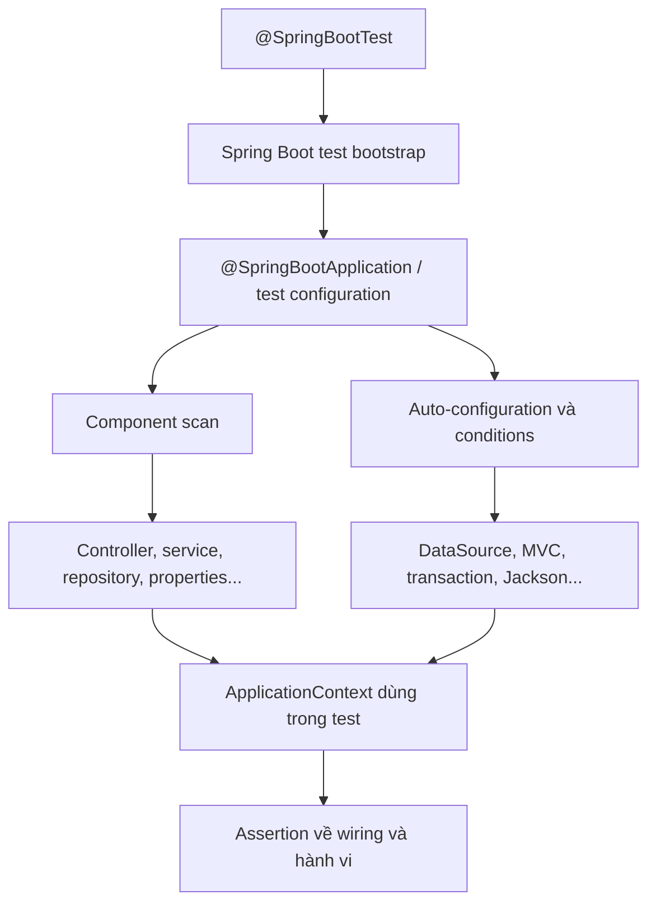
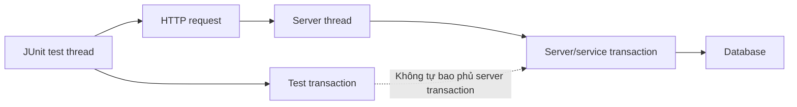

# @SpringBootTest để kiểm tra ứng dụng được lắp ghép đầy đủ

> **Spring Boot Fundamentals · Kiểm thử nền tảng**  
> Một service có thể vượt qua unit test nhưng ứng dụng vẫn không khởi động vì thiếu bean, sai cấu hình, repository không kết nối được database, transaction advice không được tạo hoặc một auto-configuration bị loại bởi condition. **`@SpringBootTest` kiểm tra một lát cắt rộng của hệ thống ở cấp Spring ApplicationContext**: Spring Boot khởi tạo ứng dụng bằng các cấu hình thực tế được chọn cho test, thực hiện component scanning, áp dụng auto-configuration và lắp ghép các bean. Nó đặc biệt phù hợp để phát hiện lỗi tích hợp giữa những thành phần mà unit test chạy riêng lẻ không thể thấy.

## 1. Tại sao kiểm thử một class riêng lẻ chưa đủ?

Giả sử ứng dụng có chuỗi xử lý:

```text
HTTP request
    ↓
OrderController
    ↓
OrderService
    ↓
OrderRepository
    ↓
DataSource
    ↓
Database
```

Unit test của `OrderService` có thể mock `OrderRepository` và xác nhận tính toán đúng. Nhưng khi chạy ứng dụng thật, lỗi vẫn có thể xuất hiện:

- `OrderController` không nằm trong phạm vi component scan.
- `OrderService` có hai implementation làm injection trở nên mơ hồ.
- Không có `DataSource` vì thiếu dependency hoặc URL cấu hình.
- `@ConfigurationProperties` chưa được đăng ký thành bean.
- Một `@ConditionalOnProperty` không khớp với profile đang bật.
- Repository được tạo nhưng schema chưa được migration.
- Security filter chặn endpoint mặc dù controller unit test hoàn toàn đúng.
- Một circular dependency hoặc bean initialization exception làm context không khởi động.

`@SpringBootTest` cho phép kiểm tra **khả năng khởi tạo và phối hợp các thành phần Spring**, thay vì chỉ kiểm tra logic bên trong từng class.



Điểm then chốt: `@SpringBootTest` khởi tạo một **application context hoàn chỉnh theo configuration, classpath, profile và test overrides đã chọn**, chứ không có nghĩa mọi bean của mọi profile hoặc mọi dịch vụ bên ngoài trên thế giới đều được chạy thật.

## 2. `@SpringBootTest` là gì?

`@SpringBootTest` là annotation từ Spring Boot Test, thường được dùng cùng JUnit Jupiter để khởi động một `ApplicationContext` theo cơ chế Spring Boot.

Ví dụ đơn giản:

```java
package com.example.shop;

import org.junit.jupiter.api.Test;
import org.springframework.boot.test.context.SpringBootTest;

@SpringBootTest
class ShopApplicationTests {

    @Test
    void contextLoads() {
        // Test đạt khi Spring context khởi động thành công.
    }
}
```

Nếu không có lỗi startup, test hoàn thành. Nếu thiếu một bean bắt buộc, property bind thất bại hoặc auto-configuration không thể hoàn tất, test có thể thất bại **ngay trong giai đoạn tạo ApplicationContext**, trước khi chạy thân method `contextLoads`.

### 2.1. Nó thực sự kiểm tra những gì?

Với một application configuration thông thường, phép thử có thể bao gồm:

- Tìm root configuration phù hợp.
- Khởi tạo Spring Boot application theo test bootstrap.
- Phát hiện các `@Component`, `@Service`, `@Repository`, `@Controller` nằm trong phạm vi scan.
- Xử lý các `@Configuration` và `@Bean` methods.
- Áp dụng các auto-configuration theo classpath, properties và conditions.
- Tạo dependency graph và inject beans.
- Bind các `@ConfigurationProperties`.
- Thiết lập những infrastructure beans được yêu cầu bởi dependency và môi trường.
- Thực hiện bean initialization callbacks phù hợp.
- Đóng context khi cache bị loại hoặc kết thúc vòng đời test.

Nếu test dùng web environment với server thật, phép thử còn có thể mở HTTP listener và xử lý request qua network.

### 2.2. Nó không tự chứng minh những gì?

Một test chỉ có `contextLoads()` không tự chứng minh:

- Mọi HTTP endpoint trả đúng response.
- Mọi database query đều đúng.
- Mọi integration bên ngoài đều có thể kết nối.
- Các bước transaction hoặc security được cấu hình theo mong muốn.
- Business rule được thực hiện đúng.
- Artifact đóng gói production có manifest và runtime classpath đúng.
- Production profile có cấu hình tương tự profile test.

Nó xác nhận context **có thể khởi động trong điều kiện của test**. Những yêu cầu còn lại phải được thể hiện bằng assertion hoặc test ở tầng phù hợp.

### 2.3. Phụ thuộc test cần có

Trong Maven project dùng Spring Boot dependency management, dependency phổ biến:

```xml
<dependency>
    <groupId>org.springframework.boot</groupId>
    <artifactId>spring-boot-starter-test</artifactId>
    <scope>test</scope>
</dependency>
```

Trong Gradle:

```groovy
dependencies {
    testImplementation 'org.springframework.boot:spring-boot-starter-test'
}

tasks.named('test') {
    useJUnitPlatform()
}
```

Starter test thường đem các thành phần Spring Test, Spring Boot Test, JUnit Jupiter, AssertJ, Mockito và công cụ hỗ trợ tương thích theo phiên bản. Không nên ghi cứng version của từng thư viện test mà không kiểm tra BOM/dependency management.

### 2.4. Có cần `@ExtendWith(SpringExtension.class)` không?

Với Spring Boot Test và JUnit Jupiter hiện đại, `@SpringBootTest` đã tích hợp cơ chế mở rộng Spring Test phù hợp. Trong tình huống phổ biến, **không cần viết thêm**:

```java
@ExtendWith(SpringExtension.class)
```

Chỉ thêm annotation hỗ trợ một cách có ý nghĩa khi framework/test setup thực tế yêu cầu. Tránh lặp annotation chỉ vì sao chép mẫu.

## 3. `@SpringBootTest` tìm application configuration như thế nào?

Khi không chỉ định root configuration rõ ràng, Spring Boot test bootstrap có thể tìm class được đánh dấu `@SpringBootConfiguration`, thường là class mang `@SpringBootApplication`, bằng cách đi từ package của test lên các package cha.

Ví dụ:

```text
com.example.shop
├── ShopApplication.java       @SpringBootApplication
├── web/
│   └── CheckoutController.java
└── test/
    └── CheckoutFlowTest.java
```

Nếu test class nằm ở `com.example.shop.test` và root application ở `com.example.shop`, cơ chế tìm kiếm thông thường có thể xác định root phù hợp.

### 3.1. Chỉ định `classes` khi cần rõ ràng

```java
@SpringBootTest(classes = ShopApplication.class)
class CheckoutFlowTest {

    @Test
    void applicationStarts() {
    }
}
```

Cách này hữu ích khi:

- Project có nhiều class application root.
- Test nằm ngoài package tree mà Boot có thể tự tìm.
- Module test dùng một root configuration chuyên biệt.
- Bạn muốn test contract ghi rõ ứng dụng nào đang được khởi tạo.

Nhưng `classes` không nên trỏ tới một `@Configuration` tối giản chỉ chứa vài mock nếu mục tiêu của bài test là **kiểm tra đầy đủ application wiring**. Làm vậy có thể vô tình thay đối tượng kiểm thử thành một context bị thu hẹp.

### 3.2. Lỗi “Unable to find a @SpringBootConfiguration”

Nếu gặp lỗi tương tự:

```text
Unable to find a @SpringBootConfiguration
```

hãy kiểm tra:

1. Class root có `@SpringBootApplication` hoặc `@SpringBootConfiguration` không?
2. Test đặt ở package nào?
3. Package của test có nằm trong cây package của root không?
4. Có nhiều root gây ambiguity không?
5. Có thể dùng `@SpringBootTest(classes = ShopApplication.class)` để chỉ định rõ không?

Không nên xử lý bằng cách thêm nhiều class `@SpringBootApplication` rải rác chỉ để test khởi động, vì điều đó có thể làm component scanning và auto-configuration trở nên khó đoán.

### 3.3. `@SpringBootApplication` là một điểm ghép quan trọng

`@SpringBootApplication` kết hợp các ý nghĩa như configuration, component scan và enable auto-configuration. Vì thế, một test khởi động từ class này thường kiểm tra được cả việc tìm bean ứng dụng lẫn việc kích hoạt infrastructure thích hợp với dependency graph.

Vẫn cần lưu ý những bean bị loại bởi `@Profile`, `@ConditionalOnProperty` hoặc điều kiện khác: chỉ vì class có trong source không có nghĩa bean tương ứng được tạo trong mọi test context.

## 4. So sánh unit test, slice test và full-context test

Không phải bài test nào cũng nên dùng `@SpringBootTest`.

| Loại test | Mục tiêu | Spring context? | Chi phí tương đối |
| --- | --- | --- | --- |
| Unit test thuần JUnit/Mockito | Logic một class và cộng tác viên được giả lập | Thường không | Thấp |
| `@WebMvcTest` | MVC slice: controller, web binding, một phần infrastructure web | Có, phạm vi chọn lọc | Thường thấp hơn full context |
| `@DataJpaTest` | JPA/repository slice với infrastructure dữ liệu thích hợp | Có, phạm vi chọn lọc | Tùy database |
| `@SpringBootTest` | Application wiring theo root configuration đã chọn | Có, phạm vi rộng | Thường cao hơn |
| End-to-end test ngoài tiến trình | Ứng dụng đã deploy cùng các hệ thống liên quan | Không nhất thiết do test trực tiếp tạo | Thường cao nhất |

### 4.1. Vì sao `@WebMvcTest` không tương đương `@SpringBootTest`?

`@WebMvcTest` thường tải những thành phần phù hợp với MVC slice, không tự tạo toàn bộ service/repository graph. Nếu controller cần `OrderService`, test slice thường phải cung cấp fake/mock của service hoặc import cấu hình liên quan.

`@SpringBootTest` có thể dựng luôn service, repository, data source và security infrastructure theo cấu hình thực tế, nên phát hiện được vấn đề **wiring giữa các tầng**.

### 4.2. Vì sao không dùng full context cho mọi phép tính?

Nếu bạn cần xác nhận:

```java
int total = unitPrice * quantity;
```

thì unit test không cần khởi động cả application, database và embedded servlet server. Dùng full context cho từng phép tính có thể khiến test suite chậm, dễ phụ thuộc môi trường và khó xác định nguyên nhân lỗi.

Chiến lược thường tốt là: **nhiều unit test nhỏ, một số slice test có mục tiêu, và một tập full-context/integration test chọn lọc để xác nhận các ranh giới quan trọng**.

## 5. Bốn chế độ `webEnvironment`

`@SpringBootTest` có thuộc tính `webEnvironment` để xác định cách xử lý môi trường web trong test.

| Chế độ | Web context/server | Phù hợp với |
| --- | --- | --- |
| `MOCK` (mặc định) | Tạo mock web environment cho servlet khi phù hợp; không mở HTTP listener thực | Kiểm tra bean graph, MockMvc và MVC |
| `RANDOM_PORT` | Khởi động embedded web server trên một port được chọn động | Gọi HTTP thật qua local network |
| `DEFINED_PORT` | Khởi động embedded server trên port được cấu hình | Kiểm tra tình huống cần port xác định, dùng cẩn trọng |
| `NONE` | Không khởi động web application environment | Batch/CLI/service application không cần web |

Các mô tả trên dành cho môi trường Spring Boot phù hợp với servlet/web stack. Với ứng dụng reactive hoặc classpath không có web stack, cách khởi tạo context có sắc thái riêng; không nên dựa vào tên `MOCK` để khẳng định luôn có `MockServletContext` trên mọi loại ứng dụng.

### 5.1. `MOCK`: context web nhưng không mở port thật

```java
@SpringBootTest(
        webEnvironment = SpringBootTest.WebEnvironment.MOCK
)
class WebWiringTest {
}
```

Đây là mặc định của `@SpringBootTest`. Trong ứng dụng Spring MVC servlet, nó cho phép test chạy với mock servlet environment mà không cần bind TCP port.

Một `@SpringBootTest` có webEnvironment MOCK **không tự tạo field `MockMvc`** để inject trong mọi test; thường cần thêm `@AutoConfigureMockMvc`.

### 5.2. `RANDOM_PORT`: server thật trên port tự chọn

```java
@SpringBootTest(
        webEnvironment = SpringBootTest.WebEnvironment.RANDOM_PORT
)
class HttpIntegrationTest {
}
```

Boot yêu cầu embedded server dùng port động phù hợp với môi trường test. Tránh hardcode port vì port được cấp theo từng context runtime.

### 5.3. `DEFINED_PORT`: server thật trên port được cấu hình

```java
@SpringBootTest(
        webEnvironment = SpringBootTest.WebEnvironment.DEFINED_PORT,
        properties = "server.port=18080"
)
class FixedPortTest {
}
```

Cách này có rủi ro:

- Port bị một process khác chiếm.
- Hai test chạy song song tranh port.
- CI runner đã có service lắng nghe ở port đó.
- Context cache hoặc shutdown làm port được giữ ngoài dự kiến.

Nếu không cần kiểm thử một port cụ thể, `RANDOM_PORT` thường an toàn hơn.

### 5.4. `NONE`: kiểm thử ứng dụng không web

```java
@SpringBootTest(
        webEnvironment = SpringBootTest.WebEnvironment.NONE
)
class SchedulerWiringTest {

    @Autowired
    JobCoordinator coordinator;

    @Test
    void coordinatorExists() {
        assertThat(coordinator).isNotNull();
    }
}
```

Dùng cho batch, CLI, scheduler hoặc business application không cần khởi tạo servlet/reactive web server. Lưu ý: một số bean có điều kiện phụ thuộc `@ConditionalOnWebApplication` sẽ không được tạo trong chế độ NONE.

### 5.5. Chọn chế độ theo câu hỏi kiểm thử

Nếu câu hỏi là “service và repository có được wire đúng không?”, dùng MOCK hoặc NONE tùy ứng dụng. Nếu câu hỏi là “cả HTTP connector, encoding, servlet filter và request handling thực sự có hoạt động không?”, RANDOM_PORT có giá trị lớn hơn.

Không mở server thật chỉ để kiểm tra một bean injection cơ bản.

## 6. Ví dụ ứng dụng nhỏ để kiểm tra toàn bộ wiring

Ta tạo một API báo giá có ba lớp: controller, service và các bean infrastructure được Spring MVC/Jackson tự cấu hình.

### 6.1. Application root

```java
package com.example.shop;

import org.springframework.boot.SpringApplication;
import org.springframework.boot.autoconfigure.SpringBootApplication;

@SpringBootApplication
public class ShopApplication {

    public static void main(String[] args) {
        SpringApplication.run(ShopApplication.class, args);
    }
}
```

### 6.2. Service tính giá

```java
package com.example.shop.service;

import org.springframework.stereotype.Service;

@Service
public class PriceService {

    public int calculateTotal(int unitPrice, int quantity) {
        if (unitPrice < 0 || quantity < 0) {
            throw new IllegalArgumentException(
                    "Price and quantity must not be negative");
        }

        return Math.multiplyExact(unitPrice, quantity);
    }
}
```

Trong ứng dụng thực tế có thể dùng `BigDecimal` cho tiền tệ. Ví dụ dùng số nguyên đơn giản chỉ để làm rõ cách lắp ghép các bean.

### 6.3. Controller

```java
package com.example.shop.web;

import com.example.shop.service.PriceService;

import org.springframework.web.bind.annotation.GetMapping;
import org.springframework.web.bind.annotation.RequestMapping;
import org.springframework.web.bind.annotation.RequestParam;
import org.springframework.web.bind.annotation.RestController;

@RestController
@RequestMapping("/api/quotes")
public class QuoteController {

    private final PriceService prices;

    public QuoteController(PriceService prices) {
        this.prices = prices;
    }

    @GetMapping
    public Quote quote(
            @RequestParam int quantity,
            @RequestParam int unitPrice) {

        int total = prices.calculateTotal(
                unitPrice, quantity);

        return new Quote(quantity, unitPrice, total);
    }

    public record Quote(
            int quantity,
            int unitPrice,
            int total) {
    }
}
```

Ở runtime, Spring cần:

1. Phát hiện `QuoteController` qua component scan.
2. Phát hiện `PriceService` qua `@Service`.
3. Tạo và inject `PriceService` vào controller.
4. Tạo Spring MVC request mapping.
5. Chuyển query parameters thành `int`.
6. Dùng HTTP message converter, thường với Jackson, để trả JSON.

Unit test của `PriceService` chỉ chứng minh bước tính toán. Full-context web test có thể kiểm tra cả chuỗi trên.

## 7. `@SpringBootTest` với `@AutoConfigureMockMvc`

`MockMvc` mô phỏng HTTP request vào Spring MVC **mà không cần mở network port thật**. Khi kết hợp với full-context test, nó kiểm tra controller và những bean ứng dụng được tạo trong cùng ApplicationContext.

### 7.1. Test cả request mapping và service injection

```java
package com.example.shop;

import static org.springframework.test.web.servlet.request
        .MockMvcRequestBuilders.get;
import static org.springframework.test.web.servlet.result
        .MockMvcResultMatchers.jsonPath;
import static org.springframework.test.web.servlet.result
        .MockMvcResultMatchers.status;

import org.junit.jupiter.api.Test;
import org.springframework.beans.factory.annotation.Autowired;
import org.springframework.boot.test.autoconfigure.web.servlet
        .AutoConfigureMockMvc;
import org.springframework.boot.test.context.SpringBootTest;
import org.springframework.test.web.servlet.MockMvc;

@SpringBootTest(classes = ShopApplication.class)
@AutoConfigureMockMvc
class QuoteMvcIntegrationTest {

    @Autowired
    MockMvc mockMvc;

    @Test
    void returnsQuoteThroughFullApplicationContext()
            throws Exception {

        mockMvc.perform(
                get("/api/quotes")
                    .param("quantity", "3")
                    .param("unitPrice", "100")
        )
        .andExpect(status().isOk())
        .andExpect(jsonPath("$.quantity").value(3))
        .andExpect(jsonPath("$.total").value(300));
    }
}
```

Khi test chạy thành công, nó có thể xác nhận được:

- Root `ShopApplication` được khởi động.
- Controller và service được phát hiện/inject.
- Spring MVC routing xử lý đúng URL.
- Query params được chuyển kiểu.
- Controller gọi service và trả object.
- HTTP message conversion tạo JSON phù hợp.

**Không có TCP listener thật** trong kiểu test MOCK/MockMvc. Do đó, nó không phải bằng chứng trực tiếp rằng socket binding hoặc hành vi network stack đã hoạt động.

### 7.2. Có phải gọi controller trực tiếp không?

Không. Khi gọi:

```java
mockMvc.perform(get("/api/quotes") ...)
```

request đi qua Spring MVC test infrastructure. Điều này khác với:

```java
QuoteController controller =
        new QuoteController(new PriceService());

controller.quote(3, 100);
```

Cách thứ hai bỏ qua routing, argument binding, filters và JSON serialization. Nó có giá trị như unit test, nhưng không thay thế integration test của MVC.

### 7.3. Security filters có tham gia không?

Nếu ứng dụng có Spring Security và `MockMvc` được cấu hình tích hợp filters, request có thể bị từ chối do authentication/authorization hoặc CSRF policy.

Đó có thể là bằng chứng rằng **full application context đang áp dụng security configuration**, không phải controller sai.

Có thể dùng `spring-security-test` và những annotation/helper tương ứng để tạo authenticated test request, thay vì tắt security toàn cục chỉ để test đạt.

`@AutoConfigureMockMvc(addFilters = false)` có thể hữu ích cho một tình huống test cô lập, nhưng nó bỏ qua một phần behavior. Nếu mục tiêu là kiểm tra wiring/security thực tế, tránh sử dụng tùy chọn này chỉ để che lỗi 401/403.

## 8. `RANDOM_PORT`: kiểm tra HTTP thật qua embedded server

Nếu muốn kiểm tra quá trình server mở port và nhận request qua socket, dùng `RANDOM_PORT`.

```java
package com.example.shop;

import static org.assertj.core.api.Assertions.assertThat;

import java.net.URI;
import java.net.http.HttpClient;
import java.net.http.HttpRequest;
import java.net.http.HttpResponse;

import com.fasterxml.jackson.databind.JsonNode;
import com.fasterxml.jackson.databind.ObjectMapper;

import org.junit.jupiter.api.Test;
import org.springframework.beans.factory.annotation.Autowired;
import org.springframework.boot.test.context.SpringBootTest;
import org.springframework.boot.test.web.server.LocalServerPort;

@SpringBootTest(
        classes = ShopApplication.class,
        webEnvironment = SpringBootTest.WebEnvironment.RANDOM_PORT
)
class QuoteHttpIntegrationTest {

    @LocalServerPort
    int port;

    @Autowired
    ObjectMapper objectMapper;

    @Test
    void respondsOverRealHttp() throws Exception {
        URI url = URI.create(
                "http://localhost:" + port
                        + "/api/quotes?quantity=2&unitPrice=75");

        HttpRequest request = HttpRequest.newBuilder(url)
                .GET()
                .build();

        HttpResponse<String> response =
                HttpClient.newHttpClient().send(
                        request,
                        HttpResponse.BodyHandlers.ofString());

        assertThat(response.statusCode()).isEqualTo(200);

        JsonNode json = objectMapper.readTree(response.body());
        assertThat(json.path("quantity").asInt()).isEqualTo(2);
        assertThat(json.path("total").asInt()).isEqualTo(150);
    }
}
```

Ví dụ dùng `java.net.http.HttpClient` của Java 11+ để không phụ thuộc TestRestTemplate API. Trong hệ sinh thái Boot 3.x, `TestRestTemplate` cũng là lựa chọn quen thuộc cho servlet HTTP integration tests. Chọn công cụ client phù hợp với phiên bản và dependency của project.

### 8.1. `@LocalServerPort` lấy port từ đâu?

`@LocalServerPort` (Spring Boot test) inject cổng mà embedded web server đã bind. Khi dùng `RANDOM_PORT`, giá trị được chọn động nên không được giả định luôn là 8080.

Lưu ý import trong Boot 3.x:

```java
import org.springframework.boot.test.web.server.LocalServerPort;
```

Không dùng một import cũ từ package khác nếu dự án đang ở Boot 3.x.

### 8.2. Test này bao gồm những phần nào?

Ngoài bean wiring và Spring MVC infrastructure, còn kiểm tra được:

- Embedded web server thực sự được tạo.
- HTTP listener bind port.
- Client gửi request qua local TCP stack.
- Server nhận và dispatch request.
- Controller/service tạo response.
- Response được gửi lại qua HTTP.

Tuy nhiên, đây vẫn là server **khởi động trong test process**. Nó không tự kiểm tra Docker image, Kubernetes Service, reverse proxy, TLS public hoặc network policy của production.

### 8.3. RANDOM_PORT tránh xung đột nhưng không loại mọi vấn đề

Port do hệ điều hành chọn động giúp giảm khả năng conflict giữa các test. Nhưng nếu ứng dụng có một connector khác được hardcode, nhiều management ports hoặc third-party server cũng mở port cố định, test vẫn có thể gặp conflict.

Với server hoặc container bên ngoài, phải xem cả những port khác mà ứng dụng sử dụng.

## 9. Kiểm thử ứng dụng không web

Không phải mọi Spring Boot application đều là REST API. Một ứng dụng batch có thể chỉ có:

```java
@Service
public class InvoiceJob {

    private final InvoiceRepository repository;

    public InvoiceJob(InvoiceRepository repository) {
        this.repository = repository;
    }

    public void generate() {
        // Đọc dữ liệu và tạo báo cáo.
    }
}
```

Test wiring:

```java
@SpringBootTest(
        webEnvironment = SpringBootTest.WebEnvironment.NONE
)
class InvoiceJobWiringTest {

    @Autowired
    InvoiceJob invoiceJob;

    @Test
    void jobBeanCanBeCreated() {
        assertThat(invoiceJob).isNotNull();
    }
}
```

Nếu `InvoiceRepository` được tạo từ auto-configuration dữ liệu thật, context vẫn cần database hoặc một test replacement thích hợp. `NONE` chỉ loại web application environment; nó **không tự mock toàn bộ infrastructure khác**.

### 9.1. Chú ý `CommandLineRunner` và `ApplicationRunner`

Khi full application được bootstrapped, runner của ứng dụng có thể được gọi theo cơ chế khởi động Spring Boot. Nếu runner thực hiện dữ liệu thật, gửi message hoặc đồng bộ bên ngoài, test có thể có side effect ngoài dự kiến.

Với ứng dụng batch, nên thiết kế runner mỏng và đưa logic vào service kiểm thử được. Có thể điều khiển runner bằng property/profile hoặc một condition rõ ràng trong test, thay vì để mỗi `@SpringBootTest` vô tình chạy cả batch job.

## 10. Cấu hình riêng cho test bằng `@ActiveProfiles`

Full-context test không có nghĩa phải chạy với production settings. Nên dùng profile có chủ đích.

Ví dụ:

```java
@SpringBootTest(classes = ShopApplication.class)
@ActiveProfiles("test")
class ShopTestProfileIntegrationTest {
}
```

File:

```yaml
# src/test/resources/application-test.yml
app:
  payments:
    provider: fake
  notifications:
    enabled: false

logging:
  level:
    com.example.shop: INFO
```

Khi profile `test` active, Spring Boot có thể tải config data tương ứng. Những bean dùng `@Profile("test")` hoặc `@ConditionalOnProperty` sẽ được đánh giá theo môi trường đó.

### 10.1. Test profile phải đại diện đúng cho mục tiêu

Nếu cần xác nhận **production wiring**, tắt quá nhiều infrastructure bằng test profile có thể làm test kém ý nghĩa. Nhưng để test ổn định và tránh side effects, việc dùng database/test endpoint riêng là cần thiết.

Hãy chọn có chủ đích: một test bootstrap cơ bản có thể dùng profile `test`; một smoke test production-like có thể dùng cấu hình gần production hơn nhưng vẫn trỏ vào tài nguyên test an toàn.

### 10.2. Dùng `properties` để override vài khóa

```java
@SpringBootTest(
        classes = ShopApplication.class,
        properties = {
            "app.notifications.enabled=false",
            "app.jobs.auto-start=false"
        }
)
class ShopWithoutBackgroundJobsTest {
}
```

Cách này thích hợp khi chỉ cần vài overrides cục bộ cho test, không muốn tạo thêm một file profile chỉ để đổi một hoặc hai giá trị.

Các test properties có thứ tự ưu tiên riêng trong Spring Test/Boot, thường cao hơn config data thông thường. Nếu một key được đặt ở nhiều test annotations, phải kiểm tra thực tế source nào có precedence cao hơn.

### 10.3. `@TestPropertySource` là một lựa chọn khác

```java
@SpringBootTest(classes = ShopApplication.class)
@TestPropertySource(properties = {
    "app.feature.enabled=true"
})
class FeatureEnabledTest {
}
```

`@TestPropertySource` có thể cung cấp property trực tiếp hoặc tải file properties riêng. Với YAML, không nên mặc định mọi cách dùng `@TestPropertySource(locations=...)` đều đọc được YAML giống config data; Spring Test có cơ chế file format riêng.

Khi dùng Spring Boot, `application-test.yml` cùng `@ActiveProfiles` hoặc `@SpringBootTest(properties=...)` thường rõ ràng hơn cho những file YAML cấu hình test.

### 10.4. Profile không phải một cơ chế bảo mật

Đừng đưa production passwords hoặc private keys vào `application-test.yml` chỉ vì file thuộc test resources. Test secrets vẫn cần được quản lý, nhất là khi chạy trên CI.

## 11. Kiểm tra các bean được tạo và injected đúng

Một phép test wiring có thể assert về những bean quan trọng.

```java
@SpringBootTest(classes = ShopApplication.class)
class BeanGraphTest {

    @Autowired
    ApplicationContext context;

    @Test
    void essentialBeansExist() {
        assertThat(context.getBean(QuoteController.class))
                .isNotNull();

        assertThat(context.getBean(PriceService.class))
                .isNotNull();
    }
}
```

Test này hữu ích nhưng chỉ là mức cơ bản. Nếu muốn chứng minh controller thực sự sử dụng service đúng, test qua MockMvc/HTTP cho nhiều giá trị đầu vào thường có ý nghĩa hơn.

### 11.1. Kiểm tra bean cụ thể thay vì “context load là đủ”

Ví dụ ứng dụng yêu cầu một implementation:

```java
public interface PaymentGateway {
    PaymentResult charge(PaymentCommand command);
}
```

Có hai implementation được đăng ký:

```java
@Component
class StripePaymentGateway implements PaymentGateway {
    // ...
}
```

```java
@Component
class SandboxPaymentGateway implements PaymentGateway {
    // ...
}
```

Nếu service inject `PaymentGateway` không có `@Qualifier` hoặc một bean `@Primary` rõ ràng, application context có thể thất bại vì ambiguity.

`@SpringBootTest` sẽ phát hiện khi tạo graph. Test nên xác nhận implementation thực sự được chọn trong profile của mình nếu lựa chọn đó là yêu cầu quan trọng.

### 11.2. `@Primary` và `@Qualifier`

Hai annotation này điều khiển lựa chọn bean khi có nhiều ứng viên. Chúng không phải tính năng riêng của test.

Nếu dự án bị lỗi “expected single matching bean but found 2”, hãy xem:

- Có hai implementation cùng active không?
- Profile/condition có vô tình kích hoạt cả hai không?
- Cần chọn bằng qualifier hay một default primary?
- Có bean test bổ sung trùng với production bean không?

Đừng chỉ sửa test bằng cách xóa bớt component scan để khiến ambiguity biến mất; nếu ambiguity cũng tồn tại trong production, đó là lỗi thật cần được xử lý.

## 12. Mock một ranh giới ngoài mà vẫn giữ application graph

Full-context test không bắt buộc gọi tất cả hệ thống ngoài thật. Có thể **thay thế có mục tiêu** bean giao tiếp với dịch vụ ngoài như email, payment provider hoặc message broker, trong khi vẫn giữ controller, service, repository và phần lớn infrastructure.

Ví dụ service:

```java
@Service
public class CheckoutService {

    private final PaymentGateway payments;
    private final OrderRepository orders;

    public CheckoutService(
            PaymentGateway payments,
            OrderRepository orders) {
        this.payments = payments;
        this.orders = orders;
    }

    public Receipt checkout(OrderCommand command) {
        PaymentResult result = payments.charge(
                new PaymentCommand(command.total()));

        return orders.savePaidOrder(command, result);
    }
}
```

Nếu gọi payment provider thật trong mọi test là không an toàn hoặc khó tái lập, test có thể dùng Mockito mock cho bean `PaymentGateway`.

### 12.1. `@MockitoBean` trong Spring Framework mới

Với Spring Framework 6.2+ và phiên bản Spring Boot tích hợp phù hợp, có `@MockitoBean`:

```java
import org.springframework.test.context.bean.override.mockito
        .MockitoBean;

@SpringBootTest(classes = ShopApplication.class)
class CheckoutIntegrationTest {

    @MockitoBean
    PaymentGateway paymentGateway;

    @Autowired
    CheckoutService checkoutService;

    @Test
    void usesPaymentGatewayBean() {
        when(paymentGateway.charge(any()))
                .thenReturn(new PaymentResult("approved"));

        // Gọi checkoutService và assert kết quả/lưu dữ liệu.
    }
}
```

Ở đây `OrderCommand`, `PaymentCommand`, `PaymentResult`, `Receipt` và `OrderRepository` là các domain types minh họa, cần được định nghĩa theo ứng dụng thật. Ví dụ làm rõ cách thay external boundary bằng mock; không phải một module hoàn chỉnh có thể copy chạy độc lập nếu chưa có domain classes.

### 12.2. `@MockBean` trong các phiên bản cũ hơn

Trong các phiên bản Spring Boot 3.x cũ hơn, người ta thường dùng:

```java
@MockBean
PaymentGateway paymentGateway;
```

`@MockBean` của Spring Boot được đánh dấu deprecated từ Spring Boot 3.4 để chuyển sang cơ chế bean override của Spring Framework như `@MockitoBean` ở môi trường hỗ trợ.

Vì vậy, chọn annotation theo **phiên bản Spring Boot/Spring Framework của project**. Đừng đổi import chỉ vì ví dụ trên internet mà bỏ qua dependency version.

### 12.3. Một full-context test có mock còn “đầy đủ” không?

Nó vẫn tạo một context rộng từ root application, nhưng **bean đã mock không chạy logic thật**. Vì thế:

- Nó có thể kiểm tra controller → service → repository thật.
- Nó có thể kiểm tra việc service inject và gọi PaymentGateway.
- Nó **không** chứng minh HTTP request tới payment provider thật hoạt động.
- Nó **không** kiểm tra authentication hoặc timeout thực tế của provider.

Trong tài liệu test, hãy ghi rõ những boundaries nào là thật và boundary nào được mock. Một context rộng không tự đồng nghĩa với end-to-end integration đầy đủ.

### 12.4. Mock quá nhiều sẽ làm test mất giá trị

Nếu mock controller, service, repository, mapper và các infrastructure bean quan trọng, `@SpringBootTest` có thể chỉ còn làm công việc khởi động một context nặng cho hành vi đã bị giả lập.

Khi chỉ muốn kiểm tra một class với mocks, dùng unit test thuần sẽ nhanh và rõ hơn. Dùng full-context test khi bạn thật sự muốn kiểm tra cách các thành phần Spring được ghép lại.

## 13. `@TestConfiguration` để bổ sung bean dành cho test

Có những dependency nên thay bằng fake implementation thay vì Mockito mock, ví dụ clock, queue publisher hoặc remote gateway giả lập có trạng thái kiểm soát được.

Ví dụ:

```java
public interface NotificationGateway {
    void send(String message);
}
```

Fake:

```java
public final class InMemoryNotificationGateway
        implements NotificationGateway {

    private final List<String> sent =
            new CopyOnWriteArrayList<>();

    @Override
    public void send(String message) {
        sent.add(message);
    }

    public List<String> messages() {
        return List.copyOf(sent);
    }

    public void clear() {
        sent.clear();
    }
}
```

Test configuration:

```java
@TestConfiguration(proxyBeanMethods = false)
class NotificationTestConfig {

    @Bean
    @Primary
    InMemoryNotificationGateway notificationGateway() {
        return new InMemoryNotificationGateway();
    }
}
```

Test import:

```java
@SpringBootTest(classes = ShopApplication.class)
@Import(NotificationTestConfig.class)
class NotificationFlowTest {

    @Autowired
    InMemoryNotificationGateway gateway;

    @BeforeEach
    void reset() {
        gateway.clear();
    }

    @Test
    void recordsSentMessages() {
        // Gọi service dùng NotificationGateway.
        assertThat(gateway.messages()).isEmpty();
    }
}
```

`@Primary` ưu tiên fake khi injection theo interface có nhiều ứng viên; **nó không loại bỏ bean production còn tồn tại**. Nếu bean production thực hiện kết nối hoặc side effect ngay trong initialization, chỉ thêm fake primary chưa chắc đủ để test an toàn. Có thể cần condition theo profile/property hoặc cơ chế bean replacement phù hợp.

### 13.1. Phân biệt `@TestConfiguration` và `@Configuration`

`@TestConfiguration` biểu thị configuration phục vụ test và có cách được test bootstrap xử lý khác `@Configuration` thông thường. Với nested test configuration, cần hiểu cách Spring Boot nhận diện root configuration và import bổ sung.

Nếu mục tiêu vẫn là dùng `ShopApplication` làm root, hãy ghi rõ root và import `@TestConfiguration` bổ sung như ví dụ. Tránh khiến một configuration nhỏ của test vô tình thay toàn bộ application configuration.

### 13.2. Tránh dùng test fake ngoài ý muốn ở production

Đặt fake test implementation trong `src/test/java`, không trong production source nếu chỉ dành cho kiểm thử. Đừng để component scan production vô tình phát hiện các bean fake.

## 14. Kết hợp database thật trong test

Một phần giá trị lớn của `@SpringBootTest` là khả năng tạo và kiểm tra data infrastructure:

- `DataSource`.
- Connection pool.
- JPA `EntityManagerFactory`.
- Spring Data repositories.
- Transaction manager.
- SQL migration tool như Flyway/Liquibase nếu được cấu hình.
- Các service dùng repository.

Nhưng để test ổn định, cần lựa chọn database và dữ liệu test có chủ đích.

### 14.1. Database in-memory

Ví dụ trong dự án dùng JPA và H2:

```yaml
# src/test/resources/application-test.yml
spring:
  datasource:
    url: jdbc:h2:mem:shop-test;DB_CLOSE_DELAY=-1
    driver-class-name: org.h2.Driver
    username: sa
    password: ""
  jpa:
    hibernate:
      ddl-auto: create-drop
```

Và test scope dependency tương ứng:

```xml
<dependency>
    <groupId>com.h2database</groupId>
    <artifactId>h2</artifactId>
    <scope>test</scope>
</dependency>
```

Đây là một **lựa chọn khi dùng Hibernate/JPA và muốn schema do test tạo**, không phải configuration chuẩn cho mọi hệ thống. Nếu ứng dụng production dùng Flyway/Liquibase, việc thay migration bằng `ddl-auto=create-drop` có thể bỏ sót lỗi schema migration.

### 14.2. Ưu điểm và hạn chế của H2

Ưu điểm:

- Khởi động nhanh.
- Không cần cài PostgreSQL/MySQL riêng.
- Dễ dùng trong CI.
- Có thể phù hợp với test repository đơn giản.

Hạn chế:

- SQL dialect khác production.
- Kiểu dữ liệu, index, locking và transaction behavior có thể khác.
- Native queries hoạt động ở H2 chưa chắc hoạt động trên PostgreSQL hoặc MySQL.
- Migration script có cú pháp đặc thù database có thể không tương thích.

Nếu bài test muốn chứng minh **wiring với database production-like**, Testcontainers hoặc database test cùng engine/version family thường đáng tin cậy hơn.

### 14.3. Đừng cho test dùng production DB

`@SpringBootTest` có thể đọc cấu hình nguồn ưu tiên cao như OS env hoặc CI secrets. Nếu một test vô tình dùng production datasource URL, nó có thể ghi hoặc xóa dữ liệu thật.

Nên tạo profile test, database test riêng, tài khoản có quyền giới hạn và cơ chế xác nhận/test isolation. Không dựa vào tên class `SomeTest` để cho rằng Spring tự tạo database an toàn.

## 15. Testcontainers: infrastructure thực nhưng tách khỏi production

Testcontainers thường được dùng để khởi động database hoặc dịch vụ phụ trợ trong container phục vụ test.

Ví dụ cho ứng dụng dùng PostgreSQL với Spring Boot 3.x:

```java
package com.example.shop;

import org.junit.jupiter.api.Test;
import org.springframework.boot.test.context.SpringBootTest;
import org.springframework.test.context.DynamicPropertyRegistry;
import org.springframework.test.context.DynamicPropertySource;

import org.testcontainers.containers.PostgreSQLContainer;
import org.testcontainers.junit.jupiter.Container;
import org.testcontainers.junit.jupiter.Testcontainers;

@Testcontainers
@SpringBootTest(classes = ShopApplication.class)
class PostgresIntegrationTest {

    @Container
    static PostgreSQLContainer<?> postgres =
            new PostgreSQLContainer<>("postgres:16-alpine")
                    .withDatabaseName("shop_test")
                    .withUsername("shop")
                    .withPassword("test-only");

    @DynamicPropertySource
    static void postgresProperties(
            DynamicPropertyRegistry registry) {

        registry.add(
                "spring.datasource.url",
                postgres::getJdbcUrl);

        registry.add(
                "spring.datasource.username",
                postgres::getUsername);

        registry.add(
                "spring.datasource.password",
                postgres::getPassword);
    }

    @Test
    void applicationCanUsePostgres() {
        // Gọi repository/service và assert dữ liệu.
    }
}
```

Đoạn ví dụ giả định project đã có Spring Data JDBC/JPA hoặc data access stack, PostgreSQL JDBC driver, Testcontainers dependencies và môi trường chạy container tương thích.

### 15.1. `@DynamicPropertySource` có vai trò gì?

Container thường được cấp **port động**. Không nên hardcode `jdbc:postgresql://localhost:5432/...` khi Testcontainers có thể map port khác.

`@DynamicPropertySource` đăng ký suppliers để Spring Test lấy giá trị JDBC URL, username và password từ container đang chạy.

Vì container được khai báo static và quản lý bởi JUnit/Testcontainers extension, nó thường tồn tại trong vòng đời test class theo cấu hình ví dụ. Những test classes khác dùng riêng container có thể có URL/port khác.

### 15.2. Tích hợp `@ServiceConnection` trong Spring Boot mới

Spring Boot 3.1+ có hỗ trợ `@ServiceConnection` trong những trường hợp và dependency phù hợp để suy ra connection details từ Testcontainers.

Ví dụ minh họa:

```java
@Testcontainers
@SpringBootTest
class PostgresServiceConnectionTest {

    @Container
    @ServiceConnection
    static PostgreSQLContainer<?> postgres =
            new PostgreSQLContainer<>("postgres:16-alpine");

    @Test
    void contextLoads() {
    }
}
```

Cách này cần dependency hỗ trợ `spring-boot-testcontainers` và các testcontainer modules phù hợp, cũng như version Boot có tích hợp connection details tương ứng.

`@ServiceConnection` không phải một annotation có sẵn cho mọi phiên bản Boot và mọi loại container; đừng thay `@DynamicPropertySource` bằng nó mà không kiểm tra hỗ trợ của integration đang dùng.

### 15.3. “Đầy đủ” nên hiểu theo boundary đã quyết định

Một test dùng PostgreSQL container thật nhưng mock payment gateway có phạm vi:

```text
HTTP/MVC → service → repository → PostgreSQL (thật)
                            |
                            └── PaymentGateway (mock)
```

Đây là test tích hợp mạnh cho persistence/wiring, nhưng không xác nhận kết nối payment API ngoài. Viết rõ boundary giúp team không đánh giá sai độ bao phủ.

## 16. Test dữ liệu: khởi tạo, dọn dẹp và cô lập

Nếu test đọc/ghi database, chỉ khởi động context thành công là chưa đủ. Cần kiểm soát **trạng thái dữ liệu**.

### 16.1. Dùng `@Sql` cho fixture có kiểm soát

```java
@SpringBootTest(classes = ShopApplication.class)
@ActiveProfiles("test")
@Sql(scripts = "/sql/seed-orders.sql")
class OrderRepositoryIntegrationTest {

    @Autowired
    OrderRepository orders;

    @Test
    void findsSeededOrder() {
        // Assert với dữ liệu đã seed.
    }
}
```

Script đặt trong test resources:

```text
src/test/resources/sql/seed-orders.sql
```

`@Sql` của Spring Test có thể chạy script ở những phase và transaction mode theo cấu hình. Cần biết test có transaction quản lý hay không để quyết định cơ chế cleanup phù hợp.

### 16.2. Các chiến lược isolation phổ biến

| Chiến lược | Lợi ích | Lưu ý |
| --- | --- | --- |
| Rollback transaction của test | Thuận tiện cho DAO/repository tests cùng transaction scope | Không tự rollback request server chạy thread khác |
| Xóa dữ liệu trong `@AfterEach` | Dễ hiểu khi dữ liệu ít | Cần xóa theo thứ tự foreign keys |
| SQL cleanup script | Có thể biểu diễn rõ dữ liệu cần dọn | Chú ý commit và transaction mode |
| Truncate/reset schema | Môi trường test sạch | Tốn thời gian; nguy hiểm nếu trỏ nhầm DB |
| Database/container riêng cho test suite | Isolation tốt hơn | Chi phí startup và resource |
| Fixture với key riêng cho từng test | Giảm đụng độ | Cần cleanup và uniqueness policy |

### 16.3. Không dùng `@DirtiesContext` để thay mọi loại cleanup

`@DirtiesContext` báo Spring Test rằng context hiện tại không nên tiếp tục được reuse vì đã bị thay đổi theo cách ảnh hưởng tests khác. Nó có thể khiến Spring đóng và tạo lại context, rất tốn chi phí.

Dữ liệu database được thay đổi **không mặc nhiên** đòi hỏi tạo lại toàn bộ ApplicationContext. Trong nhiều trường hợp, cleanup/rollback database là đúng tầng xử lý.

Chỉ dùng `@DirtiesContext` khi test thực sự làm context state không an toàn cho reuse, ví dụ thay singleton mutable configuration hoặc điều chỉnh infrastructure không thể reset gọn.

## 17. Cạm bẫy lớn: `@Transactional` và `RANDOM_PORT`

Spring Test có thể tự bắt đầu test-managed transaction nếu test method/class được đánh dấu `@Transactional` và transaction infrastructure phù hợp.

Ví dụ:

```java
@SpringBootTest
@Transactional
class RepositoryFlowTest {

    @Autowired
    OrderRepository orders;

    @Test
    void writesAndRollsBack() {
        // Trong nhiều kiểu test trực tiếp repository cùng thread,
        // transaction của test có thể rollback khi test kết thúc.
    }
}
```

Tuy nhiên, cần phân biệt với HTTP test dùng server thật.

### 17.1. MOCK/MockMvc và test transaction

Với MockMvc, request thường được xử lý trong cùng test thread. Nếu test transaction đang active, những thao tác persistence tham gia cùng transaction có thể được rollback theo Spring Test khi test kết thúc, với điều kiện các propagation/lifecycle rules phù hợp.

Nhưng không nên mặc định mọi task async hoặc transaction có `REQUIRES_NEW` đều tham gia cùng test transaction.

### 17.2. RANDOM_PORT chạy request ở thread khác

Với `@SpringBootTest(webEnvironment=RANDOM_PORT)`:

- Test client code chạy trong test thread.
- Embedded server xử lý HTTP request ở server thread.
- Transaction của test thread không tự lan sang server thread theo cơ chế thread-local imperative transactions.

Vì vậy, nếu test method có `@Transactional`, transaction đó **không tự rollback những thay đổi mà server request đã commit**.



Đây là lý do một HTTP integration test có thể để lại dữ liệu trong database dù test class mang `@Transactional`.

### 17.3. Hướng xử lý

Với RANDOM_PORT test có ghi dữ liệu:

- Dùng database riêng cho tests.
- Seed/cleanup trong các transaction phù hợp.
- Đặt unique identifiers cho mỗi scenario.
- Dọn dữ liệu bằng repository/SQL ở thời điểm thích hợp.
- Dùng isolated container/schema nếu yêu cầu độ độc lập cao.
- Không phụ thuộc duy nhất vào `@Transactional` trên JUnit test method để rollback mọi HTTP side effect.

Khi dùng reactive transaction, cơ chế context propagation cũng khác imperative thread-local transaction; cần kiểm tra riêng.

## 18. HTTP test có thể nhìn thấy behavior khác với gọi bean trực tiếp

Một service method có `@Transactional` hoặc `@Validated` có thể được Spring proxy bọc. Gọi bean được inject từ context sẽ đi qua proxy phù hợp; gọi object tự tạo bằng `new` thì không.

Tương tự, một HTTP request qua Spring MVC có thể đi qua:

- Security filters.
- Servlet filters.
- Handler mappings.
- Argument resolvers.
- Bean Validation.
- Controller advice và exception handlers.
- Message converters.
- Service proxies.
- Repository và database infrastructure.

Vì vậy, một `@SpringBootTest` + MockMvc hoặc RANDOM_PORT có thể bắt được lỗi ở những boundary mà test gọi controller method trực tiếp không nhìn thấy.

### 18.1. Kiểm tra transaction thực sự hoạt động

Ví dụ service:

```java
@Service
public class InventoryService {

    private final InventoryRepository inventory;

    public InventoryService(InventoryRepository inventory) {
        this.inventory = inventory;
    }

    @Transactional
    public void reserve(String productId, int quantity) {
        inventory.decreaseAvailable(productId, quantity);
        inventory.insertReservation(productId, quantity);
    }
}
```

Test nên kiểm tra kết quả persistence và rollback ở tình huống lỗi phù hợp, không chỉ assert annotation `@Transactional` có mặt trên method.

Nếu `reserve` được gọi nội bộ từ cùng bean (`this.reserve(...)`), Spring AOP proxy mode có thể không intercept lời gọi đó. Một full-context test thực hiện đúng call path sẽ giúp bộc lộ vấn đề này.

### 18.2. MockMvc test không chứng minh TLS/socket behavior

Nếu yêu cầu là kiểm tra HTTP headers, JSON mapping hoặc status codes, MockMvc có thể rất hữu ích. Nếu yêu cầu là kiểm tra server port, redirect, compression hoặc network-level behavior, phải chọn HTTP server test hay môi trường deployed phù hợp.

Tên `@SpringBootTest` không tự quyết định độ sâu network.

## 19. ApplicationContext caching và tốc độ test suite

Spring Test Framework có cơ chế **cache ApplicationContext** để tránh khởi động lại một context giống nhau ở mọi test class.

Nếu hai test classes có configuration, profiles và context customizations tương thích, framework có thể reuse context đã tạo.

### 19.1. Những yếu tố có thể tạo context cache key khác nhau

Một số yếu tố thường liên quan:

- Root configuration classes.
- Context initializers.
- Active profiles.
- Test properties.
- Context customizers, ví dụ bean overrides.
- Parent context nếu có.
- Resource base path cho web contexts.
- Những thiết lập test bootstrap khác.

Nếu mỗi test class khai báo một danh sách properties hoặc mocks riêng, số context khác nhau có thể tăng mạnh, làm toàn bộ suite chậm.

### 19.2. Không lạm dụng `@DirtiesContext`

```java
@DirtiesContext
@SpringBootTest
class ContextMutationTest {
}
```

`@DirtiesContext` có thể buộc Spring bỏ context khỏi cache và rebuild ở lần cần tiếp theo. Dùng nó khi cần thiết; không gắn lên mọi full-context test để “cho chắc”.

### 19.3. Chia sẻ context không đồng nghĩa chia sẻ dữ liệu test tùy tiện

Context caching có thể khiến singleton beans và connection pools được reuse. Nếu một singleton có mutable state mà test làm thay đổi, test sau có thể bị ảnh hưởng.

Hướng xử lý phù hợp:

- Ưu tiên stateless components.
- Reset fake/mock state khi cần.
- Cleanup test data.
- Không phụ thuộc test order.
- Dùng `@DirtiesContext` khi thực sự thay đổi context theo cách không thể reset.

### 19.4. Test suite chạy song song cần thêm kỷ luật

Parallel tests có thể cùng gọi một HTTP server, database hoặc singleton test fake. Dữ liệu seed chung và mutable state không thread-safe sẽ gây flaky tests.

Nên dùng unique test data, isolate database/schema hoặc điều chỉnh concurrency policy. Không dùng một global counter không bảo vệ để giả định kết quả luôn theo thứ tự các test methods.

## 20. Những khác biệt giữa test startup và startup production

Một full-context test rất giá trị, nhưng vẫn không đảm bảo production deploy giống hệt.

| Thành phần | Test | Production |
| --- | --- | --- |
| Active profiles | Có thể là `test` | Thường là `prod` hoặc profile khác |
| Database | H2/Testcontainers/test DB | Managed production database |
| HTTP server | MOCK hoặc embedded random port | Embedded server/deployed container |
| External services | Có thể mock/fake | Remote services thật |
| Credentials | Test-only secrets | Secret manager |
| Message broker | Có thể stub/container | Production broker |
| Config precedence | Test properties thường ưu tiên cao | OS env, config data, CLI |
| JVM/container | Developer/CI JVM | Runtime image/platform |
| Data volume | Nhỏ, có kiểm soát | Có thể rất lớn |

### 20.1. Test profile có thể che lỗi production configuration

Ví dụ bean:

```java
@Configuration(proxyBeanMethods = false)
@Profile("prod")
class ProductionGatewayConfiguration {

    @Bean
    PaymentGateway paymentGateway() {
        // Khởi tạo provider thực.
    }
}
```

Một `@SpringBootTest` chạy `test` profile không tạo bean này. Vì vậy, test thành công không chứng minh production gateway được cấu hình hợp lệ.

Nếu deployment risk liên quan tới `prod` wiring, hãy bổ sung một bootstrap test hoặc smoke test phù hợp với cấu hình production-like, dùng secrets/endpoints an toàn cho kiểm thử.

### 20.2. Không cần gọi production services chỉ để test production-like wiring

Có thể thiết kế boundary để kiểm tra production configuration validation nhưng không thực hiện side effect. Ví dụ validate required properties và instantiate client không tự kết nối; thực hiện connectivity check riêng vào sandbox hoặc test endpoint.

Không dùng production credential hoặc gửi thanh toán/email thật chỉ để làm `contextLoads` “thực tế” hơn.

## 21. Lỗi startup thường gặp khi dùng `@SpringBootTest`

### 21.1. `NoSuchBeanDefinitionException` / `UnsatisfiedDependencyException`

Triệu chứng: constructor cần một bean không tìm thấy.

Có thể do:

- Component scan không bao phủ package chứa implementation.
- Bean bị `@Profile` hoặc condition loại.
- Một dependency cần auto-configuration không có trên classpath.
- Implementation chưa được đánh dấu/đăng ký thành bean.
- Test configuration làm thay đổi bean graph.

Điều tra từ constructor injection point, bean type/name, active profiles và condition report. Không tạo một mock cho bean đó ngay lập tức nếu lỗi tương tự có thể tồn tại trong application thật.

### 21.2. `NoUniqueBeanDefinitionException`

Có nhiều bean ứng viên cùng type. Kiểm tra `@Primary`, `@Qualifier`, conditions và test bean overrides.

Nếu test profile tạo thêm implementation fake mà không vô hiệu hóa production bean, ambiguity có thể xuất hiện ngay từ startup.

### 21.3. `BeanCreationException`

Một bean thất bại khi khởi tạo: ví dụ constructor đọc config sai, static initialization ném lỗi, HTTP client bắt buộc endpoint nhưng chưa có property hoặc repository không tạo được.

Cần đọc **root cause cuối** trong stack trace. Tên exception top-level thường chỉ nói bean nào đang bị ảnh hưởng, không giải thích nguyên nhân nguồn.

### 21.4. `BindException` và cấu hình sai kiểu

Ví dụ:

```yaml
app:
  worker:
    max-jobs: lots
```

Nếu `maxJobs` là `int` trong `@ConfigurationProperties`, binder không chuyển được String thành integer. Full-context startup có thể thất bại khi bean được tạo.

Đây là lỗi được phát hiện rất tốt bởi `@SpringBootTest`, vì unit test của service có thể không hề thử binding từ externalized configuration.

### 21.5. Không kết nối được database

Có thể do:

- URL/host/port sai.
- Database test chưa được khởi động.
- Credentials không hợp lệ.
- Driver không có trên runtime classpath.
- Migration schema lỗi.
- Test bị trỏ tới một database ngoài không sẵn sàng.

Không khắc phục bằng cách loại toàn bộ data auto-configuration nếu mục tiêu của test là kiểm tra persistence wiring. Hãy tạo dependency test phù hợp, như H2 hoặc Testcontainers.

### 21.6. Port conflict

Với `DEFINED_PORT`, một process khác hoặc test song song có thể chiếm port. Dùng `RANDOM_PORT` khi không có yêu cầu port cố định.

Nếu `RANDOM_PORT` vẫn lỗi port, kiểm tra các listener khác có port hardcoded, management server hoặc service ngoài.

### 21.7. Test chạy được riêng nhưng fail trong cả suite

Các nguyên nhân phổ biến:

- Test data không được cleanup.
- Singleton fake/shared cache giữ state.
- Context cache reuse kèm mutable settings.
- Tests thay đổi global system properties rồi không khôi phục.
- Các tests song song dùng cùng port/resource.
- Container lifetime không khớp context caching.

Hãy phân biệt lỗi của application wiring với lỗi **test isolation**. Không sửa bằng cách ngẫu nhiên đổi thứ tự test methods.

## 22. Debug condition report và bean graph

Nếu auto-configuration bị loại hoặc bean không xuất hiện, condition evaluation report giúp biết vì sao các điều kiện khớp hoặc không khớp.

Có thể bật log debug cho test:

```java
@SpringBootTest(properties = "debug=true")
class DebugContextTest {
}
```

Hoặc điều chỉnh logging cho package liên quan qua test config:

```properties
logging.level.org.springframework.boot.autoconfigure=DEBUG
```

Debug output có thể khá lớn. Hãy đọc những condition liên quan đến bean đang thiếu, không chỉ xem log cuối cùng.

### 22.1. Kiểm tra Environment

```java
@SpringBootTest
class PropertyWiringTest {

    @Autowired
    Environment environment;

    @Test
    void usesTestProfile() {
        assertThat(
                environment.getProperty(
                        "spring.profiles.active")
        ).isNotNull();
    }
}
```

Đoạn trên chỉ minh họa truy cập Environment; không nên dùng `spring.profiles.active` phải non-null như assertion chung cho mọi test, vì profile có thể được kích hoạt qua Spring Test annotation mà không được phản ánh như property source theo cách bạn giả định.

Để kiểm tra profile chính xác hơn:

```java
assertThat(environment.getActiveProfiles())
        .contains("test");
```

khi test thực sự có `@ActiveProfiles("test")`.

### 22.2. Truy nguồn property và condition

Khi value khác kỳ vọng, xem:

- `@SpringBootTest(properties=...)`.
- `@TestPropertySource`.
- `@DynamicPropertySource`.
- Active profile config data.
- OS environment variables.
- Java system properties.
- Command-line arguments nếu được test bootstrap cung cấp.
- Custom PropertySources.

Không kết luận “application-test.yml không được load” chỉ vì một value khác; có thể nguồn ưu tiên cao hơn đang ghi đè.

## 23. Chi phí và nguy cơ của full-context test

### 23.1. Test chậm

Để tạo full ApplicationContext, Spring có thể cần:

- Scan nhiều package.
- Tạo nhiều bean và proxies.
- Tạo connection pools.
- Chạy SQL migrations.
- Khởi tạo message clients/schedulers.
- Khởi động embedded web server.
- Bind một lượng lớn properties.

Nếu mỗi test class tạo context riêng, thời gian startup lặp lại nhiều lần.

Hướng xử lý:

- Dùng unit test cho business logic thuần.
- Dùng slice tests cho một subsystem.
- Nhóm những full-context tests có cùng configuration để tận dụng context cache.
- Tránh `@DirtiesContext` trừ khi cần.
- Tránh tạo nhiều bộ properties/mock khác nhau mà không cần.

### 23.2. Test phụ thuộc môi trường bên ngoài

Nếu bean init gọi HTTP remote, CI test có thể fail vì network chưa sẵn sàng. Full-context test không có nghĩa phải dùng production network.

Thiết kế client không thực hiện side effects trong constructor; dùng sandbox/Testcontainers/fake boundary khi phù hợp. Việc kết nối thật nên được test ở scenario dành riêng.

### 23.3. Test khó hiểu

Nếu một class chỉ có:

```java
@SpringBootTest
class BigIntegrationTest {
    // 80 test methods không liên quan.
}
```

thì suite có thể khó chẩn đoán. Nên tách theo behavior hoặc integration boundary, giữ test naming rõ ràng, nhưng vẫn xem xét caching và không tạo context variants vô ích.

### 23.4. Không phủ nhận vai trò full-context test chỉ vì nó chậm

Một số lỗi wiring chỉ xảy ra khi toàn bộ application được ghép: circular dependencies, profile/conditional combinations, transaction advice, datasource config, actuator integration, security chain.

Mục tiêu là **dùng đủ số lượng full-context tests để bảo đảm các đường tích hợp quan trọng**, không phải loại hoàn toàn chúng để tối ưu tốc độ.

## 24. Một số kịch bản test thực tế nên có

### 24.1. Kiểm tra application khởi động trong test profile

```java
@SpringBootTest(classes = ShopApplication.class)
@ActiveProfiles("test")
class ShopContextSmokeTest {

    @Test
    void contextLoads() {
    }
}
```

Dùng để phát hiện bean graph hoặc property binding lỗi sớm.

### 24.2. Kiểm tra REST endpoint qua MockMvc

```java
@SpringBootTest(classes = ShopApplication.class)
@AutoConfigureMockMvc
class QuoteEndpointTest {

    @Autowired
    MockMvc mvc;

    @Test
    void mapsRequestAndSerializesResponse() throws Exception {
        mvc.perform(
                get("/api/quotes")
                    .param("quantity", "2")
                    .param("unitPrice", "40")
        )
        .andExpect(status().isOk())
        .andExpect(jsonPath("$.total").value(80));
    }
}
```

Dùng khi cần kiểm tra Controller/Service/Jackson/Filter wiring mà không cần mở real port.

### 24.3. Kiểm tra HTTP server thực sự

```java
@SpringBootTest(
        classes = ShopApplication.class,
        webEnvironment = SpringBootTest.WebEnvironment.RANDOM_PORT
)
class HttpSmokeTest {
    // Gọi HTTP tới port do @LocalServerPort cung cấp.
}
```

Dùng cho startup + request/response qua embedded server.

### 24.4. Kiểm tra persistence integration

```java
@SpringBootTest(classes = ShopApplication.class)
@ActiveProfiles("test")
class OrderPersistenceTest {

    @Autowired
    OrderRepository repository;

    @Test
    void persistsOrder() {
        // Seed, save, load và cleanup dữ liệu test.
    }
}
```

Kết hợp database engine phù hợp. Nếu sử dụng Testcontainers, truyền dynamic connection properties hoặc service connections theo version Boot.

### 24.5. Kiểm tra conditional bean

```java
@SpringBootTest(
        classes = ShopApplication.class,
        properties = "app.notification.enabled=false"
)
class NotificationDisabledTest {

    @Autowired
    ApplicationContext context;

    @Test
    void doesNotCreateSender() {
        assertThat(
                context.getBeansOfType(
                        ExternalNotificationSender.class)
        ).isEmpty();
    }
}
```

Ví dụ giả định bean `ExternalNotificationSender` thực sự được điều khiển bởi condition trên property này. Nếu bean không có condition tương ứng, assert sẽ không phản ánh hành vi mong muốn.

Với một vài auto-configuration conditions, `ApplicationContextRunner` có thể nhẹ hơn và phù hợp hơn full-context test. Chọn công cụ theo việc muốn kiểm tra một configuration riêng hay toàn bộ application wiring.

## 25. Bài thực hành: xây dựng bộ test kiểm tra việc lắp ghép ứng dụng

### Bước 1 — Tạo ứng dụng có nhiều tầng

Xây dựng `ShopApplication` với:

- `QuoteController`.
- `PriceService`.
- Một `OrderRepository` có DataSource phù hợp.
- `@ConfigurationProperties(prefix="shop")`.
- Một interface `PaymentGateway` cho external integration.
- Một `@Configuration` tạo bean dựa trên property.

Mục tiêu là có ít nhất một dependency chain cần Spring ghép.

### Bước 2 — Test startup

Viết:

```java
@SpringBootTest(classes = ShopApplication.class)
@ActiveProfiles("test")
class ShopBootstrapTest {

    @Test
    void contextLoads() {
    }
}
```

Cố ý xóa registration của một service và quan sát test fail khi dependency không còn được thỏa mãn.

### Bước 3 — Test controller qua MockMvc

Thêm `@AutoConfigureMockMvc`, gọi `/api/quotes` và kiểm tra JSON. So sánh với unit test trực tiếp của `PriceService`.

### Bước 4 — Test HTTP qua RANDOM_PORT

Tạo một test class khác dùng `RANDOM_PORT` và `@LocalServerPort`, gọi endpoint qua Java HttpClient. Ghi lại khác biệt giữa MockMvc và HTTP test.

### Bước 5 — Thử profile/condition

Thêm property `shop.notifications.enabled`. Dùng `@ActiveProfiles("test")` và `@SpringBootTest(properties=...)` để thay giá trị, rồi assert bean conditional tồn tại hoặc vắng mặt.

### Bước 6 — Thử database

Dùng H2 hoặc PostgreSQL Testcontainers trên test database riêng. Test một nghiệp vụ ghi/lấy dữ liệu và cleanup sau test.

Không dùng database production cho bài tập.

### Bước 7 — Thử external gateway mock

Thay `PaymentGateway` bằng `@MockitoBean` trên phiên bản Spring Framework phù hợp hoặc `@MockBean` trong Boot 3.x cũ hơn. Assert service sử dụng gateway theo contract, rồi ghi rõ phần integration nào chưa được kiểm thử thật.

### Bước 8 — Thử transaction rollback

Tạo một `@Transactional` test gọi repository trực tiếp rồi quan sát rollback. Sau đó chạy HTTP test với `RANDOM_PORT` và so sánh tác động database. Giải thích vì sao server transaction không nằm trong test thread transaction.

### Bước 9 — Quan sát context caching

Chạy hai test classes với cùng root/profile/properties, quan sát tốc độ và context startup logs. Thay properties hoặc bean override, rồi quan sát khả năng tạo cache entry khác.

Không thêm `@DirtiesContext` chỉ để ép một test chạy chậm.

### Bước 10 — Mô phỏng lỗi thực tế

Thử lần lượt:

- Property integer đặt thành một chuỗi sai kiểu.
- Bỏ `@Service` ở implementation bắt buộc.
- Tạo hai implementation của một interface mà không có `@Qualifier`/`@Primary`.
- Cấu hình database test sai host.
- Trỏ test vào một context thiếu web stack nhưng lại dùng MockMvc.
- Đổi `DEFINED_PORT` sang port đang bị chiếm.

Ghi lại loại lỗi và vị trí xảy ra: bootstrap, bean creation, binding, HTTP request hay assertion.

### Câu hỏi tự kiểm tra

1. `@SpringBootTest` nhằm kiểm tra điều gì mà unit test một class khó phát hiện?
2. Vì sao `contextLoads()` thành công chưa chứng minh toàn bộ business flow đúng?
3. Spring Boot tìm root configuration mặc định theo cách nào?
4. Khi nào nên khai báo `@SpringBootTest(classes = ...)`?
5. `@WebMvcTest` khác `@SpringBootTest` ở phạm vi bean thế nào?
6. `webEnvironment=MOCK` có mở TCP port thật không?
7. Vì sao thường dùng `@AutoConfigureMockMvc` cùng `@SpringBootTest` khi cần inject MockMvc?
8. Khi nào nên chọn `RANDOM_PORT` thay cho `MOCK`?
9. `@LocalServerPort` có ý nghĩa gì?
10. `DEFINED_PORT` dễ gây flaky test trong CI vì sao?
11. `NONE` có tự mock DataSource và repository không?
12. `@ActiveProfiles("test")` có làm production profile được kiểm thử không?
13. Khác nhau giữa `@SpringBootTest(properties=...)` và `@DynamicPropertySource` là gì?
14. Mock PaymentGateway trong full-context test có còn cho phép kiểm tra service/repository thật không?
15. Khi nào nên chọn `@MockitoBean` và khi nào gặp `@MockBean`?
16. `@TestConfiguration` và `@Primary` có tự ngăn production bean khởi tạo không?
17. H2 và PostgreSQL Testcontainers có đánh đổi gì khi test persistence?
18. Vì sao `@Transactional` trên test không rollback dữ liệu ghi bởi server thread trong `RANDOM_PORT`?
19. Khi nào nên dùng `@DirtiesContext`?
20. Context caching phụ thuộc những khác biệt cấu hình nào?
21. Vì sao full-context test có thể khởi động background jobs ngoài ý muốn?
22. Làm gì khi gặp `NoSuchBeanDefinitionException` trong test?
23. Vì sao test chạy riêng thành công nhưng chạy cả suite lại thất bại?
24. Tại sao không nên nhầm test context “đầy đủ” với một hệ thống end-to-end production?
25. Những integration boundaries nào trong ứng dụng của bạn cần ít nhất một `@SpringBootTest`?

## 26. Bảng ghi nhớ nhanh

| Mục tiêu | Lựa chọn thường phù hợp |
| --- | --- |
| Kiểm tra một phép tính nghiệp vụ | Unit test JUnit |
| Kiểm tra controller/MVC slice | `@WebMvcTest` |
| Kiểm tra JPA/repository slice | `@DataJpaTest` |
| Kiểm tra full Spring application wiring | `@SpringBootTest` |
| Kiểm tra context có khởi động được | `@SpringBootTest` + `contextLoads()` |
| Kiểm tra MVC qua mock request | `@SpringBootTest` + `@AutoConfigureMockMvc` |
| Kiểm tra HTTP server thật | `@SpringBootTest(webEnvironment=RANDOM_PORT)` |
| Kiểm tra application không web | `webEnvironment=NONE` |
| Lấy port được chọn động | `@LocalServerPort` |
| Dùng profile riêng | `@ActiveProfiles("test")` |
| Override vài properties | `@SpringBootTest(properties=...)` |
| Cung cấp property từ container động | `@DynamicPropertySource` |
| Tự động suy ra service connection khi hỗ trợ | `@ServiceConnection` |
| Thay bean external bằng Mockito | `@MockitoBean` hoặc `@MockBean` theo phiên bản |
| Thêm fake/test beans | `@TestConfiguration` / `@Import` |
| Kiểm tra persistence gần production | Database Testcontainers phù hợp |
| Chuẩn bị dữ liệu SQL | `@Sql` và test fixtures |
| Reset database giữa các test | Rollback hoặc cleanup phù hợp |
| Test transaction không bao phủ HTTP thread | Dùng cleanup/isolation riêng |
| Context bị làm bẩn thực sự | `@DirtiesContext` khi cần |
| Giảm thời gian suite | Context cache, unit/slice tests |
| Phân tích auto-configuration fail | Condition report và root cause |
| Kiểm tra deployment cuối cùng | Smoke/E2E test trên artifact đã build |

## 27. Kết luận

`@SpringBootTest` là công cụ nền tảng để xác nhận một Spring Boot application **được lắp ghép đúng theo cấu hình đã chọn**. Nó kiểm tra Spring container, bean graph, dependency injection, auto-configuration và những integration được phép hoạt động trong test environment. Khi phối hợp với `@AutoConfigureMockMvc`, nó kiểm tra request handling không mở port; với `RANDOM_PORT`, nó kiểm tra cả embedded HTTP server; với Testcontainers, nó có thể xác minh repository và database integration gần điều kiện production hơn.

Sử dụng công cụ này có chủ đích: **định nghĩa rõ application root, profiles, test properties, những dependency nào thật và những boundary nào đã mock; quản lý dữ liệu và lifecycle; không giả định test transaction sẽ rollback server thread; tận dụng context caching nhưng giữ test độc lập**. Một bộ kiểm thử vững chắc không dùng `@SpringBootTest` cho mọi trường hợp, mà dùng nó ở những chỗ cần câu trả lời đáng tin cậy cho câu hỏi: *các thành phần của ứng dụng có thực sự khởi tạo và phối hợp đúng với nhau khi Spring Boot chạy hay không?*
