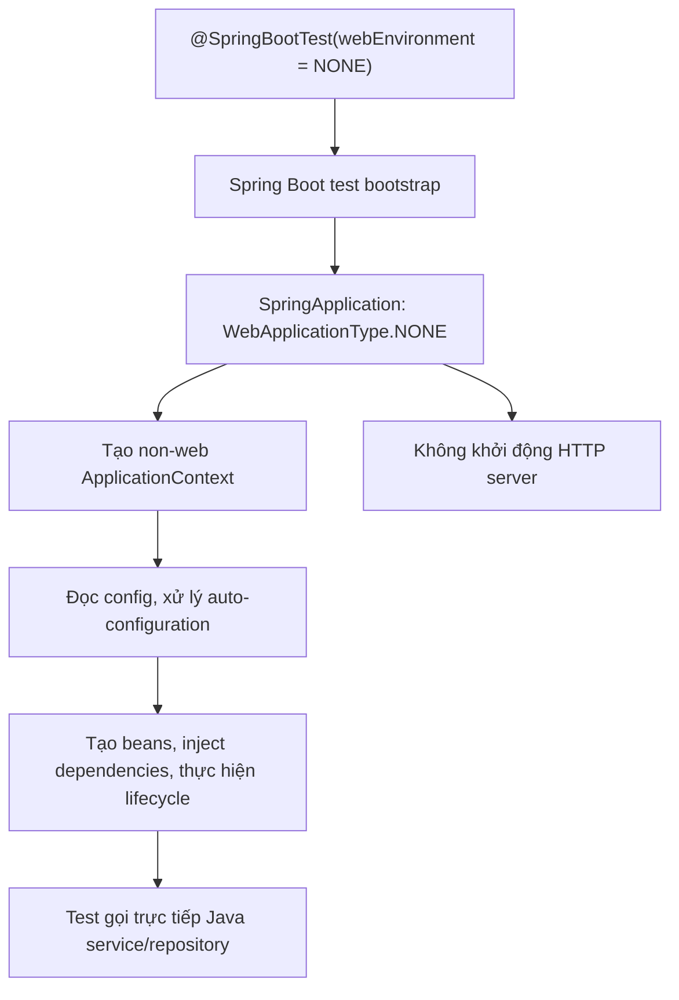
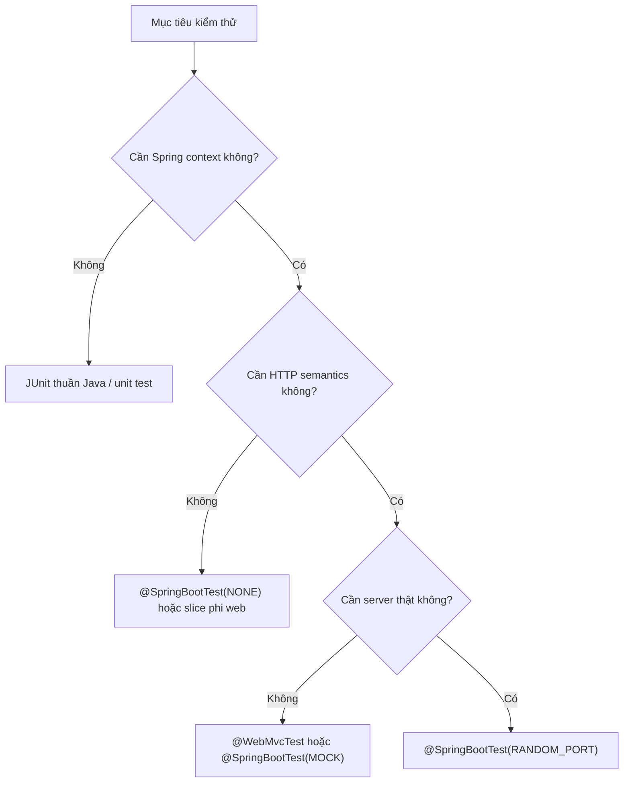

# WebEnvironment.NONE cho ứng dụng không cần môi trường web

Một ứng dụng Spring Boot không phải lúc nào cũng phục vụ HTTP request. Nhiều chương trình được xây dựng để chạy **batch job**, xử lý dữ liệu, đọc message, thực hiện nghiệp vụ theo lịch, đồng bộ hệ thống hoặc cung cấp các service mà ta muốn kiểm thử trực tiếp qua Java API. Khi viết integration test cho những trường hợp này, việc khởi tạo servlet container hoặc reactive web server thường không cần thiết.

Spring Boot Test có một lựa chọn chuyên dụng:

```java
@SpringBootTest(webEnvironment = SpringBootTest.WebEnvironment.NONE)
```

Lựa chọn `WebEnvironment.NONE` yêu cầu test bootstrap Spring Boot với **loại ứng dụng không web**. Spring vẫn tạo `ApplicationContext`, thực hiện dependency injection và áp dụng những auto-configuration phù hợp; điều được loại bỏ là **môi trường web** mà test không cần. Vì vậy, ta có thể kiểm thử bean nghiệp vụ, cấu hình, repository hoặc luồng xử lý trong context Spring Boot mà không phải mở HTTP port.

Đây là bài học thuộc chương **Kiểm thử nền tảng** của *Spring Boot Fundamentals*. Ta sẽ làm rõ `NONE` tác động tới quá trình tạo context ra sao, khi nào nên dùng thay vì `MOCK` hoặc `RANDOM_PORT`, những loại bean nào vẫn có thể được nạp, cách viết integration test có thể chạy, và các giới hạn dễ nhầm.

Ví dụ sử dụng Java 21, JUnit Jupiter và Spring Boot 3.x. API trọng tâm là `@SpringBootTest` và enum `SpringBootTest.WebEnvironment`. Chi tiết auto-configuration có thể phụ thuộc phiên bản Spring Boot và dependency thực tế của dự án.

## 1. Vấn đề: Kiểm thử nghiệp vụ không đồng nghĩa kiểm thử HTTP

Giả sử có một ứng dụng tính phí hóa đơn. Phần nghiệp vụ cần giải quyết bài toán:

```text
Đầu vào: số tiền trước thuế và thuế suất
Đầu ra: tổng tiền sau thuế, làm tròn theo quy tắc
```

Ta muốn kiểm tra service tính đúng kết quả và nhận được cấu hình từ Spring. Không nhất thiết phải:

- Mở cổng HTTP.
- Khởi tạo embedded Tomcat, Jetty hoặc Reactor Netty.
- Gửi request qua controller.
- Serialization JSON.
- Kiểm tra HTTP status hoặc response headers.

Nếu test mục tiêu là một service và các bean liên quan trong Spring context, việc kéo cả môi trường web vào có thể làm tăng thời gian khởi động hoặc khiến test phụ thuộc vào những thành phần không liên quan tới điều cần xác nhận.

Một test phù hợp có thể là:

```java
@SpringBootTest(webEnvironment = SpringBootTest.WebEnvironment.NONE)
class InvoiceCalculatorIntegrationTest {
    // Inject service từ Spring context và gọi trực tiếp.
}
```

**Tư duy chính:** trước khi chọn test annotation, hãy hỏi **mình đang kiểm tra Java business behavior, sự tích hợp giữa các bean, hay HTTP behavior?** Câu trả lời quyết định có cần web environment hay không.

## 2. @SpringBootTest làm gì?

`@SpringBootTest` là annotation của Spring Boot Test dùng để tạo một **Spring Boot application context** trong quá trình kiểm thử. Không giống unit test thuần Java, test này có thể sử dụng:

- Dependency injection với `@Autowired`.
- Configuration classes và component scanning.
- `@ConfigurationProperties` và các property sources.
- Conditional auto-configuration.
- Bean lifecycle và những bean post-processors phù hợp.
- Repository, transaction manager hoặc các integration beans khi dependency và cấu hình đã có.
- Các bean có điều kiện theo profile.

Ví dụ:

```java
@SpringBootTest
class ServiceIntegrationTest {

    @Autowired
    SomeService service;

    @Test
    void worksWithSpringDependencies() {
        // Gọi service đã được Spring tạo.
    }
}
```

Tuy nhiên, `@SpringBootTest` có nhiều lựa chọn web environment. Nếu không chọn, giá trị mặc định của enum trong annotation là **`MOCK`**, không phải `NONE`.

### 2.1. NONE thay đổi phần nào?

Khi viết:

```java
@SpringBootTest(webEnvironment = SpringBootTest.WebEnvironment.NONE)
```

Spring Boot test bootstrap sẽ sử dụng `WebApplicationType.NONE` để tạo context không web. Đây vẫn là Spring application context, nhưng không khởi tạo servlet hoặc reactive web server để phục vụ HTTP.



Sơ đồ chỉ những mốc quan trọng cho lựa chọn web environment, không thay thế toàn bộ thứ tự chi tiết của `SpringApplication.run`.

### 2.2. NONE không có nghĩa “không có Spring”

Đừng nhầm `NONE` với một test thuần Java không dùng container.

| Kiểu kiểm thử | Spring context? | HTTP server? | Phạm vi điển hình |
|---|---|---|---|
| JUnit thuần Java, tự tạo object | Không, trừ khi bạn tự thiết lập. | Không. | Unit test logic cô lập. |
| `@SpringBootTest(webEnvironment = NONE)` | Có. | Không. | Integration test beans và cấu hình không cần web. |
| `@SpringBootTest(webEnvironment = MOCK)` | Có. | Không khởi động server thật theo chế độ MOCK. | Kiểm thử với web-aware mock context khi phù hợp. |
| `@SpringBootTest(webEnvironment = RANDOM_PORT)` | Có. | Có, khi ứng dụng web phù hợp. | HTTP integration test qua port ngẫu nhiên. |

NONE là **full Spring Boot context không web**, không phải cách tắt toàn bộ auto-configuration hoặc rút context xuống chỉ còn một bean.

## 3. Bốn lựa chọn WebEnvironment

Enum `SpringBootTest.WebEnvironment` có bốn lựa chọn thông dụng:

| Giá trị | Ý tưởng | Có web server thật? | Khi nên dùng |
|---|---|---|---|
| `MOCK` | Tạo mock web environment nếu web libraries phù hợp có mặt. | Không. | Test controller/filter qua mock infrastructure. |
| `RANDOM_PORT` | Khởi động web server ở một port được chọn tự động. | Có, nếu app có web server phù hợp. | End-to-end HTTP integration test trong cùng JVM. |
| `DEFINED_PORT` | Khởi động web server theo cấu hình port của ứng dụng. | Có, nếu app có web server phù hợp. | Trường hợp cố ý cần cổng xác định. |
| `NONE` | Khởi động application context theo kiểu non-web. | Không. | Batch, service, repository, property binding không cần HTTP. |

### 3.1. MOCK không phải NONE

`MOCK` là default khi dùng `@SpringBootTest` không truyền `webEnvironment`. Nếu có servlet API và Spring MVC trên classpath, nó có thể cung cấp mock servlet web application context mà không mở cổng thật.

Ngược lại, `NONE` yêu cầu **không dùng web application context**. Các khả năng phụ thuộc servlet mock context như Spring MVC request mapping infrastructure phục vụ `MockMvc` không phải mục tiêu của chế độ này.

Nếu bạn kiểm tra `@RestController` bằng request giả lập, hãy cân nhắc `@WebMvcTest` hoặc `@SpringBootTest(webEnvironment = MOCK)` kết hợp `@AutoConfigureMockMvc` khi phù hợp, **không chọn NONE chỉ vì muốn test chạy nhanh**.

### 3.2. RANDOM_PORT khác NONE

Ví dụ:

```java
@SpringBootTest(webEnvironment = SpringBootTest.WebEnvironment.RANDOM_PORT)
class HttpEndpointTest {
    // Thử endpoint qua HTTP.
}
```

Với ứng dụng servlet web phù hợp, server thật chạy trên cổng ngẫu nhiên để tránh xung đột với dịch vụ local. Trong test bạn có thể nhận port thực bằng `@LocalServerPort` và dùng HTTP client phù hợp.

`NONE` không có server port được gán. Vì vậy, không nên thử:

```java
@LocalServerPort
int port;
```

trong một test `NONE` rồi kỳ vọng đó là cổng đã mở.

### 3.3. DEFINED_PORT khác NONE

`DEFINED_PORT` có thể dùng `server.port` đã cấu hình. Vì nhiều tiến trình test có thể chạy đồng thời, cổng cố định dễ xung đột và khiến test khó chạy song song.

Nếu không cần kiểm tra HTTP, dùng NONE có thể loại bỏ cả vấn đề chọn và giữ port.

## 4. WebApplicationType.NONE ở lớp runtime

`SpringApplication` có khái niệm `WebApplicationType`:

```java
import org.springframework.boot.WebApplicationType;
```

Các kiểu chính:

- `NONE`: ứng dụng không web.
- `SERVLET`: ứng dụng web dựa trên servlet stack.
- `REACTIVE`: ứng dụng web dựa trên reactive stack.

Khi khởi động bình thường, Spring Boot có thể suy ra web application type từ các thư viện đang có. Test annotation `@SpringBootTest(webEnvironment = NONE)` yêu cầu bootstrap test dùng `WebApplicationType.NONE`, ngay cả khi project chứa một số web dependency.

### 4.1. Ví dụ ứng dụng batch tự chọn NONE

Trong runtime application code, bạn có thể tường minh chọn non-web:

```java
package com.example.batch;

import org.springframework.boot.SpringApplication;
import org.springframework.boot.WebApplicationType;
import org.springframework.boot.autoconfigure.SpringBootApplication;

@SpringBootApplication
public class BatchApplication {

    public static void main(String[] args) {
        SpringApplication app = new SpringApplication(BatchApplication.class);
        app.setWebApplicationType(WebApplicationType.NONE);
        app.run(args);
    }
}
```

Đó là cấu hình cho **ứng dụng khi chạy thực tế**. Còn `webEnvironment = NONE` bên trong `@SpringBootTest` là lựa chọn cho **test context**.

### 4.2. Chọn NONE trong test có sửa application.yml không?

Không. Annotation điều khiển quá trình bootstrap của test, không ghi file cấu hình. Khi chạy main application bằng cơ chế khác, loại ứng dụng được xác định theo runtime configuration của lần chạy đó.

### 4.3. Property spring.main.web-application-type

Spring Boot cũng có property:

```properties
spring.main.web-application-type=none
```

Property này có thể cấu hình loại web application khi chạy Spring Boot. Tuy nhiên, trong bài toán kiểm thử nên dùng annotation `webEnvironment = NONE` để thể hiện rõ yêu cầu ngay tại test, thay vì chỉ phụ thuộc một profile hay cấu hình ngoài có thể bị ghi đè.

## 5. Một project tối giản để thực hành

Ta tạo ứng dụng tính hóa đơn để kiểm thử trực tiếp bean và property binding. Đây là ứng dụng **không cần web starter**.

Gợi ý cấu trúc:

```text
billing-demo/
├── build.gradle
└── src/
    ├── main/java/com/example/billing/
    │   ├── BillingApplication.java
    │   ├── BillingProperties.java
    │   └── InvoiceCalculator.java
    └── test/java/com/example/billing/
        └── InvoiceCalculatorBootTest.java
```

### 5.1. Khai báo Gradle dependencies

Trong một project có sẵn Spring Boot Gradle plugin và dependency management, phần dependencies có thể là:

```groovy
dependencies {
    implementation 'org.springframework.boot:spring-boot-starter'
    testImplementation 'org.springframework.boot:spring-boot-starter-test'
}
```

`spring-boot-starter` cung cấp những thành phần Spring Boot cơ bản. `spring-boot-starter-test` cung cấp hạ tầng kiểm thử phù hợp với phiên bản Boot, bao gồm JUnit Jupiter và thư viện assertion thường dùng.

Không cần khai báo `spring-boot-starter-web` chỉ để Spring Boot có thể chạy một `@SpringBootTest`.

### 5.2. Lớp ứng dụng chính

```java
package com.example.billing;

import org.springframework.boot.autoconfigure.SpringBootApplication;
import org.springframework.boot.context.properties.ConfigurationPropertiesScan;

@SpringBootApplication
@ConfigurationPropertiesScan
public class BillingApplication {
}
```

Chúng ta không cần method `main` trong class minh họa này để chạy test `@SpringBootTest`. Nếu muốn chạy ứng dụng như một executable Java program, có thể bổ sung `main` gọi `SpringApplication.run(...)` như thông thường.

Annotation `@ConfigurationPropertiesScan` giúp Spring Boot tìm các configuration properties classes trong vùng package được scan.

### 5.3. ConfigurationProperties cho thuế suất

```java
package com.example.billing;

import java.math.BigDecimal;
import org.springframework.boot.context.properties.ConfigurationProperties;

@ConfigurationProperties(prefix = "billing")
public record BillingProperties(BigDecimal taxRate) {
}
```

Record này nhận cấu hình `billing.tax-rate`. Khi Spring Boot tạo bean từ configuration properties, Binder chuyển chuỗi property sang `BigDecimal`.

### 5.4. Service nghiệp vụ

```java
package com.example.billing;

import java.math.BigDecimal;
import java.math.RoundingMode;
import org.springframework.stereotype.Service;

@Service
public class InvoiceCalculator {

    private final BillingProperties properties;

    public InvoiceCalculator(BillingProperties properties) {
        this.properties = properties;
    }

    public BigDecimal total(BigDecimal beforeTax) {
        BigDecimal tax = beforeTax.multiply(properties.taxRate());
        return beforeTax.add(tax).setScale(2, RoundingMode.HALF_UP);
    }
}
```

Service tập trung vào nghiệp vụ tính tiền. Nó nhận `BillingProperties` từ Spring container; không biết gì về HTTP controller, servlet request hoặc web server.

### 5.5. Test với WebEnvironment.NONE

```java
package com.example.billing;

import static org.assertj.core.api.Assertions.assertThat;

import java.math.BigDecimal;
import org.junit.jupiter.api.Test;
import org.springframework.beans.factory.annotation.Autowired;
import org.springframework.boot.test.context.SpringBootTest;
import org.springframework.core.env.Environment;

@SpringBootTest(
        classes = BillingApplication.class,
        webEnvironment = SpringBootTest.WebEnvironment.NONE,
        properties = "billing.tax-rate=0.10")
class InvoiceCalculatorBootTest {

    @Autowired
    InvoiceCalculator calculator;

    @Autowired
    BillingProperties properties;

    @Autowired
    Environment environment;

    @Test
    void calculatesTotalUsingSpringConfiguration() {
        BigDecimal result = calculator.total(new BigDecimal("100.00"));

        assertThat(result).isEqualByComparingTo("110.00");
        assertThat(properties.taxRate())
                .isEqualByComparingTo("0.10");
        assertThat(environment.getProperty("billing.tax-rate"))
                .isEqualTo("0.10");
    }
}
```

Khi test chạy:

1. Spring Boot tạo non-web ApplicationContext.
2. Configuration properties scanning đăng ký `BillingProperties`.
3. Giá trị `billing.tax-rate=0.10` được cung cấp từ test properties.
4. Spring tạo `InvoiceCalculator` với dependency đã bind.
5. JUnit gọi trực tiếp method `total(...)` trên Spring bean.
6. Assertion xác nhận kết quả và property.

**Không có bước nào phải gọi HTTP endpoint.** Test này xác nhận Spring binding và dependency injection cùng hoạt động đúng với logic nghiệp vụ trong một application context không web.

## 6. Vì sao ví dụ trên là integration test?

Ta không tự tạo:

```java
new InvoiceCalculator(new BillingProperties(...));
```

Thay vào đó, Spring Boot nạp cấu hình, tạo bean và inject dependency. Vì thế test kiểm tra sự phối hợp của nhiều thành phần:

- Component scanning.
- `@ConfigurationPropertiesScan`.
- Binder và property source.
- Constructor dependency injection.
- Method nghiệp vụ.

Nhưng test **không** kiểm tra HTTP routing, JSON serialization, security filters hoặc embedded servlet container. Đây chính là ý nghĩa của việc chọn đúng test boundary.

### 6.1. Unit test thuần Java vẫn hữu ích

Với cùng service, bạn cũng có thể viết:

```java
import static org.assertj.core.api.Assertions.assertThat;

import java.math.BigDecimal;
import org.junit.jupiter.api.Test;

class InvoiceCalculatorUnitTest {

    @Test
    void computesTotalWithoutSpring() {
        InvoiceCalculator calculator =
                new InvoiceCalculator(
                        new BillingProperties(new BigDecimal("0.10")));

        assertThat(calculator.total(new BigDecimal("100.00")))
                .isEqualByComparingTo("110.00");
    }
}
```

Unit test nhẹ hơn và kiểm tra công thức thuần túy. `@SpringBootTest(NONE)` bổ sung giá trị khi bạn thật sự cần xác minh **Spring wiring/configuration**.

**Chọn NONE không phải lý do để biến mọi unit test thành @SpringBootTest.**

## 7. Kiểm tra application context không web

Trong một project có Spring Web trên classpath, có thể kiểm tra kiểu context của test khi dùng NONE.

Ví dụ:

```java
package com.example.billing;

import static org.assertj.core.api.Assertions.assertThat;

import org.junit.jupiter.api.Test;
import org.springframework.beans.factory.annotation.Autowired;
import org.springframework.boot.test.context.SpringBootTest;
import org.springframework.context.ApplicationContext;
import org.springframework.web.context.WebApplicationContext;

@SpringBootTest(
        classes = BillingApplication.class,
        webEnvironment = SpringBootTest.WebEnvironment.NONE,
        properties = "billing.tax-rate=0.10")
class NonWebContextTypeTest {

    @Autowired
    ApplicationContext context;

    @Test
    void applicationContextIsNotServletWebApplicationContext() {
        assertThat(context)
                .isNotInstanceOf(WebApplicationContext.class);
    }
}
```

Đoạn test này giả định project có `spring-web` để import `WebApplicationContext`; nếu bạn chỉ dùng starter cơ bản không có Spring Web, **không cần thêm web dependency chỉ để thực hiện assertion này**. Khi đó, chỉ cần xác nhận context và các bean cần dùng đã được tạo, đồng thời test không yêu cầu HTTP port.

### 7.1. NONE vẫn dùng ApplicationContext

`ApplicationContext` vẫn hỗ trợ:

```java
context.getBean(InvoiceCalculator.class)
context.getEnvironment()
context.getBeanDefinitionNames()
```

Tùy cách cấu hình, các lifecycle callbacks và auto-configuration phi web vẫn hoạt động. Không phải mọi bean đều biến mất chỉ vì context không web.

### 7.2. Đừng phụ thuộc tên concrete ApplicationContext class

Tên lớp implementation của context có thể thay đổi theo cách bootstrap/framework. Test nên xác nhận hành vi có ý nghĩa — như các bean nghiệp vụ có mặt, không cần HTTP server — thay vì assert chính xác một tên implementation nếu không có yêu cầu kỹ thuật cụ thể.

## 8. NONE vẫn chạy những auto-configuration không web

Đây là điểm quan trọng để hiểu giới hạn của `NONE`.

Giả sử ứng dụng có:

```groovy
dependencies {
    implementation 'org.springframework.boot:spring-boot-starter'
    implementation 'org.springframework.boot:spring-boot-starter-data-jpa'
    runtimeOnly 'com.h2database:h2'
    testImplementation 'org.springframework.boot:spring-boot-starter-test'
}
```

Với datasource và JPA configuration phù hợp, `@SpringBootTest(webEnvironment = NONE)` **vẫn có thể**:

- Khởi tạo `DataSource`.
- Tạo `EntityManagerFactory`.
- Đăng ký repository beans.
- Tạo transaction manager.
- Chạy các bước initialization/schema management theo cấu hình.

Vì những bean đó **không phải servlet web server**, NONE không vô hiệu hóa chúng.

### 8.1. NONE không có nghĩa “chỉ load bean được inject”

`@SpringBootTest` vẫn là full-context test. Nếu ứng dụng có nhiều integration beans được tạo eagerly, chúng vẫn có thể tham gia startup.

Điều này có nghĩa test có thể thất bại vì:

- Datasource URL thiếu hoặc sai.
- Migration bị lỗi.
- Một `@PostConstruct` ném exception.
- Một bean bắt buộc thiếu dependency.
- Một `ApplicationRunner` chạy và gặp lỗi.
- Một external integration cố gắng kết nối tới hệ thống chưa có.

Đây **không phải bằng chứng NONE không hoạt động**; những lỗi đó đến từ phần phi web của application context.

### 8.2. Vì sao test NONE vẫn có thể khởi động chậm?

Không khởi động HTTP server giúp bỏ một phần công việc, nhưng Spring vẫn phải xử lý configuration classes, bean creation, proxies, database và các integration khác.

Vì vậy `NONE` không bảo đảm mọi test nhanh hơn một ngưỡng cụ thể. Tốc độ phụ thuộc độ lớn context và các dependency thực sự được nạp.

## 9. NONE không làm mất hoàn toàn các bean liên quan HTTP

Nếu project có `spring-boot-starter-web`, nhiều class web vẫn nằm trên classpath. Component scanning vẫn có thể thấy một class được đánh dấu `@RestController` như một Spring bean thông thường.

Điều mà NONE loại bỏ là **web application environment** cần thiết để phục vụ request, không phải xóa mọi class có annotation liên quan web khỏi classpath.

Vì vậy cần phân biệt:

- **Controller class tồn tại trên classpath.**
- **Controller bean có thể được component scan đăng ký.**
- **Spring MVC infrastructure có được auto-configure hay không.**
- **Có web server lắng nghe HTTP requests hay không.**

Không có server thì không có đường HTTP thật để kiểm thử qua network trong context đó, dù một số bean controller có thể vẫn tồn tại.

### 9.1. Điều kiện auto-configuration dựa trên web application

Spring Boot có các condition như:

```java
@ConditionalOnWebApplication
```

hoặc:

```java
@ConditionalOnNotWebApplication
```

Những điều kiện này quyết định auto-configuration/bean nào phù hợp với loại context. Với `WebEnvironment.NONE`, phần yêu cầu servlet hoặc reactive web application không được thỏa theo cách thông thường.

Như vậy, NONE không chỉ “tắt port”. Nó còn thay đổi **những điều kiện runtime được đánh giá là đúng** trong quá trình auto-configuration.

## 10. NONE và MockMvc không thay thế cho nhau

`MockMvc` mô phỏng lời gọi vào Spring MVC request processing infrastructure mà không cần mở HTTP port. Điều đó vẫn cần **web-aware test context** thích hợp.

Một test controller nên chọn chẳng hạn:

```java
import org.junit.jupiter.api.Test;
import org.springframework.beans.factory.annotation.Autowired;
import org.springframework.boot.test.autoconfigure.web.servlet.AutoConfigureMockMvc;
import org.springframework.boot.test.context.SpringBootTest;
import org.springframework.test.web.servlet.MockMvc;

import static org.springframework.test.web.servlet.request.MockMvcRequestBuilders.get;
import static org.springframework.test.web.servlet.result.MockMvcResultMatchers.status;

@SpringBootTest(webEnvironment = SpringBootTest.WebEnvironment.MOCK)
@AutoConfigureMockMvc
class CatalogHttpContractTest {

    @Autowired
    MockMvc mockMvc;

    @Test
    void returnsProducts() throws Exception {
        mockMvc.perform(get("/products"))
                .andExpect(status().isOk());
    }
}
```

Ví dụ giả định ứng dụng thật có controller xử lý `GET /products` và trả 200. Mục đích là minh họa đúng **kiểu web test**, không phải cung cấp controller đầy đủ trong bài này.

### 10.1. Vì sao không dùng NONE + AutoConfigureMockMvc?

Với NONE, context không được tạo như một servlet web application context; vì vậy việc kết hợp:

```java
@SpringBootTest(webEnvironment = SpringBootTest.WebEnvironment.NONE)
@AutoConfigureMockMvc
```

không phải lựa chọn đúng khi bạn cần mô phỏng Spring MVC HTTP request. Những bean/mock servlet infrastructure mà `MockMvc` cần có thể không tồn tại.

Chọn `MOCK` cho request-level MVC integration, hoặc `@WebMvcTest` nếu chỉ cần một web slice nhỏ.

### 10.2. Vì sao có WebMvcTest?

`@WebMvcTest` thường chỉ khởi tạo các thành phần liên quan MVC theo slice auto-configuration, giảm khối lượng context so với full `@SpringBootTest`. Nó phù hợp khi mục tiêu là controller mapping, validation, status, serialization hoặc security ở web layer.

Ngược lại, `@SpringBootTest(NONE)` phù hợp khi mục tiêu là những service/configuration phi web nhưng muốn sử dụng Spring Boot context thật.

## 11. NONE và TestRestTemplate, WebTestClient

`TestRestTemplate` thường xuất hiện trong test có embedded web server, chẳng hạn:

```java
@SpringBootTest(webEnvironment = SpringBootTest.WebEnvironment.RANDOM_PORT)
```

Khi không có HTTP server, `TestRestTemplate` không có cổng ứng dụng vừa khởi động để gọi. Tương tự, một `WebTestClient` được bind tới server thật cần server phù hợp; các chế độ bind mock context/reactive handler có yêu cầu riêng.

### 11.1. Test một method thay vì HTTP

Với NONE:

```java
@Autowired
InvoiceCalculator calculator;

@Test
void calculatesInvoice() {
    assertThat(calculator.total(new BigDecimal("50.00")))
            .isEqualByComparingTo("55.00");
}
```

Đây là lời gọi Java trực tiếp vào Spring-managed bean. Bạn không cần dựng request body, gửi HTTP, đọc JSON response hay xác nhận cổng.

### 11.2. Khi nào cần test HTTP thật?

Nếu yêu cầu là:

- Controller mapping.
- JSON serialization/deserialization.
- HTTP headers.
- Security filter chain.
- CORS.
- HTTP status và error contract.
- Embedded server integration.

thì NONE không kiểm tra đúng ranh giới; hãy chọn `MOCK`, web slice hoặc `RANDOM_PORT` tùy mục tiêu.

## 12. NONE cho batch application

Một chương trình batch thường chỉ cần khởi động Spring, tìm job/service và chạy công việc.

Ví dụ:

```java
package com.example.batch;

import java.time.LocalDate;
import org.springframework.stereotype.Service;

@Service
public class DailyReportService {

    private final ReportRepository repository;

    public DailyReportService(ReportRepository repository) {
        this.repository = repository;
    }

    public int createReport(LocalDate date) {
        return repository.buildFor(date);
    }
}
```

Trong đó `ReportRepository` là abstraction do ứng dụng định nghĩa. Ta có thể tạo một integration test:

```java
@SpringBootTest(
        webEnvironment = SpringBootTest.WebEnvironment.NONE,
        properties = "reports.mode=test")
class DailyReportServiceTest {

    @Autowired
    DailyReportService reports;

    @Test
    void createsDailyReport() {
        int count = reports.createReport(LocalDate.of(2026, 11, 13));
        assertThat(count).isGreaterThanOrEqualTo(0);
    }
}
```

Test giả định repository và dữ liệu thử đã được chuẩn bị để tạo report. Trong dự án thật, assertion cần kiểm tra kết quả nghiệp vụ cụ thể thay vì chỉ số bản ghi không âm.

### 12.1. Batch không cần HTTP nhưng có thể cần database

NONE phù hợp vì test không mở web server. Nhưng nếu business logic dùng `JdbcTemplate`, JPA hoặc transaction, bạn vẫn cần cấu hình datasource/test database phù hợp.

### 12.2. Phân biệt batch logic với startup runner

Một batch application có thể khởi chạy công việc qua `CommandLineRunner` hoặc `ApplicationRunner`. Nếu test khởi động full Spring Boot application context, những runner đó **cũng có thể được gọi** trong quá trình bootstrapping.

Đừng giả định NONE ngăn runners chạy — chúng không phải tính năng web.

## 13. Bẫy quan trọng: ApplicationRunner và CommandLineRunner vẫn chạy

Ví dụ:

```java
@Component
public class StartupImportRunner implements ApplicationRunner {

    private final ExternalImportService service;

    public StartupImportRunner(ExternalImportService service) {
        this.service = service;
    }

    @Override
    public void run(ApplicationArguments args) {
        service.importFromPartner();
    }
}
```

Một test `@SpringBootTest(webEnvironment = NONE)` khởi chạy context theo Spring Boot lifecycle. Runner này có thể thực thi, dù không có web server. Nếu nó gọi một đối tác ngoài qua mạng, test dễ thất bại hoặc tạo side effect không mong muốn.

### 13.1. Giải pháp 1: tách hành vi khỏi trigger

Thiết kế runner chỉ là một adapter nhỏ:

```java
@Component
@ConditionalOnProperty(
        name = "app.startup-import.enabled",
        havingValue = "true",
        matchIfMissing = true)
public class StartupImportRunner implements ApplicationRunner {

    private final ExternalImportService service;

    public StartupImportRunner(ExternalImportService service) {
        this.service = service;
    }

    @Override
    public void run(ApplicationArguments args) {
        service.importFromPartner();
    }
}
```

Trong test:

```java
@SpringBootTest(
        webEnvironment = SpringBootTest.WebEnvironment.NONE,
        properties = "app.startup-import.enabled=false")
```

Khi property tắt, bean runner không được đăng ký theo condition. Test vẫn có thể inject service và gọi operation một cách có kiểm soát.

### 13.2. Giải pháp 2: profile dành cho test

Một số startup integration có thể dùng:

```java
@Profile("!test")
```

để không đăng ký runner khi profile `test` active. Cách này phải phù hợp với chính sách môi trường của dự án; một runner cần được kiểm thử ở vài test khác vẫn phải có đường kiểm tra riêng.

### 13.3. Giải pháp 3: cô lập external integrations

Khi test cần cả flow thật nhưng không muốn gọi dịch vụ production, dùng fake/test double hoặc môi trường test integration được kiểm soát. Đừng tắt mọi cơ chế startup chỉ để có context xanh; hãy xác định rõ behavior nào là mục tiêu của test.

## 14. NONE không tắt scheduled jobs hoặc background threads

Tương tự runner, những thành phần phi web vẫn có thể hoạt động:

```java
@Scheduled(fixedDelay = 60_000)
public void synchronizeData() {
    // Tác vụ chạy định kỳ.
}
```

Nếu ứng dụng bật scheduling bằng `@EnableScheduling` và bean phù hợp, scheduler có thể khởi tạo trong test context NONE. Một task có thể chạy trong lúc test khác đang thực thi hoặc tạo dữ liệu ngoài dự kiến.

### 14.1. Cần thiết kế test có kiểm soát

Ví dụ dùng condition cho scheduler configuration:

```java
@Configuration(proxyBeanMethods = false)
@ConditionalOnProperty(
        name = "app.scheduling.enabled",
        havingValue = "true",
        matchIfMissing = true)
@EnableScheduling
public class SchedulingConfiguration {
}
```

Trong test không cần scheduler:

```java
@SpringBootTest(
        webEnvironment = SpringBootTest.WebEnvironment.NONE,
        properties = "app.scheduling.enabled=false")
```

Ví dụ này giả định project chỉ bật scheduling qua configuration đã được điều kiện hóa như trên; nếu có `@EnableScheduling` ở nơi khác, phải xem lại cấu hình thực tế.

### 14.2. Không suy luận từ tên thread

Nếu log xuất hiện trên `scheduling-1` hoặc thread executor khác trong test, đó có thể là dấu hiệu background component vẫn hoạt động. NONE không có nghĩa ứng dụng chỉ chạy trên test thread.

## 15. Dùng test properties với NONE

`@SpringBootTest` cho phép cung cấp property ngay trong annotation:

```java
@SpringBootTest(
        webEnvironment = SpringBootTest.WebEnvironment.NONE,
        properties = {
            "billing.tax-rate=0.10",
            "billing.rounding-mode=HALF_UP",
            "app.startup-import.enabled=false"
        })
```

Những property này tham gia test Environment và có thể ghi đè giá trị từ application config theo precedence của Spring Boot Test.

### 15.1. Dùng @ActiveProfiles khi có file test profile

`src/test/resources/application-test.yml`:

```yaml
billing:
  tax-rate: 0.10

app:
  startup-import:
    enabled: false
```

Test:

```java
@SpringBootTest(webEnvironment = SpringBootTest.WebEnvironment.NONE)
@ActiveProfiles("test")
class BillingConfigurationTest {
    // Test dùng cấu hình ứng với profile test.
}
```

`@ActiveProfiles("test")` chọn profile, còn `NONE` chọn loại application context. Đây là **hai trục cấu hình độc lập**.

### 15.2. NONE không tự động bật profile test

Viết:

```java
@SpringBootTest(webEnvironment = SpringBootTest.WebEnvironment.NONE)
```

không có nghĩa Spring tự chọn profile `test`. Nếu muốn dùng `application-test.yml`, cần active profile đó qua `@ActiveProfiles` hoặc một cách hợp lệ khác.

### 15.3. Không dùng cấu hình production cho external integrations

Nếu service của test cần database hoặc message broker, hãy cấp test configuration rõ ràng. Không chọn NONE rồi giả định toàn bộ external connection được cô lập.

## 16. NONE và @ConfigurationProperties

`@ConfigurationProperties` hoạt động trên nền binding và Environment; nó không yêu cầu HTTP server.

Ví dụ:

```yaml
mail:
  digest:
    enabled: true
    recipients:
      - ops@example.test
      - dev@example.test
```

Record:

```java
import java.util.List;
import org.springframework.boot.context.properties.ConfigurationProperties;

@ConfigurationProperties(prefix = "mail.digest")
public record DigestProperties(
        boolean enabled,
        List<String> recipients) {
}
```

Nếu record này được đăng ký bằng `@ConfigurationPropertiesScan` hoặc `@EnableConfigurationProperties`, test NONE có thể inject và kiểm tra binding.

```java
@SpringBootTest(webEnvironment = SpringBootTest.WebEnvironment.NONE)
@ActiveProfiles("test")
class DigestPropertiesTest {

    @Autowired
    DigestProperties properties;

    @Test
    void bindsDigestSettings() {
        assertThat(properties.enabled()).isTrue();
        assertThat(properties.recipients())
                .containsExactly("ops@example.test", "dev@example.test");
    }
}
```

Chỉ cần bảo đảm YAML ở trên có trong property sources của test, ví dụ file profile được nạp từ `src/test/resources/application-test.yml`. Không cần `MockMvc` hay `TestRestTemplate` để kiểm tra binding.

## 17. NONE và repository/transaction tests

Nhiều integration test phi web cần repository hoặc transaction:

```java
@SpringBootTest(webEnvironment = SpringBootTest.WebEnvironment.NONE)
@Transactional
class AccountRepositoryIntegrationTest {

    @Autowired
    AccountRepository repository;

    @Test
    void persistsAccount() {
        Account saved = repository.save(new Account("demo"));
        assertThat(saved.getId()).isNotNull();
    }
}
```

Ví dụ giả định project đã có JPA entity/repository, datasource và transaction manager hợp lệ.

### 17.1. @Transactional trên test có ý nghĩa gì?

Với Spring Test transaction management và `PlatformTransactionManager` phù hợp, `@Transactional` trên test method/class có thể chạy test trong giao dịch và mặc định rollback sau test. Đây là cách hữu ích để giữ dữ liệu thử biệt lập trong nhiều loại test repository đồng bộ.

Tuy nhiên, cần chú ý những code chạy trên thread khác hoặc hệ thống ngoài database transaction có thể **không** nằm trong cùng giao dịch test.

### 17.2. Khi nào @DataJpaTest tốt hơn?

Nếu mục tiêu chỉ là JPA repository, `@DataJpaTest` có thể nạp một **slice** nhỏ tập trung vào persistence và các test conveniences phù hợp.

Chọn:

- `@DataJpaTest` khi muốn kiểm tra repository/JPA với context có phạm vi hẹp.
- `@SpringBootTest(NONE)` khi cần kiểm tra phối hợp đầy đủ giữa service, repository, configuration và những bean phi web khác.

Không cần full application context cho mọi phép CRUD đơn giản.

## 18. NONE và @MockBean / test doubles

Đối với một service cần external API client, full context test có thể vẫn muốn thay một bean bằng fake hoặc mock.

Ví dụ phụ thuộc:

```java
@Service
public class BillingSyncService {

    private final PaymentGateway gateway;

    public BillingSyncService(PaymentGateway gateway) {
        this.gateway = gateway;
    }

    public boolean synchronize(String invoiceId) {
        return gateway.confirm(invoiceId);
    }
}
```

Trong các phiên bản framework/test library phù hợp, có thể dùng cơ chế override bean trong test, chẳng hạn annotation mocking được phiên bản Spring Boot/Spring Framework đó hỗ trợ.

Những tên annotation như `@MockBean` (Boot Test truyền thống) và `@MockitoBean` (ở những bản Spring Framework mới hơn) cần chọn theo **version cụ thể của project**. Ý tưởng không thay đổi:

1. Nạp application context không web.
2. Thay `PaymentGateway` thật bằng test double.
3. Gọi `BillingSyncService` trực tiếp.
4. Kiểm chứng kết quả mà không gọi external production gateway.

### 18.1. NONE không tự tạo mock cho external services

Nếu bạn không override bean hoặc cấu hình endpoint test, service vẫn có thể dùng dependency thật. Web environment NONE chỉ loại bỏ hạ tầng web server; nó **không** tự thay các bean networking, database hoặc message broker bằng mock.

### 18.2. Lựa chọn thay thế không phụ thuộc Mockito

Bạn có thể dùng `@TestConfiguration` để đăng ký một fake implementation với điều kiện/bean override phù hợp. Giữ logic test double đơn giản và tránh trộn test implementation vào configuration production.

## 19. Context caching và vòng đời của test

Spring Test có **context caching** để tái sử dụng ApplicationContext giữa các test có cấu hình tương thích. Điều này giảm thời gian khởi tạo nhưng cũng là một nguồn hiểu nhầm.

Giả sử hai test class cùng dùng:

```java
@SpringBootTest(
        webEnvironment = SpringBootTest.WebEnvironment.NONE,
        properties = "billing.tax-rate=0.10")
```

Nếu các đặc điểm cấu hình context trùng theo cache key của Spring Test, context có thể được tái sử dụng thay vì khởi động lại từ đầu cho mỗi class.

### 19.1. Không giả định runner chạy trước mỗi @Test

`ApplicationRunner` và `CommandLineRunner` thuộc startup lifecycle. Nếu context được cache, runner không được gọi mới chỉ vì JUnit chạy thêm một test method.

**Startup của context** và **lifecycle của từng test method** là hai khái niệm khác nhau.

### 19.2. State trong singleton có thể gây ảnh hưởng chéo

Nếu bean là singleton và giữ trạng thái mutable:

```java
@Component
public class InMemoryCounter {

    private int count;

    public void increment() {
        count++;
    }

    public int value() {
        return count;
    }
}
```

Hai test dùng chung context có thể nhìn thấy state còn lại từ test trước. `NONE` không thay đổi bean scope và không tự reset singleton giữa các test.

Nên giữ test độc lập bằng setup/cleanup rõ ràng, reset state có chủ đích hoặc thiết kế service ít mutable state. `@DirtiesContext` có thể buộc context được tái tạo trong trường hợp cần thiết nhưng tăng chi phí chạy test.

### 19.3. Khi nào nên dùng @DirtiesContext?

Nếu một test thực sự thay đổi cấu hình/bean state của context theo cách không thể reset an toàn, `@DirtiesContext` có thể báo cho Spring Test bỏ context đã dùng sau hoặc trước test, tùy cấu hình.

Không nên áp dụng đại trà chỉ để “tránh lỗi lạ”. Tốt hơn là hiểu state nào bị chia sẻ và cô lập đúng nơi.

## 20. Điều gì xảy ra nếu application context không tạo được?

Nếu test:

```java
@SpringBootTest(webEnvironment = SpringBootTest.WebEnvironment.NONE)
class ApplicationStartupTest {
    @Test
    void starts() {
    }
}
```

thì test method không làm gì, nhưng bản thân việc load context đã là một phép kiểm thử quan trọng. Nếu một required bean không tạo được, context initialization thất bại trước khi test method được gọi.

Đây là một **context smoke test** hữu ích cho ứng dụng phi web.

### 20.1. Lỗi do datasource

Thông báo có thể liên quan thiếu JDBC URL, driver hoặc authentication. NONE không vô hiệu hóa datasource auto-configuration. Cần cấu hình datasource test hoặc giới hạn phạm vi context hợp lý.

### 20.2. Lỗi do runner

Nếu `ApplicationRunner` gọi API ngoài và ném exception, context có thể fail trong quá trình Boot startup. Hãy cô lập trigger bằng property/profile, dùng fake hoặc test integration environment phù hợp.

### 20.3. Lỗi do servlet bean

Một bean ứng dụng có thể phụ thuộc trực tiếp vào `HttpServletRequest`, servlet context hoặc web-scoped bean. Trong context NONE, dependency web-specific có thể không có và khiến bean creation thất bại.

Điều này không có nghĩa NONE “bị bug”. Test đang yêu cầu nạp một bean chỉ hoạt động khi có web context.

## 21. Khi ứng dụng có cả web và non-web modules

Một monolith có thể chứa:

- REST controllers.
- Service nghiệp vụ.
- Scheduled jobs.
- Data repositories.
- Message consumers.
- External clients.

Bạn có thể muốn kiểm thử business layer không web để tránh mở server, nhưng full component scan vẫn có thể đăng ký controller và các bean khác.

### 21.1. NONE vẫn có thể không tải được toàn bộ ứng dụng

Nếu một số singleton được thiết kế chỉ cho môi trường web và yêu cầu servlet-scoped dependency ngay khi khởi tạo, test NONE có thể fail. Khi đó có một số lựa chọn:

1. Phân tách web adapter và business/application service rõ ràng.
2. Dùng condition để chỉ đăng ký web-specific bean trong web application.
3. Tạo test configuration chỉ gồm những bean cần thiết.
4. Nếu mục tiêu là web layer, dùng web-aware test thay vì cố ép NONE.

### 21.2. Không dùng NONE để né một lỗi web quan trọng

Nếu production dùng web server, một test NONE thành công **không chứng minh** HTTP endpoint, security và controller mappings sẽ hoạt động đúng. Bạn vẫn cần test cho web layer ở mức phù hợp.

Tổ chức bộ test tốt thường gồm:

```text
Unit tests -> service/domain logic thuần Java
Non-web integration tests -> Spring beans + config + persistence
Web slice tests -> controller/filter/validation
HTTP integration tests -> server + routing + serialization
```

Mỗi lớp có giá trị riêng; NONE chỉ là một công cụ giúp chọn đúng ranh giới cho lớp integration không web.

## 22. Mức độ “nhanh” của NONE và trade-off

Lợi ích dễ thấy của NONE:

- Không phải mở HTTP port.
- Không cần khởi tạo embedded web server.
- Không phụ thuộc request/response pipeline.
- Test tập trung vào dependency injection và business integrations.
- Ít gặp xung đột cổng khi chạy nhiều test.

Nhưng chi phí vẫn có thể lớn nếu:

- Ứng dụng có nhiều auto-configuration.
- Có hàng trăm singleton beans.
- DataSource/JPA cần khởi động.
- Có migration hoặc schema initialization.
- Có message listener/external client.
- Có runner hoặc scheduler tạo side effect.

**Đừng xem NONE là nút “chạy nhanh” thay cho thiết kế test scope.** Nếu chỉ cần một class thuần Java, unit test vẫn thường đơn giản và nhanh hơn.

## 23. Một ví dụ thứ hai: service không web nhưng ứng dụng có web starter

Giả sử project chính là REST API có `spring-boot-starter-web`. Ta vẫn có thể chọn NONE cho một test cần Spring configuration nhưng không cần HTTP.

```java
package com.example.store;

import static org.assertj.core.api.Assertions.assertThat;

import org.junit.jupiter.api.Test;
import org.springframework.beans.factory.annotation.Autowired;
import org.springframework.boot.test.context.SpringBootTest;

@SpringBootTest(
        classes = StoreApplication.class,
        webEnvironment = SpringBootTest.WebEnvironment.NONE,
        properties = {
            "inventory.min-stock=5",
            "app.startup-sync.enabled=false"
        })
class InventoryPolicyTest {

    @Autowired
    InventoryPolicy policy;

    @Test
    void flagsLowStock() {
        assertThat(policy.isLowStock(3)).isTrue();
        assertThat(policy.isLowStock(12)).isFalse();
    }
}
```

Ví dụ giả định `StoreApplication`, `InventoryPolicy` và property điều khiển startup sync đã được ứng dụng định nghĩa. Nó mô tả ý tưởng **test policy bean qua Spring DI**, không test controller.

### 23.1. Vì sao test có web dependency nhưng vẫn NONE?

Web dependency chỉ cho thấy các class servlet/MVC có trên classpath. `WebEnvironment.NONE` là chỉ dẫn tường minh cho **lần chạy test** rằng Spring Boot không cần tạo web application context hoặc HTTP server.

### 23.2. Khi nào cách này không phù hợp?

Nếu `InventoryPolicy` phụ thuộc trực tiếp vào request scope, HTTP session hoặc những bean chỉ tồn tại trong web context, việc đưa nó vào test NONE có thể thất bại. Đây có thể là tín hiệu thiết kế rằng policy nghiệp vụ đang gắn quá chặt với lớp web.

## 24. Phân biệt NONE với webEnvironment mặc định

Đây là một trong những lỗi học và sử dụng thường gặp:

```java
@SpringBootTest
class MyTest {
}
```

và:

```java
@SpringBootTest(webEnvironment = SpringBootTest.WebEnvironment.NONE)
class MyTest {
}
```

**Không hoàn toàn tương đương.** Dạng đầu dùng `MOCK` theo default annotation; dạng sau bắt buộc non-web application type.

### 24.1. Nếu ứng dụng không có web dependency?

Với default `MOCK`, Spring Boot có thể fallback về non-web context nếu classpath không có các thành phần web cần thiết. Tuy nhiên, dùng `NONE` vẫn thể hiện ý định rõ ràng: test không cần môi trường web, kể cả sau này project bổ sung web starter.

### 24.2. Vì sao việc thể hiện ý định quan trọng?

Một dự án hiện chỉ có `spring-boot-starter`. Sau vài tháng, đội ngũ thêm `spring-boot-starter-web` để mở API quản trị. Những test không chỉ định `NONE` có thể bắt đầu dùng mock web environment vì classpath đã thay đổi.

Nếu mục tiêu của test luôn là non-web integration, chỉ định `NONE` giúp giảm phụ thuộc vào những thay đổi web dependency ngoài ý muốn.

## 25. @SpringBootTest(classes = ...) và phạm vi configuration

`@SpringBootTest` cần biết root configuration class. Nếu cấu trúc package phù hợp, Spring Boot Test có thể tìm class đánh dấu `@SpringBootConfiguration` hoặc `@SpringBootApplication`.

Tuy nhiên, khi project có nhiều root configuration hoặc test nằm ngoài package thông thường, có thể khai báo tường minh:

```java
@SpringBootTest(
        classes = BillingApplication.class,
        webEnvironment = SpringBootTest.WebEnvironment.NONE)
```

Cách này giúp người đọc thấy đúng root configuration dự kiến.

### 25.1. NONE không phải một slice annotation

Dù chỉ định `classes = BillingApplication.class`, nếu class đó sử dụng `@SpringBootApplication` với component scanning và auto-configuration, context vẫn có thể rất lớn.

Nếu bạn muốn nạp **chỉ vài configuration classes**, cần thiết kế test configuration có phạm vi thích hợp; không thể trông đợi NONE tự thu nhỏ thành một service duy nhất.

### 25.2. Ví dụ context hẹp với @SpringBootConfiguration

Đối với một tình huống cần Spring Boot bootstrap nhưng chỉ một tập bean tối thiểu:

```java
import org.springframework.boot.SpringBootConfiguration;
import org.springframework.context.annotation.Bean;

@SpringBootConfiguration
class MinimalBillingTestConfiguration {

    @Bean
    BillingProperties billingProperties() {
        return new BillingProperties(new BigDecimal("0.10"));
    }

    @Bean
    InvoiceCalculator invoiceCalculator(BillingProperties properties) {
        return new InvoiceCalculator(properties);
    }
}
```

Test:

```java
@SpringBootTest(
        classes = MinimalBillingTestConfiguration.class,
        webEnvironment = SpringBootTest.WebEnvironment.NONE)
class MinimalBillingContextTest {
    // Context chỉ có những thành phần được cấu hình phù hợp.
}
```

Đây là lựa chọn có chủ đích cho một context nhỏ. Nhưng lúc này bạn **không còn kiểm tra đầy đủ auto-configuration/component scan** của ứng dụng production; cần hiểu sự đánh đổi khi giới hạn root configuration.

## 26. Tích hợp với @ActiveProfiles, @TestPropertySource, @DynamicPropertySource

Với integration test, ngoài `properties` trong `@SpringBootTest`, bạn có thể gặp:

- `@ActiveProfiles`: chọn profile cho context test.
- `@TestPropertySource`: cấp property file hoặc inline test properties.
- `@DynamicPropertySource`: đăng ký property động, thường dùng với tài nguyên được khởi chạy trong test setup.

### 26.1. @TestPropertySource

```java
@SpringBootTest(webEnvironment = SpringBootTest.WebEnvironment.NONE)
@TestPropertySource(properties = {
    "billing.tax-rate=0.08",
    "app.startup-import.enabled=false"
})
class BillingWithTestPropertySourceTest {
}
```

Nó vẫn là test non-web. `@TestPropertySource` chỉ ảnh hưởng nguồn cấu hình; không tạo HTTP server.

### 26.2. @DynamicPropertySource cho tài nguyên động

Khi integration test dùng database container và port được cấp động, bạn có thể đăng ký property bằng method:

```java
@DynamicPropertySource
static void registerDatasource(DynamicPropertyRegistry registry) {
    registry.add("spring.datasource.url", database::getJdbcUrl);
    registry.add("spring.datasource.username", database::getUsername);
    registry.add("spring.datasource.password", database::getPassword);
}
```

Đoạn code minh họa giả định `database` là một test container đã được tạo và quản lý lifecycle phù hợp. Nó cho thấy **NONE hoàn toàn tương thích với việc kiểm thử database integration**, vì database không phải web server của ứng dụng.

### 26.3. Test property precedence

Khi một property xuất hiện ở nhiều nguồn, Spring Test và Spring Boot áp dụng thứ tự ưu tiên tương ứng. Đừng đọc duy nhất `application.yml` rồi kết luận bean nhận đúng giá trị đó; hãy xác nhận `Environment` hoặc object `@ConfigurationProperties` trong context test.

## 27. NONE có ảnh hưởng đến Actuator không?

Nếu ứng dụng thêm `spring-boot-starter-actuator`, các bean health/metrics liên quan phi web có thể vẫn được đăng ký nếu điều kiện phù hợp. Nhưng trong test `NONE`:

- Không có HTTP server để phục vụ `GET /actuator/health`.
- Điều kiện auto-configuration dành riêng cho web management endpoints có thể không match.
- Các bean/metrics phi web vẫn có thể tồn tại tùy dependency và configuration.

Vì vậy, một test NONE không phù hợp để chứng minh đường HTTP `/actuator/health` đã được expose. Nếu đó là mục tiêu, hãy dùng web environment có server hoặc mock web test theo yêu cầu.

### 27.1. HealthIndicator không cần HTTP để có logic

Nếu muốn kiểm tra custom `HealthIndicator`, có thể inject bean và gọi method `health()` trực tiếp trong context NONE. Điều đó kiểm tra logic health contributor, không kiểm tra HTTP mapping của Actuator.

## 28. NONE và Spring Security

Trong application có Spring Security, những bean security phi web có thể vẫn tồn tại. Tuy nhiên, web filter chain và HTTP authorization behavior dựa trên servlet/reactive web infrastructure thường yêu cầu web-aware context.

`NONE` có thể phù hợp để kiểm thử:

- Một service dùng method security theo cấu hình phù hợp.
- Business policy độc lập với HTTP.
- Configuration và bean injection không cần request.

`NONE` **không phù hợp** nếu muốn xác nhận:

- Filter chặn một request.
- Token được trích từ HTTP header như thế nào.
- CSRF/CORS trên web endpoint.
- HTTP status 401/403 của SecurityFilterChain.

Với các yêu cầu đó, chọn web slice/MockMvc hoặc HTTP integration test.

## 29. Những lỗi thường gặp khi chọn NONE

| Hiện tượng | Nguyên nhân thường gặp | Hướng xử lý |
|---|---|---|
| Test đòi `MockMvc` nhưng không có bean | NONE không cung cấp mock servlet web environment phù hợp | Dùng `MOCK` + `@AutoConfigureMockMvc` hoặc `@WebMvcTest`. |
| `@LocalServerPort` không có port hữu dụng | NONE không khởi động embedded HTTP server | Dùng `RANDOM_PORT` nếu thực sự test HTTP. |
| Test context không tạo được vì DB | Datasource/JPA vẫn được auto-configure | Cấp test datasource hoặc dùng slice/test context thích hợp. |
| Startup runner gọi API ngoài | NONE không tắt runners | Điều kiện hóa runner, inject fake hoặc dùng test environment. |
| Scheduled job làm nhiễu test | Scheduling vẫn hoạt động trong context nếu bật | Cấu hình tắt scheduler trong test khi phù hợp. |
| Test đạt nhưng controller lỗi khi chạy thật | NONE không kiểm tra web layer | Bổ sung web-specific tests. |
| Có REST controller bean nhưng không có HTTP server | Classpath/bean scanning khác web application type | Phân biệt bean registration với server/web mappings. |
| Context quá lớn, test chậm | `@SpringBootTest` vẫn là full context | Xem xét unit test hoặc slice test. |
| Property không như dự kiến | Profile/test properties/Config Data có precedence | Kiểm tra Environment và nguồn cấu hình. |
| Test thứ hai bị ảnh hưởng state từ test thứ nhất | Context caching và singleton mutable state | Reset state có chủ đích hoặc cách cô lập phù hợp. |
| Test lỗi vì servlet request scope thiếu | Bean ứng dụng phụ thuộc web context | Dùng web-aware test hoặc tách thiết kế module. |

## 30. Quy trình chọn WebEnvironment cho một yêu cầu test

Hãy bắt đầu từ **điều mà test cần quan sát**, thay vì bắt đầu từ annotation đã quen.



### 30.1. Câu hỏi cần tự trả lời

1. Test có cần dependency injection hoặc auto-configuration thật không?
2. Có cần servlet context, HTTP headers hoặc JSON conversion không?
3. Có cần mở cổng HTTP không?
4. Có external dependencies nào sẽ khởi động theo context không?
5. Có runners/schedulers nào tạo side effects không?
6. Có thể dùng unit test hoặc slice nhỏ thay full context không?

Nếu câu trả lời là **cần Spring wiring, nhưng không cần web**, `NONE` là lựa chọn rất tự nhiên.

## 31. Bài thực hành tổng hợp

Tạo project Spring Boot dùng `spring-boot-starter` và `spring-boot-starter-test`; khi muốn mở rộng so sánh, có thể thêm web starter.

**Bước A — Service thuần nghiệp vụ.** Tạo `InvoiceCalculator` nhận `BillingProperties` và tính tổng tiền.

**Bước B — Test NONE.** Viết `@SpringBootTest(webEnvironment = NONE)`, inject service và kiểm tra kết quả.

**Bước C — Property binding.** Cấp `billing.tax-rate=0.10` bằng `properties` trong annotation và xác nhận record nhận đúng.

**Bước D — Profile.** Tạo `application-test.yml` với thuế suất khác, bật `@ActiveProfiles("test")` và kiểm tra Environment.

**Bước E — Context smoke test.** Viết test không cần assertion nghiệp vụ, chỉ xác nhận context load thành công. Giải thích vì sao đây vẫn là kiểm thử có giá trị.

**Bước F — Thêm runner.** Tạo `ApplicationRunner` ghi nhận một sự kiện startup và quan sát nó vẫn chạy khi test NONE.

**Bước G — Cô lập runner.** Thêm một property điều khiển runner và vô hiệu hóa trigger external integration trong test.

**Bước H — Thêm web starter.** Giữ `webEnvironment = NONE`; so sánh context với test `MOCK`. Không cần mở HTTP port ở test NONE.

**Bước I — Thử MockMvc.** Tạo test MVC riêng dùng `@WebMvcTest` hoặc `MOCK` + `@AutoConfigureMockMvc`. Xác nhận đó là phạm vi khác NONE.

**Bước J — Thử RANDOM_PORT.** Khởi chạy server thật trong một test HTTP riêng và dùng HTTP client để kiểm tra response.

**Bước K — Persistence.** Nếu project có JPA, tạo repository test bằng `@DataJpaTest`, rồi một service integration test bằng NONE để so sánh phạm vi context.

**Bước L — Context caching.** Tạo hai test classes cùng configuration; thử dùng một singleton mutable để hiểu vì sao không nên phụ thuộc thứ tự chạy.

**Bước M — Tổng kết.** Viết bảng so sánh: unit test, NONE, MOCK và RANDOM_PORT theo mục tiêu, dependency, HTTP behavior và chi phí khởi động.

Sau mỗi bước, hãy chỉ rõ **bean nào được tạo, phần web nào không cần, những side effect nào vẫn có thể xảy ra và test đã thật sự chứng minh điều gì**.

## 32. Câu hỏi tự đánh giá

1. `WebEnvironment.NONE` trong `@SpringBootTest` có ý nghĩa gì?
2. NONE có đồng nghĩa không tạo Spring application context không?
3. `@SpringBootTest` mặc định dùng giá trị nào của WebEnvironment?
4. Điểm khác biệt giữa `MOCK` và `NONE` là gì?
5. Vì sao `NONE` không cần HTTP port?
6. Vì sao test `NONE` có thể sử dụng `@Autowired`?
7. `@ConfigurationProperties` có hoạt động khi không có servlet web server không?
8. Khi project có `spring-boot-starter-web`, dùng NONE có còn hữu ích không?
9. Vì sao một `@RestController` bean có thể tồn tại mà không có HTTP server phục vụ request?
10. Điều kiện `@ConditionalOnWebApplication` ảnh hưởng auto-configuration thế nào với NONE?
11. Vì sao `@AutoConfigureMockMvc` không phải một lựa chọn tự nhiên cùng NONE?
12. Khi nào chọn `RANDOM_PORT` thay vì NONE?
13. Vì sao thêm `@Transactional` trên repository test không phụ thuộc HTTP server?
14. `@DataJpaTest` khác `@SpringBootTest(NONE)` về phạm vi context ra sao?
15. Một `ApplicationRunner` có thể chạy khi test NONE khởi động không?
16. Scheduled task và message listener có chắc bị tắt khi chọn NONE không?
17. Tại sao cần chú ý external dependencies trong test NONE?
18. `@ActiveProfiles("test")` và `WebEnvironment.NONE` điều khiển hai khía cạnh nào khác nhau?
19. Context caching có thể gây ảnh hưởng chéo giữa các test bằng cách nào?
20. Nếu test NONE pass, có thể kết luận HTTP endpoint production hoạt động đúng không?
21. Trường hợp nào chỉ cần JUnit unit test thay vì full Spring context?
22. Khi một test NONE không inject được servlet-scoped bean, bạn cần xem lại điều gì?
23. Vì sao giá trị property trong `@SpringBootTest(properties=...)` có thể khác file `application.yml`?
24. Vì sao loại bỏ web server không nhất thiết loại bỏ toàn bộ thời gian khởi tạo context?

### Mẫu giải thích hoàn chỉnh

> `@SpringBootTest(webEnvironment = SpringBootTest.WebEnvironment.NONE)` yêu cầu Spring Boot tạo một application context không web cho integration test. Test vẫn sử dụng dependency injection, configuration properties, conditional auto-configuration và các bean phù hợp, nhưng không tạo servlet/reactive web server để phục vụ HTTP. Đây là lựa chọn tốt cho batch application, business services, property binding hoặc repository/service integration khi không cần kiểm tra request/response. NONE khác `MOCK` — vốn có thể tạo mock web environment khi có web libraries — và khác `RANDOM_PORT`/`DEFINED_PORT`, vốn phục vụ HTTP integration với server thật trong trường hợp ứng dụng web phù hợp. NONE không phải slice test: datasource, scheduler, runner và những integration beans phi web vẫn có thể khởi tạo hoặc tạo side effect. Vì vậy phải chọn test configuration và cô lập external dependencies có chủ đích. Nếu mục tiêu là controller, security filter hoặc HTTP response contract, nên dùng một web-aware test; nếu chỉ kiểm tra logic thuần Java, unit test thường đơn giản hơn.

Khi bạn có thể giải thích rõ **vì sao test cần Spring context nhưng không cần môi trường web**, phân biệt được NONE với MOCK/RANDOM_PORT và biết những bean phi web nào vẫn sẽ chạy, bạn đã nắm vững cách dùng **WebEnvironment.NONE cho ứng dụng không cần môi trường web** trong Spring Boot.
