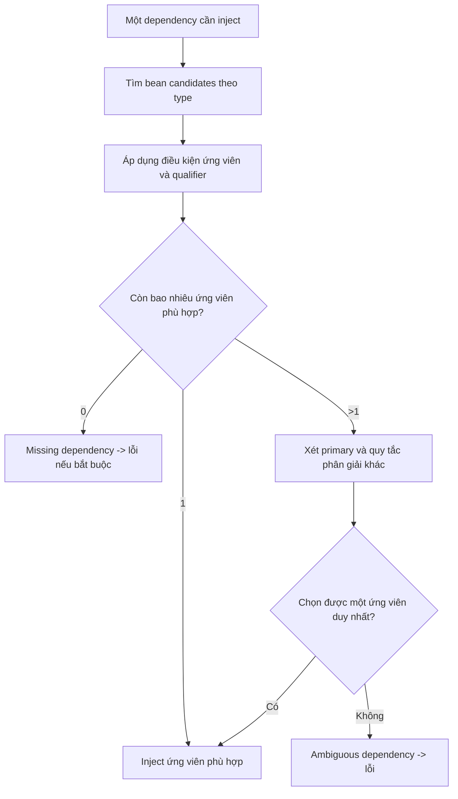

# Kiểm thử @Bean, @Qualifier, @Primary và cấu hình thiếu ứng viên

Một ứng dụng Spring Boot có thể có hàng trăm Spring bean, nhưng không phải lúc nào các bean đều được nối với nhau đúng như mong muốn. Cùng một interface có thể có hai implementation; một service có thể vô tình nhận implementation dành cho môi trường thử nghiệm; một `@Bean` factory method có thể yêu cầu dependency chưa tồn tại; hoặc cấu hình khởi động có thể thất bại vì có nhiều ứng viên mà Spring không biết nên chọn cái nào.

Các lỗi này thuộc nhóm **bean wiring**: kiểm tra việc đăng ký bean và giải quyết dependency trong Spring IoC container. Chúng khác với kiểm thử một thuật toán nghiệp vụ thuần Java. Một service có thể tính toán đúng khi được khởi tạo thủ công, nhưng ứng dụng vẫn không chạy được vì Spring không tạo ra hoặc không tìm được bean phù hợp.

Trong chương **Kiểm thử nền tảng** của *Spring Boot Fundamentals*, bài học **“Kiểm thử @Bean, @Qualifier, @Primary và cấu hình thiếu ứng viên”** tập trung vào cách xây dựng các phép thử có mục đích để xác nhận:

- Một `@Bean` method thực sự đăng ký bean trong application context.
- Bean có đúng tên, kiểu, scope hoặc dependency cần thiết.
- `@Primary` chọn ứng viên mặc định khi có nhiều bean cùng type.
- `@Qualifier` chỉ định đúng ứng viên, kể cả khi có bean khác mang `@Primary`.
- Một ứng viên không tồn tại, hoặc có quá nhiều ứng viên không phân giải được, làm startup thất bại như thế nào.
- Điều kiện `@ConditionalOnMissingBean` và những fallback có chủ đích cần được kiểm thử ra sao.
- Nên dùng `ApplicationContextRunner`, context test hoặc `@SpringBootTest` trong tình huống nào.

Mục tiêu không chỉ là viết một test “context loads” thành công, mà là **kiểm tra rõ hợp đồng wiring trong cả trạng thái thành công lẫn trạng thái thiếu/sai ứng viên**.

## 1. Tại sao cần kiểm thử wiring?

Xét ứng dụng gửi thông báo, có interface:

```java
public interface MessageSender {
    String channel();
    void send(String message);
}
```

Hai implementation:

```java
public final class EmailMessageSender implements MessageSender {

    @Override
    public String channel() {
        return "email";
    }

    @Override
    public void send(String message) {
        // Gửi email theo cấu hình hệ thống.
    }
}
```

```java
public final class SmsMessageSender implements MessageSender {

    @Override
    public String channel() {
        return "sms";
    }

    @Override
    public void send(String message) {
        // Gửi SMS theo cấu hình hệ thống.
    }
}
```

Service sử dụng một sender:

```java
public final class NotificationService {

    private final MessageSender sender;

    public NotificationService(MessageSender sender) {
        this.sender = sender;
    }

    public String selectedChannel() {
        return sender.channel();
    }
}
```

Nếu chỉ có một bean `MessageSender`, Spring thường giải quyết dependency theo type được. Nếu có hai bean cùng type, cần quy tắc chọn rõ ràng. Nếu không có bean nào, một dependency bắt buộc sẽ không thể được thỏa mãn.

Những câu hỏi cần kiểm thử:

| Tình huống cấu hình | Kỳ vọng |
| --- | --- |
| Có đúng một `MessageSender` | `NotificationService` nhận bean đó |
| Có email và SMS, email là `@Primary` | Injection đơn trị không có qualifier chọn email |
| Có email `@Primary` nhưng service dùng `@Qualifier("smsSender")` | Service chọn SMS |
| Có email và SMS, không có quy tắc phân giải | Context phải báo lỗi không duy nhất |
| Không có `MessageSender`, service vẫn yêu cầu bắt buộc | Context phải báo thiếu dependency |
| Service yêu cầu qualifier không khớp bean nào | Context phải báo không có ứng viên phù hợp |
| Có fallback conditional khi thiếu sender | Chỉ tạo fallback khi không có sender phù hợp theo điều kiện |

Không nên chỉ kiểm tra số lượng bean. Một context có đủ hai sender nhưng `NotificationService` nhận sai sender vẫn là lỗi wiring.

## 2. Đặt đúng phạm vi: kiểm thử Spring context, không chỉ Java object

Một unit test thuần Java:

```java
@Test
void delegatesToEmailSender() {
    NotificationService service =
            new NotificationService(new EmailMessageSender());

    assertThat(service.selectedChannel()).isEqualTo("email");
}
```

Test này kiểm tra hành vi của constructor và object, nhưng **không** kiểm tra `@Bean`, `@Primary`, `@Qualifier` hoặc cơ chế chọn dependency của Spring.

Trong một wiring test, ta cần tạo Spring `ApplicationContext` rồi truy vấn hoặc cho Spring khởi tạo service:

```text
Java configuration / annotations
             |
             v
  Spring bean definitions
             |
             v
  Bean candidate resolution
             |
             v
  Dependency injection
             |
             v
  Bean under test
```

Một wiring test tốt cần xác nhận **đầu ra của container**, không chỉ đầu ra của constructor đã được gọi thủ công.

### 2.1. Không phải mọi wiring test đều cần khởi động web server

Để kiểm tra lựa chọn `MessageSender`, ta không cần mở cổng HTTP, tạo database thật hay load toàn bộ ứng dụng. Một context nhỏ chỉ chứa vài class cấu hình thường nhanh hơn và cho lỗi dễ hiểu hơn.

Các lựa chọn thường gặp:

| Công cụ | Phạm vi | Khi nào phù hợp |
| --- | --- | --- |
| Test Java thuần | Không có Spring container | Kiểm tra logic object với dependency truyền thủ công |
| `AnnotationConfigApplicationContext` | Spring context nhỏ, không cần Boot test runner | Thử `@Configuration`, `@Bean` và injection đơn giản |
| `ApplicationContextRunner` | Context nhỏ, tạo/đóng trong callback; thuận tiện kiểm tra startup failure | Kiểm thử bean wiring, auto-configuration và điều kiện tạo bean |
| `@SpringBootTest` | Spring Boot application context rộng hơn | Kiểm tra tích hợp thực tế của các cấu hình trong ứng dụng |
| Test slices như `@WebMvcTest` | Một phần context theo lớp chức năng | Kiểm thử controller/web integration; không mặc định chứa mọi service/config |

Đối với bài này, **`ApplicationContextRunner` là công cụ trọng tâm**, vì nó cho phép kiểm tra cả context tạo thành công lẫn context thất bại mà không làm toàn bộ test suite dừng ngay ở bước bootstrap.

## 3. Cấu hình @Bean cơ bản và hợp đồng cần test

Spring cho phép một method được đánh dấu `@Bean` đăng ký object mà nó trả về:

```java
package com.example.notification.config;

import com.example.notification.EmailMessageSender;
import com.example.notification.MessageSender;
import org.springframework.context.annotation.Bean;
import org.springframework.context.annotation.Configuration;

@Configuration(proxyBeanMethods = false)
public class NotificationConfiguration {

    @Bean
    MessageSender emailSender() {
        return new EmailMessageSender();
    }
}
```

Trong context sử dụng configuration này, bean mặc định thường có:

- **Tên** `emailSender`, lấy từ tên method.
- **Kiểu khai báo** `MessageSender` và instance thực tế `EmailMessageSender`.
- **Scope** singleton nếu không ghi rõ scope khác.
- **Được Spring quản lý** về việc khởi tạo, dependency injection và lifecycle phù hợp.

### 3.1. Viết test cho sự tồn tại và type

```java
import org.junit.jupiter.api.Test;
import org.springframework.boot.test.context.runner.ApplicationContextRunner;

import static org.assertj.core.api.Assertions.assertThat;

class NotificationConfigurationTest {

    private final ApplicationContextRunner contextRunner =
            new ApplicationContextRunner()
                    .withUserConfiguration(NotificationConfiguration.class);

    @Test
    void registersOneMessageSender() {
        contextRunner.run(context -> {
            assertThat(context).hasNotFailed();
            assertThat(context).hasSingleBean(MessageSender.class);
            assertThat(context).hasBean("emailSender");

            MessageSender sender = context.getBean(MessageSender.class);
            assertThat(sender).isInstanceOf(EmailMessageSender.class);
        });
    }
}
```

Với `ApplicationContextRunner`, callback nhận một context đã được tạo hoặc có thể chứa thông tin về thất bại khi startup. Context do runner quản lý sẽ được đóng sau callback.

Ở đây test kiểm tra **registration**, **số ứng viên theo type** và **implementation thực tế**. Nó không cần gửi email ra ngoài.

### 3.2. Bean name có thể được đặt tường minh

```java
@Bean("transactionalEmailSender")
MessageSender emailSender() {
    return new EmailMessageSender();
}
```

Tên bean là `transactionalEmailSender`, không còn mặc nhiên là `emailSender`. Nếu test hoặc injection đang dựa vào bean name cũ, cấu hình đổi tên có thể ảnh hưởng đến wiring.

Có thể khai báo aliases:

```java
@Bean(name = {"transactionalEmailSender", "emailSender"})
MessageSender emailSender() {
    return new EmailMessageSender();
}
```

Khi đó cả hai tên có thể tra cứu cùng một bean. Đây là aliases, không phải hai sender instances riêng biệt.

### 3.3. Test singleton cần phân biệt identity và behavior

```java
@Test
void returnsSameSingletonThroughAliases() {
    new ApplicationContextRunner()
            .withUserConfiguration(SenderAliasConfiguration.class)
            .run(context -> {
                Object a = context.getBean("transactionalEmailSender");
                Object b = context.getBean("emailSender");
                assertThat(a).isSameAs(b);
            });
}
```

Ví dụ giả định `SenderAliasConfiguration` chứa `@Bean(name = {...})` ở trên. Kiểm tra `isSameAs` đúng khi đang xác nhận singleton aliases. Nếu bean dùng `@Scope("prototype")` thì không nên áp cùng kỳ vọng identity.

## 4. Vì sao @Bean method có dependency cũng cần kiểm thử?

Một `@Bean` method có thể nhận dependency qua tham số:

```java
@Configuration(proxyBeanMethods = false)
class NotificationServiceConfiguration {

    @Bean
    NotificationService notificationService(MessageSender sender) {
        return new NotificationService(sender);
    }
}
```

Spring phải tìm một bean có thể gán vào `MessageSender` rồi truyền cho method. Nếu không có ứng viên hoặc có nhiều ứng viên không phân giải được, **việc tạo `NotificationService` sẽ thất bại**.

Tức là lỗi wiring có thể xuất hiện không chỉ ở:

```java
public NotificationService(MessageSender sender) { ... }
```

mà còn ở:

```java
@Bean
NotificationService notificationService(MessageSender sender) { ... }
```

### 4.1. @Bean factory method không nên tự gọi thủ công để kiểm tra wiring

Ví dụ dễ nhầm:

```java
NotificationConfiguration config = new NotificationConfiguration();
MessageSender sender = config.emailSender();
```

Lời gọi trên chỉ gọi method Java thông thường. Nó **không xác nhận Spring đã đăng ký một bean đúng tên, áp dụng scope hay giải quyết dependency qua container**.

Với `@Configuration(proxyBeanMethods = false)`, lời gọi trực tiếp tới method `@Bean` cũng không được Spring CGLIB intercept nhằm tái sử dụng singleton như trong mô hình proxy-bean-methods đầy đủ.

Vì vậy, khi muốn test contract của container, hãy tạo context và gọi `context.getBean(...)` hoặc để Spring inject dependency.

### 4.2. Dùng method parameter thay vì gọi @Bean method khác

Không nên dùng code sau khi muốn lấy đúng dependency đã được Spring quản lý:

```java
@Configuration(proxyBeanMethods = false)
class ManualCallConfiguration {

    @Bean
    MessageSender emailSender() {
        return new EmailMessageSender();
    }

    @Bean
    NotificationService notificationService() {
        return new NotificationService(emailSender());
    }
}
```

Khi `proxyBeanMethods = false`, lời gọi `emailSender()` trong method khác là lời gọi Java trực tiếp và có thể tạo **một object mới**, không phải lấy singleton `emailSender` đã được container quản lý.

Thay bằng:

```java
@Configuration(proxyBeanMethods = false)
class ManagedDependencyConfiguration {

    @Bean
    MessageSender emailSender() {
        return new EmailMessageSender();
    }

    @Bean
    NotificationService notificationService(MessageSender sender) {
        return new NotificationService(sender);
    }
}
```

Đây là cách để Spring tự giải quyết ứng viên. Test wiring cũng nên được viết theo hướng đó.

## 5. Khi có nhiều bean cùng type: vấn đề không duy nhất

Giả sử configuration:

```java
@Configuration(proxyBeanMethods = false)
class TwoSendersConfiguration {

    @Bean("emailSender")
    MessageSender emailSender() {
        return new EmailMessageSender();
    }

    @Bean("smsSender")
    MessageSender smsSender() {
        return new SmsMessageSender();
    }

    @Bean
    NotificationService notificationService(MessageSender sender) {
        return new NotificationService(sender);
    }
}
```

Có hai bean có thể gán vào `MessageSender`. Nếu injection point không có qualifier, primary hoặc quy tắc phân giải phù hợp khác, Spring không thể tùy ý chọn một bean.

Ta muốn test xác nhận context **thất bại rõ ràng**, thay vì vô tình chọn implementation không xác định.

### 5.1. Lỗi NoUniqueBeanDefinitionException

Trong nhiều trường hợp, nguyên nhân gốc là:

```text
NoUniqueBeanDefinitionException:
  expected single matching bean but found 2:
  emailSender,smsSender
```

Exception có thể được bọc bởi `UnsatisfiedDependencyException` hoặc exception trong quá trình tạo bean, tùy injection point và giai đoạn tạo context.

**Đừng viết test chỉ so sánh nguyên văn error message.** Message có thể thay đổi giữa các phiên bản Spring Framework; test nên tập trung vào loại lỗi/nguyên nhân quan trọng.

### 5.2. Test startup failure có chủ đích

```java
@Test
void failsWhenTwoCandidatesHaveNoSelectionRule() {
    new ApplicationContextRunner()
            .withUserConfiguration(TwoSendersConfiguration.class)
            .run(context -> {
                assertThat(context).hasFailed();
                assertThat(context.getStartupFailure())
                        .hasRootCauseInstanceOf(
                                NoUniqueBeanDefinitionException.class
                        );
            });
}
```

Trong ví dụ cần import `org.springframework.beans.factory.NoUniqueBeanDefinitionException` và AssertJ tương ứng.

Test này kiểm tra một **điều kiện âm tính**: nếu hai ứng viên không được phân giải thì context không được khởi tạo thành công. Điều đó bảo vệ ứng dụng khỏi lỗi cấu hình khó phát hiện khi thêm implementation mới.

### 5.3. Không chỉ kiểm tra có hai bean

Một test:

```java
assertThat(context.getBeansOfType(MessageSender.class)).hasSize(2);
```

không đủ chứng minh injection vào `NotificationService` thành công. Thậm chí, nếu service được tạo eager và injection thất bại, callback của test có thể nhận một failed context.

Phải kiểm tra **cả candidate set và outcome của injection**.

## 6. @Primary: đánh dấu ứng viên mặc định

`@Primary` cho Spring một tín hiệu ưu tiên khi **một dependency đơn trị** cần chọn từ nhiều candidate hợp lệ theo type.

Ví dụ:

```java
@Configuration(proxyBeanMethods = false)
class PrimarySenderConfiguration {

    @Bean("emailSender")
    @Primary
    MessageSender emailSender() {
        return new EmailMessageSender();
    }

    @Bean("smsSender")
    MessageSender smsSender() {
        return new SmsMessageSender();
    }

    @Bean
    NotificationService notificationService(MessageSender sender) {
        return new NotificationService(sender);
    }
}
```

Với injection point `MessageSender sender`, ứng viên `emailSender` có `@Primary` nên thường được chọn.

### 6.1. Test @Primary bằng behavior của bean nhận dependency

```java
@Test
void choosesPrimarySenderForUnqualifiedDependency() {
    new ApplicationContextRunner()
            .withUserConfiguration(PrimarySenderConfiguration.class)
            .run(context -> {
                assertThat(context).hasNotFailed();
                assertThat(context).hasSingleBean(NotificationService.class);

                NotificationService service =
                        context.getBean(NotificationService.class);

                assertThat(service.selectedChannel()).isEqualTo("email");
            });
}
```

Test này hiệu quả hơn kiểm tra bean annotation bằng reflection: nó xác nhận Spring **thực sự giải quyết dependency theo primary** trong context.

### 6.2. @Primary không xóa các bean khác

`smsSender` vẫn tồn tại:

```java
assertThat(context.getBeansOfType(MessageSender.class))
        .containsKeys("emailSender", "smsSender");
```

`@Primary` chỉ ảnh hưởng đến **lựa chọn ưu tiên tại injection point phù hợp**; nó không disable các implementation khác.

### 6.3. @Primary không áp dụng cùng cách khi inject collection

Ví dụ:

```java
@Bean
SenderCatalog senderCatalog(List<MessageSender> senders) {
    return new SenderCatalog(senders);
}
```

Khi inject `List<MessageSender>`, Spring thường cung cấp **các ứng viên cùng type** phù hợp, không tự giới hạn danh sách chỉ còn bean `@Primary`.

Tương tự:

```java
@Bean
SenderRegistry senderRegistry(Map<String, MessageSender> senders) {
    return new SenderRegistry(senders);
}
```

Map có thể chứa các sender theo bean names. Nếu muốn một sender duy nhất, dùng injection đơn trị và quy tắc lựa chọn phù hợp.

### 6.4. Hai primary không làm vấn đề biến mất

Nếu cả email và SMS cùng được đánh dấu `@Primary` trong tập ứng viên còn lại, Spring có thể vẫn không phân giải được:

```java
@Bean("emailSender")
@Primary
MessageSender emailSender() { ... }

@Bean("smsSender")
@Primary
MessageSender smsSender() { ... }
```

Khi đó đừng kỳ vọng “primary đầu tiên thắng”. Cần thiết kế để chỉ có một primary phù hợp hoặc dùng qualifier/logic selection rõ ràng.

### 6.5. @Primary không ghi đè yêu cầu bằng tên

Nếu gọi:

```java
MessageSender sms =
        context.getBean("smsSender", MessageSender.class);
```

thì ta đang yêu cầu bean theo tên cụ thể. `@Primary` trên email không làm lệnh tra cứu theo tên `smsSender` chuyển sang email.

## 7. @Qualifier: yêu cầu đúng ứng viên

`@Qualifier` là cơ chế thu hẹp candidate set cho một dependency. Nó đặc biệt hữu ích khi có nhiều implementation và **từng consumer cần một implementation cụ thể**.

Ví dụ:

```java
@Configuration(proxyBeanMethods = false)
class QualifiedSenderConfiguration {

    @Bean("emailSender")
    @Primary
    MessageSender emailSender() {
        return new EmailMessageSender();
    }

    @Bean("smsSender")
    MessageSender smsSender() {
        return new SmsMessageSender();
    }

    @Bean
    NotificationService notificationService(
            @Qualifier("smsSender") MessageSender sender
    ) {
        return new NotificationService(sender);
    }
}
```

Mặc dù email là `@Primary`, injection point yêu cầu `smsSender` nên chọn SMS.

### 7.1. Test @Qualifier khác @Primary

```java
@Test
void qualifierSelectsSmsEvenWhenEmailIsPrimary() {
    new ApplicationContextRunner()
            .withUserConfiguration(QualifiedSenderConfiguration.class)
            .run(context -> {
                assertThat(context).hasNotFailed();
                assertThat(context.getBean(NotificationService.class)
                        .selectedChannel())
                        .isEqualTo("sms");
            });
}
```

Đây là tình huống đặc biệt nên test: **qualifier tại injection point phải được tôn trọng** thay vì bị primary của ứng viên khác lấn át.

### 7.2. @Qualifier có thể đặt ở constructor parameter

Với bean được tạo qua component scan:

```java
@Service
public class SmsNotificationService {

    private final MessageSender sender;

    public SmsNotificationService(
            @Qualifier("smsSender") MessageSender sender
    ) {
        this.sender = sender;
    }
}
```

Không chỉ `@Bean` method parameter; constructor, field hoặc method injection cũng có thể dùng qualifier. Constructor injection thường làm dependency rõ và dễ test.

### 7.3. Bean name có thể tham gia qualifier matching

Nếu bean có tên `smsSender`, một injection point với `@Qualifier("smsSender")` có thể chọn bean đó. Nhưng `@Qualifier` không đơn giản đồng nghĩa “getBean theo tên” trong mọi hoàn cảnh: Spring còn hỗ trợ qualifier metadata và custom qualifiers.

Nên hiểu chính xác:

> `@Qualifier` là điều kiện lọc trong tập candidate theo type. Tên bean có thể được dùng để khớp, nhưng bản chất vẫn là một cơ chế chọn ứng viên.

### 7.4. Qualifier custom không nhất thiết là tên bean

Ví dụ:

```java
@Bean("fastSmsSender")
@Qualifier("urgent")
MessageSender fastSmsSender() {
    return new SmsMessageSender();
}
```

Consumer:

```java
@Bean
NotificationService urgentNotification(
        @Qualifier("urgent") MessageSender sender
) {
    return new NotificationService(sender);
}
```

`urgent` là qualifier metadata được khai báo rõ, không nhất thiết là bean name.

### 7.5. Một qualifier có thể khớp nhiều bean

Giả sử cả email và SMS đều mang `@Qualifier("outbound")`:

```java
@Bean("emailSender")
@Qualifier("outbound")
MessageSender emailSender() { ... }

@Bean("smsSender")
@Qualifier("outbound")
MessageSender smsSender() { ... }
```

Khi inject một `MessageSender` đơn trị với `@Qualifier("outbound")`, vẫn có thể còn **hai ứng viên**. Qualifier không tự bảo đảm tính duy nhất. Có thể cần primary trong tập còn lại, một qualifier cụ thể hơn hoặc thiết kế lại dependency.

Ngược lại, nếu injection point là `List<@...>` hoặc dùng các cơ chế collection filtering phù hợp, qualifier có thể được dùng để nhóm các ứng viên phục vụ một chức năng. Cần test theo đúng kiểu injection và điều kiện đang sử dụng.

## 8. Thứ tự tư duy khi Spring chọn dependency

Ở mức khái niệm, có thể hình dung:



Đây là sơ đồ **khái niệm để học**, không phải bản sao đầy đủ thuật toán nội bộ của `DefaultListableBeanFactory`. Spring còn có các quy tắc như priority, fallback/default candidate, tên parameter/field hoặc đề xuất từ framework tùy phiên bản và loại injection point.

### 8.1. Vì sao test nên rõ ràng về selection rule?

Nếu test chỉ có hai bean và injection point tên `emailSender`, một số phiên bản/thiết lập có thể dùng tên parameter để phân giải. Khi đó test “hai bean không primary phải thất bại” có thể không thất bại như người viết mong chờ.

Để kiểm thử **ambiguity**, hãy dùng một dependency parameter có tên không khớp tên bean, chẳng hạn `MessageSender sender`, và bảo đảm không có `@Primary`, qualifier, priority hay candidate rule khác vô tình lựa chọn được một bean.

Để kiểm thử lựa chọn **có chủ đích**, hãy dùng `@Qualifier` hoặc `@Primary` và assert implementation thực tế, thay vì dựa vào tên parameter.

### 8.2. Không phân loại mọi lỗi chọn bean thành “thiếu bean”

Hai vấn đề khác nhau:

- **Không có ứng viên hợp lệ:** `NoSuchBeanDefinitionException` là nguyên nhân phổ biến.
- **Có nhiều ứng viên không thể phân giải:** `NoUniqueBeanDefinitionException` là nguyên nhân phổ biến.

Chúng dẫn đến hành động sửa khác nhau. Một vấn đề cần đăng ký/cấp dependency; vấn đề kia cần phân giải ambiguity.

## 9. Thiếu ứng viên: không có bean nào thỏa dependency

Giả sử:

```java
@Configuration(proxyBeanMethods = false)
class MissingSenderConfiguration {

    @Bean
    NotificationService notificationService(MessageSender sender) {
        return new NotificationService(sender);
    }
}
```

Không có `MessageSender` bean được đăng ký. Khi Spring cố tạo singleton `NotificationService`, nó không thể thỏa tham số `sender`.

### 9.1. Lỗi có thể xuất hiện như thế nào?

Trong log có thể thấy chuỗi nguyên nhân kiểu:

```text
UnsatisfiedDependencyException:
  Error creating bean with name 'notificationService'
  ...
Caused by: NoSuchBeanDefinitionException:
  No qualifying bean of type '...MessageSender' available
```

`UnsatisfiedDependencyException` thể hiện việc một bean không nhận đủ dependency. `NoSuchBeanDefinitionException` là nguyên nhân cụ thể: không tìm được ứng viên hợp lệ.

### 9.2. Test context thất bại vì thiếu bean

```java
@Test
void failsWhenRequiredSenderIsMissing() {
    new ApplicationContextRunner()
            .withUserConfiguration(MissingSenderConfiguration.class)
            .run(context -> {
                assertThat(context).hasFailed();
                assertThat(context.getStartupFailure())
                        .hasRootCauseInstanceOf(
                                NoSuchBeanDefinitionException.class
                        );
            });
}
```

Không nên đặt một `@SpringBootTest` bị thiếu bean cố ý rồi viết `@Test` để assert exception: nếu context không khởi động được, JUnit/Spring Test có thể thất bại **trước khi chạy method test**. `ApplicationContextRunner` cho phép chủ động quan sát startup failure trong callback.

### 9.3. Nguyên nhân thiếu bean thường gặp

- Chưa có `@Bean` hoặc `@Component` cho implementation.
- Configuration nằm ngoài component scan hoặc chưa được `@Import`.
- Bean bị loại bởi `@Profile` hoặc `@ConditionalOnProperty`.
- Test slice không load bean của ứng dụng mà service cần.
- Một bean đã bị mock/replace/remove sai trong test configuration.
- Qualifier của injection point không khớp bất kỳ candidate nào.
- Bean type được khai báo quá rộng hoặc điều kiện auto-configuration không khớp.
- Có property khiến một auto-configuration không tạo bean theo dự kiến.

Không nên sửa lỗi bằng cách bật component scan toàn bộ repository trong mọi test. Hãy tìm cấu hình nào chịu trách nhiệm cung cấp dependency.

## 10. Qualifier không khớp cũng là thiếu ứng viên

Giả sử chỉ có email:

```java
@Configuration(proxyBeanMethods = false)
class UnknownQualifierConfiguration {

    @Bean("emailSender")
    MessageSender emailSender() {
        return new EmailMessageSender();
    }

    @Bean
    NotificationService notificationService(
            @Qualifier("pushSender") MessageSender sender
    ) {
        return new NotificationService(sender);
    }
}
```

Spring có một bean theo type `MessageSender`, nhưng **không có candidate thỏa qualifier `pushSender`**.

### 10.1. Test cho sai qualifier

```java
@Test
void failsWhenQualifierDoesNotMatchAnySender() {
    new ApplicationContextRunner()
            .withUserConfiguration(UnknownQualifierConfiguration.class)
            .run(context -> {
                assertThat(context).hasFailed();
                assertThat(context.getStartupFailure())
                        .hasRootCauseInstanceOf(
                                NoSuchBeanDefinitionException.class
                        );
            });
}
```

Điều này khác với test thiếu hoàn toàn `MessageSender`. Trong trường hợp này bean tồn tại nhưng điều kiện lọc tại injection point không khớp.

### 10.2. Không thể “sửa” bằng @Primary không liên quan

Nếu email đã là `@Primary` nhưng consumer vẫn yêu cầu `@Qualifier("pushSender")`, primary trên email không khiến email tự thỏa một qualifier sai.

Không nên dùng `@Primary` để bỏ qua contract của một consumer yêu cầu implementation cụ thể.

### 10.3. Khi nào cần test tên qualifier?

Đặc biệt nên test khi:

- Rename `@Bean` method hoặc bean name.
- Chuyển từ bean name sang custom qualifier.
- Thêm implementation mới.
- Chia configuration theo module.
- Chuyển giữa profile local và production.

Những thay đổi này dễ làm compile vẫn thành công nhưng context không tạo được hoặc chọn sai sender.

## 11. Test nhiều primary cùng lúc

Giả sử configuration:

```java
@Configuration(proxyBeanMethods = false)
class TwoPrimaryConfiguration {

    @Bean("emailSender")
    @Primary
    MessageSender emailSender() {
        return new EmailMessageSender();
    }

    @Bean("smsSender")
    @Primary
    MessageSender smsSender() {
        return new SmsMessageSender();
    }

    @Bean
    NotificationService notificationService(MessageSender sender) {
        return new NotificationService(sender);
    }
}
```

Với hai candidate cùng primary, một dependency đơn trị có thể thất bại vì không xác định được lựa chọn duy nhất.

```java
@Test
void failsWhenTwoPrimaryCandidatesRemain() {
    new ApplicationContextRunner()
            .withUserConfiguration(TwoPrimaryConfiguration.class)
            .run(context -> {
                assertThat(context).hasFailed();
                assertThat(context.getStartupFailure())
                        .hasRootCauseInstanceOf(
                                NoUniqueBeanDefinitionException.class
                        );
            });
}
```

Không dùng thứ tự khai báo `@Bean` làm quy tắc chọn. Nếu thiết kế chỉ cho phép một default sender, phải có một test bảo vệ contract đó.

## 12. Ví dụ test đầy đủ trong một file với ApplicationContextRunner

Để nhìn rõ những test riêng lẻ phối hợp thế nào, dưới đây là một mẫu **tự chứa** trong file `src/test/java/com/example/wiring/BeanSelectionTests.java`. Mẫu này không cần khởi động web server hay gọi database.

### 12.1. Dependencies cho test

Với Spring Boot project có dependency management, thông thường thêm:

Maven:

```xml
<dependency>
    <groupId>org.springframework.boot</groupId>
    <artifactId>spring-boot-starter-test</artifactId>
    <scope>test</scope>
</dependency>
```

Gradle:

```groovy
dependencies {
    testImplementation 'org.springframework.boot:spring-boot-starter-test'
}
```

Starter test trong các dòng Spring Boot hiện đại thường cung cấp JUnit Jupiter, AssertJ và các thư viện test cần thiết, nhưng tên module và thành phần cụ thể có thể thay đổi theo bản phát hành. Hãy dùng các dependency được quản lý tương thích với phiên bản Boot đang học.

### 12.2. File test độc lập

```java
package com.example.wiring;

import org.junit.jupiter.api.Test;
import org.springframework.beans.factory.NoSuchBeanDefinitionException;
import org.springframework.beans.factory.NoUniqueBeanDefinitionException;
import org.springframework.beans.factory.annotation.Qualifier;
import org.springframework.boot.test.context.runner.ApplicationContextRunner;
import org.springframework.context.annotation.Bean;
import org.springframework.context.annotation.Configuration;
import org.springframework.context.annotation.Primary;

import static org.assertj.core.api.Assertions.assertThat;

class BeanSelectionTests {

    interface Channel {
        String name();
    }

    static final class EmailChannel implements Channel {
        @Override
        public String name() {
            return "email";
        }
    }

    static final class SmsChannel implements Channel {
        @Override
        public String name() {
            return "sms";
        }
    }

    static final class DeliveryService {
        private final Channel channel;

        DeliveryService(Channel channel) {
            this.channel = channel;
        }

        String chosenChannel() {
            return channel.name();
        }
    }

    @Configuration(proxyBeanMethods = false)
    static class SingleChannelConfig {

        @Bean("email")
        Channel email() {
            return new EmailChannel();
        }

        @Bean
        DeliveryService deliveryService(Channel channel) {
            return new DeliveryService(channel);
        }
    }

    @Configuration(proxyBeanMethods = false)
    static class PrimaryChannelConfig {

        @Bean("email")
        @Primary
        Channel email() {
            return new EmailChannel();
        }

        @Bean("sms")
        Channel sms() {
            return new SmsChannel();
        }

        @Bean
        DeliveryService deliveryService(Channel channel) {
            return new DeliveryService(channel);
        }
    }

    @Configuration(proxyBeanMethods = false)
    static class QualifiedChannelConfig {

        @Bean("email")
        @Primary
        Channel email() {
            return new EmailChannel();
        }

        @Bean("sms")
        Channel sms() {
            return new SmsChannel();
        }

        @Bean
        DeliveryService deliveryService(
                @Qualifier("sms") Channel channel
        ) {
            return new DeliveryService(channel);
        }
    }

    @Configuration(proxyBeanMethods = false)
    static class MissingChannelConfig {

        @Bean
        DeliveryService deliveryService(Channel channel) {
            return new DeliveryService(channel);
        }
    }

    @Configuration(proxyBeanMethods = false)
    static class AmbiguousChannelConfig {

        @Bean("email")
        Channel email() {
            return new EmailChannel();
        }

        @Bean("sms")
        Channel sms() {
            return new SmsChannel();
        }

        @Bean
        DeliveryService deliveryService(Channel channel) {
            return new DeliveryService(channel);
        }
    }

    @Configuration(proxyBeanMethods = false)
    static class MissingQualifierConfig {

        @Bean("email")
        Channel email() {
            return new EmailChannel();
        }

        @Bean
        DeliveryService deliveryService(
                @Qualifier("push") Channel channel
        ) {
            return new DeliveryService(channel);
        }
    }

    @Test
    void oneCandidateIsInjected() {
        new ApplicationContextRunner()
                .withUserConfiguration(SingleChannelConfig.class)
                .run(context -> {
                    assertThat(context).hasNotFailed();
                    assertThat(context).hasSingleBean(Channel.class);
                    assertThat(context.getBean(DeliveryService.class)
                            .chosenChannel()).isEqualTo("email");
                });
    }

    @Test
    void primaryWinsAmongUnqualifiedCandidates() {
        new ApplicationContextRunner()
                .withUserConfiguration(PrimaryChannelConfig.class)
                .run(context -> {
                    assertThat(context).hasNotFailed();
                    assertThat(context.getBeansOfType(Channel.class))
                            .containsKeys("email", "sms");
                    assertThat(context.getBean(DeliveryService.class)
                            .chosenChannel()).isEqualTo("email");
                });
    }

    @Test
    void qualifierSelectsSmsInsteadOfPrimaryEmail() {
        new ApplicationContextRunner()
                .withUserConfiguration(QualifiedChannelConfig.class)
                .run(context -> {
                    assertThat(context).hasNotFailed();
                    assertThat(context.getBean(DeliveryService.class)
                            .chosenChannel()).isEqualTo("sms");
                });
    }

    @Test
    void missingRequiredCandidateFailsStartup() {
        new ApplicationContextRunner()
                .withUserConfiguration(MissingChannelConfig.class)
                .run(context -> {
                    assertThat(context).hasFailed();
                    assertThat(context.getStartupFailure())
                            .hasRootCauseInstanceOf(
                                    NoSuchBeanDefinitionException.class
                            );
                });
    }

    @Test
    void twoUnqualifiedCandidatesFailStartup() {
        new ApplicationContextRunner()
                .withUserConfiguration(AmbiguousChannelConfig.class)
                .run(context -> {
                    assertThat(context).hasFailed();
                    assertThat(context.getStartupFailure())
                            .hasRootCauseInstanceOf(
                                    NoUniqueBeanDefinitionException.class
                            );
                });
    }

    @Test
    void missingQualifierFailsEvenThoughSomeChannelExists() {
        new ApplicationContextRunner()
                .withUserConfiguration(MissingQualifierConfig.class)
                .run(context -> {
                    assertThat(context).hasFailed();
                    assertThat(context.getStartupFailure())
                            .hasRootCauseInstanceOf(
                                    NoSuchBeanDefinitionException.class
                            );
                });
    }
}
```

Các nested `@Configuration` ở đây được đưa vào **từng context riêng**. Test dùng `withUserConfiguration(...)` để tránh quét nhầm các configuration khác, nên mỗi test có trạng thái candidate được kiểm soát.

Lưu ý: khi kiểm thử lỗi startup, AssertJ đang kiểm tra **root cause** vì Spring có thể bọc lỗi chọn dependency trong exception tạo bean. Các test không yêu cầu so sánh nguyên văn exception message.

## 13. Tại sao ApplicationContextRunner hợp với “negative testing”?

`@SpringBootTest` được thiết kế để tạo context cho test. Nếu context không tạo được, test method có thể không được gọi; rất khó viết phép thử khẳng định “context này phải thất bại” theo cách bình thường.

`ApplicationContextRunner` tạo context trong một callback:

```java
runner.run(context -> {
    // Có thể kiểm tra context đã chạy hay thất bại.
});
```

Trong test thất bại:

```java
assertThat(context).hasFailed();
Throwable failure = context.getStartupFailure();
```

Phương thức giúp thiết kế **expected failure as success**: bài kiểm tra sẽ pass khi cấu hình sai bị container từ chối đúng dự kiến.

### 13.1. Kiểm tra thành công là đủ chưa?

Không phải lúc nào. Ví dụ fallback configuration có thể:

- Hoạt động khi thiếu bean.
- Nhưng lại tạo thêm bean khi đã có bean người dùng khai báo.

Nếu chỉ test trường hợp không có bean, sẽ bỏ sót lỗi override. Vì vậy cần test cả hai trạng thái.

### 13.2. Context runner không tự quét toàn bộ ứng dụng

`ApplicationContextRunner` giúp giới hạn cấu hình được load. Đây vừa là ưu điểm vừa là giới hạn:

- **Ưu điểm:** test nhanh, ít dependency ngoài, lỗi được khoanh vùng.
- **Giới hạn:** nếu không import configuration quan trọng, test có thể không phản ánh toàn bộ application startup.

Với test wiring nhỏ, kiểm soát context là chủ đích. Với smoke test tích hợp, nên có thêm phép thử `@SpringBootTest` phù hợp.

### 13.3. Context được đóng sau callback

Không giữ bean reference để sử dụng sau khi `run(...)` callback đã hoàn tất, đặc biệt với beans quản lý resources. Khi context được đóng, lifecycle destroy callbacks có thể giải phóng dependency.

Hãy thực hiện assertions bên trong callback.

## 14. Kiểm thử @ConditionalOnMissingBean: fallback có điều kiện

Spring Boot auto-configuration thường có mô hình **“tạo bean mặc định nếu ứng dụng chưa cung cấp implementation”**. Cơ chế hay dùng là `@ConditionalOnMissingBean`.

Ví dụ ứng dụng muốn có fallback sender:

```java
import org.springframework.boot.autoconfigure.AutoConfiguration;
import org.springframework.boot.autoconfigure.condition.ConditionalOnMissingBean;
import org.springframework.context.annotation.Bean;

@AutoConfiguration
public class NotificationAutoConfiguration {

    @Bean
    @ConditionalOnMissingBean(MessageSender.class)
    MessageSender fallbackMessageSender() {
        return new EmailMessageSender();
    }
}
```

Ý định:

- Nếu không có `MessageSender` bean phù hợp, thêm fallback email.
- Nếu ứng dụng tự định nghĩa một `MessageSender`, không tạo fallback mới gây xung đột.

### 14.1. Test không có user bean

```java
import org.springframework.boot.autoconfigure.AutoConfigurations;
import org.springframework.boot.test.context.runner.ApplicationContextRunner;

@Test
void createsFallbackWhenNoSenderExists() {
    new ApplicationContextRunner()
            .withConfiguration(
                    AutoConfigurations.of(NotificationAutoConfiguration.class)
            )
            .run(context -> {
                assertThat(context).hasNotFailed();
                assertThat(context).hasSingleBean(MessageSender.class);
                assertThat(context).hasBean("fallbackMessageSender");
            });
}
```

### 14.2. Test có user bean

Cấu hình người dùng:

```java
@Configuration(proxyBeanMethods = false)
class CustomSenderConfiguration {

    @Bean
    MessageSender customSender() {
        return new SmsMessageSender();
    }
}
```

Test:

```java
@Test
void backsOffWhenUserProvidedSenderExists() {
    new ApplicationContextRunner()
            .withUserConfiguration(CustomSenderConfiguration.class)
            .withConfiguration(
                    AutoConfigurations.of(NotificationAutoConfiguration.class)
            )
            .run(context -> {
                assertThat(context).hasNotFailed();
                assertThat(context).hasSingleBean(MessageSender.class);
                assertThat(context).doesNotHaveBean("fallbackMessageSender");
                assertThat(context.getBean(MessageSender.class))
                        .isInstanceOf(SmsMessageSender.class);
            });
}
```

Đây là hai contract của một fallback auto-configuration. Chỉ test “được tạo khi thiếu” là chưa đủ; phải xác nhận **back-off** khi người dùng tự cung cấp bean.

### 14.3. Vì sao dùng AutoConfigurations.of?

`@ConditionalOnMissingBean` đánh giá những bean definitions **đã được xử lý đến thời điểm điều kiện được xét**. Trong auto-configuration của Boot, các cấu hình người dùng thông thường được xử lý trước auto-configuration, giúp fallback có thể quan sát user-defined beans.

Vì vậy, trong test nên sử dụng `withUserConfiguration(...)` cho user config và `withConfiguration(AutoConfigurations.of(...))` cho auto-config để gần với quy tắc tổ chức được Spring Boot thiết kế.

Không nên rải `@ConditionalOnMissingBean` tùy tiện vào mọi `@Configuration` bình thường rồi kỳ vọng thứ tự xử lý luôn giống auto-configuration.

### 14.4. Điều kiện thiếu bean không phải optional injection

`@ConditionalOnMissingBean` quyết định **bean definition có được đăng ký**. Nó khác với:

```java
Optional<MessageSender> sender
```

vốn thể hiện dependency có thể không tồn tại ở **injection point**.

Một cái điều khiển cấu trúc context; cái kia điều khiển cách một consumer phản ứng khi không có ứng viên.

## 15. Có cần thử @ConditionalOnBean và các điều kiện khác?

Đôi khi một bean chỉ được tạo khi dependency tồn tại:

```java
@Bean
@ConditionalOnBean(MessageSender.class)
NotificationService notificationService(MessageSender sender) {
    return new NotificationService(sender);
}
```

Trường hợp này nên test:

1. **Có sender:** service được tạo đúng.
2. **Không có sender:** service không được tạo, context có thể vẫn khởi động thành công nếu không bean nào bắt buộc service đó.

Không nên đánh đồng việc “service không được tạo do condition” với “context bị lỗi vì thiếu dependency”. Đây là hai thiết kế khác nhau.

`@ConditionalOnProperty`, `@ConditionalOnClass`, `@Profile` cũng làm candidate set thay đổi. Với các configuration phụ thuộc môi trường, phải xây test matrix phù hợp.

### 15.1. Test @ConditionalOnProperty bằng property values

```java
new ApplicationContextRunner()
        .withUserConfiguration(SmsFeatureConfiguration.class)
        .withPropertyValues("feature.sms.enabled=true")
        .run(context -> {
            assertThat(context).hasBean("smsSender");
        });
```

Giả định `SmsFeatureConfiguration` dùng `@ConditionalOnProperty` phù hợp để tạo `smsSender`. Với `enabled=false`, có thể assert không có bean.

### 15.2. Profile làm đổi số ứng viên

Nếu email bean có `@Profile("dev")` và SMS bean có `@Profile("prod")`, test cần kiểm tra:

- Chỉ `dev` active.
- Chỉ `prod` active.
- Không profile nào active.
- Cả `dev` và `prod` active nếu ứng dụng có thể cho phép kết hợp.

Khi cả hai implementation được tạo, một injection đơn trị có thể trở thành ambiguous nếu không có selection rule.

## 16. Kiểm thử @Bean trong @SpringBootTest

`ApplicationContextRunner` rất phù hợp cho các configuration nhỏ, nhưng đôi khi cần bảo đảm **cấu hình thật của ứng dụng** được Spring Boot nạp đúng cùng những dependency khác.

Ví dụ:

```java
package com.example.notification;

import org.junit.jupiter.api.Test;
import org.springframework.beans.factory.annotation.Autowired;
import org.springframework.boot.test.context.SpringBootTest;

import static org.assertj.core.api.Assertions.assertThat;

@SpringBootTest
class NotificationIntegrationTest {

    @Autowired
    NotificationService notificationService;

    @Test
    void productionWiringResolvesAnExpectedSender() {
        assertThat(notificationService.selectedChannel())
                .isEqualTo("email");
    }
}
```

Test này chỉ phù hợp nếu application configuration và active profile của test **thực sự bảo đảm** email là sender được chọn. Nếu production dùng SMS hoặc profile khác, phải đặt expectation theo contract của dự án.

### 16.1. @SpringBootTest mạnh ở điểm nào?

Nó kiểm tra nhiều phần cùng lúc:

- `@SpringBootApplication` và component scan.
- Các `@Configuration` liên quan.
- Auto-configuration theo dependency/property.
- Conditional beans.
- Constructor injection trong những service thực tế.
- Những vấn đề integration xuất hiện khi ghép các module.

Nhưng đổi lại:

- Context lớn hơn và test có thể chạy chậm.
- Có thể đụng database, broker, remote client nếu cấu hình không cách ly.
- Một bean không liên quan cũng có thể khiến test thất bại.
- Khó dùng làm công cụ assert intentional startup failure.

### 16.2. Hãy tách unit/wiring/integration tests

Một chiến lược hợp lý:

1. Test Java thuần cho nghiệp vụ bên trong `NotificationService`.
2. `ApplicationContextRunner` cho selection rules và fallback.
3. Một số `@SpringBootTest` để xác nhận application context thực sự khởi động với profile/config đã chọn.

Không cần khởi động toàn bộ Spring Boot cho từng permutation nhỏ của `@Qualifier` và `@Primary`.

### 16.3. Không thêm @SpringBootTest(classes=...) tùy tiện

`@SpringBootTest(classes = SomeConfiguration.class)` chỉ định nguồn configuration dùng để khởi tạo test context. Nếu `SomeConfiguration` không import đầy đủ những bean cần thiết, test có thể thiếu bean mà runtime ứng dụng thật có.

Ngược lại, nếu dùng class `@SpringBootApplication` làm nguồn test, component scan có thể load nhiều cấu hình không cần thiết.

Hãy quyết định rõ test muốn kiểm tra **một cấu hình cô lập** hay **context tích hợp của ứng dụng**.

## 17. Dùng @TestConfiguration và @Import thế nào cho đúng?

Spring Boot hỗ trợ `@TestConfiguration` để khai báo bean phục vụ test. Khi cần đưa một fake implementation vào context, có thể dùng:

```java
@TestConfiguration(proxyBeanMethods = false)
class FakeSenderTestConfiguration {

    @Bean("fakeSender")
    MessageSender fakeSender() {
        return new MessageSender() {
            @Override
            public String channel() {
                return "fake";
            }

            @Override
            public void send(String message) {
                // Không gọi hệ thống ngoài.
            }
        };
    }
}
```

Trong test, có thể import cấu hình này bằng `@Import(FakeSenderTestConfiguration.class)` nếu muốn nó tham gia context.

### 17.1. Fake bean không tự thay thế bean khác

Nếu application đã có `emailSender` và `smsSender`, thêm `fakeSender` sẽ tạo ra **ứng viên thứ ba**. Nó không tự thay thế hai bean cũ.

Đây là lỗi thường gặp: người viết test thêm fake, nhưng context thất bại vì không duy nhất, hoặc service vẫn inject một bean `@Primary` khác.

Các lựa chọn đúng tùy ý định:

- Chỉ import configuration vừa đủ, không load production bean cần thay.
- Đặt qualifier rõ cho consumer trong test.
- Dùng cơ chế bean override/mock được phiên bản Spring/Spring Boot hỗ trợ.
- Điều khiển `@ConditionalOnMissingBean` hoặc `@Profile` trong thiết kế cấu hình.

Không nên bật bean-definition overriding toàn cục chỉ để che giấu xung đột tên.

### 17.2. @TestConfiguration không phải tên khác của @Configuration

`@TestConfiguration` là một biến thể configuration dành cho test, có những quy tắc scan và inclusion nhằm tránh vô tình đem test beans vào ứng dụng thật. Cách được import vào test context còn phụ thuộc vị trí class và annotation.

Với test wiring cần kiểm soát cao, dùng `ApplicationContextRunner.withUserConfiguration(...)` cùng test-only `@Configuration` nhỏ thường đơn giản.

### 17.3. Mock replacement khác thêm mock như bean mới

Trong các dòng Spring Boot cũ, `@MockBean` là lựa chọn phổ biến để tạo/thay bean bằng Mockito mock. Ở các dòng Spring Framework/Boot mới, cơ chế `@MockitoBean` được giới thiệu và `@MockBean` có trạng thái deprecation trong một số phiên bản.

Vì API và khả năng override thay đổi theo version, hãy kiểm tra tài liệu của đúng Spring Boot/Spring Framework đang dùng. Điều quan trọng về mặt ý nghĩa là:

> **Thay thế một bean đã tồn tại** và **đăng ký thêm một bean có cùng interface** không phải cùng hành động.

Khi một test dùng mock, vẫn nên assert rằng service dưới test thực sự được wire tới mock mong muốn, đặc biệt khi có primary/qualifier.

## 18. Missing bean: nên fail fast hay cho phép dependency tùy chọn?

Không phải mọi trường hợp không có ứng viên đều là lỗi. Một số dependency thực sự tùy chọn, ví dụ một publisher bổ sung sự kiện hoặc một diagnostic listener.

Spring hỗ trợ những kiểu injection thể hiện optionality.

### 18.1. Optional<T>

```java
public final class AuditService {

    private final Optional<MessageSender> optionalSender;

    public AuditService(Optional<MessageSender> optionalSender) {
        this.optionalSender = optionalSender;
    }

    public boolean canSend() {
        return optionalSender.isPresent();
    }
}
```

Khi không có candidate, Spring có thể cung cấp `Optional.empty()` thay vì lỗi dependency bắt buộc.

**Nhưng nếu có nhiều candidate không phân giải được**, `Optional<MessageSender>` không tự biến chúng thành một danh sách hoặc chọn ngẫu nhiên. Vẫn cần một quy tắc lựa chọn phù hợp.

### 18.2. ObjectProvider<T>

```java
@Bean
AuditService auditService(ObjectProvider<MessageSender> provider) {
    return new AuditService(provider.getIfAvailable());
}
```

Ví dụ giả định `AuditService` có constructor nhận `MessageSender` nullable hoặc được thiết kế lại cho giá trị vắng mặt. Điểm quan trọng là ý nghĩa của `ObjectProvider`:

- `getIfAvailable()` có thể trả `null` khi không có candidate, nhưng có thể báo lỗi nếu còn nhiều candidate không phân giải được.
- `getIfUnique()` phù hợp khi muốn nhận object nếu có ứng viên duy nhất có thể phân giải; nếu không duy nhất có thể trả `null` theo hợp đồng.
- `getObject()` yêu cầu một candidate và có thể ném exception nếu không có hoặc không duy nhất.

Hãy chọn đúng API theo nhu cầu, không dùng `getIfAvailable()` rồi mặc định rằng nó sẽ âm thầm bỏ qua mọi ambiguity.

### 18.3. @Autowired(required=false)

Spring cũng hỗ trợ optional injection theo một số hình thức `@Autowired(required=false)`, nhưng cần hiểu giới hạn của kiểu injection. Với các dependency quan trọng, constructor injection cùng `Optional<T>` hoặc một abstraction/fallback rõ ràng thường dễ test và biểu đạt hơn.

### 18.4. @Lazy không làm bean thiếu trở nên hợp lệ

`@Lazy` có thể trì hoãn thời điểm tạo hoặc giải quyết một dependency; điều đó không có nghĩa ứng viên thiếu đã được cung cấp. Một ứng dụng có thể khởi động thành công rồi chỉ lỗi khi code lần đầu sử dụng dependency lazy.

Khi viết test thiếu ứng viên, **xác định thời điểm muốn phát hiện lỗi**. Nếu yêu cầu fail-fast tại startup, đừng để lazy proxy vô tình đẩy lỗi sang lúc có request.

## 19. Kiểm thử optional dependency riêng

Giả sử một audit module có dependency tùy chọn:

```java
@Configuration(proxyBeanMethods = false)
class OptionalAuditConfiguration {

    @Bean
    AuditReporter auditReporter(Optional<MessageSender> sender) {
        return new AuditReporter(sender.orElse(null));
    }
}
```

`AuditReporter` là class giả định có thể hoạt động khi không có sender. Trong code sản xuất, tốt hơn có thể giữ `Optional` bên trong hoặc dùng Null Object/Fallback implementation thay vì truyền `null` rộng rãi.

Test:

```java
@Test
void startsWithoutOptionalSender() {
    new ApplicationContextRunner()
            .withUserConfiguration(OptionalAuditConfiguration.class)
            .run(context -> {
                assertThat(context).hasNotFailed();
                assertThat(context).hasSingleBean(AuditReporter.class);
            });
}
```

Sau đó viết thêm test khi có sender để bảo đảm reporter sử dụng nó. Nếu optional dependency là một phần quan trọng của contract, **phải test cả absent và present**.

### 19.1. Không lạm dụng optional để che lỗi cấu hình

Một service thanh toán bắt buộc có payment gateway. Đổi dependency thành `Optional<PaymentGateway>` chỉ để context khởi động có thể khiến hệ thống nhận request rồi thất bại ở runtime.

Nếu sự tồn tại của dependency là điều kiện vận hành bắt buộc, nên **cho context fail fast** và sửa configuration. Optional chỉ phù hợp khi không có bean là một trạng thái **được thiết kế trước**.

## 20. Thứ tự ưu tiên: primary, qualifier, priority và tên

Trong project thực tế, Spring còn có các annotation và metadata khác ảnh hưởng candidate resolution. Những chi tiết có thể phụ thuộc phiên bản Spring Framework.

Với bài học này, cần giữ những nguyên tắc:

- `@Qualifier` tại injection point giúp xác định candidate phù hợp với yêu cầu cụ thể.
- `@Primary` giúp ưu tiên một candidate khi có nhiều candidate hợp lệ cần lựa chọn theo type.
- Bean name và parameter name có thể tham gia resolution trong những trường hợp phù hợp.
- `@Order` thường dùng để sắp xếp collections hoặc thứ tự xử lý, **không đồng nghĩa** với việc đặt một bean làm primary cho injection đơn trị.
- Một số phiên bản Spring hỗ trợ thêm priority/fallback/default candidate metadata; hãy xác nhận khi cần kiểm thử behavior nâng cao.

### 20.1. Đừng dùng @Order để sửa NoUniqueBeanDefinitionException

Ví dụ:

```java
@Bean
@Order(1)
MessageSender emailSender() { ... }

@Bean
@Order(2)
MessageSender smsSender() { ... }
```

Đừng suy luận bean có `@Order(1)` sẽ tự được inject vào một `MessageSender` đơn trị trong mọi trường hợp. `@Order` có ý nghĩa rõ trong collection ordering, còn resolution đơn trị cần các quy tắc lựa chọn thích hợp.

Nếu chỉ cần default implementation, `@Primary` thường diễn đạt rõ hơn. Nếu từng consumer cần implementation khác nhau, dùng `@Qualifier`.

### 20.2. Kiểm thử đổi tên parameter

Nếu code dựa vào tên parameter để phân giải ứng viên, việc refactor tên biến có thể thay behavior wiring tùy runtime metadata và phiên bản.

Một test dựa trên `@Qualifier` rõ ràng thường ổn định và dễ hiểu hơn test phụ thuộc việc build có lưu parameter names hay không.

## 21. Testing bean aliases và tên qualifier

Đôi khi một interface có nhiều bean và người viết code muốn injection bằng tên:

```java
@Bean(name = {"emailSender", "primaryEmail"})
MessageSender emailSender() {
    return new EmailMessageSender();
}
```

Test:

```java
@Test
void aliasResolvesToSameBean() {
    new ApplicationContextRunner()
            .withUserConfiguration(AliasConfiguration.class)
            .run(context -> {
                assertThat(context).hasNotFailed();

                MessageSender a = context.getBean(
                        "emailSender", MessageSender.class
                );
                MessageSender b = context.getBean(
                        "primaryEmail", MessageSender.class
                );

                assertThat(a).isSameAs(b);
            });
}
```

`AliasConfiguration` là một config demo chứa method ở trên. Test này bảo vệ hợp đồng **alias**, không phải hợp đồng `@Primary`.

### 21.1. Bean name và qualifier annotation có thể khác nhau

Ví dụ:

```java
@Bean("providerA")
@Qualifier("fast")
MessageSender emailSender() {
    return new EmailMessageSender();
}
```

Consumer có thể dùng `@Qualifier("fast")` để yêu cầu metadata, còn `getBean("providerA")` truy cập theo tên. Nếu một ngày thay bean name nhưng giữ qualifier metadata, các consumer dùng qualifier có thể tiếp tục hoạt động, còn lookup theo tên cũ sẽ cần được cập nhật.

### 21.2. Test đúng contract public của configuration

Nếu hệ thống chỉ cam kết rằng `NotificationService` dùng email, không nhất thiết phải assert bean name nội bộ trong mọi test. Nếu bean name là một phần contract giữa các module, lúc đó test alias/name là cần thiết.

Chỉ kiểm tra chi tiết implementation khi chúng có ý nghĩa; nếu không test sẽ quá giòn trước refactor.

## 22. Kiểm tra collection injection khi có @Primary

Giả sử một registry cần tất cả senders:

```java
public final class SenderRegistry {

    private final Map<String, MessageSender> senders;

    public SenderRegistry(Map<String, MessageSender> senders) {
        this.senders = Map.copyOf(senders);
    }

    public Set<String> names() {
        return senders.keySet();
    }
}
```

Configuration:

```java
@Bean
SenderRegistry senderRegistry(Map<String, MessageSender> senders) {
    return new SenderRegistry(senders);
}
```

Với hai bean email (primary) và SMS, registry vẫn nên nhận cả hai nếu không có qualifier hoặc condition khác loại chúng.

```java
@Test
void primaryDoesNotRemoveOtherBeansFromCollection() {
    new ApplicationContextRunner()
            .withUserConfiguration(SenderRegistryConfiguration.class)
            .run(context -> {
                assertThat(context).hasNotFailed();

                SenderRegistry registry =
                        context.getBean(SenderRegistry.class);

                assertThat(registry.names())
                        .contains("emailSender", "smsSender");
            });
}
```

`SenderRegistryConfiguration` trong ví dụ là config có hai sender và bean registry đã mô tả.

### 22.1. Collection ordering cần test riêng

Khi inject `List<MessageSender>`, thứ tự list có thể liên quan `@Order` hoặc `Ordered`. Nếu thứ tự là contract quan trọng của một chain (ví dụ validators, filters), hãy test thứ tự đó riêng.

Đừng lấy `@Primary` để biểu diễn thứ tự list.

### 22.2. Map keys là bean names

Với `Map<String, MessageSender>` được inject từ container, keys thường là bean names. Điều này hữu ích cho registry hoặc strategy lookup, nhưng nếu người dùng nhập string từ bên ngoài, cần validate và giới hạn những tên/strategy được phép, không expose trực tiếp toàn bộ bean factory.

## 23. Profile làm thay đổi candidate set: test gì?

Một ví dụ phổ biến:

```java
@Configuration(proxyBeanMethods = false)
class ProfileBasedSenders {

    @Bean
    @Profile("dev")
    MessageSender devSender() {
        return new EmailMessageSender();
    }

    @Bean
    @Profile("prod")
    MessageSender prodSender() {
        return new SmsMessageSender();
    }

    @Bean
    NotificationService notificationService(MessageSender sender) {
        return new NotificationService(sender);
    }
}
```

Những kịch bản cần kiểm thử:

| Active profiles | Ứng viên dự kiến | Rủi ro |
| --- | --- | --- |
| `dev` | `devSender` | Behavior dev |
| `prod` | `prodSender` | Behavior production |
| Không có `dev`/`prod` | Không có sender từ cấu hình này | Missing dependency |
| Cả `dev` và `prod` | Hai senders | Ambiguous nếu không có selection rule |

### 23.1. Dùng environment với ApplicationContextRunner

```java
new ApplicationContextRunner()
        .withUserConfiguration(ProfileBasedSenders.class)
        .withInitializer(context ->
                context.getEnvironment().setActiveProfiles("dev")
        )
        .run(context -> {
            assertThat(context).hasNotFailed();
            assertThat(context.getBean(NotificationService.class)
                    .selectedChannel()).isEqualTo("email");
        });
```

Trong ví dụ, profile được đặt trước khi context refresh. Với integration tests dùng Spring Test, `@ActiveProfiles("dev")` thường phù hợp.

### 23.2. Đừng dùng test profile để che thiếu bean production

Nếu test luôn chạy với `dev` và có một fake sender, nhưng production dùng `prod` mà không có bean tương ứng, test dev vẫn pass.

Hãy có ít nhất một phép thử wiring với những profile chính mà ứng dụng thực sự hỗ trợ, hoặc đảm bảo CI có smoke test cho production-like configuration được cách ly an toàn.

### 23.3. @ActiveProfiles không sửa configuration class thiếu @Bean

`@ActiveProfiles("prod")` chỉ chọn profile cho context. Nếu `prodSender` không được đăng ký, nằm ngoài scan hoặc bị một condition khác loại, việc đặt profile vẫn không tạo bean.

## 24. Test slice có thể tạo ra lỗi thiếu bean “giả”

Một controller được test bằng:

```java
@WebMvcTest(NotificationController.class)
class NotificationControllerTest {
    // ...
}
```

`@WebMvcTest` thường chỉ nạp những thành phần liên quan web slice và các auto-configuration phù hợp, **không nạp toàn bộ service/repository của ứng dụng**.

Nếu `NotificationController` constructor-inject `NotificationService` nhưng test slice không có service bean, context có thể báo thiếu bean. Điều đó không nhất thiết chứng minh ứng dụng production thiếu `NotificationService`.

### 24.1. Cách xử lý đúng cho slice test

Nếu mục tiêu là test controller behavior, có thể:

- Cung cấp mock/fake `NotificationService` theo cơ chế test framework đang dùng.
- Import cấu hình service có phạm vi nhỏ khi thật sự muốn test thêm wiring.
- Sử dụng `@SpringBootTest` nếu mục tiêu là xác minh integration rộng.

Không nên đổi source production để làm hài lòng một test slice đang cố ý loại các service bean.

### 24.2. Khi nào cần ApplicationContextRunner thay vì @WebMvcTest?

Nếu mục tiêu chính là “`@Primary` có chọn email không?” thì web slice không liên quan. `ApplicationContextRunner` đủ, nhanh và rõ hơn.

Nếu mục tiêu là “controller trả HTTP 400 khi request sai” thì `@WebMvcTest` hợp lý hơn. Chọn công cụ theo loại contract cần test.

## 25. Cấu hình thiếu ứng viên trong auto-configuration

Khi một starter tùy chỉnh tạo bean, tình huống thường gặp:

```java
@AutoConfiguration
public class TransportAutoConfiguration {

    @Bean
    @ConditionalOnMissingBean(TransportClient.class)
    TransportClient transportClient(TransportProperties properties) {
        return new DefaultTransportClient(properties);
    }
}
```

Ở đây có **hai điều kiện**:

1. Nếu chưa có `TransportClient`, auto-config cố tạo default client.
2. Để tạo được client, phải có `TransportProperties` bean hợp lệ.

Nếu thiếu `TransportProperties`, conditional missing bean không cứu được; context có thể vẫn thất bại vì dependency của factory method bị thiếu.

### 25.1. Test nên bao gồm cả dependency của @Bean method

Ma trận:

| User client | Properties bean | Kỳ vọng |
| --- | --- | --- |
| Không có | Có và hợp lệ | Tạo default client |
| Có | Có | Back-off, dùng user client |
| Không có | Không có | Fail startup hoặc thiết kế fallback rõ, tùy contract |
| Có | Không có | Không tạo default; user client có thể vẫn hoạt động nếu không cần properties |

Những test này giúp phát hiện lỗi mà chỉ nhìn `@ConditionalOnMissingBean` không thấy được.

### 25.2. Đừng để fallback quá mạnh làm mất tín hiệu lỗi

Ví dụ, nếu hệ thống bắt buộc có cổng thanh toán thật ở production, một fallback `NoOpPaymentGateway` được auto-configure mọi lúc có thể khiến context khởi động nhưng thanh toán không bao giờ xảy ra.

Fallback chỉ nên tồn tại khi đó là một trạng thái hợp lệ theo contract. Trong production, thiếu dependency bắt buộc thường nên fail fast.

### 25.3. Test auto-configuration theo classpath

Một số auto-config phụ thuộc `@ConditionalOnClass`. `ApplicationContextRunner` kết hợp `FilteredClassLoader` hoặc các test classloader facilities phù hợp có thể mô phỏng dependency thiếu trên classpath để xác minh bean không được tạo.

Tuy nhiên, đây là kiểm thử auto-configuration nâng cao. Với nền tảng của bài học, ưu tiên nắm chắc `@Bean`, `@Qualifier`, `@Primary` và candidate failure trước.

## 26. Những exception nên phân biệt trong wiring test

| Exception/khái niệm | Ý nghĩa thường gặp | Kỳ vọng test |
| --- | --- | --- |
| `NoSuchBeanDefinitionException` | Không có bean/candidate phù hợp với yêu cầu | Kiểm tra thiếu ứng viên hoặc sai qualifier |
| `NoUniqueBeanDefinitionException` | Có nhiều bean phù hợp nhưng không chọn được một | Kiểm tra ambiguity |
| `UnsatisfiedDependencyException` | Bean không được tạo vì dependency không thỏa | Kiểm tra nguyên nhân bên trong |
| `BeanCreationException` | Lỗi xảy ra khi tạo/khởi tạo bean | Có thể bọc nhiều nguyên nhân khác nhau |
| `BeanDefinitionOverrideException` | Trùng bean definition name khi overriding bị cấm | Khác với nhiều candidate cùng type |
| `ApplicationContextException` | Context không hoàn tất lifecycle/startup vì vấn đề rộng hơn | Đọc cause chain để biết nguyên nhân |

### 26.1. Trùng tên khác với trùng type

Trùng type:

```java
@Bean("emailSender")
MessageSender email() { ... }

@Bean("smsSender")
MessageSender sms() { ... }
```

Hai bean names khác nhau nhưng cùng `MessageSender` type. Điều này **hợp lệ** nếu không có dependency đơn trị không thể phân giải. Nó không tự là duplicate bean definition error.

Trùng tên:

```java
@Bean("sender")
MessageSender email() { ... }

@Bean("sender")
MessageSender sms() { ... }
```

Đây là vấn đề registration/override của bean name. Hành vi có thể phụ thuộc cấu hình overriding và cách definitions được đăng ký.

Hai nhóm lỗi cần phân biệt khi viết test.

### 26.2. Không assert mỗi thông điệp tiếng Anh

Không nên:

```java
assertThat(failure.getMessage())
        .isEqualTo("No qualifying bean of type ... available");
```

Message có thể chứa bean names, stack trace details và format khác nhau theo Spring Framework version.

Nên kiểm tra nguyên nhân bằng type, rồi chỉ assert một đoạn ổn định nếu thực sự cần chứng minh tên bean/qualifier liên quan.

## 27. Cách đọc lỗi startup của Spring Boot

Spring Boot có failure analysis giúp giải thích một số vấn đề injection. Ví dụ khi thiếu dependency:

```text
Description:

Parameter 0 of method notificationService in ... required a bean
of type '...MessageSender' that could not be found.

Action:

Consider defining a bean of type '...MessageSender' ...
```

Đây là log minh họa, không phải output cố định của mọi release.

### 27.1. Đọc từ injection point

Xác định:

- **Bean nào** đang được tạo?
- **Tham số nào** cần dependency?
- **Type** của dependency?
- Có **qualifier** nào yêu cầu không?
- Những candidates nào thực tế được đăng ký?
- Có bean bị loại do `@Profile`/`@Conditional...` không?

Đừng chỉ nhìn dòng cuối rồi thêm `@Primary` vô điều kiện. Nếu không có bean nào, `@Primary` không tạo ra bean.

### 27.2. Đọc candidate list khi không duy nhất

Nếu lỗi nói có hai bean `emailSender` và `smsSender`, hãy xác định service nào cần chọn mặc định hay có yêu cầu rõ ràng:

- Một implementation mặc định của toàn module: có thể dùng `@Primary`.
- Một consumer cần SMS bất kể default: dùng `@Qualifier("smsSender")`.
- Consumer cần cả hai: dùng collection injection.
- Cả hai không nên cùng tồn tại trong profile đó: sửa conditions/profiles.

### 27.3. Condition evaluation report

Nếu một bean auto-configured không được tạo, có thể kiểm tra condition evaluation report của Spring Boot (ví dụ bật debug mode trong môi trường test phù hợp) hoặc endpoint Actuator `conditions` khi ứng dụng khởi động được và endpoint được bảo vệ/expose hợp lệ.

Nhưng với context startup thất bại, HTTP Actuator không nhất thiết hoạt động; đọc cause chain và config test thường hiệu quả hơn.

## 28. Test theo hợp đồng thay vì nhìn annotation

Một test đơn giản có thể dùng reflection:

```java
assertThat(MyConfiguration.class
        .getDeclaredMethod("emailSender")
        .isAnnotationPresent(Primary.class))
        .isTrue();
```

Test này chỉ kiểm tra **source annotation metadata**. Nó không chứng minh:

- Configuration đã được Spring nạp.
- Bean đủ điều kiện theo profile.
- Bean được đăng ký với tên đúng.
- Bean được chọn vào service.
- Không có primary khác.
- Dependency injection thực sự thành công.

Với wiring behavior, nên ưu tiên:

```java
assertThat(context.getBean(NotificationService.class)
        .selectedChannel())
        .isEqualTo("email");
```

Nhờ đó test bám vào contract người dùng quan tâm: service nhận đúng implementation.

### 28.1. Kiểm tra nội bộ khi thực sự cần

Nếu một library công bố bean tên `notificationClient` như API cho module khác, lúc đó assert bean name có giá trị. Nếu bean name chỉ là chi tiết nội bộ, assert behavior giúp refactor thoải mái hơn.

### 28.2. Không trộn nhiều lý do thất bại trong một test

Tránh cấu hình vừa có:

- Hai primary.
- Một qualifier sai.
- Một bean factory throw exception.
- Một property thiếu.

Nếu context fail, rất khó biết bạn đang test nguyên nhân nào. Một negative test tốt chỉ đưa vào **một điều kiện sai chủ đích**, còn các phần khác đủ hợp lệ.

## 29. Tổ chức test matrix cho module có nhiều implementation

Một module gửi thông báo có thể hỗ trợ email, SMS, push và no-op fallback.

Ma trận ví dụ:

| Case | Beans được đưa vào context | Injection point | Outcome |
| --- | --- | --- | --- |
| A | Email | `MessageSender` | Chọn email |
| B | Email + SMS, email primary | `MessageSender` | Chọn email |
| C | Email primary + SMS | `@Qualifier("smsSender") MessageSender` | Chọn SMS |
| D | Email + SMS, không primary | `MessageSender sender` | Lỗi không duy nhất |
| E | Không có sender | `MessageSender sender` | Lỗi thiếu ứng viên |
| F | Email | `@Qualifier("pushSender") MessageSender` | Lỗi không khớp qualifier |
| G | Không có sender, fallback auto-config | `MessageSender` | Tạo fallback |
| H | SMS người dùng + fallback auto-config | `MessageSender` | Chỉ có SMS, fallback back-off |
| I | Email + SMS, cả hai primary | `MessageSender sender` | Lỗi không duy nhất |
| J | Email primary + SMS | `List<MessageSender>` | Nhận cả hai |
| K | Không có sender | `Optional<MessageSender>` | Empty nếu thiết kế optional |

Các case trên vừa đủ mô tả quy tắc nền tảng. Không nên chỉ assert một case thành công rồi cho rằng mọi cấu hình có điều kiện đều an toàn.

### 29.1. Dùng helper để giảm lặp mà vẫn đọc được

Trong test class có thể khai báo:

```java
private ApplicationContextRunner withConfig(Class<?> configuration) {
    return new ApplicationContextRunner()
            .withUserConfiguration(configuration);
}
```

Nhưng không nên ẩn cả expected outcome sau một helper quá phức tạp. Mục tiêu là khi test fail, người đọc nhanh chóng thấy configuration nào đang được thử và outcome nào mong đợi.

### 29.2. Giữ test configurations trong test source

Các config chỉ phục vụ giả lập candidate set nên nằm trong `src/test/java` hoặc nested test classes. Không đưa fake sender hoặc intentionally broken config vào production component scan.

### 29.3. Đặt tên test theo behavior

Ví dụ tốt:

```text
selectsPrimarySenderWhenTwoCandidatesExist
qualifierOverridesPrimaryForSpecificConsumer
failsWhenRequiredBeanIsMissing
failsWhenTwoCandidatesAreAmbiguous
backsOffFallbackWhenCustomBeanExists
```

Tên test nói điều kiện và outcome, giúp đọc report mà không cần mở code ngay.

## 30. Khi test fail không như dự đoán

### 30.1. Kỳ vọng fail nhưng context lại pass

Nguyên nhân có thể:

- Có `@Primary` ở một candidate mà test quên.
- Parameter name khớp một bean name và được Spring dùng phân giải.
- Có qualifier/custom resolver.
- Bean cần dependency được đánh dấu lazy và chưa khởi tạo.
- Bean factory method không được load vì test import sai configuration.
- Một condition làm chỉ còn một candidate.

Hãy kiểm tra bean definitions và tình trạng bean tạo thực tế trong test.

### 30.2. Kỳ vọng pass nhưng context lại fail vì thiếu bean

Có thể:

- Configuration cung cấp bean chưa được import.
- Class ngoài scan scope.
- Profile chưa active.
- Một `@Bean` method đòi thêm dependency phụ.
- Test slice không chứa bean ứng dụng.
- Bean bị condition loại.

Đừng thêm bean production không cần thiết chỉ để test context pass. Sửa test scope hoặc cấu hình thật tùy mục đích.

### 30.3. Kỳ vọng @Qualifier chọn SMS nhưng email được chọn

Kiểm tra:

- Qualifier có thực sự nằm ở injection point mà Spring xử lý không?
- `NotificationService` được tạo bởi Spring hay bằng `new`?
- Test đang nhìn đúng service bean hay một bean khác?
- Có nhiều `NotificationService` và test tra cứu sai tên không?
- Qualifier metadata có khớp candidate không?

Nếu tự tạo service bằng `new NotificationService(new EmailMessageSender())`, annotation ở nơi khác không ảnh hưởng object đó.

### 30.4. @Primary không hoạt động

Có thể bean primary không thuộc candidate set do type/qualifier/condition. Hoặc dependency đang được yêu cầu theo tên khác, hoặc có nhiều primary trong tập ứng viên còn lại.

Không nên kết luận annotation bị bỏ qua trước khi nhìn **candidate set sau filtering**.

## 31. Các lỗi thường gặp khi kiểm thử bean wiring

| Sai lầm | Hệ quả | Cách cải thiện |
| --- | --- | --- |
| Test chỉ dùng `new` | Không kiểm tra Spring injection | Tạo context phù hợp |
| Gọi trực tiếp method `@Bean` | Bỏ qua container registration/scope | Truy vấn `getBean` hoặc inject dependency |
| Load cả application cho mọi case nhỏ | Test chậm và lỗi khó khoanh vùng | Dùng `ApplicationContextRunner` |
| Dùng `@SpringBootTest` để assert startup fail trong test method | Test có thể lỗi trước khi method chạy | Dùng runner và `getStartupFailure()` |
| Chỉ kiểm tra số lượng bean | Không biết service nhận bean nào | Assert behavior/implementation được inject |
| Nghĩ `@Primary` làm biến mất bean khác | Hiểu sai candidate registry | Test collection và bean names riêng |
| Nghĩ `@Qualifier` luôn duy nhất | Có thể vẫn khớp nhiều candidates | Test candidate filtering |
| Nghĩ không có bean và nhiều bean là cùng lỗi | Chẩn đoán sai | Phân biệt `NoSuch...` và `NoUnique...` |
| Bật bean overriding để tránh lỗi | Che giấu registration conflicts | Sửa names/conditions/test scope |
| Thêm fake bean nhưng không thay production bean | Có thêm candidate và ambiguity | Dùng cơ chế override/import có chủ đích |
| Dựa vào tên parameter không được bảo đảm | Refactor hoặc build metadata thay outcome | Dùng qualifier/primary rõ |
| Chỉ test dev profile | Production có thể thiếu bean | Test các profile quan trọng |
| Dùng Optional cho dependency bắt buộc | Đẩy lỗi startup sang runtime | Fail fast khi yêu cầu bắt buộc |
| Assert nguyên văn stack trace | Test dễ vỡ theo Spring version | Assert exception/root cause type |
| Để bean lazy trong negative startup test | Context pass rồi lỗi muộn | Thiết kế phép thử theo thời điểm cần phát hiện |

## 32. Bài tập thực hành

### Bài tập 1 — Test @Bean đơn giản

Tạo interface `CurrencyConverter` với một implementation `FixedRateConverter`. Đăng ký bằng `@Bean` và dùng `ApplicationContextRunner` kiểm tra:

1. Context không thất bại.
2. Có đúng một `CurrencyConverter` bean.
3. Bean có tên mong muốn.
4. Implementation được trả về đúng.

Sau đó đổi tên bean bằng `@Bean("converterA")` và sửa test để phản ánh contract.

### Bài tập 2 — @Primary giữa hai implementation

Tạo `EmailMessageSender` và `SmsMessageSender`, đánh dấu email primary. Tạo `NotificationService` nhận `MessageSender` theo constructor.

Viết test xác nhận service chọn email nhưng cả hai sender vẫn tồn tại trong context.

### Bài tập 3 — @Qualifier thắng primary

Giữ email là primary. Thêm một `SmsAlertService` có constructor parameter `@Qualifier("smsSender") MessageSender sender`.

Viết test khẳng định `SmsAlertService` nhận SMS, không phải email.

### Bài tập 4 — Ambiguous candidates

Bỏ `@Primary` và `@Qualifier` khỏi cấu hình có hai sender. Chọn tên injection parameter không trùng bean names. Viết test cho context failure và kiểm tra nguyên nhân `NoUniqueBeanDefinitionException`.

### Bài tập 5 — Missing required bean

Chỉ đăng ký `NotificationService` nhưng không có `MessageSender`. Kiểm tra context thất bại với nguyên nhân thiếu candidate.

Sau đó bổ sung bean sender để thấy cùng service có thể khởi tạo bình thường.

### Bài tập 6 — Sai qualifier

Đăng ký bean `emailSender`, nhưng consumer yêu cầu `@Qualifier("pushSender")`. Viết negative test. Sau đó đổi qualifier hoặc cung cấp đúng bean và kiểm tra positive test.

### Bài tập 7 — Hai @Primary

Đặt `@Primary` trên cả email và SMS. Xác nhận context thất bại khi một consumer yêu cầu `MessageSender` đơn trị. Giải thích vì sao thứ tự khai báo không phải giải pháp.

### Bài tập 8 — Collection injection

Với email là primary, inject `List<MessageSender>` vào `SenderRegistry`. Test danh sách chứa cả email và SMS. Thêm `@Order` nếu muốn kiểm tra thứ tự list, nhưng không dùng primary để làm ordering.

### Bài tập 9 — Bean alias

Đăng ký `@Bean(name={"emailSender","primaryEmail"})`. Kiểm tra `getBean` theo hai tên trả cùng singleton instance.

### Bài tập 10 — Fallback auto-configuration

Tạo auto-configuration có `@ConditionalOnMissingBean(MessageSender.class)`. Dùng `ApplicationContextRunner` kiểm tra:

- Không có user sender thì fallback được tạo.
- Có user sender thì fallback không được tạo.

Giải thích tại sao cần cả hai test.

### Bài tập 11 — Profile và missing candidate

Tạo sender `@Profile("dev")` và sender `@Profile("prod")`. Test bốn trạng thái: chỉ dev, chỉ prod, không profile, cả hai profile.

Với mỗi trạng thái, dự đoán candidate set và outcome của injection đơn trị.

### Bài tập 12 — Optional dependency

Tạo `AuditReporter` nhận `Optional<MessageSender>`. Kiểm tra trường hợp không có sender và có đúng một sender.

Tiếp đó thử hai sender không primary; giải thích vì sao Optional không biến ambiguity thành một danh sách.

### Bài tập 13 — Test slice

Viết controller cần `NotificationService` và tạo `@WebMvcTest`. Quan sát lỗi nếu test chưa có service bean. Cung cấp mock/fake theo cơ chế phù hợp với Spring Boot version, rồi xác nhận controller test pass.

Giải thích vì sao lỗi trong test slice không tự chứng minh ứng dụng production thiếu service.

### Bài tập 14 — @Bean phụ thuộc một bean khác

Tạo `TransportClient` bean được cung cấp bởi `@Bean` method yêu cầu `TransportProperties`. Viết positive test khi có properties và negative test khi thiếu.

Phân biệt lỗi của bean factory method với việc thiếu top-level bean type.

### Bài tập 15 — Thiết kế test matrix

Một ứng dụng có ba payment providers và quy tắc:

- Local dùng provider giả.
- Production mặc định dùng provider A.
- Một chức năng refund phải dùng provider B.
- Nếu thiếu payment provider trong production, startup phải thất bại.

Thiết kế tập tests cho `@Bean`, `@Profile`, `@Primary`, `@Qualifier` và missing candidate. Không cần kết nối tới payment API thật.

## 33. Câu hỏi tự kiểm tra

**Câu 1.** Hai bean cùng implement một interface có luôn gây lỗi startup không?

Không. Chỉ khi container cần giải quyết dependency và không thể chọn candidate phù hợp (hoặc có lỗi registration/condition khác) mới phát sinh vấn đề tương ứng. Nếu chỉ inject collection, hai bean có thể hoàn toàn hợp lệ.

**Câu 2.** Có `@Primary` thì bean khác có còn tồn tại không?

Có. Primary là một quy tắc ưu tiên lựa chọn, không phải cơ chế xóa hoặc disable các bean còn lại.

**Câu 3.** `@Qualifier("smsSender")` có thể chọn SMS dù email là primary không?

Có, nếu `smsSender` là candidate phù hợp tại injection point.

**Câu 4.** Nếu không có bean nào thỏa `@Qualifier("pushSender")` thì điều gì xảy ra?

Với dependency bắt buộc, Spring có thể báo thiếu candidate phù hợp, thường có nguyên nhân `NoSuchBeanDefinitionException`.

**Câu 5.** Nếu cả email và SMS đều primary thì sao?

Với một dependency đơn trị mà cả hai đều là candidates còn lại, có thể xảy ra lỗi không duy nhất, thường liên quan `NoUniqueBeanDefinitionException`.

**Câu 6.** Vì sao `ApplicationContextRunner` thuận tiện hơn `@SpringBootTest` cho expected startup failure?

Vì runner cho phép kiểm tra failure trong callback qua `getStartupFailure()`, trong khi `@SpringBootTest` có thể không chạy test method nếu context bootstrap thất bại.

**Câu 7.** Có một bean custom thì `@ConditionalOnMissingBean` có luôn bị bỏ qua không?

Tùy type/qualifier/search scope, thứ tự xử lý configurations và điều kiện cụ thể. Với một fallback auto-configuration được thiết kế đúng, user bean phù hợp thường khiến fallback back off. Cần test trường hợp thực tế thay vì suy luận từ tên annotation.

**Câu 8.** Khi test trả về đúng business result bằng `new Service(fake)`, đã chứng minh wiring đúng chưa?

Chưa. Đó là test logic object, không kiểm tra Spring container có tạo và inject đúng bean.

## 34. Tổng kết

Kiểm thử `@Bean`, `@Qualifier`, `@Primary` và cấu hình thiếu ứng viên là **kiểm thử hợp đồng chọn và nối bean của Spring IoC container**. Đây là một phần quan trọng của nền tảng Spring Boot vì ứng dụng có thể compile thành công nhưng vẫn thất bại khi khởi động hoặc chạy sai implementation do cấu hình.

Những nguyên tắc cần ghi nhớ:

1. **Test container behavior**, không chỉ nhìn annotation bằng reflection hoặc gọi trực tiếp `@Bean` factory method.
2. **`@Bean` đăng ký object vào context**; hãy kiểm tra tên, type và bean thực sự được inject khi chúng là contract quan trọng.
3. **`@Primary` giúp chọn một candidate mặc định** cho dependency đơn trị, nhưng không loại các bean khác khỏi context.
4. **`@Qualifier` thu hẹp tập candidate** theo yêu cầu của consumer; qualifier không tự bảo đảm chỉ còn một candidate và không nên bị primary không phù hợp “ghi đè”.
5. **Thiếu candidate** và **không duy nhất candidate** là hai loại lỗi khác nhau. Với injection bắt buộc, nguyên nhân thường liên quan `NoSuchBeanDefinitionException` hoặc `NoUniqueBeanDefinitionException`.
6. **`ApplicationContextRunner` rất phù hợp cho context tests nhỏ**, đặc biệt khi cần assert expected startup failure hoặc kiểm tra auto-configuration back-off.
7. **`@SpringBootTest` giúp xác nhận context tích hợp thực tế**, nhưng không nên dùng cho mọi permutation nhỏ của bean wiring.
8. **Fallback phải có chủ đích**. `@ConditionalOnMissingBean` cần được kiểm tra cả khi thiếu user bean và khi user bean đã tồn tại.
9. **Optional injection không che được mọi ambiguity**, và không nên dùng để làm application âm thầm khởi động khi dependency nghiệp vụ bắt buộc bị thiếu.
10. **Profile, conditions và test slices làm thay đổi candidate set**; hãy xác định context nào đang được kiểm thử trước khi kết luận production wiring sai.

Cách tư duy hữu ích nhất cho mọi bài test trong nhóm này là: **“Context đang chứa những bean ứng viên nào, injection point yêu cầu điều gì, Spring sẽ chọn ứng viên nào, và nếu không thể chọn thì context phải thất bại ra sao?”** Khi viết được phép thử rõ cho từng câu hỏi, chúng ta có thể thay đổi cấu hình, thêm implementation hoặc nâng cấp Spring Boot với sự tự tin rằng dependency wiring vẫn tuân thủ hợp đồng của ứng dụng.
