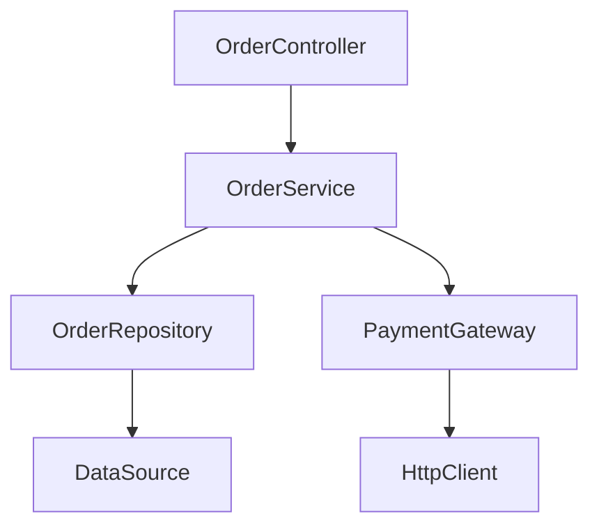
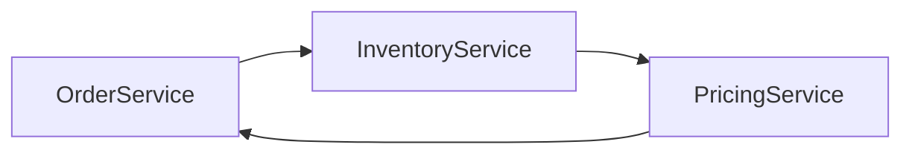
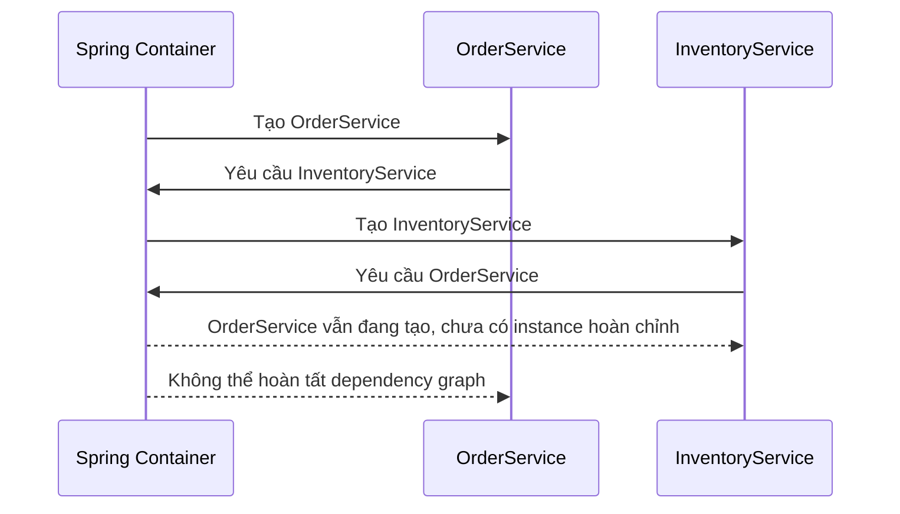
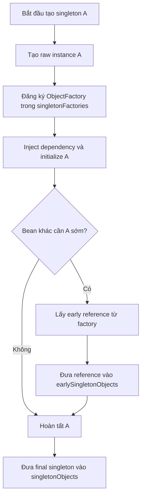
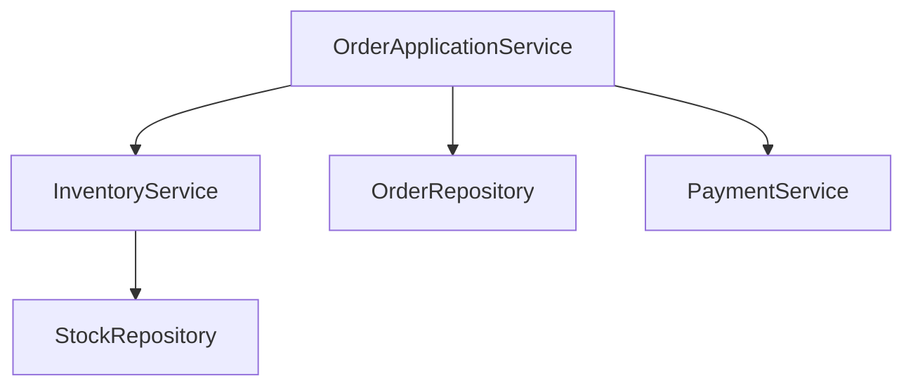
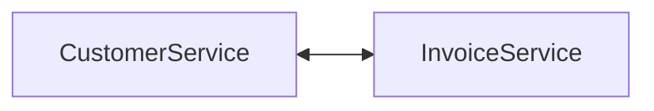
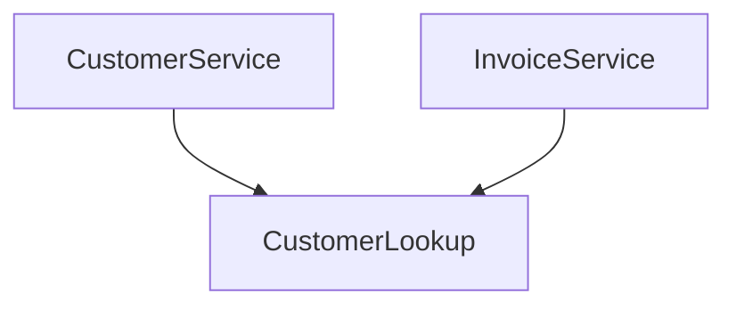
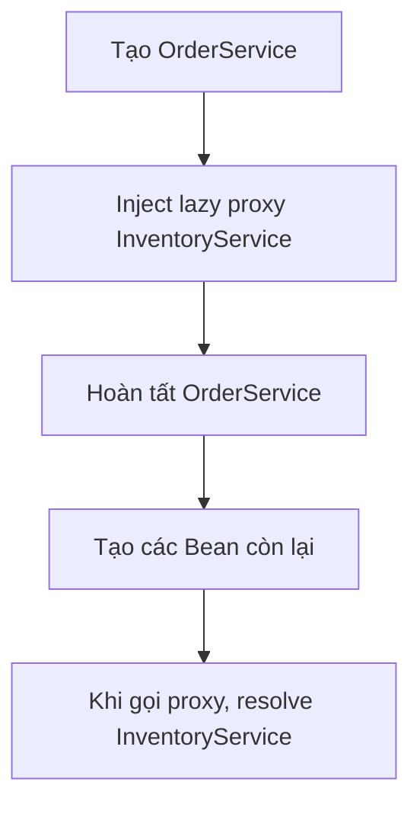
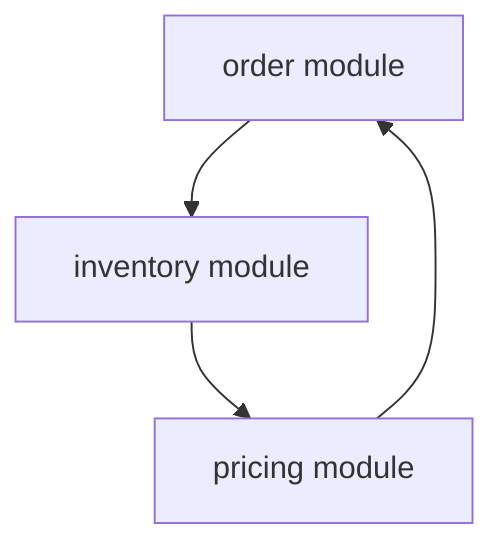
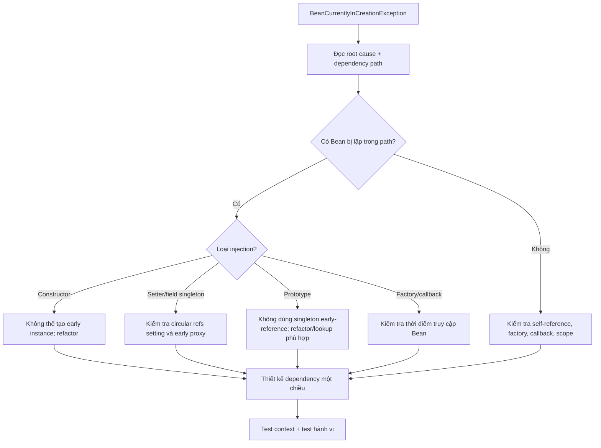

# BeanCurrentlyInCreationException và vòng phụ thuộc

Khi Spring tạo các Bean lúc khởi động, container phải biết Bean nào cần được tạo trước để inject dependency cho Bean khác. Nếu dependency tạo thành một vòng khép kín, ví dụ `A` cần `B` nhưng `B` lại cần `A`, Spring có thể không tìm được thứ tự khởi tạo hợp lệ.

Một lỗi thường gặp trong trường hợp này là:

```text
org.springframework.beans.factory.BeanCurrentlyInCreationException:
Error creating bean with name 'orderService':
Requested bean is currently in creation: Is there an unresolvable circular reference?
```

Thông báo này cho biết Spring đang cần một Bean nhưng Bean đó vẫn trong quá trình tạo. Trong một số cấu hình, container có thể dùng early reference để giải quyết vòng phụ thuộc giữa singleton. Trong các trường hợp khác, đặc biệt với constructor injection, prototype scope hoặc khi circular references bị tắt, vòng phụ thuộc không thể được giải quyết và quá trình tạo ApplicationContext thất bại.

Điều cần làm là tìm **chu trình dependency thực sự**, hiểu vì sao hai Bean phụ thuộc lẫn nhau, rồi thiết kế lại ranh giới trách nhiệm. Việc chỉ bật cho phép circular references có thể làm ứng dụng khởi động được trong một số trường hợp, nhưng thường che giấu một cấu trúc khó bảo trì.

## 1. BeanCurrentlyInCreationException là gì?

`BeanCurrentlyInCreationException` là exception của Spring BeanFactory, thuộc nhóm lỗi tạo Bean. Nó được ném khi một Bean được yêu cầu trong lúc chính Bean đó vẫn đang được tạo và container không thể cung cấp tham chiếu hợp lệ ở thời điểm đó.

Tình huống phổ biến là circular dependency:

```text
Bean A ───── cần Bean B
  ▲              │
  └──────────────┘
        B cần A
```

Spring không thể hoàn tất quá trình tạo A nếu chưa có B, đồng thời cũng không thể hoàn tất B nếu chưa có A.

Tuy nhiên, không nên kết luận mọi `BeanCurrentlyInCreationException` đều chắc chắn do hai class constructor-inject lẫn nhau. Nó cũng có thể xuất hiện khi:

- Một Bean trực tiếp hoặc gián tiếp yêu cầu chính nó trong lúc khởi tạo.
- Một `FactoryBean`, factory method hoặc callback khởi tạo truy cập Bean quá sớm.
- Một prototype Bean nằm trong vòng phụ thuộc.
- Cấu hình `@DependsOn` tạo thứ tự phụ thuộc vòng.
- Một Bean bị truy cập trong `@PostConstruct`, `InitializingBean.afterPropertiesSet()` hoặc custom initialization callback khi object graph chưa hoàn tất.
- Cơ chế proxy/AOP và early reference không tương thích với cách Bean được inject.

Vì vậy exception là **dấu hiệu cần điều tra**, còn stack trace và dependency graph mới giúp xác định nguyên nhân cụ thể.

## 2. Dependency graph và vòng khép kín

Spring quản lý các Bean như một đồ thị phụ thuộc có hướng. Nếu `A` cần `B`, ta có cạnh `A → B`.

Một đồ thị không có vòng thường có thể được khởi tạo theo thứ tự phù hợp:



Ví dụ này có thể tạo các dependency nền trước rồi tạo các Bean phía trên.

Khi có vòng:



Chu trình là:

`OrderService → InventoryService → PricingService → OrderService`.

Không quan trọng vòng có hai Bean hay năm Bean. Chỉ cần tồn tại đường đi từ một Bean quay lại chính nó thì dependency graph có chu trình.

### Vòng trực tiếp và vòng gián tiếp

Vòng trực tiếp:

```java
@Component
public class ReportService {
    public ReportService(ReportService self) {
    }
}
```

Vòng gián tiếp:

```java
@Service
public class OrderService {
    public OrderService(InventoryService inventoryService) {
    }
}

@Service
public class InventoryService {
    public InventoryService(OrderService orderService) {
    }
}
```

Vòng gián tiếp thường khó nhận ra hơn vì mỗi class riêng lẻ có vẻ chỉ phụ thuộc vào một service hợp lý. Khi hệ thống lớn, chu trình có thể đi qua nhiều module hoặc nhiều tầng nghiệp vụ.

### Dependency graph phản ánh thiết kế

Nếu service A cần gọi service B và service B lại cần gọi ngược service A, có thể hai service đang chứa các trách nhiệm chưa được phân chia đúng. Có thể cần:

- Tách phần logic dùng chung thành một service thứ ba.
- Đưa quy trình điều phối lên một application service.
- Dùng interface hoặc port để đảo chiều dependency.
- Chuyển giao tiếp một chiều sang event/message nếu phù hợp nghiệp vụ.

Không phải mọi vòng đều có thể xóa chỉ bằng đổi constructor thành setter. Hãy xác định vì sao dependency tồn tại trước khi chọn cách xử lý.

## 3. Constructor injection tạo vòng phụ thuộc không thể khởi tạo

Constructor injection là cách phổ biến để thể hiện dependency bắt buộc:

```java
@Service
public class OrderService {
    private final InventoryService inventoryService;

    public OrderService(InventoryService inventoryService) {
        this.inventoryService = inventoryService;
    }
}
```

Nhưng nếu `InventoryService` lại yêu cầu `OrderService`:

```java
@Service
public class InventoryService {
    private final OrderService orderService;

    public InventoryService(OrderService orderService) {
        this.orderService = orderService;
    }
}
```

Spring phải tạo hai object:

1. Tạo `OrderService` cần có `InventoryService`.
2. Tạo `InventoryService` lại cần có `OrderService`.
3. Nhưng constructor của `OrderService` chưa hoàn tất nên chưa có instance hoàn chỉnh để truyền vào `InventoryService`.
4. Container không thể hoàn tất một trong hai constructor.

Sơ đồ:



Đây là lý do constructor cycle thường dẫn tới `BeanCurrentlyInCreationException`. Container không thể tạo object chưa hoàn thành rồi đưa vào constructor khác như một reference hợp lệ.

### Vì sao constructor injection vẫn được khuyến nghị?

Constructor injection có những lợi ích quan trọng:

- Dependency bắt buộc được thể hiện rõ.
- Field có thể khai báo `final`.
- Object không thể được tạo ở trạng thái thiếu dependency.
- Unit test dễ tạo instance với dependency giả.
- Vòng phụ thuộc được phát hiện sớm khi khởi tạo context.

Nếu constructor injection làm lộ vòng phụ thuộc, đó thường là tín hiệu tốt: thiết kế cần được xem xét trước khi ứng dụng đi vào runtime.

## 4. Setter/field injection và early reference của singleton

Khác với constructor injection, setter/field injection cho phép Spring tạo instance trước, sau đó mới gán dependency:

```java
@Service
public class OrderService {
    private InventoryService inventoryService;

    @Autowired
    public void setInventoryService(InventoryService inventoryService) {
        this.inventoryService = inventoryService;
    }
}

@Service
public class InventoryService {
    private OrderService orderService;

    @Autowired
    public void setOrderService(OrderService orderService) {
        this.orderService = orderService;
    }
}
```

Với singleton Bean và circular reference được cho phép, Spring có thể:

1. Tạo instance A bằng constructor không tham số.
2. Đưa một factory tạo early reference của A vào cache nội bộ.
3. Bắt đầu tạo B.
4. Khi B cần A, lấy early reference của A.
5. Hoàn tất inject dependency cho B.
6. Quay lại hoàn tất inject dependency cho A.

Điều này có thể giải quyết một số vòng phụ thuộc setter/field injection giữa singleton Bean.

### Vì sao không phải mọi vòng đều giải quyết được?

Early reference chỉ có thể cung cấp khi object instance đã được tạo. Nó không thể giải quyết vòng constructor vì constructor chưa tạo xong object.

Ngoài ra:

- Prototype Bean không được quản lý theo cùng singleton cache lifecycle.
- Một số factory/lifecycle callback có thể yêu cầu Bean ở thời điểm chưa thể cung cấp reference.
- AOP proxy có thể tạo khác biệt giữa raw object và wrapped object.
- Spring Boot hiện đại mặc định không cho circular references trong cấu hình thông thường.

Do đó, việc đổi constructor injection sang field injection có thể khiến một vòng phụ thuộc “chạy được” trong một cấu hình cũ, nhưng không phải giải pháp thiết kế đáng tin cậy.

## 5. Spring singleton three-level cache hoạt động ra sao?

Để hiểu vì sao setter cycle có thể được giải quyết trong một số trường hợp, cần biết cơ chế cache singleton của Spring Framework.

Ở mức khái niệm, `DefaultSingletonBeanRegistry` sử dụng ba vùng lưu trữ:

| Cache | Vai trò |
|---|---|
| `singletonObjects` | Singleton Bean đã hoàn tất, sẵn sàng sử dụng |
| `earlySingletonObjects` | Early reference đã được tạo và có thể trả cho dependency đang cần |
| `singletonFactories` | Factory có thể tạo early reference khi cần, thường để hỗ trợ `getEarlyBeanReference` và AOP |

Luồng khái quát:



Ba cache này không phải ba bản sao Bean cùng được tạo. Chúng đại diện cho các giai đoạn khác nhau trong quá trình tạo singleton.

### Vì sao có factory thay vì lưu raw object ngay?

Spring cần một điểm để tạo **early bean reference** có thể được điều chỉnh bởi các cơ chế như `SmartInstantiationAwareBeanPostProcessor`. Auto-proxy creator có thể dùng cơ chế này để cung cấp proxy phù hợp sớm, tránh một Bean khác nhận raw object trong khi sau đó container lại expose một proxy khác.

Nếu early reference không tương thích với object cuối cùng sau các BeanPostProcessor, ứng dụng có thể gặp vấn đề về identity hoặc hành vi AOP. Đây là một trong các lý do xử lý circular references không đơn giản chỉ là “đưa object vào map trước khi inject”.

### Early reference không có nghĩa Bean đã sẵn sàng

Một early reference có thể được inject khi Bean vẫn chưa hoàn thành:

- Setter/field dependency có thể chưa được gán hết.
- `@PostConstruct` có thể chưa chạy.
- `InitializingBean.afterPropertiesSet()` chưa hoàn tất.
- BeanPostProcessor còn có thể xử lý object.
- Một số proxy/wrapper chưa ở trạng thái cuối cùng.

Nếu Bean B gọi method của A ngay trong quá trình khởi tạo, A có thể đang ở trạng thái chưa sẵn sàng. Đây là một rủi ro runtime dù context có thể khởi động thành công.

**Early reference là cơ chế tương thích container, không phải lời bảo đảm mọi Bean trong vòng đều an toàn khi sử dụng lẫn nhau lúc startup.**

## 6. Spring Boot 2.6 trở lên và mặc định circular references

Từ Spring Boot 2.6, circular references giữa Bean mặc định bị cấm trong cấu hình thông thường. Thay đổi này giúp phát hiện sớm những dependency cycle khó bảo trì thay vì âm thầm cố giải quyết bằng early reference.

Một cấu hình có thể gặp:

```text
The dependencies of some of the beans in the application context form a cycle:

┌─────┐
| orderService
↑     ↓
| inventoryService
└─────┘
```

Spring Boot có property tương thích để cho phép lại circular references:

```properties
spring.main.allow-circular-references=true
```

Hoặc YAML:

```yaml
spring:
  main:
    allow-circular-references: true
```

Khi property này được bật, Boot cho phép container xử lý một số circular references có thể giải quyết được, chẳng hạn vòng setter/field injection giữa singleton Bean.

**Điều đó không có nghĩa mọi vòng phụ thuộc đều hoạt động.** Constructor cycle vẫn không có instance sẵn để inject; prototype cycle và một số tình huống factory/proxy cũng có thể không giải quyết được.

### Có nên bật property này?

Thông thường, không nên dùng `spring.main.allow-circular-references=true` như cách sửa lỗi mặc định cho ứng dụng mới.

Chỉ cân nhắc tạm thời khi:

- Đang nâng cấp một ứng dụng legacy có vòng setter/field injection đã tồn tại.
- Cần khôi phục hoạt động trong thời gian ngắn trước khi refactor.
- Đã xác định rõ vòng nào được giải quyết và kiểm thử lifecycle của các Bean liên quan.
- Có kế hoạch loại bỏ dependency cycle thay vì giữ property vô thời hạn.

Nếu ứng dụng cần property này để khởi động, hãy ghi nhận đây là một điểm nợ thiết kế và xác định module/Bean cần thay đổi.

## 7. Đọc stack trace và xác định chu trình

Khi context khởi động thất bại, lỗi ngoài cùng có thể là:

```text
org.springframework.beans.factory.UnsatisfiedDependencyException:
Error creating bean with name 'orderController'
```

Nhưng root cause ở sâu hơn có thể là:

```text
org.springframework.beans.factory.BeanCurrentlyInCreationException:
Error creating bean with name 'orderService':
Requested bean is currently in creation
```

Đừng chỉ nhìn dòng đầu tiên. Hãy lần theo chuỗi:

```text
OrderController
  constructor parameter 0
    OrderService
      constructor parameter 1
        InventoryService
          constructor parameter 0
            OrderService
              currently in creation
```

Đoạn này cho thấy:

1. Controller cần `OrderService`.
2. `OrderService` cần `InventoryService`.
3. `InventoryService` lại cần `OrderService`.
4. `OrderService` đang ở giữa quá trình tạo nên không thể được cung cấp theo cách yêu cầu.

### Cách đọc dependency path

Khi đọc stack trace:

- Tìm tên Bean ở `Error creating bean with name`.
- Đọc các đoạn `Unsatisfied dependency expressed through constructor parameter`, field hoặc method.
- Ghi lại từng Bean xuất hiện trong chuỗi.
- Tìm Bean đầu tiên lặp lại.
- Đọc exception cause cuối cùng để phân biệt circular dependency với lỗi khác như thiếu Bean, lỗi constructor hoặc lỗi binding.

Nếu output có dependency cycle diagram, dùng nó làm điểm bắt đầu nhưng vẫn kiểm tra source injection thực tế. Một Bean có thể phụ thuộc gián tiếp thông qua `@Bean` factory method, configuration properties hoặc `@DependsOn`.

### Khi không có cycle diagram rõ ràng

Một số phiên bản hoặc kiểu lỗi không in đồ thị dễ đọc. Có thể:

- Bật log tạo Bean phù hợp trong môi trường phát triển.
- Dùng debugger đặt breakpoint tại constructor/factory method.
- Kiểm tra dependency khai báo qua constructor, field và method.
- Tìm các `@Bean` method trả về service hoặc factory.
- Dùng IDE call hierarchy hoặc search tên Bean/type để dựng đường đi.

Không cần bật root TRACE cho toàn bộ ứng dụng ngay từ đầu. Hãy khoanh vùng các Bean trong chuỗi lỗi trước.

## 8. Ví dụ vòng phụ thuộc trong nghiệp vụ

Giả sử ứng dụng đặt hàng có hai service:

```java
@Service
public class OrderService {
    private final InventoryService inventoryService;

    public OrderService(InventoryService inventoryService) {
        this.inventoryService = inventoryService;
    }

    public void placeOrder(String sku, int quantity) {
        inventoryService.reserve(sku, quantity);
        // Tạo order và lưu dữ liệu.
    }
}
```

Inventory service cần Order service để kiểm tra trạng thái:

```java
@Service
public class InventoryService {
    private final OrderService orderService;

    public InventoryService(OrderService orderService) {
        this.orderService = orderService;
    }

    public void reserve(String sku, int quantity) {
        // Cần gọi orderService để xác minh trạng thái order.
    }
}
```

Thiết kế này có một câu hỏi đáng đặt ra: tại sao việc giữ tồn kho lại cần biết trực tiếp về `OrderService`? Có thể `InventoryService` đang biết quá nhiều về quy trình đặt hàng.

Thay vì cố cho phép vòng, ta tách phần điều phối:



`OrderApplicationService` điều phối use case. `InventoryService` chỉ chịu trách nhiệm kiểm tra và giữ tồn kho; nó không cần gọi ngược về service điều phối.

Ví dụ:

```java
@Service
public class OrderApplicationService {
    private final InventoryService inventoryService;
    private final PaymentService paymentService;
    private final OrderRepository orderRepository;

    public OrderApplicationService(
            InventoryService inventoryService,
            PaymentService paymentService,
            OrderRepository orderRepository) {
        this.inventoryService = inventoryService;
        this.paymentService = paymentService;
        this.orderRepository = orderRepository;
    }

    public Order placeOrder(CreateOrderCommand command) {
        inventoryService.reserve(
                command.sku(), command.quantity());

        Order order = orderRepository.save(
                Order.create(command));

        paymentService.authorize(order);
        return order;
    }
}
```

InventoryService:

```java
@Service
public class InventoryService {
    private final StockRepository stockRepository;

    public InventoryService(StockRepository stockRepository) {
        this.stockRepository = stockRepository;
    }

    public void reserve(String sku, int quantity) {
        Stock stock = stockRepository.findBySku(sku)
                .orElseThrow(() ->
                        new IllegalArgumentException("Unknown SKU"));

        stock.reserve(quantity);
        stockRepository.save(stock);
    }
}
```

Ví dụ rút gọn giả định các kiểu `Order`, `CreateOrderCommand`, `Stock`, `OrderRepository`, `StockRepository` và `PaymentService` đã được định nghĩa. Điểm quan trọng là dependency chỉ đi từ application service xuống các service chuyên trách, không có cạnh quay ngược.

## 9. Cách sửa tốt nhất: tách trách nhiệm và tạo một chiều phụ thuộc

Một chu trình thường là dấu hiệu hai module đang phụ thuộc lẫn nhau về mặt nghiệp vụ. Các phương án refactor phổ biến:

### Tách logic dùng chung

Nếu A và B cùng cần một đoạn logic, đừng để A gọi B và B gọi A. Đưa logic đó vào component thứ ba có trách nhiệm riêng.

Trước:



Sau:



### Dùng application service làm orchestration layer

Một service điều phối use case có thể gọi các service chuyên trách theo thứ tự. Những service chuyên trách không cần gọi ngược lên orchestration layer.

```text
Controller
   ↓
Application Service
   ├── Customer Service
   ├── Inventory Service
   ├── Payment Service
   └── Notification Service
```

### Đảo chiều dependency bằng interface/port

Nếu module domain cần một hành vi nhưng không nên phụ thuộc vào module infrastructure, định nghĩa interface ở phía sở hữu contract. Implementation ở module khác phụ thuộc vào interface đó.

Ví dụ:

```java
public interface CustomerStatusReader {
    CustomerStatus findStatus(CustomerId customerId);
}
```

Service dùng interface:

```java
@Service
public class InvoiceService {
    private final CustomerStatusReader customerStatusReader;

    public InvoiceService(CustomerStatusReader customerStatusReader) {
        this.customerStatusReader = customerStatusReader;
    }
}
```

Adapter triển khai interface ở module thích hợp:

```java
@Component
public class CustomerStatusAdapter implements CustomerStatusReader {
    private final CustomerRepository customerRepository;

    public CustomerStatusAdapter(CustomerRepository customerRepository) {
        this.customerRepository = customerRepository;
    }

    @Override
    public CustomerStatus findStatus(CustomerId customerId) {
        return customerRepository.findStatus(customerId);
    }
}
```

Đảo chiều dependency giúp module nghiệp vụ không phải import implementation của module khác. Nó không tự động loại mọi runtime cycle nếu implementation vẫn inject ngược service ban đầu, nhưng tạo ranh giới tốt để thiết kế đồ thị một chiều.

### Tách interface không tự phá vòng

Nếu `A` inject interface `BPort`, nhưng implementation `BAdapter` lại inject `A`, dependency runtime vẫn có thể là:

`A → BAdapter → A`.

Interface chỉ có ích khi nó giúp đảo chiều hoặc tách module thật sự. Đừng chỉ đổi tên type rồi nghĩ chu trình đã biến mất.

## 10. Dùng event để tách giao tiếp một chiều

Một số tình huống không cần service gọi ngược đồng bộ. Ví dụ sau khi tạo đơn, hệ thống cần gửi thông báo. Thay vì `OrderService` gọi `NotificationService` và notification service lại gọi `OrderService` để đọc trạng thái, có thể phát một domain/application event.

Publisher:

```java
@Service
public class OrderApplicationService {
    private final OrderRepository orderRepository;
    private final ApplicationEventPublisher events;

    public OrderApplicationService(
            OrderRepository orderRepository,
            ApplicationEventPublisher events) {
        this.orderRepository = orderRepository;
        this.events = events;
    }

    public Order placeOrder(CreateOrderCommand command) {
        Order order = orderRepository.save(Order.create(command));
        events.publishEvent(new OrderPlacedEvent(order.getId()));
        return order;
    }
}
```

Listener:

```java
@Component
public class OrderNotificationListener {
    private final NotificationService notificationService;

    public OrderNotificationListener(
            NotificationService notificationService) {
        this.notificationService = notificationService;
    }

    @EventListener
    public void onOrderPlaced(OrderPlacedEvent event) {
        notificationService.notifyOrderPlaced(event.orderId());
    }
}
```

Event type:

```java
public record OrderPlacedEvent(Long orderId) {}
```

Ở đây publisher phụ thuộc vào abstraction `ApplicationEventPublisher`; listener phụ thuộc vào `NotificationService`. Notification service không cần inject ngược `OrderApplicationService`.

### Event không phải lúc nào cũng là giải pháp

Spring application event thường được xử lý đồng bộ theo mặc định nếu không cấu hình executor khác. Nếu listener gọi ngược publisher hoặc tạo một chu trình event, logic vẫn có thể phức tạp.

Ngoài ra, event nội bộ không tự bảo đảm durable delivery. Nếu cần bảo đảm thông báo sau khi process crash, cân nhắc transactional outbox hoặc message broker thay vì chỉ dùng in-memory event.

## 11. Dùng ObjectProvider khi dependency cần được phân giải muộn

Có trường hợp một Bean chỉ cần dependency ở một thời điểm sau khi context đã khởi tạo. Spring cung cấp `ObjectProvider<T>` để trì hoãn việc lấy Bean:

```java
@Service
public class ReportService {
    private final ObjectProvider<ExportService> exportServiceProvider;

    public ReportService(
            ObjectProvider<ExportService> exportServiceProvider) {
        this.exportServiceProvider = exportServiceProvider;
    }

    public void exportReport(Report report) {
        ExportService exportService =
                exportServiceProvider.getObject();
        exportService.export(report);
    }
}
```

`ObjectProvider` được inject ngay khi tạo `ReportService`, nhưng Bean `ExportService` chỉ được resolve khi gọi `getObject()`.

Điều này có thể phá vòng khởi tạo nếu dependency chỉ được dùng sau khi context đã sẵn sàng. Tuy nhiên, nó cũng thay đổi semantics:

- Lỗi thiếu Bean có thể xuất hiện muộn hơn.
- Nếu gọi provider trong constructor hoặc callback khởi tạo, vòng có thể vẫn xảy ra.
- Mỗi lần gọi provider có thể lấy cùng singleton hoặc một instance khác tùy scope.
- Quan hệ phụ thuộc vẫn tồn tại về mặt thiết kế, chỉ được trì hoãn phân giải.

### getIfAvailable và getIfUnique

Nếu dependency thật sự tùy chọn:

```java
Optional<ExportService> exportService =
        exportServiceProvider.getIfAvailable();
```

Hoặc dùng `getIfUnique()` khi cần tránh chọn giữa nhiều ứng viên. Không nên dùng API optional để che giấu một dependency thực tế bắt buộc; nếu service không thể hoạt động thiếu dependency, hãy khai báo nó rõ ràng.

### ObjectProvider không phải công cụ refactor mặc định

Nếu A và B cần nhau trong mọi thao tác nghiệp vụ, `ObjectProvider` chỉ làm chu trình khó nhìn thấy hơn. Hãy dùng nó khi việc trì hoãn lookup phản ánh đúng thời điểm sử dụng, chẳng hạn plugin tùy chọn hoặc callback cần Bean sau startup.

## 12. Dùng @Lazy để trì hoãn khởi tạo hoặc inject proxy

Spring hỗ trợ `@Lazy` ở cấp Bean definition và injection point.

Ví dụ:

```java
@Service
public class OrderService {
    private final InventoryService inventoryService;

    public OrderService(@Lazy InventoryService inventoryService) {
        this.inventoryService = inventoryService;
    }
}
```

Ở injection point, `@Lazy` có thể tạo một lazy-resolution proxy. Proxy được inject ngay, còn target Bean được resolve khi method được gọi.

Điều này có thể làm constructor cycle khởi tạo được trong một số trường hợp:



### Rủi ro của @Lazy

- Lỗi dependency có thể bị trì hoãn đến request/runtime đầu tiên.
- Proxy có thể che giấu chu trình thay vì loại bỏ coupling.
- Gọi target trong quá trình khởi tạo có thể kích hoạt vòng sớm trở lại.
- Một số kiểu final class/method hoặc proxy strategy có thể ảnh hưởng khả năng proxy.
- Khi target có scope/lifecycle khác, semantics của proxy cần được hiểu rõ.

`@Lazy` phù hợp khi dependency thực sự không cần ngay lúc khởi tạo, hoặc một integration tùy chọn nên chỉ được tạo khi sử dụng. Không nên thêm `@Lazy` vào mọi Bean trong vòng chỉ để ứng dụng khởi động mà không xem lại thiết kế.

### @Lazy trên Bean khác với @Lazy trên injection point

Đặt `@Lazy` trên class/configuration có thể trì hoãn khởi tạo Bean cho tới khi được yêu cầu. Đặt trên tham số/field injection có thể tạo lazy-resolution proxy cho dependency đó. Hai cách có liên quan nhưng không phải một cấu hình giống hệt nhau.

## 13. @DependsOn không sửa circular dependency

`@DependsOn` yêu cầu Spring khởi tạo một Bean trước Bean khác:

```java
@Component
@DependsOn("databaseInitializer")
public class OrderService {
}
```

Nó hữu ích khi một Bean có side effect khởi tạo cần xảy ra trước một Bean khác nhưng quan hệ đó không được thể hiện qua constructor dependency.

Nhưng nếu cấu hình:

```java
@Component
@DependsOn("inventoryService")
public class OrderService {
}

@Component
@DependsOn("orderService")
public class InventoryService {
}
```

thì bạn vừa khai báo thứ tự tạo vòng. `@DependsOn` không cung cấp object sớm và không phá chu trình; nó có thể làm lỗi dependency rõ hơn hoặc dẫn tới cùng loại vấn đề.

Hãy dùng `@DependsOn` cho thứ tự khởi tạo một chiều có chủ đích, không dùng như công cụ giải quyết cycle.

## 14. @PostConstruct và gọi Bean quá sớm

Một vòng phụ thuộc đôi khi không nằm trực tiếp ở constructor mà phát sinh trong callback:

```java
@Component
public class StartupCoordinator {
    private final OrderService orderService;

    public StartupCoordinator(OrderService orderService) {
        this.orderService = orderService;
    }

    @PostConstruct
    void initialize() {
        orderService.loadInitialData();
    }
}
```

Nếu `loadInitialData()` gọi tiếp một Bean đang trong quá trình tạo hoặc truy cập một phần object graph chưa sẵn sàng, startup có thể thất bại hoặc tạo hành vi khó dự đoán.

`@PostConstruct` được gọi sau khi dependency của chính Bean được inject, nhưng không đồng nghĩa **toàn bộ ApplicationContext đã khởi tạo xong**. Các Bean khác có thể còn đang được tạo.

### Công việc cần chạy sau khi context sẵn sàng

Nếu logic là một tác vụ startup cần chạy sau khi context refresh, hãy cân nhắc:

- `ApplicationRunner` hoặc `CommandLineRunner` cho công việc sau khi ứng dụng đã chuẩn bị context.
- `ApplicationReadyEvent` nếu cần mốc sau các runner.
- `SmartLifecycle` cho tài nguyên cần start/stop theo lifecycle.
- Một workflow riêng được gọi tường minh bởi application service.

Ví dụ:

```java
@Component
public class InitialDataLoader implements ApplicationRunner {
    private final OrderService orderService;

    public InitialDataLoader(OrderService orderService) {
        this.orderService = orderService;
    }

    @Override
    public void run(ApplicationArguments args) {
        orderService.loadInitialData();
    }
}
```

Chuyển từ `@PostConstruct` sang runner có thể giải quyết vấn đề **thời điểm gọi quá sớm**, nhưng không sửa một dependency cycle thực sự trong constructor graph. Nếu A constructor-inject B và B constructor-inject A, runner cũng không thể giúp context tạo xong hai Bean.

## 15. Vòng phụ thuộc qua @Configuration và @Bean method

Không phải mọi Bean đều được tạo từ `@Component`. `@Configuration` có thể khai báo factory method:

```java
@Configuration
public class ServiceConfiguration {

    @Bean
    OrderService orderService(InventoryService inventoryService) {
        return new OrderService(inventoryService);
    }

    @Bean
    InventoryService inventoryService(OrderService orderService) {
        return new InventoryService(orderService);
    }
}
```

Đây vẫn là constructor-style dependency graph ở mức factory method:

`orderService → inventoryService → orderService`.

Đổi `@Configuration(proxyBeanMethods = true/false)` không tự loại bỏ chu trình tham số `@Bean`. `proxyBeanMethods` chủ yếu điều khiển việc intercept lời gọi trực tiếp giữa các `@Bean` method trong configuration class; dependency qua method parameters vẫn do container phân giải.

### Gọi @Bean method trực tiếp trong lite configuration

Với:

```java
@Configuration(proxyBeanMethods = false)
class AppConfiguration {
    @Bean
    ServiceA serviceA() {
        return new ServiceA(serviceB());
    }

    @Bean
    ServiceB serviceB() {
        return new ServiceB();
    }
}
```

Khi `proxyBeanMethods=false`, lời gọi `serviceB()` là lời gọi Java thông thường, không được intercept để lấy singleton từ container. Điều này có thể tạo object khác với Bean mà container quản lý. Dùng method parameter:

```java
@Bean
ServiceA serviceA(ServiceB serviceB) {
    return new ServiceA(serviceB);
}
```

thường rõ ràng và đúng lifecycle hơn.

Nếu các `@Bean` method inject lẫn nhau qua tham số, hãy dựng dependency graph như với constructor injection và loại bỏ vòng. Đừng nhầm lỗi do gọi method trực tiếp với circular dependency của container.

## 16. Vòng phụ thuộc và AOP proxy

Spring có thể bọc Bean bằng proxy cho các tính năng như:

- `@Transactional`
- `@Async`
- `@Cacheable`
- Method security
- Custom aspects

Khi có circular reference, container phải bảo đảm Bean khác nhận reference tương thích với proxy cuối cùng. `SmartInstantiationAwareBeanPostProcessor.getEarlyBeanReference(...)` là một phần cơ chế hỗ trợ early proxy reference.

Một số tình huống có thể phát sinh thông báo dạng:

```text
Bean with name '...' has been injected into other beans
in its raw version as part of a circular reference,
but has eventually been wrapped
```

Thông báo này nói rằng một Bean khác đã nhận raw object trong khi Bean cuối cùng được wrap thành proxy. Kết quả có thể khiến một đường gọi bỏ qua advice như transaction/security/cache.

### Tại sao raw/proxy mismatch nguy hiểm?

Giả sử `PaymentService` được bọc bởi transaction proxy. Nếu một Bean khác giữ raw target reference do early exposure, lời gọi qua reference đó có thể không đi qua transaction interceptor như dự định.

Điều này làm ứng dụng có vẻ chạy được nhưng semantics runtime không đồng nhất:

- Một số call đi qua proxy.
- Một số call gọi trực tiếp target.
- `@Transactional` hoặc các advice khác có thể không áp dụng ở một đường gọi.

Đây là một lý do mạnh để loại circular references thay vì dựa vào early singleton exposure.

### Khi thấy lỗi proxy liên quan circular reference

Đừng chỉ thêm `@Lazy` hoặc bật `allow-circular-references` ngay. Hãy:

1. Xác định Bean nào được wrap và bởi post-processor nào.
2. Xác định Bean nào nhận raw reference.
3. Kiểm tra các lời gọi có phụ thuộc `@Transactional`, `@Async`, security hoặc cache advice không.
4. Refactor để dependency graph không còn cycle.
5. Kiểm tra lại hành vi qua proxy trong integration test.

## 17. Prototype scope và vòng phụ thuộc

Singleton Bean được container lưu trong cache và có cơ chế early reference cho một số circular references. Prototype Bean có lifecycle khác: mỗi lần yêu cầu tạo instance, container tạo object mới và không quản lý nó bằng singleton cache.

Ví dụ:

```java
@Component
@Scope(ConfigurableBeanFactory.SCOPE_PROTOTYPE)
public class TaskA {
    public TaskA(TaskB taskB) {
    }
}

@Component
@Scope(ConfigurableBeanFactory.SCOPE_PROTOTYPE)
public class TaskB {
    public TaskB(TaskA taskA) {
    }
}
```

Vòng prototype như vậy không thể dựa vào singleton early-reference mechanism để giải quyết. Nó có thể dẫn tới việc tạo đệ quy cho tới khi lỗi.

Một singleton inject prototype cũng có semantics khác: prototype được resolve tại thời điểm injection, thường chỉ một instance được giữ trong singleton nếu không dùng provider/proxy để lấy instance mới theo nhu cầu.

Nếu cần tạo prototype theo từng tác vụ, có thể dùng `ObjectProvider<Task>`:

```java
@Component
public class TaskLauncher {
    private final ObjectProvider<ExpensiveTask> taskProvider;

    public TaskLauncher(ObjectProvider<ExpensiveTask> taskProvider) {
        this.taskProvider = taskProvider;
    }

    public void launch() {
        ExpensiveTask task = taskProvider.getObject();
        task.execute();
    }
}
```

Đây là cách trì hoãn tạo instance theo yêu cầu, không phải cách hợp thức hóa một vòng dependency không có ý nghĩa.

## 18. Dùng @Lazy hoặc ObjectProvider: khi nào chấp nhận được?

Hai cơ chế này hữu ích khi **thời điểm cần dependency thật sự muộn hơn thời điểm tạo Bean**:

| Trường hợp | Cơ chế có thể phù hợp | Vì sao |
|---|---|---|
| Plugin tùy chọn chỉ dùng khi một chức năng được gọi | `ObjectProvider<T>` | Chỉ resolve khi feature được dùng |
| Bean nặng không cần lúc startup | `@Lazy` trên Bean hoặc injection point | Trì hoãn khởi tạo |
| Cần prototype mới cho mỗi thao tác | `ObjectProvider<T>` | Resolve instance mới theo scope |
| Dependency tùy chọn có thể không tồn tại | `getIfAvailable()` | Biểu đạt optional dependency |
| Hai service bắt buộc gọi nhau trong mọi nghiệp vụ | Refactor | Trì hoãn lookup chỉ che coupling |
| Constructor cycle giữa hai service core | Refactor | Không nên phụ thuộc vào proxy để vượt qua cycle |

Hãy đặt câu hỏi: **nếu trì hoãn dependency, hệ thống có một luồng gọi rõ ràng và hợp lệ sau khi context sẵn sàng không?** Nếu câu trả lời là không, vấn đề nằm ở thiết kế trách nhiệm chứ không phải thời điểm tạo Bean.

## 19. Circular dependency qua module

Trong dự án nhiều module, vòng phụ thuộc có thể tồn tại ở cấp build module:

```text
module-order  → module-inventory
module-inventory → module-pricing
module-pricing → module-order
```

Đây không chỉ là Spring Bean cycle. Build tool cũng có thể từ chối dependency cycle giữa Gradle/Maven modules trước khi ứng dụng chạy.

Một vòng module thường cho thấy ranh giới package/module chưa đúng. Ví dụ:



Có thể xử lý bằng cách:

- Đưa các contract chung vào module nhỏ hơn, ít phụ thuộc.
- Tạo module application/orchestration phụ thuộc xuống các module nghiệp vụ.
- Đặt interface tại module sở hữu abstraction.
- Tách integration adapter ra khỏi domain module.
- Không để shared module phụ thuộc ngược vào ứng dụng.

Ví dụ cấu trúc:

```text
application
  ├── order-domain
  ├── inventory-domain
  ├── pricing-domain
  └── infrastructure

order-domain      → shared-kernel
inventory-domain  → shared-kernel
pricing-domain    → shared-kernel
infrastructure   → các contract/domain cần triển khai
```

Một cấu trúc module tốt giúp Spring Bean graph dễ giữ theo một chiều, nhưng không bảo đảm tự động không có Bean cycle. Vẫn cần xem dependency injection trong từng module.

## 20. Kiểm thử và xác nhận đã loại bỏ vòng

Sau khi refactor, kiểm tra ApplicationContext có thể khởi động với cấu hình thật:

```java
@SpringBootTest
class ApplicationContextStartupTest {

    @Test
    void contextStartsSuccessfully() {
        // Spring Boot tạo context trước khi chạy test.
    }
}
```

Test này xác nhận các Bean được tạo trong cấu hình test đã load. Nếu ứng dụng có nhiều profile, cần chạy context test cho những profile chính vì mỗi profile có thể đăng ký một tập Bean khác nhau.

### Kiểm tra một nhóm Bean bằng ApplicationContextRunner

Với một nhóm configuration nhỏ:

```java
class OrderConfigurationTest {
    private final ApplicationContextRunner contextRunner =
            new ApplicationContextRunner()
                    .withUserConfiguration(OrderConfiguration.class);

    @Test
    void contextCanCreateOrderServices() {
        contextRunner.run(context -> {
            assertThat(context).hasNotFailed();
            assertThat(context).hasSingleBean(OrderService.class);
            assertThat(context).hasSingleBean(InventoryService.class);
        });
    }
}
```

Ví dụ dùng Spring Boot test và AssertJ; `OrderConfiguration` phải đăng ký các Bean liên quan. `ApplicationContextRunner` hữu ích để cô lập cấu hình, nhưng không thay thế test tích hợp toàn bộ ứng dụng khi dependency graph phụ thuộc nhiều auto-configuration.

### Test hành vi chứ không chỉ startup

Context khởi động thành công chưa chắc refactor giữ đúng nghiệp vụ. Cần kiểm tra:

- Use case gọi các service theo đúng thứ tự.
- Transaction boundary vẫn đúng.
- AOP proxy như `@Transactional` vẫn được áp dụng.
- Event listener không tạo vòng gọi lại.
- Lazy/provider dependency được resolve đúng lúc.
- Các profile/condition không tạo thêm một vòng mới ở môi trường khác.

Đặc biệt nếu trước đó có Bean được inject qua early reference, hãy kiểm tra đường gọi quan trọng có còn đi qua proxy cần thiết không.

## 21. Các triệu chứng thường gặp và hướng xử lý

| Triệu chứng | Nguyên nhân có thể | Hướng điều tra |
|---|---|---|
| `BeanCurrentlyInCreationException` ở constructor | Constructor cycle | Dựng dependency path và refactor |
| Boot báo circular reference giữa hai Bean | Setter/field cycle bị cấm theo mặc định | Xác định vòng; không bật property ngay như giải pháp lâu dài |
| Bật `allow-circular-references` nhưng vẫn lỗi | Constructor cycle, prototype cycle hoặc trường hợp không thể early expose | Xem loại injection/scope và factory |
| Context chạy nhưng gọi method lại lỗi null | Bean được gọi quá sớm khi dependency chưa được gán | Xem early reference và callback khởi tạo |
| `@Transactional` không hoạt động trên một đường gọi | Raw reference/proxy mismatch hoặc self-invocation | Kiểm tra proxy và dependency cycle |
| Vòng xuất hiện sau khi thêm `@PostConstruct` | Callback gọi Bean khác khi context chưa hoàn tất | Chuyển công việc sang runner/event phù hợp hoặc refactor |
| Lỗi chỉ xuất hiện ở một profile | Profile đăng ký implementation tạo cycle khác | Kiểm tra Bean graph của profile đó |
| Lỗi chỉ xuất hiện khi bật một feature | Conditional Bean hoặc optional integration tạo dependency path | Kiểm tra condition và cấu hình feature |
| Gradle/Maven báo module dependency cycle | Vòng ở build graph, chưa tới Spring | Tách contract/module và đảo chiều dependency |
| Ứng dụng khởi động khi thêm `@Lazy` nhưng lỗi lúc request đầu | Cycle bị trì hoãn chứ chưa được loại bỏ | Kiểm tra thời điểm resolve và thiết kế lại |

### Khi nào cần xem xét @Primary hoặc @Qualifier?

`@Primary` và `@Qualifier` giải quyết ambiguity khi có nhiều Bean cùng type. Chúng không giải quyết circular dependency.

Ví dụ nếu `OrderService` có hai implementation `LocalInventoryService` và `RemoteInventoryService`, chọn Bean đúng có thể giải quyết `NoUniqueBeanDefinitionException`. Nhưng nếu implementation được chọn lại inject `OrderService`, chu trình vẫn tồn tại.

Phân biệt:

- **Ambiguous dependency:** có nhiều ứng viên, Spring không biết chọn Bean nào.
- **Circular dependency:** dependency path quay lại Bean đang được tạo.
- **Missing dependency:** không có Bean phù hợp để inject.

Các lỗi này cần cách xử lý khác nhau dù đều có thể xuất hiện dưới dạng lỗi tạo Bean.

## 22. Những cách sửa tạm thời cần cân nhắc

Có những cách làm context khởi động được nhưng không nhất thiết làm thiết kế tốt hơn:

### Bật lại circular references

```properties
spring.main.allow-circular-references=true
```

Chỉ cân nhắc cho hệ thống legacy có setter/field cycle có thể giải quyết và cần thời gian refactor. Không sửa được constructor cycle hoặc mọi loại vòng.

### Đổi constructor injection thành setter injection

Điều này có thể giúp container tạo raw instance trước rồi dùng early reference cho singleton, nhưng làm dependency bắt buộc trở thành trạng thái có thể chưa được gán. Nó cũng làm dependency graph kém rõ ràng và có thể gây vấn đề proxy.

### Thêm @Lazy

Có thể trì hoãn resolve dependency, nhưng lỗi có thể xuất hiện ở runtime. Dùng khi lazy resolution là yêu cầu thực sự, không chỉ để che vòng.

### Dùng ApplicationContext.getBean()

Lấy Bean thủ công từ `ApplicationContext` có thể trì hoãn dependency đến lúc runtime, nhưng biến service thành service locator và làm dependency khó thấy trong constructor. Nó không loại bỏ coupling; chỉ giấu nó trong code.

### Đổi thứ tự bằng @DependsOn

Không phá được chu trình thực sự. Một thứ tự A trước B và B trước A là không thể đồng thời thỏa mãn.

### Tắt validation hoặc AOP

Không liên quan đến nguyên nhân dependency cycle, trừ khi một post-processor cụ thể đang tạo thêm dependency. Tắt một tính năng hạ tầng chỉ để context khởi động có thể làm mất transaction/security/cache semantics.

## 23. Quy trình chẩn đoán có hệ thống

Khi gặp `BeanCurrentlyInCreationException`, có thể đi theo trình tự:

1. **Tìm root cause.** Đọc tới exception sâu nhất, không chỉ dòng `UnsatisfiedDependencyException` đầu tiên.
2. **Ghi lại dependency path.** Liệt kê từng Bean và constructor parameter/field/method dẫn tới Bean kế tiếp.
3. **Tìm điểm lặp.** Bean xuất hiện lại trong cùng đường đi tạo thành chu trình.
4. **Phân loại cách inject.** Constructor, field, setter, `@Bean` factory method, `@DependsOn` hay callback.
5. **Kiểm tra scope.** Singleton hay prototype; có custom scope hoặc scoped proxy không?
6. **Kiểm tra Boot configuration.** Đặc biệt `spring.main.allow-circular-references` và phiên bản Spring Boot.
7. **Kiểm tra AOP.** Bean có `@Transactional`, `@Async`, cache, security hoặc custom proxy không?
8. **Xác định nguyên nhân nghiệp vụ.** Vì sao service A cần service B và B cần A?
9. **Chọn cách refactor.** Tách logic, tạo orchestration service, đảo chiều dependency hoặc event hóa giao tiếp phù hợp.
10. **Khởi động context và test hành vi.** Xác nhận cả startup lẫn transaction/proxy/business flow.

Sơ đồ:



## 24. Bài thực hành

Tạo hai service có constructor dependency vòng:

```java
@Service
class AService {
    AService(BService bService) {
    }
}

@Service
class BService {
    BService(AService aService) {
    }
}
```

Sau đó thực hiện:

1. Khởi động ứng dụng với cấu hình mặc định và đọc dependency cycle report.
2. Đổi hai constructor thành setter injection, thử trong môi trường Spring Boot hiện đại.
3. Tạm bật `spring.main.allow-circular-references=true`, quan sát trường hợp nào có thể được giải quyết.
4. Đưa một Bean sang prototype scope và quan sát khác biệt.
5. Đặt `@Lazy` ở một injection point, gọi method qua proxy sau khi startup và quan sát thời điểm target được resolve.
6. Thay một dependency bằng `ObjectProvider<BService>` rồi gọi `getObject()` trong một method nghiệp vụ.
7. Refactor hai service để một application service điều phối, không còn lời gọi ngược.
8. Thêm `@Transactional` vào một service boundary và xác nhận lời gọi đi qua proxy sau refactor.
9. Viết `@SpringBootTest` xác nhận context khởi động và test nghiệp vụ xác nhận thứ tự xử lý.

Khi hoàn tất, hãy giải thích vì sao setter injection hoặc `@Lazy` có thể làm một số tình huống chạy được nhưng không nhất thiết là thiết kế tốt nhất.

## 25. Ghi nhớ

`BeanCurrentlyInCreationException` thường xuất hiện khi Spring cần một Bean trong lúc Bean đó vẫn đang được tạo. Circular dependency là nguyên nhân phổ biến: một chuỗi dependency quay lại Bean ban đầu.

- Constructor cycle không thể giải quyết bằng early reference vì instance chưa được tạo hoàn chỉnh.
- Setter/field cycle giữa singleton có thể được xử lý bởi early singleton references trong những cấu hình cho phép.
- Spring Boot 2.6+ mặc định không cho circular references trong cấu hình thông thường; `spring.main.allow-circular-references=true` chỉ nên xem là biện pháp tương thích có kiểm soát.
- Three-level singleton cache hỗ trợ early reference, nhưng Bean được inject sớm có thể chưa hoàn tất lifecycle hoặc proxy.
- `@Lazy` và `ObjectProvider` trì hoãn resolve dependency; chúng hữu ích khi phản ánh đúng thời điểm sử dụng, nhưng có thể chỉ che giấu coupling.
- `@DependsOn`, `@Primary` và `@Qualifier` không tự loại bỏ một dependency cycle.
- Cách sửa bền vững thường là tách trách nhiệm, tạo application service điều phối, đảo chiều dependency qua contract hoặc dùng event/message khi nghiệp vụ phù hợp.

Khi gặp lỗi, hãy dựng dependency path và tìm Bean lặp lại trước khi đổi annotation. Một đồ thị Bean có hướng một chiều giúp Spring khởi tạo dễ dự đoán hơn, giúp transaction/proxy hoạt động nhất quán và làm ranh giới giữa các service rõ ràng.
