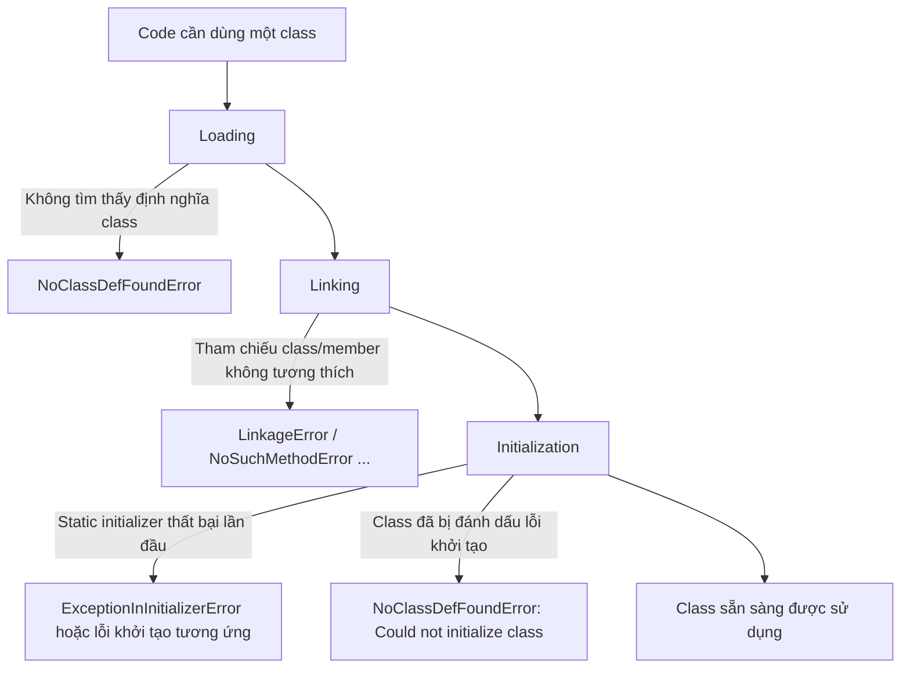

# NoClassDefFoundError, NoSuchMethodError và dependency không tương thích

Một ứng dụng Spring Boot có thể biên dịch thành công nhưng thất bại ngay khi khởi động, hoặc chỉ lỗi khi người dùng gọi tới một chức năng cụ thể. Stack trace có thể chứa những dòng như:

```text
java.lang.NoClassDefFoundError: com/example/library/Client

java.lang.NoSuchMethodError:
  'void com.example.library.Client.connect(java.lang.String)'
```

Đây là hai lỗi thường gặp khi **classpath lúc chạy không khớp với những gì code đã được biên dịch**, hoặc khi các thư viện không tương thích nhị phân với nhau. Chúng có thể xuất hiện sau khi nâng cấp Spring Boot, thêm một starter, đổi version thư viện, loại một dependency transitive hoặc đóng gói ứng dụng.

Trong chương **Chẩn đoán lỗi** của *Spring Boot Fundamentals*, bài học này giải thích cách phân biệt hai lỗi, truy ngược dependency gây xung đột, xác định class/method đang được JVM nạp từ đâu và khôi phục một dependency set nhất quán.

Những ý chính:

- **`NoClassDefFoundError`** thường cho biết JVM cần một class nhưng không thể định nghĩa/tìm thấy class đó tại thời điểm liên kết hoặc sử dụng.
- **`NoSuchMethodError`** cho biết JVM đã tìm thấy class nhưng method mà bytecode yêu cầu không có trong phiên bản class được nạp.
- Cả hai đều là **linkage errors**, không phải lỗi validation request hay exception nghiệp vụ thông thường.
- Build thành công không bảo đảm runtime classpath đúng; IDE, test, `bootRun` và executable JAR có thể dùng những classpaths khác nhau.
- Spring Boot dependency management/BOM giúp đồng bộ các thư viện Spring và thư viện liên quan; tự pin từng module riêng lẻ có thể tạo version skew.
- Sửa lỗi nên bắt đầu từ classpath thực tế và dependency graph, sau đó mới thay version hoặc exclusions.

## 1. Vì sao ứng dụng biên dịch được nhưng chạy lại lỗi?

Khi biên dịch Java, compiler cần nhìn thấy những class và method mà source code sử dụng. Khi chạy, JVM lại cần nạp những class tương ứng từ runtime classpath/module path.

Hai tập dependency có liên quan nhưng **không nhất thiết giống nhau**:

```text
Compile time
  Source code
      |
      v
  Compile classpath
      |
      v
  .class bytecode

Runtime
  .class bytecode
      |
      v
  Runtime classpath / module path
      |
      v
  JVM class loading + linking + initialization
      |
      v
  Application behavior
```

Ví dụ, code được biên dịch với thư viện phiên bản 2:

```java
public class ReportService {
    public void generate() {
        ReportClient client = new ReportClient();
        client.exportAsPdf();
    }
}
```

Phiên bản 2 của `ReportClient` có method `exportAsPdf()`. Nhưng khi đóng gói hoặc triển khai, runtime lại nạp phiên bản 1, vốn chưa có method này. Compiler đã làm đúng vì lúc biên dịch nó nhìn thấy version 2; JVM vẫn có thể thất bại khi chạy vì class thực tế là version 1.

Một tình huống khác: compiler tìm thấy `com.example.library.Client` trong dependency compile, nhưng dependency đó bị loại khỏi runtime vì khai báo scope/configuration không phù hợp. Khi JVM cần class, nó không tìm thấy.

### 1.1. Các classpath khác nhau trong một project Spring Boot

Một project thường có nhiều classpath:

| Classpath | Mục đích |
| --- | --- |
| Compile classpath | Dependency cần để biên dịch source chính |
| Runtime classpath | Dependency cần khi chạy ứng dụng |
| Test compile classpath | Dependency cần để biên dịch test source |
| Test runtime classpath | Dependency cần khi chạy test |
| Annotation processor path | Công cụ chạy lúc compile để sinh code/metadata |
| Build plugin classpath | Dependency dùng bởi Maven/Gradle plugin, không mặc nhiên là dependency runtime của ứng dụng |

Một thư viện có thể xuất hiện trên test runtime nhưng không có trên runtime của ứng dụng. Test pass không tự chứng minh executable JAR có đủ thư viện.

### 1.2. Executable JAR có thể khác môi trường IDE

Spring Boot executable JAR thường đóng gói dependency runtime vào:

```text
BOOT-INF/classes/
BOOT-INF/lib/
```

IDE có thể chạy ứng dụng với classpath trực tiếp từ các thư mục output và cache dependency của IDE. Một cấu hình chạy trong IDE có thể vô tình nhìn thấy thư viện mà artifact đóng gói không chứa.

Vì vậy, nếu lỗi chỉ xảy ra sau khi build/deploy, hãy kiểm tra **runtime artifact thực tế**, không chỉ dựa vào việc chạy được từ nút Run của IDE.

## 2. JVM thực hiện loading, linking và initialization

Để hiểu hai lỗi, cần phân biệt các giai đoạn chính trong vòng đời class:

1. **Loading:** tìm bytecode và tạo đối tượng biểu diễn class trong JVM.
2. **Linking:** xác minh bytecode, chuẩn bị dữ liệu class và resolve những tham chiếu cần thiết.
3. **Initialization:** thực thi static initializers và khởi tạo các static fields theo quy tắc JVM.

Có thể hình dung:



Đây là sơ đồ khái niệm. JVM có thể trì hoãn việc resolve một số symbolic references cho đến khi chúng thực sự được dùng, nên lỗi linkage không nhất thiết xuất hiện ngay ở dòng đầu tiên của chương trình.

## 3. NoClassDefFoundError là gì?

`NoClassDefFoundError` thuộc nhóm `java.lang.LinkageError`. JVM ném lỗi này khi code cần một class definition nhưng không thể tiếp tục vì class đó không khả dụng theo yêu cầu liên kết/khởi tạo.

Thông điệp thường gặp:

```text
java.lang.NoClassDefFoundError: com/example/library/Client
```

Tên class trong thông điệp thường dùng dấu gạch chéo thay cho dấu chấm. Điều đó không có nghĩa tên package trong source phải được viết bằng dấu gạch chéo.

### 3.1. Nguyên nhân phổ biến: thiếu class ở runtime

Code:

```java
import com.example.library.Client;

public class CatalogService {
    public void load() {
        Client client = new Client();
        client.connect();
    }
}
```

Giả sử dependency chứa `Client.class` chỉ có trên compile classpath, nhưng không có trên runtime classpath. Khi JVM cần class, có thể phát sinh `NoClassDefFoundError`.

Nguyên nhân thường gặp:

- Dependency được khai báo với scope/configuration không được đóng gói vào runtime.
- Một dependency transitive bị exclude nhưng code vẫn sử dụng class của nó.
- Thư viện bị đánh dấu optional ở module trung gian, trong khi ứng dụng cuối không khai báo trực tiếp dependency cần thiết.
- JAR thiếu file class hoặc được đóng gói sai.
- Runtime artifact khác với artifact đã được kiểm thử.
- Dependency bị thay thế bằng một phiên bản hoặc module không còn chứa class cần dùng.

### 3.2. Thiếu dependency transitive

Một thư viện A có thể dùng class của thư viện B:

```text
Application
   |
   v
Library A
   |
   v
Library B
```

Nếu dependency declaration của A kéo B vào theo cách thông thường, build tool có thể tự resolve B. Nhưng nếu B là optional dependency, bị exclude hoặc không được đưa vào runtime theo metadata, ứng dụng có thể phải khai báo B trực tiếp.

Không nên thêm mọi dependency bị thiếu một cách tùy tiện. Trước tiên xác định:

- Class bị thiếu thuộc artifact nào?
- Artifact đó có trong runtime dependency graph không?
- Nếu không, vì sao nó bị loại?
- Library A có yêu cầu một version cụ thể của B không?

### 3.3. Thiếu class do version/module không chứa class đó

Không phải lúc nào JAR cũng vắng mặt hoàn toàn. Có thể JAR được nạp nhưng version đang dùng không chứa class mới mà code đã compile tham chiếu.

Ví dụ:

```text
Compile:
  library-api-2.0.jar
  -> có com.example.ClientOptions

Runtime:
  library-api-1.4.jar
  -> không có com.example.ClientOptions
```

JVM tìm thấy artifact cùng tên nhưng class definition không có trong version đó. Triệu chứng có thể là `NoClassDefFoundError`.

### 3.4. NoClassDefFoundError cũng có thể xuất hiện sau lỗi static initialization

Đây là trường hợp dễ gây nhầm lẫn. Một class có static initializer:

```java
public final class CryptoSupport {

    static {
        String required = System.getenv("CRYPTO_PROVIDER");
        if (required == null) {
            throw new IllegalStateException(
                    "CRYPTO_PROVIDER is required"
            );
        }
    }

    private CryptoSupport() {
    }
}
```

Nếu initialization thất bại, lần đầu tiên JVM cố khởi tạo class thường có thể ném `ExceptionInInitializerError` (hoặc exception/error khởi tạo tương ứng theo tình huống). JVM đánh dấu class đó ở trạng thái lỗi khởi tạo trong classloader hiện tại.

Lần sau code tiếp tục sử dụng class đó, có thể thấy:

```text
java.lang.NoClassDefFoundError: Could not initialize class
  com.example.CryptoSupport
```

Trong trường hợp này, file class có thể tồn tại và JVM đã load nó. Vấn đề gốc là **static initialization thất bại trước đó**.

Khi thông điệp có cụm `Could not initialize class`, hãy tìm exception xuất hiện **trước lần NoClassDefFoundError hiện tại** trong cùng startup/test log. Đừng vội thêm dependency chỉ vì thấy chữ “NoClassDefFoundError”.

### 3.5. Classloader cũng là một phần của vấn đề

JVM không chỉ tìm class theo tên; class identity còn gắn với classloader đã định nghĩa class. Hai class cùng tên nhưng do hai classloader khác nhau định nghĩa không nhất thiết là cùng một type.

Những tình huống phức tạp có thể liên quan:

- Application server hoặc plugin runtime có nhiều classloaders.
- DevTools restart classloader trong môi trường phát triển.
- Thread hoặc static singleton giữ object từ classloader cũ.
- Thư viện bị đóng gói lặp ở nhiều nơi.
- Parent/child delegation và module boundaries.

Nếu lỗi xuất hiện sau nhiều lần DevTools restart hoặc chỉ trong container/application server, cần xem class origin và classloader identity, không chỉ nhìn version Maven/Gradle.

## 4. Phân biệt NoClassDefFoundError với ClassNotFoundException

Hai tên rất giống nhau nhưng loại lỗi và ngữ cảnh khác nhau.

| Đặc điểm | `ClassNotFoundException` | `NoClassDefFoundError` |
| --- | --- | --- |
| Loại | Checked exception | Error, cụ thể là LinkageError |
| Tình huống thường gặp | Code chủ động yêu cầu class qua reflection/classloader nhưng không tìm thấy | JVM cần một class definition khi liên kết hoặc sử dụng nhưng không thể tìm thấy/khởi tạo |
| Ví dụ | `Class.forName("com.example.Plugin")` không tìm thấy class | Bytecode tham chiếu class không có trên runtime classpath |
| Cách xử lý | Catch/propagate theo contract của API reflection | Sửa classpath, binary compatibility hoặc nguyên nhân initialization |

Ví dụ `ClassNotFoundException`:

```java
try {
    Class<?> plugin = Class.forName("com.example.Plugin");
} catch (ClassNotFoundException ex) {
    // Plugin không có trong classpath hoặc không được loader tìm thấy.
}
```

Ví dụ `NoClassDefFoundError` có thể xuất hiện khi code gọi trực tiếp:

```java
PluginRegistry registry = new PluginRegistry();
```

nhưng dependency chứa `PluginRegistry` hoặc một class mà nó cần lại không có trong runtime.

**Không nên catch `NoClassDefFoundError` như một lỗi request thông thường.** Nó thường chỉ ra lỗi triển khai/classpath hoặc trạng thái JVM không thể tiếp tục an toàn.

## 5. NoSuchMethodError là gì?

`NoSuchMethodError` cũng thuộc `java.lang.LinkageError`. Nó xảy ra khi JVM đang resolve một method reference trong bytecode nhưng class được nạp không có method tương ứng với tên và descriptor mà bytecode yêu cầu.

Ví dụ:

```text
java.lang.NoSuchMethodError:
  'void com.example.library.Client.connect(java.lang.String)'
```

Thông điệp cho thấy:

- Class: `com.example.library.Client`.
- Method: `connect`.
- Parameter type: `java.lang.String`.
- Return type: `void`.

JVM không tìm thấy method phù hợp với symbolic reference đó trong class hierarchy theo quy tắc method resolution.

### 5.1. Ví dụ binary incompatibility

Phiên bản 1 của thư viện:

```java
package com.example.library;

public class Client {
    public void connect() {
        // Kết nối.
    }
}
```

Phiên bản 2:

```java
package com.example.library;

public class Client {
    public void connect(String endpoint) {
        // Kết nối tới endpoint.
    }
}
```

Ứng dụng mới được compile với version 2:

```java
Client client = new Client();
client.connect("https://service.example.invalid");
```

Bytecode tham chiếu method `connect(String)`. Nhưng nếu runtime lại nạp version 1, chỉ có `connect()` không tham số, JVM không thể resolve method được yêu cầu và có thể ném `NoSuchMethodError`.

### 5.2. Compile-time API và runtime implementation không khớp

Một cách diễn đạt ngắn:

```text
Compile-time:
  Client.connect(String) exists

Runtime:
  Client.connect(String) missing

Result:
  NoSuchMethodError
```

Code không nhất thiết sai cú pháp. Nó đã được biên dịch đúng với API mà compiler nhìn thấy. Lỗi phát sinh vì class implementation được nạp lúc chạy không còn tương thích với bytecode.

### 5.3. Method descriptor gồm cả kiểu trả về

Trong JVM bytecode, method descriptor mô tả kiểu tham số và kiểu trả về. Vì vậy, chỉ nhìn tên method là chưa đủ để xác định hai method có cùng binary signature hay không.

Ví dụ:

```java
public String getValue() { ... }
```

và:

```java
public Object getValue() { ... }
```

có cùng tên và không có tham số nhưng descriptor khác kiểu trả về. Việc thay đổi return type có thể phá binary compatibility dù một số source call sites có thể trông gần giống nhau.

Trong các trường hợp thay đổi method static/instance hoặc class hierarchy, có thể gặp các loại `IncompatibleClassChangeError` hoặc linkage errors khác. Đừng gán mọi mismatch API thành `NoSuchMethodError`.

### 5.4. Dependency transitive thường là thủ phạm

Ví dụ ứng dụng trực tiếp dùng Library A:

```text
Application
   |
   v
Library A 2.x
   |
   v
Library B 2.x
```

Library A 2.x được compile để gọi `B.Client.connect(String)`. Nhưng một dependency khác kéo Library B 1.x vào runtime:

```text
Application
   |                     Other Library
   v                          |
Library A 2.x                  v
   |                       Library B 1.x
   v                          |
Library B 2.x  <--- version conflict / resolution
```

Build tool chỉ chọn một phiên bản artifact theo quy tắc dependency resolution. Nếu version được chọn không tương thích với Library A, runtime có thể phát sinh `NoSuchMethodError`.

## 6. NoSuchMethodError khác NoClassDefFoundError ở đâu?

| Câu hỏi | NoClassDefFoundError | NoSuchMethodError |
| --- | --- | --- |
| JVM tìm được class cần dùng? | Có thể không; hoặc class đã được load nhưng initialization thất bại | Thường đã tìm được class |
| Thành phần thiếu/không tương thích | Class definition hoặc trạng thái initialization | Method với descriptor được bytecode yêu cầu |
| Nguyên nhân thường gặp | Dependency thiếu ở runtime, class không có trong version, init lỗi | Compile với API mới nhưng runtime nạp implementation cũ/khác |
| Bước đầu điều tra | Xác định artifact chứa class, classpath và static initializer | Xác định class được nạp từ JAR nào và method descriptor có trong version đó không |

Cả hai đều có thể do **dependency version mismatch**. Khác biệt là loại symbolic reference mà JVM không giải quyết được.

## 7. Một số linkage errors liên quan cần nhận diện

Khi điều tra dependency không tương thích, có thể gặp các lỗi khác cùng nhóm:

| Error | Ý nghĩa khái quát |
| --- | --- |
| `NoSuchFieldError` | Class được nạp không có field mà bytecode yêu cầu |
| `AbstractMethodError` | Runtime gọi một method abstract mà object implementation không cung cấp implementation phù hợp |
| `IncompatibleClassChangeError` | Cấu trúc class/member không tương thích với cách bytecode sử dụng, ví dụ thay đổi static/instance hoặc class/interface |
| `IllegalAccessError` | Bytecode cố truy cập member/class không còn accessible theo quy tắc runtime |
| `UnsupportedClassVersionError` | JVM không hỗ trợ class-file version được biên dịch; thường là runtime JDK quá cũ |
| `ExceptionInInitializerError` | Lỗi xảy ra khi static initializer hoặc static field initialization thất bại |

Các lỗi này không có cùng cách sửa. Ví dụ `UnsupportedClassVersionError` thường yêu cầu đồng bộ JDK build/runtime; hạ version một dependency không phải giải pháp tổng quát.

### 7.1. Vì sao cần đọc loại lỗi chính xác?

Giả sử thấy:

```text
java.lang.UnsupportedClassVersionError:
  ... has been compiled by a more recent version of the Java Runtime
```

Đây không phải trường hợp thiếu class hoặc thiếu method. Class file có mặt nhưng JVM không đọc được version bytecode. Hãy kiểm tra `java -version` trong môi trường thực thi và JDK dùng để build.

### 7.2. ClassCastException cũng có thể liên quan classloader

Hai class cùng tên được định nghĩa bởi hai classloaders khác nhau có thể gây lỗi kiểu:

```text
ClassCastException:
  com.example.Plugin cannot be cast to com.example.Plugin
```

Thông điệp có vẻ vô lý, nhưng hai class cùng tên không có cùng identity nếu classloader khác nhau. Trường hợp này thường cần xem classloader topology và nơi nạp JAR.

## 8. Dependency không tương thích hình thành như thế nào?

Một ứng dụng Spring Boot thường không chỉ có dependency khai báo trực tiếp. Các starter kéo theo một đồ thị thư viện transitive.

Ví dụ khái niệm:

```text
catalog-service
  +-- spring-boot-starter-web
  |     +-- spring-boot-starter
  |     +-- Spring MVC / web infrastructure
  |     +-- JSON library
  |
  +-- spring-boot-starter-data-jpa
  |     +-- Spring Data
  |     +-- Hibernate
  |     +-- JDBC dependencies
  |
  +-- partner-sdk
        +-- http-client
        +-- commons-library
```

Khi hai nhánh yêu cầu các version khác nhau của cùng một artifact, Maven hoặc Gradle cần chọn version được đưa vào classpath.

### 8.1. Dependency trực tiếp và transitive

- **Direct dependency:** được khai báo trực tiếp trong project.
- **Transitive dependency:** được kéo vào bởi một dependency khác.

Ví dụ:

```text
Application
  +-- partner-sdk
  |     +-- commons-codec 1.x
  |
  +-- reporting-sdk
        +-- commons-codec 2.x
```

Ứng dụng có thể không hề khai báo `commons-codec` trực tiếp nhưng runtime vẫn phải chọn một version. Nếu version đó không tương thích với một SDK, lỗi chỉ xuất hiện khi code path tương ứng được thực thi.

### 8.2. Version mediation không chứng minh binary compatibility

Build tool có thể giải quyết dependency graph thành công và tạo artifact. Điều đó chỉ chứng minh có một version được chọn theo quy tắc resolution, **không chứng minh mọi thư viện phụ thuộc đều tương thích nhị phân với version đó**.

Một graph “resolved” vẫn có thể chứa tổ hợp thư viện không được vendor hỗ trợ.

### 8.3. JAR cùng tên không có nghĩa cùng API

Hai JAR có cùng group/artifact nhưng version khác có thể:

- Thêm method.
- Xóa method.
- Đổi parameter/return types.
- Chuyển class sang package khác.
- Đổi class thành interface hoặc ngược lại.
- Thay đổi constructor.
- Thay đổi generic bridge methods hoặc visibility.
- Chuyển namespace từ `javax.*` sang `jakarta.*`.

Vì vậy, khi debug phải xem **artifact version và class contents thực tế**, không chỉ nhìn tên dependency.

## 9. Maven giải quyết dependency version như thế nào?

Maven xây dependency tree từ các dependency được khai báo và metadata của chúng. Khi cùng một artifact xuất hiện nhiều version trong graph, Maven áp dụng dependency mediation. Quy tắc thường được mô tả là **nearest definition**: dependency gần project hơn được ưu tiên; nếu ở cùng depth, thứ tự khai báo có thể ảnh hưởng lựa chọn.

Ví dụ:

```text
Application
  +-- library-a
  |     +-- commons-x:1.0
  |
  +-- library-b
        +-- commons-x:2.0
```

Nếu hai version ở cùng depth, dependency được gặp trước theo thứ tự khai báo có thể được chọn. Tuy nhiên, dependency management, exclusions, scopes và explicit direct dependencies cũng ảnh hưởng graph cuối.

**Không nên dựa vào trí nhớ về nearest-wins để đoán runtime version. Hãy chạy dependency tree.**

### 9.1. Xem dependency tree

Linux/macOS:

```bash
./mvnw dependency:tree
```

Windows:

```powershell
.\mvnw.cmd dependency:tree
```

Lọc một artifact:

```bash
./mvnw dependency:tree -Dincludes=com.example:commons-x
```

Output có thể cho thấy:

```text
com.example:catalog-service
  \- com.vendor:library-a:jar:2.0
     \- com.example:commons-x:jar:1.0
  \- com.vendor:library-b:jar:3.0
     \- com.example:commons-x:jar:2.0
```

Đây là graph minh họa. Hãy xác định version thực tế được chọn, những node bị omitted/conflict và dependency path đã kéo version đó vào.

### 9.2. Dùng -Dverbose

```bash
./mvnw dependency:tree -Dverbose
```

Output verbose có thể hiển thị các dependency bị bỏ qua do conflict hoặc mediation, giúp xác định nhánh nào yêu cầu version khác.

### 9.3. Xem effective POM

```bash
./mvnw help:effective-pom
```

Effective POM hữu ích khi project kế thừa parent POM, import BOM hoặc khai báo dependency management ở nhiều cấp. Nó cho thấy cấu hình Maven sau khi kế thừa và interpolation.

### 9.4. Dependency scope ảnh hưởng runtime

Một số scope thường gặp:

| Scope | Có trên compile? | Có trên runtime? | Ghi chú |
| --- | --- | --- | --- |
| `compile` | Có | Có | Mặc định nếu không chỉ định scope |
| `runtime` | Không dùng để compile source chính theo cách thông thường | Có | Phù hợp dependency chỉ cần lúc chạy |
| `provided` | Có | Thường không được đóng gói runtime như compile dependency | Môi trường triển khai được kỳ vọng cung cấp |
| `test` | Dành cho test | Dành cho test | Không phải dependency runtime của ứng dụng production |
| `optional` | Tùy cách dependency được khai báo ở module hiện tại | Không tự động truyền sang consumer như dependency thường | Consumer cần khai báo rõ nếu sử dụng |

Nếu một class được import trong source chính nhưng dependency chỉ ở scope `test`, compile bình thường có thể không thành công. Nhưng cũng có các tình huống dependency được cung cấp bởi IDE/container ngoài build, khiến khác biệt chỉ lộ ra khi đóng gói.

### 9.5. Kiểm tra dependency runtime cụ thể

Có thể yêu cầu Maven tạo classpath runtime:

```bash
./mvnw dependency:build-classpath -Dmdep.outputFile=runtime-classpath.txt
```

Lưu ý command này cần plugin phù hợp và output phụ thuộc project/module đang chạy. Đừng commit file classpath tạm vào repository nếu không có mục đích rõ ràng.

## 10. Gradle giải quyết dependency như thế nào?

Gradle cũng xây dependency graph và chọn phiên bản theo quy tắc resolution. Theo mặc định, khi có conflict giữa các version của cùng module, Gradle thường chọn version cao hơn; tuy nhiên constraints, platforms/BOM, rich version constraints, resolution rules và dependency substitution có thể thay đổi kết quả.

**Không nên giả định Gradle luôn chọn version cao nhất trong mọi cấu hình.** Hãy xem kết quả resolution thực tế.

### 10.1. Xem runtimeClasspath

```bash
./gradlew dependencies --configuration runtimeClasspath
```

Windows:

```powershell
.\gradlew.bat dependencies --configuration runtimeClasspath
```

Tìm artifact nghi vấn trong output và xem nhánh nào kéo nó vào.

### 10.2. Dùng dependencyInsight

Đây thường là lệnh hữu ích nhất khi cần biết **vì sao một version được chọn**:

```bash
./gradlew dependencyInsight \
  --dependency commons-x \
  --configuration runtimeClasspath
```

Output có thể giải thích:

- Version được chọn.
- Những version được yêu cầu bởi các dependency khác.
- Selection reason.
- Constraint hoặc platform tham gia quyết định.

### 10.3. Phân biệt configurations

Đừng chỉ xem `compileClasspath` rồi kết luận runtime đầy đủ. Hãy xem:

```bash
./gradlew dependencies --configuration compileClasspath
./gradlew dependencies --configuration runtimeClasspath
./gradlew dependencies --configuration testRuntimeClasspath
```

Nếu test pass nhưng app chạy thất bại, so sánh `testRuntimeClasspath` với `runtimeClasspath` là một bước hữu ích.

### 10.4. Dependency constraints và platform

Gradle có thể dùng Spring Boot dependency management hoặc native platform support:

```groovy
dependencies {
    implementation platform(
        "org.springframework.boot:spring-boot-dependencies:${springBootVersion}"
    )
    implementation "org.springframework.boot:spring-boot-starter-web"
}
```

Ví dụ trên minh họa import BOM qua Gradle platform. Trong project dùng Spring Boot Gradle plugin, cách quản lý dependency có thể đã được plugin hỗ trợ; tránh khai báo platform trùng lặp nếu project đã có cơ chế tương ứng.

### 10.5. Không ép version bằng resolutionStrategy quá sớm

Ví dụ:

```groovy
configurations.configureEach {
    resolutionStrategy.force "com.example:commons-x:2.0"
}
```

`force` có thể giải quyết một conflict cụ thể, nhưng cũng có thể buộc một thư viện dùng version mà nó chưa hỗ trợ. Chỉ dùng khi đã xác minh compatibility và hiểu phạm vi ảnh hưởng.

Ưu tiên dependency constraints/platform và cập nhật dependency gây ra version skew khi phù hợp.

## 11. Spring Boot BOM và dependency management

Spring Boot quản lý một tập lớn phiên bản thư viện đã được lựa chọn để làm việc cùng nhau. **BOM (Bill of Materials)** cho phép project dùng version set phù hợp mà không cần tự chỉ định version cho từng dependency.

Maven project dùng parent:

```xml
<parent>
    <groupId>org.springframework.boot</groupId>
    <artifactId>spring-boot-starter-parent</artifactId>
    <version>${spring-boot.version}</version>
    <relativePath/>
</parent>
```

Hoặc import BOM:

```xml
<dependencyManagement>
    <dependencies>
        <dependency>
            <groupId>org.springframework.boot</groupId>
            <artifactId>spring-boot-dependencies</artifactId>
            <version>${spring-boot.version}</version>
            <type>pom</type>
            <scope>import</scope>
        </dependency>
    </dependencies>
</dependencyManagement>
```

Sau đó dependency thường không cần version riêng:

```xml
<dependency>
    <groupId>org.springframework.boot</groupId>
    <artifactId>spring-boot-starter-web</artifactId>
</dependency>
```

### 11.1. Vì sao không nên pin riêng từng module Spring?

Ví dụ rủi ro:

```xml
<dependency>
    <groupId>org.springframework</groupId>
    <artifactId>spring-core</artifactId>
    <version>...</version>
</dependency>
<dependency>
    <groupId>org.springframework</groupId>
    <artifactId>spring-context</artifactId>
    <version>...</version>
</dependency>
```

Nếu `spring-core` và `spring-context` đến từ các release không đồng bộ, một module có thể gọi method chỉ tồn tại trong module kia ở version mới hơn. Kết quả có thể là `NoSuchMethodError`, `NoClassDefFoundError` hoặc một linkage error khác.

Thông thường nên để Boot BOM quản lý **các module Spring Framework và dependency liên quan**. Chỉ override khi có lý do cụ thể, kiểm tra compatibility và có kiểm thử.

### 11.2. BOM không đảm bảo mọi dependency ngoài hệ sinh thái đều tương thích

Một BOM chỉ quản lý các dependency nằm trong phạm vi của nó. Một SDK bên thứ ba có thể yêu cầu version khác của Jackson, Netty, HTTP client hoặc logging library.

Khi thêm SDK, hãy xem:

- Dependency versions mà SDK yêu cầu.
- Những version Boot BOM đang quản lý.
- Vendor có công bố ma trận tương thích với Boot/Spring/JDK không.
- Có version SDK mới hơn tương thích với BOM hiện tại không.

### 11.3. Không nâng riêng Spring Framework lên version tùy ý

Spring Boot release train chọn một dòng Spring Framework tương ứng. Nâng một module Spring Framework riêng lẻ có thể làm các module còn lại lệch version.

Nếu cần tính năng mới hoặc bug fix, trước tiên kiểm tra bản Spring Boot phù hợp đã quản lý release đó chưa. Nếu buộc phải override, hãy làm có chủ đích và kiểm thử cả startup lẫn các code paths dùng API thay đổi.

## 12. Dependency compatibility khi nâng cấp Spring Boot

Khi nâng cấp Boot, không chỉ một dependency đổi version. Có thể có thay đổi đồng bộ ở:

- Spring Framework.
- Spring Data.
- Spring Security.
- Jackson.
- Hibernate.
- Tomcat/Jetty/Undertow.
- Micrometer.
- Logging APIs/backends.
- Jakarta APIs.
- Các starter và auto-configuration.

### 12.1. Không trộn starter từ nhiều dòng Boot

Một project nên có một dòng Spring Boot nhất quán. Tránh khai báo:

```text
spring-boot-starter-web      version family A
spring-boot-starter-data-jpa version family B
spring-boot-autoconfigure    version family C
```

Các module này được thiết kế để phối hợp theo release train. Trộn version có thể gây thiếu method/class hoặc behavior không dự đoán.

### 12.2. Kiểm tra Spring Cloud release train

Spring Cloud cũng có ma trận tương thích với các dòng Spring Boot. Không nên chọn ngẫu nhiên version Spring Cloud mới nhất rồi ghép với bất kỳ Boot version nào.

Nếu ứng dụng dùng Spring Cloud, hãy đối chiếu release train compatibility matrix của phiên bản đang dùng. BOM Spring Cloud có thể quản lý một tập dependency liên quan riêng, và cần được phối hợp với Spring Boot BOM theo hướng dẫn của release train.

### 12.3. Nâng cấp theo nhóm có kiểm soát

Một quy trình an toàn:

1. Chọn Spring Boot target version.
2. Kiểm tra Java baseline và build plugin compatibility.
3. Chọn Spring Cloud release train tương thích nếu có.
4. Loại bỏ những version override không cần thiết.
5. Cập nhật dependency management/BOM.
6. Chạy dependency report để phát hiện version skew.
7. Build/test và chạy executable artifact.
8. Kiểm thử những code paths dùng thư viện đã đổi major version.

Không nên sửa từng `NoSuchMethodError` một bằng cách pin một JAR ngẫu nhiên mà không xem lại release train tổng thể.

## 13. javax và jakarta: một nguồn lỗi phổ biến khi chuyển sang Spring Boot 3+

Một thay đổi lớn ở hệ sinh thái Jakarta EE là nhiều API chuyển package namespace từ `javax.*` sang `jakarta.*`.

Ví dụ:

| Trước | Sau |
| --- | --- |
| `javax.servlet.*` | `jakarta.servlet.*` |
| `javax.persistence.*` | `jakarta.persistence.*` |
| `javax.validation.*` | `jakarta.validation.*` |

Các dòng Spring Boot 3.x chuyển sang nền tảng Jakarta tương ứng. Vì vậy, thư viện cũ được compile dựa trên `javax.servlet.Filter` không tự tương thích với code yêu cầu `jakarta.servlet.Filter` chỉ vì cả hai đều có interface tên Filter.

### 13.1. Hai package khác nhau là hai type khác nhau

Ví dụ:

```java
javax.servlet.Filter
```

và:

```java
jakarta.servlet.Filter
```

là hai class names khác nhau. Chúng không thể thay thế cho nhau trong method signatures.

### 13.2. Triệu chứng có thể là thiếu class hoặc không tương thích method

Một thư viện cũ có thể tham chiếu `javax.servlet.ServletRequest` trong khi runtime chỉ có API Jakarta. Lỗi có thể xuất hiện dưới dạng `NoClassDefFoundError`.

Một module mới gọi method có signature dùng Jakarta type nhưng runtime nạp implementation cũ không có method tương ứng có thể dẫn tới `NoSuchMethodError` hoặc lỗi linkage liên quan.

### 13.3. Không thêm cả hai namespace như một cách chữa tổng quát

Thêm đồng thời các API javax và jakarta không tự chuyển đổi thư viện cũ sang API mới. Nó có thể làm class loading thành công ở một phần nhưng vẫn không tương thích ở method signatures hoặc behavior.

Giải pháp thường là:

- Dùng phiên bản thư viện đã hỗ trợ Jakarta.
- Thay starter/plugin cũ bằng phiên bản tương thích.
- Nâng cấp code import và cấu hình liên quan.
- Loại dependency cũ kéo API namespace không còn phù hợp.

### 13.4. Kiểm tra JPA, validation và servlet libraries

Khi nâng cấp Boot 2 lên Boot 3, hãy xem các thư viện:

- Persistence provider và JPA APIs.
- Validation provider và annotations.
- Servlet filters, listeners và container integrations.
- Security adapters.
- Các starter bên thứ ba.

Không chỉ đổi import trong source; dependency runtime cũng phải cùng namespace.

## 14. Các tình huống Spring Boot thường gặp

### 14.1. NoSuchMethodError trong Spring Framework

Giả sử startup log:

```text
java.lang.NoSuchMethodError:
  org.springframework.core.SomeType.someMethod(...)
```

Một khả năng là `spring-core` và module Spring khác đến từ version không tương thích. Hãy kiểm tra dependency tree cho:

```text
org.springframework:spring-core
org.springframework:spring-context
org.springframework:spring-beans
org.springframework:spring-web
```

Các module Spring Framework nên đến từ release set phù hợp với Spring Boot đang dùng.

### 14.2. NoClassDefFoundError khi dùng starter mới

Một starter có thể auto-configure tính năng dựa trên một class tùy chọn. Nếu thư viện provider bị thiếu hoặc bị exclude, lúc code path được kích hoạt có thể thiếu class.

Hãy kiểm tra:

- Starter có kéo module provider cần thiết không?
- Dependency có optional không?
- Có exclude nào được thêm ở parent starter không?
- Code có dùng trực tiếp API của module optional không?
- Có classloader/runtime packaging nào làm module biến mất không?

### 14.3. Lỗi chỉ xuất hiện khi gọi một endpoint

Một số class được load lazily. Ứng dụng có thể startup thành công nhưng chỉ khi request tới endpoint export PDF mới gọi SDK PDF và phát sinh `NoSuchMethodError`.

Do đó:

**Context khởi động thành công không chứng minh mọi dependency path đã tương thích.**

Test cần exercise các chức năng dùng thư viện có nguy cơ version skew.

### 14.4. Lỗi chỉ xuất hiện trong test

Test runtime có thể kéo thêm dependency của test framework, mock library hoặc test fixture. Nếu một test-only version thay đổi dependency resolution, classpath test có thể khác runtime ứng dụng.

So sánh `testRuntimeClasspath` với `runtimeClasspath` hoặc Maven test/runtime dependency tree. Không nên tự động “sửa production dependencies” khi lỗi chỉ tồn tại trong test.

### 14.5. Lỗi chỉ xuất hiện trong executable JAR

Nếu chạy IDE/`bootRun` pass nhưng `java -jar` fail, hãy xem:

- Dependency runtime có được đóng gói không?
- Artifact có phải bản vừa build không?
- Có JAR cũ ở thư mục deploy?
- Container có mount thêm thư viện hoặc dùng classpath ngoài?
- Có build profile làm thay đổi dependency graph?

## 15. Quy trình điều tra chung: đọc stack trace trước khi sửa

Khi gặp `NoClassDefFoundError` hoặc `NoSuchMethodError`, **đừng bắt đầu bằng cách thêm dependency mới**. Hãy ghi nhận thông tin:

1. Error chính xác là gì?
2. Class nào hoặc method nào được nhắc đến?
3. Lỗi xảy ra trong startup, test hay request cụ thể?
4. Có root cause trước đó không?
5. Class được nạp từ JAR nào?
6. Version nào được chọn trong runtime graph?
7. Classpath lúc chạy có khác compile/test classpath không?

### 15.1. Tìm frame đầu tiên thuộc code ứng dụng hoặc thư viện liên quan

Ví dụ:

```text
java.lang.NoSuchMethodError: ...
    at com.vendor.sdk.ReportClient.export(ReportClient.java:42)
    at com.example.catalog.ReportService.generate(ReportService.java:81)
    ...
```

Frame `ReportClient.export` có thể là nơi bytecode gọi method không tồn tại. Frame `ReportService.generate` cho biết code ứng dụng đã kích hoạt đường đi đó.

Không phải frame đầu tiên luôn là root cause cuối cùng, nhưng đây là điểm tốt để truy ngược.

### 15.2. Đọc toàn bộ cause chain

Spring có thể bọc lỗi:

```text
BeanCreationException
  -> UnsatisfiedDependencyException
      -> NoClassDefFoundError
```

Hãy tìm exception linkage ở sâu hơn. Lỗi ngoài cùng mô tả bean/context thất bại; nguyên nhân bên trong có thể chỉ ra class bị thiếu.

### 15.3. Phân biệt lỗi đầu tiên và lỗi dây chuyền

Với static initialization:

```text
First attempt:
  ExceptionInInitializerError
    -> IllegalStateException: required setting missing

Later attempt:
  NoClassDefFoundError: Could not initialize class ...
```

Nếu chỉ đọc exception cuối cùng, có thể bỏ lỡ lỗi cấu hình thực sự.

### 15.4. Ghi lại môi trường tái hiện

Ít nhất cần:

```text
Spring Boot version:
Java build version:
Java runtime version:
Build tool and version:
Execution mode (IDE / bootRun / mvn / java -jar / container):
Active profiles:
Failing class:
Failing method (if any):
First relevant application/library frame:
Root cause:
```

Các thông tin này giúp so sánh hai môi trường có vẻ giống nhau nhưng dùng classpath khác.

## 16. Xác định class được nạp từ JAR nào

Biết dependency graph là một chuyện; biết **JVM thực sự nạp class từ file nào** còn quan trọng hơn khi có nhiều JAR hoặc classloader.

### 16.1. In CodeSource của class

Với class có thể load được:

```java
public final class ClassOrigin {

    public static void printOrigin(Class<?> type) {
        var protectionDomain = type.getProtectionDomain();
        var codeSource = protectionDomain == null
                ? null
                : protectionDomain.getCodeSource();

        System.out.println("Class: " + type.getName());
        System.out.println("ClassLoader: " + type.getClassLoader());
        System.out.println(
                "Origin: " + (codeSource == null
                        ? "<unknown>"
                        : codeSource.getLocation())
        );
    }
}
```

Gọi:

```java
ClassOrigin.printOrigin(Client.class);
```

Đây là kỹ thuật chẩn đoán. `CodeSource` có thể null tùy classloader/nguồn class; không phải mọi runtime đều cung cấp location.

### 16.2. Log class loading của JVM

Với nhiều JDK, có thể bật:

```bash
java -verbose:class -jar app.jar
```

JDK 9+ còn hỗ trợ unified logging:

```bash
java -Xlog:class+load=info -jar app.jar
```

Output có thể rất lớn. Lọc theo class nghi vấn hoặc chạy trong môi trường tái hiện có kiểm soát. Cú pháp và chi tiết log có thể khác giữa các JDK.

### 16.3. Kiểm tra class trong JAR

Liệt kê nội dung JAR:

```bash
jar tf library.jar
```

Tìm class:

```bash
jar tf library.jar | grep 'com/example/library/Client.class'
```

Trên PowerShell:

```powershell
jar tf library.jar | Select-String 'com/example/library/Client.class'
```

Nếu class nằm trong executable Spring Boot JAR, nó thường ở một dependency nested trong `BOOT-INF/lib`. Cần xác định nested JAR cụ thể và kiểm tra contents của JAR đó.

### 16.4. javap kiểm tra method signature

Khi nghi `NoSuchMethodError`, dùng `javap` trên đúng JAR:

```bash
javap -classpath library.jar -p com.example.library.Client
```

`-p` hiển thị cả các member không public trong output phù hợp. Để xem bytecode hoặc descriptor chi tiết hơn:

```bash
javap -classpath library.jar -p -s com.example.library.Client
```

So sánh output của version compile-time và runtime. Hãy chắc rằng `-classpath` trỏ đúng JAR đang điều tra.

## 17. Kiểm tra executable Spring Boot JAR

Executable JAR của Spring Boot thường chứa:

```text
catalog-service.jar
├── META-INF/
├── org/springframework/boot/loader/...
└── BOOT-INF/
    ├── classes/
    └── lib/
        ├── spring-core-....jar
        ├── spring-context-....jar
        └── partner-sdk-....jar
```

### 17.1. Liệt kê dependency đã đóng gói

```bash
jar tf target/catalog-service.jar
```

Hoặc:

```bash
jar tf target/catalog-service.jar | grep 'BOOT-INF/lib/'
```

Trên PowerShell:

```powershell
jar tf target/catalog-service.jar |
    Select-String 'BOOT-INF/lib/'
```

Tìm xem:

- JAR chứa class nghi vấn có trong artifact không?
- Có nhiều version của cùng một thư viện không?
- Version có khớp dependency tree không?
- Có thư viện bị exclude hoặc không được đóng gói không?

### 17.2. Nested JAR không giống classpath phẳng

Spring Boot loader hỗ trợ chạy nested JAR. Không nên chỉ unzip rồi chạy một classpath tùy tiện và cho rằng đó là runtime tương đương.

Để tái hiện lỗi, ưu tiên chạy:

```bash
java -jar target/catalog-service.jar
```

với đúng artifact đã được kiểm tra.

### 17.3. So sánh artifact giữa CI và máy local

Có thể so sánh checksum:

```bash
sha256sum target/catalog-service.jar
```

Trên Windows:

```powershell
Get-FileHash .\target\catalog-service.jar -Algorithm SHA256
```

Checksum giúp xác nhận hai file giống nhau, không giải thích vì sao dependency graph sai. Nhưng nó hữu ích để loại trừ việc deploy nhầm artifact.

## 18. Cách sửa NoClassDefFoundError

Sau khi xác định class bị thiếu, xử lý theo nguyên nhân.

### 18.1. Dependency cần thiết bị thiếu khỏi runtime

Nếu code ứng dụng trực tiếp dùng class của một dependency nhưng dependency không có trong runtime, khai báo dependency đúng scope/configuration.

Maven:

```xml
<dependency>
    <groupId>com.example</groupId>
    <artifactId>client-api</artifactId>
</dependency>
```

Gradle:

```groovy
dependencies {
    implementation 'com.example:client-api'
}
```

Version nên được quản lý bởi BOM/constraint tương thích nếu có.

### 18.2. Dependency bị exclude nhầm

Ví dụ:

```xml
<dependency>
    <groupId>com.vendor</groupId>
    <artifactId>partner-sdk</artifactId>
    <exclusions>
        <exclusion>
            <groupId>com.example</groupId>
            <artifactId>client-api</artifactId>
        </exclusion>
    </exclusions>
</dependency>
```

Nếu SDK thực sự cần `client-api` ở runtime, exclusion này có thể làm ứng dụng lỗi. Hãy xóa exclusion nếu không còn lý do, hoặc khai báo dependency thay thế đúng version mà SDK hỗ trợ.

### 18.3. Optional dependency

Nếu một thư viện khai báo dependency optional, ứng dụng cuối có trách nhiệm khai báo module đó nếu code path cần dùng. Kiểm tra POM/metadata của thư viện để biết dependency nào optional.

### 18.4. Static initializer thất bại

Nếu message là `Could not initialize class`, tìm exception lần đầu khởi tạo class. Sửa cấu hình, resource, native library hoặc dependency mà initializer cần. Thêm lại classpath không giải quyết được một environment variable bắt buộc đang thiếu.

### 18.5. Classloader mismatch

Nếu class có mặt trong nhiều JAR/classloader, xác định nguồn class được nạp và topology loader. Loại bản sao không cần thiết, sửa plugin/container classloader configuration hoặc đảm bảo các module chia sẻ API qua cùng loader phù hợp.

Không nên cố catch `NoClassDefFoundError` rồi tiếp tục chạy một phần ứng dụng khi dependency thiết yếu đang thiếu.

## 19. Cách sửa NoSuchMethodError

`NoSuchMethodError` thường yêu cầu **đồng bộ version của class cung cấp method với code đã compile gọi method đó**.

### 19.1. Xác định artifact sở hữu class

Ví dụ:

```text
NoSuchMethodError:
  com.vendor.http.ClientBuilder.timeout(Duration)
```

Tìm class `com.vendor.http.ClientBuilder` thuộc artifact nào. Sau đó xem version runtime đang được chọn và version nào có method descriptor đó.

### 19.2. Xác định ai kéo version cũ vào

Maven:

```bash
./mvnw dependency:tree -Dverbose -Dincludes=com.vendor:http-client
```

Gradle:

```bash
./gradlew dependencyInsight \
  --dependency http-client \
  --configuration runtimeClasspath
```

Nếu một dependency khác kéo version cũ, hãy xem có thể nâng dependency đó hoặc dùng release tương thích không.

### 19.3. Đồng bộ version theo vendor/BOM

Nếu vendor cung cấp BOM, hãy cân nhắc import BOM để đồng bộ các module cùng release:

```xml
<dependencyManagement>
    <dependencies>
        <dependency>
            <groupId>com.vendor</groupId>
            <artifactId>vendor-bom</artifactId>
            <version>${vendor.version}</version>
            <type>pom</type>
            <scope>import</scope>
        </dependency>
    </dependencies>
</dependencyManagement>
```

Một SDK có thể gồm `client-core`, `client-http` và `client-json`. Pin riêng một module mới trong khi các module khác cũ có thể gây method mismatch.

### 19.4. Nâng thư viện gọi method hoặc hạ thư viện cung cấp method?

Có hai hướng:

- **Nâng dependency caller** lên bản tương thích với API runtime đã chọn.
- **Chọn lại provider version** về bản có method/behavior mà caller yêu cầu.

Chọn hướng dựa trên ma trận tương thích của vendor và toàn dependency graph. Không thể chỉ nhìn số version cao hơn rồi kết luận an toàn.

### 19.5. Không thêm một JAR version mới vào lib thủ công

Nếu ứng dụng dùng Maven/Gradle và executable JAR, không nên copy thêm JAR mới vào thư mục lib của máy rồi hy vọng classloader chọn đúng. Điều đó tạo runtime không tái lập và có thể khiến local khác CI.

Hãy sửa dependency declaration/constraint, build lại artifact và deploy artifact mới.

## 20. Spring Boot BOM và cách giữ dependency set nhất quán

Một project Boot nên có một nguồn quản lý version rõ ràng.

### 20.1. Maven với Spring Boot parent

Ví dụ:

```xml
<parent>
    <groupId>org.springframework.boot</groupId>
    <artifactId>spring-boot-starter-parent</artifactId>
    <version>${spring-boot.version}</version>
    <relativePath/>
</parent>
```

Sau đó không pin version thủ công cho từng starter thuộc cùng release train.

### 20.2. Maven import BOM khi không dùng parent

```xml
<dependencyManagement>
    <dependencies>
        <dependency>
            <groupId>org.springframework.boot</groupId>
            <artifactId>spring-boot-dependencies</artifactId>
            <version>${spring-boot.version}</version>
            <type>pom</type>
            <scope>import</scope>
        </dependency>
    </dependencies>
</dependencyManagement>
```

Các plugin build vẫn cần được cấu hình phù hợp; import BOM chỉ quản lý dependency versions, không tự áp dụng toàn bộ cấu hình Maven parent.

### 20.3. Gradle dùng Boot plugin/BOM

Một project có thể dùng Spring Boot Gradle plugin và dependency management integration, hoặc khai báo native platform:

```groovy
dependencies {
    implementation platform(
        "org.springframework.boot:spring-boot-dependencies:${springBootVersion}"
    )
    implementation 'org.springframework.boot:spring-boot-starter-web'
    implementation 'org.springframework.boot:spring-boot-starter-data-jpa'
}
```

Chọn một cách quản lý nhất quán. Tránh vừa force version toàn cục, vừa import nhiều BOM có constraints xung đột mà không hiểu kết quả.

### 20.4. Không dùng Boot BOM để quản lý mọi thư viện bên ngoài

Nếu một vendor có BOM riêng, có thể cần import thêm. Khi nhiều BOM quản lý cùng artifact, thứ tự và quy tắc dependency management có thể ảnh hưởng version cuối. Xem dependency tree/insight sau khi thay đổi, không suy đoán.

## 21. Kiểm tra dependency convergence và version drift

Một project lớn nên có kiểm tra tự động để phát hiện dependency graph bất thường.

### 21.1. Maven Enforcer

Maven Enforcer plugin có rule như `dependencyConvergence` để phát hiện một dependency được yêu cầu ở nhiều version khác nhau theo graph.

Ví dụ cấu hình khái niệm:

```xml
<plugin>
    <groupId>org.apache.maven.plugins</groupId>
    <artifactId>maven-enforcer-plugin</artifactId>
    <executions>
        <execution>
            <id>enforce-dependency-convergence</id>
            <goals>
                <goal>enforce</goal>
            </goals>
            <configuration>
                <rules>
                    <dependencyConvergence/>
                </rules>
            </configuration>
        </execution>
    </executions>
</plugin>
```

Cấu hình thực tế cần version plugin và execution phù hợp với project. Rule này có thể yêu cầu xử lý các conflict có chủ đích; không nên tắt ngay khi build fail mà không xem dependency path.

### 21.2. Gradle dependency locking

Gradle dependency locking giúp cố định các version đã resolve để những lần build sau có kết quả ổn định hơn. Locking **không tự đảm bảo version đã lock tương thích**, nhưng giúp tránh dependency drift bất ngờ.

Có thể kết hợp:

- Dependency constraints.
- Platforms/BOM.
- Dependency locking.
- Dependency verification/checksum.
- CI kiểm tra dependency reports.

### 21.3. Không ép convergence bằng cách chọn version cao nhất vô điều kiện

Một version cao hơn có thể không tương thích với caller cũ. Mục tiêu là **một tập dependency tương thích**, không chỉ là tất cả module có version số lớn nhất.

## 22. Lỗi do duplicate classes và shaded dependencies

Đôi khi classpath có nhiều JAR chứa cùng một class name. JVM classloader sẽ chọn một định nghĩa theo quy tắc nạp, và class còn lại có thể không bao giờ được dùng.

Ví dụ:

```text
library-old.jar:
  com/example/Client.class

library-new.jar:
  com/example/Client.class
```

Nếu version cũ được nạp trước, application có thể gặp `NoSuchMethodError` dù JAR mới cũng có mặt.

### 22.1. Tìm class trùng

Có thể dùng script/công cụ kiểm tra archive để tìm cùng entry path trong nhiều JAR. Dependency tree giúp thấy artifact versions, nhưng shaded/relocated JAR có thể chứa class đã copy vào trong một artifact khác.

Với executable JAR, kiểm tra nested libraries trong `BOOT-INF/lib` và class contents của chúng.

### 22.2. Shading và relocation

Một số thư viện đóng gói dependency vào chính JAR của chúng (shading). Nếu không relocation package, shaded class có thể xung đột với dependency độc lập.

Nếu vendor đã relocation package, class name khác có thể tránh conflict; nhưng các API vẫn có thể không tương thích theo cách riêng.

### 22.3. Không sửa bằng cách đổi thứ tự JAR ngẫu nhiên

Thứ tự classpath có thể ảnh hưởng class nào được nạp trước trong một số runtime, nhưng dựa vào thứ tự ngẫu nhiên để chọn version đúng là giải pháp mong manh. Hãy loại bỏ duplicate/conflicting class sources hoặc dùng dependency set được vendor hỗ trợ.

## 23. Classpath của IDE, Maven, Gradle và container

Nếu cùng một source code có hành vi khác giữa môi trường, hãy so sánh cách chạy.

| Cách chạy | Điều cần kiểm tra |
| --- | --- |
| IDE Run | Run configuration, module classpath, profile và cached dependencies |
| Maven `spring-boot:run` | Maven runtime dependency graph và active profiles |
| Gradle `bootRun` | `runtimeClasspath` và task configuration |
| `java -jar` | Nội dung nested libraries trong executable artifact |
| Docker | Image layer, artifact copy, base JRE/JDK, mounted libraries và environment |
| Kubernetes | Image digest thực tế, config/secret mounts, init containers và runtime args |
| Test runner | Test runtime classpath, test fixtures, mocks và test-specific dependency overrides |

### 23.1. Xóa build output có giúp không?

Clean/rebuild có thể hữu ích nếu output cũ hoặc incremental build bị lỗi:

```bash
./mvnw clean package
./gradlew clean bootJar
```

Nhưng clean **không sửa dependency graph sai**. Nếu dependency resolution vẫn chọn version không tương thích, build sạch sẽ tái tạo cùng lỗi.

### 23.2. IDE cache không phải dependency management

Invalidate caches hoặc refresh Gradle/Maven project có thể sửa trạng thái IDE lỗi thời. Nhưng không dùng thao tác này làm giải pháp cuối cùng nếu runtime JAR vẫn chứa dependency sai.

### 23.3. Kiểm tra JDK build và runtime

Dùng:

```bash
java -version
javac -version
```

Trong CI/container, hai lệnh có thể trả version khác máy local. Nếu lỗi là `UnsupportedClassVersionError`, đồng bộ Java toolchain/runtime. Nếu là `NoSuchMethodError`, tiếp tục kiểm tra API/provider version.

## 24. Kiểm tra Spring Boot dependency graph trong Maven

Một quy trình cụ thể:

**Bước 1:** Xác nhận Boot version trong POM hoặc parent.

**Bước 2:** In dependency tree của runtime:

```bash
./mvnw dependency:tree -Dscope=runtime
```

**Bước 3:** Lọc artifact liên quan class/method lỗi:

```bash
./mvnw dependency:tree -Dverbose -Dincludes=org.springframework:spring-core
```

**Bước 4:** Xem effective POM nếu có parent/BOM:

```bash
./mvnw help:effective-pom
```

**Bước 5:** Kiểm tra package output:

```bash
./mvnw clean package
jar tf target/catalog-service.jar
```

**Bước 6:** Chạy chính artifact:

```bash
java -jar target/catalog-service.jar
```

Nếu dependency tree đã chọn đúng version nhưng JAR vẫn chứa một version khác, kiểm tra build plugin/repackage configuration, artifact cũ hoặc bước copy thủ công.

## 25. Kiểm tra Spring Boot dependency graph trong Gradle

Quy trình:

**Bước 1:** Xác nhận plugin và Boot version.

**Bước 2:** Xem runtime graph:

```bash
./gradlew dependencies --configuration runtimeClasspath
```

**Bước 3:** Xem lý do chọn một module:

```bash
./gradlew dependencyInsight --dependency spring-core --configuration runtimeClasspath
```

**Bước 4:** So sánh test runtime:

```bash
./gradlew dependencies --configuration testRuntimeClasspath
```

**Bước 5:** Build executable JAR:

```bash
./gradlew clean bootJar
```

**Bước 6:** Kiểm tra và chạy artifact:

```bash
jar tf build/libs/catalog-service.jar
java -jar build/libs/catalog-service.jar
```

Nếu dùng multi-project build, hãy chạy report trong đúng module tạo executable application; dependency graph của root project chưa chắc là runtime graph của module đó.

## 26. Cách đọc NoSuchMethodError ở mức bytecode

Khi một thư viện có nhiều version, việc so sánh source API có thể chưa đủ. Có thể dùng `javap`:

```bash
javap -classpath client-v1.jar -p -s com.example.Client
javap -classpath client-v2.jar -p -s com.example.Client
```

Ví dụ output khái niệm:

```text
public void connect(java.lang.String);
  descriptor: (Ljava/lang/String;)V
```

Nếu runtime JAR chỉ hiển thị:

```text
public void connect();
  descriptor: ()V
```

thì method descriptor không khớp bytecode gọi `connect(String)`.

### 26.1. Generic methods và bridge methods

Compiler có thể sinh bridge methods để hỗ trợ type erasure và polymorphism. Một thay đổi generic signature hoặc hierarchy đôi khi tạo ra những khác biệt ở bytecode mà source code không dễ nhìn thấy.

Khi lỗi xuất hiện quanh generic API, hãy kiểm tra `javap -p -s` và version thực tế của cả superclass/interface, không chỉ class concrete.

### 26.2. Interface default methods

Một library có thể thêm hoặc thay đổi default method trong interface. Consumer được compile với một API set nhưng runtime nạp interface/implementation khác có thể gặp linkage errors như `NoSuchMethodError` hoặc `AbstractMethodError` tùy cách thay đổi và call site.

Đừng kết luận mọi lỗi ở interface đều là NoSuchMethodError; đọc chính xác exception type.

## 27. Ví dụ thực tế: dependency SDK không đồng bộ

Giả sử project:

```text
catalog-service
  +-- reporting-sdk 3.0
  |     +-- document-core 3.0
  |
  +-- storage-sdk 1.8
        +-- document-core 2.4
```

`reporting-sdk 3.0` gọi method mới của `document-core 3.0`. Build tool chọn `document-core 2.4` do graph/version constraints. Khi người dùng gọi endpoint export, runtime có thể ném `NoSuchMethodError`.

### 27.1. Điều tra

1. Đọc stack trace, xác định class thuộc `document-core`.
2. Chạy dependency tree/insight.
3. Xác nhận version thực tế.
4. Đọc compatibility matrix của reporting/storage SDK.
5. Chọn một cặp SDK release tương thích.

### 27.2. Sửa bằng release train của vendor

Có thể nâng `storage-sdk` lên bản hỗ trợ `document-core 3.x` hoặc chọn `reporting-sdk` tương thích với core 2.4. Nếu vendor cung cấp BOM, dùng BOM để đồng bộ modules.

Không nên chỉ force `document-core 3.0` nếu `storage-sdk 1.8` phụ thuộc API cũ đã bị xóa.

### 27.3. Kiểm thử code path bị lỗi

Một context startup test có thể pass vì `reporting-sdk` chưa được gọi. Cần integration test thực hiện thao tác export thật (với external services được giả lập/cô lập) để xác nhận method linkage trên đường code đó.

## 28. Ví dụ thực tế: thiếu dependency của một integration

Giả sử ứng dụng thêm SDK để xuất PDF, nhưng runtime không có class provider:

```text
java.lang.NoClassDefFoundError:
  com/vendor/pdf/FontRegistry
```

### 28.1. Điều tra

1. Tìm artifact chứa `FontRegistry.class`.
2. Kiểm tra SDK có khai báo dependency đó optional không.
3. Kiểm tra dependency tree/runtimeClasspath.
4. Kiểm tra executable JAR có chứa JAR provider không.
5. Kiểm tra SDK có yêu cầu native library hoặc resource ngoài classpath không.

### 28.2. Sửa

Nếu provider là dependency bắt buộc của code path, thêm dependency đúng version theo hướng dẫn SDK. Nếu tính năng PDF là optional, có thể tách module/configuration để code path chỉ được bật khi provider có mặt, nhưng không để endpoint production âm thầm lỗi khi được gọi.

### 28.3. Test

- Test context khi tính năng PDF được bật.
- Test behavior khi provider có mặt.
- Nếu tính năng có thể tắt, test điều kiện không đăng ký PDF beans khi provider thiếu.
- Test endpoint hoặc service export để bảo đảm class được load trong runtime artifact.

## 29. Tránh sửa lỗi theo kiểu “thêm mọi JAR”

Khi gặp `NoClassDefFoundError`, thêm dependency có vẻ hợp lý. Nhưng thêm quá nhiều JAR có thể:

- Tạo version conflict mới.
- Thêm nhiều SLF4J providers.
- Đưa cả hai namespace javax/jakarta vào một context không tương thích.
- Tạo duplicate classes.
- Tăng attack surface và kích thước artifact.
- Che giấu việc SDK đã được chọn sai version.

**Chỉ thêm dependency sau khi biết class thuộc artifact nào và artifact đó có thực sự cần ở runtime hay không.**

Tương tự, khi gặp `NoSuchMethodError`, không nên hạ toàn bộ dependency graph. Hãy xác định caller và provider cụ thể.

## 30. Dependency convergence không thay thế integration tests

Một graph chỉ có một version cho mỗi artifact vẫn có thể sai:

```text
Library A 2.0
Library B 4.0
```

Không có duplicate version, nhưng A 2.0 có thể không tương thích với B 4.0. Dependency convergence phát hiện một loại xung đột, không chứng minh mọi cặp thư viện tương thích.

Cần kết hợp:

- BOM/vendor compatibility matrix.
- Dependency convergence/version constraints.
- Unit và integration tests.
- Startup test của executable artifact.
- Tests cho những code paths dùng SDK/framework API quan trọng.

## 31. Một checklist điều tra có thứ tự

Khi nhận một issue runtime linkage, làm theo trình tự:

**1. Chụp lại lỗi chính xác.** Ghi đầy đủ class, method descriptor, exception type và cause chain.

**2. Xác định thời điểm lỗi.** Startup, bean creation, test, request cụ thể hay chỉ sau deploy.

**3. Tìm artifact sở hữu class.** Dùng dependency metadata, JAR listing hoặc `javap`.

**4. Xem runtime dependency graph.** Maven dependency tree hoặc Gradle runtimeClasspath/dependencyInsight.

**5. So sánh compile và runtime.** Kiểm tra scope/configuration, test runtime, IDE và executable JAR.

**6. Xem version alignment.** Đối chiếu Spring Boot BOM, Spring Cloud train và vendor BOM.

**7. Kiểm tra namespace/API changes.** Đặc biệt javax/jakarta, major library upgrades và method signature changes.

**8. Xác định class origin.** Dùng CodeSource, JVM class loading logs hoặc kiểm tra nested JAR.

**9. Sửa nguyên nhân gốc.** Cập nhật release tương thích, loại dependency cũ, sửa scope/exclusion hoặc khắc phục initializer.

**10. Build sạch và kiểm thử artifact.** Chạy chính executable JAR/container image được deploy.

**11. Kiểm thử code path bị lỗi.** Đừng dừng ở context startup nếu lỗi chỉ xảy ra khi một chức năng được gọi.

**12. Ghi nhận dependency changes.** Giữ dependency graph có thể tái lập trong CI và lock/version management phù hợp.

## 32. Bài tập thực hành

### Bài tập 1 — Phân biệt ClassNotFoundException và NoClassDefFoundError

Tạo một project Java nhỏ:

1. Gọi `Class.forName("com.example.MissingPlugin")` trong try/catch.
2. Tạo một class tham chiếu trực tiếp tới một class ở thư viện riêng.
3. Compile khi thư viện có mặt, sau đó chạy với runtime classpath thiếu thư viện.

Ghi lại exception type và giải thích sự khác nhau giữa reflective lookup và linkage của bytecode.

### Bài tập 2 — Tái hiện NoSuchMethodError

Tạo hai version của một thư viện `demo-api`:

- Version 1 có `Client.connect()`.
- Version 2 có `Client.connect(String endpoint)`.

Compile application với version 2, sau đó chạy bằng version 1. Quan sát `NoSuchMethodError` và dùng `javap -p -s` để so sánh method descriptors.

### Bài tập 3 — Dependency tree Maven

Tạo một Maven project có hai thư viện cùng yêu cầu các version khác nhau của một artifact chung. Chạy:

```bash
./mvnw dependency:tree -Dverbose
```

Xác định version được chọn, dependency path và cách thêm dependency management để tạo graph mong muốn.

### Bài tập 4 — dependencyInsight Gradle

Trong một project Gradle, tìm một module có nhiều requested versions:

```bash
./gradlew dependencyInsight --dependency jackson-databind --configuration runtimeClasspath
```

Giải thích selection reason. So sánh với `testRuntimeClasspath` nếu test và application có hành vi khác nhau.

### Bài tập 5 — Spring Boot BOM

Tạo project Spring Boot có parent/BOM. Thêm một dependency Spring Framework không version-managed hoặc override một module có chủ đích.

Xem effective POM/dependency insight, sau đó khôi phục version alignment. Giải thích vì sao các module Spring nên đi cùng release set tương thích.

### Bài tập 6 — Thiếu dependency transitive

Tạo một SDK dùng class từ một dependency khác. Exclude dependency đó và gọi code path tương ứng.

Xác định class bị thiếu, artifact sở hữu class và cách khai báo dependency cần thiết với version tương thích.

### Bài tập 7 — Static initializer thất bại

Tạo class có static initializer yêu cầu environment variable. Chạy lần đầu khi thiếu biến, sau đó thử dùng class lại trong cùng classloader.

Quan sát exception đầu tiên và thông điệp `Could not initialize class` ở lần sau. Giải thích vì sao đây không đơn thuần là thiếu file class.

### Bài tập 8 — Kiểm tra executable JAR

Build Spring Boot executable JAR, liệt kê `BOOT-INF/lib` và xác nhận dependency runtime được đóng gói. Loại một dependency cần thiết trong môi trường thử nghiệm, build lại và quan sát lỗi.

So sánh chạy từ IDE với `java -jar`.

### Bài tập 9 — Namespace javax/jakarta

Trong một project migration thử nghiệm, xác định một thư viện dùng `javax.servlet` và một thư viện dùng `jakarta.servlet`. Xem dependency graph và class names.

Giải thích vì sao thêm cả hai API không tự làm thư viện cũ tương thích với Spring Boot 3+.

### Bài tập 10 — Tìm class origin

Dùng `Class.getProtectionDomain().getCodeSource()` để in vị trí một class thư viện. Sau đó bật `-verbose:class` hoặc `-Xlog:class+load=info` và so sánh thông tin.

Giải thích trường hợp CodeSource có thể không cung cấp location.

### Bài tập 11 — Duplicate class

Tạo hai JAR có cùng class name nhưng implementation khác nhau. Thử chạy với classpath khác nhau và quan sát class được nạp.

Giải thích vì sao dựa vào classpath ordering là giải pháp không bền vững.

### Bài tập 12 — Test một lỗi chỉ xuất hiện ở endpoint

Tạo một service dùng thư viện có API mismatch nhưng chỉ được gọi khi endpoint export được request. Xác nhận context có thể khởi động, nhưng integration test gọi endpoint sẽ phát hiện lỗi.

Thiết kế test để code path này luôn được thực thi trong CI.

### Bài tập 13 — Lập kế hoạch sửa dependency

Một project có:

- Spring Boot BOM quản lý Spring Framework.
- Một SDK bên thứ ba kéo Jackson version khác.
- Một module cũ dùng javax validation.
- Một lỗi NoSuchMethodError trong request export.

Viết kế hoạch điều tra theo thứ tự: stack trace, dependency graph, class origin, compatibility matrix, thay đổi dependency và test artifact.

## 33. Những hiểu lầm thường gặp

| Hiểu lầm | Cách hiểu đúng |
| --- | --- |
| “Build pass thì runtime chắc chắn đủ dependency.” | Compile và runtime classpaths khác nhau; packaging có thể loại dependency |
| “NoClassDefFoundError luôn nghĩa là thiếu JAR.” | Có thể class có mặt nhưng initialization đã thất bại |
| “ClassNotFoundException và NoClassDefFoundError giống nhau.” | Một cái thường là checked exception từ lookup; cái kia là linkage Error |
| “NoSuchMethodError là do gọi sai tên method trong source.” | Thường source đã compile; runtime class không có descriptor mà bytecode yêu cầu |
| “Chỉ cần thêm version mới nhất.” | Version mới có thể không tương thích với caller khác |
| “Maven/Gradle resolve thành công nghĩa là dependency tương thích.” | Resolution chỉ chọn version theo rules, không chứng minh binary compatibility |
| “@SpringBootTest context loads nghĩa mọi chức năng chạy được.” | Một code path lazy có thể chưa load class cho đến khi request gọi tới |
| “Thêm cả javax và jakarta sẽ sửa migration.” | Hai namespace là hai type khác nhau; cần thư viện tương thích |
| “Xóa cache IDE là sửa dependency conflict.” | Có thể làm mới trạng thái IDE nhưng không sửa graph sai |
| “Dependency convergence đảm bảo hệ thống tương thích.” | Một version duy nhất vẫn có thể không tương thích với thư viện gọi nó |
| “Có hai JAR cùng class name thì JVM tự chọn bản đúng.” | Classloader nạp một định nghĩa theo quy tắc; bản còn lại có thể bị che khuất |
| “Bắt LinkageError rồi tiếp tục xử lý request là ổn.” | Đây thường là lỗi triển khai nghiêm trọng; cần sửa runtime environment |

## 34. Tổng kết

**`NoClassDefFoundError` và `NoSuchMethodError` là những dấu hiệu quan trọng cho thấy JVM không thể liên kết bytecode với class hoặc method mà runtime thực sự cung cấp.** Chúng thường liên quan đến dependency thiếu, version skew, binary incompatibility, classloader hoặc static initialization.

Hãy nhớ cách phân biệt:

- **`NoClassDefFoundError`:** class definition cần thiết không khả dụng, hoặc class đã rơi vào trạng thái initialization failure. Nếu có `Could not initialize class`, hãy tìm lỗi khởi tạo đầu tiên.
- **`NoSuchMethodError`:** class được nạp nhưng không có method với descriptor mà bytecode yêu cầu. So sánh compile-time API và runtime JAR bằng dependency reports/`javap`.
- **`ClassNotFoundException`:** thường xuất hiện khi code yêu cầu class qua reflection hoặc classloader API và lookup không thành công.
- **Các linkage errors khác:** `NoSuchFieldError`, `AbstractMethodError`, `IncompatibleClassChangeError` và `IllegalAccessError` cũng có thể phản ánh binary incompatibility; `UnsupportedClassVersionError` thường liên quan JDK runtime quá cũ.

Với Spring Boot, hãy giữ dependency set nhất quán bằng Boot BOM và release train phù hợp, kiểm tra Spring Cloud/vendor compatibility, tránh pin riêng từng module Spring khi không cần và chú ý migration từ `javax.*` sang `jakarta.*`.

Quy trình chẩn đoán đáng tin cậy là **đọc exception và cause chain → xác định class/method → tìm artifact sở hữu nó → kiểm tra runtime dependency graph → xác minh JAR/class origin → sửa version/scope/exclusion/initialization → build và chạy đúng executable artifact → kiểm thử code path gây lỗi**.

Build thành công chỉ là một bước. Một ứng dụng Spring Boot ổn định cần có **runtime classpath nhất quán và các thư viện tương thích nhị phân với nhau** trong đúng môi trường triển khai.
