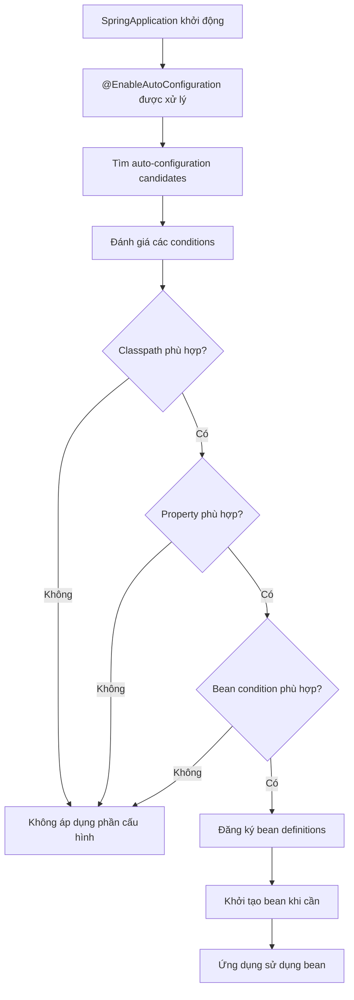
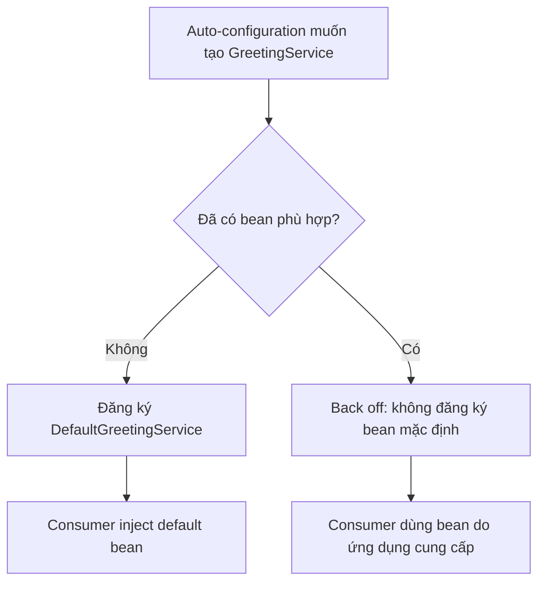
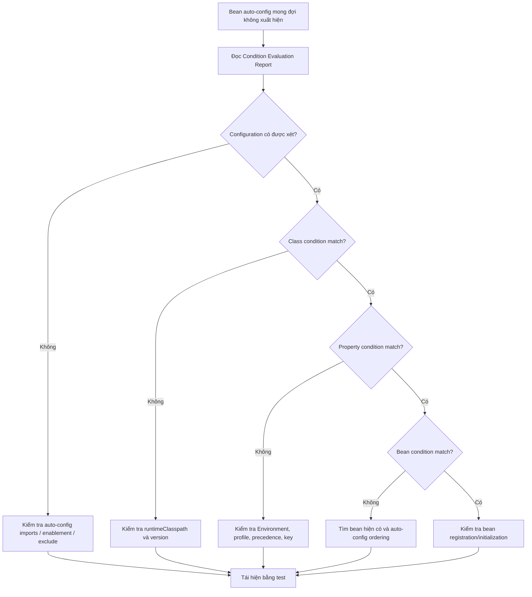

# Auto-configuration không chạy vì classpath, property hoặc bean hiện có

Spring Boot có thể tự tạo nhiều bean mà lập trình viên không cần viết từng dòng cấu hình. Chỉ cần thêm một starter, một số thành phần như `DataSource`, `JdbcTemplate`, web infrastructure hoặc Actuator endpoint có thể được cấu hình tự động. Nhưng đôi khi bạn thêm dependency rồi mà bean mong đợi vẫn không xuất hiện. Hoặc một auto-configuration trước đây hoạt động, sau khi bạn tự khai báo một bean thì cấu hình mặc định biến mất.

Những tình huống này thường liên quan đến **conditional auto-configuration**: Spring Boot chỉ áp dụng một cấu hình khi các điều kiện của nó phù hợp. Ba nhóm điều kiện quan trọng nhất cần kiểm tra là:

1. **Classpath:** class hoặc thư viện mà cấu hình cần có thật sự nằm trên runtime classpath không?
2. **Property:** giá trị cấu hình có tồn tại và thỏa điều kiện không?
3. **Bean hiện có:** ứng dụng đã đăng ký một bean khiến auto-configuration chủ động lùi lại chưa?

Hiểu ba nhóm điều kiện này giúp bạn tìm nguyên nhân thay vì thêm annotation hoặc dependency một cách thử-và-sai. Bài học thuộc chương **Chẩn đoán lỗi** của *Spring Boot Fundamentals*, tập trung vào cách nhận biết auto-configuration không chạy, đọc Condition Evaluation Report, kiểm tra classpath và property sources, hiểu `@ConditionalOnMissingBean`, cũng như tái hiện điều kiện bằng test.

Ví dụ dùng Java 21 và Spring Boot 3.x. Một số tên auto-configuration và chi tiết condition có thể thay đổi theo phiên bản; hãy xem report của chính ứng dụng đang chạy để xác nhận.

## 1. Auto-configuration không có nghĩa là luôn cấu hình

Auto-configuration là cơ chế để Spring Boot đăng ký cấu hình dựa trên những gì đang có trong ứng dụng. Một class cấu hình có thể được phát hiện nhưng chỉ tạo bean khi các điều kiện liên quan thỏa mãn.

Ví dụ khái niệm:

```java
@Configuration(proxyBeanMethods = false)
@ConditionalOnClass(SomeClient.class)
@ConditionalOnProperty(
        prefix = "app.client",
        name = "enabled",
        havingValue = "true")
class ClientAutoConfiguration {

    @Bean
    @ConditionalOnMissingBean
    SomeClient someClient() {
        return new SomeClient();
    }
}
```

Đây là ví dụ minh họa về các loại điều kiện, không phải auto-configuration có sẵn của Spring Boot. Bean chỉ được tạo khi:

- `SomeClient` có trên classpath.
- Property `app.client.enabled` có giá trị `true`.
- Không có bean phù hợp đã được đăng ký khiến điều kiện `@ConditionalOnMissingBean` không còn đúng.

Chỉ cần một điều kiện không thỏa, phần cấu hình phụ thuộc vào điều kiện đó có thể bị bỏ qua.

### 1.1. Ba lớp câu hỏi khi điều tra

| Câu hỏi | Điều cần xác minh |
|---|---|
| Cấu hình có được Spring Boot xem xét không? | Auto-configuration class có nằm trong danh sách imports và có được kích hoạt bởi `@EnableAutoConfiguration` không? |
| Điều kiện của cấu hình có khớp không? | Classpath, property, bean, web application type và các điều kiện khác có phù hợp không? |
| Bean có được tạo và sử dụng không? | Có bean definition không, bean có khởi tạo thành công không, consumer có inject đúng bean không? |

Đừng gộp ba câu hỏi thành một. Ví dụ, auto-configuration có thể đã match nhưng bean creation thất bại do constructor cần một dependency khác. Đó là lỗi khởi tạo bean, không phải condition không match.

## 2. Luồng đánh giá auto-configuration

Khi ứng dụng bật auto-configuration, Spring Boot tìm các cấu hình được đăng ký, sau đó đánh giá điều kiện tương ứng trong quá trình xử lý configuration classes và bean definitions.



Sơ đồ rút gọn ba nhóm condition trong bài. Một auto-configuration thật có thể có nhiều condition khác, và một số condition được áp dụng ở cấp class, method hoặc nested configuration.

### 2.1. Auto-configuration class phải được đăng ký để được xét

Trong Spring Boot, `@SpringBootApplication` bao gồm `@EnableAutoConfiguration`. Cơ chế này giúp Boot tìm các auto-configuration candidates được công bố bởi những module có trên classpath.

Với Spring Boot 3, các auto-configuration được đăng ký thông qua metadata imports, thường nằm trong:

```text
META-INF/spring/org.springframework.boot.autoconfigure.AutoConfiguration.imports
```

Ở các phiên bản Spring Boot cũ, cơ chế đăng ký từng dùng `spring.factories` cho auto-configuration. Vì vậy, khi đọc tài liệu hoặc source của một thư viện, hãy đối chiếu đúng phiên bản.

Nếu một class cấu hình tùy chỉnh không nằm trong cơ chế imports hoặc không được import/component-scan theo cách phù hợp, Boot không tự biết phải xét nó chỉ vì class có tên `SomethingAutoConfiguration`.

### 2.2. Auto-configuration có thứ tự

Một auto-configuration có thể cần được xét sau cấu hình khác. Spring Boot cung cấp các metadata/annotation để mô tả thứ tự, ví dụ `@AutoConfiguration(after = ...)` hoặc các quy tắc trước/sau tương ứng.

Điều này quan trọng với điều kiện bean: `@ConditionalOnBean` và `@ConditionalOnMissingBean` nhìn vào những bean definitions đã được xử lý ở thời điểm condition được đánh giá. Nếu một cấu hình tùy chỉnh được xử lý sau, kết quả có thể khác với giả định đơn giản rằng “bean sẽ được tạo ở đâu đó trong tương lai”.

## 3. Nhóm nguyên nhân thứ nhất: classpath không đáp ứng điều kiện

Classpath là tập class và thư viện mà JVM có thể sử dụng khi chạy ứng dụng. Một auto-configuration thường cần một class cụ thể hoặc một nhóm class để quyết định có áp dụng hay không.

Ví dụ:

```java
@Configuration(proxyBeanMethods = false)
@ConditionalOnClass(name = "com.example.payment.PaymentClient")
class PaymentAutoConfiguration {
    // Cấu hình liên quan tới PaymentClient.
}
```

Nếu `PaymentClient` không có trên classpath, condition không match và phần cấu hình này bị bỏ qua. Đây là cách Spring Boot tránh cấu hình những tính năng mà ứng dụng không sử dụng.

### 3.1. Thêm starter sai configuration scope

Với Gradle, dependency có thể được khai báo ở những scope khác nhau:

```groovy
dependencies {
    implementation 'org.springframework.boot:spring-boot-starter-actuator'
    testImplementation 'org.springframework.boot:spring-boot-starter-test'
}
```

Nếu một thư viện chỉ được thêm bằng `testImplementation`, nó có trong test classpath nhưng không có trên runtime classpath của ứng dụng đã đóng gói. Vì vậy:

- Test có thể nhìn thấy class và auto-configuration liên quan.
- Ứng dụng chạy thật có thể không nhìn thấy class đó.

Tương tự, `compileOnly`, `developmentOnly` hoặc cấu hình custom có thể không đưa dependency vào runtime artifact theo cách bạn mong muốn.

### 3.2. Kiểm tra runtime dependency tree

Với Gradle:

```bash
./gradlew dependencies --configuration runtimeClasspath
```

Tìm một dependency cụ thể:

```bash
./gradlew dependencyInsight --dependency spring-boot-starter-actuator --configuration runtimeClasspath
```

Với Maven:

```bash
./mvnw dependency:tree
```

Dependency tree giúp trả lời:

- Starter có thực sự được đưa vào build không?
- Có dependency transitively cung cấp class đang cần không?
- Có version conflict hoặc dependency bị exclude không?
- Dependency nằm ở compile/test/runtime scope nào?

Đừng chỉ nhìn file `build.gradle` rồi kết luận class đã có mặt. Kết quả runtime classpath và artifact cuối cùng mới là bằng chứng sát với môi trường chạy.

### 3.3. Dependency bị exclude hoặc optional

Một starter có thể kéo theo nhiều module. Nếu project loại một dependency bằng `exclude`, hoặc thư viện khai báo một dependency ở dạng optional, class mà auto-configuration cần có thể không được đưa vào.

Ví dụ Gradle:

```groovy
dependencies {
    implementation('com.example:payment-integration:1.2.0') {
        exclude group: 'com.example', module: 'payment-client'
    }
}
```

Nếu auto-configuration phụ thuộc `payment-client`, việc exclude có thể làm condition `@ConditionalOnClass` không match.

Hãy kiểm tra dependency tree để biết vì sao thư viện bị thiếu, rồi quyết định thêm lại dependency hoặc loại cấu hình không cần thiết. Không thêm một dependency ngẫu nhiên chỉ vì tên class trong log trông giống vấn đề.

### 3.4. Version conflict và class không tương thích

Classpath có thể chứa một class nhưng version không tương thích với code mong đợi. Khi đó condition `@ConditionalOnClass` có thể match, nhưng quá trình tạo bean vẫn thất bại với lỗi như:

```text
NoSuchMethodError
NoClassDefFoundError
ClassNotFoundException
```

Những lỗi này khác với “condition không match”:

- `ClassNotFoundException` hoặc `NoClassDefFoundError` cho thấy class không tải được ở đường chạy đó.
- `NoSuchMethodError` thường gợi ý binary version mismatch.
- Condition report có thể nói class condition match, nhưng bean initialization vẫn lỗi sau đó.

Kiểm tra dependency alignment và dùng Spring Boot dependency management phù hợp để tránh trộn các version không tương thích.

### 3.5. Kiểm tra đúng class loader

Một số môi trường có nhiều class loader, plugin hoặc DevTools restart class loader. Việc một class xuất hiện trong test class loader không bảo đảm nó xuất hiện trong runtime class loader của một ứng dụng khác.

Nếu report và dependency tree không giải thích được, có thể kiểm tra nguồn tải class:

```java
Class<?> type = com.example.payment.PaymentClient.class;
System.out.println(type.getClassLoader());
System.out.println(type.getProtectionDomain()
        .getCodeSource()
        .getLocation());
```

Ví dụ này chỉ áp dụng khi class tồn tại và `CodeSource` có giá trị. Với class do bootstrap loader hoặc môi trường đặc biệt cung cấp, `CodeSource` có thể không có.

## 4. Đọc @ConditionalOnClass

`@ConditionalOnClass` là một trong những điều kiện phổ biến nhất trong auto-configuration.

Ví dụ:

```java
@AutoConfiguration
@ConditionalOnClass(name = "com.example.search.SearchClient")
public class SearchAutoConfiguration {

    @Bean
    @ConditionalOnMissingBean
    SearchService searchService(SearchClient client) {
        return new SearchService(client);
    }
}
```

Nếu class `SearchClient` không có trên classpath, cấu hình này không được áp dụng theo condition.

### 4.1. Dùng name hay class literal?

Có thể viết:

```java
@ConditionalOnClass(SearchClient.class)
```

hoặc dùng tên class dạng string:

```java
@ConditionalOnClass(name = "com.example.search.SearchClient")
```

Trong auto-configuration, cách dùng tên class hoặc đặt condition ở nested configuration có thể hữu ích để tránh JVM phải resolve kiểu tùy chọn quá sớm trong một số trường hợp. Hãy theo pattern mà Spring Boot và thư viện tương ứng sử dụng.

### 4.2. Vì sao classpath condition giúp thư viện tùy chọn?

Một thư viện có thể hỗ trợ nhiều integration:

- JDBC nếu có JDBC API.
- Redis nếu có Redis client.
- Kafka nếu có Kafka client.
- Prometheus nếu có registry tương ứng.

Người dùng không cần kéo tất cả dependency vào ứng dụng. Auto-configuration chỉ bật phần tích hợp khi class tương ứng có mặt.

### 4.3. Khi class có mặt nhưng bean vẫn không có

`@ConditionalOnClass` chỉ xác nhận điều kiện classpath. Cấu hình có thể còn:

- `@ConditionalOnProperty`.
- `@ConditionalOnBean`.
- `@ConditionalOnMissingBean`.
- `@ConditionalOnWebApplication`.
- Các condition tùy chỉnh khác.

Vì vậy, một positive match cho classpath condition không chứng minh toàn bộ auto-configuration đã tạo bean.

## 5. Nhóm nguyên nhân thứ hai: property không thỏa điều kiện

Một auto-configuration có thể bật/tắt tính năng dựa trên property.

Ví dụ:

```java
@Configuration(proxyBeanMethods = false)
@ConditionalOnProperty(
        prefix = "app.mail",
        name = "enabled",
        havingValue = "true")
class MailAutoConfiguration {

    @Bean
    MailSender mailSender() {
        return new MailSender();
    }
}
```

Với điều kiện này, bean `MailSender` chỉ được tạo khi property `app.mail.enabled` có giá trị phù hợp là `true`.

### 5.1. Property bị thiếu và matchIfMissing

Mặc định, `@ConditionalOnProperty` yêu cầu property được khai báo. Nếu property không có, condition thường không match.

Có thể thay đổi hành vi:

```java
@ConditionalOnProperty(
        prefix = "app.mail",
        name = "enabled",
        havingValue = "true",
        matchIfMissing = true)
```

Khi property vắng mặt, điều kiện có thể xem như phù hợp. Nhưng nếu property có giá trị `false`, điều kiện vẫn không match vì `havingValue="true"`.

Đừng nhầm `matchIfMissing=true` với “mọi giá trị đều được chấp nhận”. Nó chỉ định cách xử lý khi **không có property**.

### 5.2. havingValue và giá trị mặc định

Một số cách viết:

```java
@ConditionalOnProperty(
        prefix = "app.feature",
        name = "enabled")
```

Khi không chỉ định `havingValue`, property có mặt và giá trị không phải chuỗi `false` thường được xem là match.

Rõ ràng hơn:

```java
@ConditionalOnProperty(
        prefix = "app.feature",
        name = "enabled",
        havingValue = "true")
```

Với feature flag, khai báo `havingValue="true"` thường giúp ý định dễ đọc và tránh chấp nhận một giá trị ngoài dự kiến.

### 5.3. Kiểm tra giá trị property hiệu lực

Giả sử `application.yml` viết:

```yaml
app:
  mail:
    enabled: false
```

Nhưng command line truyền:

```bash
java -jar app.jar --app.mail.enabled=true
```

Trong cấu hình Spring Boot thông thường, command-line property có thể ghi đè giá trị từ file. Khi ấy condition có thể match dù file YAML vẫn ghi `false`.

Kiểm tra bằng:

```java
String enabled = environment.getProperty("app.mail.enabled");
```

Hãy xem giá trị runtime thực tế, không chỉ đọc một file trong repository.

## 6. Property có thể đến từ nhiều nguồn

Spring Boot kết hợp nhiều property sources. Một khóa có thể xuất hiện trong:

- Default properties.
- `application.properties` hoặc `application.yml`.
- File theo profile.
- Config Data import hoặc file bên ngoài.
- Environment variables.
- Java system properties.
- Command-line arguments.
- PropertySource được đăng ký bằng code hoặc test.

Ví dụ:

```text
application.yml:                 app.mail.enabled=false
application-prod.yml:            app.mail.enabled=true
Environment:                     APP_MAIL_ENABLED=false
Command line:                    --app.mail.enabled=true
```

Không thể kết luận condition chỉ bằng cách nhìn một trong các dòng trên. Phải xét profile active và thứ tự ưu tiên của nguồn.

### 6.1. Kiểm tra bằng Environment

Một runner nhỏ có thể in giá trị không nhạy cảm:

```java
@Component
class MailConfigurationReporter implements ApplicationRunner {

    private final Environment environment;

    MailConfigurationReporter(Environment environment) {
        this.environment = environment;
    }

    @Override
    public void run(ApplicationArguments args) {
        System.out.println("app.mail.enabled = "
                + environment.getProperty("app.mail.enabled", "<missing>"));
    }
}
```

Đoạn code cho biết giá trị hiệu lực mà Environment trả về. Nó không tự cho biết chính xác nguồn nào thắng.

### 6.2. Kiểm tra PropertySource

Với `ConfigurableEnvironment`, có thể liệt kê những nguồn khai báo key:

```java
ConfigurableEnvironment environment = ...;
String key = "app.mail.enabled";

for (PropertySource<?> source : environment.getPropertySources()) {
    if (source.containsProperty(key)) {
        System.out.println(source.getName());
    }
}
```

Thứ tự `PropertySource` có ý nghĩa đối với precedence. Một số nguồn có wrapper hoặc relaxed name mapping, nên `containsProperty` chỉ là công cụ chẩn đoán cơ bản. Actuator `env` có thể cung cấp thông tin origin tốt hơn khi được cấu hình và bảo vệ phù hợp.

### 6.3. Biến môi trường có thể ghi đè file

Property:

```text
app.mail.enabled
```

thường ánh xạ sang:

```text
APP_MAIL_ENABLED
```

Nếu local chạy đúng nhưng container không tạo bean, hãy kiểm tra environment variables trong container hoặc deployment manifest. Giá trị trên máy lập trình viên không nhất thiết giống giá trị ở môi trường triển khai.

### 6.4. Sai tên property

Một lỗi phổ biến là khai báo:

```yaml
app:
  mail:
    enable: true
```

trong khi condition đang tìm `app.mail.enabled`. Hai tên khác nhau. Property không được xác thực tự động chỉ vì YAML hợp lệ; điều kiện có thể đơn giản coi property mong đợi là missing.

Khi condition không match, hãy sao chép chính xác prefix và name từ annotation hoặc report.

## 7. @ConditionalOnProperty có giới hạn

`@ConditionalOnProperty` phù hợp với property đơn giản, nhưng không phải công cụ binding tổng quát cho mọi cấu trúc.

Ví dụ:

```yaml
app:
  mail:
    servers:
      - smtp-a.example.test
```

Không nên giả định `@ConditionalOnProperty(prefix="app.mail", name="servers")` sẽ hoạt động theo cách kiểm tra một phần tử list như bạn mong đợi. Với property collection hoặc cấu trúc phức tạp, cân nhắc custom condition hoặc bind `@ConfigurationProperties` rồi kiểm tra bằng cơ chế phù hợp.

### 7.1. Kiểm tra property phức tạp bằng configuration properties

Ví dụ:

```java
@ConfigurationProperties(prefix = "app.mail")
public record MailProperties(
        boolean enabled,
        List<String> servers) {
}
```

Khi cần logic nhiều điều kiện, một configuration class hoặc bean factory có thể dùng properties đã bind và validation rõ ràng hơn. Tuy nhiên, phải chú ý thời điểm bean được tạo và tránh tạo dependency cycle giữa điều kiện và bean đang được quyết định.

## 8. Nhóm nguyên nhân thứ ba: bean hiện có khiến auto-configuration back off

Nhiều auto-configuration được thiết kế để không ghi đè lựa chọn của ứng dụng. Annotation phổ biến:

```java
@ConditionalOnMissingBean
```

Ví dụ:

```java
@AutoConfiguration
public class GreetingAutoConfiguration {

    @Bean
    @ConditionalOnMissingBean(GreetingService.class)
    GreetingService greetingService() {
        return new DefaultGreetingService();
    }
}
```

Nếu context đã có bean kiểu `GreetingService`, bean mặc định `DefaultGreetingService` sẽ không được đăng ký bởi method này.

Đây thường là hành vi **được thiết kế có chủ đích**, không phải lỗi auto-configuration.

### 8.1. Vì sao Spring Boot cho phép back off?

Mục tiêu là cung cấp default thuận tiện nhưng vẫn để ứng dụng tùy chỉnh.



Nếu không có cơ chế back-off, thư viện có thể tạo một bean mặc định trùng với bean mà ứng dụng đã tự cấu hình, dẫn đến ambiguity hoặc buộc người dùng phải tắt toàn bộ auto-configuration.

### 8.2. Bean hiện có có thể đến từ đâu?

Một bean khiến auto-configuration back off có thể được đăng ký bởi:

- `@Component`, `@Service`, `@Repository` được component scan phát hiện.
- Method `@Bean` trong configuration của ứng dụng.
- Một auto-configuration khác.
- Test configuration.
- Import configuration từ thư viện.

Vì thế, nếu bạn không nhớ đã tạo bean đó, hãy xem danh sách bean definitions và nguồn configuration liên quan.

### 8.3. Bean cùng kiểu nhưng tên khác vẫn có thể làm condition không match

Ví dụ:

```java
@Bean
GreetingService customGreetingService() {
    return new CustomGreetingService();
}
```

Auto-configuration dùng:

```java
@ConditionalOnMissingBean(GreetingService.class)
```

Điều kiện thường kiểm tra theo kiểu bean; bean `customGreetingService` vẫn có thể khiến condition không match dù tên khác `greetingService`.

Đừng chỉ tìm bean name giống với tên mặc định. Hãy xem **type, annotation, qualifier và điều kiện cụ thể** mà auto-configuration sử dụng.

## 9. @ConditionalOnMissingBean không giống @Primary

Hai cơ chế này giải quyết vấn đề khác nhau:

| Cơ chế | Vai trò |
|---|---|
| `@ConditionalOnMissingBean` | Quyết định có đăng ký bean mặc định hay không dựa trên bean phù hợp đã tồn tại. |
| `@Primary` | Chọn bean ưu tiên khi Spring cần resolve một dependency đơn trị có nhiều candidate. |
| `@Qualifier` | Chỉ rõ candidate cần inject tại một injection point. |

Ví dụ có hai bean:

```java
@Bean
@Primary
GreetingService primaryGreetingService() {
    return new PrimaryGreetingService();
}

@Bean
GreetingService secondaryGreetingService() {
    return new SecondaryGreetingService();
}
```

Nếu một auto-configuration sau đó có:

```java
@Bean
@ConditionalOnMissingBean(GreetingService.class)
GreetingService defaultGreetingService() {
    return new DefaultGreetingService();
}
```

thì sự hiện diện của bean `GreetingService` có thể khiến default method back off. `@Primary` không phải nguyên nhân trực tiếp; **bean type đã tồn tại** mới là yếu tố quyết định trong ví dụ này.

### 9.1. @Primary không xóa bean còn lại

`@Primary` không loại bỏ bean khác khỏi ApplicationContext. Nó chỉ giúp Spring chọn candidate ưu tiên trong những injection point phù hợp.

Nếu consumer cần một bean cụ thể, `@Qualifier` có thể làm ý định rõ hơn. Nhưng đừng thêm `@Primary` với hy vọng kích hoạt một auto-configuration đang bị `@ConditionalOnMissingBean` chặn.

## 10. Kiểm tra bean nào đang tồn tại

Một cách trực tiếp là inject `ApplicationContext` và lấy tên bean theo type:

```java
@Component
class GreetingBeanReporter implements ApplicationRunner {

    private final ApplicationContext context;

    GreetingBeanReporter(ApplicationContext context) {
        this.context = context;
    }

    @Override
    public void run(ApplicationArguments args) {
        String[] names =
                context.getBeanNamesForType(GreetingService.class);

        System.out.println(Arrays.toString(names));
    }
}
```

Nếu kết quả có `customGreetingService`, bạn đã có manh mối rằng bean do ứng dụng tạo đang hiện diện.

### 10.1. Kiểm tra implementation thực tế

```java
GreetingService service = context.getBean(GreetingService.class);
System.out.println(service.getClass().getName());
```

Khi có một candidate duy nhất hoặc có thể resolve theo quy tắc hiện hành, đoạn code cho biết class của object được lấy. Nếu có nhiều bean và không có lựa chọn rõ, `getBean(GreetingService.class)` có thể ném `NoUniqueBeanDefinitionException`.

### 10.2. Bean definition có thể khác object đã khởi tạo

Condition thường đánh giá bean definitions, không nhất thiết cần mọi singleton đã được khởi tạo. Do đó, việc kiểm tra runtime object chỉ là một phần. Condition report và bean definition metadata giúp hiểu vì sao cấu hình bị back off.

## 11. @ConditionalOnBean và thứ tự cấu hình

`@ConditionalOnBean` yêu cầu bean phù hợp đã được đăng ký trong context tại thời điểm condition được đánh giá.

Ví dụ:

```java
@Configuration(proxyBeanMethods = false)
@ConditionalOnBean(PaymentGateway.class)
class PaymentAuditAutoConfiguration {

    @Bean
    PaymentAuditService paymentAuditService(PaymentGateway gateway) {
        return new PaymentAuditService(gateway);
    }
}
```

Nếu không có `PaymentGateway` bean definition khi condition được đánh giá, `PaymentAuditService` có thể không được đăng ký.

### 11.1. Vì sao thứ tự quan trọng?

Auto-configuration được sắp xếp theo quan hệ trước/sau và các quy tắc xử lý configuration. Nếu một cấu hình muốn dùng bean do auto-configuration khác cung cấp, thứ tự xử lý cần được thiết kế phù hợp.

Spring Boot khuyến nghị dùng `@ConditionalOnBean` và `@ConditionalOnMissingBean` chủ yếu trong auto-configuration, nơi thứ tự xử lý được kiểm soát để điều kiện quan sát được các bean definitions thích hợp.

Không nên dùng các điều kiện này tùy tiện trong component configuration thông thường để điều khiển một chuỗi phụ thuộc phức tạp. Nếu hai configuration class phụ thuộc lẫn nhau, có thể tạo kết quả khó hiểu hoặc condition được đánh giá trước khi bean mong muốn được đăng ký.

### 11.2. @AutoConfiguration(after = ...)

Với auto-configuration tự viết, có thể mô tả thứ tự:

```java
@AutoConfiguration(after = DataSourceAutoConfiguration.class)
class ReportingAutoConfiguration {
    // Cấu hình cần datasource đã được xử lý trước.
}
```

Đây là gợi ý thứ tự giữa auto-configuration classes, không phải cách đảm bảo một bean bất kỳ đã khởi tạo thành công. Nếu condition phụ thuộc bean, hãy kiểm tra đúng loại bean và thứ tự definition processing.

## 12. Đọc Condition Evaluation Report

Khi một bean hoặc auto-configuration không xuất hiện, công cụ quan trọng nhất để bắt đầu là **Condition Evaluation Report**.

Trong môi trường development, chạy:

```bash
./gradlew bootRun --args='--debug'
```

Hoặc với executable JAR:

```bash
java -jar app.jar --debug
```

Spring Boot có thể in báo cáo những điều kiện auto-configuration đã match hoặc không match. Nội dung thường được chia thành các phần như positive matches và negative matches.

### 12.1. Positive match nói điều gì?

Positive match cho biết một cấu hình hoặc condition cụ thể đã thỏa điều kiện. Nhưng điều đó không tự chứng minh tất cả bean bên trong đã được tạo thành công.

Ví dụ:

- Classpath condition match.
- Property condition match.
- Một nested configuration match.
- Bean method vẫn có thể thất bại khi khởi tạo do dependency khác.

Hãy đọc tên configuration và từng condition cụ thể, không chỉ thấy tên auto-configuration trong positive list rồi kết luận toàn bộ tính năng đã hoạt động.

### 12.2. Negative match nói điều gì?

Negative match thường cung cấp lý do cấu hình không được áp dụng. Một thông tin minh họa:

```text
MailAutoConfiguration:
   Did not match:
      - @ConditionalOnProperty (app.mail.enabled=true) did not find property 'enabled'
```

Điều này chỉ ra property bị thiếu ở điều kiện đang được xét. Bước tiếp theo là kiểm tra:

- Tên property có đúng không?
- Profile cần thiết đã active chưa?
- File cấu hình có được nạp không?
- Environment variable có ánh xạ đúng không?
- Một nguồn ưu tiên cao hơn có thay đổi giá trị không?

### 12.3. Report có thể hiển thị nhiều condition cho cùng cấu hình

Ví dụ:

```text
PaymentAutoConfiguration:
   matched:
      - @ConditionalOnClass found required class
   did not match:
      - @ConditionalOnProperty did not find property
```

Đây là ví dụ mô tả. Ý nghĩa là classpath condition có thể match nhưng property condition không match. Không có mâu thuẫn: mỗi điều kiện kiểm tra một khía cạnh riêng.

### 12.4. --debug không phải logging level toàn hệ thống

Tham số `--debug` của Spring Boot hỗ trợ debug/condition report theo cơ chế của Boot. Nó không đồng nghĩa mọi logger đều chuyển sang TRACE, và không thay thế việc cấu hình `logging.level` cho package cụ thể.

## 13. Dùng /actuator/conditions endpoint

Nếu project có `spring-boot-starter-actuator`, endpoint `conditions` có thể cung cấp Condition Evaluation Report qua management API khi endpoint được phép và được expose.

Ví dụ cấu hình cho môi trường local được bảo vệ:

```yaml
management:
  endpoints:
    web:
      exposure:
        include: health,conditions
```

Request:

```text
curl http://localhost:8080/actuator/conditions
```

Endpoint này giúp xem những positive/negative matches trong context đang chạy. Tên đường dẫn có thể thay đổi theo management base path hoặc port.

### 13.1. Nếu conditions trả 404

Đừng lập tức kết luận Actuator không có condition report. Kiểm tra:

- Actuator dependency có trên runtime classpath không?
- Endpoint có khả dụng trong version/configuration này không?
- Web exposure đã bao gồm `conditions` chưa?
- Management base path hoặc port có khác không?
- Endpoint access/security có chặn request không?

### 13.2. Bảo vệ conditions endpoint

Condition report có thể tiết lộ class, package, dependency và cấu trúc cấu hình nội bộ. Chỉ expose ở môi trường phù hợp, có authentication/authorization và network controls. Không mở endpoint chẩn đoán này công khai chỉ để thuận tiện debug.

## 14. Phân biệt condition không match với bean creation failure

Hai loại lỗi thường bị nhầm:

### Trường hợp A: condition không match

```text
@ConditionalOnProperty did not find property 'enabled'
```

Bean definition không được đăng ký bởi configuration method đó. Đây là quyết định bỏ qua có điều kiện.

### Trường hợp B: bean đã được đăng ký nhưng khởi tạo thất bại

```text
Error creating bean with name 'paymentClient'
Caused by: java.lang.IllegalStateException: Missing endpoint URL
```

Đây là lỗi tạo bean sau khi cấu hình đã được áp dụng, hoặc lỗi từ dependency trong quá trình khởi tạo.

### Trường hợp C: bean tồn tại nhưng inject không được

```text
NoUniqueBeanDefinitionException:
expected single matching bean but found 2
```

Đây là lỗi resolve dependency do có nhiều candidate, không phải auto-configuration nhất thiết không chạy.

### 14.1. Bảng phân loại

| Dấu hiệu | Nhóm vấn đề | Nơi kiểm tra |
|---|---|---|
| `Did not match` | Condition không thỏa | Condition report, classpath, property, bean |
| `NoClassDefFoundError` | Class loading/classpath | Runtime dependency tree, version alignment |
| `Error creating bean` | Bean initialization | Root cause, constructor, dependency, config |
| `NoSuchBeanDefinitionException` | Không có bean phù hợp | Condition report, component scan, imports |
| `NoUniqueBeanDefinitionException` | Nhiều bean candidate | Bean names/types, qualifier, primary |
| `BeanCurrentlyInCreationException` | Chu trình tạo bean | Dependency graph, circular reference |

Đọc exception đầu tiên chưa đủ. Hãy tìm root cause và xác định lỗi nằm ở bước condition, registration, initialization hay injection.

## 15. Ví dụ tổng hợp: một client không được auto-configure

Giả sử project muốn có `CatalogSearchClient` khi thư viện search client được thêm và property được bật, trừ khi ứng dụng tự cung cấp client khác.

### 15.1. Auto-configuration minh họa

```java
@AutoConfiguration
@ConditionalOnClass(CatalogSearchClient.class)
@ConditionalOnProperty(
        prefix = "catalog.search",
        name = "enabled",
        havingValue = "true")
public class CatalogSearchAutoConfiguration {

    @Bean
    @ConditionalOnMissingBean(CatalogSearchClient.class)
    CatalogSearchClient catalogSearchClient(
            CatalogSearchProperties properties) {
        return new DefaultCatalogSearchClient(properties.endpoint());
    }
}
```

Đây là ví dụ thiết kế auto-configuration của một thư viện giả định. Để auto-configuration được tìm thấy, nó còn cần được đăng ký trong metadata imports phù hợp với phiên bản Spring Boot.

### 15.2. Cấu hình ứng dụng

```yaml
catalog:
  search:
    enabled: true
    endpoint: https://search.example.test
```

### 15.3. Ba cách khiến bean mặc định không xuất hiện

**A — Thiếu classpath**

Nếu thư viện cung cấp `CatalogSearchClient` không có trong runtime classpath, condition `@ConditionalOnClass` không match.

**B — Property không đúng**

Nếu file cấu hình ghi `catalog.search.enabled: false`, hoặc giá trị hiệu lực là false do một nguồn khác ghi đè, property condition không match.

**C — Ứng dụng đã cung cấp bean**

Nếu ứng dụng khai báo:

```java
@Configuration(proxyBeanMethods = false)
class CustomSearchConfiguration {

    @Bean
    CatalogSearchClient customCatalogSearchClient() {
        return new CustomCatalogSearchClient();
    }
}
```

thì default bean có thể back off vì đã có một bean `CatalogSearchClient` phù hợp.

### 15.4. Chẩn đoán theo từng lớp

| Kiểm tra | Kết quả giả định | Kết luận |
|---|---|---|
| Runtime dependency tree | Có thư viện search | Classpath có thể phù hợp. |
| Condition report | Class condition matched | Không phải thiếu class ở điều kiện này. |
| Environment | `catalog.search.enabled=false` | Property condition không match. |
| Bean lookup | Chưa có client bean | Không có bằng chứng bean condition là nguyên nhân. |

Sau khi sửa property, nếu vẫn không có bean, hãy đọc lại report. Có thể khi ấy bean condition hoặc một condition khác mới là nguyên nhân tiếp theo.

## 16. Tự viết condition: khi nào cần?

Spring Boot có nhiều condition sẵn có. Với logic phức tạp hoặc cần kiểm tra cấu hình không thể biểu diễn rõ bằng annotation tiêu chuẩn, có thể viết custom `Condition`.

Ví dụ minh họa:

```java
public class SupportedRegionCondition implements Condition {

    @Override
    public boolean matches(
            ConditionContext context,
            AnnotatedTypeMetadata metadata) {

        String region = context.getEnvironment()
                .getProperty("app.region");

        return "apac".equalsIgnoreCase(region);
    }
}
```

Sử dụng:

```java
@Configuration(proxyBeanMethods = false)
@Conditional(SupportedRegionCondition.class)
class ApacConfiguration {
    // Beans dành cho khu vực APAC.
}
```

Khi custom condition trả `false`, configuration không được áp dụng. Condition report có thể cung cấp thông tin đánh giá tùy cách condition được triển khai và version; hãy viết condition dễ giải thích và dễ quan sát.

### 16.1. Đừng dùng custom condition nếu property condition đã đủ

Với một boolean feature flag, `@ConditionalOnProperty` thường dễ đọc hơn. Custom condition chỉ đáng dùng khi cần nhiều logic, nhiều property hoặc kiểm tra ngữ cảnh đặc biệt.

### 16.2. Condition nên không tạo side effect

Method `matches(...)` có thể được gọi trong quá trình xử lý configuration. Không nên gọi network, mở database connection hoặc thực hiện thao tác nghiệp vụ trong custom condition. Condition nên kiểm tra metadata/configuration có thể đánh giá ổn định.

## 17. Tắt hoặc loại trừ auto-configuration

Đôi khi vấn đề ngược lại: một auto-configuration đang chạy và bạn muốn tắt nó vì ứng dụng đã có cách triển khai riêng.

### 17.1. Exclude qua @SpringBootApplication

Ví dụ:

```java
@SpringBootApplication(exclude = {
        SomeAutoConfiguration.class
})
public class CatalogApplication {
}
```

Hoặc dùng tên class:

```java
@SpringBootApplication(
        excludeName = "com.example.SomeAutoConfiguration")
```

Tên class và package phải là auto-configuration thực tế. Không nên đoán tên từ tên starter.

### 17.2. Exclude qua property

Spring Boot hỗ trợ property `spring.autoconfigure.exclude` để loại trừ auto-configuration theo tên class:

```yaml
spring:
  autoconfigure:
    exclude:
      - com.example.SomeAutoConfiguration
```

Đây là cách tắt một auto-configuration cụ thể. Nó khác với việc condition của cấu hình không match do thiếu class/property/bean.

### 17.3. Exclude không phải cách đầu tiên để sửa mọi vấn đề

Nếu auto-configuration không tạo bean do thiếu một property, exclude nó không giúp khắc phục nguyên nhân. Nếu bean mặc định back off vì custom bean đã có, exclude có thể chỉ làm mất thêm những bean khác mà cấu hình đó cung cấp.

Chỉ exclude khi bạn thật sự không muốn cấu hình đó tham gia, và đã hiểu những bean/behavior liên quan.

## 18. Kiểm thử điều kiện bằng ApplicationContextRunner

Spring Boot cung cấp `ApplicationContextRunner` để kiểm thử auto-configuration trong một context nhỏ. Đây là cách hữu ích để tái hiện classpath/property/bean conditions mà không phải khởi động toàn bộ ứng dụng.

Ví dụ test property condition:

```java
class MailAutoConfigurationTests {

    private final ApplicationContextRunner runner =
            new ApplicationContextRunner()
                    .withConfiguration(AutoConfigurations.of(
                            MailAutoConfiguration.class));

    @Test
    void createsMailSenderWhenEnabled() {
        runner.withPropertyValues("app.mail.enabled=true")
                .run(context -> {
                    assertThat(context).hasSingleBean(MailSender.class);
                });
    }

    @Test
    void backsOffWhenDisabled() {
        runner.withPropertyValues("app.mail.enabled=false")
                .run(context -> {
                    assertThat(context).doesNotHaveBean(MailSender.class);
                });
    }
}
```

Ví dụ giả định `MailAutoConfiguration` đã được định nghĩa với condition tương ứng và project có các dependency test của Spring Boot. `ApplicationContextRunner` cho phép mỗi test chạy với một context cô lập.

### 18.1. Test matchIfMissing

Nếu auto-configuration dùng `matchIfMissing=true`, cần có test riêng khi property không được cung cấp:

```java
@Test
void createsDefaultWhenPropertyIsMissing() {
    runner.run(context -> {
        assertThat(context).hasSingleBean(MailSender.class);
    });
}
```

Không nên chỉ test trường hợp `true`. Cần kiểm tra cả `false`, missing và giá trị không hợp lệ theo contract của condition.

### 18.2. Test back-off khi ứng dụng có bean

```java
@Test
void backsOffWhenUserDefinesMailSender() {
    runner.withUserConfiguration(CustomMailConfiguration.class)
            .run(context -> {
                assertThat(context).hasSingleBean(MailSender.class);
                assertThat(context.getBean(MailSender.class))
                        .isInstanceOf(CustomMailSender.class);
            });
}
```

Test này chứng minh auto-configuration tôn trọng bean tùy chỉnh theo `@ConditionalOnMissingBean`.

### 18.3. Test classpath condition

`ApplicationContextRunner` hỗ trợ cấu hình class loader cho những test classpath condition. Có thể dùng một class loader lọc để mô phỏng class optional vắng mặt, hoặc tách test fixture để kiểm tra cấu hình có/không có class.

Đừng chỉ giả định `@ConditionalOnClass` hoạt động vì test compile được. Compile classpath và runtime class loader của test là hai phạm vi cần hiểu rõ.

### 18.4. Test report condition khi context không có bean

Trong callback `run(context -> ...)`, có thể kiểm tra bean không tồn tại và xem failure analysis/report phù hợp. Mục tiêu là khẳng định **điều kiện cụ thể** gây kết quả, thay vì chỉ assert một bean thiếu.

## 19. Dùng /actuator/conditions để xác nhận trong context đang chạy

Nếu ứng dụng đã tích hợp Actuator, endpoint `conditions` giúp điều tra một ứng dụng đang chạy. Trong môi trường local được bảo vệ:

```yaml
management:
  endpoints:
    web:
      exposure:
        include: health,conditions
```

Sau đó truy cập:

```text
GET /actuator/conditions
```

Tìm tên auto-configuration, sau đó xem positive/negative matches.

Nếu endpoint chưa được expose hoặc bị security chặn, dùng `--debug` trong lần chạy phù hợp. Hai công cụ trả lời câu hỏi tương tự ở hai cách quan sát khác nhau:

| Công cụ | Phù hợp khi |
|---|---|
| `--debug` / Condition Evaluation Report | Muốn xem báo cáo trong startup logs. |
| `/actuator/conditions` | Muốn xem condition report của context đang chạy qua management API. |
| Dependency tree | Muốn xác nhận thư viện thực sự có trên classpath. |
| Environment / `/actuator/env` | Muốn kiểm tra property hiệu lực và nguồn. |
| ApplicationContext / `/actuator/beans` | Muốn kiểm tra bean đã đăng ký. |

Không một công cụ đơn lẻ nào thay thế tất cả các công cụ còn lại.

## 20. Quy trình chẩn đoán có thứ tự

Khi auto-configuration không tạo bean như mong đợi, hãy tiến hành:

1. **Xác định chính xác bean và auto-configuration.** Ghi lại type, tên bean dự kiến và class cấu hình liên quan.
2. **Kiểm tra candidate có được đăng ký không.** Đọc Condition Evaluation Report.
3. **Kiểm tra classpath.** Dùng runtime dependency tree và xác nhận class condition.
4. **Kiểm tra property.** Đọc tên key chính xác, giá trị hiệu lực, profile và PropertySource.
5. **Kiểm tra bean hiện có.** Tìm bean cùng type/name/annotation làm điều kiện back off.
6. **Kiểm tra thứ tự auto-configuration.** Đặc biệt khi dùng `@ConditionalOnBean` hoặc `@ConditionalOnMissingBean`.
7. **Phân loại giai đoạn thất bại.** Condition không match, bean definition không được đăng ký, bean initialization thất bại hay injection ambiguous?
8. **Kiểm tra loại application.** Có điều kiện web/servlet/reactive hoặc profile nào liên quan không?
9. **Tái hiện trong test nhỏ.** Dùng `ApplicationContextRunner` hoặc integration test với cấu hình cụ thể.
10. **Sửa nguyên nhân gốc.** Thêm đúng dependency, chỉnh property, bỏ bean không cần thiết hoặc giữ bean tùy chỉnh có chủ đích.



Trình tự này giúp thu hẹp phạm vi điều tra từ metadata đến runtime thay vì sửa nhiều lớp cùng lúc.

## 21. Một số lỗi và cách đọc dấu hiệu

| Dấu hiệu | Nguyên nhân có thể | Việc nên kiểm tra |
|---|---|---|
| `Did not match` | Condition không thỏa | Condition report, classpath, property, bean |
| `NoClassDefFoundError` | Class loading/classpath | Runtime dependency tree, version alignment |
| `Error creating bean` | Bean initialization | Root cause, constructor, dependency, config |
| `NoSuchBeanDefinitionException` | Không có bean phù hợp | Condition report, component scan, imports |
| `NoUniqueBeanDefinitionException` | Nhiều bean candidate | Bean names/types, qualifier, primary |
| `BeanCurrentlyInCreationException` | Chu trình tạo bean | Dependency graph, circular reference |

## 22. Những hiểu lầm thường gặp

### “Thêm starter là auto-configuration chắc chắn tạo bean”

Không. Starter chỉ cung cấp một tập dependency. Auto-configuration còn xét classpath, property, bean và các điều kiện khác.

### “Condition report không có tên cấu hình nghĩa là thiếu property”

Chưa chắc. Cấu hình có thể chưa được đăng ký, đã bị exclude, không có trên imports hoặc chưa được đưa vào classpath.

### “Có class trên compile classpath nghĩa là runtime cũng có”

Không. Dependency scope, packaging và runtime classloader có thể khác.

### “@ConditionalOnMissingBean kiểm tra tên bean mặc định”

Không nhất thiết. Condition có thể kiểm tra type, name, annotation hoặc các tiêu chí được khai báo. Xem annotation thực tế.

### “@Primary sẽ khiến auto-configuration tiếp tục tạo default bean”

Không. `@Primary` chọn candidate khi inject; nó không xóa bean hiện có và không làm `@ConditionalOnMissingBean` trở thành match.

### “Property có trong application.yml thì condition chắc chắn thấy true”

Không. Một nguồn ưu tiên cao hơn có thể ghi đè; property có thể sai tên hoặc profile file chưa được nạp.

### “Positive match nghĩa là bean đã khởi tạo thành công”

Không. Condition match chỉ là một giai đoạn. Bean có thể lỗi khi instantiate hoặc khi dependency injection.

### “Tắt auto-configuration là cách sửa bean bị thiếu”

Không. Exclude chỉ loại cấu hình. Nếu cấu hình không chạy vì property hoặc classpath, exclude không giải quyết nguyên nhân.

## 23. Bài thực hành tổng hợp

Tạo một auto-configuration giả định cho `MailSender` với ba điều kiện: thư viện mail client có trên classpath, property `app.mail.enabled=true`, và chưa có bean `MailSender` do ứng dụng cung cấp.

**Bước A — Classpath.** Đưa thư viện mail client vào runtime dependency. Xem dependency tree và xác định class mà `@ConditionalOnClass` kiểm tra.

**Bước B — Property.** Khai báo `app.mail.enabled=true` trong `application.yml`, sau đó đổi thành `false` và quan sát Condition Evaluation Report.

**Bước C — Missing property.** Xóa property, chạy lại và xác nhận hành vi mặc định của `matchIfMissing`.

**Bước D — Override.** Giữ YAML là `false`, nhưng truyền `--app.mail.enabled=true`. Kiểm tra Environment và condition report.

**Bước E — Custom bean.** Đăng ký `MailSender` qua `@Bean`. Xem auto-configuration default có back off không.

**Bước F — Primary.** Tạo hai bean cùng type, đánh dấu một bean `@Primary`. Phân biệt việc chọn candidate với việc auto-configuration có tạo bean default hay không.

**Bước G — Scope.** Chuyển thư viện mail client từ runtime dependency sang test-only dependency. So sánh kết quả test với cách chạy ứng dụng.

**Bước H — Report.** Chạy với `--debug` và tìm positive/negative matches cho auto-configuration.

**Bước I — Test cô lập.** Dùng `ApplicationContextRunner` kiểm tra property true, false, missing và custom bean.

**Bước J — Phân loại lỗi.** Cố ý tạo một trường hợp condition không match và một trường hợp bean initialization thất bại. Ghi lại sự khác biệt trong log.

**Bước K — Tổng kết.** Với mỗi lần bean xuất hiện hoặc biến mất, ghi rõ: classpath, property hiệu lực, bean definitions hiện có và condition cụ thể.

## 24. Câu hỏi tự đánh giá

1. Auto-configuration có phải luôn tạo bean khi starter được thêm không?
2. `@ConditionalOnClass` kiểm tra điều gì?
3. Vì sao dependency ở `testImplementation` có thể làm test thấy class nhưng packaged app không thấy?
4. Runtime dependency tree giúp phát hiện những lỗi nào?
5. `@ConditionalOnProperty` mặc định xử lý property bị thiếu ra sao?
6. `havingValue="true"` và `matchIfMissing=true` có vai trò gì khác nhau?
7. Vì sao property trong YAML có thể không phải giá trị condition nhìn thấy?
8. `@ConditionalOnMissingBean` giúp auto-configuration tôn trọng custom bean thế nào?
9. Condition kiểm tra bean theo tên hay type? Làm sao biết chính xác?
10. `@Primary` khác `@ConditionalOnMissingBean` như thế nào?
11. `@ConditionalOnBean` phụ thuộc thứ tự configuration ra sao?
12. Condition Evaluation Report có thể cho biết những thông tin nào?
13. Positive match có chứng minh bean đã khởi tạo thành công không?
14. Phân biệt condition không match với `Error creating bean`.
15. Vì sao `NoUniqueBeanDefinitionException` không đồng nghĩa auto-configuration không chạy?
16. Làm thế nào kiểm tra property source nào cung cấp giá trị hiệu lực?
17. Khi nào cần xem `spring.autoconfigure.exclude`?
18. Vì sao không nên dùng custom `Condition` để gọi network hoặc database?
19. `ApplicationContextRunner` giúp kiểm thử auto-configuration ra sao?
20. Khi nào cần kết hợp dependency tree, Condition Report, Environment và bean inspection?

### Mẫu giải thích hoàn chỉnh

> Spring Boot auto-configuration hoạt động theo điều kiện, vì vậy việc thêm một starter không bảo đảm mọi bean mặc định đều được tạo. `@ConditionalOnClass` chỉ áp dụng cấu hình khi class cần thiết có trên runtime classpath; dependency sai scope, bị exclude hoặc version conflict có thể khiến điều kiện không phù hợp. `@ConditionalOnProperty` kiểm tra property trong Environment, nên tên key, active profile, biến môi trường, file bên ngoài và command-line override đều có thể làm kết quả thay đổi. `@ConditionalOnMissingBean` cho phép ứng dụng tự cung cấp implementation; khi đã có bean phù hợp, auto-configuration có thể chủ động back off. `@Primary` và `@Qualifier` giải quyết lựa chọn giữa các bean đã tồn tại, không thay thế logic back-off. Để chẩn đoán, hãy đọc Condition Evaluation Report, kiểm tra runtime dependency tree, giá trị và PropertySource của Environment, sau đó xem bean definitions và phân biệt condition không match với lỗi khởi tạo bean. Có thể tái hiện từng điều kiện bằng `ApplicationContextRunner`.

Khi bạn xác định được auto-configuration **có được xét hay không**, condition nào không thỏa và bean hiện có nào khiến cấu hình lùi lại, bạn đã có phương pháp chẩn đoán có hệ thống cho lỗi **auto-configuration không chạy vì classpath, property hoặc bean hiện có**.
