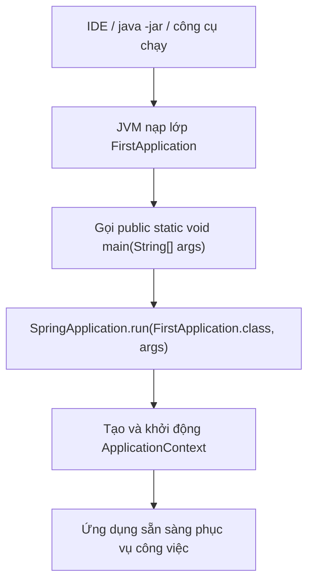
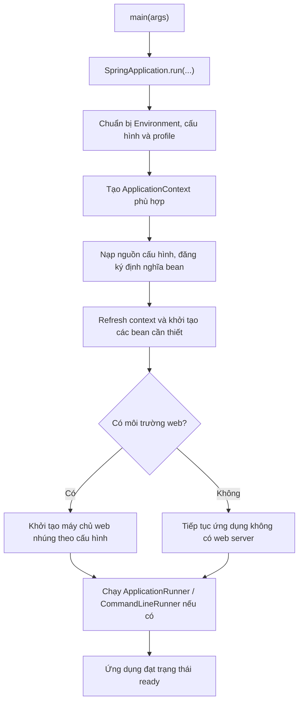
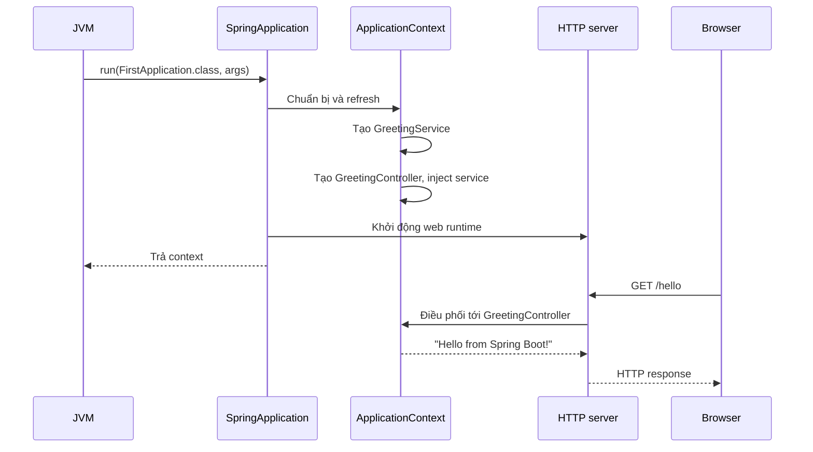
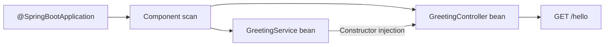

# Lớp main và lời gọi SpringApplication.run

Trong dự án Spring Boot đầu tiên, tệp Java ngắn nhất nhưng quan trọng nhất thường là lớp chứa phương thức `main`. Đây là điểm bắt đầu của chương trình khi JVM khởi chạy ứng dụng. Từ phương thức này, lời gọi `SpringApplication.run(...)` giao cho Spring Boot việc chuẩn bị cấu hình, tạo Spring container, khởi tạo các bean và, nếu ứng dụng có thành phần web thích hợp, khởi động máy chủ HTTP.

Điều cần hiểu là **`main` thuộc cơ chế chạy chương trình Java**, còn **`SpringApplication.run` thuộc cơ chế khởi động ứng dụng Spring Boot**. Hai phần có trách nhiệm khác nhau nhưng nối với nhau để tạo thành một ứng dụng hoạt động.

Bài học tập trung vào cách đọc, viết, chạy và giải thích lớp main của dự án đầu tiên, bao gồm cấu trúc package, cách Spring tìm bean, tham số khởi động, vòng đời ứng dụng và những lỗi phổ biến khi khởi chạy.

## 1. Lớp main trong dự án Spring Boot đầu tiên

Một lớp khởi động điển hình:

```java
package com.example.firstapp;

import org.springframework.boot.SpringApplication;
import org.springframework.boot.autoconfigure.SpringBootApplication;

@SpringBootApplication
public class FirstApplication {

    public static void main(String[] args) {
        SpringApplication.run(FirstApplication.class, args);
    }
}
```

Lớp `FirstApplication` thường được đặt ở package gốc của ứng dụng, chẳng hạn `com.example.firstapp`. Tên lớp không bắt buộc là `Application` hay `FirstApplication`; điều quan trọng là chương trình có một entry point hợp lệ và lớp được truyền vào `SpringApplication.run` cung cấp cấu hình khởi động phù hợp.

Khi người dùng nhấn **Run** trên IDE hoặc chạy một JAR thực thi của Spring Boot, quá trình đi từ JVM tới `main` rồi tới Spring Boot:



Lớp main thông thường chỉ cần vài dòng. Các lớp xử lý HTTP, nghiệp vụ và truy cập dữ liệu được Spring quản lý ở những vị trí khác. Không nên đưa toàn bộ logic ứng dụng vào `main` chỉ vì đó là nơi chương trình bắt đầu.

### 1.1. Đường dẫn tệp và tên package

Trong một dự án Gradle hoặc Maven theo cấu trúc Java thông dụng, vị trí có thể là:

```text
firstapp/
├── src/
│   ├── main/
│   │   ├── java/
│   │   │   └── com/
│   │   │       └── example/
│   │   │           └── firstapp/
│   │   │               └── FirstApplication.java
│   │   └── resources/
│   │       └── application.yml
│   └── test/
│       └── java/
│           └── com/
│               └── example/
│                   └── firstapp/
│                       └── FirstApplicationTests.java
├── build.gradle       (nếu dùng Gradle)
└── pom.xml            (nếu dùng Maven; thường chọn một hệ build)
```

Dòng `package com.example.firstapp;` cho biết tên package của lớp. Cấu trúc thư mục nguồn phải phản ánh tên package. Thư mục `resources` chứa cấu hình như `application.yml` hoặc `application.properties`; các tệp đó không cần khai báo `package`.

Nếu dự án có tên khác, hãy dùng tên package phù hợp và thống nhất từ lớp main đến các lớp con. Không cần đặt tên package theo đúng chữ `firstapp` trong ví dụ.

## 2. Phương thức main là điểm vào của chương trình Java

Hãy tách riêng phần Java thuần:

```java
public class PlainJavaApp {
    public static void main(String[] args) {
        System.out.println("Java application started");
    }
}
```

Khi chạy `PlainJavaApp` như một Java application thông thường, trình khởi chạy Java gọi phương thức `main` theo quy ước entry point. Spring Boot sử dụng cùng quy ước đó; không có một loại `main` riêng dành cho Spring.

| Thành phần | Ý nghĩa |
| --- | --- |
| `public` | Phương thức có thể được truy cập từ bên ngoài lớp theo quy ước entry point thông dụng. |
| `static` | JVM gọi phương thức mà không cần tạo instance của lớp trước. |
| `void` | Phương thức không trả kết quả bằng giá trị trả về. |
| `main` | Tên phương thức entry point theo quy ước của Java. |
| `String[] args` | Mảng đối số dòng lệnh được truyền khi chương trình bắt đầu. |

Tham số `args` có thể đổi tên, ví dụ `arguments`; đó chỉ là tên biến. Cách khai báo `String... args` cũng tương đương về kiểu tham số mảng trong Java, nhưng `String[] args` dễ nhận biết nhất đối với người mới.

Ví dụ:

```java
public class PlainJavaApp {
    public static void main(String[] args) {
        for (String arg : args) {
            System.out.println(arg);
        }
    }
}
```

Nếu chạy chương trình với hai đối số `hello` và `world`, chúng xuất hiện trong `args` theo thứ tự nhận được. Trong Spring Boot, việc chuyển `args` vào `SpringApplication.run` cho phép Spring Boot xử lý những đối số phù hợp và để các thành phần khởi động truy cập chúng.

**Một phân biệt dễ nhầm:** `main` là phương thức `static` được JVM gọi; bản thân lời gọi này không phải một yêu cầu HTTP, một callback của controller hoặc một phương thức được Spring inject. Các đối tượng Spring chỉ được tạo và quản lý sau khi quy trình khởi động container bắt đầu.

## 3. @SpringBootApplication làm gì?

Annotation `@SpringBootApplication` báo rằng lớp này là cấu hình khởi động chính của ứng dụng Spring Boot. Nó kết hợp các chức năng nền tảng của ba annotation:

| Thành phần | Chức năng chính |
| --- | --- |
| `@SpringBootConfiguration` | Đánh dấu lớp là nguồn cấu hình Spring; là dạng chuyên biệt của `@Configuration`. |
| `@EnableAutoConfiguration` | Bật cơ chế tự cấu hình theo các điều kiện, dependency và thiết lập hiện có. |
| `@ComponentScan` | Quét các lớp thành phần của Spring từ package của lớp cấu hình và các package con theo quy tắc mặc định. |

Vì thế, một annotation có thể đáp ứng nhiều nhu cầu của một ứng dụng mới:

```java
@SpringBootApplication
public class FirstApplication {
    public static void main(String[] args) {
        SpringApplication.run(FirstApplication.class, args);
    }
}
```

### 3.1. Component scanning: Spring tìm bean ở đâu?

Giả sử cấu trúc package như sau:

```text
com.example.firstapp
├── FirstApplication.java          // @SpringBootApplication
├── greeting
│   └── GreetingService.java       // @Service
└── web
    └── GreetingController.java    // @RestController
```

Khi `FirstApplication` ở `com.example.firstapp`, cơ chế component scan mặc định tìm được các component phù hợp trong chính package đó và những package con như `greeting`, `web`.

Ví dụ một service:

```java
package com.example.firstapp.greeting;

import org.springframework.stereotype.Service;

@Service
public class GreetingService {

    public String message() {
        return "Hello from Spring Boot!";
    }
}
```

Và một controller sử dụng service thông qua constructor:

```java
package com.example.firstapp.web;

import com.example.firstapp.greeting.GreetingService;
import org.springframework.web.bind.annotation.GetMapping;
import org.springframework.web.bind.annotation.RestController;

@RestController
public class GreetingController {

    private final GreetingService greetingService;

    public GreetingController(GreetingService greetingService) {
        this.greetingService = greetingService;
    }

    @GetMapping("/hello")
    public String hello() {
        return greetingService.message();
    }
}
```

Nếu dự án có dependency web phù hợp, ví dụ `spring-boot-starter-web`, ứng dụng có thể nhận `GET /hello` và trả nội dung:

```text
Hello from Spring Boot!
```

Không có lệnh `new GreetingService()` hay `new GreetingController()` trong `main`. Spring tạo những bean đó và tiêm `GreetingService` vào constructor của controller.

**Điều kiện cần nhớ:** chỉ viết `@Service` không đủ nếu lớp nằm ngoài phạm vi quét hoặc Spring không có cơ chế khác để đăng ký nó. Đặt lớp main ở package gốc của phần mã ứng dụng thường là lựa chọn đơn giản nhất.

### 3.2. Khi đặt lớp main quá sâu trong cây package

Xét cấu trúc:

```text
com.example.firstapp
├── service
│   └── GreetingService.java
└── web
    └── FirstApplication.java  // @SpringBootApplication
```

Nếu lớp main ở `com.example.firstapp.web`, scan mặc định bắt đầu từ package `web`. `GreetingService` trong package anh em `service` có thể không được tìm thấy.

Khi controller cần `GreetingService`, ứng dụng có thể không khởi động vì thiếu bean tương ứng.

Cách thiết kế tự nhiên hơn:

```text
com.example.firstapp
├── FirstApplication.java      // @SpringBootApplication
├── service
│   └── GreetingService.java
└── web
    └── GreetingController.java
```

Có thể tùy chỉnh bằng `@ComponentScan` hoặc `@SpringBootApplication(scanBasePackages = ...)` khi kiến trúc thật sự cần. Tuy nhiên, `scanBasePackages` điều chỉnh component scan; nó không tự động thay thế tất cả quy tắc quét JPA entity và Spring Data repository. Với dự án đầu tiên, nên ưu tiên package gốc rõ ràng.

### 3.3. Auto-configuration không tạo mọi thứ một cách vô điều kiện

`@EnableAutoConfiguration` không có nghĩa Spring Boot tự phát minh ra mọi dependency. Cơ chế tự cấu hình xét những gì có sẵn và điều kiện tương ứng.

Ví dụ:

- Có dependency Spring MVC/web phù hợp: Spring Boot có thể cấu hình ứng dụng servlet web và máy chủ nhúng.
- Không có các dependency web phù hợp: ứng dụng vẫn có thể khởi chạy như chương trình không có HTTP server.
- Một bean đã được lập trình viên tự khai báo: một số cấu hình tự động sẽ lùi lại theo điều kiện của chúng.

Vì vậy, `@SpringBootApplication` là điểm bắt đầu của cơ chế cấu hình, không phải một lệnh bảo đảm mọi chức năng đều tồn tại.

## 4. Giải thích chính xác lời gọi SpringApplication.run

Trọng tâm của lớp main:

```java
SpringApplication.run(FirstApplication.class, args);
```

Lời gọi này có hai đầu vào quan trọng:

1. `FirstApplication.class`: đối tượng `Class` mô tả lớp cấu hình chính cần dùng làm nguồn khởi động.
2. `args`: đối số dòng lệnh của ứng dụng, được chuyển tiếp cho quy trình khởi động.

### 4.1. FirstApplication.class không phải là đối tượng do new tạo

Biểu thức `FirstApplication.class` là **class literal** trong Java. Nó đại diện cho metadata về lớp, không phải một instance của `FirstApplication`.

So sánh:

```java
FirstApplication.class      // Đối tượng Class<FirstApplication>
new FirstApplication()      // Instance của FirstApplication
```

`SpringApplication.run` cần thông tin về lớp cấu hình. Nó sử dụng cấu hình/annotation từ lớp này để thiết lập Spring container. Người viết ứng dụng không cần tự tạo instance của lớp main.

Hãy truyền đúng lớp chứa cấu hình Spring Boot của ứng dụng, thay vì vô tình truyền một service hoặc một lớp Java không được thiết kế làm nguồn cấu hình:

```java
// Cách thường gặp
SpringApplication.run(FirstApplication.class, args);
```

Không có yêu cầu bắt buộc tên lớp phải kết thúc bằng `Application`; ví dụ `DemoServer.class` vẫn hợp lệ nếu đây là lớp cấu hình khởi động phù hợp.

### 4.2. SpringApplication.run khởi tạo những gì?

Đây là mô hình khái quát của quy trình khởi động (đã lược bỏ nhiều chi tiết nội bộ):



Các bước chính có thể hiểu như sau:

**Chuẩn bị môi trường:** Spring Boot tổng hợp các nguồn cấu hình liên quan như application properties/YAML, biến môi trường, system properties, đối số dòng lệnh và profile. Từng nguồn có quy tắc ưu tiên; không nên cho rằng chỉ có một tệp cấu hình.

**Tạo ApplicationContext:** đây là container quản lý các bean, dependency, scope và vòng đời của chúng. Loại context được lựa chọn phụ thuộc vào loại ứng dụng và những thư viện có trên classpath.

**Đăng ký và tạo bean:** Spring xử lý các nguồn cấu hình, component scan và auto-configuration. Khi context được refresh, các singleton không lazy và thành phần cần thiết khác thường được khởi tạo. Constructor injection giúp Spring nối các dependency.

**Khởi động web server khi phù hợp:** nếu đây là ứng dụng web, Spring Boot có thể khởi động máy chủ nhúng theo cấu hình. Với dependency servlet web thông dụng, Tomcat là lựa chọn mặc định của `spring-boot-starter-web` nếu không thay đổi.

**Chạy startup runners và hoàn tất:** những bean triển khai `ApplicationRunner` hoặc `CommandLineRunner` được gọi gần cuối quá trình khởi động. Sau khi quy trình hoàn thành, ứng dụng phát tín hiệu sẵn sàng.

Các bước này không hàm ý rằng mọi bean đều được khởi tạo ngay lập tức trong mọi cấu hình. Lazy initialization, bean scope và các điều kiện cấu hình có thể làm thay đổi thời điểm đối tượng được tạo.

### 4.3. run trả về gì?

`SpringApplication.run` trả về một `ConfigurableApplicationContext` nếu khởi động thành công:

```java
package com.example.firstapp;

import org.springframework.boot.SpringApplication;
import org.springframework.boot.autoconfigure.SpringBootApplication;
import org.springframework.context.ConfigurableApplicationContext;

@SpringBootApplication
public class FirstApplication {

    public static void main(String[] args) {
        ConfigurableApplicationContext context =
                SpringApplication.run(FirstApplication.class, args);

        System.out.println("Context ID: " + context.getId());
    }
}
```

Biến `context` đại diện cho Spring container đang hoạt động. Trong đa số ứng dụng web, chỉ cần:

```java
SpringApplication.run(FirstApplication.class, args);
```

Không cần giữ một biến static toàn cục chứa context để các service gọi `getBean(...)`. Các bean nên nhận dependency qua constructor; container chịu trách nhiệm cung cấp chúng.

Nếu startup thất bại, `run` có thể ném exception thay vì trả về một context hoạt động bình thường. Không nên coi lời gọi `run` luôn thành công.

### 4.4. Vì sao main kết thúc nhưng web server vẫn chạy?

`main` gọi `run`, và `run` có thể trả về sau khi khởi tạo hoàn tất. Với ứng dụng web đang hoạt động, các thành phần máy chủ và luồng chạy phù hợp vẫn duy trì tiến trình JVM để nhận request. Bản thân phương thức `main` không cần chứa vòng lặp vô hạn.

Đối với ứng dụng **không có web server** hoặc tài nguyên chạy nền giữ JVM tồn tại, tiến trình có thể kết thúc sau khi công việc khởi động hoàn tất. Vì vậy không thể kết luận “Spring Boot không chạy” chỉ vì một ứng dụng non-web khởi động rồi thoát.

## 5. Tạo ứng dụng HTTP đơn giản để quan sát kết quả

Để hiểu được cả `main` và container, hãy dùng một dự án có dependency `spring-boot-starter-web` và ba lớp sau.

**Lớp main:**

```java
package com.example.firstapp;

import org.springframework.boot.SpringApplication;
import org.springframework.boot.autoconfigure.SpringBootApplication;

@SpringBootApplication
public class FirstApplication {

    public static void main(String[] args) {
        SpringApplication.run(FirstApplication.class, args);
    }
}
```

**Service:**

```java
package com.example.firstapp.greeting;

import org.springframework.stereotype.Service;

@Service
public class GreetingService {

    public String message() {
        return "Hello from Spring Boot!";
    }
}
```

**Controller:**

```java
package com.example.firstapp.web;

import com.example.firstapp.greeting.GreetingService;
import org.springframework.web.bind.annotation.GetMapping;
import org.springframework.web.bind.annotation.RestController;

@RestController
public class GreetingController {

    private final GreetingService greetingService;

    public GreetingController(GreetingService greetingService) {
        this.greetingService = greetingService;
    }

    @GetMapping("/hello")
    public String hello() {
        return greetingService.message();
    }
}
```

Khi JVM gọi `main`, Spring Boot xây dựng context, tìm service/controller trong các package con và tạo controller cùng dependency. Sau khi web server sẵn sàng, trình duyệt gửi request tới controller.



Thứ tự sơ đồ nhằm thể hiện **quan hệ giữa các bộ phận**, không mô tả chính xác từng callback nội bộ trong framework.

### 5.1. Chạy bằng IDE, Gradle hoặc Maven

Với IDE như IntelliJ IDEA hay Eclipse, có thể chạy phương thức `main` của `FirstApplication` dưới dạng Java/Spring Boot run configuration. IDE sử dụng classpath và cấu hình chạy tương ứng của dự án.

Với dự án **Gradle** đã dùng Spring Boot Gradle plugin:

```bash
./gradlew bootRun
```

Trên Windows PowerShell:

```powershell
.\gradlew.bat bootRun
```

Với dự án **Maven** đã cấu hình Spring Boot Maven plugin:

```bash
./mvnw spring-boot:run
```

Đây là các lựa chọn thay thế tùy hệ build của dự án; không cần đồng thời dùng cả Maven và Gradle. Những lệnh trên là ví dụ để người học tự thực hành trong dự án có wrapper tương ứng, không phải yêu cầu chạy trong quá trình viết bài.

Với ứng dụng được đóng gói thành Spring Boot executable JAR:

```bash
java -jar path/to/firstapp.jar
```

Tên và vị trí JAR thực tế phụ thuộc vào cấu hình build. Khi chạy bằng `java -jar`, manifest và cấu trúc executable JAR do Spring Boot tạo giúp nạp ứng dụng, rồi tới điểm khởi động tương ứng.

### 5.2. Gửi request tới ứng dụng

Khi dùng Spring MVC cùng web server nhúng và chưa cấu hình cổng khác, cổng HTTP thông dụng mặc định là `8080`. Sau khi khởi động thành công, thử:

```bash
curl http://localhost:8080/hello
```

Kết quả kỳ vọng:

```text
Hello from Spring Boot!
```

Nếu cấu hình đổi cổng hoặc cổng mặc định đang được sử dụng, cần dùng cổng thực tế được thông báo trong log.

### 5.3. Phân biệt các dòng log quan trọng

Trong quá trình khởi động, log thường thể hiện các hoạt động như nạp cấu hình, tạo context, khởi động web server và cuối cùng thông báo ứng dụng đã started. Các câu log và thứ tự cụ thể thay đổi theo phiên bản, loại ứng dụng và cấu hình logging.

Hai kiểu thông tin hữu ích cần quan sát:

- **Ứng dụng đã started:** một dấu hiệu quy trình khởi động đã đi qua những giai đoạn cần thiết.
- **Web server đang lắng nghe ở cổng nào:** xác định địa chỉ mà người dùng sẽ gửi request tới.

Một log “started” không tự chứng minh mọi API nghiệp vụ hoạt động đúng; cũng như nhìn thấy lớp main không chứng minh ứng dụng có web server. Hãy đối chiếu các dependency, log thực tế và thử endpoint.

## 6. Truyền tham số args vào SpringApplication.run

Khai báo đúng:

```java
public static void main(String[] args) {
    SpringApplication.run(FirstApplication.class, args);
}
```

Nếu bỏ `args`, ứng dụng vẫn có thể khởi động bằng overload khác của `run` trong một số trường hợp, nhưng sẽ không chuyển tiếp đối số dòng lệnh mà JVM đã nhận theo cách trên. Với một ứng dụng mới, nên giữ đầy đủ `args`.

### 6.1. Truyền tùy chọn khởi động

Ví dụ chạy executable JAR bằng cổng khác:

```bash
java -jar path/to/firstapp.jar --server.port=9090
```

Hoặc yêu cầu bật profile `dev`:

```bash
java -jar path/to/firstapp.jar --spring.profiles.active=dev
```

Cú pháp `--key=value` được Spring Boot hỗ trợ cho đối số tùy chọn ứng dụng. Các tham số này có thể tham gia hệ thống properties khi mặc định Spring Boot cho phép thêm command-line properties vào environment.

Trong trường hợp khác, các giá trị cấu hình có thể đến từ `application.yml`, biến môi trường hoặc JVM system properties. Không nên chèn cố định mọi tham số vào code của lớp main.

Ví dụ một cấu hình cơ bản:

```yaml
spring:
  application:
    name: firstapp

server:
  port: 8080
```

Nếu không cần đổi cổng, có thể bỏ `server.port` và dùng mặc định cho ứng dụng web thông thường.

### 6.2. Phân biệt đối số JVM và đối số ứng dụng

Ví dụ:

```bash
java -Dserver.port=9090 -jar path/to/firstapp.jar --spring.profiles.active=dev
```

Trong lệnh này:

- `-Dserver.port=9090` đứng trước `-jar` là một **JVM system property**.
- `--spring.profiles.active=dev` đứng sau tên JAR là một **đối số ứng dụng** được chuyển tới `main(String[] args)`.

Đây là hai đường đưa cấu hình vào môi trường khác nhau. Đặt một `-D...` ở sau tên JAR không khiến JVM tự động phân tích nó như system property trước khi khởi chạy; nó trở thành một đối số truyền tới chương trình.

### 6.3. Đọc đối số bằng ApplicationArguments

Spring Boot cung cấp abstraction `ApplicationArguments` cho các bean cần làm việc với tham số khởi động. Ví dụ:

```java
package com.example.firstapp.startup;

import org.slf4j.Logger;
import org.slf4j.LoggerFactory;
import org.springframework.boot.ApplicationArguments;
import org.springframework.boot.ApplicationRunner;
import org.springframework.stereotype.Component;

@Component
public class StartupArgumentsReporter implements ApplicationRunner {

    private static final Logger log =
            LoggerFactory.getLogger(StartupArgumentsReporter.class);

    @Override
    public void run(ApplicationArguments args) {
        boolean previewMode = args.containsOption("preview");

        log.info("Preview mode: {}", previewMode);
        log.info("Non-option arguments: {}", args.getNonOptionArgs());
    }
}
```

Khi chạy:

```bash
java -jar path/to/firstapp.jar --preview sample-input
```

Trong ví dụ này, `args.containsOption("preview")` trả về `true`, còn `sample-input` là một non-option argument. `ApplicationRunner` chạy một lần trong giai đoạn khởi động; nó không chạy cho mỗi HTTP request.

Không nhất thiết phải lấy `ApplicationArguments` ngay trong `main`. Đặt logic phụ thuộc đối số vào một bean riêng thường giúp code rõ ràng và dễ kiểm thử.

## 7. ApplicationContext và vòng đời ứng dụng

**ApplicationContext** là container Spring chứa các bean và quản lý việc phối hợp giữa chúng. Việc nhận được một context từ `SpringApplication.run` giúp ta thấy rằng khởi động Spring Boot không chỉ là “gọi một phương thức trong lớp main”.

### 7.1. Bean được tạo như thế nào?

Với ví dụ `GreetingController`:

1. Spring tìm thấy `@Service` trên `GreetingService` và `@RestController` trên `GreetingController` thông qua component scanning.
2. Spring đăng ký định nghĩa bean cho các thành phần đó.
3. Khi cần tạo controller, Spring thấy constructor yêu cầu `GreetingService`.
4. Container cung cấp một bean `GreetingService` phù hợp.
5. Controller có thể nhận request sau khi web runtime được thiết lập.



Nếu không có bean phù hợp với dependency bắt buộc, Spring có thể báo lỗi trong quá trình tạo bean và khiến khởi động thất bại. Nếu có nhiều bean cùng kiểu mà không xác định được bean cần chọn, ứng dụng cũng có thể lỗi vì dependency không rõ ràng.

### 7.2. Sự kiện khởi động và trạng thái ready

Spring Boot cung cấp các lifecycle event, trong đó có:

| Sự kiện | Ý nghĩa khái quát |
| --- | --- |
| `ApplicationStartingEvent` | Quy trình khởi động vừa bắt đầu, trước khi environment và context được chuẩn bị đầy đủ. |
| `ApplicationEnvironmentPreparedEvent` | Environment đã được chuẩn bị nhưng context chưa được tạo đầy đủ. |
| `ApplicationPreparedEvent` | Context đã được chuẩn bị trước khi refresh. |
| `ApplicationStartedEvent` | Context đã refresh; các runner chưa chạy. |
| `ApplicationReadyEvent` | Các runner đã hoàn thành; ứng dụng được coi là sẵn sàng theo lifecycle khởi động. |
| `ApplicationFailedEvent` | Có lỗi trong quá trình khởi động. |

Các sự kiện ban đầu xuất hiện khi context chưa sẵn sàng; không nên giả định có thể sử dụng mọi bean để nhận chúng. Với trường hợp cần hành động sau khi ứng dụng hoàn thành khởi động, `ApplicationReadyEvent` thường có ý nghĩa rõ ràng hơn.

Ví dụ lắng nghe ready event:

```java
package com.example.firstapp.startup;

import org.slf4j.Logger;
import org.slf4j.LoggerFactory;
import org.springframework.boot.context.event.ApplicationReadyEvent;
import org.springframework.context.event.EventListener;
import org.springframework.stereotype.Component;

@Component
public class ReadyLogger {

    private static final Logger log = LoggerFactory.getLogger(ReadyLogger.class);

    @EventListener(ApplicationReadyEvent.class)
    public void onReady() {
        log.info("Application startup lifecycle completed");
    }
}
```

Ở đây `@EventListener` được gắn vào một bean do Spring quản lý, khác với phương thức `main` được JVM gọi. Không nên dùng listener này để chạy công việc nặng kéo dài mà không cân nhắc ảnh hưởng đến thời điểm ứng dụng đạt trạng thái ready.

### 7.3. ApplicationRunner và CommandLineRunner

Hai interface phổ biến cho công việc khởi động:

| Interface | Chữ ký phương thức | Đặc điểm |
| --- | --- | --- |
| `CommandLineRunner` | `run(String... args)` | Nhận mảng đối số dòng lệnh thô. |
| `ApplicationRunner` | `run(ApplicationArguments args)` | Có API để tra cứu option và non-option argument. |

Ví dụ dùng `CommandLineRunner`:

```java
package com.example.firstapp.startup;

import org.slf4j.Logger;
import org.slf4j.LoggerFactory;
import org.springframework.boot.CommandLineRunner;
import org.springframework.stereotype.Component;

@Component
public class StartupReporter implements CommandLineRunner {

    private static final Logger log =
            LoggerFactory.getLogger(StartupReporter.class);

    @Override
    public void run(String... args) {
        log.info("Startup runner executed");
    }
}
```

Runner được gọi sau khi context refresh và trước `ApplicationReadyEvent`. Nếu runner ném exception không được xử lý, quá trình khởi động có thể thất bại. Vì thế, chỉ đặt logic cần thiết cho startup vào runner; không nên biến mọi tác vụ nghiệp vụ thành công việc chạy khi ứng dụng khởi động.

Nếu có nhiều runner và cần thứ tự, Spring hỗ trợ `@Order` hoặc `Ordered`. Đối với dự án đầu tiên, nên giữ ít runner để dễ theo dõi quá trình startup.

### 7.4. Đóng ApplicationContext khi phù hợp

Với ứng dụng web, việc dừng ứng dụng thường được thực hiện bằng quy trình shutdown của tiến trình/runtime, để Spring đóng context và gọi các callback hủy tài nguyên.

Với một chương trình không có web dùng Spring như container để chạy tác vụ ngắn, ta có thể chủ động đóng context:

```java
package com.example.firstapp;

import org.springframework.boot.SpringApplication;
import org.springframework.boot.WebApplicationType;
import org.springframework.context.ConfigurableApplicationContext;

public class OneShotApplication {

    public static void main(String[] args) {
        SpringApplication app = new SpringApplication(OneShotApplication.class);
        app.setWebApplicationType(WebApplicationType.NONE);

        try (ConfigurableApplicationContext context = app.run(args)) {
            // Làm việc với bean hoặc chạy tác vụ ngắn có chủ đích.
        }
    }
}
```

Đoạn trên minh họa API vòng đời của context; muốn dùng làm ứng dụng thực tế, lớp nguồn khởi động cũng cần các annotation/cấu hình Spring tương ứng. Với web server đang hoạt động, không nên gọi `context.close()` ngay sau `run` vì điều đó sẽ dừng ứng dụng gần như tức thì.

## 8. Tùy biến SpringApplication khi cần

Cách chuẩn cho dự án đầu tiên vẫn là:

```java
SpringApplication.run(FirstApplication.class, args);
```

Nếu cần thiết lập rõ hơn trước khi chạy, có thể tạo đối tượng `SpringApplication`:

```java
package com.example.firstapp;

import org.springframework.boot.SpringApplication;
import org.springframework.boot.autoconfigure.SpringBootApplication;

@SpringBootApplication
public class FirstApplication {

    public static void main(String[] args) {
        SpringApplication application =
                new SpringApplication(FirstApplication.class);

        application.setAdditionalProfiles("local");
        application.run(args);
    }
}
```

Ví dụ yêu cầu bật thêm profile `local` trong chương trình. Dù API hỗ trợ, hãy cân nhắc tính linh hoạt: nếu profile chỉ khác theo môi trường chạy, thường hợp lý hơn khi cấu hình từ bên ngoài thay vì hard-code trong `main`.

Một cách khác để cấu hình chuỗi khởi động là `SpringApplicationBuilder`, nhưng đây không phải thành phần bắt buộc của dự án đầu tiên.

### 8.1. Không cần gọi run nhiều lần

Một sai lầm về kiến trúc là gọi `SpringApplication.run(...)` bên trong controller hoặc service như cách gọi hàm tiện ích:

```java
// Không dùng SpringApplication.run trong mỗi yêu cầu HTTP.
// Việc này cố tạo một Spring context mới, thay vì thực hiện nghiệp vụ.
```

`run` là API **bootstrap**, dùng để khởi tạo ứng dụng/container. Sau khi ứng dụng chạy, các endpoint và bean hoạt động trong context hiện có.

### 8.2. Không dùng context như service locator toàn cục

Có thể lấy bean bằng `context.getBean(SomeService.class)`, nhưng không nên truyền context đi khắp nơi hoặc đặt context trong biến static để mọi lớp tự tìm dependency.

Thay vào đó:

```java
import org.springframework.stereotype.Service;

@Service
public class OrderCoordinator {

    private final OrderRepository repository;

    public OrderCoordinator(OrderRepository repository) {
        this.repository = repository;
    }

    // Các phương thức nghiệp vụ sử dụng repository ở đây.
}
```

`OrderRepository` ở đây là interface/bean minh họa của ứng dụng. Constructor thể hiện dependency bắt buộc và cho phép viết unit test mà không cần khởi động toàn bộ Spring Boot.

## 9. Kiểm tra lớp main của ứng dụng đầu tiên

Một bài test Spring Boot tối giản có thể kiểm tra context khởi tạo được:

```java
package com.example.firstapp;

import org.junit.jupiter.api.Test;
import org.springframework.boot.test.context.SpringBootTest;

@SpringBootTest
class FirstApplicationTests {

    @Test
    void contextLoads() {
    }
}
```

Test này yêu cầu dependency kiểm thử tương ứng, thường đến từ `spring-boot-starter-test`. Với cấu trúc package thông dụng, Spring Boot có thể tìm lớp cấu hình chính ở package cha phù hợp. Annotation `@SpringBootTest` khởi tạo một Spring application context phục vụ kiểm thử; nó có phạm vi lớn hơn unit test Java thuần.

Một số điều cần hiểu:

- Test `contextLoads` hỗ trợ phát hiện các lỗi cấu hình và thiếu dependency khiến context không dựng được.
- Khi dùng Spring MVC, chế độ web environment mặc định của `@SpringBootTest` là môi trường mock phù hợp, thường không khởi động HTTP server trên cổng thật.
- Test này không thay thế cho test nghiệp vụ hoặc test endpoint.
- Đối với logic thuần Java, test trực tiếp lớp tương ứng thường nhanh và đơn giản hơn.

Không cần viết câu lệnh `SpringApplication.run` thủ công trong mỗi test: framework kiểm thử Spring Boot hỗ trợ tạo context theo cơ chế riêng.

## 10. Những lỗi thường gặp khi chạy ứng dụng

### 10.1. “Main method not found”

**Biểu hiện:** công cụ chạy Java không tìm được entry point.

**Hãy xem:** cấu trúc chữ ký `main`, lớp đang được chọn làm mục tiêu chạy, classpath/module path và cấu hình IDE/JAR. Ví dụ thông dụng:

```java
public static void main(String[] args) {
    SpringApplication.run(FirstApplication.class, args);
}
```

Nếu chạy nhầm một lớp chỉ có service/controller mà không có entry point, JVM không thể bắt đầu từ đó theo cách chạy Java application thông thường.

### 10.2. “No qualifying bean” hoặc “Unsatisfied dependency”

**Biểu hiện:** Spring không tìm được bean phù hợp cho một tham số constructor hoặc field injection.

Nguyên nhân thường gặp:

- Bean chưa có annotation hoặc chưa được đăng ký bằng `@Bean`.
- Class nằm ngoài phạm vi component scan.
- Dependency chỉ là interface mà chưa có implementation được đăng ký.
- Có điều kiện cấu hình/profile khiến bean không được tạo.
- Có nhiều bean cạnh tranh mà chưa chọn bean phù hợp.

Với dự án đầu tiên, hãy kiểm tra **vị trí package lớp main** và các lớp thành phần trước. Không nên sửa bằng cách rải `@ComponentScan` trên nhiều nơi khi chưa hiểu cơ chế scan.

### 10.3. Không mở được http://localhost:8080

Có thể `main` và `SpringApplication.run` đều đã được gọi nhưng dự án không có dependency web phù hợp. Spring Boot không tự bật HTTP server trong mọi ứng dụng.

Nếu có web starter, vẫn cần kiểm tra:

- Ứng dụng đã khởi động thành công chưa.
- Cổng có phải `8080` hay đã cấu hình khác.
- Có ứng dụng khác chiếm cổng hay không.
- Controller đã được component scan và mapping đúng đường dẫn chưa.

Ví dụ nếu đã chạy `--server.port=9090`, cần truy cập `http://localhost:9090/hello` thay vì cổng `8080`.

### 10.4. “Port already in use”

**Biểu hiện:** embedded web server không bind được cổng vì có tiến trình khác đang sử dụng.

Một cách đổi cổng khi khởi động:

```bash
java -jar path/to/firstapp.jar --server.port=9090
```

Có thể dừng tiến trình cũ hoặc chọn cổng khác theo yêu cầu môi trường. Không nên giải quyết bằng cách gọi `SpringApplication.run` lần nữa.

### 10.5. “Application failed to start”

Câu thông báo chung này chỉ nói startup không hoàn thành. Cần đọc exception cụ thể và phần `Caused by` trong log để biết lỗi khởi nguồn: thiếu bean, cấu hình không hợp lệ, lỗi kết nối bắt buộc, xung đột cổng hoặc các vấn đề khác.

Trong các trường hợp cần xem tại sao auto-configuration được chọn hoặc bị loại, tùy chọn `--debug` có thể giúp Spring Boot hiển thị báo cáo về điều kiện auto-configuration. Nó không tự sửa lỗi; người đọc vẫn phải đối chiếu nguyên nhân với cấu hình và dependency.

### 10.6. Đưa business logic trực tiếp vào main

Mẫu khó mở rộng:

```java
public static void main(String[] args) {
    SpringApplication.run(FirstApplication.class, args);

    // Không đặt xử lý database, thanh toán, gửi email...
    // ở đây chỉ vì đây là điểm bắt đầu chương trình.
}
```

Đặt hành vi nghiệp vụ vào service và gọi qua endpoint, runner, scheduler hoặc một luồng được thiết kế rõ mục đích. Lớp main nên tiếp tục nhỏ và dễ nhận diện là điểm khởi động.

## 11. Câu hỏi tự kiểm tra kiến thức

1. **Nếu bỏ `public static void main(String[] args)`, ai sẽ khởi động ứng dụng?**  
   Với cách chạy Java application thông thường của bài này, JVM cần xác định một entry point hợp lệ. Spring Boot không thay thế trách nhiệm khởi chạy ban đầu của JVM.

2. **`FirstApplication.class` có phải instance của lớp main không?**  
   Không. Đó là class literal biểu diễn thông tin về lớp; ứng dụng truyền lớp cấu hình cho Spring Boot.

3. **`SpringApplication.run` chỉ tạo web server có đúng không?**  
   Không. Nhiệm vụ chính của nó là bootstrap Spring application context, bao gồm môi trường, bean và lifecycle. Web server chỉ xuất hiện khi ứng dụng và classpath yêu cầu.

4. **Vì sao `@RestController` có thể không được tìm thấy?**  
   Một nguyên nhân phổ biến là controller nằm ngoài package được component scan. Annotation không có tác dụng nếu class không được đăng ký vào context.

5. **Tại sao nên giữ `args` khi gọi `run`?**  
   Để chuyển tiếp đối số khởi động từ JVM cho cơ chế xử lý của Spring Boot và các bean cần đọc tham số.

6. **Khi `main` trả về, ứng dụng web có nhất thiết dừng không?**  
   Không. Web server và các luồng hoạt động của runtime có thể giữ JVM tiếp tục chạy.

7. **Khi nào nên dùng `ApplicationRunner` thay vì ghi thêm code sau `run`?**  
   Khi cần một công việc được Spring quản lý ở giai đoạn startup, có thể nhận bean và đối số một cách rõ ràng, thay vì đặt nghiệp vụ trực tiếp trong lớp main.

## 12. Bài tập thực hành

### Bài tập 1 — Nhận diện điểm khởi động

Tạo dự án Spring Boot có lớp `FirstApplication` và phương thức:

```java
public static void main(String[] args) {
    SpringApplication.run(FirstApplication.class, args);
}
```

Ghi lại vai trò của từng thành phần: `static`, `String[] args`, `@SpringBootApplication`, `FirstApplication.class` và `run`. Mở cấu hình Run của IDE để xác định lớp thực sự được chạy.

### Bài tập 2 — Tìm bean bằng package scan

Tạo `GreetingService` trong `com.example.firstapp.greeting` và `GreetingController` trong `com.example.firstapp.web` như ví dụ. Chạy ứng dụng có web starter và gọi `GET /hello`.

Sau đó thử chuyển service ra một package anh em ngoài `com.example.firstapp` và quan sát sự thay đổi nếu không bổ sung cấu hình quét. Khôi phục cấu trúc package gốc phù hợp để ứng dụng hoạt động.

### Bài tập 3 — Đổi cổng bằng đối số

Chạy ứng dụng với `--server.port=9090`, xem log xác nhận cổng và gọi `http://localhost:9090/hello`. So sánh với lần chạy không truyền tùy chọn. Xác định tham số này đã được chuyển vào `SpringApplication.run` qua đâu.

### Bài tập 4 — Quan sát startup runner

Thêm một `ApplicationRunner` dùng `ApplicationArguments` để ghi ra liệu có tùy chọn `--preview` hay không. Chạy ứng dụng lần lượt có và không có tùy chọn; xác định runner được gọi bao nhiêu lần trong một quá trình khởi động và liệu nó có được gọi lại khi gửi request HTTP hay không.

### Bài tập 5 — Giải thích một lỗi startup

Cố tình thay cổng ứng dụng thành cổng đang có tiến trình sử dụng, hoặc tạo một bean có constructor yêu cầu dependency chưa được đăng ký. Đọc thông báo lỗi và tìm phần nguyên nhân thay vì chỉ xem dòng “Application failed to start”. Sau đó phục hồi cấu hình để ứng dụng chạy bình thường.

## 13. Liên hệ các khái niệm với nhau

| Khái niệm | Ai cung cấp/cơ chế nào | Câu hỏi nó trả lời |
| --- | --- | --- |
| `main(String[] args)` | Java/JVM | Chương trình bắt đầu từ đâu? |
| `@SpringBootApplication` | Spring Boot | Lớp cấu hình chính và cơ chế scan/auto-config là gì? |
| `FirstApplication.class` | Java class literal | Nguồn cấu hình nào được truyền vào quá trình bootstrap? |
| `SpringApplication.run` | Spring Boot | Làm thế nào môi trường và Spring context được khởi động? |
| `ApplicationContext` | Spring Framework | Các bean được đăng ký, tạo và phối hợp ở đâu? |
| `@Service` / `@RestController` | Spring stereotype annotations | Những lớp nào được đăng ký làm bean khi nằm trong phạm vi quét? |
| `ApplicationRunner` / `CommandLineRunner` | Spring Boot | Công việc nào cần chạy một lần khi startup? |
| Web server nhúng | Spring Boot và dependency web | Khi nào có thể tiếp nhận HTTP request? |

Khi mở một dự án Spring Boot chưa quen, hãy tìm lớp có `@SpringBootApplication` và phương thức `main` trước. Từ `SpringApplication.run`, xem package của lớp cấu hình, các starter dependency, nguồn cấu hình và các bean có liên quan. Đây là con đường ngắn để hiểu vì sao ứng dụng tạo được Spring container, vì sao một controller được tìm thấy và vì sao ứng dụng có hoặc không có HTTP server.

Lớp main tốt thường rất nhỏ: nó cho JVM một điểm vào rõ ràng và trao quyền quản lý vòng đời cho Spring Boot. Logic xử lý request và nghiệp vụ thuộc về các bean được quản lý bên trong context; nhờ đó dự án đầu tiên có nền tảng dễ phát triển, cấu hình và kiểm thử.
