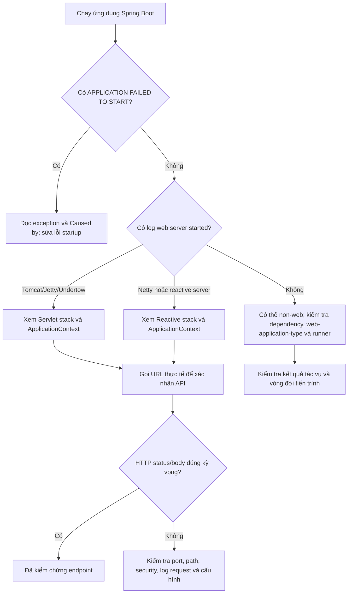

# Đọc log khởi động và xác nhận ứng dụng đã chạy đúng loại

Khi tạo **dự án Spring Boot đầu tiên**, việc chạy được lệnh `bootRun` hoặc nhìn thấy dòng `BUILD SUCCESSFUL` chưa đủ để biết ứng dụng đã hoạt động đúng. Cần đọc **log do Spring Boot phát ra**, xác định ứng dụng đã khởi tạo đến đâu, nhận diện **loại ứng dụng** đang chạy và thử hành vi phù hợp với loại đó.

Một dự án Spring Boot có thể là:

- **Servlet web application**: ứng dụng web theo mô hình Servlet, thường dùng Spring MVC với embedded Tomcat.
- **Reactive web application**: ứng dụng web reactive, thường dùng Spring WebFlux với Reactor Netty.
- **Non-web application**: ứng dụng chạy tác vụ, xử lý nền hoặc chương trình dòng lệnh, không mở HTTP server theo mặc định.

Bài học này hướng dẫn đọc log thực tế theo từng nhóm dấu hiệu, kiểm chứng bằng lệnh đơn giản và xử lý các tình huống dễ nhầm lẫn khi mới học.

## 1. Phân biệt bốn mốc: build, khởi tạo, lắng nghe cổng và hoạt động đúng

Hãy xem bốn mốc sau như bốn câu hỏi khác nhau:

| Mốc | Dấu hiệu thường gặp | Kết luận có thể đưa ra | Điều **chưa** thể kết luận |
|---|---|---|---|
| **Build thành công** | Gradle in `BUILD SUCCESSFUL` | Tác vụ Gradle vừa chạy hoàn tất thành công | Ứng dụng web đang lắng nghe hoặc API trả lời đúng |
| **Spring Boot khởi động** | Log `Started ... in ... seconds` | Quá trình khởi động Spring đã đến mốc ghi nhận thành công | HTTP endpoint cụ thể đã đáp ứng đúng; mọi phụ thuộc bên ngoài đều khỏe |
| **Web server mở cổng** | Log `Tomcat started on port ...` hoặc `Netty started on port ...` | Một web server đã khởi động ở cổng được báo | Client từ mạng bên ngoài có thể truy cập; đường dẫn API có tồn tại |
| **Chức năng được xác nhận** | Gọi endpoint nhận HTTP status và body như mong đợi | Chức năng đang kiểm tra hoạt động từ vị trí của client | Toàn bộ hệ thống đều đúng hoặc đã sẵn sàng cho production |

Với **non-web application**, không có mốc “mở cổng HTTP” là điều bình thường. Khi đó cần xem log hoàn tất khởi động, log từ chương trình và trạng thái kết thúc/tồn tại của tiến trình theo mục đích ứng dụng.

Một điểm quan trọng nữa: Spring Boot phát sự kiện `ApplicationStartedEvent` trước khi chạy các `ApplicationRunner`/`CommandLineRunner`; `ApplicationReadyEvent` xuất hiện sau khi các runner hoàn tất. Vì thế dòng `Started ...` không phải lời bảo đảm rằng mọi logic chạy sau khi khởi tạo đã hoàn tất. Nếu cần đánh giá sẵn sàng nhận lưu lượng, hãy kiểm tra khả năng sẵn sàng và các endpoint phù hợp.

## 2. Chạy đúng tiến trình và biết mình đang đọc log của ai

Với dự án có Gradle Wrapper, lệnh thông thường là:

**Windows PowerShell:**

```powershell
.\gradlew.bat bootRun
```

**macOS/Linux:**

```bash
./gradlew bootRun
```

Hai lệnh trên chỉ minh họa cách chạy **dự án có cấu hình tác vụ `bootRun`**. Nếu đang làm trong một Gradle multi-project, cần chọn đúng project path hoặc chạy ở đúng module; lệnh chính xác phụ thuộc cấu trúc dự án.

Nếu đã đóng gói executable JAR:

```bash
java -jar build/libs/<ten-ung-dung>.jar
```

Khi dùng `bootRun`, cửa sổ terminal có thể chứa hai nguồn thông tin:

1. **Thông báo của Gradle**, ví dụ tác vụ `:compileJava`, `:processResources`, `:bootRun` hay thông báo build.
2. **Log runtime của Spring Boot**, gồm logger, mức INFO/WARN/ERROR, lớp phát log và nội dung quá trình startup.

Khi chạy trực tiếp bằng `java -jar`, bạn thường nhìn thấy log runtime mà không có các dòng tiến trình tác vụ Gradle.

Ví dụ log đã rút gọn, có tính minh họa:

```text
> Task :bootRun

  .   ____          _            __ _ _
 /\\ / ___'_ __ _ _(_)_ __  __ _ \ \ \ \
( ( )\___ | '_ | '_| | '_ \/ _` | \ \ \ \
 \\/  ___)| |_)| | | | | || (_| |  ) ) ) )
  '  |____| .__|_| |_|_| |_\__, | / / / /
 =========|_|==============|___/=/_/_/_/

2026-11-13 09:15:20.101  INFO  ... DemoApplication : Starting DemoApplication using Java 21
2026-11-13 09:15:20.104  INFO  ... DemoApplication : No active profile set, falling back to 1 default profile: "default"
2026-11-13 09:15:20.815  INFO  ... TomcatWebServer : Tomcat initialized with port 8080 (http)
2026-11-13 09:15:21.213  INFO  ... TomcatWebServer : Tomcat started on port 8080 (http) with context path ''
2026-11-13 09:15:21.230  INFO  ... DemoApplication : Started DemoApplication in 1.735 seconds (process running for 2.104)
```

Thời gian, tên class/logger, banner, nội dung từng dòng và thứ tự của một số thông báo **thay đổi theo phiên bản Spring Boot, thư viện, cấu hình logging và môi trường**. Không nên viết logic kiểm tra dựa trên giả định mọi lần chạy đều có chính xác từng ký tự như ví dụ.

Trong log trên, các dấu hiệu mang ý nghĩa khác nhau:

- `Starting DemoApplication using Java 21`: JVM đã chạy vào quá trình khởi động ứng dụng và log báo phiên bản Java.
- `No active profile set ... default`: ứng dụng hiện dùng profile mặc định; không phải lỗi.
- `Tomcat initialized with port 8080`: cấu hình và khởi tạo server đã bắt đầu; **chưa phải** bằng chứng nó bind cổng thành công.
- `Tomcat started on port 8080`: embedded Tomcat đã khởi động tại cổng được nêu.
- `Started DemoApplication in ... seconds`: Spring Boot báo hoàn thành giai đoạn startup tương ứng.

Khi đọc log, hãy tìm theo **ý nghĩa và từ khóa**, không cần ghi nhớ timestamp hay tên package dài.

## 3. Cách đọc một dòng log Spring Boot

Một dòng log thông thường có thể trông như sau:

```text
2026-11-13 09:15:21.230  INFO  18240 --- [main] com.example.DemoApplication : Started DemoApplication in 1.735 seconds
```

| Thành phần | Ý nghĩa | Cách sử dụng khi phân tích |
|---|---|---|
| `2026-11-13 09:15:21.230` | Thời điểm ghi log | Ghép thứ tự các sự kiện, tìm thời gian lỗi |
| `INFO` | Mức độ log | Thông tin hoạt động bình thường |
| `18240` | Process ID nếu pattern logging hiển thị | Phân biệt các tiến trình đang chạy |
| `[main]` | Tên thread | Biết log phát ra từ thread nào |
| `com.example.DemoApplication` | Logger, thường là tên class/package | Xác định thành phần đang ghi log |
| `Started DemoApplication ...` | Nội dung sự kiện | Phần quan trọng nhất để hiểu trạng thái |

Các mức log thường gặp:

- **TRACE/DEBUG**: thông tin chi tiết phục vụ điều tra, thường không bật nhiều trong hoạt động hằng ngày.
- **INFO**: các mốc khởi động và hoạt động bình thường.
- **WARN**: có dấu hiệu cần chú ý; không đồng nghĩa ứng dụng đã thất bại.
- **ERROR**: một thao tác gặp lỗi; cần đọc cả nguyên nhân và ảnh hưởng. Một ERROR ở một tác vụ không luôn đồng nghĩa cả tiến trình đã dừng.

Đừng chỉ nhìn màu đỏ hoặc từ `WARN`. Hãy đọc **exception đầu tiên có ý nghĩa**, phần `Caused by:` và các dòng sau cùng mô tả ứng dụng còn chạy hay đã dừng.

## 4. Nhận diện đúng loại ứng dụng: Servlet, Reactive hay non-web

Spring Boot suy luận loại ứng dụng web dựa trên các class có mặt trên classpath và cấu hình khởi động. Ba giá trị tương ứng của `WebApplicationType` là `SERVLET`, `REACTIVE` và `NONE`.

Đây là **loại ứng dụng lúc chạy**; tên thư mục hoặc tên module không tự động quyết định nó. Mục tiêu là xác nhận framework đã khởi động đúng stack bạn muốn dùng.

| Loại ứng dụng | Thư viện thường gặp | Dấu hiệu log thông thường | Đối tượng cần xác nhận |
|---|---|---|---|
| **Servlet** | `spring-boot-starter-web` / Spring MVC | `Tomcat initialized...` rồi `Tomcat started on port...` khi dùng Tomcat mặc định | Web server Servlet; HTTP endpoint hoặc servlet mapping |
| **Reactive** | `spring-boot-starter-webflux` | `Netty started on port...` khi dùng Reactor Netty mặc định | Reactive web server; WebFlux handler/router |
| **Non-web** | Không có web starter hoặc chủ động đặt `NONE` | Có `Started ...` nhưng không có log web server mở cổng | Runner, job, xử lý nghiệp vụ hoặc vòng đời tiến trình |
 
**Không suy diễn tuyệt đối từ tên server:** Servlet app có thể dùng Jetty hoặc Undertow thay Tomcat. WebFlux cũng có thể chạy trên các môi trường/server được hỗ trợ khác, không nhất thiết Reactor Netty. Vì vậy log server là **dấu hiệu mạnh**, còn kết luận đầy đủ cần xét dependency, cấu hình và kiểu `ApplicationContext`.

### 4.1. Trường hợp A: Ứng dụng Servlet với Spring MVC

Một dự án Spring Boot cơ bản thường có dependency:

```groovy
dependencies {
    implementation 'org.springframework.boot:spring-boot-starter-web'
}
```

Khi không thay đổi embedded server, starter web dùng Tomcat. Bạn thường thấy log như:

```text
... TomcatWebServer : Tomcat initialized with port 8080 (http)
... TomcatWebServer : Tomcat started on port 8080 (http) with context path ''
... DemoApplication : Started DemoApplication in ... seconds
```

Kết hợp **đúng dependency Spring MVC**, **đúng server Servlet** và **HTTP endpoint hoạt động**, bạn có cơ sở xác nhận ứng dụng đã chạy ở chế độ Servlet như mong muốn.

Có thể tạo một endpoint rất nhỏ để kiểm tra:

```java
package com.example.demo;

import org.springframework.web.bind.annotation.GetMapping;
import org.springframework.web.bind.annotation.RestController;

@RestController
class HelloController {

    @GetMapping("/hello")
    String hello() {
        return "Hello from Spring Boot";
    }
}
```

Giả sử class `@SpringBootApplication` nằm trong package `com.example.demo` hoặc package cha để component scanning tìm thấy controller, sau khi startup thành công hãy mở:

```text
http://localhost:8080/hello
```

Hoặc trên terminal:

```bash
curl -i http://localhost:8080/hello
```

Phản hồi kỳ vọng, khi chưa bật các quy tắc bảo mật/chặn route bổ sung:

```http
HTTP/1.1 200
Content-Type: text/plain;charset=UTF-8

Hello from Spring Boot
```

Chính việc kết nối thành công và nhận **đúng status/body dự kiến** xác nhận endpoint hoạt động. Log `Started` chỉ chứng minh ứng dụng đã đạt một mốc khởi động.

### 4.2. Trường hợp B: Ứng dụng Reactive với Spring WebFlux

Một ứng dụng reactive điển hình sử dụng:

```groovy
dependencies {
    implementation 'org.springframework.boot:spring-boot-starter-webflux'
}
```

Với Reactor Netty mặc định, log thường chứa:

```text
... NettyWebServer : Netty started on port 8080 (http)
... DemoApplication : Started DemoApplication in ... seconds
```

Ví dụ controller dùng kiểu reactive:

```java
package com.example.demo;

import org.springframework.web.bind.annotation.GetMapping;
import org.springframework.web.bind.annotation.RestController;
import reactor.core.publisher.Mono;

@RestController
class ReactiveHelloController {

    @GetMapping("/hello")
    Mono<String> hello() {
        return Mono.just("Hello from WebFlux");
    }
}
```

Tương tự Servlet, có thể gọi `GET /hello` để kiểm tra đường dẫn. Từ góc nhìn HTTP client, hai ứng dụng có thể trả cùng một kiểu phản hồi; **chỉ nhìn kết quả 200 chưa biết server là MVC hay WebFlux**. Hãy đối chiếu dependency, loại ApplicationContext và log server.

Một điểm hay gây nhầm: nếu project đưa cả `spring-boot-starter-web` và `spring-boot-starter-webflux` vào classpath, mặc định Spring Boot **thường ưu tiên Servlet/MVC** vì nhiều dự án MVC cần `WebClient` của WebFlux. Chỉ thêm `Mono` hay `WebClient` không tự chuyển cả ứng dụng sang Reactive.

### 4.3. Trường hợp C: Ứng dụng non-web

Dự án không có Spring MVC/WebFlux web stack, hoặc cấu hình rõ `spring.main.web-application-type=none`, có thể khởi động Spring context **không mở HTTP server**.

Ví dụ một chương trình in lời chào khi chạy:

```java
package com.example.demo;

import org.springframework.boot.CommandLineRunner;
import org.springframework.boot.SpringApplication;
import org.springframework.boot.autoconfigure.SpringBootApplication;
import org.springframework.context.annotation.Bean;

@SpringBootApplication
public class ConsoleApplication {

    public static void main(String[] args) {
        SpringApplication.run(ConsoleApplication.class, args);
    }

    @Bean
    CommandLineRunner sayHello() {
        return args -> System.out.println("Job executed successfully");
    }
}
```

Log minh họa:

```text
... ConsoleApplication : Starting ConsoleApplication using Java 21
... ConsoleApplication : No active profile set, falling back to 1 default profile: "default"
... ConsoleApplication : Started ConsoleApplication in 0.9 seconds
Job executed successfully
```

Không thấy `Tomcat started` hay `Netty started` là bình thường đối với ứng dụng này. Nếu không còn thread nào giữ JVM chạy, chương trình có thể **kết thúc ngay sau khi hoàn thành công việc**. Với CLI/job, hãy kiểm tra kết quả tác vụ và exit code; không dùng “có truy cập được localhost:8080 hay không” làm điều kiện thành công.

Ngược lại, nếu bạn mong muốn một REST API nhưng log chỉ có `Started ...`, không có web server và tiến trình thoát ngay, hãy xem lại dependency web và cấu hình `spring.main.web-application-type`.

## 5. Kiểm chứng bằng thông tin runtime: ApplicationContext

Khi log server không đủ rõ, bạn có thể xem kiểu context Spring đã khởi tạo. Để quan sát trong một bài thực hành, thêm bean `ApplicationRunner` sau:

```java
package com.example.demo;

import org.springframework.boot.ApplicationRunner;
import org.springframework.context.ApplicationContext;
import org.springframework.context.annotation.Bean;
import org.springframework.context.annotation.Configuration;

@Configuration
class ContextInspectionConfiguration {

    @Bean
    ApplicationRunner printApplicationContext(ApplicationContext context) {
        return args -> System.out.println(
                "ApplicationContext type: " + context.getClass().getName()
        );
    }
}
```

Khi bean này được quét và khởi tạo, bạn có thể thấy các class tương tự:

| Kiểu thực tế thường gặp | Ý nghĩa |
|---|---|
| `AnnotationConfigServletWebServerApplicationContext` | Spring Boot web application với Servlet web server |
| `AnnotationConfigReactiveWebServerApplicationContext` | Spring Boot reactive web application với reactive web server |
| `AnnotationConfigApplicationContext` | Spring application context thông thường, không có embedded web server |

Tên class cụ thể phụ thuộc cách tạo context và cấu hình. Đây là **kỹ thuật quan sát cho bài học**, không cần giữ `System.out.println` trong mọi ứng dụng production; ở ứng dụng thực tế nên dùng logging có cấu trúc hoặc thông tin vận hành thích hợp.

Cũng cần phân biệt: một **bean dùng Reactor `Mono` hoặc `Flux`** không chứng minh cả ứng dụng chạy WebFlux. Câu hỏi đang xác nhận là **loại Spring application/web stack đã thực sự được chọn**.

## 6. Kiểm tra cổng, đường dẫn và profile

### 6.1. Đừng mặc định luôn là cổng 8080

Mặc định, ứng dụng web Spring Boot thường dùng HTTP port **8080** nếu không có cấu hình khác. Nhưng cổng có thể đổi qua `application.yml`, biến môi trường hoặc tham số khởi động.

Ví dụ cấu hình **Servlet**:

```yaml
server:
  port: 9090
  servlet:
    context-path: /demo
```

Khi đó một controller ánh xạ `/hello` sẽ có URL:

```text
http://localhost:9090/demo/hello
```

Trong log khởi động, cần tìm cổng và context path **thực tế** đã áp dụng; việc vẫn thử `http://localhost:8080/hello` sẽ dẫn đến kết luận sai.

Với WebFlux, `server.port` cũng dùng để cấu hình cổng HTTP, nhưng **`server.servlet.context-path` là cấu hình dành cho Servlet**, không phải cách chung để đặt base path cho ứng dụng Reactive; hãy dùng cơ chế cấu hình base path/routing phù hợp với WebFlux.

Một số ứng dụng còn mở **management port** riêng cho Actuator. Khi đó cổng của `/actuator/health` có thể khác cổng API chính, tùy cấu hình.

### 6.2. Đọc profile đang hoạt động

Spring Boot có thể tải cấu hình theo profile: `dev`, `test`, `prod`, v.v. Một ví dụ cấu hình:

```yaml
spring:
  profiles:
    active: dev
```

Log có thể ghi:

```text
The following 1 profile is active: "dev"
```

Profile ảnh hưởng đến database, log level, endpoint, port và các bean điều kiện. Nếu bạn mong chạy cấu hình `dev` nhưng log ghi profile mặc định, hãy kiểm tra nguồn cấu hình và tham số startup.

**Phân biệt rõ:**

- `No active profile set ... "default"` là thông báo bình thường khi không kích hoạt profile riêng.
- `The following ... profile is active` cho thấy profile được chọn.
- Profile được tải **không tự bảo đảm** mọi thuộc tính trong profile là đúng; vẫn cần xác nhận port và hành vi thực tế.

### 6.3. Thử endpoint bằng công cụ phù hợp

Trên Windows PowerShell, lệnh `curl` có thể là alias của `Invoke-WebRequest` ở một số môi trường. Để gọi đúng chương trình curl, dùng:

```powershell
curl.exe -i http://localhost:8080/hello
```

Trên macOS/Linux:

```bash
curl -i http://localhost:8080/hello
```

Nếu không có endpoint `/hello`, hãy thay đường dẫn bằng một route thực sự tồn tại. Kiểm tra cả **status**, **header cần thiết** và **nội dung trả về**; không chỉ nhìn xem terminal có in gì đó.

Nếu app có **Spring Security**, `401 Unauthorized` hoặc `403 Forbidden` có thể cho biết web server vẫn đang nhận request nhưng chính sách bảo mật đã từ chối quyền truy cập. Không được diễn giải hai status này thành “Spring Boot chưa khởi động”.

## 7. Actuator: kiểm tra health khi dự án có hỗ trợ

Một ứng dụng web có thể bật Spring Boot Actuator để cung cấp thông tin vận hành. Dependency ví dụ:

```groovy
dependencies {
    implementation 'org.springframework.boot:spring-boot-starter-actuator'
}
```

Với cấu hình mặc định phù hợp, health endpoint thường ở:

```text
GET /actuator/health
```

Một phản hồi minh họa:

```json
{
  "status": "UP"
}
```

Health endpoint hữu ích để kiểm tra tình trạng ứng dụng hoặc những health indicator đã được cấu hình. Nhưng cần hiểu giới hạn:

- **`UP` không đồng nghĩa mọi chức năng nghiệp vụ đều đã kiểm thử thành công.** Nó phản ánh những chỉ số mà health endpoint đang đánh giá.
- Nếu Actuator chưa được thêm, endpoint chưa được expose hoặc bị bảo vệ, bạn có thể nhận `404`, `401` hay `403`; khi đó cần xem cấu hình thay vì kết luận app chết.
- **Liveness** cho biết tiến trình có nên tiếp tục chạy/được khởi động lại không; **readiness** cho biết tiến trình có sẵn sàng nhận lưu lượng không. Hai mục đích không nên gộp.
- Các endpoint probe như `/actuator/health/liveness` và `/actuator/health/readiness` phụ thuộc vào cấu hình probe và môi trường chạy; không mặc định suy luận rằng chúng luôn tồn tại trong mọi dự án.

Ví dụ với Spring Boot có Actuator, khi muốn bật các probe health trong môi trường thực hành ngoài Kubernetes:

```yaml
management:
  endpoint:
    health:
      probes:
        enabled: true
```

Trong bài học dự án đầu tiên, việc gọi một endpoint tự viết như `/hello` vẫn rất hữu ích: nó xác nhận **controller và HTTP routing thực sự làm việc**, bên cạnh health status.

## 8. Khi log khởi động nhìn giống lỗi: đọc thông báo thế nào?

Đôi lúc console in rất nhiều dòng đỏ khiến người mới khó xác định nguyên nhân. Cách đọc hiệu quả:

1. Tìm cụm **`APPLICATION FAILED TO START`** hoặc dòng exception thể hiện startup dừng.
2. Xác định thành phần vừa lỗi: web server, dependency injection, datasource, cấu hình thuộc tính, bean đang khởi tạo...
3. Đọc **`Caused by:`** và các thông báo nguyên nhân cụ thể; nhiều stack trace chỉ là hệ quả của lỗi gốc.
4. Phân biệt lỗi **startup** với lỗi **một request** xảy ra sau khi ứng dụng đã chạy.
5. Sau khi sửa, chạy lại ứng dụng và kiểm tra **đúng dấu hiệu khởi động cùng hành vi thực tế**.

### 8.1. Cổng đã bị tiến trình khác sử dụng

Log minh họa:

```text
APPLICATION FAILED TO START

Description:
Web server failed to start. Port 8080 was already in use.
```

Ý nghĩa: ứng dụng muốn bind cổng 8080 nhưng không thể. Trường hợp này **không có nghĩa** mã controller sai; tiến trình khác có thể đang giữ cổng, gồm một bản ứng dụng cũ còn chạy.

Hướng xử lý: xác định tiến trình đang dùng cổng, dừng tiến trình không còn cần thiết hoặc đổi `server.port` cho ứng dụng mới. Không nên cứ thấy lỗi là tùy tiện kết thúc mọi tiến trình Java đang chạy vì chúng có thể phục vụ dự án khác.

### 8.2. Thiếu bean hoặc dependency injection không thỏa mãn

Log có thể chứa:

```text
APPLICATION FAILED TO START

Parameter 0 of constructor in ... required a bean of type ...
that could not be found.
```

Ý nghĩa: Spring không tìm được bean cần để tạo component. Cần đối chiếu annotation, component scanning, cấu hình `@Bean` và điều kiện tạo bean. Server có thể chưa kịp mở cổng; việc gọi URL lúc này không giúp xác định nguyên nhân gốc.

### 8.3. Cấu hình datasource không hợp lệ

Ví dụ:

```text
Failed to configure a DataSource: 'url' attribute is not specified
```

Khi project đưa các starter dữ liệu vào và Spring cố cấu hình DataSource, thiếu driver, URL hoặc cấu hình phù hợp có thể làm startup thất bại. Đừng bỏ qua lỗi chỉ vì bài học đang tập trung vào REST API; ứng dụng phải khởi tạo các bean bắt buộc trước khi phục vụ request.

### 8.4. Ứng dụng báo Started nhưng HTTP trả 404

`404 Not Found` thường chỉ ra **request đã đi đến một HTTP server nhưng không có handler/resource phù hợp**. Các nguyên nhân thường gặp:

- Gọi sai đường dẫn, sai HTTP method hoặc sai context path.
- `@RestController` nằm ngoài vùng component scanning.
- Chạy **một ứng dụng khác** ở cổng mà bạn đang gọi.
- Bạn nghĩ app có route `/` nhưng thực tế chỉ định nghĩa `/api/hello`.

Nếu request hoàn toàn không kết nối được, thông báo thường là **connection refused**, **timeout** hoặc lỗi mạng, không phải `404`. Hãy phân biệt lỗi **routing HTTP** và lỗi **kết nối**.

### 8.5. Có log Netty dù bạn tưởng là MVC

Kiểm tra dependency: dự án có thêm `spring-boot-starter-webflux` và loại bỏ `spring-boot-starter-web` không? Có chỉnh `spring.main.web-application-type` hay cấu hình server khác không? Có tiến trình của một ứng dụng khác đang ghi log vào cùng terminal/container log không?

Mục tiêu không phải “đổi Netty thành Tomcat bằng mọi giá”, mà là xác định ứng dụng có đang chạy **đúng stack đã thiết kế** hay không.

## 9. Phân biệt ứng dụng đã khởi động, đã sẵn sàng và có thể truy cập từ bên ngoài

Một ứng dụng có thể báo:

```text
Tomcat started on port 8080
Started DemoApplication in 2.1 seconds
```

nhưng client ở máy khác không truy cập được. Điều này có thể xuất phát từ:

- Server chỉ bind vào địa chỉ loopback hoặc interface khác với địa chỉ client dùng.
- Firewall, container port mapping, Kubernetes Service/Ingress hoặc proxy chưa cấu hình đúng.
- Client dùng sai host/port, HTTP thay cho HTTPS hoặc sai context path.
- Endpoint yêu cầu xác thực, hoặc ứng dụng có dependency nghiệp vụ đang lỗi dù server vẫn lắng nghe.
- Một `ApplicationRunner`/`CommandLineRunner` đang thực hiện công việc lâu hoặc thất bại sau mốc log `Started`.

Như vậy, có ba tầng kiểm chứng thực tế:

**Tầng 1 — Trong tiến trình:** Có log startup tương ứng, không có lỗi khiến ứng dụng dừng, đúng loại context.

**Tầng 2 — Trên máy chạy app:** HTTP server mở cổng và `curl` trên máy đó gọi được endpoint mong đợi (hoặc tác vụ non-web chạy đúng).

**Tầng 3 — Từ client thực tế:** Có thể đi qua network, gateway, container mapping và security như thiết kế.

Bài học đầu tiên chủ yếu hoàn thành **tầng 1 và tầng 2**. Khi triển khai trên server/container/cloud, cần thêm tầng 3.

## 10. Một sơ đồ suy luận từ log



Sơ đồ là một **cách tiếp cận**, không phải bộ quy tắc khẳng định tuyệt đối. Với embedded server khác mặc định hoặc logging tùy biến, hãy dùng dependency và kiểu context để xác nhận.

## 11. Thực hành: xác nhận dự án đầu tiên từ đầu đến cuối

Giả sử mục tiêu của bạn là **REST API Spring MVC**.

### Bước 1. Xác định mục tiêu trước khi chạy

Mục tiêu cụ thể:

- Dùng Spring Boot với `spring-boot-starter-web`.
- Ứng dụng chạy Servlet/MVC.
- HTTP server lắng nghe ở `localhost:8080`, nếu không có cấu hình khác.
- `GET /hello` trả chuỗi `Hello from Spring Boot`.

Nếu mục tiêu là WebFlux hoặc console job, hãy thay các tiêu chí tương ứng từ mục 4.

### Bước 2. Chạy dự án và xem dấu hiệu startup

Dùng `bootRun` hoặc executable JAR phù hợp. Đọc thông báo về Java version, active profile, server và dòng `Started`. Nếu thấy `APPLICATION FAILED TO START`, xử lý lỗi trước khi kiểm tra HTTP.

### Bước 3. Xác nhận loại web stack

Với Servlet/MVC dùng Tomcat mặc định, log `Tomcat started on port...` là tín hiệu tích cực. Nếu log Netty hoặc không có web server, xem lại dependency và `spring.main.web-application-type`. Khi cần chắc chắn, in class của `ApplicationContext` như mục 5.

### Bước 4. Gọi endpoint bằng HTTP client

Trong terminal thứ hai, chạy:

```powershell
curl.exe -i http://localhost:8080/hello
```

Đối chiếu status `200` và chuỗi trả về. Nếu không đúng, xem URL, HTTP method, security và log request.

### Bước 5. Hiểu vòng đời khi dừng chương trình

Khi chạy `bootRun`, ứng dụng web thường tiếp tục sống để phục vụ request cho tới khi bị dừng. Nhấn `Ctrl+C` trong terminal đang chạy để yêu cầu dừng. Nếu ứng dụng non-web kết thúc ngay, điều đó có thể là hành vi hợp lệ. Phân biệt **dừng chủ động** với **crash do exception** bằng log và exit status.

### Bước 6. Xác nhận lần nữa sau khi đổi cấu hình

Đổi port từ `8080` sang `9090` trong cấu hình rồi khởi động lại để quan sát log và thử:

```powershell
curl.exe -i http://localhost:9090/hello
```

Hoạt động này cho thấy log phản ánh **cấu hình runtime đang áp dụng**, giúp tránh việc dựa vào port mặc định theo thói quen.

## 12. Ba bài tình huống để tự giải thích

**Tình huống A**

```text
... Tomcat started on port 8080 (http) with context path ''
... Started CatalogApplication in 1.8 seconds
GET /products/123 -> HTTP 200
```

Giải thích: ứng dụng khởi động thành công và có HTTP endpoint đang trả lời. Với dependency MVC/Servlet tương ứng, đây là bằng chứng tốt rằng web app loại Servlet hoạt động như mong muốn. Chưa thể từ đó khẳng định mọi endpoint hay dependency đều khỏe.

**Tình huống B**

```text
... Started BatchApplication in 0.8 seconds
Processed 250 records
[process exited with code 0]
```

Giải thích: nếu dự án cố ý là non-web batch job, không có Tomcat/Netty hoàn toàn bình thường. Thành công ở đây là hoàn thành tác vụ và exit code như dự kiến; không có HTTP endpoint để thử.

**Tình huống C**

```text
... Tomcat initialized with port 8080 (http)
... Web server failed to start. Port 8080 was already in use.
... APPLICATION FAILED TO START
```

Giải thích: `initialized` không phải `started`. Ứng dụng thất bại khi mở cổng; cần xử lý xung đột cổng trước khi kết luận chức năng controller.

### Những câu hỏi nên trả lời được sau bài này

1. Dòng `BUILD SUCCESSFUL` và `Started MyApplication` nói về những giai đoạn khác nhau thế nào?
2. Vì sao `Tomcat initialized` chưa chứng minh HTTP server đã lắng nghe?
3. Khi nào log `Netty started` cho thấy WebFlux, và tại sao cần đối chiếu dependency/ApplicationContext?
4. Vì sao ứng dụng non-web khởi động rồi tự thoát có thể là hoàn toàn đúng?
5. Với HTTP `404`, `401`, `connection refused` và `timeout`, bạn sẽ điều tra các nhóm nguyên nhân nào?
6. Nếu ứng dụng dùng port `9090` và context path `/demo`, bạn sẽ kiểm tra URL nào cho controller `/hello`?
7. Vì sao `Started` và health `UP` không thay thế việc kiểm tra hành vi nghiệp vụ cụ thể?

## 13. Kết luận thực hành

Đọc log khởi động Spring Boot là đọc **trạng thái theo từng mốc**, không phải tìm duy nhất một dòng chứa chữ “success”.

- Với **Servlet/MVC**, kiểm tra classpath/configuration, dấu hiệu server Servlet mở cổng và endpoint HTTP trả đúng.
- Với **Reactive/WebFlux**, đối chiếu reactive stack, log reactive server và kết quả HTTP.
- Với **non-web**, kiểm tra Spring context, runner, kết quả công việc và vòng đời tiến trình; không chờ log mở cổng.
- Khi có lỗi, tìm nguyên nhân khiến startup dừng trước; khi server đã chạy nhưng API lỗi, tập trung vào port, routing, security và xử lý request.

Thói quen quan trọng nhất trong dự án đầu tiên là: **xác định ứng dụng được kỳ vọng chạy theo loại nào, đọc log để nhận diện loại thực tế, rồi kiểm chứng bằng hành vi có thể quan sát**.
