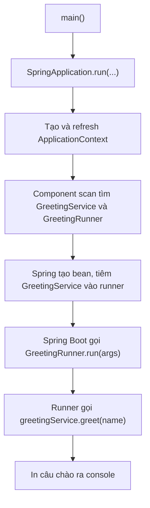
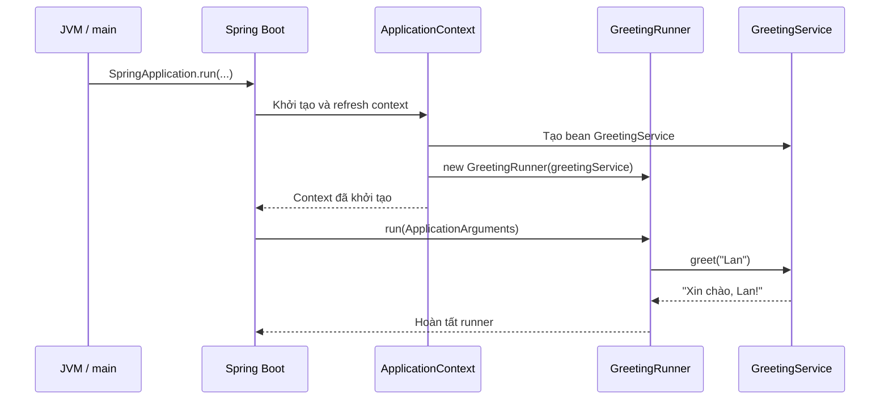

# Đăng ký một service và gọi từ ApplicationRunner

Trong dự án Spring Boot đầu tiên, ta có thể kiểm chứng **Spring quản lý một đối tượng và tự truyền đối tượng đó cho nơi cần dùng** mà chưa phải dựng REST API, database hoặc giao diện. Bài thực hành này tạo một `GreetingService` chứa nghiệp vụ chào hỏi, đăng ký nó thành *bean* của Spring và gọi nó từ `ApplicationRunner` khi ứng dụng khởi động.

Sau bài học, bạn có thể:

- Viết một service đơn giản, đánh dấu `@Service` và giải thích vì sao Spring tạo được bean.
- Dùng **constructor injection** để đưa service vào một class khác mà không gọi `new`.
- Giải thích khi nào `ApplicationRunner.run(...)` được thực thi và cách nhận tham số dòng lệnh.
- Nhận biết lỗi bean không được đăng ký, package nằm ngoài vùng quét hoặc dependency không thỏa mãn.
- Phân biệt cách đăng ký bằng `@Service` với cách đăng ký tường minh qua `@Bean`.

Ví dụ sử dụng Java 21, Spring Boot 3.x, Gradle và package gốc `com.example.demo`. Nếu bạn đã có một project Spring Boot với package khác, hãy đổi đồng nhất tên package trong tất cả đoạn code.

## 1. Bức tranh tổng thể: ba vai trò khác nhau

Ứng dụng sẽ có đúng ba thành phần chính:

| Thành phần | Vai trò | Ai gọi hoặc tạo? |
|---|---|---|
| `DemoApplication` | Điểm bắt đầu của chương trình, khởi tạo Spring Boot | JVM gọi `main`; `SpringApplication` tạo context |
| `GreetingService` | Chứa logic tạo lời chào | Spring phát hiện `@Service` và quản lý bean |
| `GreetingRunner` | Chạy một công việc nhỏ sau khi context khởi tạo | Spring Boot gọi `run(...)` theo hợp đồng `ApplicationRunner` |

Luồng thực thi cơ bản:



Điểm cần phân biệt: **service là nơi chứa nghiệp vụ; runner chỉ là điểm kích hoạt nghiệp vụ lúc khởi động**. Cách chia này giúp sau này có thể gọi cùng một service từ controller, scheduler hoặc một thành phần khác mà không phải chuyển logic sang runner.

## 2. Chuẩn bị project không cần web server

Tạo một dự án bằng Spring Initializr hoặc dùng dự án Spring Boot vừa tạo với:

- Project: Gradle (Groovy DSL).
- Language: Java; JDK 21.
- Spring Boot: nhánh 3.x phù hợp với dự án đang học.
- Group: `com.example`; Artifact: `demo`.
- Dependency nền tảng: `spring-boot-starter`. Có thể thêm `spring-boot-starter-test` nếu muốn chạy bài test cuối bài.

Trong `build.gradle` do Initializr tạo, phần dependency cho bài này có thể là:

```groovy
dependencies {
    implementation 'org.springframework.boot:spring-boot-starter'
    testImplementation 'org.springframework.boot:spring-boot-starter-test'
}
```

Đây là **đoạn dependency**, không phải toàn bộ file Gradle; giữ nguyên plugin Spring Boot, dependency management, repositories, toolchain và cấu hình khác mà Initializr đã sinh. Starter nền tảng đủ cho component scanning, dependency injection và `ApplicationRunner`. Bài này không cần `spring-boot-starter-web` nên sẽ không khởi động HTTP server.

Cấu trúc file ta sẽ tạo:

```text
demo/
├── build.gradle
├── settings.gradle
├── gradlew
├── gradlew.bat
└── src/
    ├── main/
    │   ├── java/com/example/demo/
    │   │   ├── DemoApplication.java
    │   │   ├── GreetingService.java
    │   │   └── GreetingRunner.java
    │   └── resources/
    │       └── application.properties
    └── test/
        └── java/com/example/demo/
            └── GreetingServiceIntegrationTest.java  (tùy chọn)
```

`application.properties` có thể để trống trong bài này. Các tệp Java chính cần ở cùng package `com.example.demo` để cơ chế quét component mặc định hoạt động dễ dự đoán.

## 3. Tạo điểm vào: `DemoApplication`

Tệp `src/main/java/com/example/demo/DemoApplication.java`:

```java
package com.example.demo;

import org.springframework.boot.SpringApplication;
import org.springframework.boot.autoconfigure.SpringBootApplication;

@SpringBootApplication
public class DemoApplication {

    public static void main(String[] args) {
        SpringApplication.run(DemoApplication.class, args);
    }
}
```

`main(String[] args)` là phương thức Java thông thường. Lệnh `SpringApplication.run(...)` khởi động Spring Boot và tạo một `ApplicationContext`, nơi lưu thông tin về các bean và quản lý việc tạo, nối dependency, vòng đời của chúng.

`@SpringBootApplication` bao gồm khả năng **component scanning**: mặc định, Spring quét package chứa `DemoApplication` cùng các package con. Vì vậy, class mang `@Service` hoặc `@Component` đặt trong `com.example.demo` sẽ được phát hiện khi ứng dụng khởi động.

Không cần gọi `new GreetingService()` trong `main`. Việc tạo và cung cấp service sẽ do Spring đảm nhận.

## 4. Viết service và đăng ký với `@Service`

Tệp `src/main/java/com/example/demo/GreetingService.java`:

```java
package com.example.demo;

import org.springframework.stereotype.Service;

@Service
public class GreetingService {

    public String greet(String name) {
        String recipient = (name == null || name.isBlank())
                ? "bạn"
                : name.trim();

        return "Xin chào, " + recipient + "!";
    }
}
```

Hãy đọc từng phần:

1. `GreetingService` là **lớp Java thông thường**; method `greet` nhận tên và trả về một chuỗi. Phần xử lý này chưa phụ thuộc vào Spring.
2. `@Service` là một annotation chuyên biệt của `@Component`, cho biết lớp này thuộc tầng nghiệp vụ và là ứng viên cho component scanning.
3. Khi vùng quét bao gồm lớp này, Spring đăng ký một bean definition cho `GreetingService` rồi tạo bean khi context được khởi tạo theo vòng đời thông thường.
4. Mặc định, bean loại này có scope **singleton** trong một `ApplicationContext`, nghĩa là các thành phần cùng yêu cầu bean ấy thường nhận cùng một instance do context quản lý.

Điều quan trọng không nằm ở nội dung `greet` mà ở việc **đối tượng nào quản lý instance của `GreetingService`**. Nếu tự viết `new GreetingService()`, bạn có một đối tượng Java độc lập; còn bean được Spring đăng ký có thể được framework tìm và tiêm vào nơi cần sử dụng.

Tên class và annotation cũng có hai ý nghĩa khác nhau: class có thể mang tên `GreetingService` dù không có `@Service`, nhưng khi bỏ annotation và không đăng ký bean theo cách khác, Spring sẽ không tự biết phải cung cấp instance nào cho runner.

## 5. Tạo `ApplicationRunner` và tiêm service qua constructor

Tệp `src/main/java/com/example/demo/GreetingRunner.java`:

```java
package com.example.demo;

import java.util.List;

import org.springframework.boot.ApplicationArguments;
import org.springframework.boot.ApplicationRunner;
import org.springframework.stereotype.Component;

@Component
public class GreetingRunner implements ApplicationRunner {

    private final GreetingService greetingService;

    public GreetingRunner(GreetingService greetingService) {
        this.greetingService = greetingService;
    }

    @Override
    public void run(ApplicationArguments args) {
        List<String> names = args.getOptionValues("name");
        String name = (names == null || names.isEmpty())
                ? "Spring Boot"
                : names.get(0);

        String message = greetingService.greet(name);
        System.out.println(message);
    }
}
```

Đây là một class hoạt động theo hai cơ chế:

**Thứ nhất, nó là một Spring bean.** Annotation `@Component` khiến Spring đưa `GreetingRunner` vào quá trình component scanning. Khi tạo instance của runner, Spring thấy constructor cần một `GreetingService`, tìm bean phù hợp và truyền nó vào. Đây là **constructor injection**, một cách thực hiện *dependency injection (DI)*.

**Thứ hai, nó triển khai `ApplicationRunner`.** Đây là interface của Spring Boot có method:

```java
void run(ApplicationArguments args) throws Exception;
```

Sau khi context được khởi tạo và ứng dụng đã hoàn thành phần khởi động cần thiết, Spring Boot gọi `run(...)` của các bean `ApplicationRunner`. Vì vậy ta không gọi `run` thủ công trong `main`.

Constructor duy nhất của `GreetingRunner` không cần gắn `@Autowired`. Trong Spring hiện đại, khi một bean chỉ có một constructor, Spring có thể sử dụng constructor ấy để tiêm dependency mà không cần thêm annotation.

### Vì sao field là `private final`?

`private final GreetingService greetingService` biểu thị dependency phải có khi tạo runner và sẽ không bị gán lại sau khi constructor hoàn thành. Đây là cách thể hiện rõ hợp đồng của class: **runner không thể hoạt động hợp lệ nếu thiếu service**.

Nếu không có bean `GreetingService` phù hợp, quá trình tạo runner sẽ thất bại ngay khi ứng dụng khởi động thay vì phải đợi đến lúc `run(...)` truy cập một field `null`.

### `ApplicationArguments` chứa gì?

`ApplicationArguments` là đối tượng do Boot tạo từ tham số truyền vào chương trình. Nó phân biệt:

| Lệnh ứng dụng nhận | Cách truy cập trong runner | Kết quả minh họa |
|---|---|---|
| Không có tham số | `getOptionValues("name")` | `null`, dùng tên mặc định |
| `--name=Lan` | `getOptionValues("name")` | Danh sách chứa `Lan` |
| `--name=Lan --name=Minh` | `getOptionValues("name")` | Danh sách chứa hai giá trị; ví dụ dùng giá trị đầu |
| `Lan` (không có tiền tố `--`) | `getNonOptionArgs()` | Danh sách chứa `Lan` |

Code hiện tại đọc **option có tên `name`**, vì vậy tham số không tên `Lan` sẽ không được dùng làm tên chào. Hàm `getOptionValues` có thể trả về `null` khi option không tồn tại; kiểm tra `null` và danh sách rỗng là để tránh lỗi khi chạy không tham số. `GreetingService` cũng tự xử lý tên rỗng, nên `--name=` sẽ tạo câu chào gửi tới “bạn”.

## 6. Chạy lần đầu và kiểm chứng luồng gọi

Mở terminal tại thư mục gốc của dự án, nơi có Gradle Wrapper.

Trên Linux hoặc macOS:

```bash
./gradlew bootRun
```

Trên Windows PowerShell:

```powershell
.\gradlew.bat bootRun
```

Trong các dòng log khởi động, tìm dòng do chính runner in ra:

```text
Xin chào, Spring Boot!
```

Với tham số dòng lệnh:

```bash
# Linux/macOS
./gradlew bootRun --args='--name=Lan'
```

```powershell
# Windows PowerShell
.\gradlew.bat bootRun --args="--name=Lan"
```

Dòng kết quả ứng dụng in ra:

```text
Xin chào, Lan!
```

Trong terminal, bạn có thể thấy thêm rất nhiều log framework và Gradle. Thứ cần xác nhận ở đây là **dòng chào xuất hiện do `GreetingRunner.run(...)` gọi `GreetingService.greet(...)`**, không phải một message có sẵn của Spring Boot.

Vì bài này chỉ dùng `spring-boot-starter` và không có web server hoặc tác vụ giữ tiến trình hoạt động, ứng dụng có thể thoát bình thường ngay sau khi chạy runner. Đó là hành vi mong đợi cho một chương trình chạy công việc ngắn lúc khởi động, không phải lỗi server.

## 7. Theo dõi chính xác ai tạo và ai gọi

Bạn không có dòng code nào như sau:

```java
GreetingService service = new GreetingService();
GreetingRunner runner = new GreetingRunner(service);
runner.run(...);
```

Nhưng lời chào vẫn xuất hiện. Chuỗi nguyên nhân là:

1. JVM gọi `DemoApplication.main(...)`.
2. `SpringApplication.run(...)` khởi tạo Spring context.
3. Component scanning tìm `GreetingService` vì có `@Service` và tìm `GreetingRunner` vì có `@Component` trong phạm vi package.
4. Spring đăng ký và tạo các bean cần thiết; constructor của `GreetingRunner` nhận bean `GreetingService`.
5. Sau khi context được refresh, Boot nhận diện runner là bean triển khai `ApplicationRunner` và gọi `run(...)`.
6. `GreetingRunner` đọc tham số `name`, gọi service và in giá trị trả về.

Sơ đồ tuần tự tương ứng:



Thứ tự Spring tạo **tất cả** bean trong ứng dụng không nhất thiết giống thứ tự ví dụ trên. Sơ đồ tập trung vào dependency cần có: để tạo và sử dụng `GreetingRunner`, Spring phải cung cấp được `GreetingService`. `ApplicationRunner` được gọi sau khi context đã sẵn sàng theo giai đoạn khởi động của Boot.

### Bean, IoC và DI liên quan nhau ra sao?

| Khái niệm | Giải thích bằng ví dụ hiện tại |
|---|---|
| **Bean** | Một instance như `GreetingService` được Spring context đăng ký và quản lý. |
| **IoC (Inversion of Control)** | Code ứng dụng giao việc tạo/quản lý object và kết nối dependency cho container. |
| **DI (Dependency Injection)** | Container đưa `GreetingService` vào constructor của `GreetingRunner`. |
| **Component scanning** | Cơ chế phát hiện các class mang annotation phù hợp trong package được quét. |
| **ApplicationRunner** | Hợp đồng cho một bean thực hiện logic sau giai đoạn khởi tạo context. |

`@Service` **không tự gọi method `greet`**; nó chỉ giúp khai báo vai trò của bean. `ApplicationRunner` **không tự sinh ra service**; runner nhận service đã được Spring cung cấp. Đó là sự phân chia trách nhiệm cốt lõi của bài.

## 8. Thử thay đổi để hiểu cơ chế

### Thí nghiệm A: bỏ `@Service`

Tạm bỏ `@Service` khỏi `GreetingService`, giữ nguyên `GreetingRunner`. Khi chạy lại, Spring không còn bean `GreetingService` được tạo bởi component scan. Runner vẫn được phát hiện, nhưng Spring không thể thỏa mãn tham số constructor:

```text
Parameter 0 of constructor in ...GreetingRunner
required a bean of type '...GreetingService'
that could not be found.
```

Đây là **diễn giải dạng lỗi điển hình**, nội dung log thực tế có thể khác theo phiên bản. Căn nguyên: service không được đăng ký thành bean. Khôi phục `@Service`, chạy lại để thấy lỗi biến mất.

Điều cần rút ra: một class tồn tại trong source code chưa có nghĩa Spring có bean của class ấy.

### Thí nghiệm B: bỏ `@Component` trên runner

Giữ `@Service` nhưng bỏ `@Component` khỏi `GreetingRunner`. Nếu không có cách đăng ký runner nào khác, Spring không tạo bean runner, vì thế Boot cũng không có bean `ApplicationRunner` này để gọi. Ứng dụng có thể start rồi thoát mà **không in câu chào**.

Khôi phục `@Component`. Thí nghiệm này cho thấy interface `ApplicationRunner` chỉ mô tả cách chạy; **đối tượng triển khai interface phải là bean** để Boot biết đến nó.

### Thí nghiệm C: chuyển service ra ngoài vùng component scan

Giả sử `DemoApplication` đặt trong `com.example.demo`, nhưng bạn chuyển `GreetingService` sang `com.example.other` và cập nhật import trong runner. Vì `com.example.other` không nằm dưới `com.example.demo`, component scan mặc định có thể không tìm thấy service. Lỗi injection tương tự thí nghiệm A.

Cách tổ chức nên dùng trong dự án nhỏ:

```text
com.example.demo
├── DemoApplication
├── service
│   └── GreetingService
└── runner
    └── GreetingRunner
```

Khi tách vào `com.example.demo.service` và `com.example.demo.runner`, nhớ cập nhật `package` và `import` tương ứng. Đặt lớp main ở **package gốc phía trên** các thành phần ứng dụng sẽ đơn giản hơn việc mở rộng `@ComponentScan` tùy tiện.

### Thí nghiệm D: thay đổi dữ liệu mà không sửa runner

Sửa method `greet` trong service thành:

```java
public String greet(String name) {
    String recipient = (name == null || name.isBlank())
            ? "bạn"
            : name.trim();
    return "Rất vui được gặp " + recipient + "!";
}
```

Chạy `--name=Lan` một lần nữa; runner sẽ in `Rất vui được gặp Lan!` dù không thay đổi một dòng code trong runner. Đây là dấu hiệu **tách trách nhiệm thành công**: runner lo thời điểm và đầu vào, service lo nghiệp vụ.

## 9. Cách đăng ký thứ hai: dùng `@Bean`

`@Service` rất phù hợp với class nghiệp vụ do bạn sở hữu. Tuy nhiên, Spring còn cho phép đăng ký bean thông qua method `@Bean` trong một class cấu hình. Để thấy khác biệt, hãy thực hiện một **biến thể thay thế** của bài, không áp dụng đồng thời với cấu hình `@Service` đã có.

Bước 1: xóa annotation `@Service` và import của nó khỏi `GreetingService`, giữ nguyên class và method `greet`.

Bước 2: tạo `src/main/java/com/example/demo/GreetingConfiguration.java`:

```java
package com.example.demo;

import org.springframework.context.annotation.Bean;
import org.springframework.context.annotation.Configuration;

@Configuration(proxyBeanMethods = false)
public class GreetingConfiguration {

    @Bean
    public GreetingService greetingService() {
        return new GreetingService();
    }
}
```

Bước 3: giữ nguyên `GreetingRunner` rồi chạy lại. Lời chào vẫn được in ra.

Giải thích:

- Spring phát hiện `GreetingConfiguration` qua component scan vì class có `@Configuration`.
- Method `greetingService()` được Spring xử lý như một factory method: **object trả về được đăng ký thành bean `GreetingService`**.
- Khi tạo `GreetingRunner`, Spring vẫn tìm được bean theo kiểu `GreetingService` và tiêm qua constructor.
- `new GreetingService()` **bên trong method `@Bean`** hợp lệ vì instance được trả lại cho container quản lý; khác với việc tự tạo một object bên ngoài context rồi chỉ dùng cục bộ.

So sánh hai cách:

| `@Service` | `@Bean` |
|---|---|
| Annotation đặt trên class nghiệp vụ. | Annotation đặt trên factory method trong cấu hình. |
| Bean được phát hiện thông qua component scan. | Bean được đăng ký từ kết quả method cấu hình. |
| Tiện cho service bạn tự viết, dễ phân tầng package. | Hữu ích khi tích hợp class từ thư viện hoặc cần kiểm soát cách tạo instance. |
| Không cần method factory riêng. | Có thể truyền dependency vào factory method nếu cần. |

Trong ví dụ này, không nên giữ cả `@Service` và `@Bean` tạo cùng kiểu service mà không có lý do. Hai bean cùng kiểu có thể khiến điểm tiêm theo kiểu trở nên không rõ ràng hoặc phụ thuộc vào tên/qualifier. Hãy dùng **một** trong hai cách cho bài tập cơ bản; nếu quay lại phiên bản đầu, khôi phục `@Service` và xóa `GreetingConfiguration`.

## 10. `ApplicationRunner` khác `CommandLineRunner` như thế nào?

Spring Boot cung cấp hai interface quen thuộc để chạy logic sau khi context khởi tạo:

| | `ApplicationRunner` | `CommandLineRunner` |
|---|---|---|
| Method | `run(ApplicationArguments args)` | `run(String... args)` |
| Cách nhận tham số | Đã phân loại option và non-option. | Nhận mảng chuỗi thô. |
| Phù hợp khi | Muốn lấy `--name=Lan` theo khóa `name`. | Chỉ cần duyệt hoặc xử lý chuỗi tham số trực tiếp. |
| Điều kiện để được Boot gọi | Implementation phải được đăng ký thành Spring bean. | Tương tự. |

Ví dụ `CommandLineRunner` tương đương về ý tưởng:

```java
@Component
public class RawArgsRunner implements CommandLineRunner {

    private final GreetingService greetingService;

    public RawArgsRunner(GreetingService greetingService) {
        this.greetingService = greetingService;
    }

    @Override
    public void run(String... args) {
        System.out.println(greetingService.greet("Spring Boot"));
    }
}
```

Để biến thể này biên dịch, cần import `org.springframework.boot.CommandLineRunner` và `org.springframework.stereotype.Component`; đặt class ở file `RawArgsRunner.java`. Nếu vẫn giữ `GreetingRunner`, **cả hai runner có thể được gọi** và in hai dòng chào. Khi muốn so sánh từng cái, tạm chỉ đăng ký một runner.

Khi có nhiều runner, Spring Boot hỗ trợ sắp xếp thứ tự bằng `@Order` hoặc interface `Ordered`. Nếu một runner phụ thuộc vào kết quả của runner khác, nên thiết kế rõ dependency hoặc cơ chế phối hợp, thay vì mặc định rằng Spring gọi các runner theo thứ tự file, tên class hay thời điểm bạn viết chúng.

## 11. Runner nên làm gì, và không nên làm gì?

`ApplicationRunner` hợp với những việc **có điểm bắt đầu và kết thúc rõ ràng** khi ứng dụng vừa khởi động, chẳng hạn:

- In thông tin khởi động phục vụ học tập hoặc chẩn đoán.
- Kiểm tra một điều kiện cấu hình quan trọng.
- Chạy một công việc khởi tạo nhỏ, an toàn và có thể xử lý lỗi rõ ràng.
- Thực hiện thao tác dòng lệnh ở một ứng dụng kiểu batch đơn giản.

Ngược lại, đừng đặt toàn bộ business logic vào `run` hoặc dùng runner như một vòng lặp vô hạn để “giữ ứng dụng sống”. Với ứng dụng web, request handler thường thuộc controller và nghiệp vụ thuộc service. Với batch job có quản lý quy trình, retry và checkpoint phức tạp, cần cân nhắc công cụ batch chuyên dụng.

**Xử lý lỗi:** exception phát sinh từ runner có thể làm quá trình khởi động Spring Boot thất bại. Nếu runner gọi ra cơ sở dữ liệu, mạng hoặc dịch vụ bên ngoài, hãy quyết định rõ lỗi đó có nên chặn startup hay không. Đối với bài đầu tiên, giữ runner đơn giản và không có tác dụng phụ ngoài việc in console.

**Hiệu năng khởi động:** runner chạy trong tiến trình startup. Công việc quá lâu ở đây sẽ làm tăng thời gian ứng dụng đạt trạng thái sẵn sàng. Đây là lý do một việc nền dài hạn không nên được đặt tùy tiện vào `ApplicationRunner.run`.

## 12. Một bài test nhỏ xác nhận service được Spring quản lý

Bạn có thể thêm integration test để kiểm tra bean `GreetingService` thật sự có trong context. Tệp `src/test/java/com/example/demo/GreetingServiceIntegrationTest.java`:

```java
package com.example.demo;

import static org.assertj.core.api.Assertions.assertThat;

import org.junit.jupiter.api.Test;
import org.springframework.beans.factory.annotation.Autowired;
import org.springframework.boot.test.context.SpringBootTest;

@SpringBootTest
class GreetingServiceIntegrationTest {

    @Autowired
    private GreetingService greetingService;

    @Test
    void springShouldInjectGreetingService() {
        assertThat(greetingService).isNotNull();
        assertThat(greetingService.greet("Lan"))
                .isEqualTo("Xin chào, Lan!");
    }
}
```

Với dependency `spring-boot-starter-test` đã khai báo, có thể chạy:

```bash
./gradlew test
```

Điều test chứng minh:

1. `@SpringBootTest` tải application context cho bài kiểm thử.
2. Trường có `@Autowired` được tiêm bean `GreetingService` từ context.
3. Khi gọi method service, kết quả đúng với logic chào hỏi ở phiên bản đầu tiên.

Lưu ý: vì test khởi tạo context, `GreetingRunner` cũng có thể chạy và in câu chào trong log test; điều đó không có nghĩa test đã gọi runner một cách thủ công. Nếu bạn đang ở thí nghiệm D hoặc biến thể khác làm đổi câu chào, hãy điều chỉnh giá trị kỳ vọng cho phù hợp với code đang giữ.

Test này kiểm chứng **wiring của Spring**. Nếu chỉ muốn kiểm thử thuật toán `greet` mà không cần Spring, bạn hoàn toàn có thể tạo `new GreetingService()` trong một unit test độc lập; khi đó test không chứng minh được cơ chế đăng ký bean.

## 13. Những lỗi thường gặp khi làm dự án đầu tiên

| Hiện tượng | Nguyên nhân thường gặp | Hướng kiểm tra |
|---|---|---|
| Lỗi thiếu bean `GreetingService` khi khởi động | Thiếu `@Service`/`@Bean`, hoặc service ngoài vùng component scan | Kiểm tra annotation, package gốc và cách đăng ký bean |
| Ứng dụng start nhưng không thấy câu chào | Runner chưa là bean, `run(...)` không được Boot gọi | Kiểm tra `@Component` và `implements ApplicationRunner` |
| Java báo không tìm thấy `ApplicationRunner` | Thiếu dependency Spring Boot hoặc import sai | Kiểm tra `spring-boot-starter` và import `org.springframework.boot.ApplicationRunner` |
| Chạy với `--name=Lan` nhưng vẫn chào mặc định | Đối số chưa được chuyển đến ứng dụng hoặc code đọc sai tên option | Kiểm tra `--args` của `bootRun` và khóa `name` |
| Câu chào in hai lần | Có hai runner được đăng ký hoặc hai vị trí cùng gọi service | Liệt kê các bean triển khai runner và luồng gọi |
| Lỗi có nhiều bean `GreetingService` phù hợp | Đăng ký service trùng theo các cách hoặc cấu hình khác nhau | Giữ một cách đăng ký, hoặc dùng `@Qualifier` khi thật sự cần nhiều bean |
| `localhost:8080` không trả lời | Bài này không thêm web starter nên không có HTTP server | Chạy bằng terminal và quan sát stdout; không cần gọi HTTP |
| Ứng dụng thoát ngay sau khi in lời chào | Không có công việc dài hạn hoặc web server giữ tiến trình | Đây là hành vi bình thường của ví dụ startup runner |

Một cách xử lý sự cố hiệu quả là xác định **lỗi xảy ra ở giai đoạn nào**: chưa biên dịch được, Spring không tạo được bean, Boot không nhận diện runner, hay runner đã chạy nhưng tạo kết quả không đúng. Mỗi giai đoạn có nguyên nhân khác nhau.

## 14. Bài thực hành mở rộng

Hãy tiếp tục trên đúng ba class ban đầu. Các yêu cầu tăng dần:

**Bài A — Đổi thông điệp theo tham số.** Truyền `--name=Mai`; xác nhận runner vẫn không chứa logic ghép chuỗi chào. Việc ghép chuỗi hoàn toàn thuộc `GreetingService`.

**Bài B — Gọi service hai lần.** Trong `GreetingRunner.run`, lần lượt gọi `greet("Lan")` và `greet("Minh")`. Giải thích tại sao bạn không cần tạo hai instance `GreetingService` để gọi hai lần.

**Bài C — Tách package.** Chuyển service vào `com.example.demo.service` và runner vào `com.example.demo.runner`; sửa import. Quan sát rằng component scanning vẫn hoạt động vì cả hai package đều nằm dưới `com.example.demo`.

**Bài D — Thay cơ chế đăng ký.** Bỏ `@Service`, dùng `@Configuration` + `@Bean` đăng ký service. Giữ nguyên constructor của runner. Giải thích vì sao consumer không cần biết bean được tạo bởi component scan hay factory method.

**Bài E — Nhận hai kiểu đối số.** Bổ sung fallback: nếu không có option `--name`, thử lấy phần tử đầu của `args.getNonOptionArgs()`; nếu vẫn không có thì dùng `Spring Boot`. Ví dụ `--name=Lan` và `Lan` sẽ cùng cho ra một câu chào. Không thay logic `greet`.

Gợi ý cho bài E trong method `run`:

```java
List<String> names = args.getOptionValues("name");
String name;

if (names != null && !names.isEmpty()) {
    name = names.get(0);
} else if (!args.getNonOptionArgs().isEmpty()) {
    name = args.getNonOptionArgs().get(0);
} else {
    name = "Spring Boot";
}

System.out.println(greetingService.greet(name));
```

## 15. Tự giải thích bài thực hành từ đầu đến cuối

Trước khi chuyển sang bài khác, hãy trả lời thành lời các câu hỏi này:

1. Tại sao `GreetingService` là bean khi có `@Service` nhưng không chắc là bean khi chỉ có class Java?
2. Spring tìm thấy `GreetingService` và `GreetingRunner` từ đâu?
3. Khi constructor `GreetingRunner(GreetingService greetingService)` chạy, đối tượng service do ai cung cấp?
4. Tại sao không cần `@Autowired` trên constructor duy nhất?
5. Ai gọi `GreetingRunner.run(...)`, và vì sao việc triển khai `ApplicationRunner` thôi chưa đủ nếu runner không phải bean?
6. Vì sao `ApplicationArguments.getOptionValues("name")` phù hợp hơn việc tự duyệt toàn bộ tham số thô trong ví dụ?
7. Nếu đổi từ `@Service` sang `@Bean` mà runner vẫn hoạt động, điều đó cho thấy sự độc lập nào giữa nơi **cung cấp** bean và nơi **tiêu thụ** bean?
8. Tại sao một ứng dụng chỉ in lời chào rồi thoát vẫn là một Spring Boot application hợp lệ?

Bạn đã đạt mục tiêu của bài khi có thể vẽ lại chuỗi **`main` → context → bean service → constructor injection → runner → service method → console**, cho chạy ví dụ với tham số riêng và giải thích được ít nhất một lỗi thiếu bean bằng nguyên nhân cụ thể. Từ nền tảng này, bạn có thể tái sử dụng chính service đã viết khi dự án tiến tới REST controller, cấu hình thuộc tính hoặc kết nối các thành phần ứng dụng khác.
