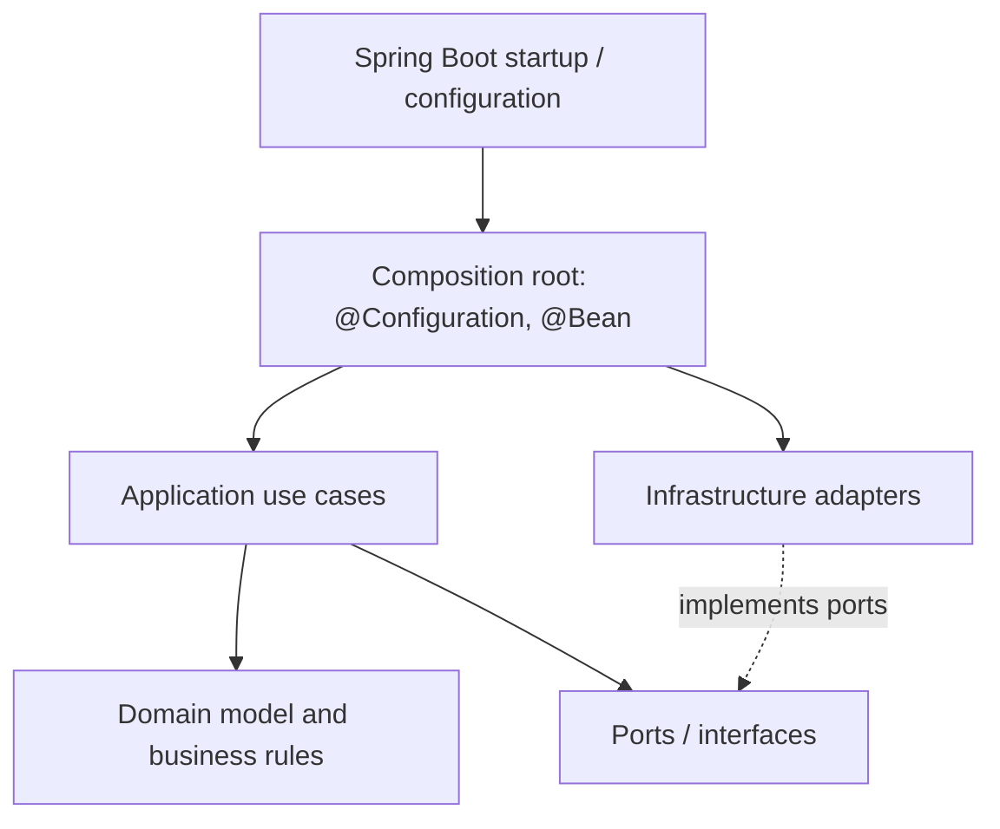
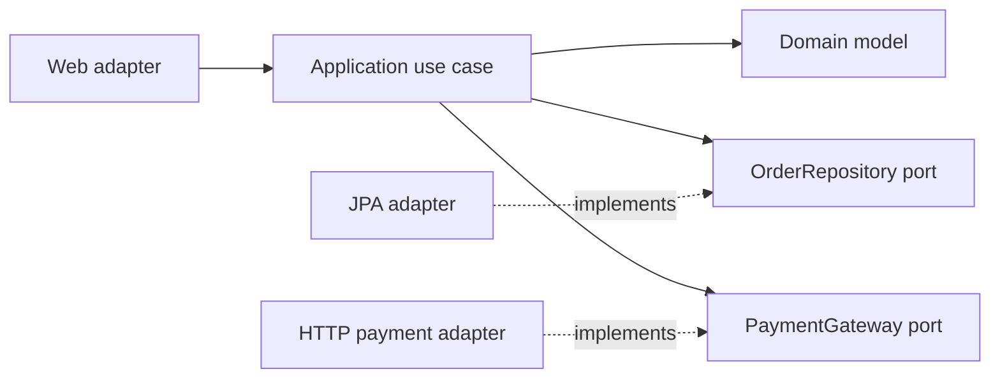
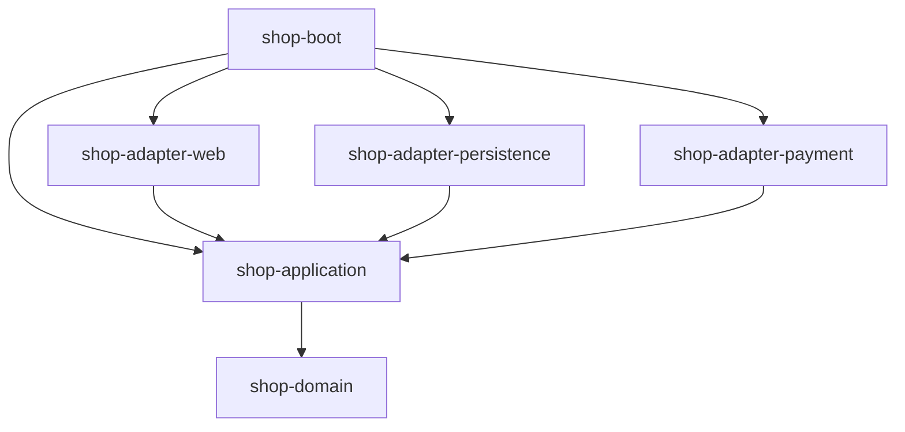

# Tách quy tắc nghiệp vụ khỏi cơ chế khởi tạo và cấu hình Spring

> **Spring Boot Fundamentals · Thiết kế ứng dụng**  
> Spring Boot cung cấp dependency injection, component scanning, auto-configuration, transaction management và nhiều cơ chế giúp ứng dụng khởi động nhanh. Nhưng những tiện ích đó không nên quyết định cách một quy tắc nghiệp vụ hoạt động. Một chính sách tính giá, điều kiện chấp nhận đơn hàng hoặc giới hạn số lượng cần có thể hiểu, kiểm thử và tái sử dụng mà không phải khởi động Spring ApplicationContext. **Tách quy tắc nghiệp vụ khỏi cơ chế khởi tạo và cấu hình Spring** giúp domain logic ổn định, dễ kiểm thử và ít bị ràng buộc vào framework; Spring vẫn làm tốt vai trò lắp ghép các object và cung cấp adapter ở ranh giới ứng dụng.

## 1. Vấn đề: business rule bị trộn với Spring infrastructure

Hãy xem một service xử lý đơn hàng:

```java
@Service
public class OrderService {

    @Autowired
    private OrderRepository repository;

    @Value("\${app.order.max-items:20}")
    private int maxItems;

    public Order place(OrderRequest request) {
        if (request.items().size() > maxItems) {
            throw new IllegalArgumentException(
                    "Too many items");
        }

        Order order = new Order(request.items());
        return repository.save(order);
    }
}
```

Đoạn code này có thể chạy, nhưng nhiều trách nhiệm đang nằm trong cùng một class:

- Quy tắc số lượng mặt hàng tối đa.
- Đọc cấu hình từ Spring Environment.
- Dependency injection.
- Tạo object domain.
- Gọi persistence repository.
- Có thể còn thêm transaction, logging hoặc gửi event trong các phiên bản tiếp theo.

Khi quy tắc nghiệp vụ phụ thuộc trực tiếp vào `@Value`, `@Autowired` hoặc Spring context, muốn test một điều kiện đơn giản cũng có thể phải dựng Spring. Khi đổi framework hoặc dùng cùng logic trong batch/CLI, code nghiệp vụ bị kéo theo cơ chế khởi tạo của ứng dụng.

Một cách thiết kế rõ ràng hơn là:



Spring tạo và kết nối object ở composition root. Quy tắc nghiệp vụ nằm trong domain/application model và được gọi thông qua các dependency rõ ràng.

### 1.1. Phân biệt business rule với framework concern

| Loại trách nhiệm | Ví dụ | Nơi phù hợp |
| --- | --- | --- |
| Quy tắc nghiệp vụ | Đơn hàng phải có ít nhất một dòng hàng | Domain model |
| Chính sách nghiệp vụ | Khách VIP được giảm giá theo điều kiện | Domain policy/service |
| Điều phối use case | Tải đơn hàng, áp dụng policy, lưu kết quả | Application service |
| Khởi tạo object graph | Chọn implementation của repository | Spring configuration |
| Đọc cấu hình triển khai | Database URL, endpoint, timeout | Configuration/properties |
| Giao tiếp database | SQL, JPA, mapping persistence | Infrastructure adapter |
| HTTP request mapping | URL, query parameter, response | Web adapter/controller |
| Quản lý transaction | Begin/commit/rollback | Application boundary/infrastructure |

Không phải mọi class có annotation Spring đều sai. Một application service dùng `@Service` hoặc `@Transactional` có thể là lựa chọn thực dụng. Mục tiêu là bảo đảm **quy tắc nghiệp vụ cốt lõi không cần Spring để tồn tại và được kiểm thử**.

## 2. Tách theo trách nhiệm, không chỉ tách theo package

Một cấu trúc tham khảo:

```text
src/main/java/com/example/shop/
├── domain/
│   ├── order/
│   │   ├── Order.java
│   │   ├── OrderLine.java
│   │   ├── OrderId.java
│   │   └── OrderPricingPolicy.java
│   └── customer/
│       └── Customer.java
├── application/
│   ├── order/
│   │   ├── PlaceOrderUseCase.java
│   │   ├── PlaceOrderService.java
│   │   └── PlaceOrderCommand.java
│   └── port/
│       ├── OrderRepository.java
│       └── PaymentGateway.java
├── adapter/
│   ├── in/
│   │   └── web/OrderController.java
│   └── out/
│       ├── persistence/JpaOrderRepository.java
│       └── payment/HttpPaymentGateway.java
└── config/
    ├── OrderConfiguration.java
    └── PaymentProperties.java
```

Đây là một cách tổ chức theo domain/application/adapter/configuration. Dự án nhỏ có thể dùng package ít tầng hơn; dự án lớn có thể tổ chức theo feature/module. Điều quan trọng là **dependency direction**: domain không gọi ngược Spring, controller hoặc database adapter.

### 2.1. Domain layer

Domain chứa mô hình và quy tắc diễn đạt nghiệp vụ:

- Entity và value object.
- Invariant của object.
- Domain service/policy khi quy tắc không thuộc tự nhiên một entity.
- Domain event nếu nghiệp vụ cần mô tả sự kiện đã xảy ra.

Domain không nên đọc Environment, mở database connection, nhận HTTP request hoặc tạo Spring bean.

### 2.2. Application layer

Application layer diễn đạt use case: ai gọi, cần dữ liệu gì, phối hợp domain object nào, cần lưu hoặc gọi port nào.

Ví dụ use case “đặt đơn hàng” có thể:

1. Nhận command đã được chuẩn hóa.
2. Tải thông tin khách hàng.
3. Tạo aggregate đơn hàng.
4. Áp dụng pricing policy.
5. Lưu đơn hàng.
6. Gọi payment port nếu nghiệp vụ yêu cầu.
7. Trả kết quả cho adapter gọi nó.

Application layer điều phối, còn quyết định nghiệp vụ quan trọng nên được đặt trong domain object/policy thích hợp.

### 2.3. Adapter/infrastructure layer

Adapter chuyển đổi giữa contract của ứng dụng và hệ thống bên ngoài:

- REST controller chuyển HTTP request thành command.
- JPA adapter triển khai repository port.
- HTTP client adapter triển khai payment port.
- Message listener chuyển message thành use case command.
- Spring configuration tạo các adapter và kết nối chúng.

Adapter có thể phụ thuộc Spring, Jackson, JPA, HTTP client hoặc message broker. Domain không cần biết những chi tiết đó.

### 2.4. Composition root

Composition root là nơi object graph được lắp ghép. Trong Spring Boot, đây thường là application configuration, component scanning và các `@Bean` methods.

Composition root quyết định:

- Dùng implementation nào cho từng interface.
- Lấy cấu hình từ đâu.
- Adapter nào được bật theo profile/condition.
- Bean nào có lifecycle do Spring quản lý.
- Những dependency nào được inject vào application service.

Đây là nơi framework nên tập trung xuất hiện.

## 3. Viết quy tắc nghiệp vụ thành Java code độc lập

Ví dụ: một đơn hàng có nhiều dòng hàng, mỗi dòng có đơn giá và số lượng. Quy tắc là:

- Số lượng phải dương.
- Đơn giá không âm.
- Đơn hàng phải có ít nhất một dòng.
- Tổng tiền được tính từ các dòng hàng.
- Đơn hàng không thể được xác nhận nếu tổng tiền bằng 0.

### 3.1. Value object Money

```java
package com.example.shop.domain.order;

import java.math.BigDecimal;
import java.math.RoundingMode;
import java.util.Objects;

public record Money(BigDecimal amount) {

    public Money {
        Objects.requireNonNull(amount, "amount must not be null");

        amount = amount.setScale(2, RoundingMode.HALF_UP);

        if (amount.signum() < 0) {
            throw new IllegalArgumentException(
                    "Money must not be negative");
        }
    }

    public static Money zero() {
        return new Money(BigDecimal.ZERO);
    }

    public Money add(Money other) {
        return new Money(amount.add(other.amount));
    }

    public Money multiply(int quantity) {
        if (quantity < 0) {
            throw new IllegalArgumentException(
                    "Quantity must not be negative");
        }

        return new Money(
                amount.multiply(BigDecimal.valueOf(quantity)));
    }

    public boolean isPositive() {
        return amount.signum() > 0;
    }
}
```

`Money` không có `@Component`, `@ConfigurationProperties` hoặc `@Autowired`. Nó là value object Java thuần, bảo vệ invariant của chính nó.

Trong hệ thống đa tiền tệ, value object thường cần thêm currency code và quy tắc cộng/trừ chỉ cho phép cùng currency. Ví dụ rút gọn này giả định một loại tiền tệ và scale hai chữ số.

### 3.2. OrderLine

```java
package com.example.shop.domain.order;

import java.util.Objects;

public record OrderLine(
        String productId,
        Money unitPrice,
        int quantity) {

    public OrderLine {
        if (productId == null || productId.isBlank()) {
            throw new IllegalArgumentException(
                    "productId is required");
        }

        Objects.requireNonNull(unitPrice, "unitPrice");

        if (quantity <= 0) {
            throw new IllegalArgumentException(
                    "quantity must be positive");
        }
    }

    public Money subtotal() {
        return unitPrice.multiply(quantity);
    }
}
```

Quy tắc số lượng dương được bảo vệ ngay khi tạo `OrderLine`. Controller, batch job hoặc message consumer đều không thể tạo một dòng hàng không hợp lệ qua constructor này.

### 3.3. Order aggregate

```java
package com.example.shop.domain.order;

import java.util.List;
import java.util.Objects;

public final class Order {

    private final String id;
    private final List<OrderLine> lines;
    private final Money total;

    private Order(
            String id,
            List<OrderLine> lines,
            Money total) {
        this.id = id;
        this.lines = List.copyOf(lines);
        this.total = total;
    }

    public static Order create(
            String id,
            List<OrderLine> lines) {

        if (id == null || id.isBlank()) {
            throw new IllegalArgumentException(
                    "Order id is required");
        }

        Objects.requireNonNull(lines, "lines");

        if (lines.isEmpty()) {
            throw new IllegalArgumentException(
                    "Order must contain at least one line");
        }

        Money total = lines.stream()
                .map(OrderLine::subtotal)
                .reduce(Money.zero(), Money::add);

        if (!total.isPositive()) {
            throw new IllegalArgumentException(
                    "Order total must be positive");
        }

        return new Order(id, lines, total);
    }

    public String id() {
        return id;
    }

    public List<OrderLine> lines() {
        return lines;
    }

    public Money total() {
        return total;
    }
}
```

Aggregate tự đảm bảo invariant. Không có repository, transaction hoặc Spring bean nào được gọi trong `Order.create`.

### 3.4. Vì sao không đặt quy tắc vào controller?

Nếu controller kiểm tra `quantity > 0` rồi gọi service, một batch job hoặc message consumer có thể gọi service trực tiếp mà bỏ qua validation đó.

Quy tắc cốt lõi phải được bảo vệ ở domain boundary, nơi mọi adapter đều phải đi qua. Controller vẫn có thể kiểm tra request format và trả HTTP 400 thân thiện, nhưng không phải nơi duy nhất bảo vệ invariant.

## 4. Domain policy và application service khác nhau

Một số quy tắc có thể thuộc entity/value object. Một số quy tắc phối hợp nhiều domain object hoặc phụ thuộc chính sách thay đổi theo nghiệp vụ.

Ví dụ giảm giá theo nhóm khách hàng:

```java
package com.example.shop.domain.order;

public interface DiscountPolicy {

    Money discountFor(
            CustomerTier tier,
            Money subtotal);
}
```

Implementation thuần Java:

```java
package com.example.shop.domain.order;

public final class StandardDiscountPolicy
        implements DiscountPolicy {

    @Override
    public Money discountFor(
            CustomerTier tier,
            Money subtotal) {

        return switch (tier) {
            case REGULAR -> Money.zero();
            case SILVER -> new Money(
                    subtotal.amount().multiply(
                            new java.math.BigDecimal("0.05")));
            case GOLD -> new Money(
                    subtotal.amount().multiply(
                            new java.math.BigDecimal("0.10")));
        };
    }
}
```

Enum:

```java
public enum CustomerTier {
    REGULAR,
    SILVER,
    GOLD
}
```

Policy diễn đạt quy tắc giảm giá mà không biết Spring, database hay HTTP. Nếu mức giảm thay đổi theo hợp đồng khách hàng hoặc thời điểm, có thể biểu diễn policy bằng domain object khác hoặc dữ liệu đầu vào rõ ràng.

### 4.1. Application service không nên trở thành nơi chứa toàn bộ domain logic

Ví dụ application service:

```java
public final class PlaceOrderService
        implements PlaceOrderUseCase {

    private final OrderRepository orders;
    private final CustomerRepository customers;
    private final DiscountPolicy discountPolicy;
    private final OrderIdGenerator ids;

    public PlaceOrderService(
            OrderRepository orders,
            CustomerRepository customers,
            DiscountPolicy discountPolicy,
            OrderIdGenerator ids) {
        this.orders = orders;
        this.customers = customers;
        this.discountPolicy = discountPolicy;
        this.ids = ids;
    }

    @Override
    public OrderResult place(PlaceOrderCommand command) {
        Customer customer = customers
                .findById(command.customerId())
                .orElseThrow(CustomerNotFoundException::new);

        List<OrderLine> lines = command.items().stream()
                .map(item -> new OrderLine(
                        item.productId(),
                        item.unitPrice(),
                        item.quantity()))
                .toList();

        Order order = Order.create(ids.nextId(), lines);

        Money discount = discountPolicy.discountFor(
                customer.tier(),
                order.total());

        OrderResult result = OrderResult.from(
                order,
                discount);

        orders.save(order);

        return result;
    }
}
```

Đây là ví dụ minh họa về orchestration. Một hệ thống thực tế có thể tính discount trong aggregate hoặc tạo domain service trả về một order đã có discounted total. Điểm quan trọng là application service phối hợp các dependency, không tự nhúng mọi invariant và công thức nghiệp vụ vào một method dài.

### 4.2. Quy tắc ở domain, workflow ở application

| Câu hỏi | Nơi trả lời |
| --- | --- |
| Số lượng dòng hàng có được âm không? | OrderLine/domain |
| Đơn hàng rỗng có hợp lệ không? | Order/domain |
| Khách hàng hạng Gold được giảm bao nhiêu? | DiscountPolicy/domain |
| Cần tải customer trước khi tạo order không? | Application use case |
| Kết quả order lưu ở đâu? | Repository port + adapter |
| Dùng PostgreSQL hay in-memory repository? | Spring configuration |
| Request HTTP nào gọi use case? | Web adapter |

Không có một ranh giới cứng cho mọi dự án. Hãy đặt rule ở nơi có thể diễn đạt rõ nhất và bảo vệ invariant cho mọi caller.

## 5. Định nghĩa port để domain/application không phụ thuộc adapter

Application service cần lưu đơn hàng. Nếu nó import Spring Data JPA repository hoặc gọi trực tiếp một class JDBC, application layer phụ thuộc persistence technology.

Thay vào đó, định nghĩa interface ở phía application/domain:

```java
package com.example.shop.application.port;

import java.util.Optional;
import com.example.shop.domain.order.Order;

public interface OrderRepository {

    Order save(Order order);

    Optional<Order> findById(String id);
}
```

Payment gateway:

```java
package com.example.shop.application.port;

public interface PaymentGateway {

    PaymentResult charge(PaymentCommand command);
}
```

Đây là các **outbound ports**. Chúng mô tả khả năng ứng dụng cần từ bên ngoài, không mô tả cách adapter thực hiện.

### 5.1. Dependency direction



Adapter phụ thuộc port để triển khai nó. Application không import implementation cụ thể.

### 5.2. Vì sao gọi là ports and adapters?

Port là contract mà core application cần hoặc cung cấp. Adapter chuyển đổi giao thức bên ngoài thành contract đó.

Ví dụ:

- HTTP controller là inbound adapter cho use case.
- CLI command là một inbound adapter khác.
- JPA repository implementation là outbound adapter.
- HTTP payment client là outbound adapter.
- Message listener là inbound adapter.

Cùng một use case có thể được gọi từ REST, scheduler hoặc message consumer mà không cần viết lại quy tắc domain.

### 5.3. Port không phải một interface cho mọi class

Không cần tạo interface cho từng object hoặc từng method chỉ vì đang dùng hexagonal architecture. Hãy tạo port ở ranh giới có khả năng thay đổi hoặc cần tách khỏi technology:

- Persistence.
- Payment provider.
- Clock/time source nếu logic phụ thuộc thời gian và cần kiểm thử.
- File storage.
- Message publisher.
- External identity/authorization provider.

Một helper thuần Java không có lý do thay đổi độc lập có thể là class cụ thể.

## 6. Spring làm composition root bằng constructor injection

Khi core/application đã có constructor rõ ràng, Spring có thể lắp ghép chúng ở tầng configuration.

### 6.1. Tạo adapter

Ví dụ JPA adapter:

```java
@Repository
public class JpaOrderRepositoryAdapter
        implements OrderRepository {

    private final SpringDataOrderJpaRepository jpa;

    public JpaOrderRepositoryAdapter(
            SpringDataOrderJpaRepository jpa) {
        this.jpa = jpa;
    }

    @Override
    public Order save(Order order) {
        OrderEntity entity = OrderEntity.fromDomain(order);
        OrderEntity saved = jpa.save(entity);
        return saved.toDomain();
    }

    @Override
    public Optional<Order> findById(String id) {
        return jpa.findById(id).map(OrderEntity::toDomain);
    }
}
```

Các class `SpringDataOrderJpaRepository` và `OrderEntity` là persistence-specific, thuộc adapter/infrastructure. Domain `Order` không cần implement `JpaRepository` hay chứa annotation JPA trong ví dụ này.

### 6.2. Lắp ghép application service

Có thể dùng component scanning:

```java
@Service
public class PlaceOrderService
        implements PlaceOrderUseCase {
    // Constructor injection như ví dụ trước.
}
```

Spring phát hiện class và inject các bean triển khai port. Đây là cách thực dụng; application service vẫn có thể phụ thuộc Spring annotation, nhưng **class không cần Spring để thực hiện business rule nếu được tạo bằng constructor**.

Nếu muốn application module hoàn toàn độc lập Spring, có thể không gắn `@Service` và đăng ký bằng `@Bean`:

```java
@Configuration(proxyBeanMethods = false)
public class OrderApplicationConfiguration {

    @Bean
    PlaceOrderUseCase placeOrderUseCase(
            OrderRepository orders,
            CustomerRepository customers,
            DiscountPolicy discountPolicy,
            OrderIdGenerator ids) {

        return new PlaceOrderService(
                orders,
                customers,
                discountPolicy,
                ids);
    }
}
```

Cả hai cách đều hợp lệ. Điểm khác nhau là Spring dependency nằm trực tiếp trong application class hay chỉ ở composition root.

### 6.3. Chọn một cách nhất quán

- Với ứng dụng Spring Boot thông thường, `@Service` + constructor injection là dễ đọc và phổ biến.
- Với core/application module cần tái sử dụng ngoài Spring, dùng class thuần Java và lắp ghép bằng `@Configuration`/`@Bean`.
- Với nhiều implementation có điều kiện, configuration có thể chọn adapter theo profile/property.
- Tránh vừa scan một class vừa khai báo thêm `@Bean` tạo một instance khác cùng type nếu không có chủ đích.

## 7. Constructor injection làm dependency hiển thị rõ

Field injection:

```java
@Service
public class CheckoutService {

    @Autowired
    private OrderRepository orders;

    @Autowired
    private PaymentGateway payments;
}
```

Constructor injection:

```java
public final class CheckoutService {

    private final OrderRepository orders;
    private final PaymentGateway payments;

    public CheckoutService(
            OrderRepository orders,
            PaymentGateway payments) {
        this.orders = orders;
        this.payments = payments;
    }
}
```

Constructor injection có lợi ích:

1. Dependencies hiện rõ trong API tạo object.
2. Field có thể là final.
3. Unit test có thể tạo instance trực tiếp.
4. Object không thể tồn tại ở trạng thái thiếu dependency bắt buộc.
5. Không cần Spring reflection để gán field trong unit test.
6. Circular dependency thường được phát hiện sớm hơn.

### 7.1. Tạo object thuần Java trong unit test

```java
OrderRepository repository = new InMemoryOrderRepository();
CustomerRepository customers = new InMemoryCustomerRepository();
DiscountPolicy discounts = new StandardDiscountPolicy();
OrderIdGenerator ids = new FixedOrderIdGenerator("O-100");

PlaceOrderService service = new PlaceOrderService(
        repository,
        customers,
        discounts,
        ids);
```

Test không cần `@SpringBootTest`, không cần ApplicationContext, không cần khởi động server. Đây là bằng chứng tốt rằng application service có dependency rõ và core behavior có thể chạy độc lập.

### 7.2. Dependency bắt buộc và dependency tùy chọn

Constructor nên biểu diễn dependency bắt buộc. Nếu một collaborator thực sự optional, hãy diễn đạt bằng type/API rõ ràng như `Optional<T>` hoặc policy object mặc định, thay vì để field null và kiểm tra rải rác.

Không dùng `@Autowired(required=false)` để che việc dependency bắt buộc bị thiếu.

## 8. Cấu hình Spring không phải business rule

Một ứng dụng có thể cần các property:

```yaml
shop:
  order:
    max-lines: 20
    cancellation-window: 24h
  payment:
    endpoint: https://payments.example.test
    connect-timeout: 2s
```

Những giá trị này thuộc các loại khác nhau:

- `payment.endpoint` và `connect-timeout` chủ yếu là operational/integration configuration.
- `order.max-lines` có thể là policy nghiệp vụ nếu doanh nghiệp quyết định giới hạn đó.
- `order.cancellation-window` thường là business policy, dù giá trị có thể được quản lý theo môi trường.

Không phải mọi giá trị trong YAML đều là business rule. Hãy xác định **ai sở hữu quyết định** và nó có thể thay đổi theo môi trường hay theo nghiệp vụ.

### 8.1. Properties object ở ranh giới Spring

```java
@ConfigurationProperties(prefix = "shop.payment")
@Validated
public record PaymentProperties(
        @NotNull URI endpoint,
        @NotNull Duration connectTimeout) {
}
```

Properties object này mô tả cấu hình adapter payment. Nó có thể dùng Spring Boot Binder và Bean Validation. Domain không cần nhận `PaymentProperties` trực tiếp; adapter hoặc configuration có thể chuyển nó thành object cấu hình thuần phù hợp.

Ví dụ:

```java
public record PaymentClientSettings(
        URI endpoint,
        Duration connectTimeout) {
}
```

Mapper:

```java
static PaymentClientSettings toSettings(
        PaymentProperties properties) {

    return new PaymentClientSettings(
            properties.endpoint(),
            properties.connectTimeout());
}
```

Việc tách này hữu ích nếu bạn muốn infrastructure core không phụ thuộc annotation Boot. Với ứng dụng nhỏ, có thể dùng thẳng properties object ở adapter; không cần tạo lớp chuyển đổi nếu nó không mang lại ranh giới thực sự.

### 8.2. Không inject Environment vào domain

Ví dụ không nên:

```java
public final class Order {

    public Money total() {
        String discount =
                System.getenv("ORDER_DISCOUNT");
        // Business rule đọc trực tiếp process environment.
    }
}
```

Kết quả nghiệp vụ lúc này phụ thuộc biến môi trường toàn cục và khó tái lập trong unit test. Thay vào đó, truyền policy/giá trị rõ ràng:

```java
public Money total(DiscountPolicy policy, CustomerTier tier) {
    // Dùng policy được cung cấp từ bên ngoài.
}
```

Hoặc giữ policy trong domain service được tạo với dependency rõ ràng. Domain không nên tự tra cứu configuration source.

### 8.3. Không dùng profile để định nghĩa rule nghiệp vụ cốt lõi một cách âm thầm

Ví dụ `@Profile("premium")` để thay một cách tính giá có thể khiến business behavior đổi theo active profile mà caller không biết. Profile thường phù hợp để chọn infrastructure adapter hoặc operational implementation.

Nếu policy giá thực sự khác theo loại khách hàng, sản phẩm, hợp đồng hoặc thời điểm, hãy biểu diễn những yếu tố đó trong domain input/policy và kiểm thử rõ ràng.

## 9. Tách operational configuration và business policy

Một số cấu hình có thể được điều chỉnh theo môi trường, nhưng một số là quyết định của doanh nghiệp.

| Giá trị | Câu hỏi cần đặt | Hướng thiết kế |
| --- | --- | --- |
| Database URL | Môi trường chạy ở đâu? | External configuration |
| HTTP connect timeout | Adapter chờ bao lâu? | Infrastructure properties |
| Retry count cho gọi payment | Reliability policy hay contract nghiệp vụ? | Xác định ownership; thường thuộc adapter/application policy |
| Số item tối đa trong đơn | Quy tắc sản phẩm hay giới hạn kỹ thuật? | Domain policy nếu là giới hạn nghiệp vụ |
| VAT/tax rate | Do luật/chính sách tại thời điểm nào quyết định? | Domain policy/data có version và effective date |
| Context path | App được route thế nào? | Web/deployment configuration |
| Giá giảm cho khách VIP | Business decision | Domain policy |
| Batch page size | Tuning vận hành | Infrastructure/application configuration |
| Thời gian giữ đơn chưa thanh toán | Quy tắc vòng đời đơn | Domain/application policy có clock |
| Feature flag rollout | Chính sách rollout hay business eligibility? | Tách rollout mechanism khỏi rule quyết định quyền lợi |

### 9.1. Khi business policy cần cấu hình động

Có trường hợp doanh nghiệp muốn quản lý ngưỡng hoặc bảng giá từ external config/DB. Điều đó không có nghĩa domain nên đọc Spring Environment trực tiếp.

Một cách thiết kế:

1. Adapter/configuration đọc và validate nguồn dữ liệu.
2. Chuyển thành policy object có kiểu.
3. Application service hoặc domain service nhận policy qua constructor/parameter.
4. Domain thực thi rule từ policy đó.
5. Test truyền policy fixture cụ thể để tái lập hành vi.

Ví dụ:

```java
public record OrderPolicy(
        int maximumLines,
        Duration cancellationWindow) {

    public OrderPolicy {
        if (maximumLines < 1) {
            throw new IllegalArgumentException(
                    "maximumLines must be positive");
        }
        if (cancellationWindow.isNegative()
                || cancellationWindow.isZero()) {
            throw new IllegalArgumentException(
                    "cancellationWindow must be positive");
        }
    }
}
```

Policy là object thuần Java. Nó có thể được tạo từ YAML, database hoặc remote configuration, nhưng domain chỉ nhìn thấy contract đã được kiểm tra.

### 9.2. Policy thay đổi theo thời gian

Với quy tắc như VAT hoặc giá hợp đồng, chỉ truyền một con số hiện tại có thể chưa đủ. Có thể cần:

- Effective-from/effective-to.
- Version hoặc policy ID.
- Region/currency/customer segment.
- Audit trail.
- Quy tắc xử lý đơn đã tạo trước khi policy đổi.

Đây là vấn đề mô hình nghiệp vụ. Không nên để một lần refresh Spring property âm thầm thay đổi cách tính cho dữ liệu lịch sử nếu yêu cầu nghiệp vụ cần reproducibility.

## 10. Transaction boundary và mức độ phụ thuộc Spring

Transaction là một ví dụ cần cân bằng. Có thể dùng `@Transactional` ở application service, nhưng domain model không cần biết transaction manager.

### 10.1. Cách thực dụng: annotation ở application service

```java
@Service
public class PlaceOrderService
        implements PlaceOrderUseCase {

    @Transactional
    public OrderResult place(PlaceOrderCommand command) {
        // Load, apply domain rules, save.
    }
}
```

Cách này đơn giản và phù hợp với nhiều ứng dụng Spring. Application service phụ thuộc Spring ở annotation, nhưng domain object vẫn thuần Java.

### 10.2. Cách tách hoàn toàn framework khỏi application core

Nếu application module phải độc lập framework, có thể định nghĩa port transaction/work unit hoặc dùng decorator ở adapter/composition layer.

Ví dụ contract đơn giản:

```java
public interface UnitOfWork {

    <T> T execute(Supplier<T> work);
}
```

Application service:

```java
public final class TransactionalPlaceOrderUseCase
        implements PlaceOrderUseCase {

    private final PlaceOrderUseCase delegate;
    private final UnitOfWork unitOfWork;

    public TransactionalPlaceOrderUseCase(
            PlaceOrderUseCase delegate,
            UnitOfWork unitOfWork) {
        this.delegate = delegate;
        this.unitOfWork = unitOfWork;
    }

    @Override
    public OrderResult place(PlaceOrderCommand command) {
        return unitOfWork.execute(
                () -> delegate.place(command));
    }
}
```

Adapter Spring:

```java
@Component
public class SpringUnitOfWork implements UnitOfWork {

    @Override
    @Transactional
    public <T> T execute(Supplier<T> work) {
        return work.get();
    }
}
```

Ví dụ này minh họa boundary; trong hệ thống thật cần quyết định transaction semantics, rollback rules, checked exception handling, propagation, isolation và cách decorator được proxy. Không tạo abstraction UnitOfWork chỉ để tránh một annotation nếu project không cần tính độc lập đó.

### 10.3. Không đặt transaction vào domain entity

Domain entity không nên tự inject transaction manager hoặc mở transaction khi gọi method. Entity mô tả trạng thái và hành vi nghiệp vụ; application/infrastructure điều khiển persistence lifecycle.

## 11. Event: domain event và Spring application event

Khi một đơn hàng được đặt thành công, ứng dụng có thể cần phát thông báo hoặc tạo shipment.

Có thể biểu diễn domain event thuần Java:

```java
public record OrderPlaced(
        String orderId,
        Instant occurredAt) {
}
```

Domain/application ghi nhận event:

```java
public final class Order {

    private final List<OrderPlaced> events =
            new ArrayList<>();

    public void markPlaced(Clock clock) {
        // Kiểm tra state transition trước.
        events.add(new OrderPlaced(id, clock.instant()));
    }
}
```

Domain event không cần implement Spring interface hoặc dùng `ApplicationEventPublisher`. Adapter/application infrastructure có thể chuyển event sang Spring event, message broker hoặc outbox record.

### 11.1. Spring event là adapter mechanism

Ví dụ publisher:

```java
@Component
public class SpringOrderEventPublisher {

    private final ApplicationEventPublisher publisher;

    public SpringOrderEventPublisher(
            ApplicationEventPublisher publisher) {
        this.publisher = publisher;
    }

    public void publish(OrderPlaced event) {
        publisher.publishEvent(event);
    }
}
```

Spring event hữu ích trong cùng ApplicationContext. Nếu cần đảm bảo event được phát sau khi transaction commit, có thể dùng `@TransactionalEventListener` ở adapter. Nếu cần delivery bền vững qua process restart, cần xem xét outbox/message broker thay vì chỉ dựa vào in-memory application event.

### 11.2. Không để domain gọi Spring event publisher trực tiếp

Nếu entity gọi `ApplicationEventPublisher`, domain phụ thuộc Spring context và khó test độc lập. Thay vào đó, domain phát ra event object hoặc trả về kết quả chứa event; application layer/adaptor quyết định cách publish.

## 12. Clock và nguồn thời gian: dependency cũng cần tường minh

Một quy tắc như “đơn có thể hủy trong 24 giờ” phụ thuộc thời điểm hiện tại. Nếu domain gọi trực tiếp `Instant.now()`, test phải dựa vào đồng hồ thực và dễ flaky.

Có thể truyền `Clock`:

```java
public final class OrderCancellationPolicy {

    private final Clock clock;
    private final Duration cancellationWindow;

    public OrderCancellationPolicy(
            Clock clock,
            Duration cancellationWindow) {
        this.clock = clock;
        this.cancellationWindow = cancellationWindow;
    }

    public boolean canCancel(OrderPlacedAt placedAt) {
        Instant deadline = placedAt.value()
                .plus(cancellationWindow);

        return clock.instant().isBefore(deadline);
    }
}
```

Trong Spring configuration:

```java
@Configuration(proxyBeanMethods = false)
public class TimeConfiguration {

    @Bean
    Clock applicationClock() {
        return Clock.systemUTC();
    }
}
```

Unit test có thể dùng fixed clock:

```java
Clock fixedClock = Clock.fixed(
        Instant.parse("2026-11-13T10:00:00Z"),
        ZoneOffset.UTC);
```

Như vậy quy tắc vẫn là Java thuần, nhưng thời gian hiện tại được cung cấp qua dependency có thể thay thế.

## 13. Validation ở HTTP boundary và invariant domain

Một ứng dụng có thể dùng Jakarta Bean Validation:

```java
public record CreateOrderRequest(
        @NotBlank String customerId,
        @NotEmpty List<@Valid OrderItemRequest> items) {
}
```

Controller:

```java
@PostMapping
public ResponseEntity<OrderResponse> create(
        @Valid @RequestBody CreateOrderRequest request) {
    // Convert request thành command rồi gọi use case.
}
```

Đây là validation đầu vào HTTP: request thiếu customerId hoặc list rỗng có thể bị từ chối trước khi use case chạy.

Nhưng domain vẫn cần invariant riêng. Một batch job hoặc message listener không đi qua controller, nên không thể dựa vào `@Valid` của HTTP để bảo vệ domain.

### 13.1. Hai tầng validation bổ trợ nhau

| Boundary validation | Domain invariant |
| --- | --- |
| Kiểm tra request có field bắt buộc | Kiểm tra aggregate có trạng thái hợp lệ |
| Kiểm tra format email/JSON | Kiểm tra quy tắc nghiệp vụ về email/khách hàng |
| Kiểm tra payload size | Kiểm tra số lượng/tổng giá trị theo policy |
| Trả lỗi HTTP 400 dễ hiểu | Bảo vệ mọi đường gọi use case |
| Phụ thuộc adapter/framework có thể dùng | Thuần Java và luôn được áp dụng khi tạo object đúng API |

Không cần lặp lại mọi validation hai lần. Hãy phân biệt lỗi định dạng/transport với invariant mà domain bắt buộc giữ.

## 14. Cấu hình nhiều implementation bằng Spring

Một ưu điểm của composition root là có thể chọn adapter mà không đổi domain.

### 14.1. Dùng profile để chọn adapter

```java
@Configuration(proxyBeanMethods = false)
@Profile("dev")
public class DevelopmentPaymentConfiguration {

    @Bean
    PaymentGateway paymentGateway() {
        return new FakePaymentGateway();
    }
}
```

```java
@Configuration(proxyBeanMethods = false)
@Profile("prod")
public class ProductionPaymentConfiguration {

    @Bean
    PaymentGateway paymentGateway(
            PaymentProperties properties,
            HttpClient httpClient) {

        return new HttpPaymentGateway(
                httpClient,
                properties.endpoint());
    }
}
```

Use case chỉ phụ thuộc `PaymentGateway`. Dev profile dùng fake, production profile dùng HTTP adapter.

### 14.2. Tránh trộn profile với quyền lợi khách hàng

Không nên viết:

```java
@Profile("gold")
@Service
class GoldCustomerDiscountService {
}
```

nếu “Gold” là phân khúc khách hàng trong domain chứ không phải môi trường triển khai. Profile Spring thường mô tả deployment/runtime configuration, ví dụ dev/test/prod; phân khúc khách hàng nên là domain data hoặc policy input.

### 14.3. Condition cho infrastructure optional

Có thể dùng `@ConditionalOnProperty` để bật một adapter hoặc integration:

```java
@Configuration(proxyBeanMethods = false)
@ConditionalOnProperty(
        prefix = "shop.notifications",
        name = "enabled",
        havingValue = "true")
class NotificationAdapterConfiguration {

    @Bean
    NotificationGateway notificationGateway(
            NotificationProperties properties) {
        return new HttpNotificationGateway(properties.endpoint());
    }
}
```

Condition thuộc Spring configuration. Domain không nên kiểm tra `shop.notifications.enabled` bằng Environment ở mọi lần gửi; application nên được cung cấp một dependency hoặc policy có hành vi rõ ràng.

## 15. Kiểm thử business rule không cần Spring

Đây là lợi ích trực tiếp của việc tách domain.

### 15.1. Unit test value object

```java
class OrderLineTest {

    @Test
    void rejectsZeroQuantity() {
        assertThatThrownBy(() ->
                new OrderLine(
                        "P-1",
                        new Money(new BigDecimal("10.00")),
                        0))
                .isInstanceOf(IllegalArgumentException.class);
    }

    @Test
    void calculatesSubtotal() {
        OrderLine line = new OrderLine(
                "P-1",
                new Money(new BigDecimal("12.50")),
                3);

        assertThat(line.subtotal().amount())
                .isEqualByComparingTo("37.50");
    }
}
```

Không cần `@SpringBootTest`, database hoặc mock ApplicationContext.

### 15.2. Unit test aggregate invariant

```java
class OrderTest {

    @Test
    void rejectsEmptyOrder() {
        assertThatThrownBy(() ->
                Order.create("O-1", List.of()))
                .isInstanceOf(IllegalArgumentException.class);
    }

    @Test
    void calculatesOrderTotal() {
        List<OrderLine> lines = List.of(
                new OrderLine(
                        "P-1",
                        new Money(new BigDecimal("10.00")),
                        2),
                new OrderLine(
                        "P-2",
                        new Money(new BigDecimal("5.50")),
                        1));

        Order order = Order.create("O-1", lines);

        assertThat(order.total().amount())
                .isEqualByComparingTo("25.50");
    }
}
```

Test chỉ tạo object và assert rule. Nếu test cần khởi động Spring để kiểm tra tổng tiền, có thể business logic đang bị phụ thuộc quá nhiều vào framework hoặc test đang nhắm sai tầng.

### 15.3. Unit test application service bằng fake

```java
final class InMemoryOrderRepository
        implements OrderRepository {

    private final Map<String, Order> data =
            new HashMap<>();

    @Override
    public Order save(Order order) {
        data.put(order.id(), order);
        return order;
    }

    @Override
    public Optional<Order> findById(String id) {
        return Optional.ofNullable(data.get(id));
    }
}
```

Test:

```java
class PlaceOrderServiceTest {

    @Test
    void savesCreatedOrder() {
        OrderRepository orders =
                new InMemoryOrderRepository();

        CustomerRepository customers =
                new InMemoryCustomerRepository(
                        Customer.regular("C-1"));

        PlaceOrderService service =
                new PlaceOrderService(
                        orders,
                        customers,
                        new StandardDiscountPolicy(),
                        () -> "O-100");

        OrderResult result = service.place(
                new PlaceOrderCommand(
                        "C-1",
                        List.of(new OrderItemCommand(
                                "P-1",
                                new Money(new BigDecimal("20.00")),
                                2))));

        assertThat(result.orderId()).isEqualTo("O-100");
        assertThat(orders.findById("O-100")).isPresent();
    }
}
```

Các domain command/result trong ví dụ cần được định nghĩa theo API của ứng dụng. Ý tưởng là application service có thể được tạo bằng constructor với fake dependencies.

### 15.4. Mock chỉ khi fake không cần thiết

Mockito có thể hữu ích khi muốn xác nhận một collaborator được gọi với command cụ thể. Nhưng fake repository có state thường dễ hiểu hơn nếu cần assert dữ liệu được lưu.

Không mock mọi object chỉ vì đang viết unit test. Hãy chọn test double đơn giản nhất giúp thể hiện hành vi mong đợi.

## 16. Kiểm thử Spring configuration riêng với business rule

Tách domain không có nghĩa bỏ integration test. Spring configuration vẫn cần được kiểm tra.

### 16.1. Context test kiểm tra composition root

```java
@SpringBootTest
class OrderConfigurationTest {

    @Autowired
    PlaceOrderUseCase placeOrderUseCase;

    @Autowired
    PaymentGateway paymentGateway;

    @Test
    void createsApplicationAndPaymentBeans() {
        assertThat(placeOrderUseCase).isNotNull();
        assertThat(paymentGateway).isNotNull();
    }
}
```

Test này kiểm tra Spring lắp ghép bean. Nó không cần kiểm tra toàn bộ pricing rules đã được test ở domain.

### 16.2. Test profile/condition

```java
@SpringBootTest(properties = {
        "shop.notifications.enabled=false"
})
class NotificationDisabledConfigurationTest {

    @Autowired
    ApplicationContext context;

    @Test
    void notificationAdapterIsNotCreated() {
        assertThat(context.getBeansOfType(
                NotificationGateway.class))
                .isEmpty();
    }
}
```

Ví dụ giả định condition thực sự loại bean trong cấu hình. Đây là test cho Spring configuration, không phải test nghiệp vụ gửi thông báo.

### 16.3. Integration test adapter thật với database test

Dùng Testcontainers hoặc database test phù hợp để kiểm tra JPA adapter mapping và persistence. Test này xác nhận port implementation tương tác đúng với database engine; domain unit test không thay thế nó.

Phân chia test theo câu hỏi:

- Domain: quy tắc đúng không?
- Application: use case phối hợp đúng không?
- Configuration: Spring lắp ghép đúng không?
- Adapter: giao tiếp technology đúng không?
- End-to-end: deployment và hệ thống tích hợp hoạt động không?

## 17. Tránh đưa cấu hình vào constructor domain như một túi property

Một anti-pattern là truyền cả Environment hoặc toàn bộ properties vào domain:

```java
public class OrderPolicy {

    private final Environment environment;

    public OrderPolicy(Environment environment) {
        this.environment = environment;
    }

    public boolean canPlace(Order order) {
        int max = environment.getProperty(
                "shop.order.max-lines",
                Integer.class,
                20);

        return order.lines().size() <= max;
    }
}
```

Domain đang biết Spring và tự quyết định cách lấy cấu hình. Nó cũng khó kiểm thử vì phụ thuộc một abstraction rộng hơn nhu cầu thật.

Thay bằng một policy object:

```java
public final class OrderPolicy {

    private final int maximumLines;

    public OrderPolicy(int maximumLines) {
        if (maximumLines < 1) {
            throw new IllegalArgumentException(
                    "maximumLines must be positive");
        }
        this.maximumLines = maximumLines;
    }

    public boolean canPlace(Order order) {
        return order.lines().size() <= maximumLines;
    }
}
```

Spring configuration đọc giá trị và tạo object:

```java
@Bean
OrderPolicy orderPolicy(OrderProperties properties) {
    return new OrderPolicy(properties.maximumLines());
}
```

Domain nhận đúng dependency cần thiết: số dòng tối đa đã được kiểm tra. Nó không biết giá trị đến từ YAML, environment variable, database hay một test fixture.

### 17.1. Không truyền một properties object khổng lồ

Nếu `ApplicationProperties` chứa hàng trăm field cho database, email, HTTP, feature flags, order policy và UI, truyền toàn bộ vào service/domain sẽ tạo coupling không cần thiết.

Tạo object nhỏ theo trách nhiệm:

- `OrderPolicy` cho domain.
- `PaymentClientSettings` cho payment adapter.
- `DatabaseProperties` cho persistence.
- `NotificationSettings` cho notification adapter.

Không cần tạo class mới cho mọi property; hãy tách khi có ranh giới và lifecycle khác nhau.

## 18. Tránh static access và Service Locator

Một cách khác để trộn Spring vào business logic là giữ static ApplicationContext:

```java
@Component
public class SpringContextHolder
        implements ApplicationContextAware {

    private static ApplicationContext context;

    @Override
    public void setApplicationContext(
            ApplicationContext applicationContext) {
        context = applicationContext;
    }

    public static <T> T getBean(Class<T> type) {
        return context.getBean(type);
    }
}
```

Sau đó domain/service gọi:

```java
public void placeOrder() {
    PaymentGateway gateway =
            SpringContextHolder.getBean(PaymentGateway.class);
}
```

Cách này che giấu dependency, làm object phụ thuộc global state và gây khó khăn khi chạy test song song hoặc tạo nhiều application contexts.

Constructor injection thể hiện dependency ngay tại nơi tạo object, giúp object graph có thể quan sát và kiểm soát.

### 18.1. Khi nào lookup động là hợp lý?

Một số hệ thống plugin hoặc chiến lược runtime thực sự cần registry/factory để chọn implementation theo key. Khi đó hãy định nghĩa interface registry/factory ở application boundary và inject nó tường minh.

Ví dụ:

```java
public interface PaymentGatewayRegistry {
    PaymentGateway forProvider(PaymentProvider provider);
}
```

Application vẫn phụ thuộc contract rõ ràng; implementation registry có thể dùng Spring map injection ở adapter layer.

Không dùng Service Locator như cách né constructor injection cho mọi dependency.

## 19. Không biến mọi class thành Spring bean

Một class không cần lifecycle, injection hoặc AOP có thể được tạo trực tiếp bởi object sở hữu nó.

Ví dụ value object:

```java
Money total = new Money(new BigDecimal("99.00"));
```

Không cần:

```java
@Component
public class MoneyFactory {
    // ...
}
```

cho mọi thao tác tạo value object đơn giản.

Dùng Spring bean cho những object có lifecycle/collaborator hoặc cần quản lý bởi container. Domain entity/value object thường là object dữ liệu/hành vi có vòng đời gắn với aggregate, không phải singleton service của ApplicationContext.

### 19.1. Bean scope cũng không phải business lifecycle

`@Singleton` (scope mặc định của Spring bean) nói về một instance trong một bean factory/context. Nó không có nghĩa object là một singleton nghiệp vụ toàn hệ thống hoặc tồn tại qua mọi process.

Một `Order` thường là instance theo từng aggregate/load/create operation, không phải singleton Spring bean.

### 19.2. Không đưa mutable entity vào singleton service

Service bean thường là singleton. Vì vậy, không lưu trạng thái đơn hàng hoặc request cụ thể trong field mutable của singleton service:

```java
@Service
public class BadOrderService {

    private Order currentOrder; // Không an toàn giữa requests.

    public void process(Order order) {
        this.currentOrder = order;
    }
}
```

Dữ liệu theo request/use case nên nằm trong local variable, command, domain object hoặc persistence. Singleton service nên giữ dependency bất biến và stateless behavior khi có thể.

## 20. Tổ chức module để giữ dependency direction

Khi dự án lớn, có thể tách thành module:

```text
shop/
├── shop-domain/
├── shop-application/
├── shop-adapter-web/
├── shop-adapter-persistence/
├── shop-adapter-payment/
└── shop-boot/
```

Một dependency direction tham khảo:



Module `shop-domain` không phụ thuộc Spring Boot, Spring Data, web framework hoặc database driver. Module `shop-application` có thể phụ thuộc domain và khai báo ports. Adapter implement ports. Module `shop-boot` là nơi assemble toàn bộ.

### 20.1. Không cần tách module quá sớm

Một project nhỏ có thể giữ các package trong một Maven/Gradle module. Tách package và dependency direction trước; khi có nhu cầu build/version/reuse độc lập, mới tách artifact.

Tách module làm tăng:

- Build configuration.
- Dependency management.
- Publication/version coordination.
- Test setup.
- Số lượng module cần hiểu.

Không nên tạo sáu module cho một CRUD app nhỏ nếu không có lợi ích thực tế.

### 20.2. Enforce dependency rule

Khi module đã tách, build tool có thể ngăn domain phụ thuộc vào Spring:

```groovy
// shop-domain/build.gradle
plugins {
    id 'java-library'
}

dependencies {
    // Chỉ dependency thuần Java cần thiết cho domain.
}
```

Nếu module domain không khai báo Spring dependency mà compile vẫn thành công, đó là một kiểm tra đơn giản cho tính độc lập. Có thể bổ sung architecture tests hoặc module dependency rules khi project cần enforce lâu dài.

### 20.3. Tránh vòng phụ thuộc giữa module

Không để:

```text
domain -> application -> adapter -> domain
```

Domain nên là phần lõi ít phụ thuộc nhất. Nếu domain cần khả năng truy cập dữ liệu, xem lại contract: có thực sự là domain cần gọi repository, hay application service nên điều phối việc tải aggregate trước khi gọi domain behavior?

## 21. Một use case hoàn chỉnh với Spring configuration

Ví dụ cấu trúc tổng hợp:

### 21.1. Inbound port

```java
public interface PlaceOrderUseCase {
    OrderResult place(PlaceOrderCommand command);
}
```

### 21.2. Application service

```java
public final class PlaceOrderService
        implements PlaceOrderUseCase {

    private final OrderRepository orders;
    private final CustomerRepository customers;
    private final OrderPolicy policy;
    private final OrderIdGenerator ids;

    public PlaceOrderService(
            OrderRepository orders,
            CustomerRepository customers,
            OrderPolicy policy,
            OrderIdGenerator ids) {
        this.orders = orders;
        this.customers = customers;
        this.policy = policy;
        this.ids = ids;
    }

    @Override
    public OrderResult place(PlaceOrderCommand command) {
        Customer customer = customers.findById(
                command.customerId())
                .orElseThrow(CustomerNotFoundException::new);

        List<OrderLine> lines = command.items().stream()
                .map(item -> new OrderLine(
                        item.productId(),
                        item.unitPrice(),
                        item.quantity()))
                .toList();

        Order order = Order.create(ids.nextId(), lines);
        policy.validate(order, customer);

        orders.save(order);

        return OrderResult.from(order);
    }
}
```

### 21.3. Spring configuration

```java
@Configuration(proxyBeanMethods = false)
@EnableConfigurationProperties(OrderProperties.class)
public class OrderModuleConfiguration {

    @Bean
    OrderPolicy orderPolicy(OrderProperties properties) {
        return new OrderPolicy(properties.maximumLines());
    }

    @Bean
    PlaceOrderUseCase placeOrderUseCase(
            OrderRepository orders,
            CustomerRepository customers,
            OrderPolicy policy,
            OrderIdGenerator ids) {

        return new PlaceOrderService(
                orders,
                customers,
                policy,
                ids);
    }
}
```

### 21.4. Web adapter

```java
@RestController
@RequestMapping("/api/orders")
public class OrderController {

    private final PlaceOrderUseCase placeOrder;

    public OrderController(PlaceOrderUseCase placeOrder) {
        this.placeOrder = placeOrder;
    }

    @PostMapping
    public OrderResponse place(
            @Valid @RequestBody CreateOrderRequest request) {

        OrderResult result = placeOrder.place(
                CreateOrderCommand.from(request));

        return OrderResponse.from(result);
    }
}
```

Controller biết HTTP và request/response mapping. Application use case biết command/result và port. Domain biết invariant. Spring configuration kết nối implementation. Không cần domain import `@RestController`, `@Bean` hoặc `Environment`.

## 22. Những tình huống thiết kế cần cân nhắc

### 22.1. Có nên đặt `@Transactional` trên application service?

Có thể. Nếu project chấp nhận Spring dependency ở application layer, đây là cách rõ và thực dụng. Nếu application core cần độc lập framework, có thể dùng decorator/port transaction.

Không có quy tắc bắt buộc phải loại toàn bộ annotation Spring khỏi mọi class. Cần giữ **domain model** độc lập và quyết định có chủ đích mức coupling ở application layer.

### 22.2. Có nên dùng Spring Data Repository trực tiếp trong service?

Với CRUD app đơn giản, inject một Spring Data repository vào service có thể hoàn toàn hợp lý. Khi domain/application cần độc lập persistence technology, tạo repository port và adapter riêng sẽ rõ hơn.

Chọn theo yêu cầu thay đổi, độ phức tạp domain, khả năng tái sử dụng và test. Không thêm abstraction chỉ để đạt một sơ đồ kiến trúc đẹp.

### 22.3. Có nên dùng JPA annotations trong domain entity?

Có hai hướng:

- **Persistence model và domain model tách riêng:** domain thuần Java; adapter mapping sang JPA entity.
- **Domain entity đồng thời là JPA entity:** giảm mapping boilerplate, phù hợp nhiều ứng dụng CRUD/domain vừa phải.

Hướng thứ hai tạo coupling tới Jakarta Persistence, nhưng không nhất thiết tạo coupling tới Spring. Cần phân biệt framework Spring với persistence specification. Nếu yêu cầu là domain không phụ thuộc bất kỳ persistence technology nào, dùng mapping riêng.

### 22.4. Có nên đưa validation annotation vào domain?

Bean Validation annotation có thể hữu ích trên DTO hoặc properties. Nhưng invariant quan trọng phải được bảo vệ bởi API tạo/thay đổi state của domain object, không chỉ bởi một framework validator được gọi ở một entry point.

Có thể dùng annotation ở DTO để báo lỗi input sớm, đồng thời dùng constructor/factory/domain method để bảo đảm trạng thái domain luôn hợp lệ.

### 22.5. Có nên đọc feature flag trong domain?

Domain không nên tự gọi một feature flag client toàn cục. Application/configuration có thể resolve flag và truyền policy/capability cần thiết vào use case.

Nếu flag thay đổi eligibility nghiệp vụ, hãy làm rõ semantics: flag có thực sự là một quy tắc business không, ai được quyền thay đổi, và việc thay đổi có ảnh hưởng các giao dịch đang diễn ra hay không.

## 23. Những anti-pattern cần tránh

| Anti-pattern | Hậu quả | Hướng xử lý |
| --- | --- | --- |
| Domain gọi `Environment.getProperty` | Business behavior phụ thuộc Spring/global config | Truyền policy/value có kiểu |
| Entity tự lấy bean từ ApplicationContext | Che dependency, khó test | Constructor/method parameters |
| Field injection ở core service | Khó tạo object thuần Java | Constructor injection |
| Controller chứa toàn bộ business rules | Các adapter khác có thể bỏ qua rule | Đưa invariant vào domain |
| Application service chứa mọi phép tính | Service phình to, domain model nghèo | Tách entity/value object/policy |
| JPA repository bị domain import trực tiếp | Domain phụ thuộc persistence | Port ở core, adapter triển khai |
| Static SpringContextHolder | Global state, lifecycle khó kiểm soát | Explicit dependency injection |
| Profile dùng để phân biệt khách VIP | Trộn deployment environment và business state | Domain type/policy |
| Tất cả config dồn vào một properties object | Coupling rộng, khó hiểu ownership | Config model theo trách nhiệm |
| Mọi class đều là `@Component` | Container trở thành cách tạo object duy nhất | Bean cho lifecycle/collaborator cần quản lý |
| Mock mọi dependency trong full-context test | Test context nặng nhưng không kiểm tra wiring thật | Unit test thuần hoặc mock đúng boundary |
| Business rule chỉ được kiểm tra bằng Bean Validation ở HTTP | Batch/message path có thể bỏ qua | Domain invariant |
| Transaction nằm trong entity | Domain phụ thuộc persistence lifecycle | Transaction ở application boundary |
| Domain publish Spring event trực tiếp | Domain phụ thuộc ApplicationContext | Domain event + adapter publisher |
| Dùng `@Lazy` để che mọi dependency cycle | Cycle vẫn tồn tại, lỗi bị trì hoãn | Thiết kế lại dependency graph |
| Tạo interface cho mọi class | Abstraction không có giá trị | Chỉ tạo port ở boundary có ý nghĩa |
| Tách quá nhiều module quá sớm | Build/maintenance phức tạp | Bắt đầu bằng package boundaries |

## 24. Quy trình refactor khi business rule đang nằm trong Spring service

Giả sử service hiện tại vừa đọc property, vừa truy cập repository, vừa tính giá và gửi payment.

### Bước 1 — Liệt kê các quyết định nghiệp vụ

Tìm các điều kiện và phép tính:

- Số lượng tối đa.
- Giá trị đơn hàng hợp lệ.
- Discount theo tier.
- Điều kiện chuyển trạng thái.
- Thời hạn hủy.
- Quy tắc refund.

Ghi lại input/output và invariant của từng quyết định.

### Bước 2 — Xác định nguồn dữ liệu

Phân biệt dữ liệu nào là domain input, dữ liệu nào đến từ hạ tầng:

- Customer tier là domain data.
- Current time có thể truyền qua Clock.
- Pricing policy có thể được tải từ config/repository.
- Database connection URL là infrastructure config.
- Payment endpoint là adapter config.

### Bước 3 — Tạo domain types

Tạo value objects/entities/policies thuần Java. Di chuyển invariant vào constructor/factory/domain method.

### Bước 4 — Định nghĩa use case và ports

Application service điều phối. Định nghĩa repository/external gateway interface ở phía application core khi cần tách technology.

### Bước 5 — Chuyển adapter

Di chuyển JPA, HTTP client, messaging, filesystem hoặc framework-specific code ra adapter layer.

### Bước 6 — Lắp ghép ở Spring configuration

Dùng component scan hoặc `@Bean` methods. Chuyển properties thành object có kiểu rồi inject vào adapter/policy phù hợp.

### Bước 7 — Viết unit tests cho domain

Test invariant và policy bằng Java thuần, không khởi tạo ApplicationContext.

### Bước 8 — Viết application service tests

Dùng fake repository/gateway để kiểm tra orchestration và kết quả use case.

### Bước 9 — Viết Spring integration test

Dùng `@SpringBootTest` ở một số điểm quan trọng để xác nhận composition root, profile, adapter và transaction infrastructure.

### Bước 10 — Xóa dependency thừa

Sau khi chuyển xong, loại Spring annotation/import khỏi domain package nếu chúng không còn cần thiết. Kiểm tra dependency graph module và tránh giữ một service cũ song song với use case mới.

Refactor từng boundary nhỏ và giữ behavior có test xác nhận. Không cần viết lại toàn bộ ứng dụng trong một lần.

## 25. Bài thực hành: tách business rules khỏi Spring

### Mục tiêu

Từ một `OrderService` có `@Autowired`, `@Value`, repository và công thức tính giá, tách thành domain/application/adapter/configuration.

### Bước 1 — Ghi nhận behavior hiện tại

Liệt kê:

- Input request.
- Các validation.
- Cách tính subtotal/discount/total.
- Những lần đọc database.
- External calls.
- Kết quả và lỗi trả về.

Tạo test hiện trạng cho các business outcomes quan trọng trước khi refactor.

### Bước 2 — Tạo Money và OrderLine

Viết value object Money và OrderLine thuần Java. Bảo vệ invariant giá không âm và quantity dương.

### Bước 3 — Tạo Order aggregate

Chuyển quy tắc đơn không rỗng, tổng tiền và state transition vào aggregate. Controller không còn là nơi duy nhất kiểm tra những điều kiện này.

### Bước 4 — Tạo OrderPolicy

Tạo policy nhận giới hạn tối đa hoặc discount rule bằng constructor. Test policy với nhiều input biên.

### Bước 5 — Định nghĩa ports

Tạo `OrderRepository` và `PaymentGateway` ở application layer. Không import Spring Data/JPA vào interface này.

### Bước 6 — Viết PlaceOrderUseCase

Application service nhận dependencies qua constructor, tải customer, tạo domain object, gọi policy và lưu order.

### Bước 7 — Viết adapter

Tạo JPA adapter triển khai `OrderRepository` và fake/HTTP adapter triển khai `PaymentGateway`.

### Bước 8 — Viết Spring configuration

Tạo `@ConfigurationProperties` cho operational values, sau đó dùng `@Bean`/component scanning để tạo policy, use case và adapter.

### Bước 9 — Kiểm thử không Spring

Viết unit test cho Money, OrderLine, Order và OrderPolicy. Test application service bằng fake repository/gateway.

### Bước 10 — Kiểm thử Spring context

Dùng `@SpringBootTest` để xác nhận:

- Use case bean được tạo.
- Repository port có implementation.
- Payment port có implementation theo profile.
- Configuration được bind.
- Conditional adapter được bật/tắt đúng.

### Bước 11 — Kiểm thử persistence adapter

Dùng database test để xác nhận mapping giữa domain order và JPA entity, save/find và transaction behavior.

### Bước 12 — Đánh giá dependency direction

Xác nhận domain package không import `org.springframework.*`, `org.springframework.boot.*`, `org.springframework.data.*` hoặc web controller packages nếu mục tiêu là domain thuần Java. Kiểm tra application core chỉ phụ thuộc domain và các port cần thiết.

### Câu hỏi tự kiểm tra

1. Vì sao business rule không nên phụ thuộc trực tiếp vào `Environment`?
2. Khác nhau giữa domain layer và application layer là gì?
3. Composition root có vai trò gì trong Spring Boot?
4. Constructor injection giúp kiểm thử domain/application như thế nào?
5. Khi nào nên tạo repository port thay vì inject Spring Data repository trực tiếp?
6. Controller validation khác domain invariant ở điểm nào?
7. Vì sao profile `prod`/`dev` không nên đại diện cho customer tier?
8. Khi business policy được lưu trong YAML, domain nên nhận nó qua cơ chế nào?
9. `@Transactional` trên application service có nhất thiết làm domain phụ thuộc Spring không?
10. Domain event khác Spring application event ra sao?
11. Vì sao Clock nên được inject khi rule phụ thuộc thời gian?
12. Khi nào JPA annotation trong domain có thể chấp nhận được?
13. Tại sao Service Locator làm dependency khó quan sát?
14. Khi nào fake repository phù hợp hơn Mockito mock?
15. Một `@SpringBootTest` nên kiểm tra phần nào sau khi domain đã có unit tests?
16. Khi nào tách module riêng mang lại lợi ích thực tế?
17. Tại sao không nên tạo interface cho mọi class?
18. Nếu một business rule chỉ chạy khi request đi qua controller, kiến trúc có vấn đề gì?
19. Làm thế nào để cấu hình chọn fake payment gateway trong test/dev và real gateway ở production?
20. Nếu policy thay đổi theo thời gian, cần quản lý version/effective date ra sao?

## 26. Bảng ghi nhớ nhanh

| Thành phần | Trách nhiệm |
| --- | --- |
| Domain entity/value object | Bảo vệ invariant và hành vi nghiệp vụ |
| Domain policy/service | Quy tắc cần phối hợp nhiều domain concept |
| Application use case | Điều phối workflow, gọi domain và ports |
| Port | Contract mà application cần hoặc cung cấp |
| Adapter | Chuyển đổi giữa port và technology bên ngoài |
| Spring configuration | Tạo object graph và chọn implementation |
| `@ConfigurationProperties` | Bind operational/config values thành object có kiểu |
| Constructor injection | Thể hiện dependency bắt buộc |
| `@Bean` | Đăng ký object do configuration tạo |
| `@Service` | Đăng ký application/service object qua component scanning |
| `@Transactional` | Đặt transaction boundary ở tầng phù hợp |
| Domain event | Mô tả sự kiện nghiệp vụ bằng type độc lập framework |
| Spring application event | Cơ chế truyền event trong ApplicationContext |
| Unit test thuần Java | Kiểm tra business rules nhanh và độc lập |
| `@SpringBootTest` | Kiểm tra Spring wiring/configuration/integration |
| Testcontainers | Kiểm tra adapter với infrastructure gần thực tế |
| Profile/condition | Chọn implementation theo deployment configuration |
| Clock | Cung cấp thời gian có thể thay thế khi test |
| Dependency direction | Adapter/framework phụ thuộc core contract; core không phụ thuộc adapter |

**Điểm cốt lõi:** Spring Boot nên đảm nhiệm việc khởi tạo, cấu hình và kết nối các object. Domain model và các quy tắc nghiệp vụ cần có thể tồn tại độc lập với ApplicationContext. Application layer điều phối use case thông qua dependency rõ ràng; adapter xử lý HTTP, database, messaging và dịch vụ bên ngoài; Spring configuration lắp ghép các thành phần đó. Khi tách đúng ranh giới, bạn có thể **kiểm thử quy tắc bằng Java thuần, kiểm tra wiring bằng Spring test và thay đổi technology ở ranh giới mà không viết lại business behavior**.
