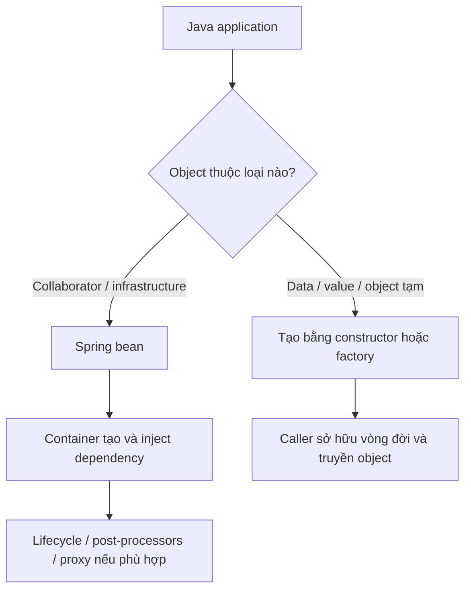

# Chọn bean do container quản lý hay đối tượng dữ liệu tạo trực tiếp

Trong Java, bạn có thể tạo object bằng toán tử `new` ở bất kỳ nơi nào phù hợp. Trong Spring, bạn cũng có thể để container tạo và quản lý object thông qua component scanning, constructor injection hoặc factory method `@Bean`. Cả hai cách đều đúng, nhưng phục vụ những mục đích khác nhau.

Một quyết định thiết kế quan trọng là **object nào nên trở thành Spring bean và object nào chỉ nên là object Java được tạo khi cần**.

Nếu đưa mọi object vào Spring container, ứng dụng dễ có quá nhiều bean, dependency khó theo dõi và state bị chia sẻ ngoài ý muốn. Ngược lại, nếu tự tạo service hoặc dependency hạ tầng bằng `new`, bạn có thể bỏ qua dependency injection, configuration, lifecycle callback và AOP mà Spring cần áp dụng.

Nguyên tắc thực tế:

- Dùng **Spring-managed bean** cho thành phần cộng tác cấp ứng dụng: service, repository, gateway, adapter, scheduler, handler, cấu hình và tài nguyên cần lifecycle.
- Dùng **object Java tạo trực tiếp** cho dữ liệu hoặc hành vi có vòng đời gắn với một thao tác: DTO, command, value object, kết quả tính toán, object tạm và thành phần thuần Java không cần container.
- Đừng quyết định chỉ dựa vào việc class có annotation hay không. Hãy xem object có cần dependency do Spring cung cấp, lifecycle được container quản lý hoặc cross-cutting behavior như transaction, cache, security và async hay không.

Bài học cũng phân biệt Spring bean với JPA-managed entity, vì hai khái niệm “được quản lý” này thuộc hai cơ chế khác nhau.

## 1. Object Java và Spring bean khác nhau thế nào?

Mọi Spring bean đều là object Java, nhưng không phải object Java nào cũng là Spring bean.

Object được tạo trực tiếp:

```java
Money price = new Money(new BigDecimal("125.00"), "VND");
```

Đây là object Java thông thường. JVM quản lý bộ nhớ của object; code gọi constructor quyết định lúc tạo nó. Spring không tự biết object này tồn tại, không inject dependency vào nó và không áp dụng bean lifecycle hoặc AOP proxy cho nó.

Spring-managed bean:

```java
@Service
public class PricingService {
    public Money calculatePrice(Product product) {
        return new Money(product.basePrice(), "VND");
    }
}
```

Khi Spring tạo ApplicationContext và phát hiện `PricingService`, container đăng ký bean definition, tạo instance theo lifecycle và cung cấp reference cho các bean khác. Nếu có infrastructure và advisor phù hợp, reference được cung cấp còn có thể là AOP proxy.



Sự khác nhau nằm ở **ai chịu trách nhiệm tạo, kết nối và quản lý vòng đời của object**, chứ không nằm ở việc object được viết bằng Java hay có thể gọi method.

### 1.1. Những gì container có thể làm với bean

Tùy scope và cấu hình, Spring container có thể:

- Tạo bean từ constructor hoặc factory method.
- Resolve dependency và inject vào constructor, setter hoặc field.
- Áp dụng BeanPostProcessor.
- Tạo proxy cho AOP advisor phù hợp.
- Gọi initialization callback như `@PostConstruct` hoặc `InitializingBean`.
- Quản lý destruction callback cho bean có lifecycle được container sở hữu.
- Quản lý scope như singleton, prototype, request hoặc session.
- Cung cấp bean thông qua injection hoặc API container.

Một object được tạo bằng `new` trong business method không tự nhận các hành vi này chỉ vì class của nó có annotation Spring.

### 1.2. Những gì object tạo trực tiếp vẫn có

Object tạo trực tiếp vẫn là Java object đầy đủ:

- Có constructor, method, field và interface.
- Có thể bất biến hoặc mutable theo thiết kế.
- Có thể được truyền qua nhiều lớp.
- Có thể được unit test mà không cần Spring.
- Có thể chứa logic nghiệp vụ thuần.
- Có thể được serialize hoặc persist nếu có cấu hình phù hợp.

Không cần Spring container cho mọi object. Nhiều object càng độc lập với framework thì càng dễ tái sử dụng và kiểm thử.

## 2. Phân biệt ba khái niệm “được quản lý”

Trong ứng dụng Spring Boot, từ “managed” có thể chỉ nhiều cơ chế khác nhau.

| Khái niệm | Ai quản lý? | Ví dụ |
|---|---|---|
| Spring-managed bean | Spring IoC container | `OrderService`, `DataSource`, `RestClient` |
| JPA-managed entity | JPA persistence context / EntityManager | `Order` sau khi được `persist` hoặc load |
| Object Java thông thường | Code tạo object và JVM quản lý bộ nhớ | `Money`, `CreateOrderCommand`, `List<OrderItem>` |

Một object có thể là JPA-managed entity mà không phải Spring bean. Ngược lại, service/repository là Spring bean nhưng không phải JPA entity.

Ví dụ:

```java
Order order = new Order(customerId, items);
entityManager.persist(order);
```

`order` được tạo bằng `new`. Sau khi được `persist` trong persistence context, nó trở thành entity được JPA quản lý. Điều đó **không biến `Order` thành Spring bean**.

Sự phân biệt này rất quan trọng khi thiết kế domain model, persistence và dependency injection.

## 3. Spring bean phù hợp với loại object nào?

Một object thường phù hợp trở thành bean khi nó có một hoặc nhiều đặc điểm sau.

### 3.1. Là collaborator được nhiều thành phần sử dụng

Ví dụ:

- `OrderService` điều phối use case.
- `PaymentGateway` gọi cổng thanh toán.
- `CustomerRepository` truy cập dữ liệu.
- `NotificationSender` gửi email hoặc message.
- `TaxPolicy` cung cấp chính sách tính thuế có dependency.
- `ReportGenerator` phối hợp nhiều nguồn dữ liệu.

Những object này thường được inject vào các thành phần khác thay vì tạo mới ở mỗi method call.

```java
@Service
public class OrderService {

    private final OrderRepository orderRepository;
    private final PaymentGateway paymentGateway;

    public OrderService(
            OrderRepository orderRepository,
            PaymentGateway paymentGateway
    ) {
        this.orderRepository = orderRepository;
        this.paymentGateway = paymentGateway;
    }

    public void placeOrder(Order order) {
        paymentGateway.charge(order.total());
        orderRepository.save(order);
    }
}
```

`OrderService` cần hai collaborator do container cung cấp. Nếu tự tạo repository và gateway bằng `new`, code sẽ phải biết chi tiết implementation, cấu hình kết nối và cách khởi tạo từng dependency.

### 3.2. Cần cấu hình từ application environment

Một HTTP client có thể cần base URL, timeout, authentication và connection pool. Để client là bean giúp Spring inject builder/configuration đã được thiết lập.

```java
@Component
public class CatalogClient {

    private final RestClient restClient;

    public CatalogClient(RestClient.Builder builder) {
        this.restClient = builder
                .baseUrl("https://catalog.example.test")
                .build();
    }
}
```

Trong ứng dụng thực, base URL và timeout nên được bind từ configuration properties. Nếu mỗi request đều tự tạo client bằng `new`, bạn có thể bỏ qua connection pooling, shared configuration hoặc customizer mà ứng dụng đã thiết lập.

### 3.3. Cần lifecycle hoặc quản lý tài nguyên

Một object sở hữu executor, scheduler, connection pool hoặc listener thường nên được container quản lý để có điểm khởi tạo và đóng rõ ràng.

```java
@Component
public class ReportScheduler {

    private final ScheduledExecutorService executor =
            Executors.newSingleThreadScheduledExecutor();

    @PreDestroy
    public void shutdown() {
        executor.shutdown();
    }
}
```

Khi context đóng bình thường, Spring có thể gọi destruction callback của bean để resource được cleanup. Nếu object này được tạo bằng `new` trong một method và không ai giữ trách nhiệm đóng nó, thread hoặc tài nguyên có thể tồn tại lâu hơn dự kiến.

Spring quản lý lifecycle của object mà container sở hữu theo scope và cấu hình phù hợp. Với prototype bean, container tạo object nhưng không tự quản lý toàn bộ destruction lifecycle như với singleton bean.

### 3.4. Cần cross-cutting behavior của Spring

Các tính năng sau thường dựa vào proxy hoặc infrastructure do Spring quản lý:

- `@Transactional`.
- `@Cacheable`.
- `@Async`.
- Method validation qua `@Validated`.
- Custom AOP aspect.
- Method security.

Ví dụ:

```java
@Service
public class InvoiceService {

    @Transactional
    public void issueInvoice(Invoice invoice) {
        // Ghi invoice và các dữ liệu liên quan.
    }
}
```

Nếu gọi service qua bean reference do Spring cung cấp, transaction interceptor có thể áp dụng. Nếu tự tạo `new InvoiceService()` rồi gọi method, object đó không đi qua Spring transaction proxy.

Annotation không tự làm thay đổi JVM method. Infrastructure phải được cấu hình, và lời gọi phải đi qua đúng interception boundary.

## 4. Object nào nên được tạo trực tiếp?

Object tạo trực tiếp phù hợp khi nó là dữ liệu hoặc đơn vị xử lý nhỏ, có vòng đời gắn với một thao tác và không cần Spring container.

### 4.1. DTO nhận request và trả response

```java
public record CreateOrderRequest(
        String customerId,
        List<CreateOrderItemRequest> items
) {
}

public record CreateOrderItemRequest(
        String productCode,
        int quantity
) {
}
```

DTO biểu diễn dữ liệu đi qua boundary. Framework có thể tạo nó khi bind request, hoặc code có thể tạo trong test/mapper.

Không cần đăng ký mỗi request DTO thành singleton bean. DTO là dữ liệu của một request, không phải collaborator dùng chung của ứng dụng.

### 4.2. Value object

```java
public record Money(BigDecimal amount, Currency currency) {

    public Money {
        Objects.requireNonNull(amount);
        Objects.requireNonNull(currency);

        if (amount.signum() < 0) {
            throw new IllegalArgumentException(
                    "Amount cannot be negative"
            );
        }
    }

    public Money add(Money other) {
        if (!currency.equals(other.currency)) {
            throw new IllegalArgumentException(
                    "Currency must match"
            );
        }

        return new Money(amount.add(other.amount), currency);
    }
}
```

`Money` biểu diễn giá trị có invariant rõ ràng. Tạo bằng constructor hoặc factory method giúp đảm bảo object hợp lệ ngay khi được tạo.

`Money` không cần Spring bean chỉ để có thể inject vào service. Service có thể tạo value object khi xử lý:

```java
Money total = new Money(
        new BigDecimal("250.00"),
        Currency.getInstance("VND")
);
```

### 4.3. Command, query và result object

```java
public record PlaceOrderCommand(
        String customerId,
        List<OrderLine> lines
) {
}

public record OrderSummary(
        String orderId,
        Money total,
        int itemCount
) {
}
```

Command mô tả yêu cầu thực hiện hành động; query/result mô tả dữ liệu đầu vào/đầu ra. Chúng thường được tạo mới cho từng lần gọi.

Không đưa state của một command vào singleton service rồi ghi đè ở mỗi request. Mỗi invocation nên có object dữ liệu riêng.

### 4.4. Object tính toán thuần

Một calculator không có dependency bên ngoài có thể chỉ là object Java:

```java
public class DiscountCalculator {

    public Money apply(Money original, BigDecimal rate) {
        BigDecimal discounted = original.amount()
                .multiply(BigDecimal.ONE.subtract(rate));

        return new Money(discounted, original.currency());
    }
}
```

Có thể tạo khi cần:

```java
DiscountCalculator calculator = new DiscountCalculator();
Money finalPrice = calculator.apply(price, discountRate);
```

Nếu calculator không có state, không cần cấu hình, không cần proxy/lifecycle và chỉ thực hiện phép tính thuần, việc biến nó thành Spring bean có thể không mang lại lợi ích đáng kể.

Nếu calculator có policy được cấu hình, phụ thuộc repository hoặc được nhiều service dùng như collaborator, Spring bean có thể phù hợp hơn. Hãy quyết định dựa trên trách nhiệm và dependency thực tế.

### 4.5. Collection và builder

Các object như `ArrayList`, `HashMap`, builder, iterator hoặc object tạm thường được tạo trực tiếp:

```java
List<OrderLine> lines = new ArrayList<>();
Map<String, Integer> quantities = new HashMap<>();
```

Chúng là state cục bộ của một thao tác, không phải dependency ứng dụng cần container quản lý.

## 5. Đừng tạo service bằng new bên trong service khác

Đây là anti-pattern thường gặp:

```java
@Service
public class CheckoutService {

    public void checkout(Order order) {
        PaymentService paymentService = new PaymentService();
        paymentService.pay(order);
    }
}
```

Nếu `PaymentService` là collaborator của ứng dụng, tự tạo bằng `new` gây ra các vấn đề:

- Spring không inject dependency vào instance đó.
- Configuration đã bind vào bean khác không được sử dụng.
- AOP proxy không áp dụng cho instance tự tạo.
- Transaction, cache, async hoặc security advice có thể bị bỏ qua.
- Test khó thay dependency bằng mock/fake qua constructor.
- Code caller bị coupling với implementation concrete.
- Vòng đời dependency do từng method tự quyết định.

Cách phù hợp:

```java
@Service
public class CheckoutService {

    private final PaymentService paymentService;

    public CheckoutService(PaymentService paymentService) {
        this.paymentService = paymentService;
    }

    public void checkout(Order order) {
        paymentService.pay(order);
    }
}
```

Giờ Spring quản lý cả hai bean và inject dependency theo cấu hình.

### 5.1. Một object tự tạo có thể chứa dependency không?

Có, Java không cấm:

```java
PaymentService service =
        new PaymentService(paymentGateway, auditPublisher);
```

Nhưng nếu `PaymentService` vốn là Spring component cần transaction/AOP/configuration, tạo thủ công vẫn bỏ qua bean reference do container cung cấp. Truyền đủ constructor arguments chỉ giải quyết object construction; nó không tự tạo proxy hoặc bean lifecycle.

Có thể tạo object thuần chứa dependency khi đó là chủ đích của một factory/domain model, nhưng không dùng cách này để thay thế Spring wiring cho application service.

## 6. new bên trong @Bean vẫn tạo Spring-managed bean

Không phải cứ thấy từ khóa `new` là object không được Spring quản lý.

```java
@Configuration(proxyBeanMethods = false)
public class PaymentConfiguration {

    @Bean
    public PaymentGateway paymentGateway(
            PaymentGatewayProperties properties
    ) {
        return new HttpPaymentGateway(
                properties.baseUrl(),
                properties.apiKey()
        );
    }
}
```

Ở đây factory method tạo object bằng `new`, nhưng object được trả về từ `@Bean` method được đăng ký vào ApplicationContext. Container quản lý bean definition và có thể áp dụng post-processing/proxy theo infrastructure.

| Cách tạo | Spring quản lý object được sử dụng? |
|---|---|
| `new HttpPaymentGateway(...)` trong business method rồi dùng trực tiếp | Không |
| `@Bean` method trả về `new HttpPaymentGateway(...)` | Có |
| Class có `@Component` được component scan | Có |
| `new Money(...)` trong service | Không, và thường không cần |
| `new ArrayList<>()` trong method | Không, và thường không cần |

**Điểm quyết định là object có được đăng ký và expose qua container hay không**, không phải có dùng constructor trực tiếp hay không.

## 7. Spring bean không đồng nghĩa singleton

Mặc định, scope của Spring bean là `singleton` trong một ApplicationContext. Container thường giữ một instance cho mỗi bean definition trong context.

Spring còn hỗ trợ các scope khác:

| Scope | Ý nghĩa khái quát | Ví dụ |
|---|---|---|
| `singleton` | Một instance cho mỗi bean definition trong context | Service stateless, repository |
| `prototype` | Tạo instance mới mỗi lần container resolve bean | Object có state riêng và được container tạo |
| `request` | Một instance trong vòng đời HTTP request | Request-scoped context |
| `session` | Một instance trong vòng đời HTTP session | Session-specific state |
| Custom scope | Lifecycle theo cơ chế ứng dụng/platform | Integration đặc biệt |

DTO được tạo bằng `new` không cần chuyển thành prototype bean chỉ vì nó có vòng đời ngắn. Prototype hữu ích khi object vẫn cần container tạo/inject dependency nhưng mỗi lần sử dụng cần instance riêng.

### 7.1. Singleton bean nên stateless hoặc thread-safe

Vì nhiều request có thể cùng gọi một singleton service, tránh lưu dữ liệu request vào mutable field:

```java
@Service
public class BadOrderService {

    private Order currentOrder;

    public void place(Order order) {
        this.currentOrder = order;
        // Xử lý...
    }
}
```

Hai request đồng thời có thể ghi đè `currentOrder` của nhau.

Hãy để state của invocation ở local variable hoặc command object:

```java
@Service
public class OrderService {

    public void place(Order order) {
        String customerId = order.customerId();
        // State cục bộ cho lần gọi này.
    }
}
```

Object dữ liệu tạo mới cho từng request thường phù hợp hơn việc biến dữ liệu request thành state của singleton bean.

## 8. Khi nào dùng prototype bean thay vì new?

Có những object không phải singleton nhưng vẫn cần dependency injection hoặc post-processing của Spring.

Ví dụ một bộ xử lý tác vụ cần collaborator được inject và có state riêng cho mỗi job:

```java
@Component
@Scope(ConfigurableBeanFactory.SCOPE_PROTOTYPE)
public class ImportJob {

    private final ImportRepository repository;

    public ImportJob(ImportRepository repository) {
        this.repository = repository;
    }

    public void execute(ImportCommand command) {
        // State và xử lý riêng cho job này.
    }
}
```

Nếu singleton service inject trực tiếp prototype vào constructor:

```java
@Service
public class ImportCoordinator {

    private final ImportJob importJob;

    public ImportCoordinator(ImportJob importJob) {
        this.importJob = importJob;
    }
}
```

prototype thường được resolve tại thời điểm tạo singleton `ImportCoordinator`, nên singleton sẽ giữ cùng một instance đã được inject. Nó không tự nhận một prototype mới ở mỗi lần gọi method.

Nếu cần instance mới theo từng lần chạy, dùng `ObjectProvider`:

```java
@Service
public class ImportCoordinator {

    private final ObjectProvider<ImportJob> jobProvider;

    public ImportCoordinator(ObjectProvider<ImportJob> jobProvider) {
        this.jobProvider = jobProvider;
    }

    public void run(ImportCommand command) {
        ImportJob job = jobProvider.getObject();
        job.execute(command);
    }
}
```

Hoặc dùng `Provider` từ Jakarta Inject tùy stack.

### 8.1. Prototype bean và destruction lifecycle

Spring tạo prototype bean và thực hiện một số bước initialization/post-processing, nhưng sau khi trả object cho caller, container thường không giữ trách nhiệm tự gọi destruction callback cho prototype instance như với singleton.

Caller cần có kế hoạch cleanup nếu prototype object sở hữu resource. Nếu object có lifecycle phức tạp, cân nhắc một factory có API tạo/đóng rõ ràng hoặc abstraction quản lý resource phù hợp.

### 8.2. Đừng dùng prototype chỉ để tránh nghĩ về state

Nếu object chỉ là `Money`, DTO hoặc command, prototype bean không cần thiết. Tạo trực tiếp đơn giản hơn vì object không cần container.

Dùng prototype khi cần **cả instance mới lẫn cơ chế tạo/inject của Spring**, không phải chỉ vì muốn có object mới.

## 9. Factory pattern là cầu nối giữa container và object dữ liệu

Một factory có thể là Spring bean, còn object mà nó tạo ra là object Java thuần.

```java
@Component
public class OrderFactory {

    public Order create(CreateOrderCommand command) {
        List<OrderLine> lines = command.items().stream()
                .map(item -> new OrderLine(
                        item.productCode(),
                        item.quantity()
                ))
                .toList();

        return new Order(
                command.customerId(),
                lines
        );
    }
}
```

`OrderFactory` là bean vì nó là collaborator của ứng dụng. `Order` và `OrderLine` là domain objects được tạo mới cho use case.

Cách phối hợp này có các lợi ích:

- Spring quản lý factory và dependency của nó.
- Factory tạo domain object với invariant.
- Domain object không cần biết Spring container.
- Unit test có thể test factory/domain model mà không cần khởi động toàn bộ application context.

### 9.1. Factory có dependency bên ngoài

Nếu việc tạo object cần repository, configuration hoặc clock, factory có thể inject các collaborator đó:

```java
@Component
public class SubscriptionFactory {

    private final Clock clock;
    private final PlanCatalog planCatalog;

    public SubscriptionFactory(Clock clock, PlanCatalog planCatalog) {
        this.clock = clock;
        this.planCatalog = planCatalog;
    }

    public Subscription create(CreateSubscriptionCommand command) {
        Plan plan = planCatalog.getRequired(command.planId());

        return new Subscription(
                command.customerId(),
                plan,
                clock.instant()
        );
    }
}
```

`Subscription` vẫn là domain object được tạo trực tiếp. `SubscriptionFactory` là bean vì nó phụ thuộc collaborator do Spring quản lý.

## 10. Domain entity không nên tự động trở thành Spring bean

Một domain entity thường đại diện cho thực thể nghiệp vụ có identity và state:

```java
public class Order {

    private final OrderId id;
    private final List<OrderLine> lines;
    private OrderStatus status;

    public Order(OrderId id, List<OrderLine> lines) {
        this.id = Objects.requireNonNull(id);
        this.lines = new ArrayList<>(lines);
        this.status = OrderStatus.DRAFT;
    }

    public void confirm() {
        if (lines.isEmpty()) {
            throw new IllegalStateException(
                    "Cannot confirm an empty order"
            );
        }

        status = OrderStatus.CONFIRMED;
    }
}
```

`Order` là object có identity và invariant của domain. Mỗi đơn hàng cần instance riêng. Nếu đăng ký `Order` như singleton Spring bean, nhiều request có thể vô tình thao tác cùng một đơn hàng.

Tạo entity/domain aggregate bằng constructor hoặc factory:

```java
Order order = orderFactory.create(command);
```

Sau đó repository lưu nó:

```java
orderRepository.save(order);
```

Trong mô hình DDD, aggregate root thường được tạo thông qua constructor/factory có kiểm soát để bảo đảm invariant, không cần Spring inject dependency vào entity.

### 10.1. JPA entity và persistence context

Với JPA, entity có lifecycle riêng:

- **New/transient:** object được tạo bằng `new`, chưa được persistence context quản lý.
- **Managed:** entity được load hoặc persist trong persistence context.
- **Detached:** entity từng managed nhưng hiện không còn gắn với persistence context.
- **Removed:** entity được đánh dấu xóa trong persistence context.

Ví dụ:

```java
OrderEntity entity = new OrderEntity();
entity.setCustomerId(customerId);

entityManager.persist(entity);
```

Trước `persist`, entity mới là Java object. Sau khi được đưa vào persistence context, nó là JPA-managed entity. Nó vẫn không phải Spring bean chỉ vì JPA đang quản lý nó.

`@Entity` không phải stereotype annotation để component scan đăng ký entity thành Spring bean.

### 10.2. Không inject Spring service vào JPA entity

Tránh thiết kế:

```java
@Entity
public class OrderEntity {

    @Autowired
    private PaymentService paymentService;
}
```

JPA provider tạo và quản lý entity theo lifecycle riêng; entity không nên phụ thuộc vào Spring application service. Điều đó trộn persistence model với application orchestration.

Thay vào đó:

```java
@Service
public class OrderApplicationService {

    private final OrderRepository repository;
    private final PaymentService paymentService;

    public OrderApplicationService(
            OrderRepository repository,
            PaymentService paymentService
    ) {
        this.repository = repository;
        this.paymentService = paymentService;
    }

    public void pay(String orderId) {
        OrderEntity order = repository.findById(orderId)
                .orElseThrow();

        paymentService.pay(order.total());
    }
}
```

Service điều phối nghiệp vụ và gọi các collaborator. Entity giữ state và hành vi domain phù hợp.

## 11. DTO, entity và service có vòng đời khác nhau

| Loại object | Mục đích | Cách tạo thường gặp | Có nên là Spring bean? |
|---|---|---|---|
| Controller | HTTP boundary | Spring container | Có |
| Application service | Điều phối use case | Spring container | Có |
| Repository | Persistence abstraction | Spring Data/container | Có |
| External client/gateway | Tích hợp hệ thống ngoài | Spring container/factory | Thường có |
| Request DTO | Dữ liệu từ request | Framework/constructor | Không |
| Response DTO | Dữ liệu trả về | Mapper/constructor | Không |
| Command/query | Mô tả một thao tác | Constructor/record | Không |
| Value object | Giá trị bất biến có invariant | Constructor/factory | Thường không |
| Domain entity | Object nghiệp vụ có identity | Constructor/domain factory/JPA | Không phải Spring bean |
| Collection/builder | State cục bộ/tạm | `new` | Không |
| Stateless calculator | Logic Java thuần | `new` hoặc static tùy thiết kế | Tùy nhu cầu |
| Stateful job có dependency Spring | Một lần chạy, cần injection | Prototype/provider/factory | Có thể là prototype bean |

Bảng này là hướng dẫn, không phải luật tuyệt đối. Một calculator có configuration hoặc collaborator có thể là bean; một object tạo mới có thể được Spring quản lý nếu được trả về từ `@Bean` factory.

## 12. Chọn object theo trách nhiệm, không theo kích thước class

Một class chỉ có vài dòng vẫn có thể là bean nếu nó đại diện cho dependency ứng dụng:

```java
@Component
public class UtcClock {

    public Instant now() {
        return Instant.now();
    }
}
```

Nhưng không cần biến mọi class tiện ích thành bean. Nếu logic không có dependency, không cần thay thế trong test, không có configuration/lifecycle và chỉ là phép biến đổi thuần, một object Java bình thường hoặc method trong value/domain type có thể phù hợp hơn.

Hãy tự hỏi:

1. Object có cần cộng tác với dependency khác không?
2. Có cần Spring inject configuration hoặc resource không?
3. Có cần AOP, transaction, cache, async hoặc method validation không?
4. Có lifecycle cần initialize/destroy không?
5. Object có state riêng theo request/job không?
6. Ai chịu trách nhiệm tạo và kết thúc vòng đời?
7. Nếu tạo trực tiếp, có bỏ qua hành vi quan trọng của Spring không?

Không có quy tắc “class trên N dòng thì phải là bean” hoặc “mọi class trong package service đều phải là bean”.

## 13. Một ví dụ hoàn chỉnh: service bean tạo domain object trực tiếp

Ta xây dựng use case tạo đơn hàng.

### 13.1. Command là dữ liệu đầu vào

```java
public record CreateOrderCommand(
        String customerId,
        List<CreateOrderLineCommand> lines
) {
}

public record CreateOrderLineCommand(
        String productCode,
        int quantity
) {
}
```

Các command object được tạo theo từng lần gọi. Chúng không cần đăng ký trong ApplicationContext.

### 13.2. Domain objects

```java
public record OrderLine(String productCode, int quantity) {

    public OrderLine {
        Objects.requireNonNull(productCode);

        if (productCode.isBlank()) {
            throw new IllegalArgumentException(
                    "Product code is required"
            );
        }

        if (quantity <= 0) {
            throw new IllegalArgumentException(
                    "Quantity must be positive"
            );
        }
    }
}
```

```java
public class Order {

    private final String customerId;
    private final List<OrderLine> lines;

    public Order(String customerId, List<OrderLine> lines) {
        this.customerId = Objects.requireNonNull(customerId);
        this.lines = List.copyOf(lines);

        if (this.lines.isEmpty()) {
            throw new IllegalArgumentException(
                    "An order needs at least one line"
            );
        }
    }

    public String customerId() {
        return customerId;
    }

    public List<OrderLine> lines() {
        return lines;
    }
}
```

Domain objects giữ invariant và không phụ thuộc Spring.

### 13.3. Repository là bean

```java
public interface OrderRepository {
    void save(Order order);
}
```

Implementation có thể được Spring Data tạo hoặc được đăng ký bằng component/configuration phù hợp. Service không tự tạo repository bằng `new`.

### 13.4. Application service là bean

```java
@Service
public class CreateOrderService {

    private final OrderRepository repository;

    public CreateOrderService(OrderRepository repository) {
        this.repository = repository;
    }

    @Transactional
    public void execute(CreateOrderCommand command) {
        List<OrderLine> lines = command.lines().stream()
                .map(line -> new OrderLine(
                        line.productCode(),
                        line.quantity()
                ))
                .toList();

        Order order = new Order(command.customerId(), lines);

        repository.save(order);
    }
}
```

Ở đây:

- Spring quản lý `CreateOrderService` và `OrderRepository`.
- Mỗi lần execute tạo danh sách và domain objects mới.
- `@Transactional` có thể được áp dụng khi method được gọi qua transaction proxy.
- Domain object không cần Spring container.

Đây là cách kết hợp hai loại object theo đúng trách nhiệm.

## 14. Factory method và @Bean cho infrastructure

Một số object không được đánh dấu `@Component` vì class thuộc thư viện ngoài hoặc cần constructor arguments phức tạp. Có thể tạo chúng bằng `@Bean`:

```java
@Configuration(proxyBeanMethods = false)
public class ClientConfiguration {

    @Bean
    public Clock applicationClock() {
        return Clock.systemUTC();
    }

    @Bean
    public ObjectMapper objectMapper() {
        return new ObjectMapper()
                .findAndRegisterModules();
    }
}
```

`Clock` và `ObjectMapper` ở đây là Spring bean. Dù factory method dùng `new` để tạo, container vẫn quản lý object trả về.

Lợi ích:

- Một cấu hình chung cho toàn ứng dụng.
- Dễ thay bean trong test.
- Các service inject cùng dependency đã được cấu hình.
- Có thể thêm customizer hoặc post-processing phù hợp.

### 14.1. Khi nào không nên đăng ký object thư viện thành bean?

Nếu object chỉ dùng một lần, không có cấu hình chung, không cần chia sẻ và không có lifecycle cần container quản lý, tạo trực tiếp có thể đơn giản hơn.

Ví dụ một `StringBuilder` dùng trong một method không cần bean:

```java
StringBuilder builder = new StringBuilder();
builder.append("Order: ").append(orderId);
String message = builder.toString();
```

Đưa `StringBuilder` thành singleton bean sẽ tạo state mutable chia sẻ không cần thiết.

## 15. Bean có thể tạo object dữ liệu nhưng không sở hữu tất cả object đó

Một service bean có thể tạo nhiều object tạm trong mỗi invocation:

```java
@Service
public class InvoiceFormatter {

    public String format(Invoice invoice) {
        List<String> lines = new ArrayList<>();

        for (InvoiceLine line : invoice.lines()) {
            lines.add(formatLine(line));
        }

        return String.join(System.lineSeparator(), lines);
    }

    private String formatLine(InvoiceLine line) {
        return line.description() + ": " + line.amount();
    }
}
```

`InvoiceFormatter` là singleton bean; `lines` là object cục bộ mới cho mỗi lời gọi. Không có lý do đăng ký từng list hoặc string làm Spring bean.

Một nguyên tắc tốt: **container quản lý collaborator cấp ứng dụng; code nghiệp vụ quản lý object dữ liệu cục bộ của thao tác**.

## 16. Khi nào object dữ liệu cần dependency?

Một domain/value object thường nên giữ độc lập, nhưng không có nghĩa mọi object có method đều không được dùng dependency. Có thể có những object xử lý theo strategy hoặc policy.

Hãy phân biệt:

- Dữ liệu thuần có invariant: thường tạo trực tiếp.
- Service/policy phụ thuộc hạ tầng hoặc configuration: thường là bean.
- Object cần behavior theo strategy thay đổi được: có thể inject strategy bean vào service hoặc factory.
- Object tạm cần dependency nhưng cần nhiều instance: cân nhắc factory/prototype.

Ví dụ không nên để value object gọi database:

```java
public class CustomerId {
    private final String value;

    // Identity value, không inject CustomerRepository vào đây.
}
```

Thay vào đó, service resolve dữ liệu:

```java
@Service
public class CustomerService {

    private final CustomerRepository repository;

    public CustomerService(CustomerRepository repository) {
        this.repository = repository;
    }

    public Customer load(CustomerId id) {
        return repository.findById(id.value())
                .orElseThrow();
    }
}
```

`CustomerId` biểu diễn identity; `CustomerService` phối hợp repository.

## 17. Khi nào dùng ObjectProvider, Provider hoặc factory?

Dùng lazy lookup có chủ đích khi dependency chỉ cần ở một nhánh logic, khi cần prototype mới hoặc khi một integration là tùy chọn.

Ví dụ:

```java
@Service
public class ExportCoordinator {

    private final ObjectProvider<ExportJob> jobProvider;

    public ExportCoordinator(ObjectProvider<ExportJob> jobProvider) {
        this.jobProvider = jobProvider;
    }

    public void export(ExportCommand command) {
        ExportJob job = jobProvider.getObject();
        job.execute(command);
    }
}
```

`ObjectProvider` vẫn làm dependency hiện diện rõ trong constructor, đồng thời trì hoãn resolve instance đến lúc gọi `getObject()`.

Nếu việc tạo object không cần Spring dependency, một Java factory đơn giản có thể tốt hơn:

```java
public class CsvRowFactory {

    public CsvRow create(List<String> columns) {
        return new CsvRow(columns);
    }
}
```

Không dùng `ApplicationContext.getBean()` trong mọi method như cách né constructor injection. Cách đó tạo service locator, làm dependency ẩn và khó test.

## 18. Đối tượng tạo trực tiếp vẫn có thể được Spring xử lý ở một boundary

Object không phải bean vẫn có thể được truyền vào API của Spring. Ví dụ:

- `Validator.validate(dto)` kiểm tra DTO được tạo bằng `new`.
- `ObjectMapper.writeValueAsString(dto)` serialize object dữ liệu.
- `EntityManager.persist(entity)` đưa entity vào persistence context.
- `RestClient` gửi object làm request body.
- `ApplicationEventPublisher.publishEvent(event)` phát event object.

Điều này không biến DTO/entity/event thành Spring bean. Spring chỉ xử lý object trong một API cụ thể.

Ví dụ validation:

```java
CreateOrderRequest request =
        new CreateOrderRequest(null, List.of());

Set<ConstraintViolation<CreateOrderRequest>> violations =
        validator.validate(request);
```

DTO có annotation validation nhưng được tạo bằng `new`; validator vẫn kiểm tra nó khi được gọi tường minh.

## 19. Kiểm thử: khi nào cần Spring context?

Việc lựa chọn bean hay object trực tiếp ảnh hưởng đến chiến lược test.

### 19.1. Unit test cho object thuần

Value object hoặc calculator không phụ thuộc Spring có thể test trực tiếp:

```java
@Test
void addsMoneyWithSameCurrency() {
    Money left = new Money(
            new BigDecimal("10.00"),
            Currency.getInstance("VND")
    );

    Money right = new Money(
            new BigDecimal("5.00"),
            Currency.getInstance("VND")
    );

    assertThat(left.add(right).amount())
            .isEqualByComparingTo("15.00");
}
```

Không cần `@SpringBootTest` chỉ để test phép cộng.

### 19.2. Unit test service bằng constructor injection

```java
@Test
void savesCreatedOrder() {
    OrderRepository repository = mock(OrderRepository.class);
    CreateOrderService service = new CreateOrderService(repository);

    CreateOrderCommand command = new CreateOrderCommand(
            "customer-1",
            List.of(new CreateOrderLineCommand("SKU-1", 2))
    );

    service.execute(command);

    verify(repository).save(any(Order.class));
}
```

Ở đây có thể tạo service bằng `new` trong unit test vì mục tiêu là kiểm tra logic điều phối với dependency giả. Test này **không** kiểm tra transaction proxy.

### 19.3. Integration test cho Spring-managed behavior

Nếu cần kiểm tra bean registration, constructor injection, configuration binding, transaction, cache, async hoặc AOP advice, hãy test qua Spring-managed bean trong context phù hợp.

```java
@SpringBootTest
class CreateOrderIntegrationTest {

    @Autowired
    CreateOrderService service;

    @Test
    void serviceIsProvidedBySpring() {
        assertThat(service).isNotNull();
        service.execute(sampleCommand());
        // Assert behavior cần kiểm tra ở tầng tích hợp.
    }
}
```

Đừng gọi `new CreateOrderService(...)` trong test rồi kết luận `@Transactional` hoạt động; instance tạo trực tiếp không đi qua proxy của container.

### 19.4. Test slice và mock bean

Một test controller dùng mock service phù hợp để kiểm tra HTTP mapping và delegation. Nhưng mock không chứng minh service thật được Spring cấu hình transaction/cache/AOP đúng.

Hãy chọn loại test theo behavior cần xác nhận, không theo thói quen luôn dùng một loại test.

## 20. Các anti-pattern thường gặp

### 20.1. Biến DTO thành singleton bean

DTO chứa dữ liệu của từng request. Đăng ký DTO làm singleton có thể làm dữ liệu request này rò sang request khác và tạo race condition.

### 20.2. Tạo service mới bằng new cho mỗi request

Nếu service cần dependency, cấu hình hoặc AOP, việc tự tạo sẽ bỏ qua container. Nếu thực sự cần instance mới, cân nhắc prototype/provider/factory có chủ đích.

### 20.3. Inject ApplicationContext khắp nơi

`ApplicationContext.getBean()` làm dependency ẩn và biến class thành service locator. Constructor injection thường rõ ràng và dễ test hơn.

### 20.4. Đưa business state vào singleton bean

Singleton bean được nhiều request dùng chung. Không lưu request-specific mutable state trong field nếu không có cơ chế concurrency phù hợp.

### 20.5. Đăng ký mọi utility class làm bean

Một class tiện ích không dependency, không lifecycle và không cần thay thế trong test có thể không cần bean. Quá nhiều bean khiến context khó hiểu và tăng coupling với Spring.

### 20.6. Inject service vào entity

Entity nên giữ domain state/invariant; service orchestration và infrastructure ở tầng ứng dụng. Inject service vào JPA entity làm trộn lifecycle và trách nhiệm.

### 20.7. Cho rằng @Component làm mọi instance của class thành bean

`@Component` chỉ là metadata để component scanning có thể đăng ký bean definition. Lệnh `new SomeComponent()` vẫn tạo object riêng không do container quản lý.

## 21. Bảng quyết định nhanh

| Câu hỏi | Nếu có | Lựa chọn thường phù hợp |
|---|---|---|
| Object cần inject repository/client/configuration? | Có | Spring bean hoặc factory do Spring quản lý |
| Object cần transaction/cache/async/security advice? | Có | Spring-managed bean và lời gọi qua proxy phù hợp |
| Object cần lifecycle init/destroy hoặc sở hữu resource? | Có | Spring bean với cleanup rõ ràng |
| Object là dữ liệu request/response? | Có | DTO tạo theo request |
| Object là value/domain object có invariant? | Có | Constructor/factory tạo trực tiếp |
| Object chỉ tồn tại trong một method invocation? | Có | Local object hoặc command/result |
| Object cần dependency nhưng mỗi job cần instance mới? | Có | Prototype qua `ObjectProvider` hoặc factory |
| Object là entity JPA? | Có | Entity lifecycle do persistence context quản lý, không phải Spring bean |
| Object là utility thuần, không state/dependency? | Có | Java method/object thuần; bean chỉ khi có lợi ích rõ |

Không có một đáp án cho mọi class. Có thể bắt đầu bằng object Java đơn giản, rồi chỉ đưa nó vào container khi có nhu cầu thực tế về dependency, configuration, lifecycle hoặc framework integration.

## 22. Quy trình thiết kế một class mới

Khi tạo class trong Spring Boot, đi theo các câu hỏi sau:

### Bước 1. Xác định vai trò

Class này là application service, infrastructure adapter, repository, domain entity, value object, DTO hay helper?

### Bước 2. Xác định dependency

Nó cần database, HTTP client, configuration, clock, executor hoặc collaborator khác không?

Nếu có, hãy cân nhắc constructor injection và Spring bean. Nếu không, object thuần có thể đủ.

### Bước 3. Xác định vòng đời và state

Object sống trong toàn application context, trong một request, trong một job hay chỉ trong một phép tính?

Nếu singleton, bảo đảm không lưu state mutable theo request. Nếu cần instance riêng có dependency Spring, cân nhắc prototype/provider.

### Bước 4. Xác định framework behavior

Có cần transaction, AOP, cache, async, method validation hoặc security proxy không?

Nếu có, caller phải dùng reference phù hợp do Spring cung cấp.

### Bước 5. Xác định ai tạo object

- Container tạo bean qua component scanning hoặc `@Bean`.
- Factory tạo domain/value object.
- Framework tạo DTO khi binding.
- Persistence context quản lý JPA entity.
- Method tạo object tạm khi xử lý.

Một object có thể được tạo bằng `new` nhưng vẫn là Spring bean nếu factory method đăng ký nó trong context.

### Bước 6. Chọn cách test

- Object thuần: unit test trực tiếp.
- Service logic: unit test với fake/mock dependency.
- Container/AOP/lifecycle: integration test với Spring context.

### Bước 7. Kiểm tra dependency direction

Domain object không nên phụ thuộc ngược vào Spring service. Application service điều phối domain object và infrastructure qua abstraction.

## 23. Ví dụ đối chiếu hai thiết kế

### Thiết kế A: mọi thứ đều là bean

```java
@Component
public class MoneyFactory {
    public Money create(BigDecimal amount) {
        return new Money(amount, Currency.getInstance("VND"));
    }
}

@Component
public class OrderDataHolder {
    // State dữ liệu của một đơn hàng.
}
```

Nếu những object này không có dependency/lifecycle cần Spring, việc đăng ký tất cả làm bean làm container phình ra và khiến data lifetime không rõ.

Đặc biệt, `OrderDataHolder` nếu là singleton sẽ nguy hiểm nếu lưu state của từng order.

### Thiết kế B: bean cho collaborator, object thuần cho dữ liệu

```java
@Service
public class OrderApplicationService {

    private final OrderRepository repository;

    public OrderApplicationService(OrderRepository repository) {
        this.repository = repository;
    }

    public void create(CreateOrderCommand command) {
        Money total = calculateTotal(command);
        Order order = new Order(command.customerId(), total);
        repository.save(order);
    }

    private Money calculateTotal(CreateOrderCommand command) {
        return new Money(
                new BigDecimal("100.00"),
                Currency.getInstance("VND")
        );
    }
}
```

Ở đây service là bean; command, money và order là object dữ liệu/domain. Container quản lý collaborator; code nghiệp vụ quản lý object của use case.

## 24. Câu hỏi tự kiểm tra

**Câu 1.** Mọi object Java trong ứng dụng Spring Boot có tự động trở thành Spring bean không?

**Đáp án:** Không. Chỉ object được đăng ký thông qua component scanning, `@Bean`, programmatic registration hoặc cơ chế tương ứng mới thuộc container.

**Câu 2.** Một `@Service` được tạo bằng `new` trong method có nhận transaction proxy không?

**Đáp án:** Không. Annotation không tự áp dụng proxy cho object tự tạo bên ngoài container.

**Câu 3.** Một `@Bean` method trả về `new HttpClientWrapper()` có tạo Spring-managed bean không?

**Đáp án:** Có. Object trả về được đăng ký vào ApplicationContext và đi qua bean lifecycle/post-processing phù hợp.

**Câu 4.** DTO request có nên là singleton bean không?

**Đáp án:** Không. DTO là dữ liệu riêng của request; singleton mutable có thể chia sẻ state giữa các request.

**Câu 5.** JPA entity sau `persist()` có phải Spring bean không?

**Đáp án:** Không. Nó là JPA-managed entity trong persistence context, một cơ chế khác với Spring IoC container.

**Câu 6.** Khi nào prototype bean phù hợp hơn `new`?

**Đáp án:** Khi cần instance mới nhưng vẫn cần Spring inject dependency, áp dụng post-processing hoặc quản lý creation theo bean definition.

**Câu 7.** Singleton service có nên giữ `currentOrder` trong field không?

**Đáp án:** Thường không. Nhiều request có thể dùng chung instance; state theo invocation nên nằm trong local variable hoặc object dữ liệu riêng.

**Câu 8.** Có thể tạo `Money` bằng `new` trong Spring service không?

**Đáp án:** Có. Value object thuần thường được tạo trực tiếp để biểu diễn dữ liệu và invariant.

**Câu 9.** Có nên inject `ApplicationContext` vào mọi service để gọi `getBean()` không?

**Đáp án:** Không. Cách đó tạo service locator và che giấu dependency. Constructor injection rõ ràng hơn; `ObjectProvider`/factory dành cho lazy hoặc dynamic lookup có chủ đích.

**Câu 10.** Unit test service tạo bằng `new` có kiểm tra được `@Transactional` không?

**Đáp án:** Không. Test đó kiểm tra logic Java thuần; muốn xác nhận transaction cần gọi qua Spring-managed proxy trong integration context có transaction infrastructure.

## 25. Ghi nhớ

- Mọi Spring bean là Java object, nhưng object tạo bằng `new` không tự động là Spring bean.
- Spring bean phù hợp với collaborator cấp ứng dụng, dependency có cấu hình, resource có lifecycle và thành phần cần AOP/infrastructure.
- DTO, command, result, collection, value object và domain object thường được tạo trực tiếp theo từng thao tác.
- `new` trong `@Bean` factory method vẫn có thể tạo Spring-managed bean; yếu tố quyết định là object được đăng ký vào container.
- Spring singleton mặc định không có nghĩa mọi dữ liệu request nên được lưu trong bean. Singleton service nên stateless hoặc thread-safe.
- Prototype bean hữu ích khi cần instance mới có dependency Spring; `ObjectProvider` giúp resolve instance theo từng lần dùng.
- JPA-managed entity khác Spring-managed bean. `@Entity` không biến entity thành component của ApplicationContext.
- Không tự tạo service/repository/client bằng `new` nếu cần dependency injection, configuration, transaction, cache, async hoặc security proxy.
- Factory có thể là Spring bean trong khi object do factory tạo là Java/domain object thuần.
- Unit test object thuần không cần Spring; test lifecycle/AOP/transaction phải dùng Spring context phù hợp.
- Tránh service locator, mutable singleton data holder và việc đưa mọi utility/data object vào container.

Khi quyết định cách tạo một class, hãy tự hỏi: **“Đây là collaborator mà ứng dụng cần quản lý, hay là dữ liệu/object tạm của một thao tác? Nó có cần dependency, lifecycle hoặc proxy của Spring không? Ai nên sở hữu vòng đời của nó?”** Trả lời rõ những câu hỏi đó giúp ứng dụng tận dụng Spring IoC mà vẫn giữ domain model và dữ liệu đơn giản, độc lập với framework.
