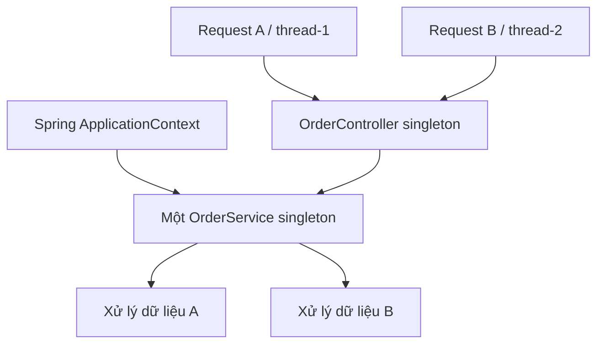
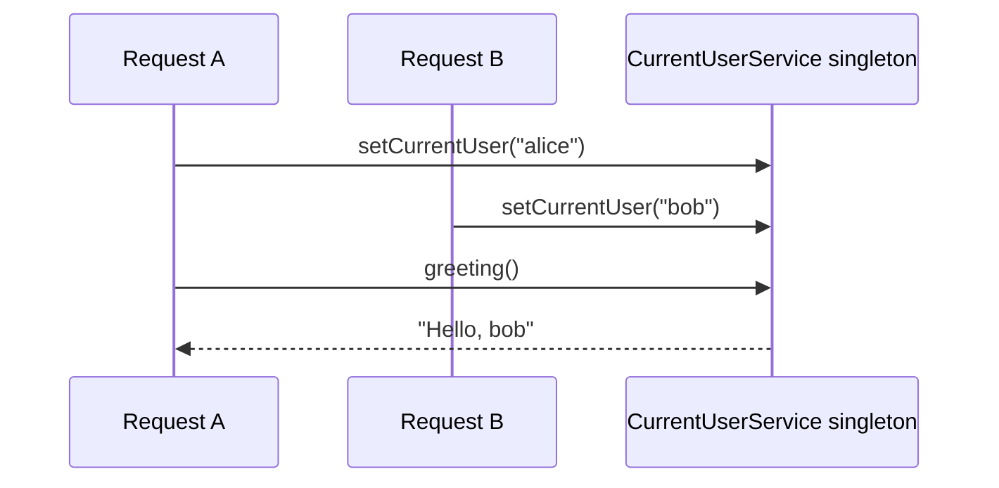
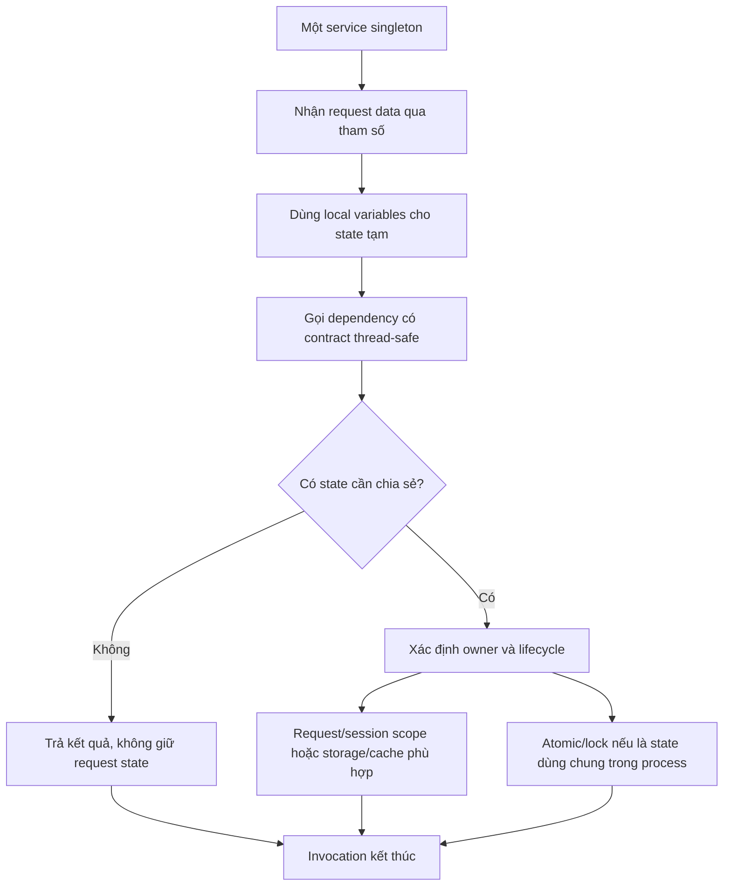

# Bean singleton không lưu trạng thái riêng của từng request

Trong Spring Boot, một bean có scope mặc định là **singleton**. Điều đó có nghĩa Spring tạo và quản lý một instance cho bean definition tương ứng trong một ApplicationContext. Với một ứng dụng web, nhiều request có thể cùng gọi một service bean trong khoảng thời gian chồng lấp. Vì vậy, một singleton service thường được nhiều luồng sử dụng đồng thời.

Điều này dẫn đến một nguyên tắc thiết kế quan trọng: **singleton service nên stateless đối với từng request**. Bean có thể giữ dependency và cấu hình dùng chung, nhưng không nên lưu dữ liệu riêng của request hiện tại vào những field mutable dùng chung như `currentUser`, `currentOrderId`, `currentRequest` hoặc một `StringBuilder` dùng lại cho mọi lời gọi.

Nếu lưu trạng thái request trong field của singleton, hai request đồng thời có thể ghi đè dữ liệu của nhau. Kết quả có thể là tính sai, ghi log nhầm người dùng, trả nhầm dữ liệu hoặc tạo lỗi chỉ xuất hiện khi có tải đồng thời. Đây không phải vấn đề riêng của Spring; đó là hệ quả của việc nhiều lời gọi cùng truy cập một object mutable.

Bài học thuộc chương **Thiết kế ứng dụng** của *Spring Boot Fundamentals*. Ta sẽ phân biệt singleton scope với một instance toàn JVM, hiểu vì sao request có thể chạy đồng thời trên cùng bean, nhận diện trạng thái dùng chung và trạng thái cục bộ, thiết kế service stateless, lựa chọn request/prototype scope khi thật sự cần, và kiểm thử những lỗi race condition thường gặp.

Ví dụ dùng Java 21, Spring Boot 3.x và Spring MVC. Nguyên tắc về chia sẻ object áp dụng cho cả servlet, reactive và những loại ứng dụng Spring khác; cách truyền request context có thể khác theo execution model.

## 1. Singleton trong Spring nghĩa là gì?

Scope mặc định của một bean do Spring quản lý là `singleton`. Với một bean definition trong một ApplicationContext, Spring thường tạo một instance và trả về cùng instance đó cho những lần lookup bean tiếp theo.

Ví dụ:

```java
@Service
public class PriceCalculator {

    public BigDecimal total(BigDecimal unitPrice, int quantity) {
        return unitPrice.multiply(BigDecimal.valueOf(quantity));
    }
}
```

Khi inject `PriceCalculator` vào nhiều component, các component thường nhận cùng bean instance do ApplicationContext quản lý.

### 1.1. Singleton không phải một object duy nhất cho cả JVM

Định nghĩa chính xác là **một instance cho mỗi bean definition trong một container**, theo scope và cách đăng ký tương ứng. Nếu một ứng dụng có hai ApplicationContext độc lập, mỗi context có thể có instance singleton riêng.

Vì vậy, không nên diễn giải Spring singleton thành:

- Một object duy nhất trên toàn bộ JVM.
- Một object duy nhất cho mọi ứng dụng chạy trên máy.
- Một object duy nhất cho mọi pod/container trong hệ thống.

Đối với một Spring Boot application thông thường có một ApplicationContext chính, cách nói “một singleton bean dùng chung trong ứng dụng” là cách mô tả thực tế dễ hiểu.

### 1.2. Singleton bean thường được tạo một lần và dùng nhiều lần

Ví dụ:

```java
@Service
public class OrderService {
}

@RestController
@RequestMapping("/orders")
public class OrderController {

    private final OrderService orderService;

    public OrderController(OrderService orderService) {
        this.orderService = orderService;
    }
}
```

Controller và service do Spring quản lý. Khi request tới controller, controller gọi service bean. Request tiếp theo cũng có thể gọi chính instance service đó.

### 1.3. Controller cũng thường là singleton

`@Controller` và `@RestController` là những stereotype component. Nếu không chỉ định scope khác, chúng cũng mặc định là singleton. Vì vậy, cùng nguyên tắc stateless áp dụng cho:

- Controller.
- Service.
- Repository.
- Component chứa business policy.
- Những bean hỗ trợ được inject vào các thành phần trên.

Không chỉ service mới có thể gây lỗi khi lưu trạng thái request trong field.

## 2. Một singleton có thể phục vụ nhiều request đồng thời

Với ứng dụng Spring MVC chạy trên servlet container, server thường sử dụng thread pool để xử lý nhiều request. Hai request có thể đi vào cùng controller và gọi cùng service instance trong thời gian chồng lấp.

Ví dụ minh họa:



Hai lời gọi có thể cùng chạy trên một object `OrderService`. Spring không tự tạo một service instance mới cho mỗi request chỉ vì có request mới.

### 2.1. Singleton scope không tự đồng bộ method

Spring quản lý lifecycle và chia sẻ bean instance. Điều đó **không có nghĩa Spring tự khóa mọi method** hoặc tự tạo cơ chế thread safety cho field mutable.

Nếu hai thread gọi cùng một method:

```java
public void process(String requestId) {
    // Code của method được thực thi cho mỗi lần gọi.
}
```

cả hai invocation có thể chạy đồng thời. JVM có stack frame riêng cho từng lời gọi method, nhưng chúng cùng nhìn thấy field của object singleton.

### 2.2. Thread pool tái sử dụng thread

Trong servlet container, tên worker thread như `http-nio-8080-exec-1` có thể được tái sử dụng cho những request khác nhau. Điều đó không làm request state trở nên an toàn nếu bạn lưu nó trong field singleton.

Một request có thể kết thúc trên thread-1, rồi một request khác được xử lý trên thread-1. Thread name không phải nơi lưu trạng thái nghiệp vụ bền vững cho request.

### 2.3. Reactive và asynchronous cũng không làm field an toàn hơn

Trong WebFlux hoặc pipeline bất đồng bộ, cùng một bean có thể được gọi từ nhiều execution path, và một operation có thể tiếp tục trên thread khác. Không nên dựa vào giả định “mỗi request có một thread riêng từ đầu đến cuối”.

Quy tắc an toàn hơn là không đặt dữ liệu request mutable vào field của singleton. Hãy truyền dữ liệu qua tham số, local variables hoặc context mechanism phù hợp với execution model.

## 3. Stateless nghĩa là gì trong service?

Một service stateless đối với request không giữ dữ liệu thay đổi theo từng lần gọi trong field của instance. Mỗi invocation nhận dữ liệu cần thiết qua tham số, xử lý trong phạm vi lời gọi và trả kết quả.

Ví dụ:

```java
@Service
public class GreetingService {

    public String greeting(String name) {
        String normalizedName = name.trim();
        return "Hello, " + normalizedName;
    }
}
```

`normalizedName` là biến cục bộ của lần gọi method. Hai request có thể gọi method cùng lúc mà mỗi invocation có biến riêng.

### 3.1. Stateless không có nghĩa bean không có field

Một service có thể có field immutable chứa dependency hoặc cấu hình:

```java
@Service
public class InvoiceService {

    private final InvoiceRepository repository;
    private final TaxPolicy taxPolicy;

    public InvoiceService(
            InvoiceRepository repository,
            TaxPolicy taxPolicy) {
        this.repository = repository;
        this.taxPolicy = taxPolicy;
    }

    public InvoiceSummary summarize(long invoiceId) {
        Invoice invoice = repository.findById(invoiceId)
                .orElseThrow();
        return taxPolicy.summarize(invoice);
    }
}
```

Các field `repository` và `taxPolicy` là dependency dùng chung. Chúng được gán một lần qua constructor và không bị thay đổi theo request. Service không lưu `invoiceId` hoặc `Invoice` hiện tại vào field.

**Stateless ở đây có nghĩa không giữ request-specific mutable state trong singleton**, không có nghĩa object không có bất kỳ field nào.

### 3.2. Local variable thường an toàn hơn field mutable

```java
@Service
public class ReportService {

    public Report create(ReportRequest request) {
        List<Row> rows = new ArrayList<>();
        rows.addAll(loadRows(request));

        return new Report(request.reportId(), rows);
    }
}
```

`rows` là biến cục bộ được tạo trong từng invocation. Hai lời gọi bình thường sẽ tạo hai list khác nhau.

Tuy nhiên, local variable chỉ an toàn khi object mutable mà nó tham chiếu không bị chia sẻ bất ngờ. Nếu `loadRows(...)` trả về một list dùng chung hoặc lưu reference đó ở nơi khác, cần phân tích ownership và mutation của object.

### 3.3. Tham số method cũng không tự động immutable

Tham số là reference được truyền vào method. Nếu caller và service cùng giữ một reference tới object mutable rồi sửa nó đồng thời, race condition vẫn có thể xảy ra.

Ví dụ:

```java
public void process(List<String> values) {
    values.add("processed");
}
```

Method không có field mutable, nhưng nếu `values` được chia sẻ giữa nhiều request, các lần gọi vẫn có thể tranh chấp trên cùng list.

Stateless service là một phần của thiết kế an toàn; ownership của input/output objects cũng cần được xác định.

## 4. Lỗi phổ biến: lưu request data trong field singleton

Xét service sau:

```java
@Service
public class CurrentUserService {

    private String currentUser;

    public void setCurrentUser(String username) {
        this.currentUser = username;
    }

    public String greeting() {
        return "Hello, " + currentUser;
    }
}
```

Service này có vẻ hoạt động khi chỉ có một request. Nhưng với hai request đồng thời:

1. Request A gọi `setCurrentUser("alice")`.
2. Request B gọi `setCurrentUser("bob")`.
3. Request A gọi `greeting()`.
4. Request A có thể nhận `"Hello, bob"` thay vì `"Hello, alice"`.



Đây là một ví dụ **data race / shared mutable state** ở cấp ứng dụng. Lỗi không nhất thiết gây exception; nguy hiểm hơn là hệ thống trả dữ liệu hợp lệ về mặt kiểu nhưng thuộc request khác.

### 4.1. Không dùng field để lưu ID của request hiện tại

Những field sau thường là dấu hiệu thiết kế đáng xem xét trong singleton:

```java
private String currentRequestId;
private Long currentUserId;
private HttpServletRequest request;
private Order currentOrder;
private List<String> currentItems = new ArrayList<>();
private StringBuilder responseBuffer = new StringBuilder();
```

Chúng đại diện dữ liệu có vòng đời gắn với request hoặc invocation. Nếu thay đổi theo mỗi request và được chia sẻ qua instance singleton, request khác có thể nhìn thấy hoặc ghi đè.

### 4.2. Field không phải lúc nào cũng nguy hiểm

Các field sau thường phù hợp trong singleton nếu object được thiết kế đúng:

```java
private final OrderRepository repository;
private final Clock clock;
private final TaxPolicy taxPolicy;
private final BigDecimal defaultTaxRate;
```

Chúng là dependency hoặc cấu hình ổn định. Tuy nhiên, `final` chỉ bảo đảm reference không bị gán lại; nó **không biến object được tham chiếu thành immutable hoặc thread-safe**.

Ví dụ `private final List<String> rules` vẫn có thể bị sửa nếu list là mutable và có phương thức cho phép mutation.

## 5. Một lỗi khác: dùng chung StringBuilder hoặc collection mutable

`StringBuilder` không thread-safe. Nếu singleton tái sử dụng một builder cho nhiều request:

```java
@Service
public class MessageService {

    private final StringBuilder builder = new StringBuilder();

    public String buildMessage(String name) {
        builder.setLength(0);
        builder.append("Hello, ");
        builder.append(name);
        return builder.toString();
    }
}
```

Hai request có thể xen kẽ các thao tác `setLength`, `append` và `toString`. Kết quả có thể bị trộn hoặc sai.

### 5.1. Sửa bằng biến cục bộ

```java
@Service
public class MessageService {

    public String buildMessage(String name) {
        StringBuilder builder = new StringBuilder();
        builder.append("Hello, ");
        builder.append(name);
        return builder.toString();
    }
}
```

Mỗi lần gọi tạo builder riêng, không chia sẻ field giữa request.

### 5.2. Sửa bằng String immutable khi phép ghép đơn giản

```java
public String buildMessage(String name) {
    return "Hello, " + name;
}
```

Với ví dụ đơn giản, không cần builder. Chọn cấu trúc dữ liệu theo nhu cầu thực tế; không cần tối ưu bằng cách tái sử dụng một object mutable dùng chung nếu điều đó làm mất thread safety.

### 5.3. Collection thread-safe không giải quyết mọi vấn đề nghiệp vụ

Thay `ArrayList` bằng `CopyOnWriteArrayList` hoặc `ConcurrentHashMap` không tự động làm thiết kế request state đúng.

Ví dụ:

```java
private final Map<Long, Order> currentOrders =
        new ConcurrentHashMap<>();
```

Map có thể hỗ trợ truy cập đồng thời, nhưng nếu mục đích là lưu “đơn hàng hiện tại của request đang chạy” mà không có khóa định danh và chính sách lifecycle rõ ràng, dữ liệu vẫn có thể rò rỉ hoặc không được dọn. Thread-safe collection chỉ bảo vệ một số thao tác cấu trúc; nó không thay thế mô hình ownership và business transaction.

## 6. Constructor injection và field final giúp thiết kế rõ hơn

Một singleton stateless thường có constructor injection:

```java
@Service
public class CheckoutService {

    private final CartRepository cartRepository;
    private final PricingService pricingService;
    private final PaymentGateway paymentGateway;

    public CheckoutService(
            CartRepository cartRepository,
            PricingService pricingService,
            PaymentGateway paymentGateway) {
        this.cartRepository = cartRepository;
        this.pricingService = pricingService;
        this.paymentGateway = paymentGateway;
    }

    public CheckoutResult checkout(CheckoutCommand command) {
        Cart cart = cartRepository.findById(command.cartId())
                .orElseThrow();

        BigDecimal total = pricingService.calculate(cart);
        PaymentReceipt receipt =
                paymentGateway.charge(command.paymentMethod(), total);

        return new CheckoutResult(cart.getId(), receipt.id(), total);
    }
}
```

Các dependency được gán qua constructor và lưu trong `final` fields. Dữ liệu của từng request như `command`, `cart`, `total` và `receipt` thuộc phạm vi method invocation.

### 6.1. Vì sao constructor injection hữu ích?

- Các dependency bắt buộc được thể hiện ngay trong constructor.
- Field có thể khai báo `final`.
- Bean dễ kiểm thử hơn vì dependency được cung cấp rõ ràng.
- Giảm nguy cơ thay đổi dependency reference trong lúc ứng dụng chạy.
- Tránh một số trạng thái khởi tạo dở dang có thể gặp với field injection.

Constructor injection **không tự làm dependency thread-safe**. Nếu `PaymentGateway` có field mutable không an toàn, việc giữ reference `final` tới gateway đó không giải quyết race condition bên trong gateway.

### 6.2. Hãy đánh giá cả dependency được inject

Khi service stateless vẫn có lỗi concurrency, xem xét những collaborator:

- Repository implementation có dùng state mutable dùng chung không?
- Client HTTP có được thiết kế để dùng đồng thời không?
- Một formatter hoặc parser có giữ buffer mutable không?
- Cache có hỗ trợ concurrent access và invalidation đúng không?
- Một singleton helper có lưu dữ liệu của lần gọi trước không?

Thread safety là thuộc tính của **toàn bộ đường gọi**, không chỉ class ở đầu request.

## 7. Thread safety và stateless là hai khái niệm liên quan nhưng khác nhau

Một bean stateless thường dễ dùng đồng thời, nhưng hai khái niệm không hoàn toàn đồng nghĩa.

| Khái niệm | Ý nghĩa |
|---|---|
| Stateless theo request | Không lưu dữ liệu riêng của invocation/request vào state dùng chung của bean. |
| Thread-safe | Có thể được nhiều thread truy cập đồng thời mà vẫn giữ invariants và kết quả đúng theo contract. |
| Immutable | State của object không thể thay đổi sau khi được tạo theo contract của object. |
| Singleton | Một instance theo bean definition trong ApplicationContext. |

Một object immutable thường dễ chia sẻ an toàn. Một singleton mutable có thể thread-safe nếu mọi mutation được kiểm soát đúng, nhưng việc đó thường phức tạp hơn và cần lý do rõ ràng.

### 7.1. Stateless bean vẫn có thể gọi một collaborator không thread-safe

```java
@Service
public class ExportService {

    private final LegacyFormatter formatter;

    public ExportService(LegacyFormatter formatter) {
        this.formatter = formatter;
    }

    public byte[] export(ExportRequest request) {
        return formatter.format(request);
    }
}
```

`ExportService` không có state riêng theo request. Nhưng nếu `LegacyFormatter` dùng một buffer instance-level và không đồng bộ, nhiều request gọi `format(...)` cùng lúc vẫn có thể làm hỏng kết quả.

Hãy kiểm tra contract concurrency của thư viện hoặc component được inject. Nếu không thread-safe, có thể tạo instance theo invocation, dùng API thread-safe, hoặc đồng bộ hóa đúng phạm vi sau khi cân nhắc hiệu năng.

### 7.2. Immutable configuration là lựa chọn tốt

Một object chỉ chứa giá trị cấu hình immutable có thể được chia sẻ:

```java
public record PaymentLimits(
        BigDecimal maximumAmount,
        int maximumAttempts) {
}
```

Record này phù hợp làm cấu hình dùng chung nếu các thành phần bên trong cũng immutable. `BigDecimal` và primitive values là những lựa chọn phù hợp cho ví dụ này.

## 8. Khi nào cần request scope?

Nếu một object thực sự cần state tồn tại xuyên suốt **một HTTP request**, Spring hỗ trợ request scope trong ứng dụng web phù hợp.

Ví dụ:

```java
@Component
@RequestScope
public class RequestContext {

    private String correlationId;

    public String getCorrelationId() {
        return correlationId;
    }

    public void setCorrelationId(String correlationId) {
        this.correlationId = correlationId;
    }
}
```

Mỗi HTTP request có thể nhận một `RequestContext` instance riêng theo request scope. Các bean trong cùng request có thể sử dụng context đó để chia sẻ metadata thuộc request.

### 8.1. Inject request-scoped bean vào singleton

Một service singleton có thể cần dùng request-scoped dependency:

```java
@Service
public class AuditService {

    private final RequestContext requestContext;

    public AuditService(RequestContext requestContext) {
        this.requestContext = requestContext;
    }

    public void record(String action) {
        String correlationId = requestContext.getCorrelationId();
        // Ghi audit cho request hiện tại.
    }
}
```

Spring sử dụng scoped proxy cho những trường hợp phù hợp khi `@RequestScope` được khai báo theo mặc định với proxy mode. Singleton giữ reference tới proxy; khi method được gọi trong request đang hoạt động, proxy phân giải request-scoped target tương ứng.

### 8.2. Request scope không phải giải pháp mặc định cho mọi request data

Trước khi tạo request-scoped bean, hãy hỏi:

- Dữ liệu có thể truyền qua tham số method không?
- Chỉ một method cần dữ liệu đó hay nhiều bean trong cùng request cần dùng?
- Có cần lưu dữ liệu xuyên suốt nhiều bước của cùng request không?
- Code có thể chạy ngoài HTTP request không?

Nếu chỉ một service method cần `userId`, truyền `userId` qua command hoặc context object thường rõ ràng hơn việc thêm một request-scoped dependency toàn cục.

### 8.3. Request scope cần active request context

Khi gọi request-scoped bean ngoài HTTP request đang hoạt động, chẳng hạn từ một scheduled job hoặc một test không thiết lập request context, proxy có thể không tìm thấy target và ném lỗi liên quan scope chưa active.

Request scope gắn với lifecycle của request. Không được mặc định nó tồn tại trong background thread hoặc message consumer.

## 9. Prototype scope có phải tạo object mới mỗi lần gọi service?

`@Scope("prototype")` yêu cầu Spring tạo một instance mới mỗi lần bean được yêu cầu từ container. Tuy nhiên, có một bẫy quan trọng:

**Nếu inject prototype bean trực tiếp vào một singleton, Spring thường chỉ resolve prototype một lần khi singleton được tạo.** Singleton sau đó giữ reference đó và dùng lại.

Ví dụ dễ hiểu nhầm:

```java
@Component
@Scope(ConfigurableBeanFactory.SCOPE_PROTOTYPE)
public class RequestWorkState {
}

@Service
public class WorkService {

    private final RequestWorkState state;

    public WorkService(RequestWorkState state) {
        this.state = state;
    }
}
```

`WorkService` là singleton. `RequestWorkState` được inject khi singleton được tạo; không tự động có một prototype mới cho mỗi lần gọi `WorkService.process()`.

### 9.1. Dùng ObjectProvider khi thật sự cần lookup prototype mỗi lần

```java
@Service
public class WorkService {

    private final ObjectProvider<RequestWorkState> stateProvider;

    public WorkService(ObjectProvider<RequestWorkState> stateProvider) {
        this.stateProvider = stateProvider;
    }

    public void process() {
        RequestWorkState state = stateProvider.getObject();
        // Dùng state trong invocation hiện tại.
    }
}
```

Mỗi lần gọi `getObject()` sẽ yêu cầu container resolve một prototype instance mới theo scope và cấu hình tương ứng.

### 9.2. Prototype không tự động được hủy bởi Spring

Spring quản lý khởi tạo prototype bean, nhưng lifecycle destruction callbacks của prototype không được container quản lý đầy đủ như singleton. Nếu prototype giữ tài nguyên cần đóng, caller cần có trách nhiệm lifecycle rõ ràng.

### 9.3. Prototype không tương đương request scope

Prototype nghĩa là mỗi lần lookup từ container có instance mới. Request scope nghĩa là một target gắn với request hiện tại và có thể được chia sẻ trong phạm vi request đó.

Chọn theo lifecycle mong muốn, không chỉ theo tên “mỗi lần dùng”.

## 10. So sánh các scope liên quan

| Scope | Vòng đời | Trường hợp thường gặp |
|---|---|---|
| `singleton` | Một instance theo bean definition trong ApplicationContext | Service stateless, repository, shared infrastructure |
| `prototype` | Instance mới mỗi lần container lookup | Object ngắn hạn được tạo qua container khi cần |
| `request` | Một target cho mỗi HTTP request | Request metadata/state cần dùng xuyên nhiều bean |
| `session` | Một target cho mỗi HTTP session | State có vòng đời session, nếu thực sự cần |
| `application` | Một target theo ServletContext trong web app | State gắn với application servlet context |

### 10.1. Session scope cũng cần concurrency awareness

Một người dùng có thể mở nhiều tab hoặc gửi nhiều request song song trong cùng session. Vì thế một session-scoped bean có thể bị nhiều request cùng truy cập.

**Session scope không đồng nghĩa mỗi request có instance riêng.** Nếu session bean chứa mutable state, vẫn cần thiết kế concurrency và consistency.

### 10.2. Scope không thay thế thiết kế dữ liệu

Đổi service singleton thành request scope chỉ để né race condition có thể che một vấn đề thiết kế và làm tăng số instance. Trước tiên hãy xác định state có thực sự cần tồn tại ngoài method invocation không.

Thông thường:

- Dữ liệu đầu vào: truyền qua parameter.
- Dữ liệu tạm: local variable.
- Dependency/configuration dùng chung: singleton immutable hoặc thread-safe.
- Metadata cần chia sẻ trong một request: request scope hoặc context mechanism phù hợp.
- State bền vững: repository/database/cache với consistency policy rõ ràng.

## 11. Vì sao không nên dùng ThreadLocal như request storage mặc định?

`ThreadLocal` cung cấp một giá trị riêng cho mỗi thread. Nó có thể hữu ích cho một số thư viện hoặc context mechanism, nhưng **thread-local không đồng nghĩa request-local**.

Trong servlet thread pool:

- Thread có thể được tái sử dụng cho request tiếp theo.
- Nếu không xóa giá trị, request sau có thể đọc dữ liệu request trước.
- Async execution có thể tiếp tục trên thread khác.
- Một request có thể chuyển qua nhiều executor hoặc event-loop.

Ví dụ nguy hiểm:

```java
public class CurrentUserHolder {

    private static final ThreadLocal<String> CURRENT_USER =
            new ThreadLocal<>();

    public static void set(String username) {
        CURRENT_USER.set(username);
    }

    public static String get() {
        return CURRENT_USER.get();
    }
}
```

Nếu code gọi `set(...)` mà không `remove()` trong mọi đường kết thúc, thread pool có thể giữ lại giá trị cũ.

### 11.1. Nếu buộc phải dùng ThreadLocal, phải dọn dẹp

```java
try {
    CurrentUserHolder.set(username);
    handleRequest();
} finally {
    CurrentUserHolder.clear();
}
```

Trong đó `clear()` nên gọi `ThreadLocal.remove()`. Cần bảo đảm cleanup chạy cả khi exception xảy ra.

### 11.2. MDC cũng có cùng mối quan tâm về context propagation

Logging MDC thường dùng thread-local semantics ở backend phổ biến. Nó hữu ích cho correlation ID trong request đồng bộ, nhưng context không tự động truyền đúng qua mọi async boundary. Hãy dùng cơ chế context propagation phù hợp với framework và dọn context đúng lifecycle.

### 11.3. Trong reactive code, dùng Reactor Context phù hợp hơn

Reactor pipeline có thể chuyển thread trong quá trình thực thi. Vì vậy, dựa vào ThreadLocal để giữ request context xuyên suốt reactive chain có thể sai. Reactor Context là cơ chế gắn dữ liệu vào subscription context; các tích hợp observability/security phù hợp có thể giúp truyền context theo reactive model.

## 12. Không lưu HttpServletRequest trong field singleton

Đây là một ví dụ dễ gây lỗi:

```java
@Service
public class RequestReader {

    private HttpServletRequest currentRequest;

    public void setRequest(HttpServletRequest request) {
        this.currentRequest = request;
    }

    public String currentPath() {
        return currentRequest.getRequestURI();
    }
}
```

Hai request có thể ghi đè `currentRequest` của nhau. Ngoài vấn đề concurrency, request object còn có lifecycle gắn với servlet request; giữ reference lâu hơn vòng đời phù hợp là thiết kế rủi ro.

### 12.1. Truyền dữ liệu cần thiết qua tham số

```java
@Service
public class RequestAuditService {

    public void record(String requestId, String path) {
        // Ghi audit bằng dữ liệu đã trích xuất.
    }
}
```

Controller hoặc filter trích xuất dữ liệu cần thiết trong phạm vi request và truyền giá trị cần dùng. Service không cần giữ toàn bộ servlet request object.

### 12.2. Dùng request-scoped abstraction khi có nhu cầu chia sẻ

Nếu nhiều component cần truy cập cùng request metadata, có thể dùng request-scoped bean hoặc cơ chế request context được framework hỗ trợ. Hãy giữ API nhỏ, chỉ chứa dữ liệu cần thiết và không dùng nó làm nơi lưu mọi trạng thái nghiệp vụ.

## 13. Thread safety khi singleton có cache hoặc counter

Không phải mọi mutable state trong singleton đều sai. Một cache hoặc counter dùng chung có thể là yêu cầu hợp lệ. Nhưng nó phải có contract concurrency rõ ràng.

Ví dụ counter:

```java
@Component
public class RequestCounter {

    private final AtomicLong count = new AtomicLong();

    public long incrementAndGet() {
        return count.incrementAndGet();
    }
}
```

`AtomicLong` cung cấp thao tác cập nhật nguyên tử cho counter đơn giản.

### 13.1. Atomic không làm mọi chuỗi thao tác trở nên nguyên tử

Ví dụ:

```java
if (count.get() < limit) {
    count.incrementAndGet();
}
```

Hai thao tác `get()` và `incrementAndGet()` không tạo thành một transaction nguyên tử. Nhiều thread có thể cùng đọc một giá trị dưới limit rồi cùng tăng vượt giới hạn.

Nếu cần invariant “không bao giờ vượt limit”, hãy dùng operation nguyên tử phù hợp, lock hoặc cấu trúc đồng bộ hóa được thiết kế cho quy tắc đó.

### 13.2. ConcurrentHashMap bảo vệ thao tác map, không bảo vệ business workflow

`ConcurrentHashMap` hỗ trợ các thao tác map an toàn khi nhiều thread truy cập. Nhưng nếu một nghiệp vụ gồm đọc, kiểm tra, gọi service ngoài và cập nhật nhiều key, toàn bộ workflow không tự trở thành nguyên tử.

Hãy phân biệt thread safety của collection với tính nhất quán của nghiệp vụ.

### 13.3. Cache nên dùng abstraction phù hợp

Nếu mục tiêu là cache dữ liệu dùng chung, cân nhắc Spring Cache và một cache provider có semantics concurrency phù hợp thay vì tự tạo field `HashMap` mutable trong singleton.

Cache cần có chính sách:

- Key và value.
- TTL/expiration.
- Invalidation.
- Concurrent loading.
- Giới hạn kích thước.
- Consistency giữa các instance.

Đổi collection sang concurrent map chỉ giải quyết một phần nhỏ của bài toán cache.

## 14. Dữ liệu request có thể nằm trong object được chia sẻ ở đâu?

Khi debug lỗi dữ liệu request bị trộn, đừng chỉ tìm field trong service. Kiểm tra:

1. Field mutable trong controller/service/component singleton.
2. Static mutable fields.
3. Mutable object được lưu trong singleton cache hoặc registry.
4. DTO hoặc collection được tái sử dụng qua nhiều request.
5. Callback/lambda capture một reference mutable dùng chung.
6. ThreadLocal/MDC không được dọn hoặc không truyền context đúng.
7. Session-scoped object bị truy cập đồng thời.
8. Collaborator singleton bên dưới có state mutable không thread-safe.

### 14.1. Static field còn rộng hơn singleton bean

Ví dụ:

```java
public class GlobalRequestState {
    public static String currentUser;
}
```

Static field được chia sẻ theo class loading scope, không gắn với một bean instance. Dùng nó để giữ request-specific state còn rủi ro hơn vì các ApplicationContext khác nhau trong cùng class loader cũng có thể truy cập cùng state.

### 14.2. Lambda có thể capture state

Ví dụ:

```java
private final List<String> sharedMessages = new ArrayList<>();

public Runnable createTask(String message) {
    return () -> sharedMessages.add(message);
}
```

Lambda capture `this` và cập nhật field dùng chung. Nếu nhiều task chạy đồng thời, collection không thread-safe có thể gây lỗi. Chuyển code sang lambda không làm state trở thành local.

## 15. Thiết kế lại service: từ stateful sang stateless

Giả sử có service cũ:

```java
@Service
public class InvoiceService {

    private Long currentInvoiceId;
    private BigDecimal currentTotal;

    public void prepare(Long invoiceId) {
        currentInvoiceId = invoiceId;
        currentTotal = loadTotal(invoiceId);
    }

    public InvoiceResult finish() {
        return new InvoiceResult(currentInvoiceId, currentTotal);
    }
}
```

Service yêu cầu caller gọi `prepare()` rồi `finish()`. Nếu hai request xen kẽ, dữ liệu có thể bị ghi đè.

### 15.1. Đưa state vào invocation

```java
@Service
public class InvoiceService {

    public InvoiceResult create(Long invoiceId) {
        BigDecimal total = loadTotal(invoiceId);
        return new InvoiceResult(invoiceId, total);
    }
}
```

Method nhận đủ đầu vào và trả kết quả trong cùng invocation. Request A và B có biến local riêng.

### 15.2. Nếu workflow có nhiều bước, dùng command/context object cục bộ

```java
public record InvoiceCommand(Long invoiceId, String requestedBy) {
}

public record InvoiceCalculation(
        Long invoiceId,
        String requestedBy,
        BigDecimal total) {
}
```

Service:

```java
@Service
public class InvoiceService {

    public InvoiceResult create(InvoiceCommand command) {
        InvoiceCalculation calculation = calculate(command);
        return persist(calculation);
    }

    private InvoiceCalculation calculate(InvoiceCommand command) {
        BigDecimal total = loadTotal(command.invoiceId());
        return new InvoiceCalculation(
                command.invoiceId(),
                command.requestedBy(),
                total);
    }

    private InvoiceResult persist(InvoiceCalculation calculation) {
        // Lưu dữ liệu và tạo kết quả.
        return new InvoiceResult(
                calculation.invoiceId(),
                calculation.total());
    }
}
```

Context object mô tả dữ liệu của một workflow. Nó được tạo và truyền qua các method, thay vì đặt vào field singleton để chờ một lần gọi tiếp theo.

### 15.3. Nếu workflow kéo dài qua nhiều request

Nếu một quy trình nghiệp vụ cần tiếp tục ở request sau, không nên giữ object tạm trong field của singleton. Hãy lưu trạng thái bền vững bằng database, cache có lifecycle và key rõ ràng, workflow engine hoặc một storage phù hợp. Request sau truy xuất trạng thái bằng ID và kiểm tra quyền truy cập.

## 16. Kiểm thử lỗi race condition

Một unit test tuần tự có thể không phát hiện lỗi shared mutable state. Ví dụ `CurrentUserService` ở trên có thể pass nếu test gọi từng method theo thứ tự đơn giản.

Để tái hiện, cần tạo các invocation chồng lấp hoặc kiểm soát thứ tự xen kẽ.

### 16.1. Một ví dụ minh họa lỗi bằng CountDownLatch

```java
@Service
public class UnsafeGreetingService {

    private String currentUser;

    public void setCurrentUser(String user) {
        this.currentUser = user;
    }

    public String greeting() {
        return "Hello, " + currentUser;
    }
}
```

Test khái niệm có thể điều khiển hai luồng:

```java
CountDownLatch userAStored = new CountDownLatch(1);
CountDownLatch userBStored = new CountDownLatch(1);

Future<String> requestA = executor.submit(() -> {
    service.setCurrentUser("alice");
    userAStored.countDown();
    userBStored.await();
    return service.greeting();
});

Future<?> requestB = executor.submit(() -> {
    userAStored.await();
    service.setCurrentUser("bob");
    userBStored.countDown();
    return null;
});

assertThat(requestA.get()).isEqualTo("Hello, bob");
```

Đây là đoạn minh họa phần thân test; project thực tế cần tạo và đóng `ExecutorService`, xử lý timeout và cleanup latch phù hợp. Assertion cho thấy thiết kế sai có thể trả dữ liệu của request B cho request A.

### 16.2. Test service stateless

Với service stateless:

```java
@Service
public class SafeGreetingService {

    public String greeting(String user) {
        return "Hello, " + user;
    }
}
```

Hai task có thể gọi:

```java
Future<String> a = executor.submit(
        () -> service.greeting("alice"));
Future<String> b = executor.submit(
        () -> service.greeting("bob"));

assertThat(a.get()).isEqualTo("Hello, alice");
assertThat(b.get()).isEqualTo("Hello, bob");
```

Mỗi invocation nhận dữ liệu qua tham số và không ghi vào shared field. Test thực tế nên dùng timeout để tránh treo vô hạn và luôn shutdown executor trong `finally` hoặc try-with-resources phù hợp với phiên bản Java.

### 16.3. Vì sao test đồng thời không nên phụ thuộc timing ngẫu nhiên?

Test chỉ tạo nhiều thread rồi hy vọng lỗi xuất hiện có thể flaky: race condition không xảy ra ở mọi lần chạy. Dùng latch/barrier để điều khiển interleaving giúp tái hiện có chủ đích hơn.

Không cần viết stress test cho mọi service. Hãy ưu tiên những nơi có shared mutable state hoặc contract yêu cầu concurrent behavior.

## 17. Kiểm thử Spring singleton scope

Có thể xác nhận một bean mặc định được trả về cùng instance trong một context:

```java
@SpringBootTest
class SingletonScopeTest {

    @Autowired
    ApplicationContext context;

    @Autowired
    OrderService injectedService;

    @Test
    void singletonBeanUsesSameInstanceWithinContext() {
        OrderService first = context.getBean(OrderService.class);
        OrderService second = context.getBean(OrderService.class);

        assertThat(first).isSameAs(second);
        assertThat(injectedService).isSameAs(first);
    }
}
```

Test giả định `OrderService` là bean singleton mặc định và ứng dụng context được khởi tạo thành công.

### 17.1. Test này chứng minh điều gì?

Nó chứng minh cùng bean definition trong context trả về cùng object reference ở những lần lookup được kiểm tra.

Nó **không** chứng minh:

- Method của bean thread-safe.
- Bean không có mutable state.
- Mọi ApplicationContext dùng chung object.
- Request scope hoặc prototype có cùng behavior.

### 17.2. Có thể kiểm tra scope metadata

Với bean definition được đăng ký thông thường, có thể xem scope trong bean factory. Scope rỗng trong metadata thường đại diện singleton mặc định; cần phân biệt với scoped proxy và bean definition nội bộ.

Trong test ứng dụng, assertion hành vi cùng instance thường dễ hiểu hơn việc phụ thuộc chi tiết implementation của bean definition.

## 18. Những bẫy liên quan transaction và request state

Một singleton service có thể xử lý nhiều transaction đồng thời. Không lưu một transaction-specific entity hoặc transaction status vào field để tái sử dụng cho lần gọi tiếp theo.

Ví dụ không nên:

```java
private Order currentOrder;

@Transactional
public void update(long orderId) {
    currentOrder = repository.findById(orderId).orElseThrow();
    currentOrder.confirm();
}
```

Nếu hai invocation đồng thời, field `currentOrder` có thể bị ghi đè. Annotation `@Transactional` không tạo một service instance riêng cho mỗi transaction.

### 18.1. Transaction context không phải state field của service

Spring transaction management thường dùng infrastructure/context gắn với thread hoặc reactive context theo transaction model. Service nên gọi method trong transaction boundary và để transaction infrastructure quản lý context.

Không tự lưu một `EntityManager`, transaction handle hoặc transaction-specific object trong mutable field singleton.

### 18.2. Entity được load cho request cũng cần ownership rõ

Một JPA entity thường được quản lý trong persistence context của transaction tương ứng. Không nên giữ entity đó trong field singleton rồi dùng lại ở request khác. Lifecycle của persistence context và transaction không được thiết kế để một mutable entity object trở thành global request state.

## 19. Một controller stateless

Ví dụ controller:

```java
@RestController
@RequestMapping("/greetings")
public class GreetingController {

    private final GreetingService greetingService;

    public GreetingController(GreetingService greetingService) {
        this.greetingService = greetingService;
    }

    @GetMapping("/{name}")
    public GreetingResponse greet(@PathVariable String name) {
        return new GreetingResponse(greetingService.greeting(name));
    }
}

public record GreetingResponse(String message) {
}
```

Controller giữ reference tới service dùng chung. Dữ liệu `name` là tham số của request handler và được truyền vào service. Controller không cần field `currentName`.

### 19.1. Đừng giữ request DTO trong controller field

Một anti-pattern:

```java
private GreetingRequest currentRequest;
```

Controller singleton có thể nhận nhiều request. Hãy để DTO ở tham số method:

```java
@PostMapping
public GreetingResponse greet(@RequestBody GreetingRequest request) {
    return new GreetingResponse(
            greetingService.greeting(request.name()));
}
```

### 19.2. Không cần tạo controller mới cho từng request

Việc tạo một controller singleton và giữ state stateless là cách sử dụng thông thường của Spring MVC. Không cần đổi controller thành prototype/request scope chỉ để mỗi request có object riêng nếu không có yêu cầu lifecycle cụ thể.

## 20. Session state và dữ liệu người dùng

Một số ứng dụng cần lưu dữ liệu xuyên nhiều request của cùng người dùng, ví dụ giỏ hàng. Có thể dùng session scope hoặc persistence layer, nhưng cần phân biệt:

- Request A và request B của cùng session có thể chạy đồng thời.
- Nhiều tab có thể cập nhật giỏ hàng cùng lúc.
- Session replication hoặc nhiều instance có thể thay đổi nơi state được lưu.

### 20.1. Không dùng singleton field làm session storage

Nếu lưu `currentCart` trong singleton, mọi người dùng có thể cùng nhìn thấy field đó. Dữ liệu của user A có thể bị user B ghi đè.

### 20.2. Chọn nơi lưu theo lifecycle

| Dữ liệu | Nơi lưu phù hợp thường gặp |
|---|---|
| Tên người dùng của request hiện tại | Method parameter, authenticated principal hoặc request context |
| Correlation ID của request | Logging/tracing context |
| Giỏ hàng trong một session ngắn | Session hoặc cart service với storage có key theo session/user |
| Đơn hàng đã tạo | Database |
| Cấu hình thuế dùng chung | Immutable configuration bean |
| Bộ đếm toàn hệ thống | Atomic/concurrent primitive hoặc storage phù hợp |

Đừng dùng singleton mutable field làm nơi lưu state có lifecycle dài hơn một invocation.

## 21. Khi nào đồng bộ hóa singleton là lựa chọn phù hợp?

Có trường hợp một singleton thực sự cần state dùng chung, ví dụ:

- Counter toàn ứng dụng.
- Cache.
- Registry các tài nguyên đang hoạt động.
- Quota hoặc giới hạn truy cập trong một process.

Khi đó có thể cần `synchronized`, lock, atomic types hoặc concurrent data structures.

Ví dụ:

```java
@Component
public class InMemorySequence {

    private long value;

    public synchronized long next() {
        return ++value;
    }
}
```

Method `next()` được đồng bộ trên instance để tránh hai thread cùng cập nhật `value` một cách mất dữ liệu.

### 21.1. Synchronized không phải cách sửa mọi shared state

Nếu `currentUser` là dữ liệu riêng của request, khóa method chỉ làm hai request chờ nhau nhưng vẫn giữ mô hình state dùng chung không cần thiết. Dữ liệu request nên được truyền trong invocation.

### 21.2. Khóa có thể ảnh hưởng throughput

Một `synchronized` method dài có I/O hoặc gọi service ngoài có thể khiến các request phải chờ nhau trên cùng monitor. Hãy khóa vùng nhỏ nhất cần thiết, chọn cấu trúc phù hợp và đo hiệu năng khi có yêu cầu.

### 21.3. Đồng bộ trong một JVM không giải quyết nhiều instance

Nếu ứng dụng chạy nhiều pod, `synchronized` chỉ đồng bộ thread trong cùng object/process. Nó không tạo distributed lock hoặc atomic counter trên toàn cluster. Cần storage hoặc coordination mechanism phù hợp với phạm vi hệ thống.

## 22. Những dấu hiệu code review cần chú ý

Khi review một singleton service/controller, hãy xem xét:

| Dấu hiệu | Câu hỏi |
|---|---|
| Field mutable không phải dependency | Giá trị có thay đổi theo request không? |
| Setter cập nhật field hiện tại | Có nhiều request gọi setter song song không? |
| `HttpServletRequest` được giữ trong field | Reference có vượt quá request lifecycle không? |
| `StringBuilder`, `ArrayList`, `HashMap` là field | Có bị sửa đồng thời không? |
| Method `prepare()` rồi `finish()` | State giữa hai lần gọi được lưu ở đâu? |
| Static mutable field | Có chia sẻ giữa nhiều context/request không? |
| ThreadLocal | Có cleanup và context propagation không? |
| `@SessionScope` | Nhiều request trong cùng session có thể chạy đồng thời không? |
| Dependency mutable được inject | Contract thread safety của collaborator là gì? |
| Async callback/lambda | Có capture object mutable dùng chung không? |

Không phải field mutable nào cũng là bug. Một cache được thiết kế có đồng bộ và lifecycle rõ ràng có thể hợp lệ. Điều cần xem là **state đó thuộc về ai, sống bao lâu và ai có thể thay đổi nó đồng thời**.

## 23. Một quy trình thiết kế service singleton

Khi viết một service mới, có thể làm theo các bước:

1. **Xác định input của một invocation.** Đưa request data vào command/DTO/parameter.
2. **Giữ dữ liệu tạm trong method.** Dùng local variables và object mới cho từng workflow.
3. **Inject dependency qua constructor.** Khai báo reference `final` khi phù hợp.
4. **Kiểm tra collaborator.** Đảm bảo repository/client/helper có contract concurrency phù hợp.
5. **Không lưu request-specific data vào field.** Nếu cần chia sẻ trong một request, cân nhắc context/request scope.
6. **Chọn storage theo lifecycle.** Session, database hoặc cache có key rõ ràng cho state cần tồn tại lâu hơn invocation.
7. **Đồng bộ state dùng chung có chủ đích.** Chọn atomic, lock hoặc concurrent structure theo invariant.
8. **Kiểm tra async boundaries.** Đừng dựa vào thread identity để truyền request state.
9. **Viết test cho concurrency quan trọng.** Điều khiển interleaving thay vì chỉ chạy test tuần tự.



## 24. Những hiểu lầm thường gặp

### “Singleton nghĩa là Spring chỉ xử lý một request tại một thời điểm”

Không. Singleton là lifecycle của bean instance, không phải cơ chế tuần tự hóa request. Nhiều thread có thể gọi cùng bean đồng thời.

### “Spring tự tạo service mới cho mỗi HTTP request”

Không với scope mặc định. `@Service` thường là singleton. Request scope cần được khai báo riêng khi thực sự cần.

### “Stateless nghĩa là class không có field”

Không. Field chứa dependency hoặc cấu hình immutable/thread-safe có thể hoàn toàn phù hợp. Vấn đề là mutable state riêng của request được giữ trong object dùng chung.

### “Dùng final field là đã thread-safe”

Không. `final` bảo vệ việc gán lại reference; object được tham chiếu vẫn có thể mutable và không thread-safe.

### “Local variable luôn an toàn”

Không tuyệt đối. Local variable có thể tham chiếu object mutable được chia sẻ với thread khác. Cần xem ownership của object.

### “Dùng ConcurrentHashMap là không còn race condition”

Không. Collection có thể bảo vệ thao tác riêng lẻ nhưng không tự làm một business workflow nhiều bước trở thành atomic.

### “Prototype bean inject vào singleton sẽ mới mỗi lần gọi method”

Không. Dependency prototype thường được resolve khi singleton được tạo. Muốn lookup mỗi lần, dùng `ObjectProvider` hoặc cơ chế provider phù hợp.

### “Request scope là một instance cho mỗi user”

Không. Request scope là theo HTTP request. Session scope mới gắn với HTTP session, nhưng nhiều request trong cùng session vẫn có thể chạy đồng thời.

### “ThreadLocal chính là request scope”

Không. Thread pool tái sử dụng worker và async/reactive flow có thể đổi thread. ThreadLocal cần cleanup và propagation có chủ đích.

### “@Transactional tạo một service instance riêng cho mỗi transaction”

Không. Transaction boundary và bean scope là hai cơ chế khác nhau. Singleton service vẫn có thể tham gia nhiều transaction đồng thời.

## 25. Bài thực hành tổng hợp

Tạo một Spring Boot web application nhỏ có `GreetingController` và `GreetingService`.

**Bước A — Xác nhận singleton.** Inject cùng `GreetingService` vào hai component hoặc lookup hai lần từ ApplicationContext; so sánh object identity trong cùng context.

**Bước B — Viết service stateless.** Tạo method nhận `name` qua parameter và trả greeting, không lưu tên vào field.

**Bước C — Tạo anti-pattern.** Viết một service thử nghiệm có field `currentUser` và hai method set/read để mô phỏng lỗi ghi đè.

**Bước D — Điều khiển concurrency.** Dùng hai executor tasks và `CountDownLatch` để buộc request A ghi tên, request B ghi đè, rồi A đọc kết quả.

**Bước E — Sửa thiết kế.** Đưa user name thành tham số của một method duy nhất và chạy lại test đồng thời.

**Bước F — Thử mutable collaborator.** Inject một formatter giữ `StringBuilder` field; gọi đồng thời để thấy singleton stateless vẫn có thể bị dependency không thread-safe làm hỏng.

**Bước G — Dùng local object.** Chuyển builder thành local variable và so sánh kết quả.

**Bước H — Thử request scope.** Tạo `@RequestScope` context bean, inject qua proxy vào singleton service và gọi từ hai HTTP requests. Xác nhận mỗi request có target riêng.

**Bước I — Thử ngoài request.** Gọi request-scoped proxy từ runner hoặc test không có request context; quan sát lỗi scope chưa active và giải thích nguyên nhân.

**Bước J — Thử prototype injection.** Inject prototype bean trực tiếp vào singleton, quan sát identity qua nhiều method calls.

**Bước K — Thử ObjectProvider.** Dùng provider để lookup prototype trong từng invocation và so sánh identity.

**Bước L — Kiểm tra ThreadLocal cleanup.** Viết một test dùng thread pool tái sử dụng worker; thử không remove và sau đó thêm `try/finally` để dọn state.

**Bước M — Review dependency.** Xem các collaborator được inject có mutable state không và contract thread safety của chúng.

**Bước N — Tổng kết.** Với mỗi state, ghi rõ owner, lifecycle, nơi lưu và những thread/request có thể truy cập.

## 26. Câu hỏi tự đánh giá

1. Singleton scope trong Spring được định nghĩa theo phạm vi nào?
2. Vì sao một singleton service có thể được nhiều HTTP request gọi đồng thời?
3. Singleton có đồng nghĩa Spring tự khóa mọi method không?
4. Stateless service khác class không có field ở điểm nào?
5. Vì sao `private final Repository repository` thường phù hợp trong singleton?
6. `final` có làm object mutable trở nên thread-safe không?
7. Local variable có thể gây shared-state bug trong trường hợp nào?
8. Điều gì có thể xảy ra nếu singleton lưu `currentUser` trong field?
9. Vì sao một field `StringBuilder` dùng chung có thể tạo kết quả sai?
10. `ConcurrentHashMap` có làm một chuỗi thao tác nghiệp vụ trở thành atomic không?
11. Vì sao controller mặc định cũng cần thiết kế stateless?
12. Request scope khác prototype scope như thế nào?
13. Tại sao inject prototype trực tiếp vào singleton không tạo prototype mới cho mỗi method call?
14. `ObjectProvider` giúp giải quyết trường hợp nào?
15. Vì sao request-scoped proxy có thể lỗi khi được gọi từ scheduled job?
16. Session-scoped bean có thể bị nhiều request đồng thời truy cập không?
17. Vì sao ThreadLocal không tương đương request scope?
18. Cần làm gì để tránh thread pool giữ lại ThreadLocal data từ request trước?
19. Vì sao một singleton stateless vẫn có thể không thread-safe do collaborator?
20. `@Transactional` có làm service bean chuyển thành request scope không?
21. `synchronized` có phải cách phù hợp để sửa field currentUser không?
22. Vì sao lock trong một JVM không giải quyết shared state trên nhiều pod?
23. Test tuần tự có thể bỏ sót race condition bằng cách nào?
24. Làm thế nào dùng latch/barrier để kiểm soát interleaving trong concurrency test?

### Mẫu giải thích hoàn chỉnh

> Spring singleton là một instance cho mỗi bean definition trong một ApplicationContext. Trong ứng dụng web, nhiều request có thể gọi cùng controller và service singleton đồng thời, vì singleton scope không tự đồng bộ method. Do đó, service nên stateless đối với từng request: nhận dữ liệu qua tham số, dùng local variables cho state tạm, giữ dependency/configuration dùng chung trong field phù hợp và không ghi `currentUser`, `currentRequest` hoặc object mutable riêng của request vào field singleton. `final` giúp không gán lại reference nhưng không tự làm dependency thread-safe. Nếu thật sự cần state theo HTTP request, có thể dùng request scope/scoped proxy; prototype scope lại tạo instance mỗi lần container lookup, nên inject trực tiếp vào singleton thường chỉ resolve một lần. ThreadLocal không phải request scope vì thread pool tái sử dụng worker và async/reactive flow có thể đổi thread. Khi có state dùng chung hợp lệ như counter/cache, phải chọn atomic/concurrent mechanism và bảo vệ đúng business invariant. Cuối cùng, kiểm thử concurrency cần tạo interleaving có kiểm soát và đánh giá cả những collaborator được inject.

Khi bạn có thể chỉ ra **state nào thuộc request, state nào được chia sẻ, vòng đời của từng object và những thread nào có thể truy cập**, bạn đã nắm được nguyên tắc thiết kế **bean singleton không lưu trạng thái riêng của từng request** trong Spring Boot.
