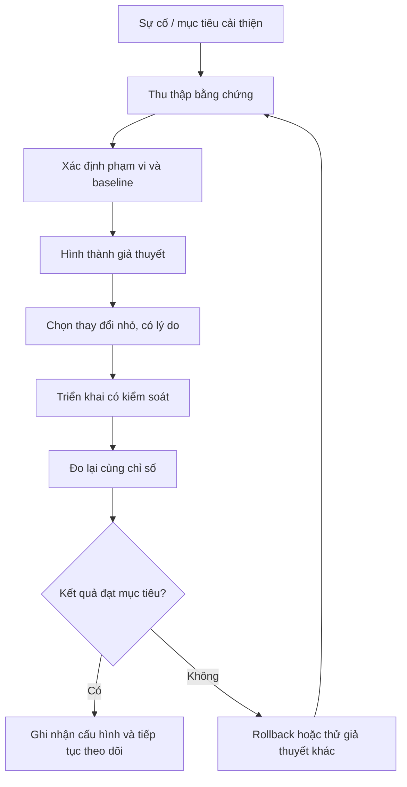
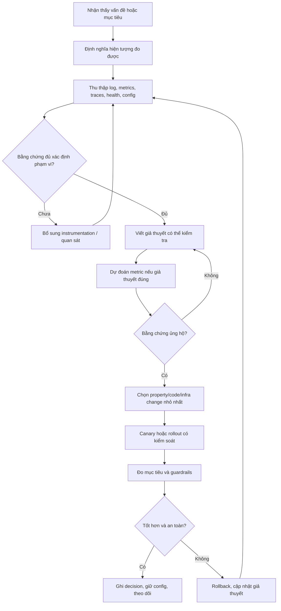

# Từ bằng chứng quan sát được đến quyết định thay đổi cấu hình

Một ứng dụng Spring Boot chạy chậm, thường xuyên timeout hoặc thỉnh thoảng không khởi động được. Một đề xuất quen thuộc xuất hiện rất nhanh: tăng connection pool, tăng số thread, đổi timeout, bật thêm log hoặc thêm một profile mới. Những thay đổi này có thể hữu ích, nhưng nếu chưa hiểu hiện tượng và nguyên nhân, chúng cũng có thể làm hệ thống tốn tài nguyên hơn, che giấu lỗi hoặc khiến sự cố lan rộng.

Trong thiết kế và vận hành ứng dụng, quyết định cấu hình nên bắt đầu từ **bằng chứng quan sát được**: log, metric, trace, health indicator, thông tin runtime và điều kiện triển khai. Sau đó ta hình thành giả thuyết, xác định thuộc tính có liên quan, thay đổi trong phạm vi kiểm soát và đo lại kết quả.

Quy trình này giúp phân biệt:

- Ứng dụng thực sự thiếu tài nguyên hay chỉ đang chờ một dependency bên ngoài.
- Timeout quá ngắn hay hệ thống downstream đang phản hồi chậm.
- Thread pool thiếu worker hay worker bị giữ bởi tác vụ blocking.
- Một auto-configuration không được áp dụng hay Bean bị ghi đè bởi cấu hình khác.
- Cần thay đổi property hay phải sửa code, kiến trúc hoặc hạ tầng.

Bài học tập trung vào cách đi từ tín hiệu quan sát đến quyết định cấu hình có lý do, có thể kiểm chứng và có thể hoàn tác trong Spring Boot.

## 1. Vì sao không nên thay đổi cấu hình theo cảm tính?

Giả sử một API đôi lúc trả HTTP 503. Một cách phản ứng là tăng:

```properties
spring.datasource.hikari.maximum-pool-size=50
```

Nhưng nếu nguyên nhân thực tế là database đã đạt giới hạn connection, tăng pool của từng instance có thể làm tổng số connection vượt giới hạn nhanh hơn.

Hoặc ứng dụng bị timeout khi gọi một dịch vụ thanh toán. Tăng HTTP client timeout từ 2 giây lên 30 giây có thể giảm số lỗi timeout quan sát được, nhưng cũng có thể khiến request giữ thread lâu hơn, làm hàng đợi tăng và tạo ra một sự cố nghẽn lớn hơn.

Một thay đổi cấu hình có thể:

- Cải thiện đúng vấn đề.
- Chỉ làm triệu chứng biến mất tạm thời.
- Dịch chuyển điểm nghẽn sang thành phần khác.
- Tăng chi phí CPU, memory, connection hoặc network.
- Làm giảm khả năng phát hiện lỗi thật.
- Tạo khác biệt giữa local, test, staging và production.

Vì vậy, trước khi chỉnh property, hãy trả lời ba câu hỏi:

1. **Quan sát được điều gì?** Có log, metric, trace, timestamp hoặc lỗi cụ thể nào?
2. **Giả thuyết nào giải thích được bằng chứng?** Có thể kiểm tra giả thuyết đó bằng phép đo nào?
3. **Thay đổi nào tác động đúng nguyên nhân và làm sao xác nhận kết quả?**



Đây là một vòng lặp điều tra và học hỏi. Mục tiêu không phải thay đổi càng nhiều property càng tốt, mà là tìm ra thay đổi có quan hệ nhân quả rõ ràng với kết quả mong muốn.

## 2. Bằng chứng quan sát được gồm những gì?

Không có một loại tín hiệu nào giải thích được mọi vấn đề. Mỗi nguồn dữ liệu trả lời một nhóm câu hỏi.

| Nguồn | Cho biết điều gì? | Ví dụ câu hỏi |
|---|---|---|
| Log | Sự kiện, exception, thông điệp theo thời gian | Lỗi xuất hiện ở bước nào? |
| Metrics | Số đo tổng hợp theo thời gian | Latency, throughput, error rate, queue depth thay đổi ra sao? |
| Distributed traces | Đường đi của một request qua nhiều service | Thời gian bị tiêu tốn ở service nào? |
| Health indicators | Trạng thái thành phần mà ứng dụng kiểm tra | Database/cache có đang kết nối được không? |
| JVM/runtime data | Heap, GC, thread, class loading, CPU | Có memory pressure hoặc thread contention không? |
| Configuration evidence | Giá trị property hiệu lực và nguồn cấu hình | Property nào đang thực sự được dùng? |
| Deployment evidence | Phiên bản image, profile, replica, resource limit | Chỉ instance hoặc phiên bản nào bị ảnh hưởng? |

Một log báo timeout cho biết request đã không hoàn tất đúng hạn, nhưng chưa chắc cho biết vì sao. Một metric latency tăng cho thấy hiện tượng có tính hệ thống, nhưng trace mới có thể chỉ ra thời gian chờ ở downstream. Một health indicator DOWN cho biết thành phần không đạt điều kiện health đã khai báo, nhưng không tự xác định được nên tăng timeout hay sửa network.

### Bằng chứng cần có ngữ cảnh

Một số dòng log:

```text
2026-11-13 10:21:04.110 WARN  PaymentClient - Request timed out
2026-11-13 10:21:04.115 INFO  OrderService - Order processing completed
```

Hai dòng trên chưa đủ để kết luận request timeout không ảnh hưởng nghiệp vụ. Có thể log thứ hai thuộc một request khác. Cần correlation ID/trace ID hoặc request ID để ghép đúng các sự kiện.

Ví dụ log có ngữ cảnh:

```text
traceId=8f21... spanId=31ab...
orderId=ORD-1042 operation=authorize
downstream=payment-provider duration=2000ms outcome=timeout
```

Trong thực tế, nên dùng structured logging và tracing context thay vì tự ghép chuỗi tùy tiện. Không đưa token, password, thông tin thẻ hoặc dữ liệu cá nhân nhạy cảm vào log chỉ để tăng khả năng quan sát.

## 3. Xác định baseline trước khi thay đổi

Baseline là trạng thái đo được trước khi thay đổi. Không có baseline, bạn khó biết cấu hình mới có cải thiện hay chỉ trùng với lúc traffic giảm.

Một baseline tối thiểu nên có:

- Thời gian quan sát và múi giờ.
- Phiên bản ứng dụng, profile và môi trường.
- Số instance/replica và giới hạn CPU/memory.
- Traffic: request per second, loại request, kích thước dữ liệu.
- Latency p50/p95/p99 nếu có.
- Error rate và loại exception.
- Các metric liên quan tới nghi ngờ như connection active/pending, thread busy/queue, heap/GC.
- Trạng thái dependency ngoài như database, cache, payment provider.

Ví dụ bảng baseline:

| Chỉ số | Trước thay đổi | Khoảng thời gian | Phạm vi |
|---|---:|---|---|
| Request rate | 180 req/s | 15 phút | 3 replicas |
| p95 latency | 1.4 s | 15 phút | POST /orders |
| Error rate | 2.1% | 15 phút | HTTP 5xx + timeout |
| Hikari active | 20/20 | 15 phút | Mỗi instance |
| Hikari pending | p95 = 8 | 15 phút | Mỗi instance |
| CPU | 45% | 15 phút | Container |

Các số liệu trên chỉ là ví dụ. Khi đo thật, hãy so sánh cùng loại traffic, cùng phiên bản code và điều kiện môi trường gần tương đương.

### Không chỉ so sánh một giá trị trung bình

Average latency có thể trông tốt dù một nhóm nhỏ request bị chậm nghiêm trọng. p95/p99 giúp quan sát tail latency. Tương tự, CPU trung bình thấp không loại trừ một khoảng spike ngắn làm timeout request.

Đừng chọn metric chỉ vì nó dễ xem. Chọn metric liên quan trực tiếp tới giả thuyết đang kiểm tra.

## 4. Phân biệt triệu chứng, nguyên nhân gần và nguyên nhân gốc

Một sự cố thường có nhiều tầng:

```text
Triệu chứng:
  POST /orders trả 503

Nguyên nhân gần:
  Không lấy được database connection trong thời hạn chờ

Nguyên nhân sâu hơn có thể là:
  - Query giữ connection quá lâu
  - Database quá tải
  - Pool quá nhỏ so với tải thực tế
  - Quá nhiều replica cùng mở pool lớn
  - Connection bị rò rỉ
  - Database network chập chờn
```

Chỉ thấy 503 rồi tăng pool là nhảy từ triệu chứng sang một phương án chưa được chứng minh. Ta cần thêm bằng chứng để phân biệt các nguyên nhân.

### Một giả thuyết tốt có thể bị bác bỏ

Ví dụ:

**Giả thuyết:** request chờ vì Hikari pool cạn connection.

**Bằng chứng cần tìm:**

- Active thường xuyên bằng maximumPoolSize.
- Pending tăng trong cùng thời gian p95 latency tăng.
- Trace cho thấy thời gian chờ lấy connection đáng kể.
- Database vẫn có capacity và không bị giới hạn connection ở phía server.

**Bằng chứng phản bác:**

- Pool còn nhiều connection rảnh.
- Pending bằng 0 trong lúc request timeout.
- Trace cho thấy phần lớn thời gian nằm ở HTTP call tới payment provider.

Nếu bằng chứng phản bác xuất hiện, không nên tăng pool chỉ vì tên lỗi có chữ “connection” ở một thành phần khác.

## 5. Dùng Spring Boot Actuator để quan sát runtime

Actuator cung cấp các endpoint để xem health, metrics, environment/configuration và các thông tin quản trị khác. Ví dụ dependency:

```groovy
dependencies {
    implementation 'org.springframework.boot:spring-boot-starter-actuator'
}
```

Một số endpoint thường dùng:

| Endpoint ID | Mục đích |
|---|---|
| `health` | Trạng thái sức khỏe ứng dụng |
| `metrics` | Liệt kê và đọc metric qua Micrometer |
| `prometheus` | Xuất metric cho Prometheus khi có registry phù hợp |
| `env` | Quan sát Environment và property sources theo chính sách bảo mật |
| `configprops` | Xem các `@ConfigurationProperties` đã bind |
| `loggers` | Xem hoặc thay đổi log level khi endpoint được phép |
| `threaddump` | Điều tra thread state |
| `heapdump` | Phân tích heap; chứa dữ liệu trong bộ nhớ nên rất nhạy cảm |

Không phải endpoint nào cũng được expose mặc định. Với Spring Boot hiện đại, HTTP exposure mặc định thường chỉ gồm `health`. Khi cần thêm endpoint, cấu hình allowlist:

```properties
management.endpoints.web.exposure.include=health,metrics,configprops
```

Hoặc YAML:

```yaml
management:
  endpoints:
    web:
      exposure:
        include: health,metrics,configprops
```

Chỉ expose endpoint cần thiết, bảo vệ bằng authentication/authorization và giới hạn network. Các endpoint env, heapdump, configprops hoặc loggers có thể tiết lộ thông tin nhạy cảm hay thay đổi hành vi runtime.

### Health trả lời một câu hỏi hẹp

Ví dụ:

```bash
curl http://localhost:8080/actuator/health
```

Health UP cho biết các health indicator đang được tổng hợp đạt trạng thái UP theo cấu hình. Nó không chứng minh mọi use case nghiệp vụ đều hoạt động, cũng không cho biết latency của từng endpoint.

Một health indicator database DOWN là bằng chứng về kiểm tra database, nhưng cần xem component nào fail, exception nào, và thời điểm xảy ra. Không nên tăng timeout chỉ để health chuyển sang UP nếu nguyên nhân thực là credential sai hoặc database không reachable.

## 6. Metrics giúp phân biệt nghẽn tài nguyên

Metrics là số đo có thể theo dõi theo thời gian. Micrometer là facade instrumentation được Spring Boot tích hợp.

Ví dụ xem danh sách metric:

```text
GET /actuator/metrics
```

Xem một metric cụ thể:

```text
GET /actuator/metrics/jvm.memory.used
GET /actuator/metrics/http.server.requests
```

Tên và tag thực tế phụ thuộc registry, instrumentation, framework version và cấu hình. Không nên giả định mọi ứng dụng đều có mọi metric hoặc metric có cùng tên ở mọi phiên bản.

Một số nhóm metric hữu ích:

| Nhóm | Câu hỏi |
|---|---|
| HTTP server | Request rate, latency, status code theo route/method |
| Database pool | Connection active, idle, pending, timeout |
| JVM memory | Heap usage, non-heap, allocation |
| Garbage collection | Pause duration, frequency, allocation pressure |
| Threads/executors | Active threads, queue size, rejected tasks |
| Cache | Hit/miss, eviction, size nếu được instrument |
| HTTP client | Request duration, error, connection pool nếu có instrumentation |

### Metrics phải được đọc theo mối liên hệ

Ví dụ:

```text
Hikari active connections ↑
Hikari pending threads ↑
Request p95 latency ↑
CPU database ↑
```

Tổ hợp này gợi ý connection contention hoặc database saturation. Nhưng nếu:

```text
Hikari active connections ổn định
Hikari pending = 0
HTTP client latency tới payment provider ↑
Request p95 latency ↑
```

thì tăng database pool không có cơ sở. Cần điều tra downstream HTTP call.

### Cẩn thận với metric cardinality

Không tạo metric tag theo giá trị gần như duy nhất như user ID, order ID hoặc raw URL chứa path parameter. Số lượng time series có thể tăng rất lớn, làm tốn memory và chi phí monitoring. Dùng route template, operation name và tag có tập giá trị giới hạn.

## 7. Logs và traces giúp tìm vị trí thời gian bị tiêu tốn

Log mô tả sự kiện; trace mô tả một request đi qua nhiều span. Khi có distributed tracing, một trace có thể trông như:

```text
POST /orders                       2.4 s
├── validate request               4 ms
├── reserve inventory             80 ms
│   └── database query            65 ms
├── authorize payment           2.1 s
│   └── HTTP payment provider    2.0 s
└── persist order                 90 ms
```

Nếu phần lớn thời gian nằm ở payment provider, điều chỉnh Hikari pool không giải quyết đúng điểm nghẽn. Có thể cần:

- Kiểm tra latency và lỗi của provider.
- Xác định timeout hiện tại ở HTTP client.
- Kiểm tra retry có làm request kéo dài hoặc nhân tải không.
- Xem có thể xử lý bất đồng bộ theo yêu cầu nghiệp vụ không.
- Xem lại deadline tổng thể của request.

Trace có thể bị sampling; không phải mọi request đều có trace. Khi kết luận, hãy xem sampling policy và kết hợp log/metrics.

### Log level cũng là cấu hình cần có lý do

Nếu cần thêm log để điều tra, bật DEBUG cho package cụ thể:

```properties
logging.level.com.example.shop.payment=DEBUG
```

Không mặc định dùng:

```properties
logging.level.root=DEBUG
```

vì root DEBUG có thể tạo lượng log lớn từ framework và dependency. Sau khi thu thập đủ bằng chứng, đưa mức log về trạng thái vận hành bình thường. Tránh log credential, token, payload nhạy cảm và dữ liệu cá nhân.

## 8. Xác định cấu hình thực sự có hiệu lực

Trong Spring Boot, giá trị property có thể đến từ nhiều nguồn:

- application.properties hoặc application.yml.
- File theo profile như application-prod.yml.
- Environment variables.
- JVM system properties.
- Command-line arguments.
- Config data import hoặc nguồn cấu hình ngoài.
- Test property sources và các nguồn được ứng dụng thêm vào.

Khi cùng một key xuất hiện ở nhiều nguồn, quy tắc precedence quyết định giá trị hiệu lực. Vì vậy đọc một file cấu hình chưa đủ để khẳng định runtime đang dùng giá trị đó.

Ví dụ:

```properties
# application.properties
server.port=8080
```

Trong deployment, command line có thể override:

```bash
java -jar app.jar --server.port=8181
```

Hoặc biến môi trường tương ứng có thể cung cấp giá trị khác. Hãy kiểm tra cấu hình của process đang chạy và nguồn cấu hình thật sự.

### Dùng configprops và env một cách có kiểm soát

Endpoint /actuator/configprops có thể giúp quan sát các configuration properties đã bind. Endpoint /actuator/env giúp điều tra Environment và property sources. Những endpoint này có khả năng tiết lộ cấu hình, nên không expose công khai và phải xem cách sanitization hoạt động.

Trong một môi trường phát triển được bảo vệ, có thể dùng:

```text
GET /actuator/configprops
GET /actuator/env/spring.datasource.hikari.maximum-pool-size
```

URL cụ thể và nội dung response phụ thuộc phiên bản, exposure và security. Nếu endpoint bị chặn, có thể kiểm tra log khởi động hoặc dùng debugger/test để đọc Bean properties thay vì mở rộng quyền truy cập production chỉ để xem một giá trị.

### @ConfigurationProperties giúp gom cấu hình có kiểu

Thay vì rải nhiều @Value, có thể nhóm các property liên quan:

```java
@ConfigurationProperties(prefix = "app.payment")
public record PaymentClientProperties(
        URI baseUrl,
        Duration connectTimeout,
        Duration readTimeout,
        int maxAttempts
) {}
```

Đăng ký bằng @ConfigurationPropertiesScan hoặc @EnableConfigurationProperties. Có thể thêm validation để ngăn cấu hình thiếu/sai:

```java
@Validated
@ConfigurationProperties(prefix = "app.payment")
public record PaymentClientProperties(
        @NotNull URI baseUrl,
        @NotNull Duration connectTimeout,
        @NotNull Duration readTimeout,
        @Min(1) @Max(5) int maxAttempts
) {}
```

Ví dụ giả định import jakarta.validation.constraints.* và có validation provider. Cấu hình có kiểu giúp biết property nào thuộc cùng một chức năng, dễ review và kiểm thử hơn.

## 9. Condition Evaluation Report: bằng chứng cho quyết định auto-configuration

Khi một Bean tự động không xuất hiện, cần biết auto-configuration có được áp dụng không và điều kiện nào không khớp.

Chạy:

```bash
java -jar app.jar --debug
```

Spring Boot có thể xuất Condition Evaluation Report với các nhóm điều kiện tích cực/tiêu cực. Ví dụ minh họa:

```text
Positive matches:
  DataSourceAutoConfiguration:
    - Required classes found

Negative matches:
  SomeCacheAutoConfiguration:
    - Did not find required class '...CacheClient'
```

Điều này giúp trả lời:

- Auto-configuration có được xét không?
- Class cần thiết có trên classpath không?
- Một Bean do ứng dụng khai báo có làm @ConditionalOnMissingBean không còn khớp không?
- Property điều kiện có được đặt đúng không?
- Ứng dụng có đúng loại web environment mà auto-configuration yêu cầu không?

Spring Boot debug mode không tương đương logging.level.root=DEBUG. Nó phục vụ chẩn đoán Boot và condition report; logger nghiệp vụ vẫn cần mức log riêng nếu muốn xem log.debug.

Nếu bằng chứng cho thấy class không có trên classpath, thay đổi timeout hay port sẽ không giúp. Nếu condition bị một Bean tùy chỉnh làm mất hiệu lực, cần quyết định giữ Bean tùy chỉnh hay để Boot tạo Bean mặc định.

## 10. Quy trình biến bằng chứng thành một quyết định cấu hình

Một quy trình thực tế có thể chia thành bảy bước:

### Bước 1 — Mô tả hiện tượng bằng câu có thể đo

Tránh mô tả chung như “app chậm”. Hãy cụ thể:

> Trong 15 phút có traffic bình thường, p95 của POST /orders tăng từ 450 ms lên 2,3 s và error rate timeout tăng từ 0,2% lên 3%.

Đây là một hiện tượng có thời gian, endpoint, metric và phạm vi rõ.

### Bước 2 — Khoanh vùng

Xác định:

- Tất cả instance hay chỉ một instance?
- Tất cả endpoint hay một route?
- Bắt đầu từ phiên bản deploy nào?
- Chỉ một profile/region/tenant?
- Có thay đổi traffic, database, network hoặc downstream cùng thời điểm?

Phạm vi hẹp giúp giảm số giả thuyết.

### Bước 3 — Lấy bằng chứng liên quan

Kết hợp log, metrics, trace, health và runtime configuration. Đảm bảo cùng khoảng thời gian và cùng phiên bản.

### Bước 4 — Viết giả thuyết và dự đoán

Ví dụ:

**Giả thuyết:** pool database quá nhỏ so với concurrency hiện tại.

**Dự đoán nếu giả thuyết đúng:** Hikari pending tăng cùng lúc active chạm max; trace có thời gian chờ connection; database còn capacity.

Một giả thuyết tốt phải tạo ra dự đoán có thể kiểm tra.

### Bước 5 — Chọn thay đổi nhỏ nhất có tác động đúng

Nếu evidence xác nhận pool chạm giới hạn nhưng database còn capacity và query time ổn định, có thể thử tăng pool vừa phải ở một nhóm instance. Nếu database đã quá tải, thay đổi đúng có thể là giảm concurrency, tối ưu query hoặc giới hạn request.

### Bước 6 — Triển khai có kiểm soát và đo lại

Giữ nguyên các điều kiện khác nếu có thể. So sánh cùng metric, cùng loại traffic, cùng khoảng thời gian. Theo dõi cả chỉ số mục tiêu và chỉ số phụ có thể bị ảnh hưởng.

### Bước 7 — Giữ, điều chỉnh hoặc rollback

Nếu mục tiêu đạt và không có tác động phụ đáng kể, ghi nhận cấu hình, lý do, phạm vi và người chịu trách nhiệm. Nếu không, rollback và quay lại giả thuyết. Không giữ một thay đổi chỉ vì đã tốn công triển khai.

## 11. Ví dụ điều tra: có nên tăng Hikari connection pool?

Spring Boot thường dùng HikariCP khi có JDBC datasource phù hợp. Một số property:

```properties
spring.datasource.hikari.maximum-pool-size=20
spring.datasource.hikari.minimum-idle=5
spring.datasource.hikari.connection-timeout=30000
```

Ý nghĩa:

- maximum-pool-size: số connection tối đa của pool.
- minimum-idle: số connection idle mục tiêu tối thiểu.
- connection-timeout: thời gian tối đa chờ lấy connection từ pool trước khi lỗi.

Giả sử thấy request timeout và nghi pool cạn.

### Bằng chứng cần xem

- hikaricp.connections.active.
- hikaricp.connections.idle.
- hikaricp.connections.pending.
- hikaricp.connections.max.
- Connection timeout logs.
- Query latency và database CPU/connection count.

Tên metric cụ thể có thể khác theo Micrometer/registry và phiên bản. Hãy kiểm tra metric thực tế của ứng dụng.

### Trường hợp A — Có cơ sở tăng pool

Giả sử:

| Chỉ số | Quan sát |
|---|---|
| Active | Chạm 20 trong phần lớn thời gian cao điểm |
| Idle | Thường xuyên 0 |
| Pending | Tăng cùng thời điểm request latency tăng |
| Database CPU | Còn headroom |
| Query duration | Ổn định |
| DB connection limit | Còn dư đáng kể |

Đây là bằng chứng pool có thể là điểm nghẽn. Có thể thử tăng từ 20 lên một giá trị vừa phải, chẳng hạn 24, ở một canary instance trước.

```properties
spring.datasource.hikari.maximum-pool-size=24
```

Sau đó đo lại pending, latency, DB CPU, connection count và error rate. Nếu pending giảm nhưng DB CPU/latency tăng mạnh, pool lớn hơn có thể đã chuyển nghẽn sang database.

### Trường hợp B — Không nên tăng pool

Giả sử:

| Chỉ số | Quan sát |
|---|---|
| Active | 12/20 |
| Idle | 8 |
| Pending | 0 |
| Database CPU | 95% |
| Query duration | Tăng 4 lần |

Pool chưa cạn. Tăng maximum pool có thể khiến database nhận thêm concurrency khi đã quá tải. Hướng điều tra phù hợp hơn là query plan, index, lock contention, database capacity và workload.

### Tính tổng connection của nhiều replica

Không chỉ nhìn pool size của một instance. Nếu:

- 6 replicas.
- Mỗi replica có maximum-pool-size=24.
- Mỗi instance có thể mở tới 24 connection.

thì tổng tiềm năng là:

```text
6 × 24 = 144 connections
```

Con số này chưa tính các ứng dụng khác, migration jobs, admin tools và monitoring. Cần so với giới hạn database và phân bổ connection cho toàn hệ thống.

**Quyết định cấu hình pool là quyết định ở cấp toàn hệ thống**, không phải chỉ một property trong một JVM.

## 12. Ví dụ điều tra: tăng HTTP client timeout hay sửa downstream?

Giả sử payment provider đôi lúc phản hồi sau 2,5 giây, trong khi client timeout là 2 giây.

Một property minh họa cho client được cấu hình riêng:

```yaml
app:
  payment:
    connect-timeout: 500ms
    read-timeout: 2s
```

Đây là property tùy ứng dụng, cần được bind vào client cụ thể; nó không phải property chuẩn chung cho mọi HTTP client của Spring Boot.

### Bằng chứng cần phân biệt

- Connect time: mất bao lâu để thiết lập kết nối?
- Response/read time: sau khi kết nối, mất bao lâu để nhận phản hồi?
- DNS/TLS: có độ trễ ở bước phân giải hoặc bắt tay không?
- Retry: có bao nhiêu lần thử cho một thao tác?
- Deadline tổng: toàn bộ request được phép kéo dài bao lâu?
- Downstream latency/error: provider có đang suy giảm không?

Nếu connect time thấp nhưng response time tăng, tăng connect timeout không đúng mục tiêu. Nếu provider có p99 cao hơn timeout hiện tại, cần phối hợp với provider và thiết kế deadline/retry.

### Timeout phải nhất quán theo chuỗi

Ví dụ:

```text
Client → API Gateway → Spring Boot → Payment Provider

Gateway timeout:        5 s
Application deadline:  4 s
Payment client timeout: 3 s
```

Nếu payment client timeout dài hơn gateway timeout, client có thể vẫn chờ trong khi gateway đã trả lỗi cho người gọi. Nếu retry không được giới hạn, một request có thể tạo nhiều lần gọi downstream và khuếch đại tải.

Chọn timeout dựa trên latency distribution, SLA, deadline của caller và thời gian còn lại cho các bước sau. Không chỉ tăng mọi timeout để giảm số exception.

### Retry và idempotency

Retry chỉ phù hợp khi lỗi có thể phục hồi và thao tác được thiết kế an toàn khi thử lại. Với thanh toán hoặc tạo đơn, cần idempotency key/đảm bảo không ghi nhận hai lần. Tăng retry count mà không kiểm tra idempotency có thể tạo giao dịch trùng.

Nếu provider chậm kéo dài, circuit breaker, bulkhead, queue hoặc xử lý bất đồng bộ có thể phù hợp hơn việc giữ request thread chờ lâu hơn. Mỗi cơ chế cần metric và giới hạn rõ ràng.

## 13. Ví dụ điều tra: tăng thread pool hay xử lý blocking?

Ứng dụng Servlet thường dùng request threads của embedded server. Nếu thread pool cạn, request mới có thể phải chờ hoặc bị từ chối tùy server/configuration.

Một số property tùy server:

```properties
server.tomcat.threads.max=200
server.tomcat.threads.min-spare=10
```

Các property này áp dụng khi ứng dụng dùng embedded Tomcat và phiên bản Boot tương ứng. Không áp dụng y nguyên cho Jetty, Undertow hoặc WebFlux/Netty.

### Bằng chứng cần thu thập

- Thread dump: thread đang RUNNABLE, BLOCKED hay WAITING?
- Số thread busy/active và queue.
- Request latency theo route.
- CPU và memory.
- Downstream latency.
- Số lượng request đồng thời.

Nếu thread chủ yếu chờ JDBC hoặc HTTP response, tăng max threads có thể chỉ cho phép nhiều request cùng chờ hơn. Điều đó có thể làm tăng connection contention, memory và áp lực lên downstream.

Nếu CPU có headroom, tác vụ ngắn và queue đang đầy vì concurrency giới hạn thấp, tăng vừa phải có thể giúp. Nếu CPU đã bão hòa, thêm thread thường làm context switching tăng.

### Phân biệt Tomcat threads với task executor

server.tomcat.threads.max điều chỉnh worker threads của embedded Tomcat. Nó không tự điều chỉnh mọi @Async, scheduler hoặc message listener executor trong ứng dụng.

Các nhóm này có cấu hình riêng. Trước khi thay property, hãy xác định thread pool nào đang cạn và metric/thread dump nào chứng minh điều đó.

## 14. Ví dụ điều tra: có nên bật thêm endpoint Actuator?

Đội vận hành muốn biết ứng dụng có đang nhận request và database có kết nối được không. Một quyết định hợp lý có thể là expose health và metrics cần thiết:

```properties
management.endpoints.web.exposure.include=health,metrics
```

Nếu cần Prometheus scrape, thêm registry phù hợp và expose endpoint prometheus:

```groovy
dependencies {
    implementation 'org.springframework.boot:spring-boot-starter-actuator'
    runtimeOnly 'io.micrometer:micrometer-registry-prometheus'
}
```

```properties
management.endpoints.web.exposure.include=health,prometheus
```

Không nên mở mọi endpoint chỉ vì muốn tìm một metric:

```properties
management.endpoints.web.exposure.include=*
```

Điều này có thể mở rộng bề mặt tấn công và làm lộ thông tin runtime. Hãy xác định metric/endpoint cần thiết, bảo vệ management server và giới hạn network.

Nếu health endpoint chỉ trả UP, đó là một tín hiệu tổng hợp. Muốn xác định DB pool hoặc latency, cần metrics/traces tương ứng; không nên cố làm health response chứa mọi thông tin chỉ để dùng như dashboard.

## 15. Ví dụ điều tra: vì sao một cấu hình không có hiệu lực?

Giả sử bạn sửa:

```yaml
spring:
  datasource:
    hikari:
      maximum-pool-size: 24
```

nhưng runtime vẫn hiển thị pool max là 10.

Có nhiều khả năng:

- File YAML không được load.
- Profile khác đang active và override property.
- Environment variable hoặc command line có ưu tiên cao hơn.
- Ứng dụng dùng prefix/property khác do cấu hình datasource tùy chỉnh.
- Bean datasource được tạo thủ công và không bind vào spring.datasource.hikari.*.
- Ứng dụng đang chạy artifact/configmap cũ.
- Bạn đang xem nhầm instance hoặc nhầm môi trường.

Quy trình:

1. Xác định process/instance và version đang chạy.
2. Xem active profiles và config locations/imports.
3. Kiểm tra property source/giá trị hiệu lực bằng công cụ an toàn.
4. Kiểm tra DataSource thực tế và Hikari pool được tạo ra.
5. Xác định Bean có dùng Boot auto-configuration hay được khai báo thủ công.
6. Kiểm tra deployment manifest/config map/secret đã cập nhật và rollout thành công chưa.

Không sửa thêm nhiều file cấu hình trước khi biết nguồn nào đang thắng. Nếu có nhiều nguồn cùng đặt một property, hãy ghi rõ source-of-truth để tránh drift.

## 16. Cấu hình theo profile: môi trường khác nhau nhưng cùng một hợp đồng

Profile phù hợp khi các môi trường cần tập cấu hình hoặc implementation khác nhau:

```yaml
# application.yml
app:
  payment:
    connect-timeout: 500ms
    read-timeout: 2s
```

```yaml
# application-dev.yml
app:
  payment:
    base-url: http://localhost:9091
```

```yaml
# application-prod.yml
app:
  payment:
    base-url: https://payments.internal.example
```

Kích hoạt profile qua deployment configuration:

```bash
java -jar app.jar --spring.profiles.active=prod
```

Không nên hardcode profile production trong source. Cùng một artifact có thể chạy ở nhiều môi trường với cấu hình do hệ thống triển khai cung cấp.

### Không dùng profile cho mọi feature toggle

Nếu chỉ cần bật/tắt một feature độc lập:

```properties
app.invoice-export.enabled=true
```

thì ConditionalOnProperty hoặc một feature-flag mechanism có thể rõ ràng hơn việc tạo profile mới. Profile nên thể hiện một nhóm cấu hình/môi trường có ý nghĩa, không trở thành nơi chứa hàng trăm công tắc không liên quan.

## 17. Phân biệt thay đổi cấu hình với thay đổi code

Không phải vấn đề nào cũng giải quyết được bằng property.

| Bằng chứng | Có thể là thay đổi phù hợp | Khi nào cần sửa code/kiến trúc |
|---|---|---|
| Pool chạm max, DB còn capacity | Điều chỉnh pool có kiểm soát | Query giữ connection quá lâu hoặc connection leak |
| Downstream p99 tăng, timeout quá ngắn so với SLA | Điều chỉnh timeout/deadline | Cần async workflow, bulkhead hoặc xử lý lỗi khác |
| Thread pool thiếu worker, CPU còn headroom | Điều chỉnh concurrency có giới hạn | Blocking call hoặc tác vụ giữ thread quá lâu |
| Bean auto-config không khớp property | Sửa property/classpath/condition | Cần custom implementation hoặc dependency architecture |
| Log thiếu chi tiết ở package cụ thể | Bật logger package tạm thời | Cần thêm instrumentation/log có cấu trúc |
| Health endpoint không tới được từ monitor | Sửa path/port/network/security | Thiết kế management access/probe chưa phù hợp |
| Memory tăng theo thời gian | Điều chỉnh heap chỉ khi sizing có căn cứ | Object retention/leak hoặc cache không giới hạn |

Một property có thể điều chỉnh giới hạn, nhưng không sửa được logic gây lãng phí tài nguyên. Ví dụ tăng heap có thể trì hoãn OOM do memory leak, nhưng không loại bỏ leak.

## 18. Thay đổi một biến tại một thời điểm

Khi có thể, chỉ thay đổi một nhóm cấu hình liên quan trong một đợt thử. Nếu cùng lúc tăng pool, timeout, thread count và retry count, kết quả tốt hay xấu đều khó quy nguyên nhân cho một thay đổi.

Một thử nghiệm có thể được mô tả:

| Thành phần | Nội dung |
|---|---|
| Hiện tượng | p95 của POST /orders tăng |
| Bằng chứng | Hikari pending tăng, active chạm max, DB còn capacity |
| Giả thuyết | Pool size hiện tại giới hạn concurrency |
| Thay đổi | Tăng maximum pool từ 20 lên 24 trên một canary |
| Chỉ số thành công | Pending giảm, p95 giảm |
| Guardrails | DB CPU, DB connections, error rate, memory |
| Thời gian quan sát | 15–30 phút traffic tương đương |
| Rollback | Trả pool size về 20 nếu guardrail vượt ngưỡng |

Giá trị thời gian chỉ là ví dụ. Cửa sổ quan sát cần đủ dài để bao phủ traffic pattern, warm-up, batch và các tác vụ định kỳ liên quan.

### Có ngoại lệ cần thay đổi nhiều property cùng lúc

Một số cấu hình tạo thành một bộ phụ thuộc, chẳng hạn đổi port và cập nhật Service/Ingress target port. Có thể phải thay nhiều thành phần trong cùng release, nhưng hãy mô tả chúng như một thay đổi có liên kết, xác định thứ tự triển khai và cách rollback đồng bộ.

## 19. Triển khai canary, rollout và rollback

Thay đổi cấu hình production nên có phạm vi tác động rõ:

- Local: kiểm tra cú pháp và hành vi cơ bản.
- Test: xác nhận binding, startup và integration.
- Staging: kiểm tra gần với topology/traffic thật.
- Canary: áp dụng lên một phần instance hoặc một nhóm traffic.
- Rollout: mở rộng khi guardrails vẫn đạt.

Một canary cần có:

1. Phiên bản code và cấu hình xác định.
2. Tỷ lệ traffic hoặc số instance được thử.
3. Chỉ số mục tiêu và ngưỡng rollback.
4. Thời gian quan sát.
5. Người theo dõi và kênh phản ứng.
6. Bản cấu hình trước đó để rollback.

Nếu thay đổi làm error rate tăng hoặc dependency quá tải, rollback sớm. Không chờ tới khi toàn bộ hệ thống suy giảm chỉ để thu thập thêm dữ liệu.

### Config rollout cũng là một lần triển khai

Một thay đổi property có thể yêu cầu restart process hoặc rollout Pod. Khi đó cần cân nhắc:

- Readiness/liveness probes.
- Graceful shutdown.
- Số replica còn phục vụ trong lúc restart.
- Khả năng tương thích của cấu hình mới với code cũ.
- Thứ tự cập nhật Secret/ConfigMap và Deployment.
- Rollback cấu hình có khôi phục được hành vi trước đó không.

Không nên xem sửa ConfigMap hoặc environment variable là thay đổi vô hại; tùy cách ứng dụng nạp cấu hình, nó có thể yêu cầu restart để có hiệu lực.

## 20. Cấu hình động và cấu hình chỉ đọc lúc startup

Không phải property nào cũng có thể thay đổi khi ứng dụng đang chạy.

Ví dụ:

- Thay logger level qua Actuator loggers có thể có hiệu lực runtime nếu endpoint được enable và bảo vệ.
- Thay server.port thường yêu cầu server khởi động lại.
- Thay management.server.port thường yêu cầu management server/context được khởi tạo lại.
- Thay pool size phụ thuộc datasource/pool implementation và cơ chế reconfiguration đang dùng; không mặc định property file thay đổi là pool tự cập nhật.
- Thay ConfigurationProperties object trong Environment không có nghĩa mọi Bean đã inject giá trị cũ tự được tạo lại.

### Environment không tự làm mới mọi Bean

Một Bean có thể nhận property trong constructor:

```java
@Component
public class PaymentClient {
    private final Duration timeout;

    public PaymentClient(
            @Value("${app.payment.read-timeout}") Duration timeout) {
        this.timeout = timeout;
    }
}
```

Giá trị được inject lúc Bean tạo. Nếu nguồn cấu hình thay đổi sau đó, field timeout không tự đổi. Cần cơ chế refresh/rebind rõ ràng hoặc tạo lại Bean/context theo thiết kế.

Vì vậy trước khi chọn quy trình vận hành, xác định property là:

- Startup-only.
- Được đọc mỗi lần operation.
- Được bind vào Bean sống lâu.
- Có cơ chế refresh được hỗ trợ.
- Được thay đổi qua management endpoint chuyên biệt.

Đừng dùng từ “dynamic config” chung chung nếu chưa biết thành phần nào thực sự nhận cập nhật.

## 21. Quản lý cấu hình như một phần của source of truth

Để quyết định có thể kiểm tra và lặp lại, cần biết cấu hình đến từ đâu và ai sở hữu:

- Default dùng chung trong repository.
- Giá trị riêng theo profile.
- Secret từ secret manager.
- Runtime override từ environment/deployment.
- Feature flag từ hệ thống quản lý flag.

Tránh để cùng một property bị định nghĩa rải rác trong nhiều file, manifest và command line mà không có quy ước. Nếu cần override, hãy ghi rõ lý do và môi trường áp dụng.

### Tên property có ý nghĩa

Các property thuộc ứng dụng nên nhóm theo chức năng:

```yaml
app:
  payment:
    base-url: https://payments.internal.example
    connect-timeout: 500ms
    read-timeout: 2s
    max-attempts: 2
  inventory:
    reservation-timeout: 1s
```

Tên rõ ràng giúp reviewer hiểu tác động. Không tạo những key mơ hồ như app.fast=true hoặc app.performance=high nếu không mô tả được chúng thay đổi thành phần nào.

### Không commit secret

Không đặt password, API token, private key hoặc credential thật trong application-prod.yml. Dùng secret manager, environment injection hoặc cơ chế bảo mật tương ứng. Khi quan sát property qua Actuator/log, xác nhận sensitive values được sanitize và endpoint được bảo vệ.

## 22. Lưu lại quyết định cấu hình

Một quyết định tốt nên ghi lại:

- Vấn đề quan sát được.
- Bằng chứng và thời gian đo.
- Giả thuyết được chọn.
- Các giả thuyết đã bị loại và bằng chứng tương ứng.
- Property trước và sau.
- Môi trường/phạm vi áp dụng.
- Chỉ số mục tiêu và guardrails.
- Kết quả sau thay đổi.
- Quyết định giữ, điều chỉnh hoặc rollback.

Ví dụ:

```markdown
### Decision: Điều chỉnh Hikari pool cho service orders

**Hiện tượng:** p95 của POST /orders tăng trong giờ cao điểm.

**Bằng chứng:** Hikari active chạm max=20, pending tăng; DB CPU còn headroom và query duration ổn định.

**Giả thuyết:** pool size giới hạn concurrency của service.

**Thay đổi:** canary tăng maximum-pool-size từ 20 lên 24.

**Guardrails:** DB CPU, tổng connection, p95, error rate.

**Kết quả:** ghi lại sau cửa sổ quan sát.

**Quyết định:** giữ/rollback dựa trên số liệu thực tế.
```

Mẫu này không cần dài. Điều quan trọng là người khác có thể hiểu vì sao property được thay và có thể kiểm tra quyết định đó sau này.

## 23. Những sai lầm thường gặp khi ra quyết định

| Sai lầm | Hệ quả | Cách làm tốt hơn |
|---|---|---|
| Tăng timeout khi chưa xem trace | Request giữ tài nguyên lâu hơn nhưng nguyên nhân vẫn còn | Xác định thời gian ở từng dependency |
| Tăng pool vì thấy timeout chung chung | Có thể làm DB quá tải | Xem active/idle/pending và DB capacity |
| Tăng thread count khi CPU đã bão hòa | Context switching và contention tăng | Đọc thread dump, CPU và downstream latency |
| Bật root DEBUG trong production | Log lớn, dễ lộ dữ liệu | Bật logger hẹp, có thời hạn |
| Expose tất cả Actuator endpoint để tiện xem | Tăng bề mặt tấn công | Allowlist endpoint, bảo vệ network/security |
| Sửa nhiều property trong một đợt | Không biết thay đổi nào tạo tác động | Thử nghiệm có kiểm soát |
| Chỉ nhìn average | Bỏ qua tail latency | Theo dõi p95/p99 và phân vị phù hợp |
| Chỉ nhìn một instance | Bỏ sót vấn đề lệch tải hoặc cấu hình drift | So sánh theo instance/version/zone |
| Không kiểm tra giá trị hiệu lực | Sửa nhầm file hoặc property bị override | Kiểm tra Environment/deployment source |
| Giữ config mới dù metric xấu hơn | Tăng nợ vận hành | Có rollback threshold trước khi triển khai |
| Nhầm health UP với nghiệp vụ khỏe | Bỏ qua lỗi ở route/dependency khác | Kết hợp health, metrics, traces và synthetic checks |
| Dùng profile cho mọi feature toggle | Quá nhiều tổ hợp cấu hình | Dùng property/conditional/feature flag phù hợp |

## 24. Bài thực hành: điều tra một API chậm

Giả sử một service Spring Boot có endpoint:

```text
POST /orders
```

Sau một đợt tăng traffic, p95 tăng từ 500 ms lên 2 giây. Hãy thực hiện theo các bước:

1. Xác định thời gian bắt đầu và phiên bản deploy.
2. So sánh request rate, p50/p95/p99 và error rate trước/sau.
3. Xem trace của một số request chậm; xác định span chiếm thời gian lớn nhất.
4. Nếu nghi database, xem Hikari active/idle/pending và database CPU/connection.
5. Nếu nghi payment provider, xem downstream latency, timeout và retry count.
6. Ghi ít nhất hai giả thuyết và nêu bằng chứng có thể bác bỏ mỗi giả thuyết.
7. Chọn một thay đổi nhỏ nhất phù hợp với bằng chứng.
8. Thử ở local/staging hoặc canary.
9. Đo lại cùng các metric và theo dõi guardrails.
10. Quyết định giữ hay rollback, rồi ghi lại lý do.

Mẫu ghi nhận:

| Câu hỏi | Kết quả |
|---|---|
| Hiện tượng đo được | ... |
| Phiên bản/profile/replica | ... |
| Trace chỉ ra span nào chậm? | ... |
| Pool/thread/downstream có tín hiệu gì? | ... |
| Giả thuyết chính | ... |
| Bằng chứng ủng hộ | ... |
| Bằng chứng phản bác | ... |
| Property dự kiến thay đổi | ... |
| Chỉ số thành công | ... |
| Guardrails | ... |
| Kết quả sau thử nghiệm | ... |
| Quyết định cuối | ... |

Không có đáp án cố định rằng phải tăng pool hay timeout. Mục tiêu bài thực hành là đưa ra quyết định có thể giải thích bằng số liệu thu được.

## 25. Sơ đồ ra quyết định tổng hợp



## 26. Ghi nhớ

Một quyết định cấu hình có chất lượng bắt đầu từ hiện tượng đo được, không bắt đầu từ một property quen thuộc.

- Dùng **logs** để hiểu sự kiện và exception.
- Dùng **metrics** để nhận biết xu hướng, saturation và tail latency.
- Dùng **traces** để xác định thành phần nào chiếm thời gian của request.
- Dùng **health** để quan sát trạng thái theo các indicator đã định nghĩa.
- Dùng **runtime/configuration evidence** để biết giá trị nào đang có hiệu lực và Bean nào thực sự được tạo.
- Dùng **deployment evidence** để hiểu phiên bản, profile, replica và resource limit đang chạy.

Từ các bằng chứng đó, hãy viết giả thuyết có thể bị bác bỏ, chọn thay đổi nhỏ nhất có tác động đúng, triển khai trong phạm vi kiểm soát và đo lại bằng cùng chỉ số. Luôn xem xét tác động phụ như CPU, memory, connection, queue, security và chi phí vận hành. Nếu kết quả không đạt mục tiêu hoặc guardrail xấu đi, rollback và quay lại điều tra.

**Cấu hình là một quyết định kỹ thuật có thể kiểm chứng.** Khi lý do, phạm vi, kết quả và đường rollback được ghi nhận rõ ràng, đội ngũ có thể hiểu vì sao hệ thống đang chạy với giá trị hiện tại và tự tin thay đổi nó khi bằng chứng mới xuất hiện.
