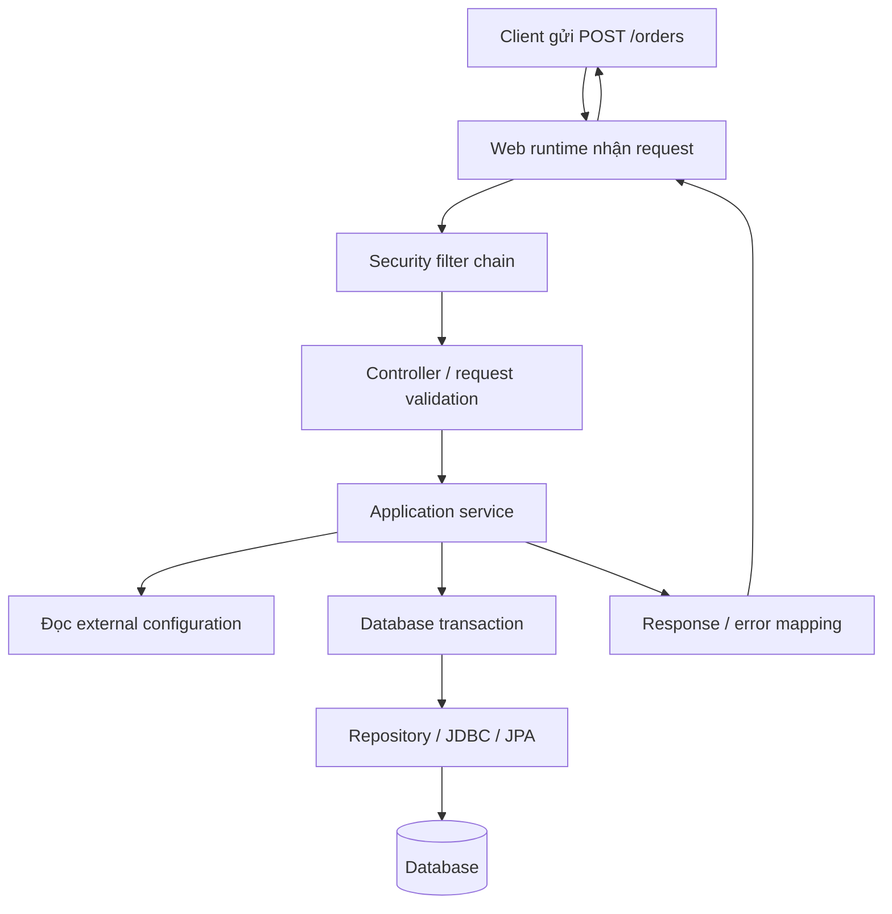
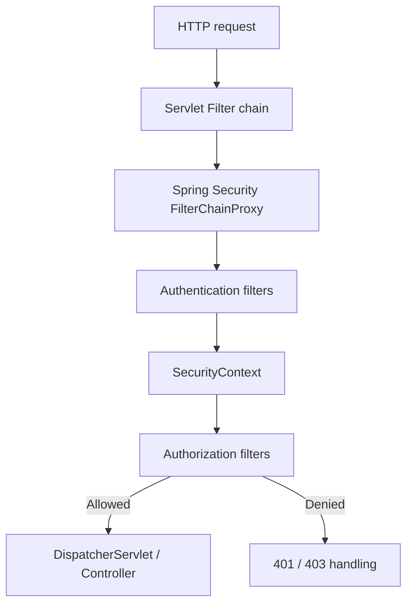
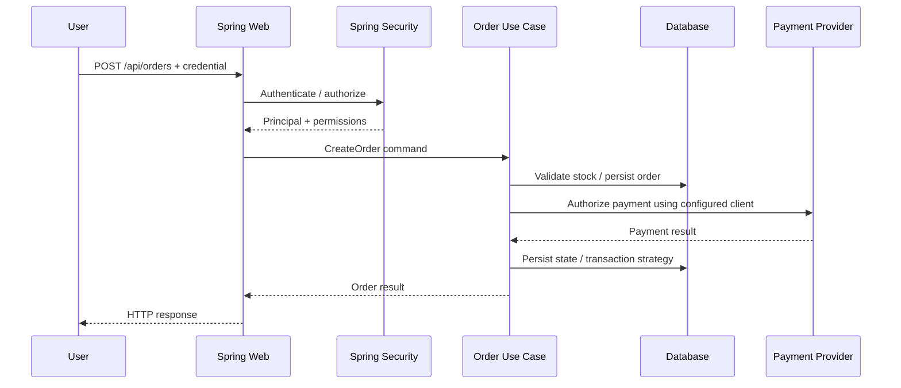

# Ranh giới học tiếp về web runtime, external configuration, dữ liệu và bảo mật

Hoàn thành Spring Boot Fundamentals giúp bạn hiểu cách một ứng dụng Spring Boot được khởi động, tạo Bean, đọc cấu hình, phục vụ request, ghi log và quan sát trạng thái. Nhưng một ứng dụng có thể khởi động thành công vẫn chưa đủ để vận hành một hệ thống web an toàn và ổn định. Khi bước sang các bài toán thực tế, bốn vùng kiến thức cần được đào sâu là **web runtime**, **external configuration**, **data management** và **security**.

Đây là các ranh giới học tiếp: mỗi vùng có khái niệm, API và quyết định thiết kế riêng, nhưng chúng liên kết với nhau trong một request thực tế. Một request đi qua web runtime, được xác thực bởi security filter chain, dùng cấu hình bên ngoài để chọn endpoint/datasource, thực hiện transaction trên dữ liệu, rồi trả response qua server runtime.

Bài học này xác định:

- Phần nền tảng Spring Boot đã cung cấp và phần nào cần học sâu hơn.
- Các khái niệm trọng tâm trong web runtime, cấu hình bên ngoài, dữ liệu và bảo mật.
- Cách các vùng này phối hợp trong một ứng dụng.
- Trình tự học tiếp theo cùng các bài thực hành để kiểm chứng kiến thức.
- Cách chọn tài liệu và phiên bản Spring Boot phù hợp để tránh học API đã lỗi thời.

Mục tiêu không phải ghi nhớ mọi framework hoặc thư viện mở rộng. Mục tiêu là nhận biết **ranh giới trách nhiệm**, hiểu câu hỏi nào thuộc vùng nào và biết khi nào một vấn đề cần kiến thức chuyên sâu hơn.

## 1. Spring Boot Fundamentals dừng ở đâu?

Các chủ đề nền tảng thường giúp bạn:

- Tạo project, cấu hình dependency và chạy ứng dụng.
- Hiểu auto-configuration, component scanning và dependency injection.
- Tạo controller, service, repository và cấu hình Bean.
- Đọc property từ application files, profile và command line.
- Dùng validation, exception handling và logging.
- Kết nối database cơ bản và quan sát ứng dụng bằng Actuator.
- Chẩn đoán các lỗi khởi động và dependency phổ biến.

Đó là nền móng để xây dựng ứng dụng, nhưng chưa bao phủ hết những câu hỏi xuất hiện khi hệ thống có nhiều traffic, nhiều môi trường, nhiều service và dữ liệu quan trọng:

| Câu hỏi khi phát triển/vận hành | Vùng kiến thức cần học tiếp |
|---|---|
| Request được xử lý qua những tầng nào? Thread được quản lý ra sao? | Web runtime |
| Khi nào nên dùng Servlet/MVC, khi nào cân nhắc reactive? | Web runtime |
| Cấu hình production lấy từ đâu và nguồn nào có ưu tiên? | External configuration |
| Làm sao quản lý secret và thay đổi cấu hình an toàn? | External configuration |
| Transaction bao phủ những thao tác nào? Isolation và locking ảnh hưởng ra sao? | Data management |
| Schema database thay đổi thế nào khi triển khai nhiều phiên bản? | Data management |
| Ai là người dùng? Họ được phép làm gì? | Security |
| Session, CSRF, CORS, OAuth2 và JWT giải quyết vấn đề nào? | Security |

Một cách nhận biết ranh giới: nếu câu hỏi liên quan đến **vòng đời request và tài nguyên server**, bắt đầu từ web runtime; nếu liên quan đến **giá trị cấu hình theo môi trường và bí mật**, bắt đầu từ external configuration; nếu liên quan đến **tính nhất quán và vòng đời dữ liệu**, bắt đầu từ data management; nếu liên quan đến **danh tính, quyền và ranh giới tin cậy**, bắt đầu từ security.

## 2. Nhìn ứng dụng như một luồng xuyên suốt

Hãy hình dung một request tạo đơn hàng:



Đây là sơ đồ khái niệm. Trong runtime thật, cấu hình thường đã được nạp từ lúc startup; request không nhất thiết đọc file cấu hình từ đầu. Security filter chain chạy trước controller trong nhiều ứng dụng Servlet; transaction thường được mở ở boundary service qua proxy hoặc transaction manager; response còn đi qua message converter và server connector.

Mỗi vùng có một câu hỏi chủ đạo:

- **Web runtime:** request đi qua những thành phần nào, dùng thread/resource ra sao, response được ghi lại thế nào?
- **External configuration:** ứng dụng nhận giá trị nào, từ nguồn nào, vào thời điểm nào và cách bảo vệ giá trị nhạy cảm ra sao?
- **Data:** các thay đổi dữ liệu được commit/rollback theo ranh giới nào, schema và concurrent access được quản lý thế nào?
- **Security:** request được tin cậy dựa trên danh tính nào, quyền được quyết định ở đâu và dữ liệu nào có thể được truy cập?

Không nên giải quyết vấn đề của một vùng bằng cách tùy tiện chỉnh cấu hình ở vùng khác. Ví dụ, tăng server thread pool không sửa được transaction bị giữ quá lâu; đổi CORS không cấp quyền truy cập một API; đổi datasource URL không sửa được schema migration sai.

## 3. Vùng 1 — Web runtime

Web runtime là môi trường nhận, điều phối và hoàn tất request/response của ứng dụng. Với Spring Boot, lựa chọn web stack ảnh hưởng tới loại server, programming model, lifecycle và cách sử dụng tài nguyên.

### 3.1. Servlet và Spring MVC

Một ứng dụng Spring MVC thường dùng Servlet API và chạy trên embedded Servlet container như Tomcat, Jetty hoặc Undertow tùy dependency/cấu hình.

Luồng đơn giản:

```text
TCP connection
    ↓
HTTP connector
    ↓
Servlet container
    ↓
Filter chain
    ↓
DispatcherServlet
    ↓
HandlerMapping / HandlerAdapter
    ↓
Controller
    ↓
Service
    ↓
Response conversion
```

Những khái niệm nên học:

- Servlet container và embedded server.
- Connector, port, context path và request mapping.
- Servlet Filter và Spring MVC HandlerInterceptor.
- `DispatcherServlet`, `HandlerMapping`, `HandlerAdapter`.
- Controller argument resolution và message converters.
- Multipart upload, request size và timeout.
- Error dispatch, exception resolver và response status.
- Thread-per-request/blocking model của Servlet stack.

**Filter và interceptor không cùng vị trí.** Filter thuộc Servlet layer và có thể bao quanh quá trình xử lý request rộng hơn; interceptor thuộc Spring MVC handler execution và thường làm việc với handler/controller đã được xác định. Security của Servlet thường được tích hợp qua Filter chain.

Ví dụ Filter:

```java
@Component
public class RequestTimingFilter extends OncePerRequestFilter {
    private static final Logger log =
            LoggerFactory.getLogger(RequestTimingFilter.class);

    @Override
    protected void doFilterInternal(
            HttpServletRequest request,
            HttpServletResponse response,
            FilterChain filterChain)
            throws ServletException, IOException {

        long start = System.nanoTime();
        try {
            filterChain.doFilter(request, response);
        } finally {
            long elapsed = System.nanoTime() - start;
            log.info("method={} uri={} status={} elapsedMs={}",
                    request.getMethod(),
                    request.getRequestURI(),
                    response.getStatus(),
                    elapsed / 1_000_000);
        }
    }
}
```

Ví dụ rút gọn này minh họa vị trí của Filter; trong ứng dụng thực tế nên dùng tracing/metrics instrumentation phù hợp, tránh log URI có thể chứa dữ liệu nhạy cảm và tránh ghi body request/response tùy tiện.

### 3.2. Threading, blocking và async

Với Servlet MVC truyền thống, một request thường được xử lý trên một worker thread trong phần lớn thời gian xử lý đồng bộ. Nếu controller gọi JDBC hoặc HTTP client blocking, thread có thể bị giữ trong lúc chờ I/O.

Điều cần hiểu:

- Thread pool của embedded server có giới hạn.
- Một thread bị block vẫn chiếm tài nguyên dù CPU không hoạt động.
- Tăng thread count có thể tăng concurrency nhưng cũng tăng memory, context switching và áp lực lên dependency.
- Async request không đồng nghĩa mọi code bên trong tự động trở thành non-blocking.
- `@Async` dùng executor riêng, không phải công tắc chuyển toàn bộ MVC sang reactive.

Nếu một service thực hiện query blocking kéo dài, worker thread của request có thể bị giữ tới khi query hoàn tất. Muốn thay đổi concurrency, trước hết cần đo latency, thread usage và thời gian chờ database.

### 3.3. Spring WebFlux và reactive runtime

Spring WebFlux là web stack reactive, thường được dùng với Reactor và server như Reactor Netty. Nó hỗ trợ xử lý bất đồng bộ/non-blocking và mô hình backpressure trong các pipeline reactive.

Ví dụ:

```java
@RestController
@RequestMapping("/catalog")
public class CatalogController {
    private final CatalogService catalogService;

    public CatalogController(CatalogService catalogService) {
        this.catalogService = catalogService;
    }

    @GetMapping("/{id}")
    public Mono<CatalogItem> get(@PathVariable String id) {
        return catalogService.findById(id);
    }
}
```

`Mono<T>` biểu diễn tối đa một kết quả; `Flux<T>` biểu diễn chuỗi 0..N phần tử. Reactive programming không chỉ là đổi kiểu trả về từ `T` sang `Mono<T>`.

Các chủ đề cần học sâu:

- Publisher, Subscriber, Subscription và demand.
- `Mono`, `Flux`, operator composition.
- Backpressure và buffering.
- Scheduler và việc chuyển execution context.
- Error signal, retry và cancellation.
- Context propagation và tracing.
- Reactive database/HTTP clients.
- Cách tránh gọi blocking API trên event-loop thread.

Một lỗi phổ biến là gọi JDBC blocking trực tiếp trên event loop của WebFlux. Điều đó có thể làm giảm khả năng xử lý nhiều request vì event-loop thread bị chặn. Nếu workload chủ yếu là JDBC/JPA blocking và đội ngũ chưa cần reactive end-to-end, Spring MVC thường đơn giản hơn.

### 3.4. Chọn MVC hay WebFlux?

| Đặc điểm | Spring MVC / Servlet | Spring WebFlux |
|---|---|---|
| Programming model | Imperative, thường blocking | Reactive, non-blocking khi stack hỗ trợ |
| Thread model | Worker thread xử lý request | Event loop và scheduler |
| Data access | JDBC/JPA phù hợp tự nhiên | Reactive data access cần driver/client tương ứng |
| Độ phức tạp | Dễ tiếp cận với ứng dụng CRUD truyền thống | Cần hiểu Reactor, backpressure và cancellation |
| Phù hợp | Business app dùng blocking dependencies | I/O concurrency cao, streaming hoặc reactive end-to-end |

Không nên chọn WebFlux chỉ vì nghe nói nó nhanh hơn. Hiệu năng phụ thuộc workload, downstream, pool, CPU, serialization và cách code sử dụng blocking. Hãy benchmark theo workload thật.

### 3.5. Server lifecycle và graceful shutdown

Web runtime không chỉ khởi động listener. Khi dừng ứng dụng, server cần ngừng nhận request mới, cho request đang chạy một khoảng thời gian hoàn tất và đóng tài nguyên theo lifecycle.

Các chủ đề học tiếp:

- Startup phases và application context refresh.
- Embedded server initialization.
- Graceful shutdown.
- Readiness và liveness.
- Shutdown timeout.
- Signal handling trong container.
- Connection draining qua load balancer.

Một ứng dụng có graceful shutdown ở JVM nhưng load balancer vẫn gửi traffic tới instance đang dừng thì vẫn có thể phát sinh lỗi. Cần phối hợp readiness, deployment strategy và server lifecycle.

## 4. Vùng 2 — External configuration

External configuration là cách cung cấp giá trị cho ứng dụng từ bên ngoài artifact: file, environment variables, system properties, command line, config server hoặc secret manager.

Mục tiêu là cùng một binary có thể chạy trong nhiều môi trường với giá trị phù hợp, mà không phải sửa code hoặc đóng gói lại cho từng môi trường.

### 4.1. Property sources và precedence

Spring Boot xây dựng `Environment` từ nhiều property sources. Một số nguồn thường gặp:

- Default properties do ứng dụng đặt.
- Config data như `application.properties`/`application.yml`.
- Profile-specific files.
- Environment variables.
- JVM system properties.
- Command-line arguments.
- Test property sources.
- Config data import và nguồn cấu hình bổ sung.

Khi cùng một key có ở nhiều nguồn, thứ tự ưu tiên quyết định giá trị cuối cùng. Ví dụ:

```properties
# application.properties
server.port=8080
```

Chạy:

```bash
java -jar app.jar --server.port=8181
```

thường khiến command-line property override giá trị trong application file theo precedence mặc định của Boot.

Không nên chỉ nhìn file YAML để kết luận server đang chạy ở cổng nào. Hãy xác định active profile, config location/import, environment và command line của process thật.

### 4.2. Profiles và nhóm cấu hình

Profiles cho phép cung cấp tập cấu hình theo môi trường hoặc điều kiện triển khai:

```yaml
# application.yml
server:
  port: 8080
app:
  payment:
    connect-timeout: 500ms
    read-timeout: 2s
```

```yaml
# application-dev.yml
app:
  payment:
    base-url: http://localhost:9091
```

```yaml
# application-prod.yml
app:
  payment:
    base-url: https://payments.internal.example
```

Kích hoạt profile:

```bash
java -jar app.jar --spring.profiles.active=prod
```

Profile nên đại diện cho nhóm cấu hình có ý nghĩa. Không nên tạo hàng chục profile cho mọi feature toggle nhỏ vì số tổ hợp sẽ khó kiểm soát.

### 4.3. @ConfigurationProperties và type-safe configuration

Với cấu hình thuộc một chức năng, gom thành object có kiểu:

```java
@ConfigurationProperties(prefix = "app.payment")
public record PaymentProperties(
        URI baseUrl,
        Duration connectTimeout,
        Duration readTimeout,
        int maxAttempts
) {}
```

Đăng ký bằng `@ConfigurationPropertiesScan` hoặc `@EnableConfigurationProperties`.

Có thể thêm validation:

```java
@Validated
@ConfigurationProperties(prefix = "app.payment")
public record PaymentProperties(
        @NotNull URI baseUrl,
        @NotNull Duration connectTimeout,
        @NotNull Duration readTimeout,
        @Min(1) @Max(5) int maxAttempts
) {}
```

Ví dụ cần validation provider và các import tương ứng. Type-safe configuration giúp:

- Nhóm property liên quan.
- Có kiểu dữ liệu rõ ràng như `Duration`, `URI`, `DataSize`.
- Validate ngay lúc startup.
- Dễ viết unit test.
- Hạn chế chuỗi key rải rác trong code.

### 4.4. External config không đồng nghĩa dynamic refresh

Đưa property ra environment không có nghĩa có thể thay đổi mọi giá trị khi ứng dụng đang chạy.

Ví dụ:

- `server.port` thường được dùng khi server khởi động.
- `DataSource`/connection pool thường được tạo lúc context khởi tạo.
- Một Bean giữ giá trị được inject qua constructor không tự đổi khi Environment thay đổi.
- Một số thành phần có API runtime riêng để đổi trạng thái, ví dụ logger level.

Phải xác định property được đọc khi nào và thành phần nào nhận giá trị. Nếu cần dynamic refresh, cần một cơ chế refresh/rebind có chủ đích và hiểu tác động tới Bean lifecycle, không chỉ thay file cấu hình.

### 4.5. Secret management

Credential, password, API token, private key và certificate password là dữ liệu nhạy cảm. Chúng không nên được commit vào Git hoặc ghi ra log.

Các khái niệm cần học:

- Secret manager và secret rotation.
- Environment injection và mounted secret files.
- Least privilege cho identity của ứng dụng.
- Encryption at rest/in transit.
- Redaction trong log và telemetry.
- Sanitization khi expose Actuator `env`/`configprops`.
- Cách cấp secret cho local, CI và production khác nhau.

Một nguyên tắc hữu ích: ứng dụng chỉ nhận secret mà nó cần, trong thời gian cần thiết, từ nguồn có kiểm soát. Không dùng một tài khoản database có quyền admin cho mọi service chỉ vì cấu hình tiện.

### 4.6. Config Server và cấu hình phân tán

Khi có nhiều ứng dụng hoặc nhiều instance, đội ngũ có thể cần một nơi quản lý cấu hình tập trung. Spring Cloud Config là một lựa chọn trong hệ sinh thái Spring Cloud.

Đây là chủ đề mở rộng, không phải yêu cầu mặc định của mọi ứng dụng Spring Boot. Khi học tiếp, cần hiểu:

- Config Server và Config Client.
- Repository backend và versioning.
- Profile/label và cách resolve cấu hình.
- Authentication, authorization và TLS.
- Refresh semantics và event propagation.
- Hành vi khi config server không sẵn sàng.

Không nên thêm Config Server chỉ vì ứng dụng có vài file YAML. Với một service đơn giản, externalized configuration tiêu chuẩn của Spring Boot có thể đã đủ.

## 5. Vùng 3 — Data management

Data management bao gồm cách ứng dụng kết nối, đọc/ghi, bảo đảm tính nhất quán, quản lý schema và vận hành dữ liệu. Repository abstraction chỉ là một phần của vùng này.

### 5.1. JDBC, Spring Data JDBC và JPA

Các lựa chọn phổ biến:

| Công nghệ | Mô hình | Khi phù hợp |
|---|---|---|
| JDBC / JdbcTemplate | SQL tường minh, mapping thủ công hoặc mapper | Muốn kiểm soát SQL và transaction trực tiếp |
| Spring Data JDBC | Aggregate-oriented persistence, ít abstraction hơn JPA | Domain model tương đối đơn giản, muốn SQL behavior dễ hiểu |
| Spring Data JPA / Hibernate | ORM, entity lifecycle, persistence context | Domain cần mapping quan hệ và identity lifecycle phù hợp |
| R2DBC | Reactive relational data access | Ứng dụng reactive có driver/database hỗ trợ và cần non-blocking I/O |

Không có lựa chọn tốt nhất cho mọi hệ thống. JPA giúp quản lý entity và relationship, nhưng cũng mang theo persistence context, lazy loading, dirty checking và các vấn đề query cần hiểu rõ. JDBC cho quyền kiểm soát SQL cao hơn nhưng ứng dụng tự chịu nhiều trách nhiệm mapping.

### 5.2. Entity, DTO và domain model

Không nên mặc định object dùng trong API cũng chính là JPA entity.

- **Request/response DTO:** biểu diễn contract HTTP.
- **Domain model:** biểu diễn quy tắc và hành vi nghiệp vụ.
- **Persistence entity:** biểu diễn cách dữ liệu được lưu/đọc qua ORM.
- **Projection/read model:** biểu diễn dữ liệu tối ưu cho truy vấn đọc.

Ví dụ DTO:

```java
public record CreateOrderRequest(
        @NotBlank String customerId,
        @NotEmpty List<OrderLineRequest> lines
) {}
```

Ví dụ entity minh họa:

```java
@Entity
@Table(name = "orders")
public class OrderEntity {
    @Id
    @GeneratedValue(strategy = GenerationType.IDENTITY)
    private Long id;

    @Column(nullable = false)
    private String customerId;

    @Enumerated(EnumType.STRING)
    @Column(nullable = false)
    private OrderStatus status;
}
```

Đây là hai mô hình phục vụ hai boundary khác nhau. Không trả thẳng entity ra HTTP nếu điều đó làm lộ internal fields, quan hệ lazy hoặc schema persistence thành public API.

### 5.3. Transaction boundary

Transaction gom các thao tác dữ liệu cần được commit hoặc rollback như một đơn vị.

Ví dụ:

```java
@Service
public class TransferService {
    private final AccountRepository accountRepository;

    public TransferService(AccountRepository accountRepository) {
        this.accountRepository = accountRepository;
    }

    @Transactional
    public void transfer(long fromId, long toId, BigDecimal amount) {
        Account from = accountRepository.findById(fromId).orElseThrow();
        Account to = accountRepository.findById(toId).orElseThrow();

        from.withdraw(amount);
        to.deposit(amount);
    }
}
```

Trong transaction, hai thay đổi cần cùng thành công hoặc cùng rollback theo transaction manager và database semantics tương ứng.

Các chủ đề cần học sâu:

- `@Transactional` và proxy-based interception.
- Propagation: `REQUIRED`, `REQUIRES_NEW`, `MANDATORY`, v.v.
- Isolation levels và dirty/non-repeatable/phantom reads.
- Rollback rules và checked/unchecked exceptions.
- Read-only transactions và ý nghĩa theo provider.
- Transaction manager và nhiều datasource.
- Self-invocation khiến method call không đi qua proxy.
- Transaction không tự bao phủ HTTP call tới service bên ngoài.

Không đặt transaction quá rộng quanh công việc kéo dài như chờ user input hoặc gọi external API lâu. Connection/lock có thể bị giữ trong suốt thời gian đó.

### 5.4. Concurrency, locking và consistency

Hai request có thể cùng cập nhật một bản ghi. Nếu không có chiến lược concurrency phù hợp, dữ liệu có thể bị lost update hoặc vi phạm invariant.

Các khái niệm:

- Optimistic locking qua `@Version`.
- Pessimistic locking và database locks.
- Unique constraints và foreign keys.
- Isolation level.
- Atomic update và conditional SQL.
- Idempotency cho thao tác có thể retry.
- Deadlock detection và retry policy.

Ví dụ optimistic locking:

```java
@Entity
public class InventoryItem {
    @Id
    private Long id;

    private int availableQuantity;

    @Version
    private long version;
}
```

ORM có thể dùng version để phát hiện update xung đột. Khi có concurrent modification, ứng dụng cần quyết định trả lỗi, retry hoặc xử lý theo nghiệp vụ. `@Version` không tự quyết định cách giải quyết conflict.

### 5.5. Schema migration

Khi ứng dụng phát hành phiên bản mới, schema database cũng có thể cần thay đổi. Dùng migration có version như Flyway hoặc Liquibase giúp thay đổi schema có thể lặp lại và review.

Ví dụ migration SQL:

```sql
ALTER TABLE orders
    ADD COLUMN fulfillment_status VARCHAR(32);
```

Các chủ đề quan trọng:

- Versioned migration và repeatable migration.
- Migration checksum và lịch sử đã chạy.
- Expand-and-contract migration.
- Tương thích giữa code phiên bản cũ/mới và schema.
- Backfill dữ liệu lớn.
- Lock và downtime khi thay đổi bảng.
- Roll-forward/rollback strategy.

Một migration thêm cột nullable có thể tương thích với code cũ; đổi tên/xóa cột ngay có thể làm phiên bản đang chạy lỗi. Trong deployment nhiều replica, schema change cần được thiết kế theo thứ tự triển khai.

### 5.6. Query performance và persistence behavior

Khi dùng JPA/Hibernate, cần hiểu:

- Lazy/eager fetching.
- N+1 query problem.
- Fetch join/entity graph.
- Pagination và sorting.
- Batch insert/update.
- Persistence context và dirty checking.
- First-level/second-level cache.
- SQL logging và query plan.
- Index và selectivity.

Không chỉ nhìn thời gian của repository method. Hãy xem SQL thực tế, số query, số row, lock wait và execution plan. Một method Java ngắn có thể tạo hàng trăm query do lazy traversal.

### 5.7. Giao dịch qua nhiều hệ thống

Một database transaction không tự bao phủ HTTP request tới payment provider hoặc message broker. Nếu use case cần phối hợp nhiều hệ thống, hãy học:

- Transactional outbox.
- Saga và compensating action.
- Idempotent consumer.
- Retry và dead-letter queue.
- Eventual consistency.
- Exactly-once claims và giới hạn thực tế.

Không nên giữ database transaction mở trong lúc chờ một dịch vụ bên ngoài chỉ để mong hai hệ thống cùng rollback. Mỗi hệ thống có transaction boundary riêng; cần thiết kế quy trình phục hồi.

## 6. Vùng 4 — Security

Security không chỉ là thêm dependency Spring Security. Nó là thiết kế ranh giới tin cậy: ai đang gọi, họ được phép làm gì, credential được xác minh ra sao và dữ liệu nào được bảo vệ.

### 6.1. Authentication và authorization

Hai khái niệm:

- **Authentication:** xác minh danh tính — người gọi là ai?
- **Authorization:** quyết định quyền — danh tính đó được làm gì trên tài nguyên nào?

Ví dụ:

| Request | Authentication | Authorization |
|---|---|---|
| Người dùng xem hồ sơ của chính mình | Xác minh session/token | Chỉ đọc profile thuộc user đó |
| Admin xem báo cáo toàn hệ thống | Xác minh danh tính | Cần role/authority admin phù hợp |
| Service gọi service khác | Xác minh workload identity/client | Chỉ được gọi scope/API đã cấp |

Một user đã đăng nhập không đồng nghĩa có quyền truy cập mọi order. Authorization cần xét resource ownership, tenant boundary và business policy.

### 6.2. Security filter chain

Trong ứng dụng Servlet, Spring Security thường hoạt động thông qua Servlet Filter chain. Một request đi qua security filters trước khi tới DispatcherServlet/controller.



Sơ đồ giản lược; thứ tự filter cụ thể phụ thuộc cấu hình và cơ chế authentication. Điều cần hiểu là security được áp dụng trước business controller và có thể từ chối request trước khi controller chạy.

### 6.3. SecurityFilterChain và request authorization

Với Spring Security hiện đại, cấu hình thường khai báo `SecurityFilterChain` bằng Bean:

```java
@Configuration
@EnableWebSecurity
public class SecurityConfiguration {

    @Bean
    SecurityFilterChain applicationSecurity(HttpSecurity http)
            throws Exception {
        return http
                .authorizeHttpRequests(authorize -> authorize
                        .requestMatchers("/public/**").permitAll()
                        .requestMatchers("/admin/**").hasRole("ADMIN")
                        .anyRequest().authenticated()
                )
                .formLogin(Customizer.withDefaults())
                .build();
    }
}
```

Ví dụ minh họa session/form login cho web app. API stateless dùng bearer token thường có cấu hình khác. Cần chọn đúng cơ chế theo client và threat model.

Không nên copy một cấu hình cũ dùng `WebSecurityConfigurerAdapter` cho phiên bản Spring Security hiện đại; adapter đó đã bị loại khỏi hướng cấu hình mới. Hãy dùng tài liệu tương ứng phiên bản đang học.

### 6.4. Password storage

Nếu ứng dụng tự quản lý password, không lưu password dạng plaintext hoặc mã hóa có thể giải mã lại. Dùng password hashing thích hợp, có salt và cost factor, qua `PasswordEncoder`.

Ví dụ:

```java
@Bean
PasswordEncoder passwordEncoder() {
    return new BCryptPasswordEncoder();
}
```

BCrypt là một lựa chọn phổ biến. Tùy threat model và framework version, có thể cân nhắc các encoder adaptive khác. Cần quản lý nâng cấp cost và rehash khi người dùng đăng nhập.

Không tự viết thuật toán hash password. Password hashing khác với SHA-256 hash thông thường; thuật toán password storage cần chống brute-force bằng cost có chủ đích.

### 6.5. Session, CSRF và CORS

**Session** lưu trạng thái đăng nhập giữa các request. Cần hiểu session cookie, expiration, fixation protection, logout và distributed session khi chạy nhiều instance.

**CSRF** là tấn công khiến browser của người dùng đã đăng nhập gửi request ngoài ý muốn tới ứng dụng. Với browser session/cookie authentication, CSRF protection thường cần được giữ và cấu hình đúng.

**CORS** là chính sách browser kiểm soát JavaScript ở origin khác có được đọc response hay không. CORS không phải authentication và không thay thế authorization.

Một API dùng bearer token trong Authorization header, không dựa trên cookie tự động của browser, có thể có CSRF risk profile khác; quyết định tắt CSRF phải dựa trên authentication model và cách credential được gửi.

### 6.6. OAuth2 và OpenID Connect

Khi cần đăng nhập qua identity provider hoặc bảo vệ API bằng access token, cần học OAuth2 và OpenID Connect:

- OAuth2 Authorization Code flow và PKCE cho browser/mobile clients.
- OpenID Connect ID token và user authentication.
- Access token, refresh token và expiry.
- Resource Server xác minh JWT hoặc opaque token.
- Issuer, audience, signature và key rotation.
- Scope/authority mapping.
- Client Credentials cho machine-to-machine.

Phân biệt:

| Thành phần | Trách nhiệm |
|---|---|
| OAuth2 Client | Đăng nhập/ủy quyền với authorization server và nhận token |
| Resource Server | Nhận bearer token và xác minh quyền truy cập API |
| Authorization Server / Identity Provider | Xác thực user/client và phát token |

JWT chỉ là một định dạng token thường gặp; OAuth2 không bắt buộc mọi access token phải là JWT. Resource server phải xác minh issuer/audience/signature/expiry theo cấu hình tin cậy, không chỉ decode payload.

### 6.7. Method security và business authorization

Request-level authorization có thể chưa đủ. Một API có thể yêu cầu người dùng có quyền chung, nhưng vẫn cần kiểm tra họ sở hữu tài nguyên cụ thể.

Ví dụ:

```java
@Service
public class InvoiceService {

    @PreAuthorize("hasAuthority('invoice:read')")
    public InvoiceView getInvoice(long invoiceId) {
        // Cần kiểm tra thêm tenant/ownership theo nghiệp vụ.
        return loadInvoice(invoiceId);
    }
}
```

Method security cần được bật bằng cấu hình phù hợp như `@EnableMethodSecurity`. Expression ở ví dụ chỉ minh họa authority; không thay thế kiểm tra quyền trên từng invoice.

Authorization phải đặt ở boundary mà mọi đường gọi đều đi qua. Chỉ ẩn nút UI hoặc kiểm tra role trong frontend không bảo vệ backend.

## 7. Bốn vùng liên kết với nhau thế nào?

Một use case tạo đơn hàng có thể sử dụng cả bốn vùng:

1. Web runtime nhận request, parse JSON và resolve controller.
2. Security xác minh token/session, xác định principal và quyền tạo đơn.
3. External configuration cung cấp URL payment provider, timeout, feature flags và datasource settings.
4. Data layer kiểm tra tồn kho, tạo order và commit transaction.
5. Nếu cần gọi payment provider, application service phối hợp với client có timeout/retry phù hợp; không giả định database transaction tự bao phủ external HTTP call.
6. Web runtime serialize response; observability ghi metric/trace theo request.

Một số lỗi có thể nhìn giống nhau nhưng thuộc vùng khác:

| Hiện tượng | Vùng cần kiểm tra đầu tiên |
|---|---|
| Connection refused tới port ứng dụng | Web runtime / deployment networking |
| 401 trước khi controller chạy | Security authentication |
| 403 dù user đã đăng nhập | Security authorization |
| Property production không có hiệu lực | External configuration |
| Password database sai hoặc secret hết hạn | External configuration / identity |
| Transaction commit nhưng event không được gửi | Data consistency / messaging |
| N+1 query làm request chậm | Data management |
| Event loop bị block bởi JDBC | Web runtime / reactive model |
| Request bị timeout do dependency chậm | Web runtime + data/client + observability |

Để điều tra, xác định request đã đi tới boundary nào, tín hiệu nào chứng minh điều đó và thành phần nào sở hữu quyết định đang cần thay đổi.

## 8. Một kiến trúc tham khảo để học tích hợp

Ví dụ cấu trúc package/module cho một ứng dụng Spring Boot:

```text
shop/
├── web/
│   ├── OrderController.java
│   ├── SecurityConfiguration.java
│   └── ApiExceptionHandler.java
├── application/
│   ├── CreateOrderUseCase.java
│   └── OrderQueryService.java
├── domain/
│   ├── Order.java
│   ├── InventoryPolicy.java
│   └── OrderRepository.java
├── infrastructure/
│   ├── persistence/
│   │   ├── JpaOrderEntity.java
│   │   └── JpaOrderRepositoryAdapter.java
│   └── payment/
│       └── PaymentHttpClient.java
└── configuration/
    ├── PaymentProperties.java
    └── RuntimeConfiguration.java
```

Đây chỉ là một cách tổ chức tham khảo. Ứng dụng nhỏ có thể dùng ít package hơn; hệ thống lớn có thể tách module theo bounded context. Điều quan trọng là ranh giới dependency:

- Web layer nhận/serialize HTTP và áp dụng request-level security.
- Application layer điều phối use case và transaction boundary.
- Domain layer chứa quy tắc nghiệp vụ, tránh phụ thuộc framework khi có thể.
- Infrastructure layer triển khai database, network client và message broker.
- Configuration layer bind property và tạo integration Bean.

Không nhất thiết phải tạo package/module cho mọi dòng trong sơ đồ. Tổ chức phải phản ánh độ phức tạp thực tế.

## 9. Lộ trình học tiếp theo

Một thứ tự học hợp lý là đi từ request đến dữ liệu rồi tới ranh giới tin cậy và vận hành.

### Chặng 1 — Web runtime

Học:

1. Servlet lifecycle và embedded server.
2. Filter, interceptor, DispatcherServlet và message converters.
3. Request validation, multipart, error handling.
4. Thread pools, blocking I/O và async.
5. Graceful shutdown, health probes và server configuration.
6. WebFlux/Reactor khi có nhu cầu reactive thực tế.

Kết quả cần đạt: có thể giải thích một request đi qua những tầng nào, tìm nơi request bị chậm và biết loại concurrency model ứng dụng đang dùng.

### Chặng 2 — External configuration

Học:

1. Environment, property sources và precedence.
2. Profiles, config data import và environment variables.
3. `@ConfigurationProperties` và validation.
4. Secret management, rotation và least privilege.
5. External config service khi hệ thống có nhu cầu tập trung.
6. Config refresh semantics và rollout.

Kết quả cần đạt: cùng một artifact chạy được ở local/test/production bằng cấu hình có kiểm soát, biết giá trị nào có hiệu lực và không để secret trong source.

### Chặng 3 — Data management

Học:

1. JDBC và SQL fundamentals.
2. JPA entity lifecycle, persistence context và repository behavior.
3. Transaction propagation/isolation/rollback.
4. Optimistic/pessimistic locking và concurrency.
5. Schema migration và backward compatibility.
6. Query performance, indexes và N+1.
7. Outbox, idempotency và eventual consistency khi cần tích hợp hệ thống.

Kết quả cần đạt: xác định transaction boundary đúng, quản lý schema qua phiên bản và giải thích cách ứng dụng xử lý concurrent updates.

### Chặng 4 — Security

Học:

1. Security filter chain và SecurityContext.
2. Authentication, authorization và password storage.
3. Session/cookie, CSRF và CORS.
4. Request-level và method-level authorization.
5. OAuth2/OIDC và JWT Resource Server.
6. Security testing, audit logging và threat modeling cơ bản.

Kết quả cần đạt: bảo vệ API theo identity và permission, kiểm tra ownership của tài nguyên, tránh tự triển khai cryptography hoặc token verification không đúng.

### Chặng 5 — Tích hợp và vận hành

Học:

1. Metrics, tracing và structured logging.
2. Health/readiness/liveness.
3. Timeout/retry/circuit breaker/bulkhead.
4. Deployment, graceful shutdown và config rollout.
5. Threat modeling và incident response.

Kết quả cần đạt: có thể điều tra một request lỗi xuyên nhiều boundary, xác định evidence và thay đổi đúng thành phần.

## 10. Bài lab tích hợp: xây dựng Order API

Một project thực hành có thể giúp kết nối bốn vùng. Xây dựng API quản lý đơn hàng với các endpoint:

```text
POST   /api/orders
GET    /api/orders/{id}
GET    /api/orders
POST   /api/orders/{id}/cancel
```

### Yêu cầu web runtime

- Dùng Spring MVC/Servlet.
- Validate request body và query parameters.
- Chuẩn hóa lỗi qua `@RestControllerAdvice`.
- Thêm request correlation ID và timing metric.
- Cấu hình server port/context path.
- Thử graceful shutdown trong môi trường local/container.

### Yêu cầu external configuration

- Bind `app.payment.*` bằng `@ConfigurationProperties`.
- Tách URL payment sandbox và production qua profile/deployment config.
- Cấu hình connect/read timeout.
- Không commit secret.
- Validate property bắt buộc ngay lúc startup.

### Yêu cầu data

- Lưu order và order lines.
- Dùng migration versioned để tạo bảng.
- Định nghĩa transaction boundary cho tạo/hủy đơn.
- Dùng optimistic locking hoặc chiến lược concurrency phù hợp.
- Kiểm tra query count và pagination.
- Thiết kế idempotency cho thao tác có thể retry.

### Yêu cầu security

- API đọc công khai hoặc yêu cầu đăng nhập theo yêu cầu bài lab.
- Chỉ user có quyền phù hợp mới tạo/hủy đơn.
- User chỉ đọc được order thuộc phạm vi tenant/ownership.
- Dùng password encoder hoặc Resource Server cho token tùy bài tập.
- Kiểm tra CSRF/CORS theo authentication model.
- Viết test cho 401, 403 và truy cập tài nguyên của user khác.

### Luồng kiểm thử tích hợp



Sơ đồ chỉ là một kịch bản học tập. Trong hệ thống thật, cần thiết kế rõ thứ tự commit và external payment call; không thể giả định transaction database rollback được giao dịch đã thực hiện ở payment provider. Có thể cần pending state, idempotency, outbox hoặc saga tùy yêu cầu nghiệp vụ.

## 11. Cách xác định ranh giới khi gặp vấn đề

Khi gặp lỗi trong project, hãy phân loại trước khi tìm property:

### Request không tới controller

Kiểm tra:

- Server có listen đúng port/address không?
- Reverse proxy/ingress có route đúng không?
- Filter chain có từ chối request không?
- Path/context path có đúng không?
- Content-Type và message converter có tương thích không?

### Request tới controller nhưng không được phép

Kiểm tra:

- Authentication filter có tạo principal không?
- Token/session còn hạn không?
- Authority/role được map đúng không?
- Request matcher có đúng thứ tự không?
- Method security và resource ownership có được áp dụng không?

### Request chạy nhưng dữ liệu không đúng

Kiểm tra:

- Transaction boundary và propagation.
- SQL thực tế và query count.
- Isolation/locking/version.
- Migration/schema version.
- Mapping DTO/entity và nullability.

### Ứng dụng chạy khác nhau giữa các môi trường

Kiểm tra:

- Active profile và property source precedence.
- Environment variables/command line/config imports.
- Secret và endpoint bên ngoài.
- Phiên bản artifact và database schema.
- Security issuer/audience, CORS origins và network policy.

Phân loại đúng giúp giảm việc thử ngẫu nhiên nhiều cấu hình không liên quan.

## 12. Chọn tài liệu theo đúng phiên bản

Spring Boot, Spring Framework, Spring Security và Spring Data phát triển theo các phiên bản tương thích. Khi học, hãy:

1. Xác định phiên bản Spring Boot của project.
2. Xem dependency management/BOM mà project đang dùng.
3. Dùng tài liệu Spring Boot đúng dòng phiên bản.
4. Kiểm tra phiên bản Spring Framework/Security/Data được BOM quản lý.
5. Không trộn ví dụ cấu hình từ nhiều thế hệ API mà không kiểm tra thay đổi.

Ví dụ, cấu hình Spring Security hiện đại thường dùng `SecurityFilterChain` Bean; nhiều bài viết cũ dùng `WebSecurityConfigurerAdapter` không còn phù hợp với các phiên bản mới. Một số property, endpoint hoặc behavior của Actuator cũng có thể khác theo dòng Boot.

### Không nâng mọi dependency độc lập

Spring Boot BOM giúp quản lý tập dependency tương thích. Trừ khi có lý do kỹ thuật rõ ràng, không nên tùy tiện override một phiên bản Spring Framework hoặc Hibernate riêng lẻ mà không kiểm tra compatibility.

Khi nâng Boot:

- Đọc release notes và migration guide.
- Kiểm tra Java baseline.
- Kiểm tra deprecation/removal.
- Chạy test startup/integration/security/data.
- Kiểm tra cấu hình và behavior runtime.

### Phân biệt nền tảng và lựa chọn triển khai

Một số quyết định không có một đáp án duy nhất:

- MVC hay WebFlux phụ thuộc programming model và I/O stack.
- JPA hay JDBC phụ thuộc domain/persistence needs.
- Session hay bearer token phụ thuộc loại client và trust boundary.
- Config files hay Config Server phụ thuộc quy mô vận hành.
- Monolith hay microservices phụ thuộc domain và tổ chức đội ngũ.

Hãy học trade-off và tiêu chí lựa chọn thay vì ghi nhớ một cấu hình “chuẩn” áp dụng cho mọi ứng dụng.

## 13. Các hiểu nhầm cần tránh

**“Spring Boot tự quản lý toàn bộ web runtime nên không cần hiểu Servlet.”** Không. Filter, thread, connector, request lifecycle và graceful shutdown vẫn ảnh hưởng trực tiếp đến hành vi ứng dụng.

**“WebFlux luôn nhanh hơn MVC.”** Không. Reactive phù hợp một số workload và cần stack non-blocking. Gọi JDBC blocking trên event loop có thể làm hiệu năng xấu đi.

**“Đưa cấu hình ra environment là có thể refresh mọi lúc.”** Không. Nhiều Bean chỉ nhận giá trị khi tạo và một số server property chỉ có hiệu lực lúc startup.

**“Profile là hệ thống secret.”** Không. Profile chỉ chọn nhóm cấu hình; credential vẫn cần secret management và least privilege.

**“JPA repository tự bảo đảm transaction đúng.”** Không. Cần hiểu transaction boundary, propagation, isolation và concurrency.

**“Database transaction rollback được HTTP call.”** Không. External system có transaction boundary riêng; cần idempotency/compensation hoặc messaging pattern.

**“User đăng nhập rồi thì có thể đọc mọi dữ liệu.”** Không. Authentication không thay authorization, ownership và tenant checks.

**“CORS là cơ chế bảo vệ API.”** Không. CORS là browser cross-origin policy, không thay authentication/authorization.

**“JWT chỉ cần decode là tin cậy.”** Không. Phải xác minh chữ ký, issuer, audience, expiry và các điều kiện tin cậy.

**“Chỉ cần ẩn endpoint trên UI là API an toàn.”** Không. Backend phải kiểm tra quyền trên mọi request.

## 14. Tự đánh giá mức sẵn sàng học tiếp

Bạn có thể dùng những câu hỏi sau để xác định vùng cần đào sâu:

| Vùng | Bạn có thể giải thích được điều gì? |
|---|---|
| Web runtime | Một request đi qua server, filter, DispatcherServlet và controller thế nào? |
| Web runtime | Blocking call ảnh hưởng worker/event-loop thread ra sao? |
| External configuration | Khi một property xuất hiện ở YAML, environment và command line, làm sao xác định giá trị hiệu lực? |
| External configuration | Vì sao secret không nên nằm trong Git và cách cấp secret cho process là gì? |
| Data | Transaction bắt đầu/kết thúc ở đâu và rollback trong trường hợp nào? |
| Data | Hai transaction cập nhật cùng một row được bảo vệ thế nào? |
| Data | Làm sao triển khai schema change tương thích với nhiều phiên bản app? |
| Security | Authentication khác authorization ở đâu? |
| Security | CSRF và CORS bảo vệ điều gì, giới hạn gì? |
| Security | Resource Server xác minh JWT dựa trên những thông tin nào? |

Nếu chưa giải thích được một câu hỏi, hãy chọn một lab nhỏ trong vùng đó thay vì học tất cả cùng lúc.

## 15. Ghi nhớ

Spring Boot Fundamentals cung cấp nền tảng để khởi tạo và cấu hình ứng dụng. Bước tiếp theo là hiểu sâu bốn ranh giới:

- **Web runtime:** vòng đời request/response, Servlet/MVC, reactive model, thread, server và graceful shutdown.
- **External configuration:** Environment, property precedence, profiles, type-safe binding, secret management và refresh semantics.
- **Data management:** JDBC/JPA, transaction, concurrency, schema migration, query performance và consistency qua nhiều hệ thống.
- **Security:** authentication, authorization, filter chain, session/CSRF/CORS, OAuth2/OIDC, resource ownership và security testing.

Các vùng này không tách rời. Một request thực tế đi qua cả bốn, vì vậy hãy học từng boundary trước rồi tích hợp trong một ứng dụng nhỏ. Khi gặp vấn đề, xác định thành phần sở hữu hành vi, thu thập bằng chứng và kiểm tra đúng ranh giới trước khi thay đổi cấu hình.

**Bước học tiếp tốt nhất là bước giải thích được một hành vi thực tế của ứng dụng.** Có thể lần theo một request từ cổng HTTP tới controller, xác định principal và quyền, xem cấu hình nào được bind, hiểu transaction nào bảo vệ dữ liệu và chứng minh kết quả bằng test/metrics. Khi làm được điều đó, bạn đã chuyển từ việc chỉ biết sử dụng Spring Boot sang khả năng thiết kế và vận hành ứng dụng có chủ đích.
