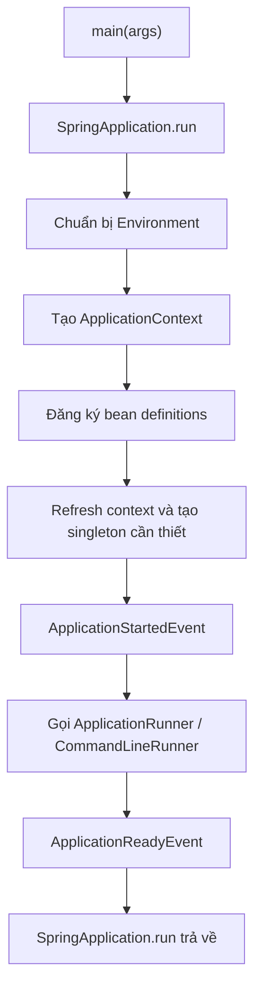
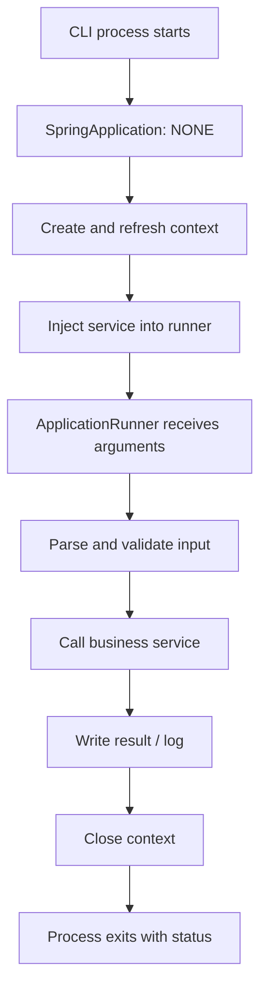

# Dựng ứng dụng dòng lệnh tối thiểu với một service và ApplicationRunner

Spring Boot thường được dùng để xây dựng REST API, nhưng một ứng dụng Spring không bắt buộc phải mở HTTP server. Ta cũng có thể dùng Spring Boot để tạo một chương trình dòng lệnh: đọc tham số khi khởi chạy, nạp cấu hình, inject service, thực hiện một công việc rồi kết thúc.

Một cách đơn giản để chạy công việc sau khi Spring application context đã được khởi tạo là **`ApplicationRunner`**. Runner nhận `ApplicationArguments`, vì vậy có thể đọc các tham số dòng lệnh đã được Spring Boot phân tích. Kết hợp runner với một service nhỏ, ta có một chương trình CLI vẫn tận dụng được dependency injection, configuration properties và các thành phần Spring mà không cần viết controller.

Bài học thuộc chương **Thực hành tổng hợp** của *Spring Boot Fundamentals*. Ta sẽ dựng một ứng dụng CLI tối thiểu để chào người dùng; tách phần xử lý vào service; đọc option từ command line; cấu hình ứng dụng chạy ở chế độ non-web; hiểu thời điểm runner được gọi; xử lý thứ tự, lỗi và exit code; sau đó kiểm thử service và runner.

Ví dụ sử dụng Java 21, Spring Boot 3.x, Gradle và JUnit Jupiter. Các nguyên tắc tương tự áp dụng cho Maven.

## 1. Ứng dụng dòng lệnh Spring Boot là gì?

Một chương trình CLI nhận dữ liệu từ đối số khi chạy, thực hiện tác vụ rồi ghi kết quả ra console hoặc file. Ví dụ:

```bash
java -jar greeting-cli.jar --name=Lan --times=2
```

Kết quả minh họa:

```text
Hello, Lan!
Hello, Lan!
```

Với Spring Boot, ứng dụng vẫn có thể:

- Khởi tạo ApplicationContext.
- Tạo bean từ component scanning và configuration.
- Inject service qua constructor.
- Đọc application.yml và environment variables.
- Dùng logging, validation, database hoặc các integration khác nếu cần.
- Chạy một tác vụ sau khi context sẵn sàng.

Điểm khác với web application là chương trình này **không cần servlet container hoặc reactive web server để phục vụ HTTP request**. Nó khởi động Spring, chạy công việc rồi kết thúc theo lifecycle của process.

### 1.1. Vì sao dùng Spring Boot cho CLI?

Với một script nhỏ không có dependency, Java thuần có thể là đủ. Spring Boot hữu ích khi chương trình dòng lệnh cần nhiều service được inject, cấu hình theo môi trường, database repositories, external API clients, logging hoặc các module dùng chung với ứng dụng Spring Boot lớn hơn.

Không nên thêm Spring chỉ để in một dòng chữ nếu không có nhu cầu về container hoặc cấu hình. Mục tiêu của ví dụ này là hiểu cách ghép một service với lifecycle của Spring Boot.

## 2. Cấu trúc project tối thiểu

Ta tạo một Gradle project có cấu trúc:

```text
greeting-cli/
├── build.gradle
└── src/
    ├── main/
    │   ├── java/com/example/cli/
    │   │   ├── GreetingCliApplication.java
    │   │   ├── GreetingService.java
    │   │   └── GreetingRunner.java
    │   └── resources/
    │       └── application.yml
    └── test/
        └── java/com/example/cli/
            ├── GreetingServiceTest.java
            └── GreetingRunnerTest.java
```

Trong ứng dụng nhỏ này, ba class chính có trách nhiệm khác nhau:

| Class | Trách nhiệm |
|---|---|
| `GreetingCliApplication` | Điểm vào chương trình và khởi động Spring Boot. |
| `GreetingService` | Chứa logic nghiệp vụ tạo lời chào. |
| `GreetingRunner` | Nhận command-line arguments, gọi service và trình bày kết quả. |

Việc tách runner khỏi service giúp service không phụ thuộc console hoặc cơ chế khởi động. Sau này cùng service có thể được gọi từ một REST controller, scheduled job hoặc test.

## 3. Khai báo dependency

Trong `build.gradle`, dùng Spring Boot plugin và dependency management tương thích với phiên bản dự án:

```groovy
plugins {
    id 'java'
    id 'org.springframework.boot' version '3.3.0'
    id 'io.spring.dependency-management' version '1.1.5'
}

group = 'com.example'
version = '0.0.1-SNAPSHOT'

java {
    toolchain {
        languageVersion = JavaLanguageVersion.of(21)
    }
}

dependencies {
    implementation 'org.springframework.boot:spring-boot-starter'
    testImplementation 'org.springframework.boot:spring-boot-starter-test'
}
```

Số phiên bản trong ví dụ minh họa một cấu trúc build; khi tạo project mới, hãy dùng phiên bản Spring Boot và Gradle phù hợp với repository hiện tại.

### 3.1. Vì sao chỉ cần spring-boot-starter?

`spring-boot-starter` cung cấp các thành phần cơ bản để chạy ứng dụng Spring Boot. Ví dụ CLI không cần `spring-boot-starter-web` để phục vụ HTTP, không cần template engine và không cần embedded servlet container.

Nếu chương trình sau này cần database, message broker hoặc HTTP client, ta thêm đúng starter/integration tương ứng. Không cần thêm web starter chỉ vì muốn dùng `ApplicationRunner`.

### 3.2. Maven dependency tương ứng

Với Maven, phần dependencies tối thiểu có thể là:

```xml
<dependencies>
    <dependency>
        <groupId>org.springframework.boot</groupId>
        <artifactId>spring-boot-starter</artifactId>
    </dependency>
    <dependency>
        <groupId>org.springframework.boot</groupId>
        <artifactId>spring-boot-starter-test</artifactId>
        <scope>test</scope>
    </dependency>
</dependencies>
```

Ví dụ giả định Maven project đã dùng Spring Boot parent hoặc BOM để quản lý dependency versions.

## 4. Tạo class khởi động ứng dụng

Tạo `GreetingCliApplication.java`:

```java
package com.example.cli;

import org.springframework.boot.SpringApplication;
import org.springframework.boot.WebApplicationType;
import org.springframework.boot.autoconfigure.SpringBootApplication;

@SpringBootApplication
public class GreetingCliApplication {

    public static void main(String[] args) {
        SpringApplication application =
                new SpringApplication(GreetingCliApplication.class);

        application.setWebApplicationType(WebApplicationType.NONE);
        application.run(args);
    }
}
```

`@SpringBootApplication` bật component scanning và auto-configuration. `SpringApplication` tạo và refresh context, sau đó chạy các runner đã đăng ký.

### 4.1. Vì sao đặt WebApplicationType.NONE?

`WebApplicationType.NONE` yêu cầu Spring Boot khởi động ứng dụng theo kiểu non-web. Với project chỉ có starter cơ bản, Boot thường đã suy ra đây là ứng dụng không web. Việc đặt rõ `NONE` giúp ý định của CLI application dễ nhận biết và tránh thay đổi ngoài ý muốn nếu sau này classpath được bổ sung web dependency.

Không có web server nghĩa là không có HTTP port để lắng nghe request; không cần controller để bắt đầu chương trình; các bean service và runner vẫn được khởi tạo bình thường.

### 4.2. Có thể dùng SpringApplication.run trực tiếp không?

Có. Cách viết ngắn:

```java
SpringApplication.run(GreetingCliApplication.class, args);
```

phù hợp nếu loại ứng dụng được suy ra đúng từ classpath hoặc đã được cấu hình qua property. Dùng đối tượng `SpringApplication` khi muốn đặt `WebApplicationType.NONE` hoặc cấu hình các thuộc tính bootstrap khác một cách tường minh.

## 5. Tạo service chứa logic nghiệp vụ

Tạo `GreetingService.java`:

```java
package com.example.cli;

import org.springframework.stereotype.Service;

@Service
public class GreetingService {

    public String greet(String name) {
        String normalizedName = name == null ? "" : name.trim();

        if (normalizedName.isEmpty()) {
            normalizedName = "Guest";
        }

        return "Hello, " + normalizedName + "!";
    }
}
```

Service nhận một giá trị đầu vào và trả về một chuỗi. Nó không đọc `System.in`, không phân tích `args` và không gọi `System.exit`. Vì vậy, logic có thể được kiểm thử độc lập.

### 5.1. Vì sao không đặt tất cả trong main?

Ta có thể viết toàn bộ chương trình trong `main`, nhưng khi logic tăng lên, class main sẽ phải xử lý đọc tham số, kiểm tra dữ liệu đầu vào, tính toán nghiệp vụ, in kết quả và xử lý lỗi/exit code.

Tách service giúp mỗi phần có một nhiệm vụ rõ ràng. `main` chỉ khởi động Spring; runner điều phối; service thực hiện nghiệp vụ.

### 5.2. Service mặc định là singleton

`@Service` đăng ký một bean có scope singleton mặc định. Ví dụ service trên không giữ trạng thái riêng của từng lần chạy, nên có thể được runner gọi mà không cần tạo instance thủ công.

Không nên thêm field `currentName` vào service để runner gán trước mỗi lần gọi. Hãy truyền `name` qua tham số method.

## 6. ApplicationRunner là gì?

`ApplicationRunner` là một callback interface của Spring Boot:

```java
@FunctionalInterface
public interface ApplicationRunner {
    void run(ApplicationArguments args) throws Exception;
}
```

Bean implement interface này sẽ được Spring Boot gọi khi application context đã được khởi tạo và refresh xong, trong quá trình hoàn tất `SpringApplication.run(...)`.

Đây là thời điểm phù hợp cho một số công việc khởi động: đọc tham số dòng lệnh; gọi service để xử lý tác vụ một lần; nạp hoặc kiểm tra dữ liệu ban đầu; in thông tin kết quả; xác nhận cấu hình bắt buộc trước khi kết thúc chương trình.

### 6.1. ApplicationRunner nhận ApplicationArguments

Khác với `CommandLineRunner`, `ApplicationRunner` nhận object `ApplicationArguments`. Object này phân tích các option arguments và non-option arguments, giúp code đọc dữ liệu rõ ràng hơn.

### 6.2. Runner không phải controller

Runner không chờ một HTTP request. Nó được gọi trong startup lifecycle. Khi `run(...)` hoàn tất, Spring Boot tiếp tục hoàn thành lời gọi `SpringApplication.run(...)`.

Nếu runner thực hiện tác vụ dài, thời gian khởi động ứng dụng cũng kéo dài tương ứng.

### 6.3. Có thể đăng ký runner bằng @Bean

Không bắt buộc phải dùng `@Component`. Một configuration class có thể khai báo:

```java
@Configuration(proxyBeanMethods = false)
class CliConfiguration {

    @Bean
    ApplicationRunner greetingRunner(GreetingService service) {
        return args -> System.out.println(service.greet("Lan"));
    }
}
```

Trong bài thực hành, ta dùng `@Component` để class runner dễ quan sát và tách biệt với class main.

## 7. Viết GreetingRunner

Tạo `GreetingRunner.java`:

```java
package com.example.cli;

import org.springframework.boot.ApplicationArguments;
import org.springframework.boot.ApplicationRunner;
import org.springframework.stereotype.Component;

@Component
public class GreetingRunner implements ApplicationRunner {

    private final GreetingService greetingService;

    public GreetingRunner(GreetingService greetingService) {
        this.greetingService = greetingService;
    }

    @Override
    public void run(ApplicationArguments args) {
        String name = args.containsOption("name")
                ? args.getOptionValues("name").get(0)
                : "Guest";

        System.out.println(greetingService.greet(name));
    }
}
```

Khi Spring tạo `GreetingRunner`, constructor injection cung cấp `GreetingService`. Đến lúc context sẵn sàng, Boot gọi `run(args)` và runner sử dụng service.

### 7.1. Điều gì xảy ra khi không truyền --name?

Nếu chạy:

```bash
java -jar greeting-cli.jar
```

runner chọn giá trị mặc định `Guest` và in:

```text
Hello, Guest!
```

Nếu truyền:

```bash
java -jar greeting-cli.jar --name=Lan
```

kết quả là:

```text
Hello, Lan!
```

Đây là CLI tối thiểu: Spring Boot khởi tạo service, runner đọc input và điều phối lời gọi.

## 8. Đọc command-line arguments bằng ApplicationArguments

Spring Boot phân loại đối số bắt đầu bằng `--` thành option arguments. Các đối số còn lại là non-option arguments.

Ví dụ:

```bash
java -jar greeting-cli.jar --name=Lan --times=3 report.csv
```

Ta có:

| Phần đầu vào | Kết quả đọc |
|---|---|
| `--name=Lan` | Option `name` có value `Lan` |
| `--times=3` | Option `times` có value `3` |
| `report.csv` | Non-option argument |

### 8.1. Các method thường dùng

`ApplicationArguments` cung cấp những method quan trọng:

| Method | Ý nghĩa |
|---|---|
| `getSourceArgs()` | Mảng argument ban đầu. |
| `getOptionNames()` | Tập tên option đã phân tích. |
| `containsOption(name)` | Kiểm tra option có xuất hiện không. |
| `getOptionValues(name)` | Lấy các giá trị của option; có thể có nhiều giá trị. |
| `getNonOptionArgs()` | Lấy các đối số không phải option. |

Ví dụ:

```java
private void printArguments(ApplicationArguments args) {
    System.out.println("Raw: "
            + Arrays.toString(args.getSourceArgs()));
    System.out.println("Options: " + args.getOptionNames());
    System.out.println("Name values: " + args.getOptionValues("name"));
    System.out.println("Files: " + args.getNonOptionArgs());
}
```

Đoạn code minh họa cách quan sát input. Trong ứng dụng thật, không nên in các argument có thể chứa password, token hoặc dữ liệu nhạy cảm.

### 8.2. Option có nhiều giá trị

Có thể truyền một option nhiều lần:

```bash
java -jar greeting-cli.jar --tag=java --tag=spring
```

`getOptionValues("tag")` có thể trả danh sách gồm `java` và `spring`. Không nên mặc định mọi option chỉ có một value.

### 8.3. Option không có giá trị

Một flag có thể được truyền như:

```bash
java -jar greeting-cli.jar --verbose
```

Khi đó `containsOption("verbose")` cho biết flag có mặt; danh sách value có thể không có phần tử. Hãy kiểm tra sự hiện diện của option thay vì gọi `get(0)` một cách mù quáng.

### 8.4. Giá trị có khoảng trắng

Trong shell, cần đặt argument phù hợp để shell truyền một giá trị duy nhất:

```bash
java -jar greeting-cli.jar "--name=Lan Nguyen"
```

Trong PowerShell:

```powershell
java -jar greeting-cli.jar '--name=Lan Nguyen'
```

Quy tắc quoting cụ thể phụ thuộc shell đang dùng. Sau khi process nhận argument, Spring Boot phân tích giá trị theo chuỗi đã được shell chuyển vào.

## 9. Mở rộng CLI: thêm option times

Ta mở rộng yêu cầu: chương trình chào người dùng nhiều lần theo `--times`. Service vẫn chỉ tạo một lời chào; việc lặp bao nhiêu lần là trách nhiệm điều phối của runner.

```java
@Component
public class GreetingRunner implements ApplicationRunner {

    private final GreetingService greetingService;

    public GreetingRunner(GreetingService greetingService) {
        this.greetingService = greetingService;
    }

    @Override
    public void run(ApplicationArguments args) {
        String name = firstValue(args, "name", "Guest");
        int times = parseTimes(firstValue(args, "times", "1"));

        String message = greetingService.greet(name);
        for (int i = 0; i < times; i++) {
            System.out.println(message);
        }
    }

    private String firstValue(
            ApplicationArguments args,
            String option,
            String defaultValue) {

        if (!args.containsOption(option)) {
            return defaultValue;
        }

        var values = args.getOptionValues(option);
        if (values == null || values.isEmpty()) {
            throw new IllegalArgumentException(
                    "Option --" + option + " requires a value");
        }
        return values.get(0);
    }

    private int parseTimes(String rawValue) {
        int times;
        try {
            times = Integer.parseInt(rawValue);
        } catch (NumberFormatException ex) {
            throw new IllegalArgumentException(
                    "--times must be an integer", ex);
        }

        if (times < 1 || times > 100) {
            throw new IllegalArgumentException(
                    "--times must be between 1 and 100");
        }
        return times;
    }
}
```

Chạy:

```bash
java -jar greeting-cli.jar --name=Lan --times=3
```

Output:

```text
Hello, Lan!
Hello, Lan!
Hello, Lan!
```

Runner chịu trách nhiệm chuyển chuỗi command-line thành kiểu dữ liệu cần thiết và báo lỗi input không hợp lệ. Service vẫn nhận kiểu dữ liệu đã được kiểm tra, không phải tự đọc chuỗi `--times`.

Khi CLI phức tạp hơn, nên tách parser/validator thành một class riêng để runner chỉ còn điều phối.

## 10. Dùng non-option arguments

Không phải chương trình nào cũng dùng option cho mọi dữ liệu. Một CLI có thể nhận tên file ở vị trí không có `--`:

```bash
java -jar report-cli.jar report.csv
```

Đọc:

```java
List<String> files = args.getNonOptionArgs();
if (files.isEmpty()) {
    throw new IllegalArgumentException("A report file is required");
}

String inputFile = files.get(0);
```

Với nhiều positional arguments, hãy định nghĩa thứ tự và ý nghĩa rõ ràng. Với CLI lớn hơn, cân nhắc một thư viện chuyên parse command-line nếu cần subcommands, help text, type conversion hoặc validation phong phú.

### 10.1. Đừng nhầm option của Spring với option nghiệp vụ

Spring Boot cũng sử dụng command-line properties, ví dụ:

```bash
java -jar app.jar --spring.profiles.active=dev --name=Lan
```

`spring.profiles.active=dev` là property cấu hình Spring Boot. `name=Lan` là option mà runner của ứng dụng đọc. Cả hai đều được truyền qua command line, nhưng thuộc hai mục đích khác nhau.

## 11. ApplicationRunner chạy ở thời điểm nào?

Một luồng startup rút gọn:



Đây là mô tả lifecycle khái quát của Spring Boot. Những event cụ thể và thứ tự tương đối của listener/runner cần đối chiếu với phiên bản đang dùng, nhưng điểm cần nhớ là **runner chạy sau khi context đã được refresh và trước khi `SpringApplication.run(...)` hoàn tất**.

### 11.1. Bean đã sẵn sàng để inject

Khi runner được gọi, các dependency của nó đã được Spring inject. Runner có thể gọi service, repository hoặc bean cấu hình đã được tạo.

### 11.2. Runner không chạy trước khi context khởi tạo

Nếu một bean bắt buộc không tạo được, ứng dụng có thể thất bại trước khi runner được gọi. Không dùng runner để thay thế quá trình đăng ký dependency hoặc sửa lỗi bean creation.

### 11.3. Runner chạy một lần cho mỗi lần khởi động context

Trong một lần startup bình thường, mỗi runner bean được gọi một lần trong startup lifecycle đó. Nó không phải callback cho từng request hoặc từng lần gọi service. Nếu ứng dụng có nhiều ApplicationContext, mỗi context có lifecycle riêng.

## 12. ApplicationRunner và CommandLineRunner khác nhau thế nào?

Hai interface đều cho phép chạy code sau khi Spring Boot khởi động:

```java
public interface ApplicationRunner {
    void run(ApplicationArguments args) throws Exception;
}

public interface CommandLineRunner {
    void run(String... args) throws Exception;
}
```

| Tiêu chí | ApplicationRunner | CommandLineRunner |
|---|---|---|
| Tham số nhận được | `ApplicationArguments` | `String... args` |
| Option arguments đã được phân tích | Có | Không, nhận mảng chuỗi gốc |
| Lấy non-option arguments | Có method riêng | Tự phân tích mảng |
| Dùng khi | Muốn truy cập option names/values có cấu trúc | Muốn xử lý chuỗi args đơn giản |
| Startup timing | Cùng nhóm lifecycle runner | Cùng nhóm lifecycle runner |

### 12.1. Khi nào chọn ApplicationRunner?

Chọn `ApplicationRunner` khi cần `containsOption("name")`, `getOptionValues("tag")`, `getNonOptionArgs()` hoặc phân biệt option với positional arguments. Đối với bài thực hành này, nó phù hợp vì mục tiêu là đọc `--name` và `--times`.

### 12.2. Khi nào chọn CommandLineRunner?

Nếu chương trình chỉ cần nhận một chuỗi đơn giản hoặc tự dùng parser riêng, `CommandLineRunner` có thể ngắn gọn hơn. Không cần đăng ký cả hai chỉ để xử lý cùng một input.

### 12.3. Có thể dùng cả hai không?

Có. Spring Boot phát hiện cả hai loại runner. Nếu ứng dụng có nhiều runner, hãy điều khiển thứ tự bằng `@Order` hoặc `Ordered` khi thứ tự thực sự quan trọng.

## 13. Điều khiển thứ tự runner

Giả sử ứng dụng cần kiểm tra cấu hình, nạp dữ liệu rồi tạo báo cáo. Ta có thể dùng `@Order`:

```java
@Component
@Order(1)
public class ConfigurationCheckRunner implements ApplicationRunner {
    @Override
    public void run(ApplicationArguments args) {
        System.out.println("Checking configuration...");
    }
}

@Component
@Order(2)
public class ImportRunner implements ApplicationRunner {
    @Override
    public void run(ApplicationArguments args) {
        System.out.println("Importing data...");
    }
}
```

Runner có order nhỏ hơn thường được gọi trước runner có order lớn hơn theo quy tắc ordering của Spring.

### 13.1. Không dựa vào thứ tự component scanning

Nếu không chỉ định ordering, đừng dựa vào thứ tự class được phát hiện hoặc tên bean để suy ra trình tự runner. Khi thứ tự là yêu cầu nghiệp vụ, hãy khai báo rõ ràng.

### 13.2. Tránh phụ thuộc runner vào nhau quá nhiều

Nếu runner B chỉ chạy đúng khi runner A đã tạo dữ liệu, có thể mô hình hóa quy trình trong một orchestrator service:

```java
@Service
public class ImportWorkflow {

    public void execute() {
        validateConfiguration();
        importData();
        generateReport();
    }
}
```

Một runner gọi `importWorkflow.execute()`. Cách này làm trình tự nghiệp vụ nằm trong một nơi có thể kiểm thử, thay vì phân tán phụ thuộc qua thứ tự của nhiều runner.

## 14. Cấu hình mặc định trong application.yml

CLI có thể dùng cấu hình ngoài thay vì hard-code mọi giá trị. Ví dụ:

```yaml
spring:
  application:
    name: greeting-cli

app:
  greeting:
    default-name: Guest
    max-times: 100
```

Ta tạo configuration properties:

```java
package com.example.cli;

import org.springframework.boot.context.properties.ConfigurationProperties;

@ConfigurationProperties(prefix = "app.greeting")
public record GreetingProperties(
        String defaultName,
        int maxTimes) {
}
```

Đăng ký bằng `@ConfigurationPropertiesScan`:

```java
@SpringBootApplication
@ConfigurationPropertiesScan
public class GreetingCliApplication {
    // main(...)
}
```

Sau đó inject properties vào runner:

```java
@Component
public class GreetingRunner implements ApplicationRunner {

    private final GreetingService service;
    private final GreetingProperties properties;

    public GreetingRunner(
            GreetingService service,
            GreetingProperties properties) {
        this.service = service;
        this.properties = properties;
    }
}
```

### 14.1. Tham số dòng lệnh có thể override property

Spring Boot command-line properties có thể ghi đè giá trị trong file cấu hình theo property precedence thông thường.

Ví dụ:

```bash
java -jar greeting-cli.jar --app.greeting.default-name=Lan
```

Runner vẫn có thể đọc `GreetingProperties.defaultName()` để lấy giá trị đã bind. Như vậy, ứng dụng có default được quản lý trong `application.yml` và override theo lần chạy qua command line hoặc environment.

### 14.2. Phân biệt CLI option với Spring property

Bạn có thể thiết kế `--name=Lan` là option nghiệp vụ, hoặc dùng `--app.greeting.default-name=Lan` như một property Spring. Option nghiệp vụ thường ngắn và gần với giao diện CLI; property Spring thường mô tả cấu hình ứng dụng và có thể được dùng trong nhiều môi trường. Không nên tạo hai khóa cùng ý nghĩa mà không có quy tắc ưu tiên rõ ràng.

## 15. Tách parser khỏi runner khi CLI lớn hơn

Runner nên đóng vai trò adapter: nhận input, chuyển sang kiểu dữ liệu có ý nghĩa, gọi service và trình bày kết quả.

Nếu parsing phức tạp, tạo một command record:

```java
public record GreetingCommand(String name, int times) {
}
```

Parser:

```java
@Component
public class GreetingCommandParser {

    public GreetingCommand parse(ApplicationArguments args) {
        String name = firstValue(args, "name", "Guest");
        int times = parsePositiveInt(
                firstValue(args, "times", "1"));
        return new GreetingCommand(name, times);
    }

    private String firstValue(
            ApplicationArguments args,
            String option,
            String fallback) {
        if (!args.containsOption(option)) {
            return fallback;
        }
        var values = args.getOptionValues(option);
        if (values == null || values.isEmpty()) {
            throw new IllegalArgumentException(
                    "--" + option + " requires a value");
        }
        return values.get(0);
    }

    private int parsePositiveInt(String value) {
        try {
            int parsed = Integer.parseInt(value);
            if (parsed < 1 || parsed > 100) {
                throw new IllegalArgumentException(
                        "--times must be between 1 and 100");
            }
            return parsed;
        } catch (NumberFormatException ex) {
            throw new IllegalArgumentException(
                    "--times must be an integer", ex);
        }
    }
}
```

Runner:

```java
@Component
public class GreetingRunner implements ApplicationRunner {

    private final GreetingCommandParser parser;
    private final GreetingService service;

    public GreetingRunner(
            GreetingCommandParser parser,
            GreetingService service) {
        this.parser = parser;
        this.service = service;
    }

    @Override
    public void run(ApplicationArguments args) {
        GreetingCommand command = parser.parse(args);
        String message = service.greet(command.name());

        for (int i = 0; i < command.times(); i++) {
            System.out.println(message);
        }
    }
}
```

Giờ parser có thể được unit test riêng, service có thể được unit test riêng, còn runner chỉ phối hợp các thành phần.

## 16. Xử lý lỗi đầu vào và exit code

Một CLI cần báo cho shell hoặc script gọi nó biết công việc thành công hay thất bại. Quy ước phổ biến là exit code `0` cho thành công và mã khác `0` cho lỗi hoặc tác vụ không hoàn thành.

Không nên chỉ in “Error” rồi luôn kết thúc với mã `0`, vì scheduler hoặc script tự động hóa có thể hiểu nhầm là thành công.

### 16.1. ExitCodeGenerator

Spring Boot cung cấp `ExitCodeGenerator` để xác định exit code khi đóng ứng dụng:

```java
public interface ExitCodeGenerator {
    int getExitCode();
}
```

Ví dụ một runner có thể ghi nhận kết quả:

```java
@Component
public class GreetingRunner
        implements ApplicationRunner, ExitCodeGenerator {

    private int exitCode = 0;

    @Override
    public void run(ApplicationArguments args) {
        try {
            // Parse input và thực hiện công việc.
        } catch (IllegalArgumentException ex) {
            System.err.println("Input error: " + ex.getMessage());
            exitCode = 2;
        }
    }

    @Override
    public int getExitCode() {
        return exitCode;
    }
}
```

Đây là mẫu khái niệm. Nếu lỗi được bắt trong runner, runner phải quyết định rõ có tiếp tục hay đánh dấu thất bại; nếu để exception thoát ra, startup có thể fail và Spring Boot xử lý lỗi khởi động.

### 16.2. Đóng context và trả exit code

Trong `main`, có thể lấy exit code từ Spring Boot:

```java
public static void main(String[] args) {
    SpringApplication application =
            new SpringApplication(GreetingCliApplication.class);
    application.setWebApplicationType(WebApplicationType.NONE);

    ConfigurableApplicationContext context = application.run(args);
    int exitCode = SpringApplication.exit(context);
    System.exit(exitCode);
}
```

`SpringApplication.exit(...)` thu thập exit code từ các `ExitCodeGenerator` phù hợp và đóng context. `System.exit(...)` kết thúc process với mã tương ứng.

**Lưu ý:** không gọi `System.exit` trong unit test hoặc trong service. Đặt thao tác kết thúc process ở entry point của chương trình để test không làm dừng JVM đang chạy test suite.

### 16.3. Có cần bắt mọi exception trong runner?

Không nhất thiết. Nếu exception đại diện lỗi không thể tiếp tục, để nó truyền ra có thể khiến ứng dụng startup thất bại và trả exit code khác 0 theo cơ chế Spring Boot. Nếu muốn cung cấp thông báo CLI thân thiện và một mã lỗi riêng, hãy xử lý ở boundary, ghi log phù hợp và bảo đảm exit code phản ánh đúng kết quả.

### 16.4. Đừng in stack trace cho lỗi input thông thường

Một giá trị `--times=abc` là lỗi đầu vào có thể giải thích ngắn gọn. Có thể in usage/help và thông báo rõ thay vì in toàn bộ stack trace. Với lỗi hệ thống như database unavailable, log exception đầy đủ ở mức phù hợp và trả exit code thất bại.

## 17. Định nghĩa help và usage

Khi CLI lớn hơn, người dùng cần biết option nào được hỗ trợ. Một cách đơn giản là thêm flag:

```bash
java -jar greeting-cli.jar --help
```

Runner có thể kiểm tra:

```java
if (args.containsOption("help")) {
    printUsage();
    return;
}
```

Hàm usage:

```java
private void printUsage() {
    System.out.println("""
            Usage:
              java -jar greeting-cli.jar [options]

            Options:
              --name=<name>    Name to greet (default: Guest)
              --times=<count>  Number of greetings (1..100)
              --help           Show this message
            """);
}
```

Với CLI chuyên nghiệp có nhiều subcommand, option type, completion và help generation, cân nhắc thư viện parser chuyên dụng như Picocli. `ApplicationRunner` vẫn có thể là điểm nối để gọi command parser đó sau khi Spring context sẵn sàng.

## 18. Đọc stdin có khác ApplicationArguments không?

Command-line arguments được cung cấp ngay khi process khởi động. `System.in` là input stream có thể đọc sau đó, ví dụ:

```java
BufferedReader reader =
        new BufferedReader(new InputStreamReader(System.in));
String line = reader.readLine();
```

Hai cách nhập có mục đích khác nhau:

| Cách nhập | Khi dùng |
|---|---|
| Command-line arguments | Script hoặc người dùng truyền option/giá trị ngay khi khởi chạy. |
| Standard input | Người dùng nhập tương tác hoặc dữ liệu được pipe từ process khác. |

Ví dụ pipe:

```bash
cat names.txt | java -jar greeting-cli.jar
```

Runner có thể đọc `System.in` nếu ứng dụng được thiết kế để nhận stream. Nhưng trong ví dụ tối thiểu này, ta chỉ dùng `ApplicationArguments` để tránh thêm một cơ chế input không cần thiết.

### 18.1. Không block startup ngoài ý muốn

Nếu runner gọi `readLine()` và chờ stdin, ứng dụng sẽ chưa hoàn tất startup cho đến khi có input hoặc EOF. Điều đó có thể là thiết kế hợp lệ cho interactive CLI, nhưng không phù hợp với một batch job được scheduler chạy tự động nếu không có input stream.

## 19. ApplicationRunner không phải cơ chế chạy định kỳ

Runner được gọi trong startup lifecycle. Nó không tự lặp lại theo lịch.

Nếu cần chạy tác vụ:

- Một lần mỗi lần process khởi động: `ApplicationRunner` phù hợp.
- Theo lịch: xem xét `@Scheduled` và scheduling infrastructure.
- Theo message: dùng message listener/container phù hợp.
- Theo request: controller hoặc handler phù hợp.
- Theo lệnh người dùng gọi nhiều lần trong cùng process: thiết kế command loop hoặc CLI subcommand dispatcher.

Đừng dùng runner như một scheduler bằng cách viết vòng lặp vô hạn hoặc `Thread.sleep(...)` trong `run(...)` nếu mục tiêu thật là tác vụ định kỳ.

## 20. Runner và các lifecycle callbacks khác

Spring Boot có nhiều callback/event ở startup. Một số điểm cần phân biệt:

| Thành phần | Mục đích |
|---|---|
| `@PostConstruct` | Khởi tạo bean sau khi dependency injection hoàn tất. |
| `InitializingBean.afterPropertiesSet()` | Callback khởi tạo bean của Spring. |
| `ApplicationRunner` | Chạy tác vụ sau khi context refresh, có `ApplicationArguments`. |
| `CommandLineRunner` | Chạy tác vụ sau khi context refresh, nhận chuỗi args. |
| `ApplicationReadyEvent` | Event báo ứng dụng đã sẵn sàng sau giai đoạn runner. |
| `@Scheduled` | Chạy method theo lịch khi scheduling được bật. |

### 20.1. Không đặt toàn bộ business workflow trong @PostConstruct

`@PostConstruct` thuộc lifecycle của bean. Nó không phải nơi lý tưởng để thực hiện tác vụ CLI cần đọc toàn bộ command-line arguments hoặc cần orchestration nhiều service.

Runner thể hiện ý định “chạy sau khi ứng dụng khởi tạo” rõ hơn.

### 20.2. Không dùng ApplicationReadyEvent chỉ vì tên nghe phù hợp

Nếu cần chạy một công việc khởi động và dùng `ApplicationArguments`, `ApplicationRunner` là API trực tiếp. Event listener phù hợp khi cần phản ứng theo event lifecycle hoặc tách listener khỏi runner orchestration.

## 21. Kiểm thử GreetingService

Service không phụ thuộc Spring container để thực hiện logic, nên có thể unit test đơn giản:

```java
package com.example.cli;

import static org.assertj.core.api.Assertions.assertThat;

import org.junit.jupiter.api.Test;

class GreetingServiceTest {

    private final GreetingService service = new GreetingService();

    @Test
    void greetsProvidedName() {
        assertThat(service.greet("Lan"))
                .isEqualTo("Hello, Lan!");
    }

    @Test
    void usesGuestForBlankName() {
        assertThat(service.greet("  "))
                .isEqualTo("Hello, Guest!");
    }
}
```

Test này xác nhận logic service. Nó không cần `@SpringBootTest` vì không kiểm tra dependency injection hoặc lifecycle của runner.

## 22. Kiểm thử ApplicationRunner

Runner phụ thuộc `GreetingService`, nhận `ApplicationArguments` và in kết quả. Ta có thể kiểm tra nó bằng cách tạo arguments từ Spring Boot parser và capture output.

Ví dụ với Spring Boot Test và JUnit:

```java
package com.example.cli;

import static org.assertj.core.api.Assertions.assertThat;

import java.io.ByteArrayOutputStream;
import java.io.PrintStream;

import org.junit.jupiter.api.AfterEach;
import org.junit.jupiter.api.Test;
import org.springframework.boot.DefaultApplicationArguments;

class GreetingRunnerTest {

    private final PrintStream originalOut = System.out;

    @AfterEach
    void restoreOutput() {
        System.setOut(originalOut);
    }

    @Test
    void printsGreetingForNameOption() throws Exception {
        ByteArrayOutputStream output = new ByteArrayOutputStream();
        System.setOut(new PrintStream(output));

        GreetingRunner runner =
                new GreetingRunner(new GreetingService());

        runner.run(new DefaultApplicationArguments("--name=Lan"));

        assertThat(output.toString())
                .contains("Hello, Lan!");
    }
}
```

Ví dụ giả định `GreetingRunner` là phiên bản chỉ cần service và đọc `--name`. Nếu runner đã mở rộng để cần parser/properties, hãy cung cấp các dependency tương ứng trong test.

### 22.1. Vì sao phải khôi phục System.out?

`System.out` là process-wide static stream. Nếu test thay nó mà không khôi phục, các test khác có thể bị ảnh hưởng. `@AfterEach` giúp trả stream ban đầu sau mỗi test.

Trong một bộ test lớn hoặc test chạy song song, việc thay đổi global stream cần được kiểm soát cẩn thận. Có thể thiết kế runner nhận một `PrintStream` hoặc output abstraction qua constructor để test không phải sửa `System.out`.

### 22.2. Kiểm tra parser riêng

Nếu đã tách `GreetingCommandParser`, hãy test không có option, `--name=Lan`, `--times=3`, `--times=abc`, `--times=0` hoặc quá giới hạn, và option thiếu value. Đây là unit tests cho boundary parsing, không cần boot cả application context.

## 23. Kiểm thử Spring Boot context và runner lifecycle

Nếu muốn xác nhận Spring tạo bean và gọi runner khi khởi động, có thể dùng `@SpringBootTest`:

```java
@SpringBootTest(
        webEnvironment = SpringBootTest.WebEnvironment.NONE,
        args = {"--name=Lan"})
class GreetingApplicationTest {

    @Autowired
    GreetingService greetingService;

    @Test
    void loadsServiceBean() {
        assertThat(greetingService.greet("Lan"))
                .isEqualTo("Hello, Lan!");
    }
}
```

`args` cung cấp command-line arguments cho test application. Runner có thể được gọi trong quá trình context startup trước khi test method chạy. Nếu runner ghi console, output có thể xuất hiện trong test logs.

### 23.1. Cẩn thận runner có side effect trong integration test

Nếu runner gửi email, xóa dữ liệu, import file hoặc gọi external API, mỗi lần test tạo context có thể kích hoạt công việc đó. Hãy thiết kế property điều khiển hoặc test configuration để chỉ chạy tác vụ khi được yêu cầu.

Ví dụ:

```yaml
app:
  cli:
    execute: true
```

Runner có thể kiểm tra `app.cli.execute` trước khi thực hiện workflow. Trong test chỉ cần load context, đặt property false để tránh side effect.

### 23.2. Context caching ảnh hưởng số lần runner chạy

Spring Test có thể cache ApplicationContext giữa các test có cấu hình tương thích. Runner chạy khi context được khởi tạo, không phải trước từng test method. Nếu context được tái sử dụng, runner không tự chạy lại cho mỗi method.

## 24. Một ví dụ hoàn chỉnh với cấu hình và runner

Sau các bước trên, phiên bản gọn của chương trình có thể gồm:

**GreetingCliApplication.java**

```java
package com.example.cli;

import org.springframework.boot.SpringApplication;
import org.springframework.boot.WebApplicationType;
import org.springframework.boot.autoconfigure.SpringBootApplication;

@SpringBootApplication
public class GreetingCliApplication {

    public static void main(String[] args) {
        SpringApplication application =
                new SpringApplication(GreetingCliApplication.class);
        application.setWebApplicationType(WebApplicationType.NONE);
        application.run(args);
    }
}
```

**GreetingService.java**

```java
package com.example.cli;

import org.springframework.stereotype.Service;

@Service
public class GreetingService {

    public String greet(String name) {
        String value = name == null ? "" : name.trim();
        if (value.isEmpty()) {
            value = "Guest";
        }
        return "Hello, " + value + "!";
    }
}
```

**GreetingRunner.java**

```java
package com.example.cli;

import org.springframework.boot.ApplicationArguments;
import org.springframework.boot.ApplicationRunner;
import org.springframework.stereotype.Component;

@Component
public class GreetingRunner implements ApplicationRunner {

    private final GreetingService service;

    public GreetingRunner(GreetingService service) {
        this.service = service;
    }

    @Override
    public void run(ApplicationArguments args) {
        String name = "Guest";

        if (args.containsOption("name")) {
            var values = args.getOptionValues("name");
            if (values != null && !values.isEmpty()) {
                name = values.get(0);
            }
        }

        System.out.println(service.greet(name));
    }
}
```

**application.yml**

```yaml
spring:
  application:
    name: greeting-cli
```

Đây là phiên bản tối thiểu đủ để khởi động Spring Boot non-web, component scan service và runner, inject service vào runner, nhận `--name=...`, in lời chào rồi hoàn tất startup.

## 25. Chạy ứng dụng

### 25.1. Chạy bằng Gradle

Trên macOS/Linux:

```bash
./gradlew bootRun --args='--name=Lan'
```

Trên Windows PowerShell:

```powershell
.\gradlew.bat bootRun --args='--name=Lan'
```

### 25.2. Build executable JAR

```bash
./gradlew bootJar
```

Sau khi build thành công, file JAR thường nằm trong `build/libs/`:

```bash
java -jar build/libs/greeting-cli-0.0.1-SNAPSHOT.jar --name=Lan
```

Tên file thực tế phụ thuộc `group`, `version`, archive configuration và tên project.

### 25.3. Kiểm tra ứng dụng không mở HTTP port

Ứng dụng không cần web starter và đã chọn `WebApplicationType.NONE`. Khi chạy, bạn sẽ thấy log startup Spring Boot, log runner và kết quả. Không cần gọi `curl localhost:8080`.

## 26. Xử lý tham số cấu hình Spring và tham số nghiệp vụ

Spring Boot có thể đọc:

```bash
java -jar app.jar --spring.profiles.active=prod --app.greeting.default-name=Lan --name=Minh
```

Trong ví dụ, `spring.profiles.active` chọn profile; `app.greeting.default-name` là property của ứng dụng; `name` là option nghiệp vụ do runner xử lý.

Khi thiết kế CLI thật, hãy xác định rõ option nào thuộc Spring configuration và option nào thuộc command contract. Tránh để một option bị xử lý hai lần với ý nghĩa khác nhau.

## 27. Tác vụ chạy lâu và vòng đời process

Một CLI có thể kết nối database, đọc file lớn hoặc gọi external API. Runner chỉ hoàn tất khi công việc đồng bộ của nó kết thúc.

### 27.1. Công việc đồng bộ

```java
@Override
public void run(ApplicationArguments args) {
    importService.importFile(args.getNonOptionArgs().get(0));
}
```

Nếu `importFile(...)` xử lý đồng bộ, runner chờ method hoàn tất rồi mới trả về.

### 27.2. Công việc bất đồng bộ

Nếu runner chỉ gửi một task vào executor rồi trả về, `SpringApplication.run(...)` có thể hoàn tất trong khi công việc nền vẫn đang chạy. Khi đó cần quản lý lifecycle executor, chờ completion hoặc giữ process sống theo chủ đích.

Không nên fire-and-forget một task rồi giả định CLI sẽ chờ kết quả. Hãy thiết kế cách chờ, timeout, cancellation và shutdown rõ ràng.

### 27.3. Đóng tài nguyên

Nếu service mở file stream, connection hoặc executor, hãy dùng try-with-resources hoặc bean lifecycle phù hợp. Khi context đóng, Spring gọi các destruction callbacks được hỗ trợ cho bean lifecycle.

## 28. Logging thay cho System.out ở ứng dụng thực tế

`System.out.println` dễ hiểu trong ví dụ CLI. Với ứng dụng thực tế, có thể dùng logger:

```java
private static final Logger log =
        LoggerFactory.getLogger(GreetingRunner.class);

log.info("Greeting task completed for {}", name);
```

Lợi ích là có log levels, timestamp, logger name, cấu hình console/file và khả năng tích hợp log aggregation.

Tuy nhiên, nếu chương trình cần output có cấu trúc cho một script khác đọc qua stdout, hãy giữ stdout cho kết quả chính và dùng stderr/logger cho diagnostics theo contract đã chọn.

### 28.1. Không trộn output máy đọc với log tùy ý

Ví dụ một CLI xuất JSON:

```json
{"status":"success","count":3}
```

Nếu log startup hoặc debug cũng ghi vào stdout, script nhận output có thể parse thất bại. Có thể cấu hình logging ra stderr hoặc file và giữ stdout cho payload theo thiết kế.

## 29. Những lỗi thường gặp

| Hiện tượng | Nguyên nhân có thể | Hướng xử lý |
|---|---|---|
| Runner không chạy | Bean runner không được scan/đăng ký hoặc context chưa startup thành công | Kiểm tra package scan, bean definition và startup exception |
| Không inject được service | Service không được đăng ký hoặc nằm ngoài component scan | Kiểm tra `@Service`, package và configuration |
| `getOptionValues("name")` trả null/empty | Option không có hoặc không có value | Kiểm tra `containsOption` và validate trước khi đọc |
| `IndexOutOfBoundsException` | Gọi `get(0)` khi list rỗng | Kiểm tra null/empty và báo lỗi input rõ ràng |
| `NumberFormatException` | Giá trị số không hợp lệ | Parse và xử lý lỗi ở CLI boundary |
| Chương trình mở port ngoài dự kiến | Có web dependency và loại application được suy ra là web | Đặt `WebApplicationType.NONE` nếu CLI không cần web |
| Runner chạy trong test gây side effect | Full context test cũng chạy startup runners | Dùng property/profile điều khiển tác vụ |
| Runner thứ hai chạy sai thứ tự | Không khai báo ordering | Dùng `@Order` hoặc gộp workflow vào orchestrator |
| Process không kết thúc | Executor/thread nền hoặc listener vẫn hoạt động | Quản lý shutdown và lifecycle |
| Script nghĩ tác vụ thành công dù có lỗi | Exit code luôn là 0 | Trả exit code phù hợp và không nuốt lỗi |
| Test làm hỏng output của test khác | Thay `System.out` nhưng không restore | Khôi phục stream hoặc inject output abstraction |
| Không thấy option nghiệp vụ | Nhầm option với non-option argument hoặc tên property | Kiểm tra `ApplicationArguments` và contract CLI |

## 30. Quy trình xây một CLI Spring Boot nhỏ

Khi bắt đầu một chương trình dòng lệnh, có thể thực hiện theo thứ tự:

1. **Xác định input và output.** Dùng command-line options, positional arguments, stdin, stdout hay file?
2. **Tạo project tối thiểu.** Chỉ thêm `spring-boot-starter` và dependency thật sự cần.
3. **Chọn non-web mode.** Dùng `WebApplicationType.NONE` nếu chương trình không phục vụ HTTP.
4. **Tách logic nghiệp vụ.** Đặt vào service có API nhận tham số và trả kết quả.
5. **Tạo ApplicationRunner.** Runner nhận `ApplicationArguments` và điều phối service.
6. **Parse và validate input.** Kiểm tra option thiếu, kiểu dữ liệu và giới hạn.
7. **Cấu hình qua Environment.** Dùng `application.yml`, profile và environment variables cho giá trị môi trường.
8. **Xác định startup behavior.** Runner chạy một lần khi context khởi động; không nhầm với scheduler hoặc request handler.
9. **Quản lý lỗi và exit code.** Đảm bảo script bên ngoài nhận đúng trạng thái.
10. **Kiểm thử theo ranh giới.** Unit test service/parser, test runner và integration test context khi cần.
11. **Quản lý tài nguyên.** Đóng file, connection, executor và context theo lifecycle.
12. **Đóng gói và chạy thử.** Build JAR, truyền tham số giống cách scheduler/script sẽ gọi.



## 31. Bài thực hành mở rộng

Sau khi chạy được lời chào tối thiểu, hãy mở rộng theo các bước:

**Bước A — Thêm `--name`.** Đọc option bằng `ApplicationArguments` và dùng `Guest` khi thiếu.

**Bước B — Thêm `--times`.** Parse integer, giới hạn trong khoảng 1 đến 100 và in lời chào đúng số lần.

**Bước C — Tách parser.** Tạo `GreetingCommandParser` trả về record `GreetingCommand`.

**Bước D — Thêm `application.yml`.** Đặt default name và giới hạn số lần chạy bằng `@ConfigurationProperties`.

**Bước E — Override property.** Truyền `--app.greeting.default-name=...` và quan sát giá trị được bind.

**Bước F — Thêm positional argument.** Nhận một file path và kiểm tra trường hợp thiếu file.

**Bước G — Thêm `--help`.** In usage và kết thúc bình thường mà không chạy nghiệp vụ.

**Bước H — Thêm một runner thứ hai.** Dùng `@Order` để quan sát thứ tự gọi.

**Bước I — Gộp workflow.** Chuyển trình tự nhiều bước vào một orchestrator service và để một runner gọi orchestrator.

**Bước J — Thử lỗi input.** Truyền `--times=abc`, `--times=0` và option thiếu value; xác nhận thông báo rõ ràng.

**Bước K — Exit code.** Đăng ký `ExitCodeGenerator`, đóng context bằng `SpringApplication.exit(...)` và xác nhận shell nhận mã thất bại.

**Bước L — Kiểm thử service.** Viết JUnit unit tests cho lời chào và default behavior.

**Bước M — Kiểm thử runner.** Tạo `DefaultApplicationArguments`, capture output hoặc inject output abstraction.

**Bước N — Kiểm thử context.** Dùng `@SpringBootTest(webEnvironment = NONE)` và `args` để xác nhận bean được tạo và runner được gọi.

**Bước O — Build executable JAR.** Chạy JAR bằng chính các tham số mà một script tự động hóa sẽ sử dụng.

**Bước P — Kiểm tra lifecycle.** Nếu thêm executor hoặc database, xác nhận process chỉ kết thúc sau khi công việc cần thiết hoàn tất và tài nguyên được đóng.

## 32. Câu hỏi tự đánh giá

1. Một ứng dụng Spring Boot CLI khác web application ở điểm nào?
2. Vì sao project tối thiểu không cần `spring-boot-starter-web`?
3. `WebApplicationType.NONE` điều khiển điều gì?
4. `@SpringBootApplication` có vai trò gì trong chương trình?
5. `@Service` giúp đăng ký `GreetingService` như thế nào?
6. `ApplicationRunner` được gọi ở giai đoạn nào của startup?
7. `ApplicationArguments` khác `String... args` ra sao?
8. `containsOption`, `getOptionValues` và `getNonOptionArgs` dùng để làm gì?
9. Vì sao cần kiểm tra danh sách option values trước khi gọi `get(0)`?
10. `--name=Lan` khác `--spring.profiles.active=dev` ở mục đích nào?
11. Khi nào nên dùng `CommandLineRunner` thay cho `ApplicationRunner`?
12. Làm thế nào điều khiển thứ tự của nhiều runner?
13. Vì sao nên để business logic trong service thay vì trong runner?
14. Runner có chạy lại trước mỗi JUnit test method không?
15. Vì sao startup runner có thể tạo side effect trong `@SpringBootTest`?
16. Làm thế nào cung cấp test arguments cho `@SpringBootTest`?
17. Khi nào cần dùng `ExitCodeGenerator`?
18. Vì sao không gọi `System.exit` bên trong service hoặc unit test?
19. Tác vụ được submit bất đồng bộ có bảo đảm hoàn tất trước khi CLI kết thúc không?
20. Khi nào nên dùng stdin thay vì command-line arguments?
21. Vì sao không nên ghi log tùy ý vào stdout nếu CLI xuất JSON cho script?
22. Khi nào nên dùng một thư viện parser chuyên dụng?

### Mẫu giải thích hoàn chỉnh

> Một ứng dụng Spring Boot CLI có thể dùng `spring-boot-starter` mà không cần web starter. Class main tạo `SpringApplication` và chọn `WebApplicationType.NONE` để khởi động non-web ApplicationContext. `GreetingService` chứa logic nghiệp vụ và được đăng ký bằng `@Service`; `GreetingRunner` implement `ApplicationRunner`, nhận `ApplicationArguments` sau khi context refresh, đọc các option như `--name` và gọi service qua constructor injection. Cách tách này giữ service độc lập với command-line parsing và console output. `ApplicationRunner` phù hợp khi cần option names/values và non-option arguments; `CommandLineRunner` nhận trực tiếp mảng chuỗi. Runner chạy trong startup lifecycle, không phải mỗi request hoặc theo lịch. Với CLI thực tế, cần validate input, quản lý lỗi và exit code, kiểm soát side effects trong test, chờ công việc bất đồng bộ nếu có và đóng tài nguyên đúng lifecycle.

Khi bạn có thể tự tạo project non-web, đăng ký một service, inject nó vào `ApplicationRunner`, đọc tham số và chạy tác vụ đến khi process kết thúc đúng trạng thái, bạn đã dựng được **ứng dụng dòng lệnh tối thiểu với một service và ApplicationRunner** trong Spring Boot.
