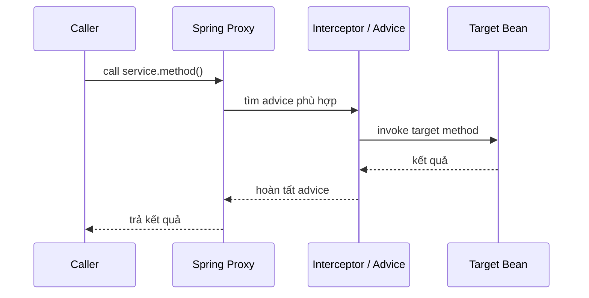
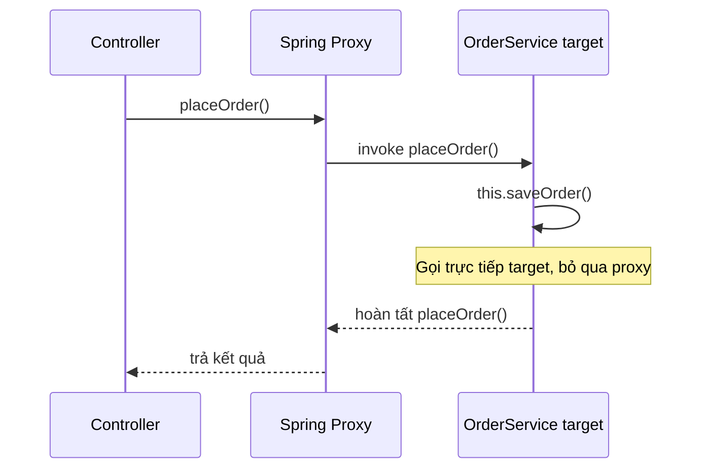

# Kiểm chứng self-invocation và lời gọi qua proxy

Spring cung cấp nhiều tính năng dựa trên proxy như transaction, cache, async, method security và các aspect tùy chỉnh. Một method có annotation chưa chắc đã được áp dụng advice trong mọi cách gọi. Điều quyết định là **lời gọi có đi qua proxy mà Spring tạo ra hay không**.

Tình huống dễ gây nhầm nhất là *self-invocation*: một method trong bean gọi method khác của chính instance đó bằng `this` hoặc gọi trực tiếp tên method. Lời gọi nội bộ này đi thẳng tới target object, bỏ qua proxy. Vì vậy, advice như `@Transactional`, `@Async`, `@Cacheable` hoặc `@Retryable` có thể không chạy dù method đích có annotation.

Bài học hướng dẫn cách phân biệt và kiểm chứng hai đường gọi:

- **Lời gọi qua proxy:** caller nhận bean reference từ Spring và gọi method qua reference đó. Proxy có cơ hội áp dụng interceptor/advice.
- **Self-invocation:** một method đang chạy trên target gọi method khác của cùng target. Lời gọi không quay lại proxy nên advice proxy-based không được áp dụng cho method được gọi nội bộ.

Ta sẽ dùng `@Transactional` làm ví dụ có thể quan sát bằng database, sau đó mở rộng sang cache, async, retry, security và các cách sửa.

## 1. Spring AOP proxy hoạt động ở đâu?

Với proxy-based AOP, Spring tạo một object proxy bọc quanh target bean. Caller gọi proxy; proxy kiểm tra các advisor/interceptor phù hợp rồi quyết định thực hiện advice trước, sau hoặc quanh lời gọi target.



Ví dụ, khi controller inject một `OrderService` bean và gọi `placeOrder()`, reference được inject có thể là proxy. Nếu method được cấu hình transaction, transaction interceptor bắt đầu transaction trước khi gọi target method và commit/rollback sau khi method kết thúc.

**Proxy là boundary của lời gọi.** Annotation là metadata để infrastructure nhận biết method cần xử lý; annotation không tự sửa bytecode của mọi lời gọi Java.

## 2. JDK dynamic proxy và CGLIB proxy

Spring AOP có thể dùng hai kiểu proxy chính.

### 2.1. JDK dynamic proxy

JDK dynamic proxy tạo một proxy implement các interface mà target cung cấp.

```java
public interface PaymentService {
    void pay(String orderId);
}

@Service
public class DefaultPaymentService implements PaymentService {

    @Override
    @Transactional
    public void pay(String orderId) {
        // Xử lý thanh toán.
    }
}
```

Caller thường inject và sử dụng interface `PaymentService`. Proxy nhận lời gọi qua method được khai báo trên interface rồi chuyển tiếp qua interceptor tới target.

### 2.2. CGLIB class-based proxy

CGLIB tạo subclass của target class để override các method có thể intercept.

```java
@Service
public class ReportService {

    @Transactional
    public void generate() {
        // Tạo báo cáo.
    }
}
```

Nếu không có interface phù hợp hoặc cấu hình yêu cầu class-based proxy, Spring có thể dùng CGLIB. Method cần intercept phải có khả năng override; method `final`, class `final` hoặc method `private` không thể được override theo cách CGLIB proxy cần.

### 2.3. Khác biệt thực tế

| Đặc điểm | JDK dynamic proxy | CGLIB proxy |
|---|---|---|
| Cách tạo | Implement interface | Tạo subclass của class |
| Caller thường dùng | Interface | Interface hoặc class |
| Target class cần interface | Có | Không |
| Intercept method | Method qua proxy interface | Method có thể override |
| `final` method | Cần xem method có được expose qua interface và proxy call hay không | Không thể override/intercept |
| `private` method | Không phải method trên interface | Không thể override |
| `this.inner()` trong target | Bỏ qua proxy | Bỏ qua proxy |

Việc chọn kiểu proxy không giải quyết self-invocation. Cả hai kiểu đều có cùng giới hạn: khi target gọi trực tiếp method của chính nó, lời gọi không đi qua proxy.

## 3. Self-invocation là gì?

Giả sử một service có hai method:

```java
@Service
public class OrderService {

    public void placeOrder() {
        validateOrder();
        saveOrder();
    }

    @Transactional
    public void saveOrder() {
        // Ghi dữ liệu.
    }

    private void validateOrder() {
        // Kiểm tra dữ liệu.
    }
}
```

Controller gọi:

```java
orderService.placeOrder();
```

Lời gọi từ controller tới `placeOrder()` có thể đi qua Spring proxy. Nhưng khi target `placeOrder()` chạy câu lệnh `saveOrder()`, Java gọi method trên chính `this`:

```java
this.saveOrder();
```

Lời gọi đó không quay ra proxy. Vì vậy transaction advice trên `saveOrder()` không được kích hoạt bởi lời gọi nội bộ này.



Một cách nhớ đơn giản:

- `controller -> proxy -> target.methodA()` là lời gọi qua proxy.
- `target.methodA() -> this.methodB()` là lời gọi nội bộ trên target.
- `target.methodA() -> injectedOtherBean.methodB()` có thể đi qua proxy của bean khác.

### 3.1. Không cần viết từ khóa this mới thành self-invocation

Hai cách dưới đây có cùng bản chất khi chạy trong instance:

```java
public void outer() {
    this.inner();
}

public void outerAgain() {
    inner();
}
```

Java ngầm hiểu lời gọi instance method không có receiver tường minh là lời gọi trên `this`. Cả hai đều là self-invocation.

### 3.2. Gọi method private cũng không thể được proxy intercept

Một method `private` không thể được gọi qua JDK interface proxy và cũng không thể được CGLIB override. Không nên đặt kỳ vọng `@Transactional` hoặc các proxy advice khác sẽ hoạt động trên private method trong mô hình proxy-based.

Với transaction annotation, hãy đặt boundary trên method phù hợp được caller gọi qua Spring bean proxy, thường là public method của application service.

## 4. Vì sao lời gọi qua proxy có advice nhưng self-invocation không?

Proxy không theo dõi mọi method call bên trong JVM. Nó chỉ có thể can thiệp khi control flow đi qua object proxy.

Ví dụ target:

```java
public class PricingService {

    public Price calculate() {
        return calculateWithAudit();
    }

    @Transactional
    public Price calculateWithAudit() {
        // Tính giá và ghi audit.
        return new Price();
    }
}
```

Nếu caller gọi `pricingService.calculateWithAudit()` qua proxy, transaction interceptor có thể chạy.

Nếu caller gọi `pricingService.calculate()` qua proxy, rồi target gọi `this.calculateWithAudit()`, interceptor của `calculateWithAudit()` không được gọi lần nữa. Proxy chỉ bao quanh `calculate()`.

Nếu `calculate()` cũng được đánh dấu `@Transactional`, transaction của method ngoài vẫn có thể bao quanh toàn bộ phần thực thi, bao gồm lời gọi nội bộ. Điều cần phân biệt là transaction đến từ **method ngoài** chứ không phải annotation của method trong được self-invocation kích hoạt.

## 5. Demo kiểm chứng bằng @Transactional

Một cách rõ ràng để quan sát self-invocation là ghi một dòng vào database rồi ném runtime exception. Nếu transaction interceptor hoạt động, thay đổi sẽ rollback. Nếu method transactional chỉ được gọi nội bộ và không có transaction bên ngoài, statement có thể đã commit theo chế độ auto-commit của connection.

### 5.1. Bảng database

Với H2 trong test, có thể tạo schema:

```sql
CREATE TABLE audit_record (
    id BIGINT GENERATED BY DEFAULT AS IDENTITY PRIMARY KEY,
    marker VARCHAR(100) NOT NULL
);
```

Đảm bảo test có dependency H2 và `JdbcTemplate` được cấu hình cùng `DataSource`/transaction manager.

### 5.2. Service có self-invocation

```java
@Service
public class AuditService {

    private final JdbcTemplate jdbcTemplate;

    public AuditService(JdbcTemplate jdbcTemplate) {
        this.jdbcTemplate = jdbcTemplate;
    }

    public void writeThroughSelfInvocation(String marker) {
        this.writeAndFail(marker);
    }

    @Transactional
    public void writeAndFail(String marker) {
        jdbcTemplate.update(
                "INSERT INTO audit_record(marker) VALUES (?)",
                marker
        );

        throw new IllegalStateException("Force rollback");
    }
}
```

`writeThroughSelfInvocation()` không có transaction. Nó gọi `writeAndFail()` trực tiếp trên target. Dù method đích có `@Transactional`, proxy không nhận được lời gọi đó.

### 5.3. Gọi method transactional qua proxy

Một caller bên ngoài gọi bean:

```java
auditService.writeAndFail("external-call");
```

Lần này reference `auditService` là Spring proxy. Transaction interceptor mở transaction trước khi gọi target method. Khi `IllegalStateException` thoát khỏi method, transaction mặc định rollback vì đây là unchecked exception.

### 5.4. So sánh kết quả

| Cách gọi | Có đi qua transaction proxy cho `writeAndFail`? | Kết quả thường thấy |
|---|---|---|
| `auditService.writeAndFail(...)` từ bean bên ngoài | Có | Insert rollback khi runtime exception thoát ra |
| `auditService.writeThroughSelfInvocation(...)` rồi target gọi `this.writeAndFail(...)` | Không | Không có transaction do method trong tạo; insert có thể được auto-commit |
| `auditService.outerTransactional()` có transaction, rồi gọi `this.writeAndFail(...)` | Transaction ngoài vẫn hoạt động | Insert thuộc transaction ngoài; rollback/commit theo boundary ngoài |

Kết quả phụ thuộc transaction manager và database configuration. Trong demo JDBC với auto-commit khi không có Spring transaction, insert nội bộ sẽ được commit trước khi exception được ném. Hãy kiểm tra bằng test thay vì suy luận chỉ từ log.

## 6. Integration test để chứng minh sự khác nhau

Test sau cần chạy trong Spring context thật, không đặt `@Transactional` trên test method. Nếu test method tự mở transaction, nó có thể làm sai lệch kết quả quan sát.

```java
@SpringBootTest
class AuditServiceProxyTests {

    @Autowired
    private AuditService auditService;

    @Autowired
    private JdbcTemplate jdbcTemplate;

    @BeforeEach
    void cleanTable() {
        jdbcTemplate.update("DELETE FROM audit_record");
    }

    @Test
    void selfInvocationDoesNotStartTransactionForInnerMethod() {
        assertThatThrownBy(() ->
                auditService.writeThroughSelfInvocation("self")
        ).isInstanceOf(IllegalStateException.class);

        Integer count = jdbcTemplate.queryForObject(
                "SELECT COUNT(*) FROM audit_record WHERE marker = ?",
                Integer.class,
                "self"
        );

        assertThat(count).isEqualTo(1);
    }

    @Test
    void externalProxyInvocationRollsBack() {
        assertThatThrownBy(() ->
                auditService.writeAndFail("external")
        ).isInstanceOf(IllegalStateException.class);

        Integer count = jdbcTemplate.queryForObject(
                "SELECT COUNT(*) FROM audit_record WHERE marker = ?",
                Integer.class,
                "external"
        );

        assertThat(count).isZero();
    }
}
```

Test đầu xác nhận lời gọi nội bộ không kích hoạt transaction của method trong. Test thứ hai gọi cùng method qua proxy và xác nhận rollback.

Các điều kiện để kết quả có ý nghĩa:

- Test không được tự mở transaction bao quanh method đang kiểm tra.
- Database test phải hỗ trợ transaction và được cấu hình đúng.
- `JdbcTemplate` phải dùng cùng `DataSource` với transaction manager.
- Exception phải thoát ra khỏi transactional method; nếu bị bắt và không được đánh dấu rollback, kết quả có thể khác.
- Không có transaction bên ngoài đang active.

Nếu project dùng JPA, có thể kiểm chứng bằng repository và transaction manager tương ứng; nguyên tắc proxy boundary không thay đổi.

## 7. Kiểm tra transaction đang active

Ngoài kiểm tra dữ liệu rollback, có thể quan sát transaction state:

```java
@Service
public class TransactionProbeService {

    public boolean activeWhenCalledInternally() {
        return transactionalProbe();
    }

    @Transactional
    public boolean transactionalProbe() {
        return TransactionSynchronizationManager
                .isActualTransactionActive();
    }
}
```

Gọi từ test:

```java
assertThat(probeService.activeWhenCalledInternally()).isFalse();
assertThat(probeService.transactionalProbe()).isTrue();
```

Trong lần gọi thứ nhất, `activeWhenCalledInternally()` đi qua proxy nhưng method `transactionalProbe()` được gọi trực tiếp trên target nên không mở transaction. Trong lần gọi thứ hai, method đích được gọi qua proxy nên transaction được mở, giả sử transaction manager đã cấu hình.

`TransactionSynchronizationManager.isActualTransactionActive()` là công cụ quan sát trạng thái hiện tại, không phải cách để tự tạo transaction.

## 8. Kiểm tra bean có thực sự là proxy không

Trong test hoặc diagnostics, Spring cung cấp các tiện ích:

```java
import org.springframework.aop.support.AopUtils;

assertThat(AopUtils.isAopProxy(auditService)).isTrue();
```

Có thể kiểm tra cụ thể:

```java
boolean jdkProxy = AopUtils.isJdkDynamicProxy(auditService);
boolean cglibProxy = AopUtils.isCglibProxy(auditService);
```

Kết quả giúp biết bean reference có phải AOP proxy và thuộc kiểu nào.

Nhưng **proxy tồn tại không có nghĩa mọi lời gọi đều được intercept**. Self-invocation vẫn bỏ qua proxy vì target gọi trực tiếp `this.method()`.

Cũng cần phân biệt target object và proxy object:

- Caller thường giữ reference proxy.
- Proxy giữ reference tới target.
- Khi proxy invoke, target method chạy.
- Bên trong target, `this` là target instance, không tự động trở thành proxy.

## 9. @Transactional và self-invocation

Đây là trường hợp gây lỗi nghiệp vụ phổ biến nhất.

```java
@Service
public class TransferService {

    public void transfer(String from, String to, BigDecimal amount) {
        debit(from, amount);
        credit(to, amount);
    }

    @Transactional
    public void debit(String account, BigDecimal amount) {
        // Trừ tiền.
    }

    @Transactional
    public void credit(String account, BigDecimal amount) {
        // Cộng tiền.
    }
}
```

Nếu caller gọi `transfer()` qua proxy nhưng `transfer()` không có transaction, hai lời gọi `debit()` và `credit()` là self-invocation. Mỗi annotation `@Transactional` ở method con không tự mở transaction.

Điều này có thể gây trạng thái dở dang: debit đã ghi nhưng credit thất bại.

Một thiết kế thường phù hợp hơn là đặt transaction boundary ở use case:

```java
@Service
public class TransferService {

    private final AccountRepository accountRepository;

    public TransferService(AccountRepository accountRepository) {
        this.accountRepository = accountRepository;
    }

    @Transactional
    public void transfer(
            String from,
            String to,
            BigDecimal amount
    ) {
        debit(from, amount);
        credit(to, amount);
    }

    private void debit(String account, BigDecimal amount) {
        // Logic trong cùng transaction.
    }

    private void credit(String account, BigDecimal amount) {
        // Logic trong cùng transaction.
    }
}
```

Method public `transfer()` được gọi qua proxy và transaction bao quanh toàn use case. Các helper private không cần annotation riêng vì đã nằm trong transaction boundary của method ngoài.

### 9.1. Propagation cũng chịu ảnh hưởng

Giả sử method bên trong có:

```java
@Transactional(propagation = Propagation.REQUIRES_NEW)
public void writeAudit() {
    // Ghi audit độc lập.
}
```

Nếu gọi bằng self-invocation, interceptor không chạy nên `REQUIRES_NEW` không được áp dụng. Method thực thi trong transaction hiện tại nếu có, hoặc không có transaction nếu caller không tạo transaction.

Đây là lỗi tinh vi: code có annotation `REQUIRES_NEW` nhưng thực tế không tách transaction.

### 9.2. Rollback rules vẫn áp dụng khi lời gọi đi qua proxy

Mặc định, Spring transaction rollback với `RuntimeException` và `Error`; checked exception thường không tự rollback trừ khi khai báo `rollbackFor` hoặc cấu hình phù hợp.

Ngay cả khi lời gọi đã đi qua proxy, kết quả vẫn phụ thuộc exception có thoát khỏi method và rollback rules. Nếu method bắt exception rồi trả về bình thường, transaction interceptor có thể commit trừ khi transaction đã bị đánh dấu rollback-only.

Vì vậy khi kiểm chứng, hãy kiểm tra cả:

- Lời gọi có qua proxy không.
- Transaction có active không.
- Exception nào được ném.
- Exception có thoát khỏi boundary không.
- Rollback rules được cấu hình ra sao.

## 10. @Async cũng bị self-invocation bỏ qua

Ví dụ:

```java
@Service
public class NotificationService {

    public void sendLater(String recipient) {
        sendAsync(recipient);
    }

    @Async
    public void sendAsync(String recipient) {
        // Gửi thông báo.
    }
}
```

Nếu `sendLater()` gọi `sendAsync()` trên cùng target, lời gọi không qua async proxy. Method chạy đồng bộ trên thread hiện tại thay vì được submit tới executor do Spring quản lý.

Cách kiểm chứng đơn giản:

```java
@Async
public void recordThreadName() {
    log.info("thread={}", Thread.currentThread().getName());
}
```

- Gọi bean method trực tiếp từ caller bên ngoài và quan sát executor thread.
- Gọi method này qua self-invocation và quan sát thread của caller.

Không chỉ dựa vào tên thread vì executor có thể được cấu hình với prefix tùy ý. Trong test, có thể dùng `CountDownLatch` hoặc `CompletableFuture` để xác nhận method hoàn tất bất đồng bộ và thread khác với caller.

## 11. @Cacheable cũng không cache qua self-invocation

Ví dụ:

```java
@Service
public class ProductService {

    public Product getProduct(String id) {
        return loadProduct(id);
    }

    @Cacheable("products")
    public Product loadProduct(String id) {
        return repository.findById(id).orElseThrow();
    }
}
```

Caller gọi `getProduct()` qua proxy, nhưng target gọi `this.loadProduct()`. Cache interceptor không được chạy cho `loadProduct()`, nên cache có thể không được đọc/ghi như mong muốn.

Cách kiểm chứng:

1. Bật cache infrastructure.
2. Đếm số lần repository được gọi.
3. Gọi public method ngoài nhiều lần với cùng key.
4. So sánh self-invocation và gọi `loadProduct()` qua proxy từ caller bên ngoài.

Nếu repository vẫn được gọi mỗi lần, đừng vội kết luận cache provider lỗi; hãy kiểm tra proxy boundary.

## 12. Retry, security và custom aspects

Các tính năng dựa trên proxy khác cũng có thể chịu giới hạn tương tự.

### 12.1. @Retryable

Nếu `@Retryable` nằm trên method được gọi trực tiếp từ một method khác trong cùng target, retry interceptor không nhận được lời gọi nội bộ. Method chỉ chạy một lần dù có annotation.

### 12.2. Method security

Các method security interceptor như `@PreAuthorize` hoạt động khi invocation đi qua security proxy tương ứng. Một self-invocation có thể bỏ qua method-level security advice.

Đây là lý do không nên đặt ranh giới kiểm soát quyền truy cập chỉ trên một method nội bộ rồi gọi nó từ method khác cùng class. Đặt security boundary ở method được gọi qua proxy hoặc tổ chức bean boundary phù hợp.

### 12.3. Custom aspect

Một aspect được khai báo bằng `@Aspect` cũng dựa vào Spring AOP proxy nếu dùng proxy-based mode. Pointcut có thể match method, nhưng self-invocation vẫn không đi qua proxy để kích hoạt advice.

Nếu cần intercept mọi method execution trong class kể cả lời gọi nội bộ, cân nhắc AspectJ weaving thay vì proxy-based Spring AOP.

## 13. Cách sửa ưu tiên: tách bean theo trách nhiệm

Giải pháp dễ hiểu và thường nên chọn là đưa method cần advice sang một collaborator khác.

Trước:

```java
@Service
public class OrderService {

    public void placeOrder(Order order) {
        saveWithTransaction(order);
    }

    @Transactional
    public void saveWithTransaction(Order order) {
        repository.save(order);
    }
}
```

Sau:

```java
@Service
public class OrderService {

    private final TransactionalOrderWriter orderWriter;

    public OrderService(TransactionalOrderWriter orderWriter) {
        this.orderWriter = orderWriter;
    }

    public void placeOrder(Order order) {
        orderWriter.save(order);
    }
}

@Service
public class TransactionalOrderWriter {

    private final OrderRepository repository;

    public TransactionalOrderWriter(OrderRepository repository) {
        this.repository = repository;
    }

    @Transactional
    public void save(Order order) {
        repository.save(order);
    }
}
```

Bây giờ `OrderService` gọi bean khác. Reference `orderWriter` được inject từ Spring và có thể là proxy, vì vậy lời gọi `save()` đi qua transaction interceptor.

Lợi ích:

- Transaction boundary hiển thị rõ trong dependency graph.
- Mỗi class có trách nhiệm cụ thể.
- Unit test có thể thay writer bằng mock.
- Không cần truy cập ApplicationContext.
- Không tạo phụ thuộc vào proxy implementation details.

Không cần tách bean chỉ để mọi method có annotation riêng. Hãy tách khi boundary đó có ý nghĩa về use case, transaction, retry hoặc trách nhiệm.

## 14. Cách khác: inject self proxy

Một số trường hợp muốn giữ method trong cùng class nhưng cần gọi lại qua proxy. Có thể inject proxy của chính bean vào một dependency riêng hoặc dùng self-reference có chủ đích.

Một cách dùng `ObjectProvider`:

```java
@Service
public class BatchService {

    private final ObjectProvider<BatchService> selfProvider;

    public BatchService(ObjectProvider<BatchService> selfProvider) {
        this.selfProvider = selfProvider;
    }

    public void runBatch(List<String> ids) {
        for (String id : ids) {
            selfProvider.getObject().processOne(id);
        }
    }

    @Transactional
    public void processOne(String id) {
        // Xử lý một item.
    }
}
```

`ObjectProvider` lấy bean từ container; nếu bean được expose dưới dạng proxy, lời gọi `processOne()` sẽ đi qua proxy.

Tuy nhiên, self-injection làm class phụ thuộc vào chính proxy của nó và có thể gây vòng dependency/circular reference tùy cách khai báo. Đây thường là lựa chọn thứ yếu so với tách collaborator.

### 14.1. Inject chính class hay interface?

Nếu dùng JDK dynamic proxy, inject concrete class có thể không tương thích vì proxy chỉ implement interface. Nên expose interface rõ ràng:

```java
public interface BatchOperations {
    void processOne(String id);
}

@Service
public class BatchService implements BatchOperations {
    // ...
}
```

Sau đó inject `ObjectProvider<BatchOperations>` hoặc một abstraction phù hợp. Với class-based proxy, concrete type có thể hoạt động nếu proxy assignable theo class, nhưng không nên để thiết kế phụ thuộc ngầm vào proxy type.

### 14.2. Self-injection có phải constructor injection bình thường?

Không hoàn toàn. Constructor inject chính bean có thể tạo circular dependency trực tiếp. Dùng `@Lazy`, `ObjectProvider` hoặc một cơ chế lookup có thể trì hoãn resolve, nhưng vẫn tăng độ phức tạp.

Nếu phải làm vậy, ghi rõ lý do và có integration test xác nhận method thực sự được gọi qua proxy.

## 15. Cách khác: AopContext.currentProxy()

Spring có thể expose proxy hiện tại để target lấy proxy và gọi method qua nó.

Cần bật:

```java
@EnableAspectJAutoProxy(exposeProxy = true)
@Configuration
public class AopConfiguration {
}
```

Sau đó:

```java
@Service
public class ReportService {

    public void generateAll() {
        ((ReportService) AopContext.currentProxy()).generateOne();
    }

    @Transactional
    public void generateOne() {
        // Tạo một phần báo cáo.
    }
}
```

`AopContext.currentProxy()` trả về proxy đang xử lý invocation hiện tại nếu proxy được expose. Method `generateAll()` phải được gọi qua proxy trước thì context mới có proxy hiện hành.

### 15.1. Nhược điểm

- Code phụ thuộc trực tiếp vào Spring AOP.
- Caller phải đi vào bean qua proxy trước.
- Cần bật `exposeProxy`.
- Có thể gây khó khăn khi test object trực tiếp.
- Làm luồng điều khiển ít rõ ràng hơn constructor injection.
- Dễ tạo coupling với kiểu proxy.

Chỉ dùng khi có lý do kỹ thuật rõ ràng và không thể tổ chức boundary tốt hơn. Không nên biến `AopContext.currentProxy()` thành pattern mặc định trong business code.

## 16. Cách khác: AspectJ weaving

Proxy-based Spring AOP chỉ intercept invocation đi qua proxy. AspectJ weaving có thể áp dụng advice trực tiếp vào bytecode ở compile-time hoặc load-time, nên có khả năng intercept self-invocation tùy join point/aspect được cấu hình.

Với transaction management, Spring hỗ trợ mode:

```java
@EnableTransactionManagement(mode = AdviceMode.ASPECTJ)
```

Cách này cần AspectJ transaction aspect và cấu hình weaving tương ứng, thường bao gồm dependency `spring-aspects` cùng compile-time hoặc load-time weaving.

### 16.1. Proxy mode và AspectJ mode

| Đặc điểm | Proxy mode | AspectJ weaving |
|---|---|---|
| Cơ chế | Proxy bọc bean | Weave advice vào bytecode |
| Self-invocation | Bỏ qua advice | Có thể được intercept |
| Cấu hình | Spring AOP proxy | AspectJ compiler/weaver hoặc load-time weaving |
| Yêu cầu runtime/build | Proxy infrastructure | Weaving setup và agent/compiler phù hợp |
| Phù hợp | Phần lớn ứng dụng Spring | Trường hợp cần intercept execution nội bộ hoặc join point rộng hơn |

AspectJ không phải công tắc nhỏ để bật khi thấy self-invocation. Nó thêm yêu cầu build/runtime, khả năng debug và chi phí vận hành. Chỉ chọn khi proxy boundary không đáp ứng được yêu cầu thật.

## 17. Những trường hợp dễ hiểu nhầm khác

### 17.1. Gọi từ constructor hoặc @PostConstruct

Trong lúc bean đang được tạo, proxy có thể chưa được expose đầy đủ như reference cuối cùng mà caller nhận. Gọi method được advise từ constructor hoặc initialization callback không phải cách tốt để khởi chạy workflow có transaction/cache/async.

Hãy để initialization chỉ thiết lập trạng thái nội bộ cần thiết. Nếu cần chạy use case sau khi context sẵn sàng, dùng lifecycle event phù hợp và gọi một bean collaborator qua reference do Spring inject.

### 17.2. Gọi method trên object vừa tạo bằng new

```java
new ReportService().generate();
```

Object này không phải Spring bean reference nên không có Spring AOP proxy. Dù class có `@Service` và method có `@Transactional`, annotation không được áp dụng cho instance vừa tạo.

### 17.3. Gọi qua một bean khác

```java
@Service
public class SchedulerService {

    private final ReportService reportService;

    public SchedulerService(ReportService reportService) {
        this.reportService = reportService;
    }

    public void run() {
        reportService.generate();
    }
}
```

Lời gọi có thể đi qua proxy của `ReportService`, miễn là bean đó được cấu hình để áp dụng advice và method có thể được intercept.

### 17.4. Internal call trong cùng class không phải lúc nào cũng sai

Self-invocation không phải lỗi Java và không phải lúc nào cũng cần sửa. Nó chỉ trở thành vấn đề khi bạn **mong đợi một proxy-based advice chạy trên method được gọi nội bộ**.

Nếu method con chỉ là helper thuần, không có annotation/interceptor cần áp dụng, gọi trực tiếp là hoàn toàn bình thường.

## 18. Method visibility và giới hạn proxy

Khi thiết kế method cần AOP, cần xem proxy type và method visibility.

| Method/class | JDK proxy | CGLIB proxy |
|---|---|---|
| Public method trên interface | Có thể intercept qua proxy | Có thể intercept nếu override được |
| Public method không có trên interface | Không expose qua JDK interface proxy | Có thể intercept nếu override được |
| Protected/package-visible method | Không phải method gọi qua interface proxy thông thường | Có thể hỗ trợ tùy Spring/version và điều kiện override |
| Private method | Không | Không |
| Final method | Cần xem interface exposure và proxy call tương ứng | Không thể override/intercept |
| Final class | JDK proxy vẫn có thể implement interface của target | Không thể subclass target |

Để code dễ dự đoán giữa các loại proxy, đặt advised operation ở method public trên interface hoặc class phù hợp, tránh `private`/`final` và kiểm tra proxy strategy thực tế.

Không kết luận rằng mọi method có annotation đều chắc chắn được intercept chỉ từ source code.

## 19. Transaction boundary nên đặt ở đâu?

Một use case thường nên có một transaction boundary rõ ràng tại application service method được caller bên ngoài gọi.

```java
@Service
public class PlaceOrderService {

    private final OrderRepository orders;
    private final InventoryService inventory;

    public PlaceOrderService(
            OrderRepository orders,
            InventoryService inventory
    ) {
        this.orders = orders;
        this.inventory = inventory;
    }

    @Transactional
    public void execute(PlaceOrderCommand command) {
        inventory.reserve(command.items());
        orders.save(Order.from(command));
    }
}
```

Method `execute()` được gọi qua proxy. Transaction bao quanh use case. Các private helper bên trong chỉ xử lý logic trong transaction đó.

Nếu có một bước cần transaction độc lập, có thể đưa bước đó vào collaborator bean riêng với `REQUIRES_NEW`, rồi gọi collaborator qua proxy.

### 19.1. Không chia transaction thành nhiều method annotation chỉ vì muốn code nhỏ

Việc tách method không tự tạo transaction boundary. Nếu method chỉ là helper nội bộ, annotation riêng có thể gây hiểu nhầm.

Hãy tách bean khi có một boundary có ý nghĩa: retry một operation, audit độc lập, transaction mới, async task hoặc một responsibility có thể được gọi từ nhiều caller.

## 20. Một chiến lược kiểm thử proxy toàn diện

Khi kiểm tra một tính năng proxy, nên có ba lớp bằng chứng.

### 20.1. Kiểm tra bean proxy

```java
assertThat(AopUtils.isAopProxy(service)).isTrue();
```

Điều này xác nhận reference được inject là proxy. Nó không chứng minh method cụ thể được intercept.

### 20.2. Kiểm tra advice có thực thi

Với transaction, quan sát `TransactionSynchronizationManager.isActualTransactionActive()` hoặc kiểm tra commit/rollback ở database.

Với async, quan sát thread/executor và đồng bộ test bằng latch/future.

Với cache, đếm số lần collaborator được gọi và xác nhận cache hit.

Với retry, đếm số lần invocation trước khi thành công hoặc hết retry.

### 20.3. So sánh external invocation và self-invocation

Tạo hai test riêng:

- External caller gọi advised method trực tiếp qua injected bean.
- External caller gọi outer method, outer method gọi advised method nội bộ.

Dùng cùng điều kiện, dữ liệu và exception để so sánh. Tránh để một transaction của test hoặc một proxy khác làm sai lệch kết quả.

### 20.4. Đừng chỉ assert exception

Một exception xuất hiện ở cả hai đường gọi không chứng minh transaction rollback. Cần assert trạng thái database, cache, thread hoặc số lần invocation tùy behavior đang kiểm tra.

## 21. Ví dụ test cache và async

### 21.1. Cache

Giả sử repository có method:

```java
interface ProductRepository {
    Optional<Product> findById(String id);
}
```

Một service dùng `@Cacheable`:

```java
@Service
public class CachedProductService {

    private final ProductRepository repository;

    public CachedProductService(ProductRepository repository) {
        this.repository = repository;
    }

    @Cacheable("products")
    public Product find(String id) {
        return repository.findById(id).orElseThrow();
    }
}
```

Integration test gọi `find("p1")` hai lần qua bean proxy và xác nhận repository chỉ được gọi một lần, với cache provider/config phù hợp.

Nếu có method `findFromAnotherMethod()` trong cùng class gọi `this.find("p1")`, test riêng đường này để xác nhận cache advice không được kích hoạt bởi self-invocation.

### 21.2. Async

Service:

```java
@Service
public class AsyncWorker {

    @Async
    public CompletableFuture<String> execute() {
        return CompletableFuture.completedFuture(
                Thread.currentThread().getName()
        );
    }
}
```

Caller bên ngoài nhận `CompletableFuture` từ proxy và chờ bằng timeout hữu hạn trong test. So sánh thread name với caller thread.

Nếu method ngoài trong cùng class gọi `this.execute()`, lời gọi không được async interceptor xử lý. Method có thể chạy trên thread hiện tại và trả future ngay theo logic target.

Test async nên tránh `Thread.sleep()` tùy tiện. Dùng `CountDownLatch`, `CompletableFuture` hoặc đồng bộ có timeout để giảm flaky test.

## 22. Tác động của self-invocation theo từng annotation

| Annotation/feature | Hành vi mong đợi khi qua proxy | Khi self-invocation |
|---|---|---|
| `@Transactional` | Mở/join/suspend transaction theo propagation | Không áp dụng transaction metadata của method trong |
| `@Async` | Submit invocation vào executor | Chạy trực tiếp trên thread hiện tại |
| `@Cacheable` | Đọc cache, có thể bỏ qua target nếu hit | Không chạy cache interceptor |
| `@CachePut` | Gọi target rồi cập nhật cache theo cấu hình | Không chạy cache interceptor |
| `@CacheEvict` | Evict theo điều kiện/key | Không chạy cache interceptor |
| `@Retryable` | Retry invocation theo policy | Không retry từ interceptor |
| `@PreAuthorize` | Kiểm tra quyền trước method invocation | Không chạy method-security interceptor |
| Custom Spring AOP aspect | Chạy advice nếu pointcut match | Không intercept self-call trong proxy mode |

Bảng này nói về các tính năng được triển khai qua proxy. Nếu dùng AspectJ weaving hoặc một cơ chế khác, semantics có thể khác.

## 23. Những lỗi thường gặp khi sửa self-invocation

### 23.1. Chỉ đổi proxyTargetClass

Bật CGLIB bằng cấu hình như `proxyTargetClass = true` không sửa self-invocation. CGLIB vẫn là proxy; target gọi `this.inner()` vẫn bỏ qua proxy.

### 23.2. Thêm @Transactional lên cả hai method

Nếu method ngoài được gọi qua proxy và đã có transaction, method trong self-invocation vẫn không tạo interceptor riêng. Có thể behavior mong muốn vẫn đạt do transaction ngoài, nhưng propagation/timeout/isolation/rollback rule riêng của method trong không được áp dụng.

### 23.3. Bắt exception để test thấy method vẫn chạy

Nếu code bắt exception bên trong transactional method rồi không ném lại, transaction interceptor có thể thấy method kết thúc bình thường và commit. Khi test rollback, cần hiểu exception boundary và rollback-only semantics.

### 23.4. Đánh dấu method private

Private method không phải advised entry point trong proxy-based AOP. Đưa transaction annotation lên private helper không tạo boundary.

### 23.5. Gọi target trực tiếp từ test

Nếu test tự tạo service bằng `new`, nó đang kiểm tra object thuần chứ không kiểm tra proxy. Dùng `@SpringBootTest` hoặc context runner phù hợp và inject bean từ context.

### 23.6. Cho rằng có @EnableTransactionManagement là đủ

Annotation này bật infrastructure transaction annotation-driven. Nhưng cần transaction manager phù hợp, method call qua proxy và transaction configuration đúng. Nếu gọi self-invocation, infrastructure có tồn tại vẫn không giúp method trong được intercept.

## 24. Checklist điều tra khi @Transactional không hoạt động

Khi thấy dữ liệu không rollback hoặc transaction không mở, lần lượt kiểm tra:

1. Method có được gọi qua Spring bean reference không?
2. Bean reference có phải proxy không?
3. Lời gọi có phải self-invocation hoặc object tạo bằng `new` không?
4. Method có visibility và signature phù hợp với proxy type không?
5. `@EnableTransactionManagement` hoặc auto-configuration transaction có hoạt động không?
6. Có `PlatformTransactionManager`/`ReactiveTransactionManager` phù hợp không?
7. Repository/JdbcTemplate có dùng cùng transaction resource không?
8. Exception có thoát ra khỏi transactional boundary không?
9. Exception thuộc rollback rule mặc định hay cần `rollbackFor`?
10. Test method có tự mở transaction làm sai kết quả không?
11. Có transaction bên ngoài đã active không?
12. Có propagation, read-only, timeout hoặc isolation làm thay đổi behavior không?

Với reactive transaction, semantics gắn với reactive pipeline/context và khác với thread-bound imperative transaction. Không dùng `TransactionSynchronizationManager.isActualTransactionActive()` như một kiểm tra tổng quát cho mọi reactive flow.

## 25. Quy trình lựa chọn cách sửa

Khi phát hiện self-invocation, chọn giải pháp theo mục tiêu:

| Nhu cầu | Cách thường phù hợp |
|---|---|
| Method con là một transaction/use case riêng | Tách thành collaborator bean |
| Method con chỉ là helper trong cùng transaction | Đặt transaction ở method ngoài, helper không cần annotation |
| Cần instance mới cho từng lần xử lý | Prototype qua `ObjectProvider` hoặc factory phù hợp |
| Không thể tách class nhưng phải gọi qua proxy | Self proxy/`ObjectProvider` có kiểm soát |
| Đã có kiến trúc dùng AspectJ và cần intercept self-call | AspectJ weaving |
| Chỉ cần test logic Java thuần | Gọi object trực tiếp, không kỳ vọng proxy advice |

Ưu tiên boundary rõ ràng và dependency injection tường minh. Các cách truy cập proxy trực tiếp nên được xem là giải pháp đặc biệt, không phải lựa chọn đầu tiên.

## 26. Bài thực hành tổng hợp

### Bài 1. Chứng minh self-invocation bỏ qua transaction

Tạo `AuditService` như ví dụ và bảng `audit_record`.

1. Gọi `writeThroughSelfInvocation("self")`.
2. Xác nhận method ném exception.
3. Đếm bản ghi `self`.
4. Gọi `writeAndFail("external")` trực tiếp qua injected bean.
5. Xác nhận method ném exception.
6. Đếm bản ghi `external`.

**Kết quả mong đợi trong JDBC auto-commit demo:** bản ghi từ self-invocation còn lại; bản ghi từ lời gọi qua proxy bị rollback.

### Bài 2. Chuyển transaction boundary ra ngoài

Đặt `@Transactional` lên method `transfer()` được caller gọi qua proxy. Bỏ annotation ở các helper nội bộ. Tạo test khiến credit thất bại sau debit.

**Tiêu chí đạt:** cả debit và credit rollback trong cùng transaction.

### Bài 3. Tách writer thành bean riêng

Tạo `TransactionalOrderWriter` có method public `@Transactional`. Inject nó vào `OrderService` và gọi qua dependency.

**Tiêu chí đạt:** test xác nhận transaction active trong writer và rollback theo exception.

### Bài 4. Kiểm tra @Async

Tạo outer method gọi async method qua self-invocation và qua bean proxy riêng. Dùng `CountDownLatch` hoặc `CompletableFuture` để kiểm tra thread thực thi.

**Câu hỏi:** Vì sao đổi sang CGLIB không làm self-invocation thành async?

**Đáp án:** Vì target vẫn gọi trực tiếp `this.method()` thay vì proxy.

### Bài 5. Kiểm tra cache

Gọi một `@Cacheable` method qua proxy nhiều lần và đếm repository invocation. Sau đó tạo outer method tự gọi cacheable method nội bộ.

**Tiêu chí đạt:** external proxy invocation dùng cache; self-invocation bỏ qua cache interceptor.

### Bài 6. So sánh proxy và AspectJ

Nếu project có hạ tầng weaving, cấu hình transaction AspectJ mode trong một sample riêng và kiểm tra self-invocation. Ghi lại dependency, compiler/load-time weaver và runtime agent cần thiết.

Không bật AspectJ trong ứng dụng chính chỉ để hoàn thành bài tập này nếu project chưa có yêu cầu weaving.

## 27. Câu hỏi tự kiểm tra

**Câu 1.** Self-invocation là gì?

**Đáp án:** Method của một object gọi method khác của chính instance đó, thường thông qua `this` hoặc lời gọi instance method không ghi receiver.

**Câu 2.** Vì sao `@Transactional` trên method nội bộ có thể không hoạt động?

**Đáp án:** Lời gọi nội bộ chạy trực tiếp trên target và không đi qua Spring proxy, nên transaction interceptor không được kích hoạt cho method đó.

**Câu 3.** JDK proxy và CGLIB có giải quyết self-invocation không?

**Đáp án:** Không. Cả hai đều dựa trên lời gọi đi qua proxy.

**Câu 4.** Nếu method ngoài đã có `@Transactional`, method helper được gọi nội bộ có chạy trong transaction không?

**Đáp án:** Có thể có, vì transaction của method ngoài bao quanh toàn bộ lời gọi. Nhưng annotation/propagation riêng trên helper vẫn không được xử lý qua proxy.

**Câu 5.** Vì sao test method không nên tự có `@Transactional` trong demo rollback?

**Đáp án:** Transaction của test có thể bao quanh cả lời gọi và làm sai lệch việc so sánh self-invocation với proxy invocation.

**Câu 6.** Đổi `proxyTargetClass` sang CGLIB có sửa lỗi không?

**Đáp án:** Không. CGLIB vẫn không intercept lời gọi trực tiếp từ target sang `this.method()`.

**Câu 7.** Cách sửa thường được ưu tiên là gì?

**Đáp án:** Tách method có boundary cần advice sang một collaborator bean khác và gọi qua injected proxy.

**Câu 8.** `AopContext.currentProxy()` cần điều kiện gì?

**Đáp án:** Proxy phải được expose và lời gọi hiện tại phải bắt đầu qua proxy; cách này làm code phụ thuộc Spring AOP.

**Câu 9.** AspectJ weaving khác proxy mode ở điểm nào?

**Đáp án:** AspectJ weave advice vào bytecode nên có thể intercept execution nội bộ; nó cần compiler hoặc load-time weaving setup.

**Câu 10.** `AopUtils.isAopProxy(bean)` trả true có chứng minh mọi method call đều được intercept không?

**Đáp án:** Không. Nó chỉ xác nhận bean reference là proxy; self-invocation và method không phù hợp vẫn có thể bỏ qua advice.

## 28. Ghi nhớ

- Spring proxy áp dụng advice khi lời gọi đi qua proxy reference.
- Self-invocation là lời gọi từ target tới method khác của chính target, không quay lại proxy.
- `this.method()` và `method()` trong instance method đều có thể là self-invocation.
- JDK dynamic proxy implement interface; CGLIB tạo subclass, nhưng cả hai đều có giới hạn self-invocation.
- `@Transactional`, `@Async`, `@Cacheable`, `@Retryable`, method security và custom proxy-based aspect đều có thể bị bỏ qua khi self-invocation.
- Transaction của method ngoài vẫn bao quanh lời gọi nội bộ nếu method ngoài đã được proxy mở transaction; annotation riêng của method trong không tự được áp dụng.
- Kiểm chứng bằng behavior thực tế như database rollback, transaction active, repository invocation count hoặc thread execution.
- Test phải gọi Spring-managed bean; không tự tạo target bằng `new` khi muốn kiểm tra AOP.
- Tách collaborator bean là cách sửa rõ ràng và dễ test trong phần lớn trường hợp.
- `ObjectProvider`/self-injection và `AopContext.currentProxy()` có thể gọi lại proxy nhưng làm tăng coupling.
- AspectJ weaving có thể xử lý self-invocation nhưng yêu cầu cấu hình build/runtime riêng.
- Method cần proxy advice phải phù hợp với proxy strategy và visibility; private/final method hoặc final class có giới hạn.
- Đừng bật CGLIB hay thêm annotation một cách máy móc; trước hết xác định lời gọi đi qua boundary nào.

Khi một annotation Spring dường như không có tác dụng, hãy lần theo đường đi của lời gọi: **“Caller đang giữ proxy hay target? Method đích được gọi từ bean khác hay từ `this`? Advice có thực sự được kích hoạt không, và test nào chứng minh behavior đó?”** Kiểm tra được ba điểm này sẽ giúp bạn phân biệt lỗi cấu hình với giới hạn proxy và đặt transaction/cache/async boundary đúng nơi.

## 29. Tài liệu tham khảo chính thức

- [Spring Framework — Understanding AOP Proxies](https://docs.spring.io/spring-framework/reference/core/aop/proxying.html)
- [Spring Framework — Declarative Transaction Annotations](https://docs.spring.io/spring-framework/reference/data-access/transaction/declarative/annotations.html)
- [Spring Framework — Cache Annotation Enablement](https://docs.spring.io/spring-framework/reference/integration/cache/annotations.html)
- [Spring Framework — Task Execution and @Async](https://docs.spring.io/spring-framework/reference/integration/scheduling.html)
