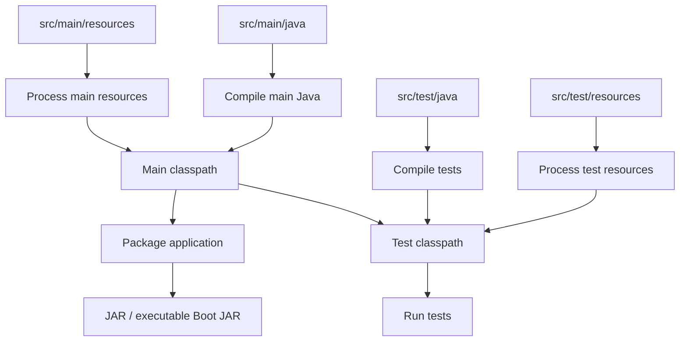
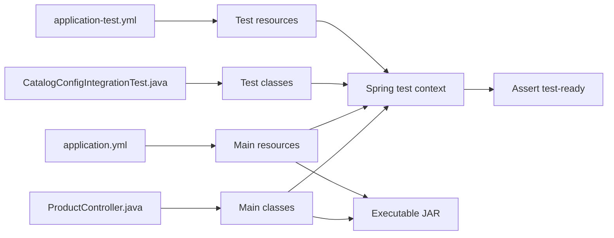

# `src/main/java`, `src/main/resources` và các thư mục kiểm thử

> **Spring Boot Fundamentals · Tổ chức mã nguồn**  
> Một dự án Spring Boot không chỉ có các file Java. Build tool còn cần biết đâu là mã chạy thật, đâu là tài nguyên được đóng gói, đâu là mã kiểm thử và đâu là dữ liệu chỉ phục vụ kiểm thử. Bài học này giải thích bốn thư mục chuẩn, cách chúng liên quan đến classpath, Spring Boot, Maven/Gradle và quá trình tạo JAR.

## 1. Bức tranh tổng thể về cấu trúc thư mục

Spring Boot thường dùng **standard directory layout** của các dự án Java, được cả Maven và Gradle hỗ trợ. Một dự án web điển hình:

```text
catalog-service/
├── pom.xml                            # Maven
│   # hoặc build.gradle / build.gradle.kts nếu dùng Gradle
├── src/
│   ├── main/
│   │   ├── java/
│   │   │   └── com/example/catalog/
│   │   │       ├── CatalogApplication.java
│   │   │       ├── product/
│   │   │       │   ├── ProductController.java
│   │   │       │   ├── ProductService.java
│   │   │       │   └── ProductRepository.java
│   │   │       └── config/
│   │   │           └── CatalogConfiguration.java
│   │   └── resources/
│   │       ├── application.yml
│   │       ├── application-dev.yml
│   │       ├── static/
│   │       │   └── css/site.css
│   │       ├── templates/
│   │       │   └── products.html
│   │       └── db/migration/
│   │           └── V1__create_products.sql
│   └── test/
│       ├── java/
│       │   └── com/example/catalog/
│       │       ├── CatalogApplicationTests.java
│       │       └── product/
│       │           └── ProductServiceTest.java
│       └── resources/
│           ├── application-test.yml
│           └── fixtures/
│               └── product-valid.json
└── target/                            # Maven output; Gradle dùng build/
```

Đây là ví dụ tổng hợp. Không phải ứng dụng Spring Boot nào cũng cần `templates/`, `static/`, SQL migration hay đủ mọi tầng controller/service/repository. Chúng xuất hiện tùy công nghệ và chức năng dự án.

Bốn thư mục đáng nhớ:

| Thư mục | Vai trò | Khi nào cần? |
| --- | --- | --- |
| `src/main/java` | Mã nguồn Java chạy trong ứng dụng | Lớp khởi động, controller, service, entity, DTO, cấu hình |
| `src/main/resources` | Tài nguyên dùng khi ứng dụng chạy | YAML/properties, SQL, static assets, template, file dữ liệu |
| `src/test/java` | Mã nguồn Java dùng để kiểm thử | Unit test, integration test, web slice test |
| `src/test/resources` | Tài nguyên dùng trong kiểm thử | Profile test, JSON fixture, dữ liệu mẫu, test SQL |

Hai trục của cấu trúc là **main/test** (mục đích sử dụng) và **java/resources** (loại nội dung). Tách biệt chúng giúp build tool biết nội dung nào cần biên dịch, copy vào classpath, chạy test và đóng gói.

## 2. Từ source file tới classpath và artifact

Trong Java, file `.java` cần được biên dịch thành `.class` trước khi JVM sử dụng. Resource không được biên dịch theo cách này; build tool thường sao chép hoặc xử lý resource rồi đưa vào output/classpath tương ứng.



Thông thường:

1. Mã Java trong `main` được biên dịch; resources trong `main` được đưa vào output chính.
2. Mã Java trong `test` được biên dịch riêng; resources trong `test` được đưa vào output kiểm thử.
3. Khi chạy test, test classpath cho phép mã test truy cập mã chính và resource phục vụ test.
4. Khi tạo artifact chạy production theo cấu hình chuẩn, build sử dụng mã và resource **main**; mã test và test fixture **không được đưa vào JAR ứng dụng**.

| Kết quả của bước build | Maven thông dụng | Gradle thông dụng |
| --- | --- | --- |
| Class + resource chính | `target/classes` | `build/classes/java/main` và `build/resources/main` |
| Class + resource test | `target/test-classes` | `build/classes/java/test` và `build/resources/test` |
| Artifact | `target/*.jar` | `build/libs/*.jar` |

Các đường dẫn có thể thay đổi khi dự án dùng plugin hoặc cấu hình tùy chỉnh. Đặc biệt, thư mục `target/` và `build/` là **output có thể tạo lại**, không phải nơi viết mã nguồn thủ công. Đừng sửa Java trong đó vì lần build/clean tiếp theo có thể ghi đè hoặc xóa.

## 3. `src/main/java`: nơi đặt code chính

Trong một ứng dụng Spring Boot, `src/main/java` thường có:

- `@SpringBootApplication` và phương thức `main`.
- `@RestController` hoặc `@Controller` cho API/web.
- `@Service` chứa logic nghiệp vụ.
- `@Repository` hoặc Spring Data repository phục vụ persistence.
- Entity, DTO, validation, exception handler, mapper và Java configuration.

Ví dụ lớp khởi động:

```java
package com.example.catalog;

import org.springframework.boot.SpringApplication;
import org.springframework.boot.autoconfigure.SpringBootApplication;

@SpringBootApplication
public class CatalogApplication {
    public static void main(String[] args) {
        SpringApplication.run(CatalogApplication.class, args);
    }
}
```

Đường dẫn tương ứng:

```text
src/main/java/com/example/catalog/CatalogApplication.java
```

Controller:

```java
package com.example.catalog.product;

import java.util.Map;
import org.springframework.web.bind.annotation.GetMapping;
import org.springframework.web.bind.annotation.RestController;

@RestController
public class ProductController {

    @GetMapping("/api/products/status")
    public Map<String, String> status() {
        return Map.of("status", "ready");
    }
}
```

Đặt tại:

```text
src/main/java/com/example/catalog/product/ProductController.java
```

Trong code, `package com.example.catalog.product;` là tên package. `src/main/java` là **source root**, còn `com/example/catalog/product` là cách biểu diễn package qua thư mục. Giữ tên package và đường dẫn file nhất quán để dễ tra cứu, refactor và hỗ trợ các công cụ Java.

### 3.1. Package của lớp khởi động ảnh hưởng tới component scan

`@SpringBootApplication` bao gồm cơ chế `@ComponentScan`. Mặc định, component scan tìm component trong package của lớp `CatalogApplication` và các package con:

```text
com.example.catalog
├── CatalogApplication
├── product
│   ├── ProductController
│   └── ProductService
├── order
│   └── OrderService
└── config
    └── CatalogConfiguration
```

Do đó, đặt `CatalogApplication` ở package gốc của ứng dụng thường hợp lý. Nếu đặt `ExternalService` dưới `com.example.shared` và package này không nằm trong vùng quét, Spring có thể không tạo bean từ annotation `@Service`, dẫn đến lỗi dependency injection.

Có thể mở rộng phạm vi scan khi có lý do rõ ràng, nhưng phải chú ý những cơ chế như quét entity hoặc repository có quy tắc riêng. Không nên giả định thay `scanBasePackages` sẽ tự xử lý tất cả.

**Tên thư mục `service` hay `controller` không phải phép màu.** Spring nhận component dựa trên annotation/cấu hình và phạm vi quét, không phải vì package có một tên nhất định.

### 3.2. Tổ chức package theo tầng hoặc theo tính năng

Hai cách đều phổ biến:

```text
# Theo tầng
com/example/catalog/
├── controller/
├── service/
├── repository/
├── dto/
└── entity/
```

```text
# Theo tính năng
com/example/catalog/
├── product/
│   ├── ProductController.java
│   ├── ProductService.java
│   └── ProductRepository.java
├── order/
│   ├── OrderController.java
│   ├── OrderService.java
│   └── OrderRepository.java
└── shared/
    └── ApiError.java
```

Theo tầng thuận tiện cho dự án nhỏ hoặc tổ chức theo công nghệ; theo tính năng thường giữ những class cùng nghiệp vụ gần nhau. Dự án có thể kết hợp, chẳng hạn `product/api`, `product/domain` và `product/persistence`.

Dù chọn cách nào, tránh đặt lớp trong **default package** (không có `package`) vì có thể làm phạm vi component scan quá rộng và khó kiểm soát.

## 4. `src/main/resources`: tài nguyên được đưa vào ứng dụng

Resource là những file ứng dụng cần đọc hoặc phục vụ khi chạy nhưng không phải mã Java biên dịch thành class. Ví dụ:

```text
src/main/resources/
├── application.yml
├── application-prod.yml
├── messages.properties
├── static/
│   ├── index.html
│   └── css/site.css
├── templates/
│   └── products.html
├── db/migration/
│   └── V1__create_products.sql
└── data/
    └── sample-products.json
```

Trong build chuẩn, các file này được copy hoặc xử lý thành resource ở output main và nằm trên runtime classpath. Khi đóng gói JAR, chúng thường nằm **bên trong artifact**, không còn ở vị trí `src/main/resources` vật lý trên máy triển khai.

### 4.1. File cấu hình `application.yml` và `application.properties`

Ví dụ `application.yml`:

```yaml
spring:
  application:
    name: catalog-service

server:
  port: 8081

catalog:
  greeting: Welcome to catalog
```

Cấu hình tương tự bằng `application.properties`:

```properties
spring.application.name=catalog-service
server.port=8081
catalog.greeting=Welcome to catalog
```

Spring Boot có cơ chế tìm và nạp config data từ những vị trí được hỗ trợ, bao gồm classpath resource. File không được nhận diện chỉ nhờ đuôi YAML; **Spring Boot** định nghĩa quy tắc tìm `application.yml`/`application.properties` và giải quyết thứ tự ưu tiên khi có nhiều nguồn cấu hình.

Khi ứng dụng được triển khai, property có thể đến từ environment variable, tham số dòng lệnh hoặc file cấu hình bên ngoài. Sửa một file `application.yml` trong repository không đảm bảo giá trị đang chạy lập tức thay đổi.

### 4.2. File theo profile

```text
src/main/resources/
├── application.yml
├── application-dev.yml
└── application-prod.yml
```

```yaml
# application.yml
catalog:
  greeting: Hello
```

```yaml
# application-dev.yml
catalog:
  greeting: Hello developer
```

Khi kích hoạt profile `dev`, Spring Boot xét thêm cấu hình tương ứng:

```bash
java -jar catalog-service.jar --spring.profiles.active=dev
```

Chỉ đặt tên `application-dev.yml` không làm profile `dev` tự bật. Khi có nhiều profile hay nguồn property, cần hiểu thứ tự ưu tiên của Spring Boot để biết giá trị cuối cùng.

**Không commit mật khẩu, private key hoặc API token thật vào resources.** Resource đóng gói có thể bị đọc từ JAR. Cấu hình nhạy cảm nên được cung cấp qua secret store hoặc nguồn cấu hình bảo mật phù hợp.

### 4.3. `static/` và nội dung web tĩnh

Nếu ứng dụng sử dụng Spring MVC với resource mapping thông dụng, Spring Boot có thể phục vụ file tĩnh từ các vị trí classpath như:

```text
classpath:/static/
classpath:/public/
classpath:/resources/
classpath:/META-INF/resources/
```

Ví dụ:

```text
src/main/resources/static/css/site.css
```

thường tương ứng với URL:

```http
GET /css/site.css
```

Vị trí truy cập thực tế còn phụ thuộc context path, servlet mapping, cấu hình MVC và bảo mật. Đừng đưa cấu hình nội bộ hay dữ liệu nhạy cảm vào những thư mục phục vụ public static resources.

`src/main/resources/data/sample-products.json` **không tự nhiên** trở thành HTTP endpoint: nó là classpath resource cho chương trình đọc. `src/main/resources/application.yml` cũng là file cấu hình, không phải static asset.

### 4.4. `templates/` cho view server-side

Nếu thêm template engine phù hợp như Thymeleaf, các template HTML thường nằm dưới:

```text
src/main/resources/templates/
```

Ví dụ với file `templates/products.html` và cấu hình Thymeleaf thích hợp:

```java
package com.example.catalog.product;

import org.springframework.stereotype.Controller;
import org.springframework.ui.Model;
import org.springframework.web.bind.annotation.GetMapping;

@Controller
public class ProductPageController {

    @GetMapping("/products")
    public String products(Model model) {
        model.addAttribute("title", "Product catalog");
        return "products";
    }
}
```

Tên view `"products"` có thể được resolve đến template `products.html`. Trong một REST API thuần túy, ứng dụng thường không cần view template. **Có thư mục `templates/` không tự cài Thymeleaf**; cần dependency và cấu hình template engine.

### 4.5. Những resource khác

| Ví dụ đường dẫn | Mục đích | Điều kiện |
| --- | --- | --- |
| `messages.properties` | Message bundle, đa ngôn ngữ | Cơ chế message source |
| `db/migration/V1__create_products.sql` | SQL migration | Có Flyway và cấu hình tương ứng |
| `data/sample-products.json` | Dữ liệu mẫu ứng dụng đọc | Code chủ động nạp resource |
| `templates/products.html` | HTML view template | Engine/bean phù hợp |
| `static/css/site.css` | File tĩnh có thể được phục vụ HTTP | Cấu hình web resource mapping |
| `application.yml` | Spring Boot config data | Cơ chế tìm cấu hình Boot |

Không phải cứ tạo tên thư mục theo quy ước thì thư viện sẽ tự hoạt động. Ví dụ SQL file dưới `db/migration` chỉ được Flyway xử lý nếu dự án dùng Flyway và các điều kiện cấu hình thỏa mãn.

## 5. Classpath resource không phải đường dẫn source trên filesystem

Đây là lỗi rất hay gặp khi ứng dụng chạy được từ IDE nhưng không đọc được file sau khi đóng gói.

Cách dễ lỗi:

```java
Path path = Path.of("src/main/resources/data/sample-products.json");
```

Cách này phụ thuộc working directory của tiến trình và đòi hỏi source tree tồn tại tại nơi chạy. Sau khi deploy JAR, file có thể đã nằm **bên trong JAR**.

Cách dùng Spring `ClassPathResource`:

```java
package com.example.catalog.product;

import java.io.IOException;
import java.io.InputStream;
import java.nio.charset.StandardCharsets;
import org.springframework.core.io.ClassPathResource;

public class SampleProductReader {

    public String readJson() throws IOException {
        ClassPathResource resource =
                new ClassPathResource("data/sample-products.json");

        try (InputStream input = resource.getInputStream()) {
            return new String(input.readAllBytes(), StandardCharsets.UTF_8);
        }
    }
}
```

Ở đây:

1. Đường dẫn là `data/sample-products.json`, tương đối với **classpath root**; không dùng `src/main/resources/`.
2. Đọc qua `InputStream` dùng được với resource đóng gói trong JAR.
3. Resource trong JAR không nhất thiết có file hệ thống riêng, vì vậy `resource.getFile()` hoặc `new File(...)` có thể không phù hợp.
4. Với file cần chỉnh sửa trong quá trình vận hành, nên dùng đường dẫn ngoài artifact, object storage hoặc database theo thiết kế ứng dụng.

Java cũng có cách đọc qua class loader:

```java
try (InputStream input = getClass().getClassLoader()
        .getResourceAsStream("data/sample-products.json")) {

    if (input == null) {
        throw new IllegalStateException("Resource not found");
    }

    // Sử dụng input ở đây.
}
```

Phân biệt ba cơ chế:

- **Classpath resource:** mã Java đọc file qua API Resource/class loader.
- **Static web resource:** HTTP handler phục vụ asset theo URL.
- **Config data:** Spring Boot nạp `application.yml` hoặc nguồn cấu hình được hỗ trợ.

Cả ba có thể dùng file nằm dưới `src/main/resources` nhưng chúng giải quyết **ba nhu cầu khác nhau**.

## 6. `src/test/java`: nơi viết mã kiểm thử

Test được đặt trong source root riêng:

```text
src/main/java/com/example/catalog/product/ProductPriceCalculator.java
src/test/java/com/example/catalog/product/ProductPriceCalculatorTest.java
```

Ví dụ class Java trong `main`:

```java
package com.example.catalog.product;

public class ProductPriceCalculator {

    public long discountedPrice(long originalPrice, int discountPercent) {
        if (originalPrice < 0 || discountPercent < 0 || discountPercent > 100) {
            throw new IllegalArgumentException("Invalid price or discount");
        }
        return originalPrice * (100 - discountPercent) / 100;
    }
}
```

Unit test dùng JUnit Jupiter trong `test`:

```java
package com.example.catalog.product;

import static org.junit.jupiter.api.Assertions.assertEquals;
import static org.junit.jupiter.api.Assertions.assertThrows;
import org.junit.jupiter.api.Test;

class ProductPriceCalculatorTest {

    private final ProductPriceCalculator calculator =
            new ProductPriceCalculator();

    @Test
    void appliesDiscount() {
        assertEquals(800L, calculator.discountedPrice(1000L, 20));
    }

    @Test
    void rejectsInvalidDiscount() {
        assertThrows(IllegalArgumentException.class,
                () -> calculator.discountedPrice(1000L, 101));
    }
}
```

Lớp cần dùng khi production chạy nằm ở `src/main/java`. Lớp kiểm thử nó nằm ở `src/test/java` và được biên dịch riêng khi build chạy test. Unit test Java thuần như trên **không cần khởi tạo Spring ApplicationContext**, vì vậy thường nhanh và dễ cô lập.

Trong dự án Maven, test dependency thường có `<scope>test</scope>`. Trong Gradle, thường dùng `testImplementation`. Đây là **khai báo thư viện dùng cho test**; nó không thay thế việc đặt test code dưới `src/test/java`.

### 6.1. Test class có cần cùng package không?

Không bắt buộc, nhưng đặt test trong cùng package với code cần kiểm tra là quy ước hữu ích:

```text
src/main/java/com/example/catalog/product/
├── ProductService.java
└── ProductPriceCalculator.java

src/test/java/com/example/catalog/product/
├── ProductServiceTest.java
└── ProductPriceCalculatorTest.java
```

Điều này giúp điều hướng dễ và có thể hỗ trợ việc kiểm thử mã package-private trong Java. Package của test được quyết định bởi khai báo `package` trong file Java. IDE/build tool nhận source root test để biên dịch nó riêng.

### 6.2. `@SpringBootTest` cho kiểm thử cần Spring context

Một integration test đơn giản:

```java
package com.example.catalog;

import org.junit.jupiter.api.Test;
import org.springframework.boot.test.context.SpringBootTest;

@SpringBootTest
class CatalogApplicationTests {

    @Test
    void contextLoads() {
        // Test thành công nếu ApplicationContext khởi động được.
    }
}
```

Đặt ở:

```text
src/test/java/com/example/catalog/CatalogApplicationTests.java
```

Spring Boot Test có cơ chế tìm lớp `@SpringBootConfiguration` bằng cách xét package hierarchy. Nếu test nằm xa package ứng dụng, nó có thể không tìm được cấu hình khởi động. Có thể chỉ rõ lớp cấu hình khi cần, ví dụ `@SpringBootTest(classes = CatalogApplication.class)`.

**Không phải test nào cũng cần `@SpringBootTest`.** Annotation này có thể khởi tạo nhiều thành phần hơn unit test thuần, làm test chậm hoặc phụ thuộc hạ tầng. Hãy dùng nó khi bài test cần Spring context.

### 6.3. Kiểm thử một phần web layer với `@WebMvcTest`

Với `ProductController` không có service dependency như ở phần 3:

```java
package com.example.catalog.product;

import static org.springframework.test.web.servlet.request.MockMvcRequestBuilders.get;
import static org.springframework.test.web.servlet.result.MockMvcResultMatchers.jsonPath;
import static org.springframework.test.web.servlet.result.MockMvcResultMatchers.status;
import org.junit.jupiter.api.Test;
import org.springframework.beans.factory.annotation.Autowired;
import org.springframework.boot.test.autoconfigure.web.servlet.WebMvcTest;
import org.springframework.test.web.servlet.MockMvc;

@WebMvcTest(ProductController.class)
class ProductControllerTest {

    @Autowired
    MockMvc mockMvc;

    @Test
    void statusReturnsReady() throws Exception {
        mockMvc.perform(get("/api/products/status"))
                .andExpect(status().isOk())
                .andExpect(jsonPath("$.status").value("ready"));
    }
}
```

Test slice như `@WebMvcTest` tập trung vào web components; nó không nhất thiết load đầy đủ service/repository của ứng dụng. Nếu controller có dependency vào service, test có thể cần cung cấp mock hoặc bean thích hợp.

## 7. `src/test/resources`: tài nguyên chỉ dành cho test

Đây là nơi chứa file cần cho kiểm thử:

```text
src/test/resources/
├── application-test.yml
├── fixtures/
│   ├── product-valid.json
│   └── product-invalid.json
└── sql/
    └── seed-products.sql
```

Test resources tham gia **test classpath**. Với cấu hình build chuẩn, chúng không được đưa vào executable JAR production. Mặc dù không đóng gói, dữ liệu trong repository vẫn phải an toàn: không lưu password hoặc token production thật vào test resources.

### 7.1. File `application-test.yml` có tự hoạt động không?

Không. Đây là cấu hình dành cho profile `test`, cần kích hoạt profile tương ứng.

File:

```yaml
# src/test/resources/application-test.yml
catalog:
  greeting: Hello from tests

logging:
  level:
    com.example.catalog: DEBUG
```

Test kích hoạt profile:

```java
package com.example.catalog;

import static org.junit.jupiter.api.Assertions.assertEquals;
import org.junit.jupiter.api.Test;
import org.springframework.beans.factory.annotation.Autowired;
import org.springframework.boot.test.context.SpringBootTest;
import org.springframework.core.env.Environment;
import org.springframework.test.context.ActiveProfiles;

@SpringBootTest
@ActiveProfiles("test")
class CatalogConfigurationTests {

    @Autowired
    Environment environment;

    @Test
    void readsTestGreeting() {
        assertEquals("Hello from tests",
                environment.getProperty("catalog.greeting"));
    }
}
```

Khi profile `test` active, Spring Boot xét nguồn config theo quy tắc config data/property precedence. Đây là cách rõ ràng để dùng cấu hình thử nghiệm riêng.

Nếu đặt `application.yml` trong cả `src/main/resources` và `src/test/resources`, hai resource cùng tên có thể ảnh hưởng đến cách classpath/config loader tìm và ưu tiên file. Tránh phụ thuộc vào thứ tự mơ hồ; thay vào đó dùng profile, property override rõ ràng hoặc cơ chế config chuyên biệt của test.

### 7.2. JSON fixture và cách đọc

Nội dung:

```json
{
  "id": 101,
  "name": "Keyboard",
  "price": 250000
}
```

Lưu tại `src/test/resources/fixtures/product-valid.json`, đọc trong test qua classpath:

```java
package com.example.catalog.product;

import static org.junit.jupiter.api.Assertions.assertTrue;
import java.io.IOException;
import java.io.InputStream;
import java.nio.charset.StandardCharsets;
import org.junit.jupiter.api.Test;

class ProductFixtureTest {

    @Test
    void canLoadFixture() throws IOException {
        try (InputStream input = getClass().getResourceAsStream(
                "/fixtures/product-valid.json")) {
            if (input == null) {
                throw new IllegalStateException("Missing test fixture");
            }

            String json = new String(
                    input.readAllBytes(), StandardCharsets.UTF_8);

            assertTrue(json.contains("Keyboard"));
        }
    }
}
```

Đây là ví dụ **đọc file**; test dữ liệu JSON thật sự nên parse và assert các thuộc tính bằng thư viện JSON thay vì chỉ so chuỗi.

Khi chạy test, mã test có thể truy cập resource ở `src/main/resources` lẫn `src/test/resources` qua classpath. Điều đó không có nghĩa resource test sẽ được đóng gói vào production artifact.

## 8. Maven và Gradle hiểu cấu trúc này thế nào?

Cả hai hỗ trợ những source root chuẩn, nên với cấu hình Java/Spring Boot phổ biến, bạn thường không phải chỉ định lại từng đường dẫn.

### 8.1. Gradle: Java plugin, source sets và task

Ví dụ `build.gradle` dùng Groovy DSL:

```groovy
plugins {
    id 'java'
    id 'org.springframework.boot' version '3.5.0'
    id 'io.spring.dependency-management' version '1.1.7'
}

repositories {
    mavenCentral()
}

dependencies {
    implementation 'org.springframework.boot:spring-boot-starter-web'
    testImplementation 'org.springframework.boot:spring-boot-starter-test'
}

tasks.named('test') {
    useJUnitPlatform()
}
```

Khi dùng Java plugin, Gradle có **source sets** mặc định:

- `main` đọc Java từ `src/main/java` và resource từ `src/main/resources`.
- `test` đọc Java từ `src/test/java` và resource từ `src/test/resources`.

Một số task tương ứng:

| Task | Công việc |
| --- | --- |
| `compileJava` | Biên dịch Java trong main |
| `processResources` | Xử lý/copy main resources |
| `compileTestJava` | Biên dịch mã Java test |
| `processTestResources` | Xử lý/copy test resources |
| `test` | Thực thi test theo cấu hình |
| `bootRun` | Chạy Spring Boot application khi phát triển |
| `bootJar` | Tạo Spring Boot executable JAR |

Hai task `bootRun` và `bootJar` có khi áp dụng Spring Boot Gradle plugin cùng cấu hình phù hợp; chúng không phải task có sẵn trong mọi Java project.

Ví dụ lệnh:

```bash
./gradlew test
./gradlew bootJar
```

Windows PowerShell:

```powershell
.\gradlew.bat test
.\gradlew.bat bootJar
```

### 8.2. Maven: standard directory layout và lifecycle

`pom.xml` thường khai báo dependency phục vụ ứng dụng và test:

```xml
<dependencies>
    <dependency>
        <groupId>org.springframework.boot</groupId>
        <artifactId>spring-boot-starter-web</artifactId>
    </dependency>

    <dependency>
        <groupId>org.springframework.boot</groupId>
        <artifactId>spring-boot-starter-test</artifactId>
        <scope>test</scope>
    </dependency>
</dependencies>
```

Ví dụ này giả định parent/BOM Spring Boot đã quản lý version cần thiết. Plugin build phù hợp sẽ biên dịch mã trong các source root chuẩn:

```text
src/main/java       -> main Java source
src/main/resources  -> main resources
src/test/java       -> test Java source
src/test/resources  -> test resources
```

Một số lệnh:

```bash
./mvnw compile
./mvnw test
./mvnw package
```

Trên Windows:

```powershell
.\mvnw.cmd test
.\mvnw.cmd package
```

Maven thường đưa main output vào `target/classes` và test output vào `target/test-classes`. Muốn tạo Spring Boot executable JAR đúng cấu trúc, cần Spring Boot Maven Plugin và cấu hình repackage phù hợp, ví dụ cơ chế được `spring-boot-starter-parent` hỗ trợ.

Các version `3.5.0`/`1.1.7` nêu trong ví dụ Gradle chỉ minh họa dự án Spring Boot 3.x; với dự án thật, dùng phiên bản plugin và Java được phiên bản Boot đang áp dụng hỗ trợ.

### 8.3. Có thể thay đổi thư mục source không?

Có. Gradle hỗ trợ cấu hình `sourceSets`; Maven cho phép tùy chỉnh source/resource directory thông qua cấu hình build và plugin. Ví dụ Gradle:

```groovy
sourceSets {
    main {
        java {
            srcDirs = ['src/main/java', 'generated/main/java']
        }
    }
}
```

Đây là nhu cầu có thể gặp với generated source. Tuy nhiên, thay đổi source root ảnh hưởng IDE, CI, build script và người đọc repo. Nếu không có lý do đặc biệt, giữ layout chuẩn thường đơn giản hơn.

## 9. Những gì thực sự đi vào Spring Boot JAR

Một Spring Boot executable JAR phổ biến có cấu trúc đơn giản hóa:

```text
catalog-service.jar
├── META-INF/
├── org/springframework/boot/loader/...
└── BOOT-INF/
    ├── classes/
    │   ├── com/example/catalog/
    │   │   ├── CatalogApplication.class
    │   │   └── product/ProductController.class
    │   ├── application.yml
    │   └── static/css/site.css
    └── lib/
        ├── spring-boot-...jar
        └── ...
```

Ở đây:

- `CatalogApplication.java` từ `src/main/java` được biên dịch thành `CatalogApplication.class`.
- `application.yml` và `static/css/site.css` từ `src/main/resources` nằm trong khu vực classpath của JAR.
- Dependency runtime cần thiết có thể nằm dưới dạng nested JAR trong `BOOT-INF/lib`.
- `ProductControllerTest.class` và `application-test.yml` thông thường **không xuất hiện** vì chúng thuộc test source set.

Tên loader và cấu trúc cụ thể phụ thuộc phiên bản và cách đóng gói. Một Java **plain JAR** có cấu trúc khác, không tự chứa Spring Boot launcher hay toàn bộ runtime dependency theo cùng cách.

Để xem nội dung artifact với JDK:

```bash
jar tf target/catalog-service-0.0.1-SNAPSHOT.jar
```

Hoặc với Gradle:

```bash
jar tf build/libs/catalog-service-0.0.1-SNAPSHOT.jar
```

Thay tên JAR bằng artifact thực tế. Kiểm tra content giúp biết file resource đã đi vào bản đóng gói chưa, không cần suy đoán từ vị trí file gốc.

### 9.1. Vì sao thay resource trong repository không cập nhật JAR đã triển khai?

Sau khi đóng gói, tài nguyên đã được copy vào artifact. Sửa `src/main/resources/application.yml` trong source không làm JAR đã chạy tự thay đổi. Muốn thay nội dung resource đóng gói phải build/deploy artifact mới, trừ khi ứng dụng được thiết kế để đọc một nguồn cấu hình/file **bên ngoài JAR**.

Đây cũng là lý do file người dùng upload hoặc file cần ghi tại runtime không nên được coi là resource đóng gói. Chúng cần cơ chế lưu trữ vận hành riêng.

## 10. Thư mục output, generated code và file local

Bạn có thể gặp thêm:

```text
catalog-service/
├── build/                    # Gradle output
├── target/                   # Maven output
├── .gradle/                  # Gradle local state
├── .idea/                    # IDE metadata
├── .vscode/                  # Editor settings
├── logs/                     # Runtime log, nếu ứng dụng tạo
└── uploads/                  # Runtime user data, nếu ứng dụng tạo
```

`build/` và `target/` là output, thường nên bị loại khỏi version control. Mã Java do generator tạo ra cũng có thể nằm trong `build/generated/...` hoặc `target/generated-sources/...`, được cấu hình thành nguồn biên dịch theo pipeline. Đừng trộn thủ công generated code với source do người viết nếu dự án đã quản lý việc sinh mã tự động.

Các thư mục `logs/`, `uploads/` là dữ liệu runtime, cần vị trí lưu và quyền truy cập riêng. Chúng không tương đương `src/main/resources` và không nên được đưa vào JAR như dữ liệu tĩnh.

`.gitignore` nên loại artifact và dữ liệu không cần commit, nhưng không được vô tình loại toàn bộ `src/main` hoặc `src/test`. Test source và fixture an toàn thường là một phần quan trọng của repository.

### 10.1. Multi-module project

Nếu hệ thống có nhiều module:

```text
catalog-platform/
├── settings.gradle
├── catalog-api/
│   ├── build.gradle
│   └── src/
│       ├── main/java/...
│       ├── main/resources/...
│       ├── test/java/...
│       └── test/resources/...
└── catalog-core/
    ├── build.gradle
    └── src/
        ├── main/java/...
        └── test/java/...
```

Tương đương trong Maven multi-module là parent/aggregator POM và POM riêng ở từng module. Mỗi module có source root riêng. Module B muốn dùng class trong module A cần khai báo dependency giữa các module. Không phải file Java xuất hiện trong một thư mục `src/main/java` bất kỳ của repository là mọi module đều nhìn thấy.

Module Spring Boot runnable và module library có thể đóng gói khác nhau; chỉ module làm ứng dụng cần cấu hình Boot executable JAR tương ứng.

## 11. Tổ chức một tính năng mẫu từ đầu đến cuối

Ta muốn endpoint `GET /api/products/status` trả message từ cấu hình, rồi có test dùng message riêng.

### 11.1. Java controller ở `main/java`

```java
package com.example.catalog.product;

import java.util.Map;
import org.springframework.beans.factory.annotation.Value;
import org.springframework.web.bind.annotation.GetMapping;
import org.springframework.web.bind.annotation.RestController;

@RestController
public class ProductController {

    private final String statusMessage;

    public ProductController(
            @Value("${catalog.status-message:ready}") String statusMessage) {
        this.statusMessage = statusMessage;
    }

    @GetMapping("/api/products/status")
    public Map<String, String> status() {
        return Map.of("status", statusMessage);
    }
}
```

File thuộc `src/main/java/com/example/catalog/product/ProductController.java` vì đó là hành vi ứng dụng sẽ chạy.

### 11.2. Main resource `application.yml`

```yaml
# src/main/resources/application.yml
catalog:
  status-message: ready
```

Đây là cấu hình ứng dụng, được Spring Boot nạp theo quy tắc externalized configuration.

### 11.3. Test resource `application-test.yml`

```yaml
# src/test/resources/application-test.yml
catalog:
  status-message: test-ready
```

### 11.4. Test Java kích hoạt profile riêng

```java
package com.example.catalog;

import static org.junit.jupiter.api.Assertions.assertEquals;
import org.junit.jupiter.api.Test;
import org.springframework.beans.factory.annotation.Autowired;
import org.springframework.boot.test.context.SpringBootTest;
import org.springframework.core.env.Environment;
import org.springframework.test.context.ActiveProfiles;

@SpringBootTest
@ActiveProfiles("test")
class CatalogConfigIntegrationTest {

    @Autowired
    Environment environment;

    @Test
    void statusMessageComesFromTestProfile() {
        assertEquals("test-ready",
                environment.getProperty("catalog.status-message"));
    }
}
```

File thuộc `src/test/java/com/example/catalog/CatalogConfigIntegrationTest.java`. Cấu hình test được nạp khi profile `test` active. Sau khi đóng gói production, controller và main config vẫn nằm trong artifact, còn mã test và test resource chỉ phục vụ giai đoạn kiểm thử.



## 12. Lỗi thường gặp khi đặt file sai chỗ

| Hiện tượng | Nguyên nhân thường gặp | Hướng xử lý |
| --- | --- | --- |
| Chạy trong IDE được, chạy JAR không tìm thấy file JSON | Mã dùng đường dẫn `src/main/resources/...` tương đối với working directory | Đọc bằng classpath hoặc cấu hình đường dẫn bên ngoài artifact |
| Controller không nhận request dù code biên dịch | Class nằm ngoài vùng component scan | Xem package `@SpringBootApplication`, annotation và phạm vi quét |
| `application-test.yml` không có tác dụng | Profile `test` chưa được kích hoạt | Dùng `@ActiveProfiles("test")` hoặc cấu hình profile rõ ràng |
| CSS/JS trả HTTP 404 | File không ở vị trí static resource, URL sai hoặc MVC/security tùy chỉnh | Kiểm tra `static/`, context path và resource mapping |
| Template không render | Chưa thêm engine, view name sai hoặc template sai thư mục | Kiểm tra `templates/` và template engine tương ứng |
| Class test xuất hiện trong JAR phát hành | Tùy chỉnh build kéo cả test output vào artifact | Xem lại source sets và packaging |
| Unit test không chạy | Sai source root, thiếu test engine hoặc cấu hình test task | Kiểm tra `src/test/java`, dependency và Maven/Gradle test config |
| Fixture đọc được tại IDE nhưng không đọc được trong CI | Sai đường dẫn classpath hoặc phân biệt chữ hoa/thường | Kiểm tra tên file chính xác và test resources |
| Sửa `application.yml` nhưng runtime không đổi | Chưa rebuild/deploy hoặc config ngoài ghi đè | Kiểm tra artifact và nguồn property đang có hiệu lực |
| Flyway không chạy migration | Chỉ tạo SQL file nhưng chưa có Flyway/cấu hình phù hợp | Kiểm tra dependency, điều kiện Flyway và vị trí migration |

Một số hệ điều hành phân biệt chữ hoa/chữ thường trong đường dẫn. Ví dụ `product-valid.json` và `Product-valid.json` có thể được coi là hai file khác nhau trên Linux, dù thao tác local trên Windows không luôn bộc lộ lỗi đó. Giữ đường dẫn và package nhất quán giúp CI đáng tin cậy hơn.

### 12.1. Cần làm gì khi resource không được tìm thấy?

Hãy xác định đường đi của resource:

1. File đang thuộc **source root nào**? `main` hay `test`?
2. Build đã copy nó vào **output classpath** tương ứng chưa?
3. Ứng dụng đang tìm file theo cơ chế **classpath**, **filesystem**, **HTTP static** hay **template engine**?
4. Tên resource có đúng đường dẫn và chữ hoa/chữ thường không?
5. Có cấu hình resource include/exclude/filtering hoặc profile khác không?
6. Artifact đang chạy có đúng là bản build mới không?

Đọc log và quan sát output giúp tránh sửa bừa annotation hay di chuyển file liên tục.

## 13. Bài thực hành: tự tạo cấu trúc và quan sát

Giả sử bạn có một dự án Spring Boot Java với dependency web và test phù hợp. Hãy thực hiện:

### Bước 1 — Tạo cây thư mục

```text
src/
├── main/
│   ├── java/com/example/catalog/
│   │   ├── CatalogApplication.java
│   │   └── product/ProductController.java
│   └── resources/
│       ├── application.yml
│       └── static/hello.txt
└── test/
    ├── java/com/example/catalog/
    │   └── CatalogApplicationTests.java
    └── resources/
        └── application-test.yml
```

File `hello.txt` chứa:

```text
Hello from static resources
```

### Bước 2 — Chạy ứng dụng

Gradle:

```bash
./gradlew bootRun
```

Maven:

```bash
./mvnw spring-boot:run
```

Quan sát endpoint `/api/products/status` và thử truy cập `/hello.txt` trong cấu hình web mặc định phù hợp. Chú ý file HTML/CSS không trở thành controller: static resource handler phục vụ chúng theo cơ chế riêng.

### Bước 3 — Chạy kiểm thử

Gradle:

```bash
./gradlew test
```

Maven:

```bash
./mvnw test
```

Nếu dùng Windows, thay lệnh wrapper tương ứng bằng `.\gradlew.bat` hoặc `.\mvnw.cmd`. Quan sát rằng test có thể đọc test profile và tài nguyên test.

### Bước 4 — Đóng gói và xem artifact

Gradle:

```bash
./gradlew bootJar
```

Maven (khi đã cấu hình Spring Boot Maven Plugin phù hợp):

```bash
./mvnw package
```

Dùng `jar tf` để liệt kê nội dung JAR. Tìm `CatalogApplication.class`, `application.yml`, `hello.txt`; xác định vì sao `CatalogApplicationTests.class` hoặc `application-test.yml` không nằm trong executable JAR thông thường.

### Bước 5 — Thử đọc resource

Đặt một file `data/demo.json` trong `src/main/resources`. Đọc file bằng `ClassPathResource("data/demo.json")` rồi so sánh với `Path.of("src/main/resources/data/demo.json")` khi chạy ứng dụng đã đóng gói. Từ đó giải thích tại sao source directory không phải đường dẫn runtime đáng tin cậy.

### Câu hỏi tự kiểm tra

1. Vì sao file `.java` và `application.yml` thuộc hai thư mục khác nhau?
2. Tại sao test code đặt dưới `src/test/java` mà không ở cùng chỗ với controller?
3. Khi chạy test, mã test có thể đọc `src/main/resources` không? Resource test có nằm trong JAR production theo mặc định không?
4. Vì sao `application-test.yml` không tự có hiệu lực nếu không kích hoạt profile?
5. Đặt `ProductController` ngoài package của `CatalogApplication` có thể gây ra lỗi gì?
6. Một file trong `src/main/resources` có tự động được tải qua HTTP không?
7. Vì sao code đọc `src/main/resources/data/demo.json` bằng đường dẫn filesystem dễ lỗi khi chạy executable JAR?
8. Với dự án nhiều module, liệu class trong module A có tự động hiện diện ở module B nếu không khai báo dependency không?

## 14. Những điểm cần ghi nhớ

| | Mã Java | Tài nguyên |
| --- | --- | --- |
| **`main` — ứng dụng** | `src/main/java`: Java code chạy cùng sản phẩm | `src/main/resources`: cấu hình và file đóng gói cùng ứng dụng |
| **`test` — kiểm thử** | `src/test/java`: JUnit/integration test | `src/test/resources`: fixture và cấu hình test |

Tách source root giúp Maven/Gradle biết **file nào được biên dịch, file nào được copy, file nào phục vụ kiểm thử và file nào đi vào artifact**. Hiểu thêm cơ chế classpath, package scanning và cách Spring Boot nạp resource sẽ giúp bạn giải thích được những lỗi thường gặp khi chuyển từ IDE sang JAR, từ máy local sang CI và từ development sang production.
