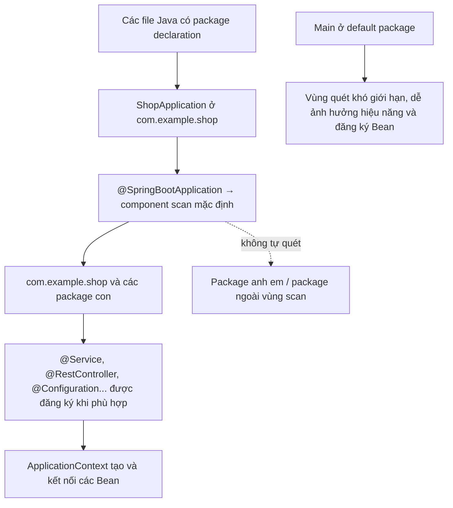

# Package gốc, package con và rủi ro dùng default package

Một ứng dụng Spring Boot có thể có đủ dependency, class được đánh dấu `@Service`, controller khai báo đúng `@GetMapping` mà khi chạy vẫn báo không tìm thấy Bean hoặc trả HTTP 404. Một nguyên nhân rất thường gặp là **các class được đặt ở những package mà Spring không quét tới**. Vấn đề này bắt đầu từ cách Java tổ chức package, sau đó liên quan trực tiếp đến cơ chế component scanning của Spring Boot.

Bài học này giúp bạn đọc được cây package, hiểu nơi nên đặt class `@SpringBootApplication`, phân biệt package gốc với package con, nhận diện hậu quả của việc bỏ khai báo `package` và chọn cách tổ chức mã nguồn khi ứng dụng phát triển.

## 1. Package là gì, và vì sao Spring Boot quan tâm?

Trong Java, một **package** là không gian tên dùng để nhóm các kiểu (class, interface, enum, record, annotation) có liên quan. Nó giúp tránh trùng tên class, kiểm soát một phần phạm vi truy cập và tạo cấu trúc có thể quản lý.

Ví dụ, hai kiểu sau có thể cùng tên `Customer` nhưng thuộc hai package khác nhau:

```java
package com.example.shop.sales;

public class Customer {
    // Khách hàng phục vụ nghiệp vụ bán hàng.
}
```

```java
package com.example.shop.support;

public class Customer {
    // Cách biểu diễn khách hàng trong nghiệp vụ hỗ trợ.
}
```

Tên đầy đủ (*fully qualified name*) lần lượt là `com.example.shop.sales.Customer` và `com.example.shop.support.Customer`. Đây là hai kiểu khác nhau dù phần tên cuối cùng trùng nhau.

Khi một class cần dùng kiểu ở package khác, có thể `import`:

```java
package com.example.shop.order;

import com.example.shop.sales.Customer;

public class Order {
    private Customer customer;
}
```

Hoặc dùng tên đầy đủ, chẳng hạn `com.example.shop.sales.Customer`. **`import` chỉ giúp trình biên dịch giải quyết tên kiểu; nó không yêu cầu Spring tạo Bean hay quét package.** Đây là sự phân biệt rất quan trọng.

### Package declaration và thư mục nguồn

Trong dự án Maven/Gradle thông thường, mã Java được lưu dưới `src/main/java`; các test thường ở `src/test/java`. Dòng khai báo `package` tương ứng với phần đường dẫn phía dưới thư mục nguồn:

```text
src/main/java/
└── com/
    └── example/
        └── shop/
            ├── ShopApplication.java
            ├── catalog/
            │   └── ProductCatalog.java
            └── order/
                └── OrderController.java
```

Ví dụ file `src/main/java/com/example/shop/catalog/ProductCatalog.java` bắt đầu bằng:

```java
package com.example.shop.catalog;
```

Trong Java, tên package được xác định bởi câu lệnh `package` trong mã nguồn. Việc sắp xếp file theo đường dẫn tương ứng là quy ước quan trọng của các công cụ build, IDE và người đọc code. Tên thư mục trên máy không tự thay thế cho khai báo `package`.

Một package thường đặt bằng chữ thường và theo dạng tên miền đảo ngược, chẳng hạn `com.company.inventory` hoặc `vn.example.learning`. Chọn tên có tính ổn định và phản ánh phạm vi sản phẩm; tránh tên quá chung như `app`, `model` hoặc `utils` nếu không có phần tiền tố đủ rõ.

## 2. Package gốc và package con

Giả sử ứng dụng có cấu trúc:

```text
com.example.shop                   ← package gốc của ứng dụng
├── ShopApplication
├── catalog                        ← package con
│   ├── ProductController
│   ├── ProductCatalog
│   └── ProductView
├── order                          ← package con
│   ├── OrderController
│   └── OrderService
└── common                         ← package con
    └── ClockConfiguration
```

Ở đây `com.example.shop` là package gốc (*root package*) theo **quy ước tổ chức ứng dụng**. Các package có tiền tố `com.example.shop.` như `com.example.shop.catalog`, `com.example.shop.order` là package con theo tên.

Một số điều cần phân biệt:

- `com.example.shop.catalog` nằm dưới vùng tên `com.example.shop` nhưng vẫn là **một package khác** với `com.example.shop`.
- `com.example.shop.catalog.internal` là package con sâu hơn của `com.example.shop.catalog`.
- `com.example.shared` là **package anh em** với `com.example.shop` dưới `com.example`; nó không thuộc cây package `com.example.shop`.
- `com.example.shopping` **không** phải package con của `com.example.shop`, dù cùng bắt đầu bằng chuỗi ký tự `com.example.shop`. Ranh giới phải là dấu chấm giữa các thành phần.

### “Package con” không có nghĩa thừa hưởng quyền truy cập

Trong Java, quyền truy cập *package-private* (không ghi `public`, `protected` hoặc `private`) chỉ dành cho code trong **cùng package chính xác**. Package con không tự có quyền đó.

```java
// File: com/example/shop/catalog/CatalogItem.java
package com.example.shop.catalog;

class CatalogItem {
    // Chỉ những class ở đúng package com.example.shop.catalog
    // mới truy cập được class package-private này.
}
```

Code ở `com.example.shop.catalog.web` không thể tự do dùng class `CatalogItem` ở trên chỉ vì nằm trong package con. Nếu muốn công khai kiểu qua ranh giới package, bạn cần thiết kế API truy cập thích hợp, thường là `public`. Quy tắc này thuộc **ngôn ngữ Java**, độc lập với Spring.

## 3. Vì sao vị trí class khởi động quyết định vùng quét mặc định?

Spring Boot thường bắt đầu bằng một class mang `@SpringBootApplication`:

```java
package com.example.shop;

import org.springframework.boot.SpringApplication;
import org.springframework.boot.autoconfigure.SpringBootApplication;

@SpringBootApplication
public class ShopApplication {

    public static void main(String[] args) {
        SpringApplication.run(ShopApplication.class, args);
    }
}
```

`@SpringBootApplication` kết hợp các khả năng cấu hình chính của Spring Boot, trong đó có **`@ComponentScan`**. Khi không chỉ định package quét khác, component scanning bắt đầu từ **package chứa class có `@SpringBootApplication`** rồi tìm các component trong package đó và các package con.

Với class trên, vùng quét mặc định là:

```text
com.example.shop
├── [quét] ShopApplication
├── [quét] catalog.ProductController
├── [quét] catalog.ProductCatalog
├── [quét] order.OrderController
├── [quét] order.OrderService
└── [quét] common.ClockConfiguration

com.example.shared
└── [không nằm trong vùng quét trên] SharedService

com.example.shopping
└── [không nằm trong vùng quét trên] OtherService
```

Đây là lý do tài liệu Spring Boot thường khuyên đặt class ứng dụng chính ở **package gốc nằm phía trên các component của dự án**.

### Component scanning tìm những gì?

Khi quét các class, Spring có thể nhận diện các kiểu có annotation stereotype phù hợp, ví dụ:

| Annotation | Vai trò thường gặp |
|---|---|
| `@Component` | Component nói chung do Spring quản lý |
| `@Service` | Service chứa xử lý nghiệp vụ |
| `@Repository` | Thành phần truy cập dữ liệu |
| `@Controller` | MVC controller |
| `@RestController` | Controller trả HTTP response body theo mặc định |
| `@Configuration` | Class cấu hình Spring, thường định nghĩa method `@Bean` |

Các annotation ở trên dựa trên cơ chế component của Spring. Nhưng component scanning **không biến mọi class Java trong package thành Bean**. Một record DTO như `ProductView` hoặc một utility class bình thường sẽ không tự trở thành Bean chỉ vì nằm dưới package gốc.

Ngược lại, một Bean có thể đến từ `@Bean`, `@Import`, đăng ký bằng API hoặc auto-configuration. Vì vậy **Bean registration** rộng hơn component scanning, và **phạm vi package quét** chỉ chi phối những cơ chế phụ thuộc vào việc quét đó.

### Đừng nhầm package gốc với một từ khóa đặc biệt

Java không có keyword “root package”. `com.example.shop` chỉ là **quy ước kiến trúc**: nhóm package mà ứng dụng muốn xem là của mình. Spring dùng package chứa class cấu hình để thiết lập mặc định, chứ không đọc tên `root` hoặc tên thư mục dự án rồi tự suy ra cấu trúc nghiệp vụ.

## 4. Ví dụ chạy xuyên suốt: root package đúng

Hãy tạo một ứng dụng REST nhỏ quản lý danh sách sản phẩm để quan sát mối liên hệ giữa package và Bean.

```text
src/main/java/
└── com/example/shop/
    ├── ShopApplication.java
    └── catalog/
        ├── ProductView.java
        ├── ProductCatalog.java
        └── ProductController.java
```

**File `ShopApplication.java`:**

```java
package com.example.shop;

import org.springframework.boot.SpringApplication;
import org.springframework.boot.autoconfigure.SpringBootApplication;

@SpringBootApplication
public class ShopApplication {
    public static void main(String[] args) {
        SpringApplication.run(ShopApplication.class, args);
    }
}
```

**File `catalog/ProductView.java`:** DTO trả dữ liệu ra API; record này không cần trở thành Bean.

```java
package com.example.shop.catalog;

public record ProductView(long id, String name) {
}
```

**File `catalog/ProductCatalog.java`:** service được component scanning phát hiện.

```java
package com.example.shop.catalog;

import org.springframework.stereotype.Service;

@Service
public class ProductCatalog {
    public ProductView find(long id) {
        return new ProductView(id, "Sổ tay");
    }
}
```

**File `catalog/ProductController.java`:** controller nhận service qua constructor injection.

```java
package com.example.shop.catalog;

import org.springframework.web.bind.annotation.GetMapping;
import org.springframework.web.bind.annotation.PathVariable;
import org.springframework.web.bind.annotation.RestController;

@RestController
public class ProductController {
    private final ProductCatalog catalog;

    public ProductController(ProductCatalog catalog) {
        this.catalog = catalog;
    }

    @GetMapping("/products/{id}")
    public ProductView getProduct(@PathVariable long id) {
        return catalog.find(id);
    }
}
```

Với một dự án Spring Boot đã thiết lập sẵn, cần dependency web để chạy HTTP endpoint, ví dụ:

```groovy
dependencies {
    implementation 'org.springframework.boot:spring-boot-starter-web'
}
```

Khởi chạy `ShopApplication` và thử:

```bash
curl "http://localhost:8080/products/7"
```

Nếu cổng mặc định chưa bị đổi và ứng dụng khởi động thành công, phản hồi JSON dự kiến:

```json
{
  "id": 7,
  "name": "Sổ tay"
}
```

Điều gì đã xảy ra?

1. Class `ShopApplication` đặt tại `com.example.shop` xác định vùng component scanning mặc định.
2. `ProductCatalog` có `@Service`, `ProductController` có `@RestController` và cả hai đều ở package con `com.example.shop.catalog`.
3. Container đăng ký hai Bean rồi tiêm `ProductCatalog` vào constructor của `ProductController`.
4. Spring MVC ánh xạ `GET /products/{id}` đến method controller và dùng cơ chế JSON có sẵn để xuất `ProductView`.
5. `ProductView` là object dữ liệu được tạo bởi code nghiệp vụ; nó **không cần Bean registration** để trở thành HTTP response body.

Package là thứ quyết định **khả năng được tìm thấy trong quá trình scan**; việc Bean chạy ra sao còn phụ thuộc annotation, dependency, cấu hình và các cơ chế khác của Spring.

## 5. Ví dụ lỗi: main class đặt quá sâu

Giờ đổi vị trí class ứng dụng chính thành package `com.example.shop.bootstrap`, trong khi controller và service vẫn ở `com.example.shop.catalog`:

```text
com.example.shop
├── bootstrap
│   └── ShopApplication          ← @SpringBootApplication
└── catalog
    ├── ProductCatalog           ← @Service
    └── ProductController        ← @RestController
```

Nếu `ShopApplication` khai báo:

```java
package com.example.shop.bootstrap;

@SpringBootApplication
public class ShopApplication {
    // ...
}
```

thì component scan mặc định sẽ bắt đầu từ `com.example.shop.bootstrap`, **không tự đi ngược lên `com.example.shop` rồi xuống nhánh `catalog`**.

Trong ví dụ này, khi chỉ chạy `ShopApplication` và không có cấu hình scan khác, `ProductController` có thể không được đăng ký. Ứng dụng web vẫn có thể khởi động, nhưng request tới `/products/7` trả về 404 do không có mapping tương ứng.

Nếu một Bean được quét tới lại phụ thuộc vào service nằm ngoài phạm vi quét, lỗi có thể xuất hiện sớm hơn khi context khởi tạo, ví dụ thông báo:

```text
Parameter 0 of constructor in ...
required a bean of type '...ProductCatalog' that could not be found.
```

Không nên vội thêm `@Autowired` hoặc tạo service thủ công để chữa cháy: cần kiểm tra trước **vùng package quét có bao phủ class cần thiết hay chưa**.

### Giải pháp tự nhiên nhất: đưa main class về package gốc

Đối với một ứng dụng đơn giản, chuyển class chính từ `com.example.shop.bootstrap` về `com.example.shop`. Giữ controller, service, repository trong các package con là đủ để mặc định hoạt động.

```text
com.example.shop
├── ShopApplication              ← @SpringBootApplication
├── bootstrap
│   └── StartupHooks
└── catalog
    ├── ProductCatalog
    └── ProductController
```

Từ đây, các team thêm feature `inventory`, `payment` hoặc `customer` dưới cùng package gốc mà không phải liên tục mở rộng cấu hình scan.

## 6. Package nằm ngoài vùng quét: các cách xử lý có chủ đích

Không phải lúc nào cũng có thể di chuyển mọi class vào cùng cây package. Một dự án có thể chứa module dùng chung hoặc thư viện tích hợp với namespace riêng. Khi đó hãy xác định rõ mình muốn Spring quản lý những class nào.

### Cách A — mở vùng component scan có kiểm soát

Ví dụ ứng dụng ở `com.example.shop` và một service ở `com.example.integration`:

```java
package com.example.shop;

import com.example.integration.IntegrationPackageMarker;
import org.springframework.boot.SpringApplication;
import org.springframework.boot.autoconfigure.SpringBootApplication;

@SpringBootApplication(
    scanBasePackageClasses = {
        ShopApplication.class,
        IntegrationPackageMarker.class
    }
)
public class ShopApplication {
    public static void main(String[] args) {
        SpringApplication.run(ShopApplication.class, args);
    }
}
```

`IntegrationPackageMarker` là một interface/class marker do bạn đặt trong package `com.example.integration`, chẳng hạn:

```java
package com.example.integration;

public interface IntegrationPackageMarker {
}
```

Ở đây, Spring quét các package chứa **hai class trong danh sách** và package con của chúng. Cách dùng `scanBasePackageClasses` có lợi thế tham chiếu kiểu có thể được IDE/refactor tool cập nhật dễ hơn so với chuỗi tên package.

Bạn cũng có thể dùng:

```java
@SpringBootApplication(
    scanBasePackages = {
        "com.example.shop",
        "com.example.integration"
    }
)
```

Khi thiết lập `scanBasePackages` hoặc `scanBasePackageClasses`, nhớ **liệt kê cả package ứng dụng chính** nếu bạn còn muốn scan các component ở đó. Việc chỉ định một package bên ngoài mà quên package hiện tại có thể làm mất các Bean vốn được tìm thấy trước đó.

Mở rộng scan nên có lý do cụ thể. Quét quá rộng, chẳng hạn `com.example` cho một hệ thống có nhiều ứng dụng độc lập, có thể vô tình đăng ký controller, service hoặc cấu hình không thuộc ứng dụng hiện tại.

### Cách B — import cấu hình hoặc đăng ký một Bean cụ thể

Nếu chỉ cần một vài component, có thể chọn đăng ký tường minh thay vì quét cả package:

```java
package com.example.shop;

import com.example.integration.IntegrationConfiguration;
import org.springframework.boot.autoconfigure.SpringBootApplication;
import org.springframework.context.annotation.Import;

@SpringBootApplication
@Import(IntegrationConfiguration.class)
public class ShopApplication {
    // main(...)
}
```

`IntegrationConfiguration` là class cấu hình thật sự bạn đã tạo hoặc được thư viện cung cấp. Khi được import, các định nghĩa Bean thích hợp của nó có thể đi vào context. Với một class Java bất kỳ không có cơ chế tự đăng ký, bạn cũng có thể dùng `@Bean` trong một `@Configuration` thuộc vùng quét để tạo instance mong muốn.

Lưu ý rằng **thêm dependency JAR không đồng nghĩa tự động scan mọi `@Service` trong JAR**. Một thư viện có thể cung cấp cơ chế auto-configuration hoặc hướng dẫn import riêng; hãy dùng hợp đồng tích hợp do thư viện thiết kế.

### Cách C — tách ứng dụng rõ ràng trong dự án nhiều module

Nếu `billing`, `shipping` và `shop` là ba ứng dụng Spring Boot độc lập, không nên cố quét tất cả vào một context chỉ vì chúng cùng ở `com.example`. Mỗi ứng dụng có thể có entry point và package gốc của riêng mình:

```text
com.example.shop.ShopApplication
com.example.billing.BillingApplication
com.example.shipping.ShippingApplication
```

Mỗi context quản lý các Bean thuộc ứng dụng đó. Mã dùng chung nên được tổ chức dưới dạng thư viện có API rõ ràng, và đăng ký Bean qua cấu hình cần thiết, thay vì mặc định kéo mọi component của mọi ứng dụng vào cùng context.

## 7. Default package: chính xác là gì?

**Default package** (còn gọi là *unnamed package*) trong Java xuất hiện khi file nguồn **không có dòng `package ...;`**.

Ví dụ:

```java
// Không có dòng package ở đầu file.
import org.springframework.boot.SpringApplication;
import org.springframework.boot.autoconfigure.SpringBootApplication;

@SpringBootApplication
public class ShopApplication {
    public static void main(String[] args) {
        SpringApplication.run(ShopApplication.class, args);
    }
}
```

Đây **không** phải package tên `default` hoặc `com.example.default`. Nó là package **không có tên**. Một ví dụ cấu trúc dễ dẫn tới tình trạng này:

```text
src/main/java/
├── ShopApplication.java           ← không khai báo package
├── ProductController.java         ← không khai báo package
└── ProductCatalog.java            ← không khai báo package
```

Với chương trình Java “Hello World” dùng để học cú pháp trong một file, unnamed package có thể tiện. Nhưng với một ứng dụng Spring Boot có nhiều class, dependency và cơ chế tự động quét cấu hình, đây là lựa chọn có rủi ro lớn.

### Hai nhóm rủi ro: Java và Spring Boot

**Ở cấp Java:**

- Các kiểu trong unnamed package không thể được code thuộc **named package** sử dụng qua cách import/tham chiếu kiểu thông thường. Vì vậy khi chương trình phát triển thành nhiều package, việc tái sử dụng các class này gặp rào cản.
- Không gian tên không mô tả module hay chức năng, dễ khiến việc tổ chức dự án và đọc code trở nên khó khăn.
- Công cụ build, IDE, test và thư viện thông thường đều được thiết kế xoay quanh các kiểu có package rõ ràng.

**Ở cấp Spring Boot:**

- Đặt class `@SpringBootApplication` trong unnamed package có thể khiến cơ chế component scanning phải xem xét số lượng class rất lớn trên classpath, gồm cả class từ các JAR dependency.
- Điều đó có thể khiến khởi động chậm, xuất hiện Bean/configuration ngoài ý muốn, xung đột tên/kiểu Bean hoặc lỗi khi Spring cố phân tích class không cần thiết.
- Một số cơ chế auto-configuration tìm kiếm package mặc định để hỗ trợ các loại dữ liệu/repository cũng có thể bị ảnh hưởng vì không có ranh giới package ứng dụng hợp lý.

Vì vậy, **đừng đặt class `@SpringBootApplication` ở default package**. Trong Spring Boot, đây không chỉ là vấn đề phong cách mà còn tác động đến phạm vi khám phá component.

### Minh họa vì sao vùng quét có thể trở nên quá rộng

Khi class chính ở một package có tên:

```text
@SpringBootApplication trong com.example.shop
    ↓
Quét com.example.shop và các package con
    ↓
Tập class ứng dụng có phạm vi tương đối rõ
```

Khi class chính ở default package:

```text
@SpringBootApplication không có package
    ↓
Không có tiền tố package ứng dụng để giới hạn quét mặc định
    ↓
Cơ chế scan có thể duyệt rất nhiều class trong các JAR
    ↓
Khởi động tốn kém hơn, tăng khả năng phát hiện nhầm component/configuration
```

Sơ đồ chỉ trình bày hệ quả ở mức khái niệm. Lỗi cụ thể phụ thuộc phiên bản Spring Boot, dependency và những class đang có trên classpath; không phải mọi dự án dùng default package đều thất bại theo một cách duy nhất.

### Có thể sửa bằng cách chỉ định `scanBasePackages` trong default package không?

Bạn có thể cấu hình phạm vi component scanning, nhưng cách dễ hiểu, ít rủi ro và hợp với cấu trúc Java nhất vẫn là **chuyển class chính vào một named package**. Chỉ thu hẹp scan bằng annotation trong khi main class ở unnamed package không tự khắc phục các hạn chế của Java unnamed package, cũng không bảo đảm thay đổi được mọi mặc định tìm package khác của Spring Boot.

## 8. Di chuyển dự án từ default package sang named package

Giả sử ban đầu:

```text
src/main/java/
├── ShopApplication.java
├── ProductCatalog.java
└── ProductController.java
```

Mục tiêu:

```text
src/main/java/
└── com/example/shop/
    ├── ShopApplication.java
    └── catalog/
        ├── ProductCatalog.java
        └── ProductController.java
```

Các việc cần làm:

1. Chọn package gốc có tên rõ ràng, ví dụ `com.example.shop`.
2. Di chuyển class khởi động vào vị trí tương ứng và thêm dòng `package com.example.shop;`.
3. Di chuyển những class nghiệp vụ vào package con hợp lý, chẳng hạn `com.example.shop.catalog`; cập nhật khai báo `package` trong từng file.
4. Cập nhật các `import`, tên class đầy đủ trong cấu hình liên quan, tham chiếu reflection hoặc tên class được viết dạng chuỗi nếu có.
5. Đặt các test vào cấu trúc package tương ứng; điều chỉnh cấu hình test nếu nó đã tham chiếu đường dẫn package cũ.
6. Khởi động lại bằng entry point mới và thử các endpoint/chức năng liên quan để xác nhận mọi Bean cần thiết vẫn được phát hiện.

Trong IDE như IntelliJ IDEA hay Eclipse, nên sử dụng chức năng **Refactor → Move** hoặc **Move Class/Package**, vì IDE có thể cập nhật nhiều import và tham chiếu theo cấu trúc code.

Nếu trước đó bạn đặt class chính trong unnamed package nhưng các service đã ở `com.example.shop...`, thì **di chuyển class chính vào `com.example.shop`** thường là bước đầu tiên cần làm. Không cần di chuyển tất cả service về một package phẳng.

## 9. Component scan khác với entity scan và repository scan

Với kiến thức Spring Boot cơ bản, có một bẫy quan trọng khi sửa package: component scanning chỉ là **một** cơ chế khám phá. JPA entity và Spring Data repository thường có những quy tắc quét/đăng ký riêng.

Ví dụ:

```text
com.example.shop.ShopApplication
com.example.shop.web.ProductController     ← @RestController
com.example.shop.service.ProductService    ← @Service
com.example.persistence.ProductEntity      ← @Entity
com.example.persistence.ProductRepository  ← interface extends JpaRepository
```

Nếu dự án dùng Spring Data JPA:

- `@RestController` và `@Service` thường do **component scanning** xử lý.
- `@Entity` **không** phải Spring component stereotype; entity được hệ thống JPA quản lý, không có nghĩa mỗi entity là một singleton Spring Bean.
- Interface Spring Data repository thường được đăng ký thông qua cơ chế **repository scanning** và proxy của Spring Data.
- Các mặc định tìm entity/repository của Spring Boot có liên hệ với package auto-configuration được suy ra từ class ứng dụng chính. Chúng không nhất thiết đi theo mọi tùy chỉnh của `@ComponentScan`.

Do đó:

```java
@SpringBootApplication(scanBasePackages = "com.example")
```

**không bảo đảm** các entity và repository ở mọi package dưới `com.example` được JPA tự quản lý theo cùng một cách. Khi cần đặt chúng ngoài package gốc, bạn có thể phải khai báo rõ:

```java
package com.example.shop;

import com.example.persistence.ProductEntity;
import com.example.persistence.ProductRepository;
import org.springframework.boot.autoconfigure.SpringBootApplication;
import org.springframework.boot.SpringApplication;
import org.springframework.boot.autoconfigure.domain.EntityScan;
import org.springframework.data.jpa.repository.config.EnableJpaRepositories;

@SpringBootApplication
@EntityScan(basePackageClasses = ProductEntity.class)
@EnableJpaRepositories(basePackageClasses = ProductRepository.class)
public class ShopApplication {
    public static void main(String[] args) {
        SpringApplication.run(ShopApplication.class, args);
    }
}
```

Đoạn này dành cho **dự án thực sự dùng Spring Data JPA**, có starter JPA, entity/repository và cấu hình datasource tương ứng. Nó minh họa cách chỉ rõ vùng khám phá; không cần thêm hai annotation JPA này vào mọi ứng dụng web.

Tương tự, các cơ chế tìm `@ConfigurationProperties` cũng có các cách kích hoạt/scan riêng như `@ConfigurationPropertiesScan` hoặc `@EnableConfigurationProperties`. Khi gặp một class “không được tạo” dù đã sửa `@ComponentScan`, hãy hỏi trước **class đó thuộc cơ chế đăng ký nào**.

## 10. Tổ chức package theo tầng hay theo tính năng?

Khi đã biết root package, câu hỏi tiếp theo là đặt các package con như thế nào. Hai kiểu phổ biến đều có thể hoạt động với Spring Boot.

### Theo tầng (*package by layer*)

```text
com.example.shop
├── ShopApplication
├── controller
│   ├── ProductController
│   └── OrderController
├── service
│   ├── ProductService
│   └── OrderService
├── repository
│   ├── ProductRepository
│   └── OrderRepository
└── domain
    ├── Product
    └── Order
```

Ưu điểm: dễ giải thích khi mới học kiến trúc controller/service/repository; dễ nhận diện một loại class nằm đâu. Bất lợi: khi thay đổi một tính năng, lập trình viên có thể phải đi qua nhiều thư mục xa nhau; các package tầng dễ phình lớn khi hệ thống mở rộng.

### Theo tính năng (*package by feature*)

```text
com.example.shop
├── ShopApplication
├── product
│   ├── ProductController
│   ├── ProductService
│   ├── ProductRepository
│   └── Product
├── order
│   ├── OrderController
│   ├── OrderService
│   ├── OrderRepository
│   └── Order
└── shared
    └── ClockConfiguration
```

Ưu điểm: mã nguồn của một tính năng tập trung gần nhau, thuận tiện khi bảo trì và chia quyền sở hữu. Bất lợi: cần quy ước rõ các phụ thuộc giữa tính năng và tránh đưa mọi thứ vào một package `shared` khổng lồ.

Hai lựa chọn trên đều nằm dưới `com.example.shop`, vì vậy **component scanning mặc định vẫn hoạt động**. Package structure chủ yếu phục vụ cách tổ chức và ranh giới mã nguồn; đừng nhầm nó với cấu hình tạo Bean.

Trong ứng dụng vừa và lớn, có thể kết hợp hai kiểu: **feature ở cấp cao, layer hoặc use case ở bên trong feature**:

```text
com.example.shop
├── ShopApplication
├── product
│   ├── api
│   ├── application
│   ├── domain
│   └── infrastructure
└── order
    ├── api
    ├── application
    ├── domain
    └── infrastructure
```

Không cần áp dụng cấu trúc nhiều tầng như vậy cho bài tập có hai class; hãy chọn độ phân chia tương ứng với số lượng chức năng và độ phức tạp thực tế.

### Những ranh giới Java vẫn áp dụng

Ngay cả khi mọi class nằm dưới root package để Spring tìm thấy, quyền truy cập Java vẫn do modifier và package quyết định. Constructor có thể tiêm một Bean kiểu `public` từ package khác. Nhưng nếu class chỉ có quyền package-private, code ở package khác sẽ không thể khai báo trực tiếp tham số constructor với kiểu đó.

Đối với cấu trúc lớn, hãy ưu tiên định nghĩa hợp đồng rõ ràng (interface hoặc public API cần thiết) giữa các package thay vì cho mọi lớp truy cập lẫn nhau.

## 11. Khác biệt giữa Java package, Gradle/Maven module và Spring application

Ba khái niệm hay bị gọi chung là “module” nhưng có vai trò khác nhau:

| Khái niệm | Xác định bởi | Vai trò |
|---|---|---|
| Java package | `package com.example.shop.order;` | Không gian tên và phạm vi truy cập trong Java |
| Build module/project | Khai báo trong Gradle/Maven | Đơn vị build, dependency, artifact |
| Spring application/context | Entry point và cấu hình khởi động | Phạm vi các Bean và hạ tầng runtime được quản lý |

Ví dụ, một project Gradle `:shared` có thể chứa class ở package `com.acme.shared`, nhưng ứng dụng `:shop` chỉ dùng được class đó khi dependency build phù hợp được khai báo. Và dù class đã có trên classpath, **điều đó vẫn không đồng nghĩa nó sẽ trở thành Bean**: component scanning, `@Import`, `@Bean` hoặc auto-configuration phải đăng ký nó bằng cơ chế thích hợp.

Ngược lại, một Java package có thể chứa class từ nhiều source set hoặc thư viện khác nhau. Package không tự tạo ra một JAR riêng, một Spring context riêng hay ranh giới deployment.

Đối với ứng dụng Spring Boot đơn giản, đặt main class tại root package là quy ước hữu hiệu. Đối với monorepo nhiều module, hãy kết hợp nó với **dependency build rõ ràng** và **cấu hình Bean có chủ đích**.

## 12. Package ảnh hưởng đến việc tìm cấu hình khi chạy test

Một đặc điểm hữu ích của Spring Boot test là cơ chế tìm class cấu hình ứng dụng. Với `@SpringBootTest`, khi không cung cấp cấu hình tường minh, Spring Boot test thường tìm một class có `@SpringBootConfiguration` (chẳng hạn class chứa `@SpringBootApplication`) bằng cách đi **ngược cây package từ vị trí class test**.

Ví dụ:

```text
src/main/java/com/example/shop/ShopApplication.java
src/main/java/com/example/shop/catalog/ProductCatalog.java
src/test/java/com/example/shop/catalog/ProductCatalogIntegrationTest.java
```

Test ở `com.example.shop.catalog` có thể tìm lên `com.example.shop` và gặp `ShopApplication`:

```java
package com.example.shop.catalog;

import org.junit.jupiter.api.Test;
import org.springframework.beans.factory.annotation.Autowired;
import org.springframework.boot.test.context.SpringBootTest;

import static org.assertj.core.api.Assertions.assertThat;

@SpringBootTest
class ProductCatalogIntegrationTest {

    @Autowired
    ProductCatalog catalog;

    @Test
    void loadsCatalogBean() {
        assertThat(catalog.find(7).name()).isEqualTo("Sổ tay");
    }
}
```

Đoạn test minh họa này cần các dependency kiểm thử phù hợp, ví dụ `spring-boot-starter-test`. Nếu test lại đặt tại `com.example.tests`, ngoài cây package chứa ứng dụng, cơ chế tìm lên package cha có thể không tìm được `ShopApplication`; lúc đó cần đặt test theo đúng cây package hoặc chỉ rõ class cấu hình, ví dụ `@SpringBootTest(classes = ShopApplication.class)`.

Điều này liên quan đến **việc tìm class cấu hình để dựng context kiểm thử**, không phải chuyện JUnit chỉ nhìn thấy test trong một số package. Các loại test slice như `@WebMvcTest` còn có phạm vi cấu hình riêng.

## 13. Chẩn đoán lỗi khi package bị tổ chức sai

Khi Spring Boot khởi động lỗi hoặc API không hoạt động, hãy kiểm tra theo cách sau.

### Trường hợp A — Bean không được tìm thấy

Thông báo thường có dạng:

```text
Parameter 0 of constructor in com.example.shop.order.OrderController
required a bean of type 'com.example.shop.order.OrderService'
that could not be found.
```

Các bước suy luận:

1. Xem `OrderService` có được khai báo Bean bằng `@Service`, `@Component` hoặc `@Bean` hợp lệ hay chưa.
2. Xem package chính xác của `OrderService`, không chỉ đường dẫn IDE đang hiển thị.
3. Xem `@SpringBootApplication` nằm ở package nào.
4. Xác định service có nằm trong package đó hoặc package con không. Nếu nằm ngoài, cần tổ chức lại hoặc cấu hình đăng ký phù hợp.
5. Nếu Bean đến từ thư viện hoặc auto-configuration, kiểm tra cơ chế đăng ký và các điều kiện của thư viện thay vì chỉ thêm package vào component scan.

**Ví dụ:** main ở `com.example.shop.app`, service ở `com.example.shop.order`. Hai nhánh là anh em, do đó main **không tự scan** service. Di chuyển main lên `com.example.shop` thường giải quyết trực tiếp.

### Trường hợp B — API trả 404 dù controller có annotation

Kiểm tra request path và HTTP method trước. Nếu mapping đúng mà Spring không đăng ký controller, xem controller có nằm ngoài vùng scan không. Một `@RestController` nằm ở `com.example.api` sẽ không được tìm thấy bởi main class ở `com.example.shop` chỉ nhờ có dependency Java tới controller.

Bạn có thể quan sát các mapping đã đăng ký thông qua log hoặc công cụ chẩn đoán của ứng dụng. Nếu dùng Actuator và có cấu hình endpoint phù hợp, endpoint mappings giúp nhìn rõ những route mà Spring MVC đã biết.

### Trường hợp C — “Not a managed type” hoặc repository không được tạo

Đây có thể là vấn đề **entity scan hoặc repository scan**, đặc biệt khi entity/repository nằm ngoài package gốc. Không mặc định kết luận rằng thêm `@ComponentScan` là đủ; xem lại `@EntityScan`, `@EnableJpaRepositories`, các package mặc định và dependency JPA.

### Trường hợp D — startup chậm hoặc xuất hiện Bean ngoài dự kiến

Xem class khởi động có đang ở unnamed/default package không, hoặc `@ComponentScan` có bị mở quá rộng không. Nếu chọn quét một namespace rất lớn, một số class cấu hình từ các module phụ có thể đi vào context ngoài mong muốn.

### Bảng phân biệt ngắn

| Triệu chứng | Cơ chế cần chú ý đầu tiên | Điều cần xác minh |
|---|---|---|
`@Service` không inject được | Component scan / Bean registration | Package, stereotype, điều kiện tạo Bean |
`@RestController` không có mapping | Component scan / Spring MVC | Package, mapping, method |
`@Entity` không được nhận diện | JPA entity scanning | Phạm vi entity, JPA dependency |
Spring Data repository biến mất | Repository scanning | Phạm vi repository, cấu hình Spring Data |
`@ConfigurationProperties` không có Bean | Configuration properties registration | Scan/enable phù hợp |
Test không tìm thấy Boot configuration | Test bootstrap discovery | Package test và class `@SpringBootApplication` |
Ứng dụng quét quá rộng | Default package / scan base packages | Vị trí main class và phạm vi scan |

## 14. Những hiểu nhầm thường gặp

**“Nếu một class được Java `import` thì Spring sẽ tạo Bean cho nó.”** Không. `import` của Java phục vụ biên dịch; Bean registration là việc của Spring.

**“Cứ đặt class trong `src/main/java` là component scan sẽ thấy.”** Không. Spring sử dụng thông tin package và cấu hình scan, không tự động quét mọi class của mọi source root.

**“Package con giống thư mục con nên có quyền truy cập package-private của cha.”** Không. `com.example.shop` và `com.example.shop.order` là hai package khác nhau.

**“Class mang `@SpringBootApplication` có thể đặt ở đâu cũng được.”** Vị trí của nó quyết định mặc định component scanning và có liên hệ với các mặc định package khác của Spring Boot. Đặt quá sâu hoặc ở default package dễ gây lỗi.

**“Thêm `@ComponentScan("com.example")` là cách sửa tốt nhất cho mọi lỗi thiếu Bean.”** Không. Nó có thể mở phạm vi quá rộng, còn entity/repository/properties có cơ chế đăng ký riêng. Hãy sửa đúng nguyên nhân và chọn vùng scan nhỏ, có chủ đích.

**“Default package nghĩa là package `com.example` mặc định của dự án.”** Không. Default package là không có khai báo `package`. `com.example` vẫn là named package hoàn toàn bình thường.

**“Cứ có dependency module/JAR thì `@Service` trong đó tự được quét.”** Không. Class phải có trên classpath **và** có đường đăng ký Bean phù hợp.

**“Di chuyển class sang package khác chỉ đổi giao diện IDE.”** Không. Nó đổi fully qualified name, import, phạm vi truy cập Java và có thể đổi phạm vi mà Spring scan hoặc test bootstrap khám phá.

## 15. Bài tập tự thực hành

### Bài tập 1 — dự đoán package nào được scan

Cho cây package:

```text
com.acme.orders
├── OrdersApplication             ← @SpringBootApplication
├── api
│   └── OrderController            ← @RestController
└── service
    └── OrderService               ← @Service

com.acme.payment
└── PaymentClient                  ← @Component

com.acme.ordersupport
└── SupportService                 ← @Service
```

Hãy xác định trong các class trên, component nào thuộc vùng scan mặc định.

**Giải thích:** `OrderController` và `OrderService` nằm trong các package con của `com.acme.orders` nên có thể được phát hiện. `PaymentClient` ở nhánh anh em `com.acme.payment`, còn `SupportService` thuộc `com.acme.ordersupport` chứ không phải `com.acme.orders.*`; hai class này nằm ngoài vùng scan mặc định.

### Bài tập 2 — sửa một main class đặt sai

Bạn có:

```text
com.acme.shop.start.ShopApplication     ← @SpringBootApplication
com.acme.shop.product.ProductService    ← @Service
com.acme.shop.product.ProductController ← @RestController
```

Hãy đề xuất một vị trí đặt lại `ShopApplication` để cả ba cùng thuộc phạm vi hợp lý.

**Một lời giải:** đổi package của class chính thành `com.acme.shop` và di chuyển file vào đường dẫn tương ứng dưới `src/main/java`. Khi đó hai component trong `com.acme.shop.product` nằm dưới package gốc. Không cần chuyển chúng về chung một package.

### Bài tập 3 — xóa default package

Tạo một dự án nhỏ mà `MainApplication.java` chưa khai báo `package`. Sau đó di chuyển main vào `com.acme.demo`, controller vào `com.acme.demo.api` và service vào `com.acme.demo.service`. Cập nhật import, chạy ứng dụng và gọi endpoint. Hãy quan sát xem cấu trúc named package có giúp xác định phạm vi Spring quản lý rõ hơn như thế nào.

### Bài tập 4 — mở rộng hệ thống

Giả sử nhóm bạn thêm project thư viện `common-notifications` với namespace `com.acme.notifications`, trong khi ứng dụng ở `com.acme.shop`. Hãy phân biệt hai câu hỏi:

- **Build:** project ứng dụng đã khai báo dependency tới thư viện để class có trên classpath chưa?
- **Spring:** Bean cần dùng được đăng ký qua auto-configuration/`@Import`/`@Bean` hay cần component scan tới namespace đó?

Chỉ khi trả lời cả hai mới xác định được nguyên nhân của lỗi thiếu Bean một cách chính xác.

## 16. Mô hình cần ghi nhớ



Khi bắt đầu một dự án Spring Boot mới, lựa chọn mặc định đáng tin cậy là: **đặt class `@SpringBootApplication` ở named package gốc của ứng dụng, đặt các component trong package con theo tính năng hoặc tầng, và không dùng default package**. Khi gặp Bean không được tìm thấy, hãy đối chiếu package thực của class với package khởi động và xác định cơ chế đăng ký tương ứng trước khi thay đổi annotation. Cách tư duy này giúp tổ chức mã nguồn có chủ đích và tránh nhiều lỗi khởi động tưởng như khó hiểu.
