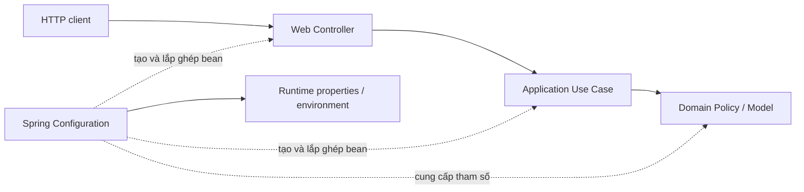
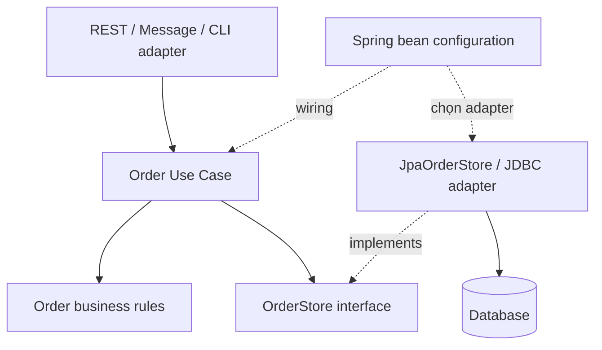

# Phân biệt mã nghiệp vụ với mã cấu hình hạ tầng

Khi bắt đầu với Spring Boot, việc đặt tất cả class vào một package, thêm `@Service`, `@Component` hoặc `@Configuration` rồi để Spring tự kết nối thường giúp có kết quả nhanh. Nhưng khi ứng dụng lớn dần, một vấn đề xuất hiện: **quy tắc kinh doanh, mã điều phối chức năng và mã cấu hình kỹ thuật bị trộn lẫn**. Lúc đó, chỉ một yêu cầu thay đổi phí giao hàng cũng có thể khiến người phát triển phải sửa cấu hình HTTP, truy vấn dữ liệu hoặc cách khởi tạo bean.

Trong chương **Tổ chức mã nguồn** của Spring Boot Fundamentals, phân biệt hai phạm vi này giúp trả lời ba câu hỏi:

1. **Ứng dụng phải làm gì?** Đây là phần quy tắc và nhu cầu nghiệp vụ.
2. **Ứng dụng phối hợp các bước ra sao?** Đây là phần điều phối một chức năng hoặc ca sử dụng (*use case*).
3. **Ứng dụng được nối với Spring Boot và các hệ thống bên ngoài như thế nào?** Đây là phần cấu hình, adapter và hạ tầng kỹ thuật.

Mục đích không phải chia càng nhiều lớp càng tốt. Mục đích là **mỗi thay đổi có một nơi hợp lý để thực hiện**, và người học có thể giải thích được vì sao một class thuộc về nơi đó.

## 1. Hai phạm vi khác nhau về trách nhiệm

**Mã nghiệp vụ** mô tả các quy tắc, quyết định và quy trình mà sản phẩm phải tuân theo. Quy tắc này có ý nghĩa ngay cả khi ứng dụng chưa có máy chủ HTTP, cơ sở dữ liệu hay Spring container.

Ví dụ trong một cửa hàng:

- Đơn hàng chỉ được đặt khi có ít nhất một sản phẩm.
- Số lượng của từng sản phẩm phải lớn hơn 0.
- Đơn từ 500.000 đồng được miễn phí giao hàng tiêu chuẩn.
- Đơn đã hủy không thể được xác nhận thanh toán.
- Khách hàng được áp dụng mức giảm giá theo chính sách của sản phẩm.

**Mã hạ tầng và cấu hình hạ tầng** mô tả cách ứng dụng kết nối, khởi tạo hoặc vận hành các thành phần kỹ thuật. Những quyết định này có thể thay đổi khi chuyển từ máy phát triển sang môi trường triển khai mà quy tắc kinh doanh vẫn giữ nguyên.

Ví dụ:

- Khai báo một bean bằng `@Configuration` và `@Bean`.
- Cấu hình địa chỉ kết nối PostgreSQL, pool kết nối hoặc HTTP client.
- Chọn port cho web server, mức logging, thời gian chờ khi gọi hệ thống ngoài.
- Cấu hình tên topic của message broker, đường dẫn lưu trữ, phương thức cung cấp secret.
- Chọn implementation cụ thể cho một interface truy cập dữ liệu.

Giữa hai phạm vi trên còn có **mã điều phối ứng dụng**: nhận yêu cầu thực hiện một ca sử dụng, gọi quy tắc nghiệp vụ, yêu cầu lưu dữ liệu hoặc gửi thông báo theo một trình tự xác định.

| Câu hỏi | Ví dụ | Phạm vi trách nhiệm |
| --- | --- | --- |
| Khi nào khách hàng được miễn phí giao hàng? | Tổng đơn đạt ngưỡng chính sách | Nghiệp vụ |
| Để tạo đơn hàng cần thực hiện các bước nào? | Kiểm tra đơn, tính tiền, lưu đơn | Điều phối ứng dụng |
| Dữ liệu đơn hàng được lưu bằng cách nào? | JPA, JDBC hoặc một API bên ngoài | Hạ tầng / adapter |
| Spring tạo đối tượng nào, kết nối các dependency ra sao? | `@Bean`, `@ConfigurationProperties`, component scan | Cấu hình ứng dụng |
| Người dùng gửi yêu cầu bằng cách nào? | REST controller, HTTP mapping, JSON | Giao tiếp / web |
| Ứng dụng chạy trên cổng nào? | `server.port` | Cấu hình runtime |

**Đường ranh giới dựa vào trách nhiệm, không dựa duy nhất vào annotation hoặc thư mục.** Một class `@Service` có thể chứa nghiệp vụ thực sự hoặc chỉ chứa logic gọi HTTP. Một class tên `BusinessConfig` vẫn có thể đang giấu quy tắc kinh doanh trong phương thức tạo bean.

## 2. Nhận diện mã nghiệp vụ bằng câu hỏi “nếu bỏ Spring đi”

Giả sử người quản lý sản phẩm đưa ra yêu cầu:

> Khách hàng được miễn phí giao hàng tiêu chuẩn nếu tổng tiền hàng từ 500.000 đồng trở lên. Các đơn còn lại trả 30.000 đồng. Không chấp nhận tổng tiền âm.

Đây là một quy tắc kinh doanh. Ta có thể viết một class Java thông thường để biểu diễn:

```java
package com.example.store.shipping.domain;

import java.math.BigDecimal;
import java.util.Objects;

public final class ShippingPolicy {

    private final BigDecimal freeShippingFrom;
    private final BigDecimal standardFee;

    public ShippingPolicy(BigDecimal freeShippingFrom, BigDecimal standardFee) {
        Objects.requireNonNull(freeShippingFrom, "freeShippingFrom");
        Objects.requireNonNull(standardFee, "standardFee");

        if (freeShippingFrom.signum() < 0 || standardFee.signum() < 0) {
            throw new IllegalArgumentException("Shipping policy values cannot be negative");
        }

        this.freeShippingFrom = freeShippingFrom;
        this.standardFee = standardFee;
    }

    public BigDecimal calculateFee(BigDecimal orderSubtotal) {
        Objects.requireNonNull(orderSubtotal, "orderSubtotal");
        if (orderSubtotal.signum() < 0) {
            throw new IllegalArgumentException("Order subtotal cannot be negative");
        }

        return orderSubtotal.compareTo(freeShippingFrom) >= 0
                ? BigDecimal.ZERO
                : standardFee;
    }
}
```

Class này có các đặc điểm:

- Thể hiện rõ hành vi sản phẩm: kiểm tra tổng tiền và tính phí giao hàng.
- Nhận ngưỡng miễn phí và phí tiêu chuẩn qua constructor, không cần biết cấu hình đó đến từ đâu.
- Dùng `BigDecimal` thay vì số thực dấu phẩy động cho các giá trị tiền trong ví dụ.
- Không import `org.springframework.*`, `jakarta.persistence.*`, HTTP client hay thư viện truy cập database.
- Có thể được tạo bằng `new ShippingPolicy(...)` và kiểm thử trực tiếp trong Java thông thường.

Nếu chuyển ứng dụng từ Spring Boot sang một chương trình Java khác, quy tắc trên vẫn có thể dùng lại. Đó là dấu hiệu mạnh cho thấy phần cốt lõi đang được đặt ở đúng nơi.

Điều này **không có nghĩa mọi mã nghiệp vụ đều bị cấm dùng Spring**. Với ứng dụng nhỏ, một service được đánh dấu `@Service` có thể hoàn toàn hợp lý. Điểm cần giữ là quy tắc kinh doanh không phụ thuộc vô cớ vào HTTP, chi tiết database hoặc cách cấu hình môi trường.

## 3. Mã điều phối ứng dụng nằm giữa nghiệp vụ và hạ tầng

Một chức năng thực tế có thể cần nhiều bước: nhận lệnh, kiểm tra quyền, tính toán, đọc hoặc lưu trạng thái, rồi trả kết quả. Phần **application/use case** điều phối các bước này; bản thân các bước tính toán và bất biến cốt lõi vẫn nên được diễn đạt rõ trong mô hình nghiệp vụ.

Với ví dụ tính phí giao hàng, ta tạo một use case đơn giản:

```java
package com.example.store.shipping.application;

import com.example.store.shipping.domain.ShippingPolicy;
import java.math.BigDecimal;
import java.util.Objects;

public final class QuoteShippingService {

    private final ShippingPolicy policy;

    public QuoteShippingService(ShippingPolicy policy) {
        this.policy = Objects.requireNonNull(policy);
    }

    public BigDecimal quote(BigDecimal orderSubtotal) {
        return policy.calculateFee(orderSubtotal);
    }
}
```

Trong ví dụ nhỏ này, use case chỉ chuyển lời gọi tới policy nên có thể trông rất mỏng. Điều đó không phải lý do để nhân bản quy tắc vào nhiều nơi. Khi chức năng thực tế mở rộng, lớp điều phối có thể chịu trách nhiệm đọc giỏ hàng, lấy chính sách đang áp dụng, tính phí và xây dựng kết quả, còn thuật toán quyết định phí nằm trong `ShippingPolicy`.

Không cần tạo hàng chục class use case cho một chương trình thử nghiệm chỉ in một dòng chữ. Sự tách biệt hữu ích khi có luồng nghiệp vụ, khả năng mở rộng, kiểm thử hoặc thay đổi tích hợp độc lập.

## 4. Spring Boot kết nối các class tại ranh giới cấu hình

`ShippingPolicy` và `QuoteShippingService` đều là Java class thông thường. Vậy Spring Boot sẽ tạo các đối tượng đó như thế nào? Đây chính là trách nhiệm của lớp cấu hình, thường gọi là *composition root* hoặc nơi lắp ghép dependency.

Giả sử các tham số chính sách được khai báo trong `src/main/resources/application.yml`:

```yaml
shipping:
  policy:
    free-shipping-from: 500000
    standard-fee: 30000

server:
  port: 8080
```

Ta có thể dùng Spring Boot Configuration Properties để đưa các giá trị này vào một đối tượng:

```java
package com.example.store.shipping.config;

import java.math.BigDecimal;
import org.springframework.boot.context.properties.ConfigurationProperties;

@ConfigurationProperties(prefix = "shipping.policy")
public record ShippingPolicyProperties(
        BigDecimal freeShippingFrom,
        BigDecimal standardFee
) {
}
```

Sau đó khai báo một class lắp ghép các bean:

```java
package com.example.store.shipping.config;

import com.example.store.shipping.application.QuoteShippingService;
import com.example.store.shipping.domain.ShippingPolicy;
import org.springframework.boot.context.properties.EnableConfigurationProperties;
import org.springframework.context.annotation.Bean;
import org.springframework.context.annotation.Configuration;

@Configuration
@EnableConfigurationProperties(ShippingPolicyProperties.class)
public class ShippingConfiguration {

    @Bean
    ShippingPolicy shippingPolicy(ShippingPolicyProperties properties) {
        return new ShippingPolicy(
                properties.freeShippingFrom(),
                properties.standardFee()
        );
    }

    @Bean
    QuoteShippingService quoteShippingService(ShippingPolicy policy) {
        return new QuoteShippingService(policy);
    }
}
```

Khi application context được khởi tạo, Spring Boot bind các property có tiền tố `shipping.policy` vào `ShippingPolicyProperties`. Spring dùng các phương thức `@Bean` để tạo `ShippingPolicy` và `QuoteShippingService`, tự cung cấp dependency mà phương thức yêu cầu.

Điều quan trọng trong ví dụ:

- `ShippingPolicyProperties` biết **cách đọc tham số từ cơ chế cấu hình của Spring Boot**.
- `ShippingConfiguration` biết **đối tượng nào cần được tạo và phụ thuộc vào đối tượng nào**.
- `ShippingPolicy` biết **quy tắc tính phí giao hàng**.
- `QuoteShippingService` biết **ca sử dụng cần gọi quy tắc nào**.

Đổi cách cung cấp cấu hình, chẳng hạn lấy giá trị từ environment variables thay vì YAML, không yêu cầu `ShippingPolicy` import Spring API. Thay đổi ngưỡng miễn phí vì chính sách bán hàng cũng không yêu cầu sửa class cấu hình để viết lại thuật toán.

### Điểm tinh tế: một giá trị đặt trong YAML vẫn có thể là tham số nghiệp vụ

Hai property ở ví dụ trên cùng nằm trong tệp YAML nhưng có ý nghĩa khác nhau:

| Property | Ý nghĩa | Nhóm quyết định |
| --- | --- | --- |
| `shipping.policy.free-shipping-from` | Ngưỡng chính sách miễn phí giao hàng | Tham số nghiệp vụ được cung cấp qua cấu hình |
| `shipping.policy.standard-fee` | Mức phí do sản phẩm quy định | Tham số nghiệp vụ được cung cấp qua cấu hình |
| `server.port` | Cổng lắng nghe của web server | Cấu hình hạ tầng/runtime |

**Không phải cứ nằm trong `application.yml` là dữ liệu hạ tầng.** Nguồn cung cấp giá trị và ý nghĩa của giá trị là hai vấn đề khác nhau. Nếu một thay đổi ảnh hưởng tới khách hàng, giá bán hay quyền thực hiện nghiệp vụ, hãy xem nó là thay đổi chính sách sản phẩm, kể cả khi nó được lưu bằng property.

Trong hệ thống thực, chính sách có thể được version hóa, lưu trong database hoặc quản lý trên công cụ riêng. Cách lưu đó không thay đổi bản chất nghiệp vụ của chính sách.

## 5. Controller là mã giao tiếp, không phải nơi đặt toàn bộ nghiệp vụ

Khi thêm `spring-boot-starter-web`, ứng dụng có thể tiếp nhận yêu cầu HTTP. Một controller có trách nhiệm diễn dịch dữ liệu HTTP thành lời gọi use case, rồi chuyển kết quả thành HTTP response.

Ví dụ:

```java
package com.example.store.shipping.web;

import com.example.store.shipping.application.QuoteShippingService;
import java.math.BigDecimal;
import org.springframework.web.bind.annotation.PostMapping;
import org.springframework.web.bind.annotation.RequestBody;
import org.springframework.web.bind.annotation.RequestMapping;
import org.springframework.web.bind.annotation.RestController;

@RestController
@RequestMapping("/api/shipping")
public class ShippingController {

    private final QuoteShippingService quoteShippingService;

    public ShippingController(QuoteShippingService quoteShippingService) {
        this.quoteShippingService = quoteShippingService;
    }

    @PostMapping("/quote")
    public ShippingQuoteResponse quote(@RequestBody ShippingQuoteRequest request) {
        BigDecimal fee = quoteShippingService.quote(request.orderSubtotal());
        return new ShippingQuoteResponse(fee);
    }

    public record ShippingQuoteRequest(BigDecimal orderSubtotal) {
    }

    public record ShippingQuoteResponse(BigDecimal fee) {
    }
}
```

Nếu đã khởi tạo ứng dụng web, gửi yêu cầu:

```http
POST /api/shipping/quote HTTP/1.1
Content-Type: application/json

{"orderSubtotal": 620000}
```

Kết quả thông thường:

```json
{
  "fee": 0
}
```

Phần HTTP ở đây chỉ nhận `orderSubtotal`, gọi use case và tạo response. Nếu ngày mai thay REST API bằng lệnh chạy theo lịch hoặc message consumer, lớp `ShippingPolicy` vẫn không cần thay đổi.

Để ví dụ tập trung vào ranh giới tổ chức mã, controller chưa bổ sung validation ở lớp HTTP, error mapping hay cơ chế xác thực. Trong ứng dụng thực tế, nên kiểm tra request và chuyển lỗi nghiệp vụ thành phản hồi HTTP phù hợp ở lớp giao tiếp, thay vì để exception nội bộ tùy ý lộ ra cho client.

### Cách viết gây trộn trách nhiệm

Ví dụ dưới đây là kiểu mã nên nhận diện khi đọc một dự án:

```java
@RestController
class ShippingController {

    @Value("${shipping.policy.free-shipping-from}")
    private BigDecimal threshold;

    @PostMapping("/shipping-fee")
    BigDecimal fee(@RequestBody BigDecimal subtotal) {
        if (subtotal.compareTo(threshold) >= 0) {
            return BigDecimal.ZERO;
        }
        return new BigDecimal("30000");
    }
}
```

Trong đoạn mã ngắn này, controller đồng thời biết:

1. Cách nhận dữ liệu HTTP.
2. Tên property từ môi trường Spring.
3. Ngưỡng và thuật toán tính phí.
4. Mức phí mặc định.

Nếu cần dùng quy tắc này trong một batch job, người phát triển có thể phải sao chép logic ra chỗ khác. Nếu thay đổi chính sách tính phí, sẽ phải sửa lớp web. Đây là dấu hiệu cho thấy controller đang nắm quá nhiều trách nhiệm.

Tách thành `ShippingPolicy`, `QuoteShippingService` và `ShippingConfiguration` là một cách giảm sự phụ thuộc đó. Không cần cố đạt một số lượng lớp cố định; điều quan trọng là **controller không sở hữu quy tắc mà những đầu vào khác cũng cần**.

## 6. Nhìn rõ hướng phụ thuộc

Một thiết kế dễ bảo trì thường định hướng:



Các mũi tên gọi hàm trong luồng xử lý đi từ web tới use case và domain. Mã domain không cần import controller hay Spring configuration. Cấu hình có thể biết các implementation cụ thể để tạo bean; nghiệp vụ không nên biết nơi nó được tạo.

Phân biệt ba hướng:

- **Hướng gọi lúc chạy:** controller gọi use case; use case gọi đối tượng nghiệp vụ.
- **Hướng import/biên dịch:** web và cấu hình có thể phụ thuộc vào application/domain; domain không cần phụ thuộc ngược lại.
- **Hướng khởi tạo:** Spring configuration tạo hoặc kết nối các dependency tại startup.

Ba khái niệm này dễ bị nhầm với nhau. Một lớp nghiệp vụ được Spring tạo thông qua `@Bean` không có nghĩa lớp đó phải import `ApplicationContext` hoặc biết tên `@Configuration` nào đã tạo nó.

## 7. Cấu hình hạ tầng trong Spring Boot gồm những gì?

Từ “hạ tầng” có thể chỉ hệ thống bên ngoài (database, cache, broker) hoặc những chi tiết giúp ứng dụng vận hành trên Spring Boot. Trong một dự án căn bản, có thể gặp:

| Loại | Ví dụ trong mã hoặc tệp | Trách nhiệm |
| --- | --- | --- |
| Khởi tạo bean | `@Configuration`, `@Bean` | Chọn implementation, truyền dependency |
| Bind property | `@ConfigurationProperties` | Chuyển cấu hình ngoài thành đối tượng có kiểu |
| Điều kiện khởi tạo | `@Profile`, `@ConditionalOnProperty` | Chọn cấu hình theo môi trường hoặc điều kiện |
| Web server | `server.port`, server settings | Điều chỉnh môi trường HTTP |
| Data access | datasource, JPA, connection pool | Kết nối và thực hiện I/O với nơi lưu trữ |
| External clients | HTTP client, timeout, retry setting | Gọi API hoặc dịch vụ khác |
| Vận hành | logging, metrics, health indicators | Quan sát và quản lý ứng dụng |
| Bí mật và cấu hình môi trường | credentials, tokens, secret sources | Cung cấp giá trị nhạy cảm an toàn |

Không phải dự án nào cũng cần tự viết class `@Configuration` cho mọi thành phần. Spring Boot có **auto-configuration** giúp tạo nhiều bean phổ biến dựa trên dependency, property và những điều kiện hiện có. Việc học Fundamentals là hiểu điều này và biết khi nào thực sự cần khai báo bean của riêng mình.

### Cấu hình ở đâu?

Thông thường nên phân biệt:

**1. Cấu hình giá trị ngoài mã nguồn**

```yaml
spring:
  application:
    name: store-service

server:
  port: 8080

logging:
  level:
    com.example.store: INFO
```

Các giá trị này có thể được thay đổi theo môi trường thông qua cơ chế externalized configuration của Boot. Không nên ghi cố định password, API key hoặc secret thật vào repository.

**2. Cấu hình tạo object trong Java**

```java
@Configuration
class StoreConfiguration {
    @Bean
    Clock clock() {
        return Clock.systemUTC();
    }
}
```

Đoạn trên cho Spring biết cách tạo một bean `Clock`. Nếu nghiệp vụ cần thời điểm hiện tại, một use case có thể nhận `Clock` qua constructor. Khi kiểm thử, ta có thể truyền `Clock.fixed(...)` để thời gian có tính xác định.

**3. Cấu hình triển khai bên ngoài ứng dụng**

Ví dụ: biến môi trường do nền tảng cloud cung cấp, cấu hình container, network policy, cơ chế inject secrets. Những phần này thường không nằm trong Java source của một class nghiệp vụ.

Không nên cố đưa mọi giá trị hạ tầng vào một class Java duy nhất; cũng không nên tạo nhiều file cấu hình nếu chỉ có một vài property đơn giản.

## 8. Ranh giới với mã truy cập dữ liệu và dịch vụ bên ngoài

Ví dụ tính phí giao hàng chỉ làm phép tính thuần túy. Một chức năng thực tế còn phải đọc tồn kho, lưu đơn hàng, gọi payment gateway hoặc gửi email. Những hoạt động ấy thuộc **I/O và tích hợp**.

Chẳng hạn ứng dụng cần lưu một yêu cầu đặt hàng. Nghiệp vụ biết rằng **đơn hợp lệ phải được lưu**, nhưng không nhất thiết cần biết đó là PostgreSQL, MongoDB hay một API từ xa.

Có thể đặt một interface thể hiện nhu cầu của ứng dụng:

```java
package com.example.store.order.application;

public interface OrderStore {
    void save(Order order);
}
```

`Order` ở đây là một đối tượng nghiệp vụ giả định thuộc mô hình đơn hàng. Một implementation tại adapter/hạ tầng sẽ hiện thực `OrderStore` bằng JPA, JDBC hoặc một phương thức lưu trữ khác.

Mô hình tổ chức:



Ý nghĩa của cách tổ chức này:

- Use case phụ thuộc vào **nhu cầu lưu đơn hàng** được diễn đạt bởi `OrderStore`.
- Adapter phụ thuộc vào thư viện kỹ thuật và triển khai cách lưu cụ thể.
- Spring kết nối một implementation của `OrderStore` vào use case ở runtime.
- Có thể thay adapter hoặc dùng bản giả trong kiểm thử mà không viết lại quy tắc tạo đơn hàng.

Trong ứng dụng CRUD rất nhỏ, sử dụng trực tiếp Spring Data repository từ một application service có thể là lựa chọn thực tế. Một interface trung gian chỉ có ích khi nó giúp thể hiện ranh giới nghiệp vụ, dễ kiểm thử hoặc có nhu cầu tách technology cụ thể. Tránh tạo một tầng “wrapper” chỉ chuyển tiếp từng phương thức một mà không đem lại mục đích rõ ràng.

### Không nhầm repository nghiệp vụ với implementation kỹ thuật

Tên `Repository` xuất hiện ở nhiều nơi:

- **Khái niệm repository/port của ứng dụng**: mô tả nhu cầu như “lưu và tìm đơn hàng”.
- **Spring Data JPA repository**: dùng cơ chế framework để định nghĩa truy vấn và thao tác persistence.
- **Adapter cụ thể**: chuyển từ mô hình domain sang entity và gọi repository của Spring Data.

Tên giống nhau không đồng nghĩa trách nhiệm giống nhau. Khi đọc code, hãy xem class nào import `org.springframework.data.*` hoặc `jakarta.persistence.*`, class nào định nghĩa yêu cầu nghiệp vụ và class nào thực thi I/O.

## 9. Tổ chức package theo trách nhiệm

Spring Boot không bắt buộc một cây thư mục cụ thể. Một dự án nhỏ thường có thể đặt package theo tầng:

```text
com.example.store
├── StoreApplication.java
├── controller
├── service
├── repository
├── domain
└── config
```

Cách này dễ bắt đầu và giúp người học nhanh nhận ra vai trò kỹ thuật. Tuy nhiên, khi có nhiều tính năng, package `service` có thể chứa mọi service của đơn hàng, sản phẩm, khách hàng và thanh toán, khiến việc tìm mã của một chức năng khó hơn.

Một lựa chọn khác là **đặt theo tính năng, rồi chia trách nhiệm bên trong tính năng**:

```text
src/main/java/com/example/store/
├── StoreApplication.java
├── shipping/
│   ├── domain/
│   │   └── ShippingPolicy.java
│   ├── application/
│   │   └── QuoteShippingService.java
│   ├── web/
│   │   └── ShippingController.java
│   └── config/
│       ├── ShippingConfiguration.java
│       └── ShippingPolicyProperties.java
├── order/
│   ├── domain/
│   ├── application/
│   └── infrastructure/
│       └── persistence/
└── shared/
    └── config/
```

Lưu ý:

- `shipping` chứa mã phục vụ chức năng giao hàng; `order` chứa mã phục vụ đơn hàng.
- `domain` là nơi đặt quy tắc và mô hình nghiệp vụ có ý nghĩa độc lập với framework.
- `application` điều phối use case và khai báo những dependency mà use case cần.
- `web` diễn dịch HTTP request/response.
- `infrastructure` hoặc `adapter` triển khai các chi tiết I/O.
- `config` chứa phần lắp ghép Spring Boot và thuộc tính cấu hình liên quan.
- `shared` chỉ chứa những thành phần thực sự được nhiều chức năng sử dụng; không nên biến nó thành nơi bỏ mọi class khó phân loại.

Trong cấu trúc này, `StoreApplication` nên nằm ở package cha `com.example.store` để component scan mặc định thường bao phủ các package con. Nếu đặt class khởi động sâu hơn hoặc tách nhiều module, phạm vi scan và cấu hình import cần được thiết kế chủ động.

### Package không tự bảo vệ ranh giới

Đưa `ShippingController` vào thư mục `web` nhưng vẫn tính phí giao hàng ngay trong controller thì mã vẫn đang trộn trách nhiệm. Ngược lại, một service viết gọn trong ít package vẫn có thể rõ ràng nếu phân biệt được đầu vào, xử lý nghiệp vụ và truy cập hạ tầng.

**Cây thư mục giúp người đọc nhận diện cấu trúc; hướng dependency và nội dung phương thức mới cho biết sự tách biệt có thật hay không.**

## 10. Hiểu đúng các annotation của Spring

Annotation giúp Spring quản lý đối tượng, nhưng không tự gán chất lượng thiết kế cho class.

| Annotation | Tác dụng thường gặp | Điều nó không đảm bảo |
| --- | --- | --- |
| `@Component` | Đăng ký component thông qua component scan | Class thuộc domain hay infrastructure |
| `@Service` | Đánh dấu component theo vai trò dịch vụ | Nội dung chắc chắn là quy tắc nghiệp vụ |
| `@Repository` | Đánh dấu vai trò persistence; một số ngữ cảnh hỗ trợ chuyển đổi exception | Không chứa logic kinh doanh, hoặc mọi database đều đã được cấu hình |
| `@RestController` | Nhận và xử lý yêu cầu theo mô hình Spring MVC | Controller được tách khỏi nghiệp vụ |
| `@Configuration` | Khai báo nguồn định nghĩa bean | Mỗi phương thức trong đó đều là “cấu hình thuần túy” |
| `@Bean` | Cung cấp một đối tượng do Spring quản lý | Bản thân class được tạo phải phụ thuộc vào Spring |
| `@ConfigurationProperties` | Bind cấu hình ngoài sang một đối tượng có kiểu | Property chỉ có thể mang ý nghĩa kỹ thuật |

Ví dụ hai thiết kế sau đều có thể được Spring khởi tạo:

```java
@Service
class ShippingService {
    BigDecimal calculateFee(BigDecimal amount) {
        // Quy tắc nghiệp vụ đặt trực tiếp trong Spring service
        return ...;
    }
}
```

```java
@Configuration
class ShippingConfiguration {
    @Bean
    ShippingPolicy shippingPolicy(ShippingPolicyProperties properties) {
        return new ShippingPolicy(
                properties.freeShippingFrom(),
                properties.standardFee()
        );
    }
}
```

Đoạn thứ nhất có thể đủ cho ứng dụng minh họa nhỏ nếu logic thực sự đơn giản. Đoạn thứ hai phù hợp hơn khi muốn tái sử dụng và kiểm thử quy tắc mà không cần khởi động Spring context. Quyết định nằm ở nhu cầu tách biệt, không phải vì “`@Service` sai” hoặc “mọi domain class phải dùng `@Bean`”.

## 11. Cấu hình theo môi trường và chính sách nghiệp vụ

Spring Boot hỗ trợ profiles và externalized configuration để chọn giá trị, bean hoặc thành phần phù hợp với môi trường:

```yaml
# application-dev.yml
logging:
  level:
    com.example.store: DEBUG
```

```yaml
# application-prod.yml
logging:
  level:
    com.example.store: INFO
```

Ở ví dụ này, sự khác biệt về mức logging là **quyết định vận hành**. Không nên viết trong domain:

```java
if ("prod".equals(activeProfile)) {
    // Bỏ một bước kiểm tra nghiệp vụ
}
```

Việc dùng profile để bỏ qua một bất biến nghiệp vụ có thể khiến cùng một yêu cầu tạo kết quả sai khác giữa các môi trường. Nếu cần chính sách kinh doanh khác nhau theo quốc gia, nhóm khách hàng hoặc chiến dịch, nên mô tả sự khác nhau đó bằng dữ liệu và quy tắc nghiệp vụ rõ ràng, thay vì gắn ngầm với nhãn `dev` hoặc `prod`.

Tuy nhiên, việc chọn adapter giả cho môi trường phát triển là trường hợp hợp lý để dùng cấu hình:

```java
@Configuration
class NotificationConfiguration {

    @Bean
    @Profile("dev")
    NotificationSender consoleNotificationSender() {
        return new ConsoleNotificationSender();
    }

    @Bean
    @Profile("prod")
    NotificationSender emailNotificationSender() {
        return new EmailNotificationSender();
    }
}
```

Các kiểu `NotificationSender`, `ConsoleNotificationSender` và `EmailNotificationSender` trong đoạn mã này là **các interface/implementation minh họa**. Ý tưởng là use case chỉ cần gọi một interface để gửi thông báo, còn cấu hình quyết định implementation theo môi trường. Nếu cả hai profile cùng active, có thể cần xử lý bean trùng hoặc đặt điều kiện rõ hơn; đây là vấn đề của cấu hình, không phải quy tắc gửi thông báo của nghiệp vụ.

Secrets như mật khẩu database hoặc token email phải được cấp từ nguồn quản lý an toàn phù hợp với môi trường. Không dùng profile như lý do để commit secret thật vào `application-prod.yml`.

## 12. Giao điểm khó phân loại: transaction, validation, logging và retry

Không phải mọi class đều thuộc đúng một ô tuyệt đối. Có những chức năng giao nhau giữa quy tắc nghiệp vụ và cơ chế kỹ thuật. Cách phân tích hữu ích là tách **ý định cần bảo đảm** khỏi **công cụ thực thi ý định đó**.

### 12.1. Transaction

“Tạo đơn và trừ tồn kho phải cùng thành công hoặc cùng thất bại” có thể là một yêu cầu nhất quán của sản phẩm. Nhưng `@Transactional`, transaction manager và isolation level là cơ chế kỹ thuật thực hiện tính nguyên tử trong điều kiện lưu trữ cụ thể.

Trong ứng dụng Spring Boot đơn giản, đặt `@Transactional` ở application service là cách thường gặp và thực tế. Khi đòi hỏi domain hoàn toàn độc lập với persistence, transaction boundary có thể được bọc ở adapter hoặc lớp application thích hợp. Không nên rải `@Transactional` lên mọi method chỉ để “cho chắc”, vì phạm vi và cách Spring áp dụng proxy có ảnh hưởng tới hành vi.

### 12.2. Validation

Nên phân biệt:

- **Validation giao tiếp:** JSON hợp lệ, trường bắt buộc trong request, kiểu số, định dạng email, giới hạn kích thước payload.
- **Validation nghiệp vụ:** đơn phải có sản phẩm, số lượng hợp lệ, không được chuyển trạng thái sai, tiền không được âm.

Controller có thể dùng Bean Validation để kiểm tra dữ liệu đến. Domain vẫn phải bảo vệ các bất biến cốt lõi, bởi cùng quy tắc có thể được gọi từ command-line, message consumer hoặc test trực tiếp mà không đi qua HTTP validation.

### 12.3. Logging và metrics

Code nghiệp vụ có thể phát sinh một sự kiện có ý nghĩa, ví dụ “đơn hàng đã được xác nhận”. Việc ghi sự kiện ấy vào log, metrics, trace hay audit storage là trách nhiệm của các cơ chế bên ngoài hoặc ứng dụng.

Không nên để một hàm tính tiền chỉ trả kết quả khi log server sẵn sàng. Ngược lại, nếu audit là yêu cầu pháp lý/nghiệp vụ, việc **bắt buộc ghi audit thành công** cần được thiết kế như một bước nghiệp vụ có hợp đồng rõ ràng, không thể coi là một dòng log tùy chọn.

### 12.4. Retry và timeout

“Phải gửi yêu cầu thanh toán tối đa một lần cho một đơn” là một yêu cầu về hành vi sản phẩm. Timeout khi gọi API, retry policy và circuit breaker là các kỹ thuật phục hồi. Nếu retry thao tác thanh toán không có idempotency key, có thể tạo tác dụng phụ trùng lặp.

Vì vậy, không nên gọi mọi retry là “thuần hạ tầng” rồi áp dụng tự động mà không xét tính an toàn của nghiệp vụ. Tính quyết định của yêu cầu có thể thuộc nghiệp vụ, trong khi công cụ triển khai thường nằm ở adapter/infrastructure.

## 13. Tách trách nhiệm giúp kiểm thử dễ hơn

Một cách kiểm chứng lợi ích của việc tách mã là xem **bài kiểm thử cần khởi tạo bao nhiêu thứ**.

### Kiểm thử quy tắc nghiệp vụ mà không khởi động Spring

`ShippingPolicy` là Java class độc lập nên có thể kiểm thử trực tiếp:

```java
import static org.junit.jupiter.api.Assertions.assertEquals;
import static org.junit.jupiter.api.Assertions.assertThrows;

import com.example.store.shipping.domain.ShippingPolicy;
import java.math.BigDecimal;
import org.junit.jupiter.api.Test;

class ShippingPolicyTest {

    private final ShippingPolicy policy = new ShippingPolicy(
            new BigDecimal("500000"),
            new BigDecimal("30000")
    );

    @Test
    void chargesStandardFeeBelowThreshold() {
        assertEquals(
                new BigDecimal("30000"),
                policy.calculateFee(new BigDecimal("499999"))
        );
    }

    @Test
    void makesShippingFreeAtThreshold() {
        assertEquals(
                BigDecimal.ZERO,
                policy.calculateFee(new BigDecimal("500000"))
        );
    }

    @Test
    void rejectsNegativeSubtotal() {
        assertThrows(IllegalArgumentException.class,
                () -> policy.calculateFee(new BigDecimal("-1")));
    }
}
```

Test trên chỉ cần JUnit và class Java đang kiểm thử. Không có `@SpringBootTest`, database hay port HTTP. Nếu chính sách thay đổi, test tập trung vào quy tắc và các trường hợp ranh giới như ngay dưới/ngay tại ngưỡng.

### Kiểm thử phần lắp ghép Spring

Các nội dung nên kiểm tra ở mức tích hợp thích hợp gồm:

- Property YAML/environment được bind đúng vào `ShippingPolicyProperties`.
- Bean `ShippingPolicy` và `QuoteShippingService` có thể được tạo trong Spring context.
- Profile hoặc điều kiện cấu hình chọn implementation dự kiến.
- Controller trả response đúng theo contract HTTP khi request hợp lệ hoặc không hợp lệ.
- Adapter truy cập dữ liệu kết nối và map dữ liệu đúng trong môi trường kiểm thử.

`@SpringBootTest` dùng khi muốn nạp một Spring Boot application context theo phạm vi cấu hình test. `@WebMvcTest` có thể tập trung vào web slice; `@DataJpaTest` tập trung vào phần JPA. Mỗi loại test có mục tiêu và chi phí khác nhau. **Không cần dùng `@SpringBootTest` để chứng minh một phép tính thuần Java trả ra con số chính xác.**

## 14. Các dấu hiệu mã đang bị trộn trách nhiệm

Trong lúc đọc hoặc viết source, hãy chú ý các biểu hiện sau:

| Biểu hiện | Vì sao đáng xem lại | Hướng tổ chức |
| --- | --- | --- |
| Controller chứa hàng chục dòng tính giá/giảm giá | Quy tắc gắn chặt với HTTP | Chuyển chính sách vào domain hoặc application |
| Một service tự đọc môi trường, tự gọi JDBC, tự xử lý HTTP response | Trộn điều phối, I/O và giao tiếp | Tách use case, adapter và web mapping |
| `@Configuration` chứa nhiều câu `if` quyết định trạng thái đơn hàng | Cấu hình trở thành nơi chứa chính sách sản phẩm | Tạo domain policy; config chỉ cung cấp dependency/tham số |
| Domain import `HttpServletRequest` để lấy user ID | Business model phụ thuộc vào giao thức web | Truyền thông tin cần thiết qua input/use case |
| Class xử lý tiền gọi trực tiếp `System.getenv("DB_PASSWORD")` | Logic nghiệp vụ biết chi tiết triển khai | Đọc cấu hình ở ranh giới hạ tầng |
| Nghiệp vụ xây SQL trực tiếp giữa các phép tính | Quy tắc và persistence thay đổi cùng nhau | Trích xuất repository/adapter khi cần |
| Logic giống nhau được copy vào REST, batch và consumer | Không có nguồn quy tắc dùng chung | Đặt quy tắc ở thành phần tái sử dụng |
| Unit test phải nạp toàn bộ Spring context để tính một biểu thức | Dependency framework vượt quá nhu cầu | Tách phép tính ra Java class thuần |

Đây là **dấu hiệu để điều tra**, không phải tiêu chí buộc refactor mọi dự án. Với ứng dụng giới thiệu rất nhỏ, số lượng class ít và logic đơn giản có thể phù hợp. Khi chuẩn bị mở rộng, nên xem lại những điểm mà một thay đổi nghiệp vụ gây ra hàng loạt sửa đổi kỹ thuật.

## 15. Cách tách mã từng bước trong một dự án đã có sẵn

Giả sử hiện tại toàn bộ tính phí giao hàng đang nằm trong `ShippingController`. Có thể chuyển đổi có kiểm soát theo thứ tự:

1. **Nhận diện quy tắc ổn định:** xác định khi nào miễn phí, mức phí và điều kiện dữ liệu không hợp lệ. Viết chúng thành lời trước khi di chuyển code.
2. **Trích xuất phép tính thuần Java:** đưa logic tính phí vào `ShippingPolicy`, nhận tham số cần thiết từ constructor và không đọc HTTP request hoặc môi trường bên trong.
3. **Trích xuất use case nếu có luồng điều phối:** cho application service gọi policy, repository hoặc các port cần thiết. Với chức năng rất nhỏ, có thể để controller gọi một application service mỏng.
4. **Đưa nguồn tham số ra ranh giới cấu hình:** dùng `@ConfigurationProperties` hoặc cơ chế cấu hình phù hợp, sau đó tạo bean bằng `@Bean` hoặc các pattern DI đã chọn.
5. **Giữ controller tập trung vào HTTP:** parse request, gọi use case, map kết quả và map lỗi ra response.
6. **Tách I/O theo nhu cầu:** khi thêm truy cập database hay hệ thống khác, đặt code tích hợp trong adapter và thể hiện hợp đồng mà application thực sự cần.
7. **Duy trì kiểm thử đúng cấp:** kiểm thử quy tắc bằng unit test, kiểm thử wiring/property và HTTP ở các bài test thích hợp.

Không cần chuyển toàn bộ project sang một kiến trúc phức tạp chỉ để sửa một hàm nhỏ. Bắt đầu từ nơi có thay đổi thường xuyên, đang khó kiểm thử hoặc đang bị nhiều kênh giao tiếp cùng sao chép logic.

## 16. Bài tập thực hành: xác định nơi đặt mã

Xét yêu cầu: “Khách hàng hạng Gold được giảm 10% tiền hàng, nhưng chỉ với đơn hàng có tổng tiền dương; người dùng phải đăng nhập để đặt đơn; thông tin đơn được lưu vào PostgreSQL; môi trường dev dùng một email sender giả”.

Hãy phân loại từng phần:

| Thành phần cần viết | Nơi đặt hợp lý | Lý do |
| --- | --- | --- |
| Quy tắc hạng Gold giảm 10% | `customer/domain` hoặc `order/domain` tùy mô hình | Đây là chính sách sản phẩm |
| Điều kiện tổng tiền phải dương | Domain invariant | Không phụ thuộc HTTP hay storage |
| Luồng tạo đơn, tính giảm giá, lưu đơn | Application/use case | Điều phối nhiều bước |
| Yêu cầu xác thực HTTP | Web/security configuration và adapter | Liên quan HTTP identity và cơ chế security |
| Implementation lưu PostgreSQL | Infrastructure/persistence | Phụ thuộc công nghệ database |
| Chọn email sender giả ở dev | Spring configuration/profile | Chọn implementation theo môi trường |
| Chuyển kết quả thành JSON response | Web/controller | Liên quan contract HTTP |

Nếu phiên bản sau có yêu cầu “khách hàng Platinum được giảm 15%”, phần thay đổi chính nằm trong policy. Nếu thay PostgreSQL bằng một hệ lưu trữ khác, điểm thay đổi chính là persistence adapter và wiring. Nếu API đổi từ REST sang message consumer, lớp giao tiếp thay đổi; chính sách giảm giá vẫn cần cho cùng nghiệp vụ.

### Bài tập đọc một class

Xét giả mã:

```java
@Service
class OrderService {
    // 1. Đọc biến môi trường để lấy địa chỉ database
    // 2. Truy vấn số lượng tồn kho bằng SQL
    // 3. Tính giá sau giảm giá cho thành viên
    // 4. Ghi đơn hàng vào database
    // 5. Trả về đối tượng ResponseEntity
}
```

Hãy giải thích vì sao class này có nhiều lý do để thay đổi, rồi thử phân rã:

- Quy tắc chiết khấu thành một policy.
- Trình tự kiểm tra tồn kho, tính giá và đặt đơn thành một use case.
- Truy vấn/lưu đơn thành persistence adapter.
- ResponseEntity và mã HTTP thành controller hoặc lớp xử lý web.
- Các thông tin database/credential thành cấu hình hạ tầng.

Cách tách này không cấm application service gọi nhiều dependency; nó chỉ giúp **mỗi dependency đại diện một trách nhiệm có tên gọi rõ ràng**.

## 17. Những điều nên nhớ khi tổ chức mã Spring Boot

Trước khi tạo class mới, hãy thử trả lời:

1. Class này đang mô tả **quy tắc sản phẩm**, **một ca sử dụng**, hay **cách kết nối với công nghệ cụ thể**?
2. Nếu thay HTTP bằng message consumer, phần quy tắc này có cần thay đổi không?
3. Nếu chuyển từ PostgreSQL sang một cơ chế lưu trữ khác, class nào thực sự cần sửa?
4. Có thể kiểm thử quy tắc quan trọng mà không khởi động `ApplicationContext` không?
5. Cấu hình này là **tham số chính sách kinh doanh** hay **thiết lập vận hành**? Ai chịu trách nhiệm phê duyệt thay đổi?
6. Dependency hiện đi theo hướng từ giao tiếp/hạ tầng tới application/domain, hay domain đang import chi tiết hạ tầng vô cớ?

Khi tổ chức mã nguồn, hãy lấy **trách nhiệm của class và lý do nó thay đổi** làm tiêu chí chính. Spring Boot giúp khởi tạo, cấu hình và kết nối các thành phần; quy tắc của sản phẩm nên được biểu diễn đủ rõ để không bị chôn trong controller, file cấu hình hoặc mã truy cập dữ liệu. Một cấu trúc tốt cho dự án đầu tiên là cấu trúc người khác có thể nhìn vào và hiểu: **đâu là quy tắc kinh doanh, đâu là luồng ứng dụng, và đâu là cách hệ thống chạy trên công nghệ đã chọn**.
