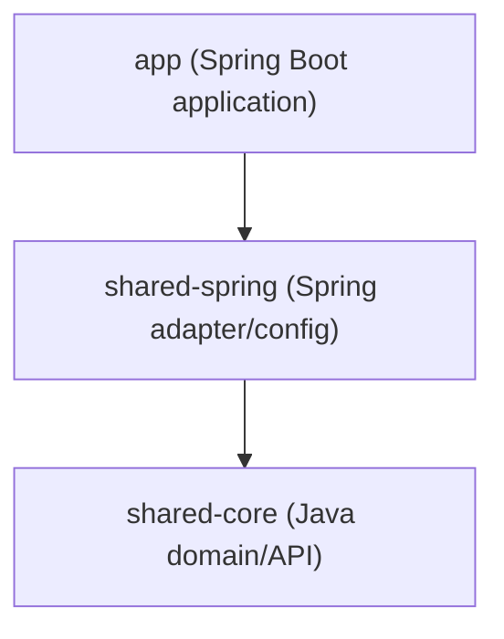
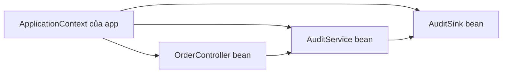

# Ứng dụng nhiều module và cách đưa thành phần dùng chung vào context

Trong một ứng dụng Spring Boot đủ lớn, việc đặt toàn bộ controller, service, repository, cấu hình và mã dùng chung vào một module sẽ khiến ranh giới trách nhiệm khó nhận diện. Chia mã nguồn thành nhiều module giúp mỗi phần có API và dependency rõ ràng. Tuy nhiên, **đưa một thư viện vào classpath không đồng nghĩa với việc các lớp trong thư viện trở thành Spring bean**.

Để tổ chức ứng dụng nhiều module đúng cách, cần hiểu hai việc độc lập nhưng có liên quan:

1. **Build system** (Gradle hoặc Maven) quyết định module nào phụ thuộc module nào, những class/resource nào được biên dịch và nằm trên classpath khi chạy.
2. **Spring container** quyết định cấu hình nào được đọc, bean nào được tạo và dependency nào được inject vào các bean trong một \`ApplicationContext\`.

Bài học dùng ví dụ Java 21, Spring Boot 3.x và Gradle multi-project để giải thích cách xây dựng thư viện dùng chung, cách đăng ký nó vào context bằng \`@Import\`, component scanning hoặc auto-configuration, cùng những giới hạn và lỗi phổ biến khi triển khai.

## 1. “Module” trong ứng dụng Spring Boot có nghĩa gì?

Từ *module* dễ bị sử dụng với nhiều nghĩa:

| Khái niệm | Đơn vị quản lý | Tác động chính |
| --- | --- | --- |
| Gradle subproject / Maven module | Thư mục chứa source set và cấu hình build riêng | Tạo artifact, thiết lập dependency và classpath |
| Package Java | Namespace và mức truy cập của lớp | Tổ chức mã, hỗ trợ component scanning |
| Spring bean | Đối tượng được Spring tạo/quản lý | Constructor injection, scope, lifecycle và AOP |
| \`ApplicationContext\` | Container các bean của một ứng dụng | Quản lý bean definitions, khởi tạo và kết nối bean |
| Ứng dụng/service triển khai độc lập | Tiến trình chạy riêng | Vòng đời, cấu hình, bộ nhớ và context riêng |
| Java Platform Module System (\`module-info.java\`) | Module ngôn ngữ/nền tảng Java | Export/readability giữa Java modules |

**Gradle subproject không tự tạo \`ApplicationContext\`.** Một tiến trình Spring Boot có thể dùng nhiều JAR từ nhiều Gradle module nhưng chỉ sử dụng một application context chính. Ngược lại, hai ứng dụng Spring Boot độc lập, dù cùng phụ thuộc một thư viện, vẫn có hai context và hai bộ bean instance riêng.

Tương tự, Java package không phải ranh giới deploy. Package chỉ ảnh hưởng tới cách đặt tên lớp và cách Spring tìm component khi có cơ chế scanning phù hợp.

### 1.1. Hình dung hai đồ thị khác nhau

Đồ thị phụ thuộc khi **build**:



Đồ thị bean khi **chạy**:



Hai đồ thị có mối liên hệ, nhưng **không trùng nhau**. Đồ thị thứ nhất cho phép lớp \`OrderController\` nhìn thấy kiểu \`AuditService\`; đồ thị thứ hai mới bảo đảm có một bean \`AuditService\` để inject.

## 2. Vì sao nên tách thành phần dùng chung?

Một thư viện dùng chung phù hợp khi nhiều phần ứng dụng cần cùng một năng lực thực sự ổn định: quy tắc chuẩn hóa dữ liệu, kiểu giá trị, cổng giao tiếp (port), thuật toán thuần Java, một HTTP client được cấu hình nhất quán hoặc cơ chế audit dùng ở nhiều module.

Ví dụ chia ba module:

```text
spring-multimodule-demo/
├── settings.gradle
├── build.gradle
├── shared-core/
│   ├── build.gradle
│   └── src/main/java/com/example/shared/core/
│       ├── AuditSink.java
│       └── AuditService.java
├── shared-spring/
│   ├── build.gradle
│   └── src/main/java/com/example/shared/spring/
│       ├── ConsoleAuditSink.java
│       └── SharedAuditConfiguration.java
└── app/
    ├── build.gradle
    └── src/main/java/com/example/app/
        ├── DemoApplication.java
        └── OrderController.java
```

- \`shared-core\`: quy tắc Java thuần, không biết Spring, HTTP hay database.
- \`shared-spring\`: adapter và cách đăng ký bean Spring cho năng lực dùng chung.
- \`app\`: entry point \`main\`, API và việc lắp ghép các phần thành ứng dụng chạy được.

Đây là một lựa chọn tổ chức, không phải cấu trúc bắt buộc cho mọi dự án. Với chương trình nhỏ, một module và các package rõ ràng có thể đã đủ. Tách module khi nó tạo ra ranh giới trách nhiệm hoặc tái sử dụng thực chất, tránh tách quá nhiều subproject chỉ vì số lượng class tăng.

### 2.1. Ví dụ Gradle multi-project

Tệp \`settings.gradle\` cho Gradle biết các subproject cần tham gia build:

```groovy
rootProject.name = 'spring-multimodule-demo'
include 'shared-core', 'shared-spring', 'app'
```

Một cấu hình root minh họa việc quản lý plugin và Java toolchain:

```groovy
// build.gradle ở root
plugins {
    id 'org.springframework.boot' version '3.3.5' apply false
    id 'io.spring.dependency-management' version '1.1.6' apply false
}

subprojects {
    apply plugin: 'java'

    repositories {
        mavenCentral()
    }

    java {
        toolchain {
            languageVersion = JavaLanguageVersion.of(21)
        }
    }
}
```

Các phiên bản trên chỉ minh họa một tổ hợp cụ thể của Spring Boot 3 và Gradle; dự án thật nên dùng bộ phiên bản do repository quản lý, đồng bộ tương thích và chính sách cập nhật của nhóm.

\`shared-core/build.gradle\`:

```groovy
plugins {
    id 'java-library'
}
```

\`shared-spring/build.gradle\`:

```groovy
plugins {
    id 'java-library'
}

dependencies {
    api project(':shared-core')

    implementation platform(
        'org.springframework.boot:spring-boot-dependencies:3.3.5'
    )
    implementation 'org.springframework:spring-context'
}
```

\`app/build.gradle\`:

```groovy
plugins {
    id 'org.springframework.boot'
    id 'io.spring.dependency-management'
}

dependencies {
    implementation project(':shared-spring')
    implementation 'org.springframework.boot:spring-boot-starter-web'

    testImplementation 'org.springframework.boot:spring-boot-starter-test'
}
```

Với \`project(':shared-spring')\`, Gradle thiết lập dependency trên artifact của subproject, sắp xếp thứ tự build và đưa dependency cần thiết vào runtime classpath của \`app\`. Không cần copy thủ công file \`.class\` hay JAR sang thư mục ứng dụng.

Các cấu hình \`api\` và \`implementation\` của plugin \`java-library\` có ý nghĩa khác nhau:

| Cấu hình | Ý nghĩa đối với module sử dụng thư viện |
| --- | --- |
| \`api\` | Dependency là một phần của API được module tiêu thụ cần nhìn thấy ở compile classpath |
| \`implementation\` | Dependency chủ yếu là chi tiết nội bộ; vẫn tham gia runtime theo cơ chế dependency tương ứng |
| \`runtimeOnly\` | Chỉ cần khi chạy, không cần để biên dịch code gọi thư viện |
| \`testImplementation\` | Chỉ phục vụ biên dịch/chạy test của module đang khai báo |

Ở đây \`shared-spring\` xuất \`AuditService\` trong các bean method nên việc để \`shared-core\` trong \`api\` là dễ hiểu. Nếu một dependency hoàn toàn chỉ nằm trong implementation bên trong thư viện, \`implementation\` giúp giảm phụ thuộc lộ ra cho consumer.

**Lưu ý:** các thư viện Spring không nhất thiết cần dùng plugin \`org.springframework.boot\` để tạo executable \`bootJar\`. Thường chỉ module ứng dụng có entry point mới đóng gói thành ứng dụng Boot; các thư viện dùng \`java-library\` và artifact JAR thông thường.

### 2.2. Maven cũng theo nguyên lý tương tự

Với Maven reactor, parent \`pom.xml\` liệt kê \`<modules>\`, module \`app\` khai báo dependency tới artifact của thư viện, và Maven xây dựng chúng theo đồ thị dependency. Khác biệt là cú pháp và lifecycle build; **classpath và bean registration vẫn là hai bước riêng** giống như Gradle.

## 3. Tạo một thành phần Java dùng chung

Tầng \`shared-core\` không cần biết Spring. Nó định nghĩa API lưu sự kiện audit và service xử lý việc ghi nhận:

\`shared-core/src/main/java/com/example/shared/core/AuditSink.java\`:

```java
package com.example.shared.core;

public interface AuditSink {
    void record(String event);
}
```

\`shared-core/src/main/java/com/example/shared/core/AuditService.java\`:

```java
package com.example.shared.core;

import java.util.Objects;

public final class AuditService {
    private final AuditSink sink;

    public AuditService(AuditSink sink) {
        this.sink = Objects.requireNonNull(sink, "sink");
    }

    public void recordOrderCreated(String orderId) {
        if (orderId == null || orderId.isBlank()) {
            throw new IllegalArgumentException("orderId must not be blank");
        }
        sink.record("ORDER_CREATED:" + orderId);
    }
}
```

Constructor nhận \`AuditSink\` giúp service chỉ biết hợp đồng cần thiết. Nó không tự tạo \`JdbcAuditSink\`, \`HttpAuditSink\` hay truy cập trực tiếp Spring context. Có thể gọi \`new AuditService(fakeSink)\` trong unit test mà không khởi động Spring.

Ở module adapter, tạo một implementation đơn giản:

\`shared-spring/src/main/java/com/example/shared/spring/ConsoleAuditSink.java\`:

```java
package com.example.shared.spring;

import com.example.shared.core.AuditSink;

public final class ConsoleAuditSink implements AuditSink {
    @Override
    public void record(String event) {
        System.out.println(event);
    }
}
```

\`System.out.println\` chỉ dùng để nhìn thấy hoạt động trong ví dụ. Trong ứng dụng thật có thể thay bằng logger, message broker hoặc adapter lưu trữ, đồng thời áp dụng chính sách dữ liệu, lỗi và transaction phù hợp.

Đến đây, Gradle có thể biên dịch những lớp trên nhưng Spring **chưa tự biết** phải tạo \`AuditService\` và \`AuditSink\` thế nào. Ta cần một cơ chế đăng ký bean.

## 4. Cách 1: Đăng ký bean rõ ràng bằng \`@Configuration\`, \`@Bean\` và \`@Import\`

Đây là lựa chọn dễ quan sát khi ứng dụng chủ động quyết định sử dụng thư viện nào.

Tạo cấu hình trong \`shared-spring\`:

\`shared-spring/src/main/java/com/example/shared/spring/SharedAuditConfiguration.java\`:

```java
package com.example.shared.spring;

import com.example.shared.core.AuditService;
import com.example.shared.core.AuditSink;
import org.springframework.context.annotation.Bean;
import org.springframework.context.annotation.Configuration;

@Configuration(proxyBeanMethods = false)
public class SharedAuditConfiguration {

    @Bean
    public AuditSink auditSink() {
        return new ConsoleAuditSink();
    }

    @Bean
    public AuditService auditService(AuditSink auditSink) {
        return new AuditService(auditSink);
    }
}
```

Giải thích:

- \`@Configuration\` đánh dấu lớp chứa các định nghĩa bean.
- \`@Bean\` trên phương thức yêu cầu Spring đăng ký giá trị trả về thành bean.
- Tham số \`AuditSink auditSink\` của bean method được Spring resolve từ context; đây là dependency injection bằng method parameter.
- \`proxyBeanMethods = false\` phù hợp khi các bean method không gọi trực tiếp nhau để nhờ Spring proxy can thiệp. Ví dụ dùng injection qua tham số thay vì gọi \`auditSink()\` trong \`auditService()\`.

Để ứng dụng thực sự sử dụng cấu hình, import nó tại entry point:

\`app/src/main/java/com/example/app/DemoApplication.java\`:

```java
package com.example.app;

import com.example.shared.spring.SharedAuditConfiguration;
import org.springframework.boot.SpringApplication;
import org.springframework.boot.autoconfigure.SpringBootApplication;
import org.springframework.context.annotation.Import;

@SpringBootApplication
@Import(SharedAuditConfiguration.class)
public class DemoApplication {
    public static void main(String[] args) {
        SpringApplication.run(DemoApplication.class, args);
    }
}
```

Lúc khởi động:

1. Gradle đã đưa \`shared-spring\` và \`shared-core\` vào runtime classpath của \`app\`.
2. Spring Boot bắt đầu tạo \`ApplicationContext\`.
3. \`@Import(SharedAuditConfiguration.class)\` đưa cấu hình của thư viện vào quá trình đăng ký bean definition.
4. Spring tạo \`AuditSink\`, truyền bean đó vào phương thức tạo \`AuditService\` và đưa \`AuditService\` vào context.
5. Một component của ứng dụng có thể inject \`AuditService\` bằng constructor.

Ví dụ controller:

\`app/src/main/java/com/example/app/OrderController.java\`:

```java
package com.example.app;

import com.example.shared.core.AuditService;
import org.springframework.http.ResponseEntity;
import org.springframework.web.bind.annotation.PathVariable;
import org.springframework.web.bind.annotation.PostMapping;
import org.springframework.web.bind.annotation.RestController;

@RestController
public class OrderController {
    private final AuditService auditService;

    public OrderController(AuditService auditService) {
        this.auditService = auditService;
    }

    @PostMapping("/demo-orders/{orderId}/audit")
    public ResponseEntity<Void> auditCreatedOrder(@PathVariable String orderId) {
        auditService.recordOrderCreated(orderId);
        return ResponseEntity.accepted().build();
    }
}
```

Endpoint này chỉ **minh họa kích hoạt audit**, không thực hiện tạo/lưu một đơn hàng thực tế. Khi request được xử lý, controller nhận bean \`AuditService\` từ context; còn service nhận \`AuditSink\` do cấu hình thư viện tạo ra.

### 4.1. Vì sao phải có \`@Import\` dù module đã được thêm làm dependency?

Trong ví dụ, ứng dụng chính nằm tại package \`com.example.app\`, còn cấu hình thư viện ở \`com.example.shared.spring\`. Cơ chế component scanning mặc định xuất phát từ package của lớp \`@SpringBootApplication\` và các package con của nó. \`com.example.shared.spring\` là package **anh em**, nên cấu hình đó không tự được component scan tìm thấy.

\`@Import\` giải quyết chính xác việc này mà không cần mở rộng vùng quét. Cấu hình thư viện vẫn có thể dùng \`@Bean\` để trả về đối tượng Java thuần, kể cả các lớp không có \`@Component\`.

Một nhầm lẫn phổ biến:

```java
// Việc mã Java compile thành công KHÔNG chứng minh rằng bean đã tồn tại:
import com.example.shared.core.AuditService;

// Đây chỉ là một kiểu Java hợp lệ trên classpath.
// Phải có bean definition để Spring inject AuditService.
```

Nếu bỏ \`@Import\` và không có cơ chế đăng ký nào khác, Spring thường báo lỗi đại ý **required a bean of type 'AuditService' that could not be found** khi tạo \`OrderController\`.

### 4.2. Khi nào nên dùng cấu hình tường minh?

\`@Import\` phù hợp khi ứng dụng muốn kiểm soát rõ những module được bật, library là mã nội bộ hoặc chỉ có vài điểm tích hợp. Mỗi ứng dụng chọn phần dùng chung bằng import cấu hình tương ứng.

Nếu nhiều ứng dụng cùng sử dụng một thư viện, việc phải thêm cùng \`@Import\` ở mọi ứng dụng có thể gây trùng lặp cấu hình. Khi đó có thể thiết kế **Spring Boot auto-configuration**, được trình bày ở phần 6.

## 5. Cách 2: Dùng component scanning

Spring có thể tạo bean từ những lớp mang stereotype annotation như \`@Component\`, \`@Service\`, \`@Repository\`, \`@Controller\`, \`@RestController\` và từ những \`@Configuration\` được quét thấy.

\`@SpringBootApplication\` bao gồm cơ chế \`@ComponentScan\`. Mặc định, vùng quét bắt đầu từ package của lớp ứng dụng chính.

Ví dụ bố trí package như sau:

```text
com.example.demo
├── DemoApplication            (@SpringBootApplication)
├── order
│   └── OrderController        (@RestController)
└── audit
    └── AuditComponent         (@Service)
```

Khi tất cả nằm bên dưới \`com.example.demo\`, component scan mặc định có thể tìm các component được đánh dấu đúng, **ngay cả khi lớp của chúng nằm trong các Gradle subproject khác nhau** và được đưa vào runtime classpath.

Ngược lại, nếu lớp ứng dụng ở \`com.example.app\`, còn component ở \`com.example.shared\`, chỉ phụ thuộc JAR là chưa đủ để component xuất hiện trong context.

### 5.1. Mở rộng phạm vi scanning có chủ đích

Có thể chỉ định package quét:

```java
package com.example.app;

import org.springframework.boot.autoconfigure.SpringBootApplication;

@SpringBootApplication(scanBasePackages = {
    "com.example.app",
    "com.example.shared.spring"
})
public class DemoApplication {
    // main(...) như ví dụ trước
}
```

Trong **phương án scanning**, \`SharedAuditConfiguration\` có thể được quét vào context bởi vì nó mang \`@Configuration\`, và các bean method bên trong cũng được xử lý. Khi đã chọn scanning để tải cấu hình đó, không cần đồng thời \`@Import\` cùng cấu hình trong ví dụ.

Có thể dùng \`scanBasePackageClasses\` thay cho chuỗi package để giảm lỗi khi refactor. Chẳng hạn truyền một marker class đặt trong package cần quét; lúc đó Spring quét package của marker class và các package con.

**Cẩn thận với vùng quét quá rộng:** quét \`com.example\` có thể vô tình đưa bean thử nghiệm, component của một ứng dụng khác hoặc nhiều implementation cạnh tranh vào context. Tránh mở rộng \`@ComponentScan\` chỉ để xử lý một bean bị thiếu nếu thư viện đã cung cấp \`@Configuration\` để import rõ ràng.

### 5.2. Component scan không thay thế mọi cơ chế khám phá khác

Trong Spring Data JPA, việc quét component thông thường không giống quét entity hay khai báo phạm vi repository.

- \`@EntityScan\` quy định package chứa entity cần quản lý trong những tình huống phải chỉ định riêng.
- \`@EnableJpaRepositories\` có thể cần khi cấu hình repository nằm ngoài phạm vi tự động nhận diện hoặc cần custom repository setup.
- \`@ConfigurationPropertiesScan\` dùng để tìm những lớp được đánh dấu \`@ConfigurationProperties\` khi áp dụng property binding theo cơ chế scanning đó.

Những annotation trên giải quyết những loại cấu hình khác nhau; thêm \`@ComponentScan\` không bảo đảm JPA entity hay configuration properties sẽ được xử lý đúng nếu chúng ở ngoài phạm vi mặc định.

## 6. Cách 3: Cung cấp Spring Boot auto-configuration

Một thư viện tái sử dụng trong nhiều ứng dụng có thể muốn tự đăng ký các bean mặc định khi có mặt trên classpath, đồng thời cho phép ứng dụng chủ động override. Spring Boot hỗ trợ mẫu thiết kế này bằng **auto-configuration**.

Đây là **phương án thay thế cho việc tự \`@Import(SharedAuditConfiguration.class)\`**, không phải một đoạn cấu hình cần bật thêm đồng thời vào ví dụ trước. Khi xây dựng thư viện thực tế, nên chọn rõ cơ chế nào là API đăng ký chính.

### 6.1. Định nghĩa auto-configuration

Ví dụ trong một thư viện dùng Spring Boot, dùng \`@AutoConfiguration\` cùng điều kiện tránh ghi đè bean do ứng dụng cung cấp:

```java
package com.example.shared.spring;

import com.example.shared.core.AuditService;
import com.example.shared.core.AuditSink;
import org.springframework.boot.autoconfigure.AutoConfiguration;
import org.springframework.boot.autoconfigure.condition.ConditionalOnMissingBean;
import org.springframework.context.annotation.Bean;

@AutoConfiguration
public class SharedAuditAutoConfiguration {

    @Bean
    @ConditionalOnMissingBean(AuditSink.class)
    public AuditSink auditSink() {
        return new ConsoleAuditSink();
    }

    @Bean
    @ConditionalOnMissingBean(AuditService.class)
    public AuditService auditService(AuditSink sink) {
        return new AuditService(sink);
    }
}
```

Lớp này cần dependency tới \`spring-boot-autoconfigure\` (ngoài \`spring-context\`) ở module thư viện. Nếu áp dụng cho cấu trúc Gradle ở trên, trong \`shared-spring/build.gradle\` thêm:

```groovy
dependencies {
    implementation 'org.springframework.boot:spring-boot-autoconfigure'
}
```

Đoạn \`dependencies\` này là **phần bổ sung** vào cấu hình thư viện đã có, không nhằm thay thế các khai báo \`api\` và BOM ở phần 2.

### 6.2. Đăng ký auto-configuration qua metadata

Với Spring Boot 3, thư viện tạo resource:

\`shared-spring/src/main/resources/META-INF/spring/org.springframework.boot.autoconfigure.AutoConfiguration.imports\`

Nội dung:

```text
com.example.shared.spring.SharedAuditAutoConfiguration
```

Mỗi dòng trong tệp imports là tên đầy đủ của một lớp auto-configuration. Khi Spring Boot thực hiện auto-configuration, cơ chế import của Boot đọc metadata này từ những JAR trên classpath và xem xét các cấu hình phù hợp. **Chỉ đặt \`@AutoConfiguration\` trên lớp mà không đăng ký nó trong resource trên thì chưa đủ để Boot tự tải từ thư viện.**

Tệp \`spring.factories\` từng được dùng để đăng ký \`EnableAutoConfiguration\` trong các phiên bản Boot cũ. Đối với các auto-configuration được phát triển cho Boot 3, sử dụng \`AutoConfiguration.imports\` là cách chuẩn.

### 6.3. Mặc định hợp lý và khả năng override

\`@ConditionalOnMissingBean(AuditSink.class)\` có nghĩa: đăng ký bean mặc định chỉ khi chưa có bean phù hợp của kiểu \`AuditSink\`. Một ứng dụng khác có thể tự khai báo implementation:

```java
package com.example.app;

import com.example.shared.core.AuditSink;
import org.springframework.context.annotation.Bean;
import org.springframework.context.annotation.Configuration;

@Configuration(proxyBeanMethods = false)
public class AppAuditConfiguration {

    @Bean
    public AuditSink auditSink() {
        return event -> {
            // Minh họa adapter riêng do ứng dụng quyết định.
            // Có thể thay bằng lời gọi database/message broker thực tế.
        };
    }
}
```

Trong cơ chế auto-configuration, bean này giúp ứng dụng thay default sink mà không phải sửa source code của thư viện. Bean \`AuditService\` vẫn được xây bằng \`AuditSink\` do context resolve.

Spring Boot còn hỗ trợ các điều kiện khác:

| Annotation | Ý nghĩa thường gặp |
| --- | --- |
| \`@ConditionalOnClass\` | Chỉ kích hoạt khi class cần thiết có mặt |
| \`@ConditionalOnBean\` | Chỉ kích hoạt khi bean cần thiết đã có |
| \`@ConditionalOnMissingBean\` | Cung cấp bean mặc định nếu chưa có bean phù hợp |
| \`@ConditionalOnProperty\` | Bật/tắt theo cấu hình |
| \`@ConditionalOnWebApplication\` | Chỉ áp dụng ở ngữ cảnh ứng dụng web thích hợp |

Auto-configuration nên dùng điều kiện ở nơi phù hợp để **giảm tác động không mong muốn lên ứng dụng tiêu thụ**. Cần hiểu thứ tự xử lý và phạm vi search của điều kiện: \`@ConditionalOnMissingBean\` thích hợp trong auto-configuration vì user-defined beans thường được xử lý trước. Đưa điều kiện ấy tùy tiện vào các cấu hình thông thường có thể dẫn tới kết quả khó dự đoán.

### 6.4. Bật/tắt thành phần dùng chung bằng property

Một thư viện có thể chỉ đăng ký các bean audit khi cấu hình cho phép:

```java
@AutoConfiguration
@ConditionalOnProperty(
    prefix = "shared.audit",
    name = "enabled",
    havingValue = "true",
    matchIfMissing = true
)
public class SharedAuditAutoConfiguration {
    // Các @Bean tương tự ví dụ trên.
}
```

\`application.yml\`:

```yaml
shared:
  audit:
    enabled: false
```

**Chú ý:** khi tắt toàn bộ audit auto-configuration, một controller vẫn yêu cầu \`AuditService\` bắt buộc sẽ khiến ứng dụng không khởi động được nếu không còn bean thay thế. Thiết kế thư viện cần xác định rõ ý nghĩa của chế độ \`enabled=false\`: không có bean, cung cấp no-op implementation, hay thay đổi điều kiện tạo component phụ thuộc. Không nên chỉ thêm một cờ rồi giả định các consumer tự thích nghi.

### 6.5. Khi nào chọn auto-configuration?

Auto-configuration thích hợp cho một năng lực hạ tầng dùng chung có hợp đồng ổn định, cần được sử dụng trong nhiều ứng dụng Boot, và có thể cung cấp mặc định an toàn. Ví dụ: metrics adapter, tracing helper, một client chung có cấu hình, hoặc cơ chế audit opt-in có defaults rõ ràng.

Nó không nhất thiết phù hợp với một module nghiệp vụ chỉ dùng riêng một ứng dụng. Trong trường hợp đó, \`@Import\` hoặc cấu hình trực tiếp thường làm quan hệ rõ hơn và dễ bảo trì hơn.

## 7. Ba cách đăng ký bean: chọn dựa trên hợp đồng

| Cách | Cách được đưa vào context | Phù hợp khi | Cần lưu ý |
| --- | --- | --- | --- |
| \`@Import(Configuration.class)\` | Ứng dụng import một config cụ thể | Muốn khai báo dependency tường minh; thư viện nội bộ | Mỗi ứng dụng cần chọn/import |
| Component scanning | Spring quét package rồi đăng ký component/config | Các package thuộc phạm vi ứng dụng hoặc library được thiết kế để quét | Package nằm ngoài scan sẽ bị bỏ qua; quét quá rộng dễ gây xung đột |
| Boot auto-configuration | Boot đọc metadata imports và áp dụng config có điều kiện | Thư viện/starter dùng ở nhiều ứng dụng | Cần metadata, defaults và điều kiện đúng |

Ba cách có thể tồn tại trong cùng hệ sinh thái, nhưng **không nên vô tình đăng ký một bean qua nhiều đường**. Nếu cùng tạo hai implementation của cùng interface, Spring có thể gặp lỗi khi inject theo kiểu hoặc khi trùng tên bean.

## 8. Đưa component dùng chung vào context: những điều thường gây lỗi

### 8.1. Thiếu dependency ở build

Triệu chứng: trình biên dịch báo không tìm thấy package/class của thư viện, ví dụ:

\`package com.example.shared.core does not exist\`

Đây là lỗi ở lớp **build/classpath**. Cần kiểm tra module được khai báo trong \`settings.gradle\`, dependency \`project(':...')\` hoặc dependency Maven phù hợp, và source có đúng package. Sửa \`@ComponentScan\` không giúp nếu class còn chưa hiện diện trên classpath.

### 8.2. Class có trên classpath nhưng không có bean

Triệu chứng lúc khởi động:

```text
Parameter 0 of constructor in com.example.app.OrderController
required a bean of type 'com.example.shared.core.AuditService'
that could not be found.
```

Đây là lỗi ở lớp **context/bean registration**. Kiểm tra theo trình tự suy luận:

1. \`AuditService\` có được đăng ký qua \`@Bean\` hoặc \`@Component\` không?
2. Nếu dùng component scan, class/config có nằm trong package được quét không?
3. Nếu dùng \`@Import\`, cấu hình có được import bởi ứng dụng thực sự khởi động không?
4. Nếu dùng auto-configuration, resource \`AutoConfiguration.imports\` có được đóng vào JAR không, và condition có cho phép kích hoạt không?
5. Bean có bị vô hiệu hóa bởi profile/property hay cấu hình điều kiện khác không?

Ví dụ \`@Service\` trong một thư viện **không tự bảo đảm được quét** khi thư viện nằm ngoài package scan của ứng dụng. Ngược lại, một \`@Bean\` method có thể tạo instance của class không có bất cứ stereotype annotation nào.

### 8.3. Có nhiều bean cùng một interface

Giả sử ứng dụng có hai bean \`AuditSink\`, một ghi console và một ghi database. Constructor:

```java
public AuditService(AuditSink sink) {
    this.sink = sink;
}
```

trở nên mơ hồ nếu không có cơ chế lựa chọn phù hợp. Trong Spring, có thể dùng \`@Qualifier\` trên điểm inject:

```java
public AuditService(@Qualifier("databaseAuditSink") AuditSink sink) {
    this.sink = sink;
}
```

Hoặc dùng \`@Primary\` cho một default implementation nếu đúng với hợp đồng. Annotation trên cần import từ \`org.springframework.beans.factory.annotation.Qualifier\` và \`org.springframework.context.annotation.Primary\` tương ứng.

Một thiết kế tốt nên đặt tên bean rõ ràng và không tạo nhiều implementation ngoài ý muốn; \`@Primary\` không phải cách che giấu việc thư viện đăng ký dư bean.

### 8.4. Trùng tên bean hoặc cấu hình được nạp hai lần

Hai bean definitions cùng tên có thể gây lỗi khi Boot không cho phép override bean definition theo cấu hình mặc định. Khi kết hợp scanning, \`@Import\` và auto-configuration, cần xác định cấu hình nào chịu trách nhiệm tạo mỗi bean.

Đừng giải quyết mặc định bằng cách bật \`spring.main.allow-bean-definition-overriding=true\` cho mọi ứng dụng: cách đó có thể che xung đột thực tế. Nếu cần override, hãy tạo điểm mở rộng có chủ đích bằng bean riêng hoặc \`@ConditionalOnMissingBean\` trong auto-configuration.

### 8.5. Dependency vòng

Ví dụ \`PaymentService\` yêu cầu \`AuditService\`, còn \`AuditService\` lại yêu cầu \`PaymentService\`. Constructor injection sẽ làm vòng phụ thuộc lộ ra ngay khi tạo bean.

Biện pháp bền vững là xem lại ranh giới và hướng phụ thuộc: trích xuất phần dùng chung, dùng event hoặc API một chiều nếu phù hợp. Việc dựa vào lazy injection để che vòng phụ thuộc thường làm thiết kế khó hiểu và không giải quyết nguyên nhân.

### 8.6. Nhầm lẫn \`ApplicationContext\` giữa các ứng dụng

Hai chương trình \`AppA.main()\` và \`AppB.main()\` có thể phụ thuộc cùng \`shared-spring.jar\`, nhưng **không chia sẻ bean instance hoặc trạng thái trong RAM**. Mỗi ứng dụng khởi động một context riêng; nếu cần chia sẻ dữ liệu, phải có giao tiếp/hạ tầng thích hợp như API, message broker, cache hoặc database theo yêu cầu hệ thống.

Ngay trong một tiến trình, Spring vẫn có thể có nhiều context (ví dụ parent/child). Khả năng nhìn thấy bean phụ thuộc cấu trúc context và quy tắc kế thừa. Không nên giả định mọi bean trong mọi context đều inject qua lại được.

## 9. Scope và vòng đời bean khi sử dụng thư viện chung

Bean do \`@Bean\` hoặc \`@Component\` tạo mặc định có scope **singleton** trong một context: Spring quản lý một instance của bean definition đó cho context tương ứng. Nó không phải singleton toàn JVM hay một instance chia sẻ giữa nhiều tiến trình.

Điều này có hai hệ quả:

- Nếu nhiều controller inject cùng một bean singleton \`AuditService\`, chúng có thể dùng cùng instance service.
- Nếu service lưu mutable state riêng cho request trong field của singleton, các request đồng thời có thể can thiệp lẫn nhau.

Thiết kế service dùng chung thường nên **stateless** (hoặc quản lý trạng thái đồng thời có chủ đích), inject dependency qua constructor và dùng biến cục bộ cho dữ liệu request.

Ví dụ không nên làm:

```java
@Service
public class UnsafeOrderTracker {
    private String currentOrderId;

    public void process(String orderId) {
        this.currentOrderId = orderId; // Request khác có thể ghi đè
    }
}
```

Nếu thực sự cần bean theo request, Spring có \`@RequestScope\`; tuy nhiên chọn scope phải dựa trên vòng đời dữ liệu và mô hình ứng dụng, không phải giải pháp chung cho mọi lỗi thread safety.

### 9.1. Cấu hình và lifecycle thuộc context đang sở hữu bean

Các annotation như \`@PostConstruct\`, \`@PreDestroy\`, \`@Profile\`, \`@ConditionalOnProperty\` hay \`@Transactional\` có thể tham gia quá trình tạo và sử dụng bean, nhưng chỉ khi Spring thực sự quản lý các bean đó và các điều kiện liên quan được đáp ứng.

Gọi \`new AuditService(...)\` trực tiếp tạo một object Java hợp lệ, nhưng đối tượng ấy **không tự nhận các dịch vụ container** như AOP proxy, tự động tiêm thêm dependency theo annotation hoặc callback vòng đời. Ngược lại, khi đưa object vào context bằng \`@Bean\`, Spring có thể áp dụng những bean post-processor phù hợp.

## 10. Một số quy tắc kiến trúc khi phát triển shared module

### 10.1. Giữ hướng dependency một chiều

Lý tưởng:

```text
app                 -> shared-spring -> shared-core
application feature -> reusable port -> infrastructure adapter
```

\`shared-core\` không nên phụ thuộc ngược vào \`app\`, vì thư viện sẽ mất tính tái sử dụng và có nguy cơ tạo vòng phụ thuộc build. Nếu hai tính năng đều dùng một interface, đặt interface ở module ổn định và để implementation nằm ở phía có trách nhiệm triển khai.

Tuy nhiên, không phải mọi lớp tương tự nhau đều cần chuyển vào thư viện chung. Việc “gom tất cả utility” dễ tạo ra module trung tâm bị mọi thứ phụ thuộc, khó versioning và khó thay đổi độc lập. Chỉ trích xuất sau khi làm rõ owner, hợp đồng và nhu cầu sử dụng thực tế.

### 10.2. Phân biệt mã dùng chung với cấu hình dùng chung

Một module Java thuần chứa logic và model có thể không cần phụ thuộc Spring. Một module tích hợp Spring có thể chứa \`@Configuration\`, \`@Bean\`, \`@AutoConfiguration\`, converter và adapter. Tách hai loại trách nhiệm này giúp module nghiệp vụ được unit test mà không cần Spring và tránh kéo framework vào nơi không cần thiết.

### 10.3. Cân nhắc contract cho cấu hình dùng chung

Nếu shared component cần properties, hãy cung cấp kiểu cấu hình rõ ràng thay vì đọc rải rác trực tiếp từ \`Environment\`:

```java
package com.example.shared.spring;

import java.time.Duration;
import org.springframework.boot.context.properties.ConfigurationProperties;

@ConfigurationProperties(prefix = "shared.audit")
public record AuditProperties(Duration timeout) {
    public AuditProperties {
        if (timeout == null || timeout.isNegative() || timeout.isZero()) {
            throw new IllegalArgumentException("timeout must be positive");
        }
    }
}
```

Trong Boot 3, một record chỉ có canonical constructor có thể được bind bằng constructor binding khi đăng ký qua \`@ConfigurationPropertiesScan\` hoặc \`@EnableConfigurationProperties(AuditProperties.class)\`. Auto-configuration của thư viện có thể dùng \`@EnableConfigurationProperties(AuditProperties.class)\` để bảo đảm bean properties được đăng ký; chỉ thêm \`@ConfigurationProperties\` trên lớp thường chưa đủ để nó tự xuất hiện từ JAR.

Ví dụ YAML:

```yaml
shared:
  audit:
    timeout: 3s
```

Trong ví dụ \`AuditProperties\` dùng để minh họa property binding, còn \`ConsoleAuditSink\` tối giản ở phần trên chưa dùng timeout. Khi phát triển adapter HTTP/database thật, cấu hình thời gian chờ sẽ được truyền vào adapter tương ứng qua constructor.

### 10.4. Hạn chế truy cập trực tiếp \`ApplicationContext\` từ domain

Đoạn code sau khiến domain phụ thuộc vào Spring container:

```java
public class OrderService {
    private final ApplicationContext context;

    public OrderService(ApplicationContext context) {
        this.context = context;
    }

    public void process() {
        AuditService audit = context.getBean(AuditService.class);
        // ...
    }
}
```

Đây là ví dụ **service locator**: lớp tự đi tìm dependency tại runtime. Nó che giấu yêu cầu dependency của service và khiến unit test phải mô phỏng context. Với dependency cố định, ưu tiên constructor:

```java
public class OrderService {
    private final AuditService audit;

    public OrderService(AuditService audit) {
        this.audit = audit;
    }
}
```

Truy cập \`ApplicationContext\` vẫn có những trường hợp hạ tầng hợp lý (framework extension, plugin registry, cơ chế resolve bean động), nhưng không nên là cách mặc định để kết nối nghiệp vụ.

## 11. Kiểm thử hai ranh giới khác nhau

Một hệ thống nhiều module cần phân biệt **kiểm thử logic** và **kiểm thử wiring**.

### 11.1. Unit test shared-core mà không cần Spring

Do \`AuditService\` chỉ phụ thuộc interface \`AuditSink\`, test có thể tự tạo fake:

```java
import static org.junit.jupiter.api.Assertions.assertEquals;
import static org.junit.jupiter.api.Assertions.assertThrows;

import com.example.shared.core.AuditService;
import java.util.ArrayList;
import java.util.List;
import org.junit.jupiter.api.Test;

class AuditServiceTest {

    @Test
    void recordsAnOrderCreatedEvent() {
        List<String> events = new ArrayList<>();
        AuditService service = new AuditService(events::add);

        service.recordOrderCreated("O-42");

        assertEquals(List.of("ORDER_CREATED:O-42"), events);
    }

    @Test
    void rejectsBlankOrderId() {
        AuditService service = new AuditService(event -> {});

        assertThrows(IllegalArgumentException.class,
                () -> service.recordOrderCreated("  "));
    }
}
```

Các unit test này tập trung vào hành vi Java, không phụ thuộc việc Spring đăng ký bean thế nào.

### 11.2. Kiểm thử cấu hình Spring

Để xác nhận các bean của thư viện thực sự được đăng ký và nối dependency đúng, có thể dùng \`ApplicationContextRunner\` từ Spring Boot test hỗ trợ tạo context nhỏ:

```java
import static org.assertj.core.api.Assertions.assertThat;

import com.example.shared.core.AuditService;
import com.example.shared.core.AuditSink;
import com.example.shared.spring.SharedAuditConfiguration;
import org.junit.jupiter.api.Test;
import org.springframework.boot.test.context.runner.ApplicationContextRunner;

class SharedAuditConfigurationTest {
    private final ApplicationContextRunner runner =
            new ApplicationContextRunner()
                    .withUserConfiguration(SharedAuditConfiguration.class);

    @Test
    void registersAuditServiceAndSink() {
        runner.run(context -> {
            assertThat(context).hasSingleBean(AuditSink.class);
            assertThat(context).hasSingleBean(AuditService.class);
        });
    }
}
```

Khi kiểm tra **auto-configuration** thay vì \`@Import\`, dùng \`ApplicationContextRunner\` với \`AutoConfigurations.of(SharedAuditAutoConfiguration.class)\` để kiểm tra các trường hợp có/không có bean người dùng và property bật/tắt. Việc kiểm thử cần đặt trong subproject có dependency test phù hợp. Đây là hướng thực hành, không phải một bài test đã được chạy trên repository hiện tại.

Một \`@SpringBootTest\` của module ứng dụng vẫn hữu ích để kiểm tra cuối cùng rằng toàn bộ context khởi động được, controller inject được service và bean thực tế đáp ứng cấu hình của ứng dụng. Không cần dùng full context để kiểm tra mọi nhánh nghiệp vụ thuần Java.

## 12. Cách chẩn đoán theo từng lớp khi ứng dụng không chạy

Khi nhận lỗi “không tìm thấy bean” trong ứng dụng nhiều module, đừng sửa ngẫu nhiên một loạt annotation. Hãy xác định lớp lỗi:

| Triệu chứng | Lớp cần kiểm tra | Hướng điều tra |
| --- | --- | --- |
| Không compile vì thiếu kiểu Java | Gradle/Maven dependency | Module có trong build; dependency và compile classpath |
| Compile được nhưng thiếu bean khi khởi động | Bean registration | \`@Import\`, component scan, \`@Bean\`, auto-configuration imports |
| Bean bị loại khỏi context | Conditions / profiles | \`@Conditional...\`, \`@Profile\`, properties |
| Có hai bean cùng interface | Dependency resolution | Tên bean, \`@Qualifier\`, \`@Primary\`, default bean |
| Bean được tạo hai lần hoặc trùng tên | Cách nạp cấu hình | Trùng \`@Import\`, scan, auto-config hay bean factory |
| Entity không được quản lý | Persistence scanning | Package entity, repository configuration, JPA setup |
| Một app thấy bean, app khác không thấy | Context/packaging riêng | Dependency, cấu hình khởi động và registration của từng app |
| Trạng thái request bị lẫn | Bean scope / concurrency | Singleton chứa mutable state, request data, thread safety |

Trong các trường hợp auto-configuration, báo cáo condition của Spring Boot có thể giúp tìm lý do một cấu hình được áp dụng hoặc bị bỏ qua. Bật debug phù hợp khi chẩn đoán môi trường phát triển, sau đó đọc thông tin cụ thể về những condition đã match hoặc không match thay vì dự đoán dựa vào tên lớp.

## 13. Bài tập áp dụng

### Bài tập 1 — Tách module Java thuần

Tạo \`shared-core\` chứa interface \`NotificationSender\` và class \`WelcomeService\` nhận \`NotificationSender\` qua constructor. Viết unit test với fake sender ghi các thông báo vào danh sách. Yêu cầu module \`shared-core\` không import annotation Spring nào.

### Bài tập 2 — Đưa shared service vào context

Tạo module \`shared-spring\` có \`WelcomeConfiguration\` và hai phương thức \`@Bean\`: một trả về implementation của \`NotificationSender\`, một trả về \`WelcomeService\`. Ở module \`app\`, dùng \`@Import(WelcomeConfiguration.class)\` và inject \`WelcomeService\` vào controller. Giải thích vì sao thêm dependency Gradle thôi chưa đủ.

### Bài tập 3 — Thử lỗi package scanning

Chuyển package của \`WelcomeConfiguration\` ra ngoài cây package của \`@SpringBootApplication\`. Bỏ \`@Import\` rồi quan sát lỗi khởi động khi controller cần service. Sửa theo một trong hai cách: khôi phục \`@Import\` hoặc chỉ định package scanning có chủ đích. Giải thích ưu nhược điểm của từng cách.

### Bài tập 4 — Viết auto-configuration có default

Đổi cấu hình thư viện thành \`@AutoConfiguration\`, thêm resource \`AutoConfiguration.imports\` và \`@ConditionalOnMissingBean(NotificationSender.class)\`. Kiểm tra ứng dụng có thể tự cung cấp bean \`NotificationSender\` của riêng mình mà không phải sửa thư viện.

### Bài tập 5 — Chọn ranh giới module

Giả sử một dự án có ba ứng dụng chạy độc lập: API bán hàng, worker xử lý hàng đợi và ứng dụng báo cáo. Chúng cùng sử dụng \`CustomerId\` và quy tắc chuẩn hóa mã khách hàng, nhưng có database và cơ chế authentication khác nhau. Hãy chọn phần nên đặt trong \`shared-core\`, phần nên cấu hình ở từng ứng dụng và giải thích vì sao các ứng dụng không dùng chung \`ApplicationContext\`.

## 14. Kết luận

Thiết kế đa module trong Spring Boot là sự kết hợp của **ranh giới build** và **ranh giới runtime**. Gradle/Maven đưa mã và tài nguyên vào classpath; Spring component scanning, \`@Import\`, \`@Bean\` hoặc auto-configuration mới quyết định những đối tượng nào trở thành bean trong \`ApplicationContext\`.

Khi chỉ có một vài ứng dụng nội bộ, \`@Configuration\` kết hợp \`@Import\` thường là cách đơn giản để nêu rõ module nào được lắp vào ứng dụng. Khi thư viện được tái sử dụng rộng hơn, auto-configuration với metadata và điều kiện mặc định phù hợp giúp consumer cấu hình dễ hơn. Component scanning có thể thuận tiện nếu package được tổ chức có chủ đích, nhưng không nên coi việc quét toàn bộ classpath là giải pháp chung.

Giữ logic dùng chung tách khỏi adapter Spring, duy trì hướng dependency một chiều, dùng constructor injection và kiểm thử riêng logic với wiring sẽ giúp hệ thống nhiều module phát triển mà vẫn dễ hiểu, dễ thay đổi và dễ phát hiện lỗi cấu hình.
