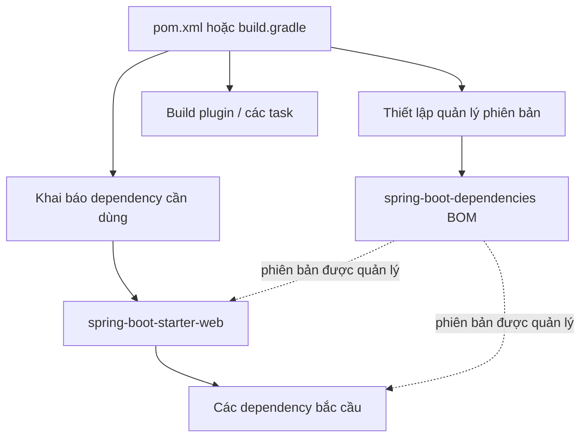
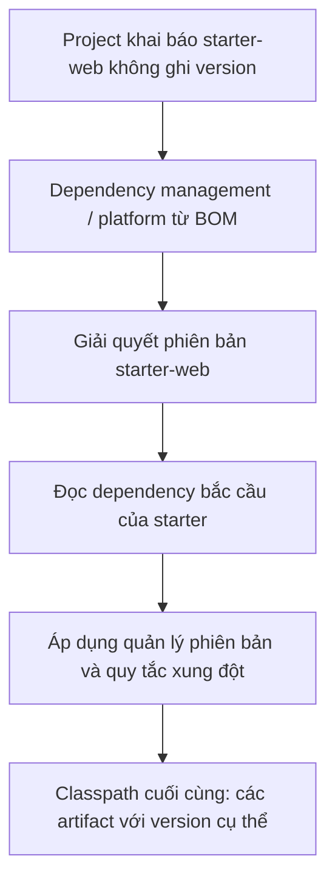

# spring-boot-dependencies BOM và tập phiên bản được quản lý

Trong một dự án Spring Boot, bạn thường gặp khai báo dependency **không ghi phiên bản**:

```groovy
dependencies {
    implementation 'org.springframework.boot:spring-boot-starter-web'
    implementation 'com.fasterxml.jackson.core:jackson-databind'
    testImplementation 'org.springframework.boot:spring-boot-starter-test'
}
```

Dù không có `:3.x.y` hay `<version>...</version>` ở từng dependency, Gradle hoặc Maven vẫn có thể chọn được phiên bản cụ thể. Điều đó thường xảy ra vì dự án đã sử dụng **Spring Boot dependency management**, đặc biệt là BOM `org.springframework.boot:spring-boot-dependencies`.

Bài học thuộc phần **Dependency và starter** của Spring Boot Fundamentals này giải thích BOM là gì, Spring Boot quản lý phiên bản như thế nào, cách bật cơ chế quản lý trong Maven/Gradle, cách nhận diện phiên bản thực tế và các giới hạn cần nhớ khi thêm thư viện hoặc nâng cấp Spring Boot.

> **Ý chính:** BOM quản lý **phiên bản được đề xuất hoặc được áp dụng theo cơ chế của build tool**; nó không tự thêm thư viện vào ứng dụng, không tự chạy Spring Boot và không bảo đảm mọi dependency tùy ý đều có phiên bản.

## 1. Bài toán khi mỗi dependency tự chọn phiên bản

Một REST API Spring Boot có thể sử dụng Spring MVC, Jackson, Hibernate, một JDBC driver, Logback, Micrometer, JUnit và nhiều thư viện khác. Những thư viện này lại có **transitive dependencies**: dependency gián tiếp được kéo theo bởi dependency mà ta đã khai báo.

Ví dụ giản lược:

```text
Ứng dụng
├── spring-boot-starter-web
│   ├── spring-web
│   ├── spring-webmvc
│   ├── jackson-databind
│   └── embedded web server
├── spring-boot-starter-data-jpa
│   ├── spring-data-jpa
│   └── hibernate-core
└── spring-boot-starter-test
    └── các thư viện kiểm thử
```

Tên và cấu trúc dependency thực tế khác theo phiên bản Spring Boot. Sơ đồ chỉ minh họa việc một dự án có **nhiều lớp phụ thuộc**.

Nếu tự quản lý, bạn phải trả lời:

- Dùng Spring Framework phiên bản nào phù hợp với Spring Boot đang chạy?
- Jackson phiên bản nào kết hợp ổn với Spring Web và các thư viện còn lại?
- Hibernate và Spring Data JPA nên đi với nhau ở phiên bản nào?
- Các phiên bản thuộc cùng hệ sinh thái có bị lệch khi một thư viện kéo theo bản cũ hơn không?
- Khi nâng Spring Boot từ một bản phát hành sang bản khác, phải điều chỉnh những thư viện liên quan như thế nào?

Đặt phiên bản riêng rẽ vào hàng chục khai báo là việc dễ lỗi. Spring Boot giải quyết phần lớn công việc lặp lại bằng cách **công bố một tập phiên bản dependency được quản lý**, có kiểm thử tích hợp cho mỗi bản phát hành.

## 2. BOM là gì?

**BOM** viết tắt của **Bill of Materials**. Trong hệ sinh thái Maven/Gradle, BOM là một tài liệu metadata mô tả tập dependency và phiên bản được quản lý. BOM của Spring Boot có tọa độ Maven:

```text
Group ID:    org.springframework.boot
Artifact ID: spring-boot-dependencies
Version:     phiên bản Spring Boot được chọn
Packaging:   pom
```

Ví dụ ở một phiên bản cụ thể:

```text
org.springframework.boot:spring-boot-dependencies:3.3.13
```

Số `3.3.13` ở đây chỉ minh họa một bản phát hành có thật trong nhánh Spring Boot 3.3. Với dự án mới, hãy chọn phiên bản Spring Boot **đang được hỗ trợ** và phù hợp với Java/Gradle/Maven của dự án.

BOM không phải file JAR chứa lớp Java. Đây là một **POM** công bố thông tin dependency management. Ở mức ý tưởng, bên trong có những quy tắc như:

```xml
<!-- Minh họa ý tưởng dependencyManagement, không phải
     nội dung nguyên văn của spring-boot-dependencies. -->
<dependencyManagement>
    <dependencies>
        <dependency>
            <groupId>com.fasterxml.jackson.core</groupId>
            <artifactId>jackson-databind</artifactId>
            <version><!-- phiên bản được Spring Boot quản lý --></version>
        </dependency>
        <dependency>
            <groupId>org.hibernate.orm</groupId>
            <artifactId>hibernate-core</artifactId>
            <version><!-- phiên bản được Spring Boot quản lý --></version>
        </dependency>
    </dependencies>
</dependencyManagement>
```

Đoạn trên chỉ dùng để hình dung **những tọa độ được ánh xạ tới phiên bản**; không nên sao chép vào project.

### 2.1. BOM là danh sách quản lý, không phải danh sách phải cài

Giả sử BOM quản lý cả `jackson-databind` và `hibernate-core`. Nếu ứng dụng chỉ cần HTTP/JSON mà không dùng JPA, chỉ vì BOM có `hibernate-core` **không có nghĩa** Hibernate sẽ được đưa vào classpath.

Phân biệt:

- **Khai báo dependency**: “Ứng dụng cần thư viện X.”
- **Quản lý phiên bản**: “Nếu thư viện X xuất hiện trong đồ thị dependency, đây là phiên bản được quản lý theo cơ chế của công cụ build.”
- **Giải quyết dependency**: Maven/Gradle kết hợp các khai báo, dependency bắc cầu, constraints và quy tắc xung đột để chọn phiên bản cuối cùng.

Một dependency có thể được đưa vào ứng dụng trực tiếp hoặc gián tiếp; BOM chỉ tham gia phần **phiên bản**.

### 2.2. Vì sao gọi là “tập phiên bản được quản lý”?

Mỗi bản Spring Boot công bố bộ phiên bản dành cho các thư viện được dự án đó quản lý. Danh sách thường bao gồm các thành phần trong hệ sinh thái:

| Nhóm | Ví dụ được quản lý trong những dòng Spring Boot phù hợp | Lý do đáng quan tâm |
|---|---|---|
| Nền tảng Spring | Spring Framework, Spring Data, Spring Security | Giữ sự tương thích giữa các module Spring |
| Web và JSON | Jackson, các embedded web server được hỗ trợ | Hạn chế lệch phiên bản khi tạo REST API |
| Dữ liệu | Hibernate ORM, các thư viện JDBC/connection pool | Hỗ trợ tích hợp persistence |
| Logging | SLF4J, Logback, Log4j tùy bản phát hành | Phối hợp logging API và implementation |
| Giám sát | Micrometer và các module liên quan | Kết nối metrics/tracing ở các phiên bản tương thích |
| Kiểm thử | JUnit, Mockito, AssertJ và các thành phần được liệt kê | Dùng bộ công cụ test nhất quán |

**Danh sách chính xác và phiên bản cụ thể thay đổi theo mỗi Spring Boot release.** Không được suy ra rằng Spring Boot luôn quản lý **mọi** thư viện, hoặc rằng một thư viện được quản lý ở bản này chắc chắn cũng được quản lý ở bản khác.

## 3. Phân biệt BOM, starter, Spring Boot plugin và parent POM

Bốn tên này thường xuất hiện cạnh nhau nhưng đảm nhiệm chức năng khác nhau.

| Thành phần | Vai trò | Tự kéo code vào classpath? |
|---|---|---|
| `spring-boot-dependencies` BOM | Công bố phiên bản dependency được quản lý | **Không**, chỉ vì import BOM |
| `spring-boot-starter-web` | Starter khai báo nhóm dependency phục vụ ứng dụng web Servlet/MVC | **Có**, vì đây là dependency thực sự |
| `org.springframework.boot` Gradle plugin | Hỗ trợ tác vụ chạy, đóng gói ứng dụng Boot và tích hợp với một số plugin khác | **Không tự thay thế** việc khai báo mọi dependency |
| `spring-boot-starter-parent` trong Maven | Parent POM cung cấp dependency management **và** các mặc định build/plugin hữu ích | Không đồng nghĩa tự thêm starter web hay starter data |

Sơ đồ quan hệ:



BOM quản lý *phiên bản* của một starter; bản thân starter khai báo *thư viện* cần để cung cấp tính năng. Build plugin quản lý các nhiệm vụ build/chạy. Các trách nhiệm này bổ sung cho nhau.

## 4. Cách Spring Boot BOM được sử dụng trong Maven

Có hai cách rất phổ biến:

1. Kế thừa `spring-boot-starter-parent`.
2. Nếu dự án có parent riêng hoặc không muốn dùng parent Spring Boot, import `spring-boot-dependencies` trong `dependencyManagement`.

### 4.1. Cách A: Maven kế thừa spring-boot-starter-parent

Ví dụ `pom.xml` rút gọn:

```xml
<project xmlns="http://maven.apache.org/POM/4.0.0"
         xmlns:xsi="http://www.w3.org/2001/XMLSchema-instance"
         xsi:schemaLocation="http://maven.apache.org/POM/4.0.0
                             https://maven.apache.org/xsd/maven-4.0.0.xsd">
    <modelVersion>4.0.0</modelVersion>

    <parent>
        <groupId>org.springframework.boot</groupId>
        <artifactId>spring-boot-starter-parent</artifactId>
        <version>3.3.13</version>
        <relativePath/>
    </parent>

    <groupId>com.example</groupId>
    <artifactId>my-first-boot-app</artifactId>
    <version>0.0.1-SNAPSHOT</version>

    <properties>
        <java.version>21</java.version>
    </properties>

    <dependencies>
        <dependency>
            <groupId>org.springframework.boot</groupId>
            <artifactId>spring-boot-starter-web</artifactId>
        </dependency>

        <dependency>
            <groupId>org.springframework.boot</groupId>
            <artifactId>spring-boot-starter-test</artifactId>
            <scope>test</scope>
        </dependency>
    </dependencies>
</project>
```

Ở đây:

- Parent của Spring Boot cung cấp cấu hình thừa kế, trong đó có dependency management từ `spring-boot-dependencies`.
- `spring-boot-starter-web` và `spring-boot-starter-test` **không cần ghi `<version>`** vì phiên bản của chúng được quản lý.
- `<java.version>21</java.version>` định hướng phiên bản Java cho cấu hình build do parent hỗ trợ; nó không phải phiên bản của dependency.
- Parent còn mang các mặc định cho plugin/build mà chỉ import BOM sẽ không tự có.

**Cần nhớ:** Maven chỉ hỗ trợ một `<parent>` trực tiếp. Nếu dự án bắt buộc có parent của tổ chức, dùng BOM import là hướng linh hoạt hơn.

### 4.2. Cách B: Maven import BOM khi không dùng Spring Boot parent

```xml
<project xmlns="http://maven.apache.org/POM/4.0.0"
         xmlns:xsi="http://www.w3.org/2001/XMLSchema-instance"
         xsi:schemaLocation="http://maven.apache.org/POM/4.0.0
                             https://maven.apache.org/xsd/maven-4.0.0.xsd">
    <modelVersion>4.0.0</modelVersion>

    <groupId>com.example</groupId>
    <artifactId>my-first-boot-app</artifactId>
    <version>0.0.1-SNAPSHOT</version>

    <properties>
        <maven.compiler.release>21</maven.compiler.release>
    </properties>

    <dependencyManagement>
        <dependencies>
            <dependency>
                <groupId>org.springframework.boot</groupId>
                <artifactId>spring-boot-dependencies</artifactId>
                <version>3.3.13</version>
                <type>pom</type>
                <scope>import</scope>
            </dependency>
        </dependencies>
    </dependencyManagement>

    <dependencies>
        <dependency>
            <groupId>org.springframework.boot</groupId>
            <artifactId>spring-boot-starter-web</artifactId>
        </dependency>
    </dependencies>
</project>
```

Điểm cốt lõi là đặt BOM trong:

```xml
<dependencyManagement>
    <dependencies>
        <dependency>
            <groupId>org.springframework.boot</groupId>
            <artifactId>spring-boot-dependencies</artifactId>
            <version>3.3.13</version>
            <type>pom</type>
            <scope>import</scope>
        </dependency>
    </dependencies>
</dependencyManagement>
```

**Tại sao phải có `type=pom` và `scope=import`?** Đây là cách Maven lấy **các khai báo quản lý phiên bản** từ một BOM POM và đưa vào mô hình dependency management của project. Nếu khai báo BOM như một JAR dependency thông thường, bạn đã dùng sai mục đích.

**Giới hạn quan trọng:** Import BOM giúp quản lý **dependency versions**, nhưng **không thay thế plugin management** mà `spring-boot-starter-parent` cung cấp. Nếu cần `spring-boot-maven-plugin` để repackage executable JAR, hãy cấu hình plugin và phiên bản tương thích một cách thích hợp.

### 4.3. Maven vẫn cho khai báo dependency có phiên bản tường minh

Ví dụ:

```xml
<dependency>
    <groupId>com.fasterxml.jackson.core</groupId>
    <artifactId>jackson-databind</artifactId>
    <version><!-- phiên bản riêng dự án quyết định --></version>
</dependency>
```

Khi một **direct dependency** có `<version>` tường minh, phiên bản được chỉ định có thể ghi đè mức quản lý tương ứng cho dependency đó. Dù Maven có quy tắc riêng về dependency mediation và transitive dependencies, nguyên tắc thực hành là **tránh khai báo phiên bản riêng nếu không có lý do chính đáng** và kiểm tra dependency tree sau khi thay đổi.

### 4.4. Parent và import BOM không giống nhau khi override phiên bản

Với `spring-boot-starter-parent`, Spring Boot cho phép tùy chỉnh một số phiên bản được quản lý thông qua các Maven properties đã công bố. Ví dụ tên property như `jackson-bom.version` chỉ có ý nghĩa khi **bản Boot đang dùng** thực sự khai báo property tương ứng.

Khi chỉ **import** BOM qua `dependencyManagement`, việc đặt property cùng tên ở project **không tự sửa nội dung của BOM đã import** theo cách giống parent inheritance. Thay vào đó, cần đặt khai báo `dependencyManagement` riêng cho dependency hoặc BOM cần override, theo thứ tự/độ ưu tiên của Maven.

Đây là một khác biệt rất hay gặp khi chuyển từ project mẫu dùng Spring Boot parent sang project có parent nội bộ của doanh nghiệp.

## 5. Cách dùng Spring Boot BOM trong Gradle

Với Gradle, cần phân biệt hai cơ chế phổ biến:

- **Spring dependency-management plugin** (`io.spring.dependency-management`).
- **Gradle native BOM support** với `platform(...)`.

Cả hai đều có thể giúp khai báo dependency mà không ghi version, nhưng cách xử lý constraint và override không hoàn toàn giống nhau.

### 5.1. Gradle với io.spring.dependency-management

Ví dụ `build.gradle` (Groovy DSL, theo cấu hình phổ biến của Spring Boot 3.3):

```groovy
plugins {
    id 'java'
    id 'org.springframework.boot' version '3.3.13'
}

apply plugin: 'io.spring.dependency-management'

repositories {
    mavenCentral()
}

java {
    toolchain {
        languageVersion = JavaLanguageVersion.of(21)
    }
}

dependencies {
    implementation 'org.springframework.boot:spring-boot-starter-web'
    implementation 'com.fasterxml.jackson.core:jackson-databind'
    testImplementation 'org.springframework.boot:spring-boot-starter-test'
}
```

Với **Spring Boot Gradle plugin 3.3** và `io.spring.dependency-management` được áp dụng, plugin Boot tự import BOM phù hợp với phiên bản Boot plugin. Nhờ đó, các dependency trong danh sách được quản lý có thể bỏ phần `:version`.

**Chú ý về thời gian:** hành vi tự import và cú pháp cấu hình có thể thay đổi giữa các **major version** của Spring Boot Gradle plugin. Khi dùng dòng Spring Boot khác, hãy đọc phần *Managing Dependencies* của tài liệu plugin đúng dòng phiên bản, không mặc định rằng mọi version đều làm việc giống 3.3.

Trong ví dụ:

- `org.springframework.boot` là Gradle plugin để build/chạy/đóng gói Boot.
- `io.spring.dependency-management` là plugin cung cấp cơ chế quản lý phiên bản.
- `spring-boot-dependencies` là BOM được nhập thông qua sự phối hợp của chúng.
- `spring-boot-starter-web` vẫn là dependency cung cấp code thư viện web cho ứng dụng.

### 5.2. Gradle native BOM support với platform(...)

Gradle có thể sử dụng BOM POM như **platform dependency** mà không cần plugin `io.spring.dependency-management`.

```groovy
plugins {
    id 'java'
    id 'org.springframework.boot' version '3.3.13'
}

repositories {
    mavenCentral()
}

dependencies {
    implementation platform(
        org.springframework.boot.gradle.plugin.SpringBootPlugin.BOM_COORDINATES
    )

    implementation 'org.springframework.boot:spring-boot-starter-web'
    implementation 'com.fasterxml.jackson.core:jackson-databind'

    testImplementation platform(
        org.springframework.boot.gradle.plugin.SpringBootPlugin.BOM_COORDINATES
    )
    testImplementation 'org.springframework.boot:spring-boot-starter-test'
}
```

`SpringBootPlugin.BOM_COORDINATES` giúp lấy đúng group/artifact/version của BOM phù hợp với **Spring Boot plugin đang áp dụng**. Cú pháp `platform(...)` là cơ chế của **Gradle**, còn giá trị tọa độ BOM do plugin Spring Boot cung cấp.

Một dạng tương đương, hữu ích khi **không áp dụng Spring Boot Gradle plugin** vào project thư viện, là import tọa độ BOM tường minh:

```groovy
dependencies {
    implementation platform('org.springframework.boot:spring-boot-dependencies:3.3.13')
    implementation 'com.fasterxml.jackson.core:jackson-databind'
}
```

Không cần vừa import `platform(...)` vừa áp dụng dependency management plugin trong cùng ví dụ nếu bạn chưa có lý do cụ thể; hãy chọn một cơ chế chính, hiểu cách nó quản lý phiên bản và tránh những rule bị chồng chéo khó phân tích.

### 5.3. Vì sao Gradle platform là một “ràng buộc” thay vì khóa tuyệt đối?

Với `platform(...)`, Gradle đưa các phiên bản trong BOM vào quá trình dependency resolution dưới dạng **version constraints/recommendations**. Nếu dependency graph còn có constraint hoặc yêu cầu phiên bản khác, bản cuối cùng được chọn **có thể khác** bản trong BOM.

Nếu dùng:

```groovy
implementation enforcedPlatform(
    org.springframework.boot.gradle.plugin.SpringBootPlugin.BOM_COORDINATES
)
```

thì `enforcedPlatform(...)` có tính cưỡng chế mạnh hơn đối với phiên bản trong phạm vi áp dụng. Tuy nhiên, điều này có thể xung đột với các dependency khác và **lan truyền ràng buộc nghiêm ngặt tới consumer** khi dùng trong một thư viện được publish. Đừng dùng `enforcedPlatform` chỉ để “chắc chắn không lỗi”, đặc biệt trong library module.

### 5.4. BOM áp dụng theo configuration

Khi viết:

```groovy
dependencies {
    implementation platform('org.springframework.boot:spring-boot-dependencies:3.3.13')
}
```

BOM tham gia giải quyết dependency trong configuration `implementation` và những configuration được thiết lập **kế thừa** phù hợp. Không nên mặc định nó tự quản lý mọi configuration tùy chỉnh, buildscript classpath hay plugin classpath.

Một project có `implementation`, `testImplementation`, `annotationProcessor`, `integrationTestImplementation` hoặc configuration riêng cần hiểu quan hệ kế thừa để áp dụng platform/management thích hợp. Ví dụ chủ động thêm BOM cho `testImplementation` là cách trực quan để người học thấy test dependencies cũng cần được quản lý.

### 5.5. Kotlin DSL với Gradle native BOM

Tương tự Groovy, ví dụ `build.gradle.kts`:

```kotlin
plugins {
    java
    id("org.springframework.boot") version "3.3.13"
}

repositories {
    mavenCentral()
}

dependencies {
    implementation(
        platform(org.springframework.boot.gradle.plugin.SpringBootPlugin.BOM_COORDINATES)
    )
    implementation("org.springframework.boot:spring-boot-starter-web")

    testImplementation(
        platform(org.springframework.boot.gradle.plugin.SpringBootPlugin.BOM_COORDINATES)
    )
    testImplementation("org.springframework.boot:spring-boot-starter-test")
}
```

Sự khác nhau chủ yếu nằm ở cú pháp DSL. Ý nghĩa BOM và các dependency được quản lý giữ nguyên.

## 6. Ví dụ luồng chọn phiên bản

Giả sử một BOM cho bản Boot mà bạn chọn quản lý:

```text
spring-boot-starter-web   → phiên bản Boot tương ứng
spring-webmvc             → phiên bản Spring Framework tương ứng
jackson-databind          → phiên bản Jackson tương ứng
junit-jupiter             → phiên bản JUnit tương ứng
```

Bạn khai báo:

```groovy
dependencies {
    implementation 'org.springframework.boot:spring-boot-starter-web'
    testImplementation 'org.springframework.boot:spring-boot-starter-test'
}
```

Quá trình suy luận có thể hình dung như sau:



Không có “BOM magic” xảy ra bên trong JVM khi app chạy. Tất cả nằm ở **giai đoạn build và resolve dependency**. Sau đó các JAR đã được chọn mới có mặt trên compile/runtime/test classpath tương ứng.

### Một tình huống xung đột phổ biến

Giả sử ứng dụng cần `jackson-databind`. Spring Boot BOM đề xuất phiên bản **X**, nhưng một thư viện khác yêu cầu phiên bản **Y**.

Kết quả không thể suy luận chỉ bằng câu “BOM quản lý X”:

- Với **Maven**, `dependencyManagement` và quy tắc mediation quyết định phiên bản thắng; direct declaration và quản lý trong POM có mức ảnh hưởng riêng.
- Với **Gradle native `platform`**, các version constraints và conflict resolution có thể chọn phiên bản khác BOM.
- Với **Gradle + dependency-management plugin**, quy tắc quản lý phiên bản của plugin tham gia resolution theo cách khác Gradle native platform.
- Với một **explicit version**, **strict constraint**, **force** hoặc **enforcedPlatform**, kết quả lại có thể thay đổi.

Do đó **hãy kiểm tra resolved dependency graph thực tế**, đừng chỉ nhìn `build.gradle`/`pom.xml` rồi khẳng định bản được chạy.

## 7. Xem danh sách phiên bản thực sự được quản lý ở đâu?

Có hai câu hỏi riêng:

1. **BOM liệt kê phiên bản nào?** Đây là danh sách phiên bản *được quản lý* cho một Spring Boot release cụ thể.
2. **Project cuối cùng chọn phiên bản nào?** Đây là kết quả sau khi Maven/Gradle xử lý toàn bộ dependency graph.

### 7.1. Đọc danh sách managed versions trong tài liệu Spring Boot

Spring Boot có tài liệu *Dependency Versions* hoặc appendix tương đương theo từng release. Ở đó bạn có thể tra phiên bản được quản lý cho Jackson, Hibernate, JUnit, Tomcat, Micrometer và nhiều thành phần khác, nếu được hỗ trợ ở release đó.

Ví dụ đường dẫn tài liệu:

- [Spring Boot 3.3 – Dependency Versions](https://docs.spring.io/spring-boot/3.3/appendix/dependency-versions/coordinates.html)
- [Spring Boot 3.3 – Managing Dependencies với Gradle](https://docs.spring.io/spring-boot/3.3/gradle-plugin/managing-dependencies.html)

Để biết chính xác phiên bản của một dependency, hãy tra trong tài liệu **đúng Spring Boot release**, thay vì lấy số phiên bản từ bài viết sử dụng release khác.

### 7.2. Gradle: xem cây dependency

Trong thư mục chứa Gradle Wrapper:

```bash
./gradlew dependencies --configuration runtimeClasspath
```

Trên Windows:

```powershell
.\gradlew.bat dependencies --configuration runtimeClasspath
```

Một dòng hiển thị có thể được Gradle diễn giải theo dạng:

```text
com.example:some-library:1.0 -> 1.2
```

Phần bên trái thường biểu diễn version được yêu cầu/khai báo; dấu `->` thể hiện version cuối cùng được chọn khi hai giá trị khác nhau. Dữ liệu chỉ mang tính ví dụ.

### 7.3. Gradle: hỏi tại sao chọn phiên bản đó

Công cụ đặc biệt hữu ích là `dependencyInsight`:

```bash
./gradlew dependencyInsight \
  --dependency jackson-databind \
  --configuration runtimeClasspath
```

Hoặc trên PowerShell:

```powershell
.\gradlew.bat dependencyInsight --dependency jackson-databind --configuration runtimeClasspath
```

Lệnh cho biết dependency xuất hiện qua những đường nào và các lý do resolution được Gradle cung cấp. Khi dùng BOM `platform`, constraint từ platform có thể xuất hiện trong kết quả; khi dùng plugin quản lý dependency, cách thông tin được trình bày có thể khác.

Nếu muốn xem dependency của test, dùng configuration phù hợp như `testRuntimeClasspath`.

### 7.4. Maven: xem dependency tree và effective POM

```bash
mvn dependency:tree
```

Tập trung vào một thư viện:

```bash
mvn dependency:tree -Dincludes=com.fasterxml.jackson.core:jackson-databind
```

Để xem mô hình POM sau khi Maven thừa kế parent và xử lý dependency management:

```bash
mvn help:effective-pom
```

**Cách đọc đúng:** `effective-pom` giúp xác nhận cấu hình được kế thừa/import, còn `dependency:tree` tập trung vào dependency của project. Dùng cả hai khi có nghi vấn “BOM import rồi nhưng bản thư viện vẫn sai”.

## 8. Khi nào được override phiên bản do Boot quản lý?

Về cơ bản, hãy **ưu tiên phiên bản Spring Boot đã quản lý**. Spring Boot phát hành và kiểm thử trên một tổ hợp thư viện nhất định. Việc override ngẫu nhiên có thể tạo ra các lỗi khó nhận biết lúc compile, khởi động hoặc chỉ xuất hiện khi gọi một API cụ thể.

Tuy nhiên, có trường hợp override cần thiết, chẳng hạn:

- Cần bản sửa lỗi bảo mật cho dependency trước khi bản Spring Boot mới tương ứng được phát hành.
- Một tích hợp có yêu cầu phiên bản cụ thể đã được xác minh tương thích.
- Tổ chức cần chính sách quản lý dependency riêng và chấp nhận công việc kiểm thử bổ sung.

Khi override, cần xác định:

1. **Thư viện có thực sự nằm trong BOM của release đang dùng không?**
2. **Chỉ đổi một artifact có làm lệch cả nhóm module phải đồng bộ phiên bản không?** Ví dụ một số họ thư viện phát hành theo release train/BOM riêng.
3. **Cơ chế override là Maven parent, Maven BOM import, Gradle dependency management hay Gradle native platform?** Cú pháp và ưu tiên khác nhau.
4. **Resolved tree sau thay đổi là gì?** Có artifact nào vẫn dùng bản cũ hoặc bị kéo sang bản không mong muốn không?
5. **Có kiểm thử tích hợp và chính sách cập nhật về sau không?** Khi nâng cấp Spring Boot, cần cân nhắc bỏ các override đã hết lý do.

### 8.1. Override qua Maven parent

Ở dự án kế thừa `spring-boot-starter-parent`, có thể dùng những property **được Spring Boot công bố**. Chẳng hạn nếu phiên bản đang dùng quản lý Jackson bằng `jackson-bom.version`, việc đổi property theo tài liệu tương ứng sẽ điều chỉnh bộ Jackson được quản lý.

Không tự bịa tên property. Hãy xem phần *Dependency Versions Properties* của đúng release.

### 8.2. Override qua Maven imported BOM

Khi chỉ import `spring-boot-dependencies` trong `dependencyManagement`, hãy thêm một khai báo quản lý cụ thể **trước BOM** theo cách Maven hướng dẫn, ví dụ minh họa:

```xml
<dependencyManagement>
    <dependencies>
        <dependency>
            <groupId>com.fasterxml.jackson.core</groupId>
            <artifactId>jackson-databind</artifactId>
            <version>REPLACE_WITH_VERIFIED_VERSION</version>
        </dependency>

        <dependency>
            <groupId>org.springframework.boot</groupId>
            <artifactId>spring-boot-dependencies</artifactId>
            <version>3.3.13</version>
            <type>pom</type>
            <scope>import</scope>
        </dependency>
    </dependencies>
</dependencyManagement>
```

`REPLACE_WITH_VERIFIED_VERSION` là placeholder phải được thay bằng phiên bản đã xác minh trước khi dùng. Đây chỉ là ví dụ về **cơ chế**; với Jackson nên cân nhắc quản lý đồng bộ cả họ Jackson bằng BOM phù hợp, tránh để các module của cùng một nhóm lệch nhau.

### 8.3. Override trong Gradle

Nếu dùng `io.spring.dependency-management` với Spring Boot 3.3, một số phiên bản có thể tùy chỉnh qua property tương ứng (ví dụ do BOM cung cấp). Nếu dùng Gradle native `platform(...)`, **không thể dùng trực tiếp các property nội bộ của BOM theo cùng cách**; hãy dùng constraint hoặc giải pháp resolution phù hợp của Gradle.

Ví dụ dùng constraint để thể hiện lý do nâng một dependency:

```groovy
dependencies {
    implementation platform('org.springframework.boot:spring-boot-dependencies:3.3.13')

    implementation 'com.fasterxml.jackson.core:jackson-databind'

    constraints {
        implementation('com.fasterxml.jackson.core:jackson-databind:REPLACE_WITH_VERIFIED_VERSION') {
            because 'Phiên bản đã được xác minh cho yêu cầu bảo mật/tương thích'
        }
    }
}
```

Ví dụ mang tính minh họa; hãy thay placeholder bằng version thực tế và kiểm tra resolved result. Khi cần điều chỉnh nhiều module trong cùng một họ, phải cân nhắc BOM/alignment thay vì nâng từng artifact rời rạc.

## 9. BOM trong ứng dụng nhiều module

Một hệ thống Gradle multi-project có thể có:

```text
my-project/
├── settings.gradle
├── build.gradle
├── api/
├── domain/
└── persistence/
```

Không phải module nào cũng cần áp dụng `org.springframework.boot` plugin để đóng gói executable JAR:

- `api` có thể là Spring Boot application, cần `bootJar`.
- `domain` là Java library thuần và không cần `bootJar`.
- `persistence` là library dùng Spring Data/JPA hoặc JDBC.

Tuy vậy, các module có thể **cùng cần một tập phiên bản được quản lý** để tránh rời rạc. Có thể đưa BOM vào từng module qua một convention/plugin build do dự án sở hữu, hoặc dùng dependency management trong phạm vi appropriate. Nếu import BOM riêng cho library, đừng tự áp dụng plugin Boot lên mọi module chỉ để nhận managed versions.

Ví dụ một library module dùng Gradle native BOM:

```groovy
plugins {
    id 'java-library'
}

repositories {
    mavenCentral()
}

dependencies {
    api platform('org.springframework.boot:spring-boot-dependencies:3.3.13')
    api 'org.springframework:spring-context'
}
```

Việc dùng `api` thay vì `implementation` ở đây chỉ minh họa **platform có thể tham gia API dependency graph của một library**. Trong project thực, việc expose constraints qua `api` hay giữ nội bộ qua `implementation` cần được chọn theo cách thư viện được tiêu thụ và publish.

Với Maven multi-module, `dependencyManagement` ở parent aggregator được các child kế thừa nếu child khai báo parent đó. Một project chỉ xuất hiện trong `<modules>` của aggregator **không tự động kế thừa dependency management**, nếu không có quan hệ `<parent>` phù hợp.

## 10. Tập phiên bản Spring Boot có liên hệ gì tới Spring Cloud BOM?

Khi dùng thêm các thư viện Spring Cloud, bạn có thể gặp một BOM khác như:

```text
org.springframework.cloud:spring-cloud-dependencies:<cloud-release-train>
```

Đây là BOM dành cho **một số thành phần Spring Cloud**. Nó **không thay thế** hoàn toàn Spring Boot BOM và không làm thay đổi bản chất của Spring Cloud thành “một starter duy nhất”.

Trong nhiều project, build sử dụng:

- Spring Boot BOM để quản lý Spring Boot, Spring Framework và các dependency chung.
- Spring Cloud BOM tương ứng để quản lý tập module Spring Cloud.
- Một **ma trận tương thích giữa Spring Boot release và Spring Cloud release train**.

Đừng ghép ngẫu nhiên Spring Boot phiên bản mới nhất với Spring Cloud release train bất kỳ. Hãy tra tài liệu tương thích chính thức trước, sau đó kiểm tra dependency graph. Nếu ứng dụng không dùng Spring Cloud, **không có lý do phải import Spring Cloud BOM** chỉ vì đã dùng Spring Boot.

Nguyên tắc tương tự với những BOM chuyên biệt khác: Spring Data, Jackson hoặc một hệ sinh thái library có thể có BOM riêng. Nhiều BOM cùng được import tạo ra vấn đề về **ưu tiên và phiên bản trùng lặp**, cần hiểu quy tắc Maven/Gradle và kiểm chứng bản được chọn.

## 11. Các lỗi thường gặp khi làm bài tập dependency

### 11.1. “Bỏ version rồi nhưng Gradle không tìm được dependency”

Ví dụ:

```groovy
plugins {
    id 'java'
    id 'org.springframework.boot' version '3.3.13'
}

dependencies {
    implementation 'org.springframework.boot:spring-boot-starter-web'
}
```

Ở những phiên bản/cấu hình Gradle phù hợp, chỉ áp dụng **Spring Boot plugin** chưa chắc đã đưa BOM vào dependency resolution nếu không thêm cơ chế quản lý phiên bản. Trong Boot 3.3, hãy áp dụng `io.spring.dependency-management` **hoặc** import native `platform(...)`.

Cũng cần khai báo repository (chẳng hạn `mavenCentral()`), bảo đảm kết nối mạng/repository mirror và coordinates có thật.

### 11.2. “Đã có BOM, vậy sao cần khai báo starter?”

BOM **không kéo starter vào ứng dụng**. Bạn vẫn phải khai báo:

```groovy
implementation 'org.springframework.boot:spring-boot-starter-web'
```

Nếu bỏ starter này và không có nguồn khác cung cấp Spring MVC/Servlet, việc import BOM đơn thuần không tạo ra HTTP endpoint hay embedded web server.

### 11.3. “Maven import BOM thì mặc nhiên có spring-boot-maven-plugin?”

Không. **Dependency management khác plugin management.** Import BOM không tự cấu hình mọi tác vụ đóng gói executable JAR, Java compiler, test plugin hay plugin riêng của dự án như `spring-boot-starter-parent`.

### 11.4. “Tôi ghi version riêng cho tất cả dependency để an toàn hơn”

Thực ra cách này dễ phá vỡ tập phiên bản tương thích mà Spring Boot đã chuẩn bị. Chỉ ghi version khi thư viện **không được quản lý**, khi muốn override có chủ đích, hoặc khi build tool/mô hình dự án yêu cầu.

### 11.5. “BOM sẽ đảm bảo không còn lỗ hổng bảo mật?”

Không. BOM được cập nhật qua các Spring Boot releases; bản cũ có thể chứa dependency đã có CVE được phát hiện sau ngày phát hành. Vẫn cần cập nhật bản Spring Boot được hỗ trợ, theo dõi thông báo bảo mật và quét các artifact được resolve.

### 11.6. “Nếu phiên bản trong BOM là X thì lúc chạy chắc chắn là X?”

Không phải trong mọi build. Gradle native `platform` có thể chịu ảnh hưởng của version constraints khác; Maven cũng có quy tắc quản lý và hòa giải dependency; các phiên bản explicit/override có thể thay kết quả. Để chắc chắn, kiểm tra **runtimeClasspath/dependency tree**.

### 11.7. “BOM quản lý cả plugin Gradle, JVM và Docker image?”

Không. Dependency BOM quản lý các **dependencies thuộc phạm vi nó công bố**. Phiên bản của Java toolchain, Gradle wrapper, Spring Boot Gradle plugin, Maven build plugin, container image hoặc các công cụ bên ngoài có cơ chế riêng.

## 12. Thực hành từng bước với một dự án Spring Boot nhỏ

Mục tiêu: tạo một project Gradle dùng Spring Boot 3.3.13 **để quan sát BOM**. Đây là phiên bản minh họa; khi tạo dự án thực tế, hãy thay bằng bản Spring Boot đang được hỗ trợ trong môi trường của bạn.

**Bước 1 – Tạo project có Gradle Wrapper**, Java và Spring Boot plugin. Chọn một trong hai cách quản lý phiên bản ở mục 5. Ví dụ theo Gradle native BOM:

```groovy
plugins {
    id 'java'
    id 'org.springframework.boot' version '3.3.13'
}

repositories {
    mavenCentral()
}

dependencies {
    implementation platform(
        org.springframework.boot.gradle.plugin.SpringBootPlugin.BOM_COORDINATES
    )
    implementation 'org.springframework.boot:spring-boot-starter-web'

    testImplementation platform(
        org.springframework.boot.gradle.plugin.SpringBootPlugin.BOM_COORDINATES
    )
    testImplementation 'org.springframework.boot:spring-boot-starter-test'
}
```

**Bước 2 – Quan sát classpath** bằng:

```powershell
.\gradlew.bat dependencies --configuration runtimeClasspath
```

Ở macOS/Linux, dùng `./gradlew` thay cho `.\gradlew.bat`.

Tìm những dòng chứa `spring-web`, `spring-webmvc`, `jackson-databind` và embedded server. Nhìn vào **phiên bản được resolve**, không chỉ tên artifact.

**Bước 3 – Truy vết một dependency bắc cầu**:

```powershell
.\gradlew.bat dependencyInsight --dependency jackson-databind --configuration runtimeClasspath
```

Xác định thư viện xuất hiện thông qua đường nào và phiên bản nào được chọn.

**Bước 4 – Thử hiểu sự khác biệt giữa khai báo và quản lý phiên bản**. Hãy tự trả lời:

- Nếu bỏ dòng `implementation 'org.springframework.boot:spring-boot-starter-web'` nhưng giữ BOM, ứng dụng còn tự có Spring MVC không?
- Nếu giữ starter nhưng bỏ BOM và không có cơ chế quản lý khác, dependency không version sẽ được resolve thế nào?
- Nếu thêm một thư viện chưa nằm trong BOM mà không ghi version, bạn cần tìm phiên bản ở đâu?
- Nếu hai dependency cùng yêu cầu một artifact ở version khác nhau, lệnh nào giúp tìm bản được chọn?

Đây là bài tập đọc metadata, không phải yêu cầu cố tình phá build hay override một thư viện trong dự án thật.

**Bước 5 – Khi nâng Spring Boot**, cập nhật bản Boot theo quy trình của dự án, rồi đọc lại resolved tree. Không tự cho rằng chỉ cần đổi version của starter: dependency management có thể làm thay đổi hàng loạt phiên bản được dùng gián tiếp.

## 13. Bảng so sánh nhanh Maven và Gradle

| Mục đích | Maven | Gradle |
|---|---|---|
| Dùng mặc định Spring Boot cho cả dependency và build plugins | `spring-boot-starter-parent` | `org.springframework.boot` plugin **kết hợp** cơ chế dependency management phù hợp |
| Chỉ import dependency versions | `dependencyManagement` + `type=pom`, `scope=import` | `platform(...)` hoặc `io.spring.dependency-management` |
| Có thể bỏ version của dependency được quản lý? | Có | Có, nếu BOM/management nằm trong đúng configuration |
| BOM tự thêm các dependency? | Không | Không |
| Kiểm tra phiên bản thực tế | `mvn dependency:tree` | `gradlew dependencies` và `dependencyInsight` |
| Override phiên bản | `dependencyManagement` hoặc property khi kế thừa parent (theo tài liệu) | Managed properties với plugin tương ứng; constraints/resolution theo cơ chế native platform |
| Plugin version có thuộc trách nhiệm BOM? | Không; Maven plugin management riêng | Không; Gradle plugin version riêng |

## 14. Tự kiểm tra kiến thức

**Câu 1.** Project import `spring-boot-dependencies` nhưng không khai báo `spring-boot-starter-web`. Có thể kết luận project đã dùng Spring MVC không?

**Trả lời:** Không. BOM không kéo Spring MVC vào classpath.

**Câu 2.** Khi khai báo `implementation 'org.springframework.boot:spring-boot-starter-web'` không có version, điều kiện nào cần để Gradle resolve được?

**Trả lời:** Phải có cơ chế quản lý phiên bản thích hợp, chẳng hạn Spring dependency management plugin kết hợp Spring Boot plugin ở phiên bản hỗ trợ hoặc Gradle `platform(...)`; ngoài ra dependency phải được lấy từ repository đã cấu hình và thỏa điều kiện resolution khác.

**Câu 3.** `spring-boot-starter-parent` và `spring-boot-dependencies` có phải cùng một artifact không?

**Trả lời:** Không. Parent POM cung cấp các mặc định build/plugin bên cạnh dependency management; BOM tập trung quản lý dependency versions.

**Câu 4.** Vì sao import Spring Boot BOM phiên bản 3.3.13 rồi vẫn không nên khẳng định `jackson-databind` luôn resolve đúng phiên bản trong BOM?

**Trả lời:** Dependency graph có thể chứa explicit versions, constraints và quy tắc giải quyết xung đột; phiên bản cuối cùng phụ thuộc build tool và toàn bộ cấu hình. Phải xem resolved dependency tree.

**Câu 5.** Một dependency không thuộc danh sách managed versions thì có thể luôn bỏ version được không?

**Trả lời:** Không. Cần nguồn cung cấp phiên bản khác, như dependency constraint, một BOM khác, version catalog hoặc version được ghi trực tiếp theo chính sách dự án.

**Câu 6.** Tại sao nâng một Spring Boot patch version có thể thay phiên bản Jackson, Hibernate hoặc JUnit dù không sửa dòng khai báo của các thư viện đó?

**Trả lời:** Mỗi Spring Boot release có thể cập nhật tập phiên bản được BOM quản lý. Khi BOM thay đổi, dependency resolution có thể chọn phiên bản mới cho các artifact xuất hiện trong đồ thị.

## 15. Ghi nhớ khi xây dựng ứng dụng Spring Boot

Để sử dụng dependency management hiệu quả, hãy giữ một trình tự đơn giản:

1. **Chọn phiên bản Spring Boot** được dự án hỗ trợ và kiểm tra Java/build tool tương thích.
2. **Chọn một cơ chế BOM rõ ràng**: Maven parent, Maven import, Gradle dependency management hoặc Gradle native platform.
3. **Khai báo đúng thư viện tính năng** như starter web, data, validation, test; bỏ version cho dependency thực sự được BOM quản lý.
4. **Kiểm tra cây dependency đã resolve** khi có xung đột, khi thêm thư viện mới hoặc nâng version.
5. **Chỉ override có chủ đích**, hiểu toàn bộ nhóm thư viện liên quan, và kiểm chứng lại sau nâng cấp.
6. **Đọc tài liệu theo phiên bản** vì danh sách managed dependencies và hành vi plugin có thể thay đổi qua các release.

Nắm vững `spring-boot-dependencies` giúp bạn hiểu vì sao project Spring Boot có file build ngắn nhưng vẫn dùng được cả hệ sinh thái thư viện lớn. **Starter xác định ứng dụng cần những gì; BOM giúp quản lý phiên bản của những gì ứng dụng cần.**

### Tài liệu tham khảo chính thức

- [Spring Boot 3.3 Gradle Plugin – Managing Dependencies](https://docs.spring.io/spring-boot/3.3/gradle-plugin/managing-dependencies.html)
- [Spring Boot Maven Plugin – Using the Plugin / Without the Parent POM](https://docs.spring.io/spring-boot/maven-plugin/using.html)
- [Spring Boot 3.3 – Dependency Versions](https://docs.spring.io/spring-boot/3.3/appendix/dependency-versions/coordinates.html)
- [Gradle User Manual – Platforms](https://docs.gradle.org/current/userguide/platforms.html)
- [Maven – Introduction to the Dependency Mechanism](https://maven.apache.org/guides/introduction/introduction-to-dependency-mechanism.html)

