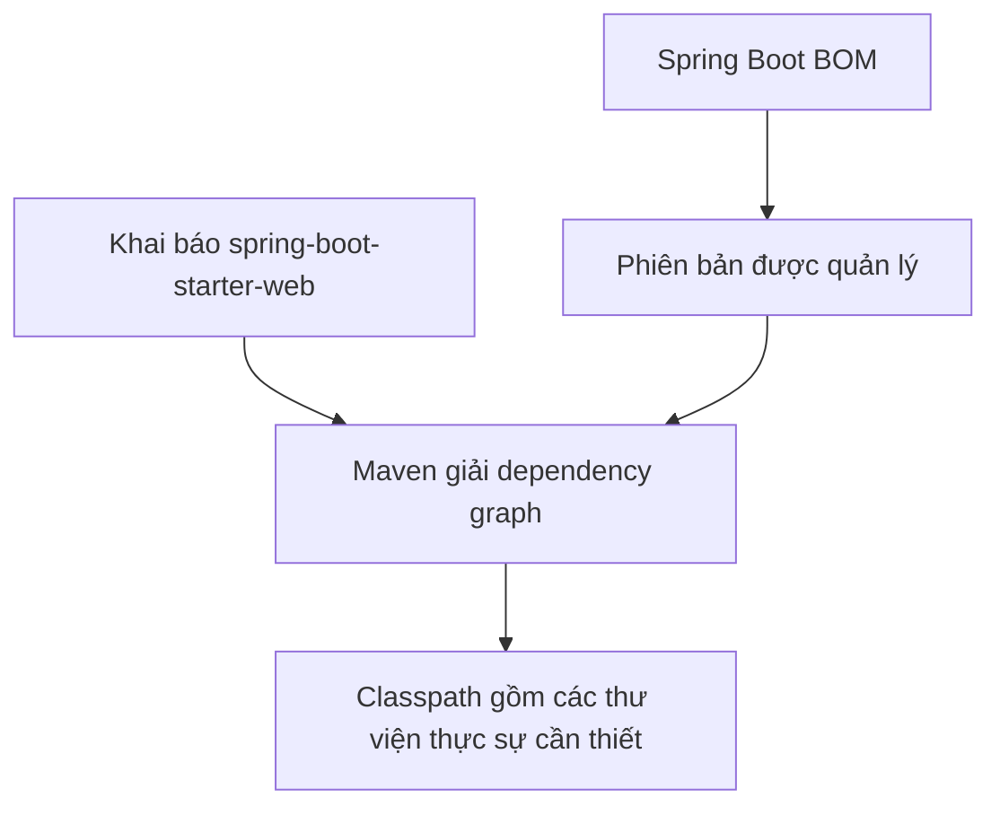
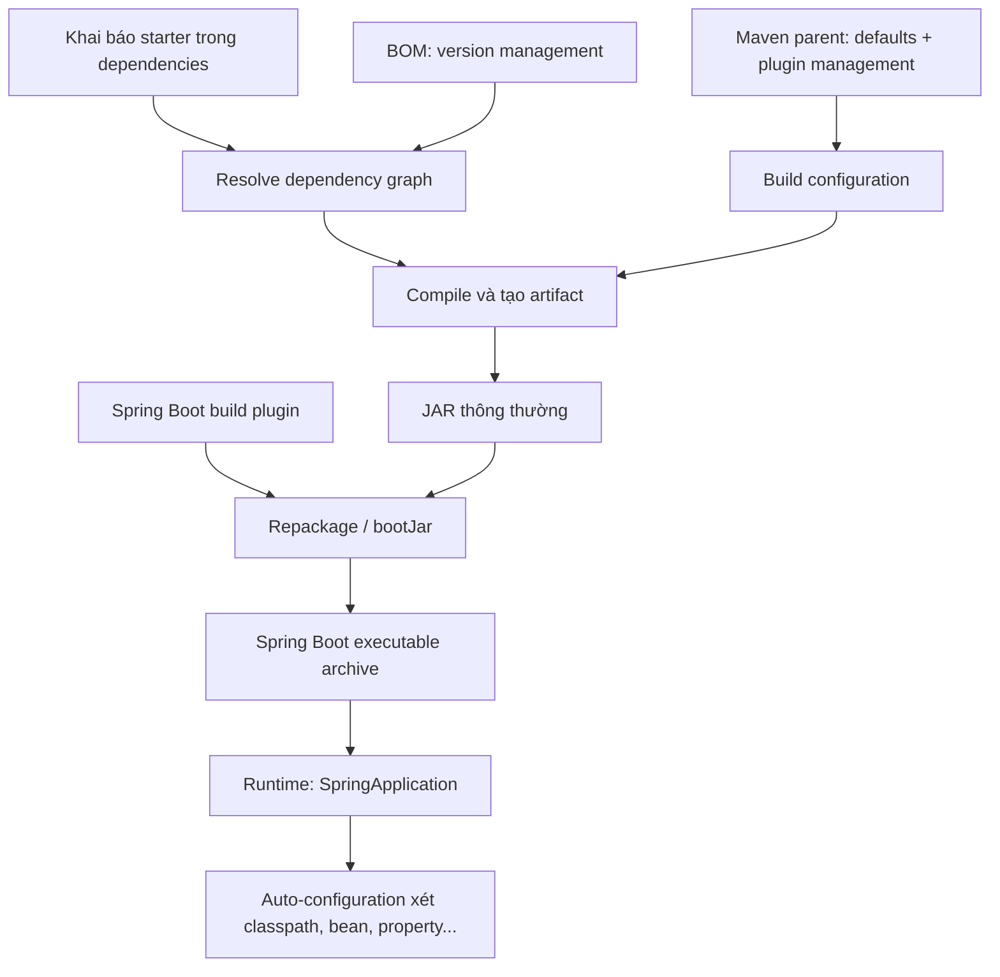

# Phân biệt BOM, Maven parent và Spring Boot build plugin

Khi mở một dự án Spring Boot, bạn dễ thấy ba thành phần đứng gần nhau trong `pom.xml` hoặc `build.gradle`: **BOM** (`spring-boot-dependencies`), **Maven parent** (`spring-boot-starter-parent`), và **Spring Boot build plugin** (`spring-boot-maven-plugin` hoặc Gradle plugin `org.springframework.boot`). Chúng có liên quan nhưng giải quyết ba việc khác nhau: **quản lý phiên bản dependency**, **kế thừa quy ước build**, và **chạy các thao tác build/đóng gói ứng dụng**.

Đây là kiến thức nền tảng trong chương *Dependency và starter*: hiểu starter giúp ta biết thư viện nào được đưa vào ứng dụng; hiểu BOM, parent và plugin giúp ta lý giải **phiên bản nào được chọn, Maven/Gradle chạy những gì, và tại sao JAR cuối cùng chạy được hoặc không chạy được**.

Bài sử dụng **Java 21**, **Spring Boot 3.3.5** và **Maven 3.9+** cho ví dụ. Phiên bản `3.3.5` được cố định để các mẫu cấu hình nhất quán, không nhằm khẳng định đây là phiên bản mới nhất. Khi thực hành trên dự án của bạn, hãy thay bằng phiên bản tương thích mà dự án đang dùng. Cuối bài có phần đối chiếu với Gradle.

## 1. Nhìn toàn cảnh trước khi đọc XML

| Thành phần | Vai trò chính | Nó có tự thêm starter vào project không? | Nó có tự tạo executable Boot JAR không? |
|---|---|---|---|
| Dependency, ví dụ `spring-boot-starter-web` | Đưa thư viện cần dùng và dependency bắc cầu vào project | Có, với dependency đã khai báo | Không |
| BOM `spring-boot-dependencies` | Quản lý phiên bản của nhiều dependency | Không | Không |
| Maven parent `spring-boot-starter-parent` | Kế thừa dependency management, properties, plugin management và quy ước build | Không tự thêm Spring Web hoặc JPA starter | Không tự đủ nếu plugin cần thiết chưa được sử dụng |
| Maven plugin `spring-boot-maven-plugin` | Tích hợp goal chạy, đóng gói lại, build image của Spring Boot vào Maven | Không | Có thể, khi goal `repackage` được thực thi |
| Gradle plugin `org.springframework.boot` | Bổ sung task Boot như `bootRun`, `bootJar` và tích hợp build khác | Không | Có thể, bằng task `bootJar` |

**Ba câu hỏi phải tách ra:**

1. *Ứng dụng cần thư viện nào?* — khai báo dependency, thường thông qua một hoặc nhiều starter.
2. *Phiên bản thư viện được quyết định ở đâu?* — khai báo trực tiếp, dependency management của Maven hoặc BOM/platform.
3. *Build artifact được thực hiện như thế nào?* — cấu hình Maven/Gradle và build plugin.

Một BOM có thể quản lý phiên bản của `spring-boot-starter-web` nhưng không tự làm ứng dụng có Spring MVC. Một Maven parent có thể cung cấp phiên bản cho Maven Compiler Plugin mà không bắt bạn dùng Spring Boot executable packaging. Một build plugin có thể tạo Boot JAR nhưng không tự cấp phiên bản cho mọi dependency.

## 2. BOM là gì? Vì sao Spring Boot cần BOM?

**BOM** viết tắt của *Bill of Materials*. Trong Maven, BOM thường là một POM có `packaging=pom`, chứa `dependencyManagement` với nhiều tọa độ dependency và các version khuyến nghị. Spring Boot phát hành BOM:

```text
org.springframework.boot:spring-boot-dependencies:3.3.5
```

BOM giúp các thư viện được Spring Boot quản lý sử dụng một tập phiên bản đã được lựa chọn và kiểm thử cùng nhau, thay vì để từng module tự chọn ngẫu nhiên từng version của Spring Framework, Jackson, logging, thư viện kiểm thử và những thành phần khác.

### 2.1. BOM quản lý phiên bản, không tự thêm dependency

Giả sử dự án import BOM và khai báo:

```xml
<dependencies>
    <dependency>
        <groupId>org.springframework.boot</groupId>
        <artifactId>spring-boot-starter-web</artifactId>
    </dependency>
</dependencies>
```

Maven có thể tìm phiên bản của `spring-boot-starter-web` từ dependency management đã import. Sau đó starter đưa vào dependency graph các thành phần phục vụ ứng dụng web theo thiết kế của starter và phiên bản Boot.

Nếu xóa toàn bộ block `spring-boot-starter-web` nhưng giữ BOM, dự án **không tự có** Spring Web. BOM giống một danh mục quản lý phiên bản; **dependency declaration** mới là yêu cầu thực sự đưa thư viện vào project.



### 2.2. Import BOM khi không kế thừa Spring Boot parent

Trong Maven POM, bạn có thể viết:

```xml
<properties>
    <spring-boot.version>3.3.5</spring-boot.version>
</properties>

<dependencyManagement>
    <dependencies>
        <dependency>
            <groupId>org.springframework.boot</groupId>
            <artifactId>spring-boot-dependencies</artifactId>
            <version>${spring-boot.version}</version>
            <type>pom</type>
            <scope>import</scope>
        </dependency>
    </dependencies>
</dependencyManagement>

<dependencies>
    <dependency>
        <groupId>org.springframework.boot</groupId>
        <artifactId>spring-boot-starter</artifactId>
    </dependency>
</dependencies>
```

Ở đây:

- `<type>pom</type>` chỉ loại artifact được nhập.
- `<scope>import</scope>` trong `dependencyManagement` yêu cầu Maven import thông tin quản lý dependency từ BOM. Đây không phải runtime scope của một thư viện.
- `<version>${spring-boot.version}</version>` chọn chính xác phiên bản BOM.
- `spring-boot-starter` trong `dependencies` mới là dependency được ứng dụng sử dụng. Nó có thể không ghi version vì đã được BOM quản lý.

Điều **không xảy ra** khi import BOM: Maven không tự thay đổi compiler target, không tự cấu hình test plugin, không tự thêm web starter, không tự buộc đóng gói executable JAR và không tự chọn version cho Spring Boot Maven Plugin.

### 2.3. Phạm vi và giới hạn của BOM

BOM chỉ quản lý những artifact có trong danh sách của nó. Một thư viện ngoài danh sách vẫn cần cách xác định version thích hợp. Version tường minh hoặc quy tắc dependency management cụ thể khác có thể tác động đến kết quả resolution của Maven. BOM không phải sự bảo đảm rằng mọi thư viện do ứng dụng tùy ý thêm vào sẽ tương thích.

Vì vậy, khi xem lỗi dependency, cần phân biệt: **thiếu dòng khai báo dependency**, **dependency không có version được quản lý**, và **xung đột dependency/version thực tế**. Đó là ba nguyên nhân khác nhau.

## 3. Maven parent là gì?

Maven cho phép một project **kế thừa cấu hình từ một parent POM**. Spring Boot có parent tiện lợi cho project ứng dụng:

```xml
<parent>
    <groupId>org.springframework.boot</groupId>
    <artifactId>spring-boot-starter-parent</artifactId>
    <version>3.3.5</version>
    <relativePath/>
</parent>
```

`<relativePath/>` rỗng yêu cầu Maven không tìm parent POM theo đường dẫn tương đối mặc định bên trong workspace; parent Spring Boot được resolve từ repository theo tọa độ artifact.

**Spring Boot starter parent bao gồm nhiều lợi ích hơn BOM**:

| Nhóm cấu hình parent cung cấp | Ý nghĩa |
|---|---|
| Dependency management | Kế thừa tập version dependency từ `spring-boot-dependencies`. |
| Properties mặc định | Những giá trị chung như encoding và mức Java mặc định của dòng Boot đang dùng. |
| Plugin management | Quản lý version và cấu hình cho những Maven build plugin phổ biến. |
| Resource filtering | Các quy ước xử lý resource thuận tiện cho cấu hình Spring. |
| Cấu hình Spring Boot plugin | Các cấu hình như execution `repackage` được quản lý để có thể sử dụng khi plugin được khai báo. |

Nhờ đó, một POM ứng dụng dùng parent thường ngắn và dễ bắt đầu hơn việc tự import BOM rồi tự điền từng Maven plugin.

### 3.1. Maven parent có phải một starter không?

Không. Dù tên chứa `starter-parent`, artifact này là **parent POM**, không phải dependency `spring-boot-starter`. Khai báo parent không đồng nghĩa đã thêm logging, web, JPA hay những thư viện khác vào classpath. Bạn vẫn phải khai báo dependency phù hợp:

```xml
<dependencies>
    <dependency>
        <groupId>org.springframework.boot</groupId>
        <artifactId>spring-boot-starter</artifactId>
    </dependency>
</dependencies>
```

### 3.2. Khi nào không thể dùng Spring Boot parent?

Trong Maven, một module chỉ có **một parent trực tiếp**. Nếu tổ chức đã yêu cầu mọi dự án kế thừa:

```xml
<parent>
    <groupId>com.acme.build</groupId>
    <artifactId>company-parent</artifactId>
    <version>1.0.0</version>
</parent>
```

thì bạn không thể khai báo thêm một `<parent>` trực tiếp thứ hai cho `spring-boot-starter-parent`. Lựa chọn phổ biến là **giữ company parent và import `spring-boot-dependencies` BOM** trong `dependencyManagement`; rồi tự cấu hình phần build chưa được parent tổ chức cung cấp.

Điều này cũng giải thích vì sao cách **BOM import** tồn tại song song với **starter parent**.

### 3.3. Parent có tự chạy repackage không?

Parent cung cấp **plugin management** và cấu hình kế thừa. Điều đó khác với việc kích hoạt plugin trong `build/plugins`. Theo cấu hình thông dụng của Spring Boot parent, khi project khai báo `spring-boot-maven-plugin` trong `<build><plugins>`, cấu hình và execution `repackage` từ parent có thể được áp dụng vào lifecycle.

Nếu chỉ có parent mà không thực sự sử dụng plugin, project không nên mặc nhiên được coi là sẽ tạo executable Spring Boot JAR.

## 4. Spring Boot build plugin là gì?

Build plugin là một thành phần của **công cụ build**. Nó thực hiện những việc như chạy ứng dụng lúc phát triển, tổ chức artifact, tạo metadata build hoặc xây dựng container image. Đây **không phải dependency phục vụ nghiệp vụ tại runtime**.

Với Maven, tên plugin là:

```text
org.springframework.boot:spring-boot-maven-plugin:3.3.5
```

Một số goal thường gặp:

| Maven goal | Trách nhiệm |
|---|---|
| `spring-boot:run` | Chạy ứng dụng trong quá trình phát triển thông qua Maven. |
| `spring-boot:repackage` | Đóng gói lại JAR/WAR ứng dụng theo bố cục executable của Boot. |
| `spring-boot:build-image` | Tạo OCI image khi dự án và môi trường đáp ứng yêu cầu. |
| `spring-boot:build-info` | Sinh thông tin build metadata nếu cần. |

Plugin không giải quyết vấn đề “version của `spring-boot-starter-web` lấy từ đâu?”. Đó là trách nhiệm của dependency declaration cùng dependency management.

### 4.1. Vì sao cần `repackage`?

Maven JAR thông thường thường chứa class và resource của chính module, còn nhiều dependency ở ngoài. Một JAR thông thường không nhất thiết có manifest chứa entry point và classpath layout đủ để chạy độc lập.

Spring Boot executable JAR phổ biến có cấu trúc khái quát:

```text
demo-0.0.1-SNAPSHOT.jar
├── META-INF/MANIFEST.MF
├── BOOT-INF/
│   ├── classes/            # Class và resource của ứng dụng
│   └── lib/                # Các JAR dependency cho runtime
└── org/springframework/boot/loader/...
```

Goal `repackage` tổ chức lại artifact và thiết lập entry point phù hợp để có thể gọi:

```bash
java -jar target/demo-0.0.1-SNAPSHOT.jar
```

Không phải **mọi** module đều cần repackage: một library JAR được module khác dùng làm dependency thường nên giữ kiểu đóng gói thư viện thông thường.

### 4.2. Phân biệt `plugins` và `pluginManagement`

Trong Maven:

| Cấu hình | Tác dụng |
|---|---|
| `<build><pluginManagement>` | Đặt default version/configuration cho plugin khi được dùng. |
| `<build><plugins>` | Khai báo plugin được sử dụng trong build. |
| `<executions>` | Định nghĩa các goal và liên kết với phase phù hợp của Maven lifecycle. |

Một tên plugin chỉ xuất hiện trong `pluginManagement` không có nghĩa `mvn package` nhất định chạy goal của plugin. Ngoài ra, việc khai báo plugin trong `build/plugins` không tự bảo đảm goal `repackage` được gắn vào phase `package` nếu không có execution được kế thừa hoặc khai báo.

## 5. Cấu hình Maven A: dùng Spring Boot parent

Đây là dạng cấu hình thường được Spring Initializr sinh ra cho Maven application.

```xml
<?xml version="1.0" encoding="UTF-8"?>
<project xmlns="http://maven.apache.org/POM/4.0.0"
         xmlns:xsi="http://www.w3.org/2001/XMLSchema-instance"
         xsi:schemaLocation="http://maven.apache.org/POM/4.0.0
         https://maven.apache.org/xsd/maven-4.0.0.xsd">
    <modelVersion>4.0.0</modelVersion>

    <parent>
        <groupId>org.springframework.boot</groupId>
        <artifactId>spring-boot-starter-parent</artifactId>
        <version>3.3.5</version>
        <relativePath/>
    </parent>

    <groupId>com.example</groupId>
    <artifactId>demo</artifactId>
    <version>0.0.1-SNAPSHOT</version>

    <properties>
        <java.version>21</java.version>
    </properties>

    <dependencies>
        <dependency>
            <groupId>org.springframework.boot</groupId>
            <artifactId>spring-boot-starter</artifactId>
        </dependency>
    </dependencies>

    <build>
        <plugins>
            <plugin>
                <groupId>org.springframework.boot</groupId>
                <artifactId>spring-boot-maven-plugin</artifactId>
            </plugin>
        </plugins>
    </build>
</project>
```

Để ứng dụng có entry point, tạo `src/main/java/com/example/demo/DemoApplication.java`:

```java
package com.example.demo;

import org.springframework.boot.SpringApplication;
import org.springframework.boot.autoconfigure.SpringBootApplication;

@SpringBootApplication
public class DemoApplication {
    public static void main(String[] args) {
        SpringApplication.run(DemoApplication.class, args);
    }
}
```

Chạy qua Maven:

```bash
mvn spring-boot:run
mvn package
java -jar target/demo-0.0.1-SNAPSHOT.jar
```

Trong project này không có web starter hoặc runner giữ tiến trình, vì vậy ứng dụng có thể khởi động xong rồi thoát bình thường. Việc thoát không chứng minh build lỗi.

Phân tích POM:

- Parent quyết định tập dependency management và một số build defaults; thuộc tính `java.version` đặt mục tiêu Java 21.
- `spring-boot-starter` được thêm như dependency thực tế, version do parent/BOM quản lý.
- `spring-boot-maven-plugin` tham gia build; version và cấu hình `repackage` được quản lý bởi parent trong trường hợp này.

Nếu bỏ plugin mà giữ parent và dependency, ứng dụng vẫn có thể biên dịch nhưng JAR xuất ra sẽ thường là JAR thông thường. Nếu bỏ dependency nhưng giữ parent và plugin, class main có thể không biên dịch vì thiếu class Spring Boot. Hai thí nghiệm cho thấy parent và plugin không thay thế dependency của ứng dụng.

## 6. Cấu hình Maven B: không dùng Spring Boot parent

Trường hợp tổ chức đã có Maven parent riêng hoặc muốn chủ động kiểm soát cấu hình build, có thể **import BOM và tự cấu hình các build plugin**. POM sau minh họa project độc lập, không cần parent Spring Boot:

```xml
<?xml version="1.0" encoding="UTF-8"?>
<project xmlns="http://maven.apache.org/POM/4.0.0"
         xmlns:xsi="http://www.w3.org/2001/XMLSchema-instance"
         xsi:schemaLocation="http://maven.apache.org/POM/4.0.0
         https://maven.apache.org/xsd/maven-4.0.0.xsd">
    <modelVersion>4.0.0</modelVersion>

    <groupId>com.example</groupId>
    <artifactId>demo</artifactId>
    <version>0.0.1-SNAPSHOT</version>

    <properties>
        <spring-boot.version>3.3.5</spring-boot.version>
        <maven.compiler.release>21</maven.compiler.release>
        <project.build.sourceEncoding>UTF-8</project.build.sourceEncoding>
    </properties>

    <dependencyManagement>
        <dependencies>
            <dependency>
                <groupId>org.springframework.boot</groupId>
                <artifactId>spring-boot-dependencies</artifactId>
                <version>${spring-boot.version}</version>
                <type>pom</type>
                <scope>import</scope>
            </dependency>
        </dependencies>
    </dependencyManagement>

    <dependencies>
        <dependency>
            <groupId>org.springframework.boot</groupId>
            <artifactId>spring-boot-starter</artifactId>
        </dependency>
    </dependencies>

    <build>
        <plugins>
            <plugin>
                <groupId>org.apache.maven.plugins</groupId>
                <artifactId>maven-compiler-plugin</artifactId>
                <version>3.13.0</version>
                <configuration>
                    <release>${maven.compiler.release}</release>
                </configuration>
            </plugin>

            <plugin>
                <groupId>org.springframework.boot</groupId>
                <artifactId>spring-boot-maven-plugin</artifactId>
                <version>${spring-boot.version}</version>
                <executions>
                    <execution>
                        <goals>
                            <goal>repackage</goal>
                        </goals>
                    </execution>
                </executions>
            </plugin>
        </plugins>
    </build>
</project>
```

Giữ cùng `DemoApplication.java` như phần trước, bạn có thể gọi:

```bash
mvn package
java -jar target/demo-0.0.1-SNAPSHOT.jar
```

Những điểm cần nhận ra:

1. `spring-boot-dependencies` BOM là **nguồn quản lý phiên bản starter**; nó không tự cấu hình plugin.
2. Maven Compiler Plugin được chỉ rõ version và `release` để build với Java 21.
3. Spring Boot Maven Plugin có version tường minh vì không nhận cấu hình từ Spring Boot parent.
4. `<goal>repackage</goal>` được khai báo trong execution để goal tham gia lifecycle khi chạy `mvn package`.

Với dự án dùng `company-parent`, bạn thường giữ parent đó rồi thêm `dependencyManagement` import Spring Boot BOM vào POM con. Cần kiểm tra cấu hình compiler/plugin hiện có do company parent cung cấp để chỉ bổ sung những phần thật sự thiếu.

### 6.1. Điểm khác khi override phiên bản

Khi **kế thừa** Spring Boot starter parent, một số thuộc tính phiên bản do parent cung cấp có thể được tùy biến theo cơ chế properties của parent.

Khi **import** BOM, các property tự đặt trong POM con **không tự sửa các property đã được tính bên trong BOM được import**. Nếu cần override một dependency được BOM quản lý, dùng quy tắc dependency management trực tiếp hoặc cách quản lý version được tổ chức chấp thuận.

Ví dụ cấu trúc minh họa:

```xml
<dependencyManagement>
    <dependencies>
        <dependency>
            <groupId>com.example</groupId>
            <artifactId>sample-library</artifactId>
            <version>2.4.0</version>
        </dependency>
        <dependency>
            <groupId>org.springframework.boot</groupId>
            <artifactId>spring-boot-dependencies</artifactId>
            <version>${spring-boot.version}</version>
            <type>pom</type>
            <scope>import</scope>
        </dependency>
    </dependencies>
</dependencyManagement>
```

`com.example:sample-library` chỉ là tọa độ giả định minh họa một mục quản lý dependency trực tiếp. Với một dependency thực tế do Boot quản lý, cần dùng đúng group/artifact và đánh giá tính tương thích trước khi override. Trong Maven, khai báo quản lý dependency trực tiếp ở POM hiện tại có độ ưu tiên thích hợp so với mục được import từ BOM.

## 7. Hai trường hợp thiếu thành phần và lỗi kết quả

### 7.1. Có BOM nhưng không có Spring Boot build plugin

Nếu project import BOM, khai báo `spring-boot-starter`, và được cấu hình compiler phù hợp nhưng **không dùng plugin repackage**, Maven vẫn có thể giải dependency và biên dịch. Tuy nhiên `mvn package` thông thường sẽ tạo JAR theo cơ chế Maven chuẩn, không tự tạo executable Spring Boot JAR.

Khi chạy:

```bash
java -jar target/demo-0.0.1-SNAPSHOT.jar
```

bạn có thể gặp lỗi manifest entry point hoặc thiếu class từ runtime dependencies, tùy cấu hình packaging khác. Hướng xử lý nằm ở **plugin/đóng gói**, không phải việc sửa BOM.

Đây có thể là **thiết kế đúng** đối với library module: module thư viện cần JAR thông thường để module khác tham chiếu, không cần đóng gói lại toàn bộ runtime như ứng dụng có điểm khởi động độc lập.

### 7.2. Có Spring Boot plugin nhưng không có BOM/parent

Một project chỉ khai báo Spring Boot Maven Plugin rồi thêm dependency:

```xml
<dependency>
    <groupId>org.springframework.boot</groupId>
    <artifactId>spring-boot-starter-web</artifactId>
</dependency>
```

mà **không có bất kỳ dependency management phù hợp nào** có thể gặp lỗi Maven kiểu:

```text
'dependencies.dependency.version' for
org.springframework.boot:spring-boot-starter-web:jar is missing.
```

Plugin không tự cung cấp version cho starter. Cách đúng là cung cấp một nguồn quản lý version phù hợp (parent/BOM hoặc version tường minh) và khai báo plugin cho mục tiêu build cần dùng.

### 7.3. Có parent nhưng chưa kích hoạt plugin

Parent hỗ trợ quản lý version và cấu hình build, nhưng nếu `spring-boot-maven-plugin` chưa thực sự tham gia `build/plugins`, bạn không nên mặc định rằng `mvn package` đã chạy `repackage`. Đọc effective POM và kiểm tra kết quả JAR để biết cấu hình cuối cùng.

## 8. Maven `dependencyManagement` khác `pluginManagement` ra sao?

| | `dependencyManagement` | `pluginManagement` |
|---|---|---|
| Quản lý thứ gì? | Các thư viện dự án sử dụng | Maven plugin phục vụ quy trình build |
| Ví dụ | `spring-boot-starter-web`, `jackson-databind` | `maven-compiler-plugin`, `spring-boot-maven-plugin` |
| Có tự thêm đối tượng vào sử dụng? | Không; phải có khai báo dependency hoặc đường dẫn phụ thuộc phù hợp | Không; plugin/goal cần tham gia build |
| Spring Boot BOM import cung cấp? | Có | Không |
| Spring Boot starter parent cung cấp? | Có | Có |

Ví dụ plugin management:

```xml
<build>
    <pluginManagement>
        <plugins>
            <plugin>
                <groupId>org.springframework.boot</groupId>
                <artifactId>spring-boot-maven-plugin</artifactId>
                <version>3.3.5</version>
            </plugin>
        </plugins>
    </pluginManagement>
</build>
```

Block này chỉ định cách quản lý plugin khi được dùng; nó **không tự yêu cầu `repackage` phải chạy**. Với mục tiêu đóng gói Boot executable JAR, hãy kiểm tra cả khai báo plugin và execution thực tế.

## 9. Đối chiếu với Gradle: khái niệm tương đương, cú pháp khác

Gradle **không có Maven parent POM**. Trong Gradle, bạn thường kết hợp:

1. Java plugin và `org.springframework.boot` Gradle plugin để có task build/run/bootJar.
2. Cơ chế dependency version management, ví dụ Spring Dependency Management plugin hoặc Gradle platform.
3. Các dependency starter thực sự trong block `dependencies`.

### 9.1. Gradle plugin `org.springframework.boot`

Plugin này hỗ trợ các task như:

| Task | Chức năng |
|---|---|
| `bootRun` | Chạy ứng dụng Spring Boot khi phát triển. |
| `bootJar` | Tạo executable Boot JAR. |
| `bootWar` | Tạo executable Boot WAR khi dùng war plugin và cấu hình thích hợp. |
| `bootBuildImage` | Tạo OCI image khi được cấu hình và có môi trường cần thiết. |

Build plugin **không tự thay thế khai báo dependency**. Bạn vẫn phải thêm starter phù hợp.

### 9.2. Cách 1: dùng Spring Dependency Management plugin

`build.gradle`:

```groovy
plugins {
    id 'java'
    id 'org.springframework.boot' version '3.3.5'
    id 'io.spring.dependency-management' version '1.1.6'
}

group = 'com.example'
version = '0.0.1-SNAPSHOT'

java {
    toolchain {
        languageVersion = JavaLanguageVersion.of(21)
    }
}

repositories {
    mavenCentral()
}

dependencies {
    implementation 'org.springframework.boot:spring-boot-starter'
    testImplementation 'org.springframework.boot:spring-boot-starter-test'
}

tasks.named('test') {
    useJUnitPlatform()
}
```

Với các phiên bản tương thích trong ví dụ, khi đồng thời áp dụng Spring Boot Gradle Plugin và `io.spring.dependency-management`, Boot plugin tự import `spring-boot-dependencies` BOM tương ứng với phiên bản plugin Boot. Nhờ đó `spring-boot-starter` và `spring-boot-starter-test` có thể không ghi version trực tiếp.

**Ai làm việc gì?** `org.springframework.boot` cung cấp task và cơ chế đóng gói; dependency management/BOM quản lý version; block `dependencies` thêm thư viện.

### 9.3. Cách 2: dùng native Gradle platform

Gradle hỗ trợ nhập BOM qua `platform(...)` mà không bắt buộc áp dụng `io.spring.dependency-management`:

```groovy
plugins {
    id 'java'
    id 'org.springframework.boot' version '3.3.5'
}

group = 'com.example'
version = '0.0.1-SNAPSHOT'

java {
    toolchain {
        languageVersion = JavaLanguageVersion.of(21)
    }
}

repositories {
    mavenCentral()
}

dependencies {
    implementation platform('org.springframework.boot:spring-boot-dependencies:3.3.5')
    implementation 'org.springframework.boot:spring-boot-starter'

    testImplementation platform('org.springframework.boot:spring-boot-dependencies:3.3.5')
    testImplementation 'org.springframework.boot:spring-boot-starter-test'
}

tasks.named('test') {
    useJUnitPlatform()
}
```

Trong biến thể này, `platform(...)` áp dụng các ràng buộc phiên bản BOM vào configuration liên quan. Ví dụ khai báo cho cả `implementation` và `testImplementation` để những dependency không ghi version có nguồn version tại configuration tương ứng. Với Gradle, phạm vi áp dụng platform và cách chọn version có các quy tắc riêng; hãy xem dependency graph khi cần xác định phiên bản thực tế.

Điều cần nhớ: **áp dụng Spring Boot Gradle plugin không đồng nghĩa mọi dependency đều đã được quản lý phiên bản**. Bạn vẫn cần một cơ chế version management đúng.

### 9.4. Các lệnh Maven và Gradle tương ứng

| Ý định | Maven | Gradle |
|---|---|---|
| Chạy ứng dụng | `mvn spring-boot:run` | `./gradlew bootRun` |
| Build project | `mvn package` | `./gradlew build` |
| Đóng gói Boot executable | `spring-boot:repackage` | `bootJar` |
| Xem dependencies | `mvn dependency:tree` | `./gradlew dependencies` |
| Xem lý do chọn version | Dependency tree/effective POM | `dependencyInsight` |

Trên Windows PowerShell, Gradle Wrapper thường gọi bằng `.\gradlew.bat`. Việc dùng wrapper giúp dự án quyết định phiên bản Gradle một cách nhất quán.

## 10. BOM, parent và plugin liên quan runtime auto-configuration thế nào?

Ba cơ chế của bài này chủ yếu làm việc ở **build time**:



**BOM không chạy lúc application khởi động.** Nó đã ảnh hưởng gián tiếp bằng cách quyết định phiên bản những thư viện được resolve từ trước. **Spring Boot build plugin cũng không phải cơ chế tự cấu hình runtime**; nó giúp build và đóng gói ứng dụng.

Khi thực sự chạy `SpringApplication`, Spring Boot quan sát runtime classpath, các property và bean, rồi xét điều kiện để áp dụng các auto-configuration thích hợp. Ví dụ, thêm `spring-boot-starter-web` có thể làm xuất hiện những class cần cho servlet web auto-configuration. Đây là tác động gián tiếp của dependency graph tới runtime, không phải BOM hay Maven plugin tự tạo bean.

## 11. Xác minh trong project thực tế bằng chứng cứ

### 11.1. Kiểm tra Maven effective POM

```bash
mvn help:effective-pom -Doutput=effective-pom.xml
```

Effective POM cho thấy cấu hình cuối cùng sau parent inheritance, profile và các thiết lập Maven liên quan. Hãy tìm `dependencyManagement`, `pluginManagement` và `build/plugins`.

Khi thấy một dependency có version được quản lý, hỏi **version này xuất phát từ parent hay BOM import?** Khi thấy plugin được quản lý, hỏi **nó có được sử dụng và có goal gắn vào lifecycle chưa?**

### 11.2. Kiểm tra dependency graph

```bash
mvn dependency:tree
```

Lệnh này cho biết version cuối cùng của dependency đã được Maven resolve. Với một dependency cụ thể, có thể sử dụng bộ lọc `-Dincludes=groupId:artifactId` theo cú pháp của Maven Dependency Plugin.

Với Gradle:

```bash
./gradlew dependencies --configuration runtimeClasspath
./gradlew dependencyInsight --dependency spring-core --configuration runtimeClasspath
```

`dependencies` liệt kê graph theo configuration; `dependencyInsight` giúp điều tra vì sao phiên bản nào đó được lựa chọn.

### 11.3. Kiểm tra JAR có phải Boot executable không

Trong project Maven:

```bash
mvn package
jar tf target/demo-0.0.1-SNAPSHOT.jar
java -jar target/demo-0.0.1-SNAPSHOT.jar
```

Với Boot executable JAR điển hình, danh sách entry có `BOOT-INF/classes/` và `BOOT-INF/lib/`, cùng launcher/manifest của Boot. Nếu JAR không có bố cục này, hãy xem `repackage` có được thực thi hay không, trước khi thay đổi dependency versions.

Trong project Gradle có Boot plugin và Java plugin, task `bootJar` là điểm cần kiểm tra để tạo executable JAR.

## 12. Những nhận định dễ nhầm và cách hiểu đúng

| Nhận định dễ nhầm | Cách hiểu đúng |
|---|---|
| “Import BOM là đã thêm Spring MVC.” | BOM quản lý version; cần dependency như `spring-boot-starter-web` để có thư viện web. |
| “Đã dùng starter parent thì không phải khai báo starter nữa.” | Parent quản lý build và versions; dependency vẫn phải được thêm phù hợp. |
| “BOM và starter parent giống nhau.” | Parent bổ sung properties, plugin management và build defaults bên cạnh dependency management. |
| “Plugin Spring Boot quản lý version cho mọi starter.” | Plugin phục vụ build; parent/BOM hoặc cơ chế khác mới quản lý dependency versions. |
| “Khai báo plugin trong `pluginManagement` thì `repackage` tự chạy.” | Cần plugin/goal thực sự tham gia lifecycle. |
| “Có Maven parent là ra executable JAR ngay.” | Phải có cấu hình sử dụng Boot plugin và execution tương ứng. |
| “Mọi module đều cần Boot executable JAR.” | Library module thường cần JAR thông thường. |
| “Gradle cần `spring-boot-starter-parent`.” | Gradle dùng plugin và platform/dependency management; không dùng Maven parent. |
| “BOM thực hiện auto-configuration.” | Auto-configuration thuộc cơ chế runtime; BOM chỉ ảnh hưởng version dependency lúc build. |
| “Dùng BOM thì mọi thư viện tương thích.” | BOM quản lý một tập dependency nhất định; những thay đổi/version override vẫn phải kiểm tra. |

## 13. Bốn tình huống chẩn đoán

### Tình huống A — Maven báo thiếu version

POM khai báo:

```xml
<dependency>
    <groupId>org.springframework.boot</groupId>
    <artifactId>spring-boot-starter-web</artifactId>
</dependency>
```

nhưng project không có parent hay BOM nào quản lý dependency đó. Lỗi thường gặp:

```text
'dependencies.dependency.version' for
org.springframework.boot:spring-boot-starter-web:jar is missing.
```

**Nguyên nhân:** Maven không tìm được version. Cách khắc phục nằm ở dependency management hoặc version tường minh, không phải ở việc thêm goal `repackage`.

### Tình huống B — Build pass nhưng `java -jar` thất bại

Project có BOM và starter, nhưng artifact là JAR thông thường, thiếu manifest phù hợp hoặc thiếu runtime dependency layout.

**Nguyên nhân cần xem:** quá trình packaging có dùng Spring Boot Maven Plugin `repackage`/Gradle `bootJar` không? Đây chủ yếu là vấn đề build artifact, không phải BOM.

### Tình huống C — Công ty bắt buộc dùng parent riêng

Project đang kế thừa `company-parent`. **Giữ parent đó**, import Spring Boot BOM vào dependency management, rồi xem compiler/plugin và các execution đã được company parent cấu hình tới đâu. Sử dụng effective POM để tránh khai báo plugin trùng hoặc ghi đè cấu hình không cần thiết.

### Tình huống D — Gradle có Boot plugin nhưng starter thiếu version

Project khai báo plugin `org.springframework.boot` và dependency `org.springframework.boot:spring-boot-starter-web` không có version nhưng chưa cấu hình dependency management/platform phù hợp.

**Nguyên nhân:** thiếu cơ chế chọn dependency versions. Thêm Spring Dependency Management plugin tương thích hoặc import BOM bằng Gradle platform.

## 14. Chọn cách cấu hình theo loại project

| Bối cảnh | Cách triển khai thường hợp lý | Mục đích |
|---|---|---|
| Maven application Spring Boot mới | Starter parent + starter dependency + Boot Maven plugin | Ít XML, dựa vào các defaults do Boot cung cấp. |
| Maven project có company parent | Giữ company parent + import Boot BOM + cấu hình plugin nếu cần | Không làm mất quy ước build của tổ chức. |
| Maven library module dùng Spring | Dependency management phù hợp; không bắt buộc repackage | Tạo artifact thư viện để module khác dùng. |
| Gradle Boot application | Boot Gradle plugin + dependency management hoặc platform + starter | Dùng cơ chế native của Gradle. |
| Repository nhiều module | Quản lý version và plugin tập trung, chỉ áp dụng Boot packaging cho module chạy | Tránh nhân bản cấu hình và đóng gói sai kiểu module. |

Không có một cấu hình bắt buộc cho mọi dự án. Điều phải nhất quán là **source of truth cho version**, **dependency nào được thêm**, và **module nào thật sự cần executable archive**.

## 15. Bài thực hành: thay một mảnh ghép và dự đoán kết quả

Dùng POM ở mục 5 làm chuẩn, thực hiện từng biến thể độc lập:

1. **Giữ parent + starter, bỏ Boot Maven plugin.** Dự đoán Maven chọn version dependency từ đâu và artifact được đóng gói theo cơ chế nào.
2. **Giữ parent + plugin, bỏ starter.** Dự đoán chuyện gì xảy ra khi class `DemoApplication` import `SpringApplication` nhưng classpath thiếu dependency cần thiết.
3. **Đổi từ parent sang BOM import, giữ starter.** Tự liệt kê phần compiler/plugin config cần khai báo khi không còn parent Boot.
4. **Giữ BOM và plugin nhưng không khai báo `repackage` execution.** Xem `mvn package` có chạy goal thông qua cấu hình được kế thừa nào khác hay không; nếu không, dự đoán JAR cuối.
5. **Chuyển module thành library.** Giải thích vì sao vẫn cần dependency management, nhưng không nhất thiết cần tạo executable Boot JAR.

Với mỗi tình huống, trả lời theo mẫu:

> Dependency nào được khai báo? Version được lấy từ đâu? Goal/task nào đóng gói artifact? Artifact cuối cần dùng để chạy độc lập hay làm thư viện?

### Câu hỏi tự đánh giá

1. Tại sao import BOM cho phép bỏ `<version>` ở nhiều dependency nhưng không cho phép bỏ chính khai báo dependency?
2. `spring-boot-starter-parent` cung cấp thêm gì so với `spring-boot-dependencies`?
3. Vì sao một project Maven chỉ có một parent trực tiếp và khi nào nên import BOM thay vì dùng starter parent?
4. Vì sao `spring-boot-maven-plugin` có thể tạo executable JAR nhưng không tự cung cấp version cho `spring-boot-starter-web`?
5. Khác biệt giữa `dependencyManagement` và `pluginManagement` là gì?
6. Vì sao `org.springframework.boot` Gradle plugin và Gradle `platform(...)` là hai cơ chế cần phân biệt?
7. Nếu Java application biên dịch được nhưng JAR không chạy bằng `java -jar`, bạn sẽ điều tra nhóm cấu hình nào trước?
8. BOM, starter và auto-configuration liên quan với nhau nhưng hoạt động ở những giai đoạn nào khác nhau?

### Một lời giải thích mẫu trong code review

> Ứng dụng này dùng Spring Boot BOM để quản lý phiên bản dependency, vì Maven module đang kế thừa parent chung của công ty nên không dùng trực tiếp `spring-boot-starter-parent`. Starter vẫn được khai báo riêng trong `dependencies` để đưa thư viện vào classpath. Spring Boot Maven Plugin được cấu hình với goal `repackage` để tạo executable JAR có thể chạy bằng `java -jar`. Compiler và các Maven plugin được quản lý thông qua company parent hoặc cấu hình build của module. Tách ba trách nhiệm này giúp kiểm tra lỗi version và lỗi packaging đúng nơi.

Khi bạn tự giải thích được sự khác nhau giữa **dependency/starter**, **BOM quản lý version**, **Maven parent kế thừa quy ước** và **Spring Boot build plugin thực thi build**, bạn có thể đọc một `pom.xml` hay `build.gradle` của dự án Spring Boot mà không đánh đồng bước chọn thư viện với bước đóng gói ứng dụng.
