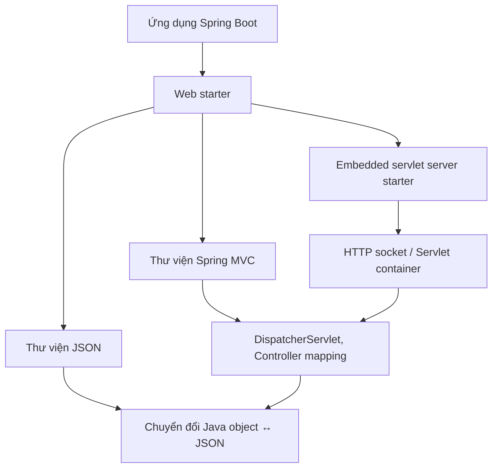
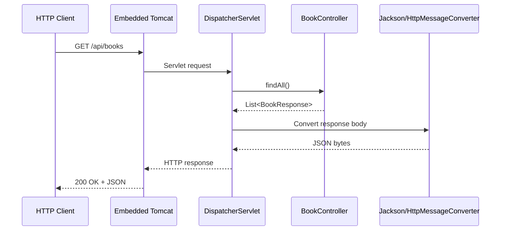

# Starter chức năng, thư viện thực thi và embedded server

> **Spring Boot Fundamentals · Dependency và starter**  
> Spring Boot giúp tạo ứng dụng web hoặc API chỉ với một số dependency. Đằng sau sự thuận tiện ấy có ba thành phần cần phân biệt: **starter chức năng** giúp tập hợp dependency, **thư viện thực thi** chứa mã thực hiện tính năng, và **embedded server** xử lý kết nối mạng khi ứng dụng web chạy. Hiểu mối liên hệ giữa chúng giúp chọn đúng dependency, giải thích cách Spring Boot khởi động và biết phải sửa gì khi đổi HTTP server hoặc gặp lỗi runtime.

## 1. Ba lớp vai trò trong một ứng dụng Spring Boot

Giả sử chúng ta muốn viết API cung cấp `GET /api/books`. Với Maven, nhiều dự án chỉ khai báo:

```xml
<dependency>
    <groupId>org.springframework.boot</groupId>
    <artifactId>spring-boot-starter-web</artifactId>
</dependency>
```

Với Gradle Groovy DSL:

```groovy
dependencies {
    implementation 'org.springframework.boot:spring-boot-starter-web'
}
```

Trong một ứng dụng **Spring Boot 3.x dùng Spring MVC/Servlet**, starter web này đưa vào một nhóm dependency cần thiết. Nhưng starter không phải một thư viện khổng lồ tự viết lại tất cả chức năng web. Nó tập hợp các dependency được chọn để cùng hoạt động.

| Thành phần | Nó làm gì? | Ví dụ trong ứng dụng web |
| --- | --- | --- |
| **Starter chức năng** | Tập hợp các dependency phù hợp cho một nhu cầu và cho build tool biết nên resolve những thư viện nào | `spring-boot-starter-web` |
| **Thư viện thực thi** | Chứa code xử lý chức năng thực tế: annotation, MVC, JSON, logging, JDBC, v.v. | `spring-webmvc`, `spring-web`, Jackson |
| **Embedded server** | Mở cổng mạng và tiếp nhận kết nối HTTP, triển khai hạ tầng xử lý request theo mô hình server tương ứng | Embedded Tomcat trong servlet web stack thông dụng |

Ví dụ về cách phối hợp:



Đây là sơ đồ khái niệm. Dependency graph chính xác tùy vào **phiên bản Spring Boot**, các exclusions và dependency management của dự án. Tên starter và cách đóng gói tính năng có thể thay đổi qua các phiên bản lớn, nên những ví dụ dưới đây chỉ định bối cảnh **Spring Boot 3.x** khi cần tên artifact cụ thể.

### 1.1. Vì sao phải tách ba khái niệm?

Vì chúng trả lời ba câu hỏi khác nhau:

1. **Tôi muốn phát triển tính năng nào?** Chọn starter hoặc nhóm dependency tương ứng.
2. **Code nào thực sự cung cấp tính năng ấy?** Xem các thư viện được resolve và bean/hạ tầng được tạo.
3. **Ai tiếp nhận HTTP request ngoài mạng?** Embedded server phù hợp hoặc servlet container được triển khai bên ngoài.

Nếu nhầm các khái niệm, ta dễ thử sai. Ví dụ, chỉ thêm một thư viện JSON không tự tạo HTTP server; thêm embedded Tomcat không tự tạo controller; thêm starter web cũng không đồng nghĩa Spring Boot đã biết URL và nghiệp vụ của API mà lập trình viên muốn cung cấp.

## 2. Starter chức năng thực chất là gì?

Một **Spring Boot starter** là dependency được tạo để giúp ứng dụng khai báo một nhu cầu kỹ thuật ở mức cao: “tôi cần web”, “tôi cần JPA”, “tôi cần test”, “tôi cần security”, v.v.

Các starter phổ biến trong hệ sinh thái Spring Boot 3.x:

| Starter | Nhu cầu | Những thành phần thường được đưa vào hoặc tích hợp |
| --- | --- | --- |
| `spring-boot-starter-web` | REST API hoặc ứng dụng Spring MVC | Spring MVC, JSON support, servlet web stack, embedded Tomcat mặc định |
| `spring-boot-starter-webflux` | Web stack reactive | Spring WebFlux và hạ tầng reactive HTTP, thường với Reactor Netty |
| `spring-boot-starter-data-jpa` | Persistence với JPA | Spring Data JPA, JPA provider như Hibernate và phần tích hợp cần thiết |
| `spring-boot-starter-jdbc` | Truy cập dữ liệu bằng JDBC | Spring JDBC, transaction support, cơ chế DataSource tích hợp |
| `spring-boot-starter-security` | Tích hợp Spring Security | Spring Security và cấu hình bảo mật mặc định có điều kiện |
| `spring-boot-starter-validation` | Bean Validation | Jakarta Validation và implementation thích hợp |
| `spring-boot-starter-test` | Viết test ứng dụng | Các thư viện test được chọn và hỗ trợ Spring Boot Test |
| `spring-boot-starter-actuator` | Quan sát và vận hành ứng dụng | Health, metrics, thông tin vận hành và cơ chế endpoint phù hợp |

**Không phải mọi starter đều có server.** Starter JDBC, Validation hoặc Test không cần mở một cổng HTTP. Ngay cả một ứng dụng có Spring Boot cũng không bắt buộc phải là ứng dụng web.

Cũng không phải starter nào tự hoàn thành cấu hình runtime: với JPA/JDBC, ứng dụng còn cần database driver và thông tin kết nối phù hợp; với web, ứng dụng vẫn phải khai báo controller hoặc endpoint của mình.

### 2.1. Starter khác dependency thư viện thông thường ở đâu?

Cả starter lẫn thư viện thực thi đều được khai báo trong phần dependency của build tool, nhưng vai trò khác nhau.

- Một starter có thể chủ yếu đóng vai trò **tập hợp dependency**, đưa vào các thư viện và cấu hình liên quan dưới dạng dependency bắc cầu.
- Một thư viện thực thi chứa các class và phương thức được ứng dụng hoặc framework gọi để làm việc thật, ví dụ `DispatcherServlet` trong Spring MVC, `ObjectMapper` của Jackson hoặc thư viện xử lý JDBC.
- Một artifact đôi khi vừa cung cấp API/lớp tiện ích vừa kéo theo dependency khác, nhưng việc phân biệt **mục đích thiết kế** vẫn hữu ích.

Ví dụ trong Spring Boot 3.x, `spring-boot-starter-web` thường dẫn tới các dependency như `spring-web`, `spring-webmvc`, `spring-boot-starter-json` và `spring-boot-starter-tomcat`. Các artifact này và các dependency bắc cầu bên dưới mới mang phần lớn code thực thi.

**Starter không phải Maven/Gradle plugin.** Starter là dependency của ứng dụng; plugin mở rộng khả năng của build tool.

### 2.2. Dependency trực tiếp và dependency bắc cầu

Ta có thể khai báo duy nhất starter web, nhưng classpath lại có nhiều JAR:

```text
catalog-service
└── spring-boot-starter-web
    ├── spring-boot-starter
    │   └── các thành phần Spring Boot cơ bản
    ├── spring-boot-starter-json
    │   └── các thư viện Jackson phù hợp
    ├── spring-web
    ├── spring-webmvc
    └── spring-boot-starter-tomcat
        └── các thành phần Tomcat embedded
```

Sơ đồ nhằm giải thích **transitive dependencies**, không khẳng định đây là cây đầy đủ cho mọi bản Boot.

Khi build tool resolve dependency, nó duyệt đồ thị phụ thuộc rồi áp dụng quy tắc chọn version, exclusion và conflict resolution. Vì vậy “chỉ khai báo một starter” không có nghĩa runtime chỉ có một JAR.

Nếu cần xác định chính xác một class hoặc server đến từ đâu, hãy xem **dependency graph đã resolve** thay vì đoán từ tên starter.

### 2.3. Vì sao starter thường không ghi version?

Ví dụ Maven:

```xml
<dependency>
    <groupId>org.springframework.boot</groupId>
    <artifactId>spring-boot-starter-web</artifactId>
</dependency>
```

Ví dụ Gradle:

```groovy
implementation 'org.springframework.boot:spring-boot-starter-web'
```

Hai ví dụ bỏ version vì **giả định dự án đã thiết lập dependency management phù hợp**, chẳng hạn Spring Boot parent/BOM hoặc cơ chế version management ở Gradle.

Không có quy tắc version tương ứng, build có thể không resolve được dependency. Maven/Gradle không tự suy đoán “phiên bản Spring Boot mới nhất phù hợp” chỉ vì thấy tên starter.

## 3. Thư viện thực thi: công việc thật nằm ở đâu?

Hãy xét một HTTP API đơn giản:

```java
package com.example.catalog.web;

import java.util.List;

import org.springframework.web.bind.annotation.GetMapping;
import org.springframework.web.bind.annotation.RestController;

@RestController
public class BookController {

    @GetMapping("/api/books")
    public List<BookResponse> findAll() {
        return List.of(
                new BookResponse(1L, "Spring Boot Fundamentals"),
                new BookResponse(2L, "Java in Practice")
        );
    }

    public record BookResponse(long id, String title) {}
}
```

Để request tới controller và trả JSON, nhiều thư viện thực hiện các vai trò khác nhau:

| Vai trò | Hạ tầng/thư viện ví dụ | Công việc |
| --- | --- | --- |
| Routing HTTP tới controller | Spring MVC / `spring-webmvc` | Nhận request từ servlet stack, tìm handler theo mapping |
| Annotation web | Spring Web / `spring-web` | Cung cấp API như `@RestController`, `@GetMapping` |
| Chuyển Java object thành JSON | Jackson và các HTTP message converter của Spring | Serialize `List<BookResponse>` thành JSON |
| Quản lý bean, DI | Spring Framework | Tạo, tìm và nối bean controller, service, config |
| Nhận kết nối mạng / servlet request | Tomcat embedded hoặc servlet server tương thích | Lắng nghe cổng HTTP, chuyển request tới servlet stack |
| Điều phối cấu hình khởi động | Spring Boot | Kiểm tra classpath, điều kiện và property để tạo hạ tầng phù hợp |

Lưu ý chức năng **không phụ thuộc vào một JAR duy nhất**. JSON HTTP response cần cả serializer (ví dụ Jackson), message converter và tích hợp MVC. Servlet server chỉ truyền request/response ở tầng hạ tầng; nó không tự quyết định nội dung nghiệp vụ.

### 3.1. Thêm đúng thư viện cho đúng nhiệm vụ

Nếu viết REST controller, thêm Spring MVC qua starter web thường phù hợp. Nếu chỉ cần xử lý JSON trong một ứng dụng batch, có thể dùng thư viện JSON trực tiếp mà không thêm toàn bộ web stack.

Tương tự:

- Cần kết nối PostgreSQL: JDBC driver là thư viện thực thi driver; chỉ thêm driver chưa tạo quy tắc truy cập dữ liệu ở tầng repository.
- Cần kiểm tra Bean Validation: thêm starter validation phù hợp có thể cung cấp implementation, nhưng mã cần khai báo constraint và kích hoạt validation đúng điểm.
- Cần test: test starter bổ sung thư viện test; nó không biến mã trong `src/main/java` thành test một cách tự động.

**Chọn starter theo tính năng của ứng dụng**, rồi thêm thư viện chuyên biệt khi yêu cầu không được starter đó bao phủ. Tránh thêm nhiều starter chỉ để khắc phục lỗi mà chưa hiểu chúng mang những dependency nào.

## 4. Embedded server là gì?

**Embedded server** là HTTP server được nhúng vào quy trình chạy của ứng dụng. Trong mô hình này, ứng dụng Spring Boot có thể khởi động server bằng mã Java của chính mình, không yêu cầu trước tiên phải cài một Tomcat độc lập rồi copy WAR vào đó.

Với một servlet web app trong Spring Boot 3.x:

- **Tomcat embedded** thường là lựa chọn mặc định khi dùng `spring-boot-starter-web`.
- **Jetty** có thể thay thế Tomcat nếu phiên bản và dependency phù hợp.
- **Undertow** là một lựa chọn embedded servlet server khác trong những phiên bản Spring Boot hỗ trợ.
- Với **WebFlux reactive stack**, **Reactor Netty** thường được sử dụng làm server mặc định khi có starter tương ứng. Đó là mô hình khác servlet server Tomcat mặc định.

Embedded server có thể cùng tồn tại trong một executable JAR với application classes và runtime dependency.

### 4.1. “Nhúng” nghĩa là server đã biến mất?

Không. Nó vẫn là một HTTP server thực thụ, với socket, connection, request handling, thread/event-loop, timeout và giới hạn tài nguyên. “Embedded” chỉ nói server được khởi tạo và quản lý như một phần vòng đời của ứng dụng.

```text
Khởi chạy ứng dụng
        │
        ▼
SpringApplication.run(...)
        │
        ▼
Tạo ApplicationContext và áp dụng cấu hình
        │
        ▼
Tạo / khởi động embedded web server
        │
        ▼
Server lắng nghe cổng HTTP
        │
        ▼
Nhận request → Servlet / handler chain
        │
        ▼
Controller → Service → Response
```

Trong mô hình triển khai truyền thống, có thể dựng một servlet container riêng rồi deploy WAR. Trong mô hình executable JAR với embedded server, chỉ cần môi trường Java phù hợp và các tài nguyên ứng dụng cần thiết, server có thể khởi động cùng ứng dụng qua `java -jar`.

### 4.2. Tomcat và Spring MVC làm hai việc khác nhau

Một cách phân biệt hữu ích:

- **Tomcat**: nhận HTTP request, thực thi Servlet API/servlet container lifecycle và cung cấp môi trường servlet.
- **Spring MVC**: sử dụng hạ tầng servlet (thường qua `DispatcherServlet`) để xác định controller phù hợp, bind tham số, gọi method, chuyển response và xử lý các khía cạnh MVC khác.
- **Code controller của bạn**: quyết định endpoint, dữ liệu trả về và quy tắc nghiệp vụ.



Tại tầng ứng dụng, có thể có filters, interceptors, exception handlers, security, validation và nhiều bước khác. Sơ đồ chỉ mô tả đường đi cốt lõi.

### 4.3. Embedded server không phải công cụ đóng gói

Cần phân biệt ba khái niệm rất gần nhau trong dự án Spring Boot:

| Khái niệm | Vai trò |
| --- | --- |
| **Embedded Tomcat** | Một HTTP/Servlet server chạy trong process ứng dụng |
| **Spring Boot Maven/Gradle plugin** | Tạo artifact, hỗ trợ chạy app trong lúc phát triển và các tác vụ build khác |
| **Executable Spring Boot JAR** | Artifact chứa classes/resources và dependency phù hợp để bootstrap ứng dụng và server khi chạy |

Plugin giúp build ra executable JAR; JAR chứa mã để lúc runtime ứng dụng có thể khởi động embedded server. **Plugin không phải server**; file JAR cũng không tự lắng nghe cổng trước khi được chạy.

## 5. Từ dependency đến server được khởi động: vai trò của auto-configuration

Thêm `spring-boot-starter-web` làm nhiều class Spring MVC và server có mặt trên **classpath**. Spring Boot nhìn vào classpath, application type, property và những bean đang có để quyết định phần nào cần cấu hình.

Trong Spring Boot 3.x, lớp chính thường là:

```java
package com.example.catalog;

import org.springframework.boot.SpringApplication;
import org.springframework.boot.autoconfigure.SpringBootApplication;

@SpringBootApplication
public class CatalogApplication {

    public static void main(String[] args) {
        SpringApplication.run(CatalogApplication.class, args);
    }
}
```

`@SpringBootApplication` bao gồm khả năng bật auto-configuration. Khi chạy, Spring Boot có thể:

1. Nhận ra ứng dụng servlet web từ các dependency/classpath phù hợp.
2. Khởi tạo servlet web application context.
3. Thiết lập embedded server factory tương ứng, thường là Tomcat trong cấu hình web starter mặc định.
4. Đăng ký các thành phần Spring MVC, ví dụ dispatcher servlet và message converter, khi điều kiện được đáp ứng.
5. Quét và đăng ký controller của ứng dụng trong phạm vi component scan.
6. Khởi động HTTP server để nhận request.

Quá trình này là **auto-configuration có điều kiện**. Ví dụ:

- Nếu class Spring MVC cần thiết không có trong classpath, phần cấu hình MVC không thể được kích hoạt theo cùng cách.
- Nếu ứng dụng không thuộc loại web, không nhất thiết có server HTTP.
- Nếu đã có bean tự khai báo mà auto-configuration sử dụng `@ConditionalOnMissingBean` để nhường chỗ, cấu hình mặc định tương ứng có thể không tạo thêm bean.
- Các property của server có thể đổi cổng, context path hoặc timeout mà không cần sửa thư viện thực thi.

**Classpath presence khác auto-configuration activation.** Việc một JAR được tải về không đảm bảo tất cả bean/tính năng có trong JAR đều được khởi tạo.

### 5.1. Vì sao không phải khai báo `new Tomcat()`?

Framework đã tích hợp code khởi tạo server theo các quy ước phổ biến. Đó chính là lợi ích của starter + auto-configuration:

- Starter mang các thư viện cần thiết vào build.
- Auto-configuration phát hiện môi trường và dựng các bean hạ tầng phù hợp.
- Embedded server factory và lifecycle quản lý việc tạo/khởi động server.
- Lập trình viên tập trung vào controller, service và các tùy chỉnh quan trọng.

Điều đó không có nghĩa server hoàn toàn tự quyết định mọi thứ. Khi vận hành thật, bạn vẫn cần cấu hình cổng, TLS/HTTPS, timeout, tài nguyên, reverse proxy, logging và bảo mật phù hợp.

## 6. Ví dụ hoàn chỉnh: API Spring MVC với embedded Tomcat

Phần này dùng một dự án minh họa **Spring Boot 3.x + Java 17**, để tên starter và plugin rõ ràng.

### 6.1. Maven `pom.xml`

```xml
<project xmlns="http://maven.apache.org/POM/4.0.0"
         xmlns:xsi="http://www.w3.org/2001/XMLSchema-instance"
         xsi:schemaLocation="http://maven.apache.org/POM/4.0.0
         https://maven.apache.org/xsd/maven-4.0.0.xsd">
    <modelVersion>4.0.0</modelVersion>

    <parent>
        <groupId>org.springframework.boot</groupId>
        <artifactId>spring-boot-starter-parent</artifactId>
        <version>3.5.0</version>
        <relativePath/>
    </parent>

    <groupId>com.example</groupId>
    <artifactId>catalog-service</artifactId>
    <version>0.0.1-SNAPSHOT</version>

    <properties>
        <java.version>17</java.version>
    </properties>

    <dependencies>
        <dependency>
            <groupId>org.springframework.boot</groupId>
            <artifactId>spring-boot-starter-web</artifactId>
        </dependency>

        <dependency>
            <groupId>org.springframework.boot</groupId>
            <artifactId>spring-boot-starter-test</artifactId>
            <scope>test</scope>
        </dependency>
    </dependencies>

    <build>
        <plugins>
            <plugin>
                <groupId>org.springframework.boot</groupId>
                <artifactId>spring-boot-maven-plugin</artifactId>
            </plugin>
        </plugins>
    </build>
</project>
```

Chú ý ba thành phần khác nhau trong file:

- `spring-boot-starter-web` là **dependency chức năng**.
- `spring-boot-starter-test` là dependency dùng cho **kiểm thử**, với scope `test`.
- `spring-boot-maven-plugin` là **build plugin**, hỗ trợ chạy/đóng gói Spring Boot application.

`spring-boot-starter-parent` và dependency management liên quan cung cấp phiên bản tương thích cho nhiều dependency; không cần gắn version riêng cho từng starter đã được quản lý.

`3.5.0` trong ví dụ là version minh họa của dòng Spring Boot 3.x, không phải chỉ dẫn phải dùng phiên bản đó cho mọi dự án mới. Khi làm dự án thực tế, chọn bản Spring Boot còn được hỗ trợ và phù hợp với Java, plugin, hệ sinh thái của dự án.

### 6.2. Gradle `build.gradle` tương đương

```groovy
plugins {
    id 'java'
    id 'org.springframework.boot' version '3.5.0'
    id 'io.spring.dependency-management' version '1.1.7'
}

group = 'com.example'
version = '0.0.1-SNAPSHOT'

java {
    toolchain {
        languageVersion = JavaLanguageVersion.of(17)
    }
}

repositories {
    mavenCentral()
}

dependencies {
    implementation 'org.springframework.boot:spring-boot-starter-web'
    testImplementation 'org.springframework.boot:spring-boot-starter-test'
}

tasks.named('test') {
    useJUnitPlatform()
}
```

Cũng phân biệt rõ:

- `plugins` bổ sung khả năng build Java và Spring Boot.
- `dependencies` khai báo thư viện dùng trong code và test.
- `tasks.named('test')` cấu hình task kiểm thử; nó không thêm HTTP server.
- Server embedded được đưa vào **runtime classpath** thông qua dependency và được khởi động khi ứng dụng web chạy.

### 6.3. Mã nguồn ứng dụng

Lớp `CatalogApplication` như phần 5, đặt tại:

```text
src/main/java/com/example/catalog/CatalogApplication.java
```

Controller `BookController` như phần 3, đặt tại:

```text
src/main/java/com/example/catalog/web/BookController.java
```

Vì controller nằm trong package con của `com.example.catalog`, component scan mặc định thường tìm được nó.

### 6.4. Chạy và gửi request

Maven Wrapper:

```bash
./mvnw spring-boot:run
```

Gradle Wrapper:

```bash
./gradlew bootRun
```

Trên Windows PowerShell dùng `.\mvnw.cmd spring-boot:run` hoặc `.\gradlew.bat bootRun`.

Trong cấu hình servlet web mặc định và nếu cổng chưa bị thay đổi, server thường lắng nghe `8080`. Một request:

```http
GET /api/books HTTP/1.1
Host: localhost:8080
```

có thể nhận response:

```json
[
  {
    "id": 1,
    "title": "Spring Boot Fundamentals"
  },
  {
    "id": 2,
    "title": "Java in Practice"
  }
]
```

HTTP server tiếp nhận kết nối, Spring MVC định tuyến tới controller, Jackson (nếu được auto-configure phù hợp) chuyển đối tượng Java thành JSON. Không có bước nào trong đó đòi hỏi controller tự khởi tạo socket hoặc viết một JSON serializer thủ công.

## 7. Đổi embedded server: từ Tomcat sang Jetty

Một lợi ích của việc tách **starter web** với **server implementation** là có thể thay servlet container mà vẫn giữ phần lớn controller và service code.

Trong Spring Boot 3.x, để dùng Jetty thay Tomcat, ý tưởng là:

1. **Loại starter Tomcat** đến từ web starter.
2. **Thêm starter Jetty** để cung cấp embedded Jetty.
3. Giữ web starter nếu vẫn cần Spring MVC.
4. Chạy ứng dụng và quan sát server thực sự được chọn.

### 7.1. Maven: exclusion và dependency mới

```xml
<dependencies>
    <dependency>
        <groupId>org.springframework.boot</groupId>
        <artifactId>spring-boot-starter-web</artifactId>
        <exclusions>
            <exclusion>
                <groupId>org.springframework.boot</groupId>
                <artifactId>spring-boot-starter-tomcat</artifactId>
            </exclusion>
        </exclusions>
    </dependency>

    <dependency>
        <groupId>org.springframework.boot</groupId>
        <artifactId>spring-boot-starter-jetty</artifactId>
    </dependency>
</dependencies>
```

### 7.2. Gradle: exclude và implementation mới

```groovy
dependencies {
    implementation('org.springframework.boot:spring-boot-starter-web') {
        exclude group: 'org.springframework.boot',
                module: 'spring-boot-starter-tomcat'
    }

    implementation 'org.springframework.boot:spring-boot-starter-jetty'
}
```

Phạm vi thay đổi là **dependency graph**. Bạn không phải sửa `@GetMapping` thành một annotation riêng của Jetty. Spring MVC vẫn xử lý controller theo abstraction của servlet web stack.

### 7.3. Vì sao phải exclude Tomcat?

Nếu cùng mang nhiều server implementation vào classpath, auto-configuration có thể không chọn cách bạn mong đợi; nhiều thành phần server trùng lặp làm dependency graph khó hiểu. Thay thế nên có chủ đích: bỏ dependency server cũ và thêm dependency server mới.

**Không nên chỉ thêm `spring-boot-starter-jetty` mà giữ nguyên Tomcat rồi giả định Jetty sẽ tự được chọn.** Cách an toàn để lý giải kết quả là xem dependency tree, log khởi động và condition evaluation report.

Mọi thay thế còn phải xét compatibility của phiên bản Spring Boot, Servlet API và server implementation. Không lấy ví dụ Jetty của Spring Boot 3.x áp dụng nguyên xi cho mọi major version nếu dependency/phiên bản đã thay đổi.

### 7.4. Thay embedded server có đổi nghiệp vụ không?

Thông thường controller, service, repository và DTO vẫn giữ nguyên. Tuy nhiên, những tính năng cấu hình chuyên biệt cho Tomcat (ví dụ connector hoặc tuning ở mức Tomcat API) không tự chuyển thành cấu hình Jetty tương ứng. Khi ứng dụng sử dụng tính năng đặc thù của container, cần điều chỉnh riêng theo server mới.

Điều này minh họa ranh giới giữa:

- **Code nghiệp vụ**: biểu diễn điều ứng dụng làm.
- **Spring MVC**: contract xử lý HTTP request/response trên servlet stack.
- **Embedded container**: hiện thực kết nối mạng, Servlet runtime và cấu hình server.

## 8. Spring MVC, WebFlux và loại server

Một nhầm lẫn phổ biến là tưởng cứ thêm dependency “web” thì mọi web stack đều hoạt động giống nhau.

### 8.1. Servlet web stack (Spring MVC)

Với `spring-boot-starter-web` trong Spring Boot 3.x:

- Bộ xử lý chính thường là Spring MVC.
- HTTP request được tiếp nhận qua servlet infrastructure.
- Embedded Tomcat là server mặc định khi dùng dependency starter thông dụng.
- Jetty hoặc server servlet khác có thể thay thế tùy hỗ trợ của phiên bản.

Đây là mô hình phù hợp cho nhiều REST API, MVC app và ứng dụng nghiệp vụ thông thường.

### 8.2. Reactive web stack (Spring WebFlux)

Với `spring-boot-starter-webflux`:

- Bộ xử lý reactive là Spring WebFlux.
- Runtime thường sử dụng Reactor Netty khi dependency/configuration mặc định phù hợp.
- Cách vận hành dựa trên Reactive Streams và non-blocking I/O ở các tầng thích hợp.
- Có thể dùng reactive server khác theo hỗ trợ và cấu hình của framework, nhưng không nên suy luận từ việc đổi starter đơn giản.

Spring MVC và WebFlux là **hai programming models** có điểm chung và khác biệt. Đổi embedded Tomcat thành Jetty **không phải** tự động chuyển Spring MVC sang WebFlux.

### 8.3. Nếu thêm cả web và webflux starter thì sao?

Trong cấu hình Spring Boot thông dụng, khi cả Spring MVC và WebFlux cùng có mặt trên classpath, Boot thường ưu tiên thiết lập **Spring MVC servlet application** theo cơ chế xác định application type. Điều này phù hợp với một số ứng dụng MVC muốn dùng `WebClient`, nhưng có thể khiến người mới hiểu lầm rằng ứng dụng đã chuyển sang reactive HTTP server.

Khi muốn xây dựng ứng dụng WebFlux thuần túy, hãy hiểu và kiểm soát dependency, kiểu ứng dụng và cách triển khai tương ứng. Không thêm cả hai starter một cách tùy tiện chỉ để giải quyết lỗi import.

### 8.4. Nếu ứng dụng không phải web?

Một batch job hoặc command-line application có thể dùng Spring Boot mà không cần mở cổng HTTP:

```properties
spring.main.web-application-type=none
```

Property này có thể dùng để chỉ định ứng dụng không khởi tạo web application context/server theo cách thông thường. Tuy nhiên, dependency web có thể vẫn tồn tại trên classpath; đổi application type **không xóa dependency** khỏi artifact.

Tốt hơn là cân nhắc liệu ứng dụng thực sự cần web starter hay không. Với batch hoặc ứng dụng chỉ xử lý message, thêm embedded server có thể là chi phí không cần thiết.

## 9. Tùy chỉnh embedded server bằng configuration

Không phải thay đổi server nào cũng cần thay dependency. Những nhu cầu phổ biến có thể sử dụng property chính thức.

### 9.1. Đổi cổng

`src/main/resources/application.yml`:

```yaml
server:
  port: 9090
```

Hoặc `application.properties`:

```properties
server.port=9090
```

Cũng có thể truyền tham số khi khởi động:

```bash
java -jar catalog-service.jar --server.port=9090
```

Cổng HTTP mặc định trong cấu hình web thông dụng là `8080` khi không có cấu hình khác; số cổng thực tế còn chịu ảnh hưởng bởi những nguồn property khác.

### 9.2. Cổng ngẫu nhiên để kiểm thử

```properties
server.port=0
```

Với một embedded server được khởi động, giá trị `0` yêu cầu hệ điều hành cấp một cổng rảnh thay vì gắn vào số cố định. Điều này hữu ích khi nhiều bản test chạy song song.

Ví dụ integration test theo Spring Boot 3.x:

```java
package com.example.catalog;

import static org.junit.jupiter.api.Assertions.assertTrue;

import org.junit.jupiter.api.Test;
import org.springframework.boot.test.context.SpringBootTest;
import org.springframework.boot.test.web.server.LocalServerPort;

@SpringBootTest(webEnvironment = SpringBootTest.WebEnvironment.RANDOM_PORT)
class CatalogServerTest {

    @LocalServerPort
    int port;

    @Test
    void serverStartedOnRandomPort() {
        assertTrue(port > 0);
    }
}
```

`@SpringBootTest` với `RANDOM_PORT` khởi động embedded server thực tế theo cấu hình web phù hợp, chứ không chỉ tạo một mock MVC environment. Mã test sử dụng annotation của Spring Boot Test với package tương ứng dòng Spring Boot 3.x.

### 9.3. Context path

Với servlet web application:

```yaml
server:
  servlet:
    context-path: /catalog
```

Trong cấu hình này, endpoint controller khai báo `/api/books` có thể truy cập qua:

```text
http://localhost:8080/catalog/api/books
```

Điều này khác việc đặt `@RequestMapping("/catalog")` cho từng controller: context path thuộc cấu hình web application context/servlet deployment.

### 9.4. Timeout, compression, SSL và tùy chỉnh sâu

Spring Boot có các property liên quan đến server như compression, SSL, kết nối và phiên tùy phiên bản/server. Một số property có ý nghĩa ở tầng chung, một số thuộc riêng Tomcat/Jetty/Netty.

Khi yêu cầu đặc thù chưa có property, Spring Boot thường cung cấp **customizer** hoặc extension point thích hợp, chẳng hạn `WebServerFactoryCustomizer` cho ứng dụng servlet. Tuy nhiên, đó là bước tùy chỉnh chủ động hơn, cần hiểu loại server thực tế và hợp đồng API đang dùng.

**Đừng giả định một property thuộc Tomcat sẽ điều khiển Jetty.** Khi thay server, rà soát các property có tiền tố riêng cho engine cũ và chọn cấu hình tương ứng của server mới.

## 10. Cách đóng gói và triển khai embedded server

Spring Boot có thể tạo **executable JAR** chứa lớp ứng dụng, resource và những dependency cần thiết. Với servlet web app dùng embedded Tomcat:

```text
catalog-service-0.0.1-SNAPSHOT.jar
├── META-INF/
├── org/springframework/boot/loader/...
└── BOOT-INF/
    ├── classes/
    │   ├── com/example/catalog/CatalogApplication.class
    │   ├── com/example/catalog/web/BookController.class
    │   └── application.yml
    └── lib/
        ├── spring-webmvc-...jar
        ├── spring-web-...jar
        ├── tomcat-embed-core-...jar
        └── ...
```

Đây là bố cục minh họa cho executable JAR theo kiểu Spring Boot 3.x; nội dung chính xác phụ thuộc phiên bản, plugin và các dependency đã resolve.

### 10.1. Maven và Gradle đóng gói thế nào?

Maven:

```bash
./mvnw package
```

Khi Spring Boot Maven Plugin được cấu hình/bind goal `repackage` theo cách phù hợp, build có thể tạo executable JAR chứa các thành phần runtime cần thiết.

Gradle:

```bash
./gradlew bootJar
```

Task `bootJar` do Spring Boot Gradle Plugin cung cấp khi plugin được áp dụng thích hợp. Nó tạo executable archive theo cách Boot hỗ trợ.

Chạy artifact:

```bash
java -jar target/catalog-service-0.0.1-SNAPSHOT.jar
```

hoặc:

```bash
java -jar build/libs/catalog-service-0.0.1-SNAPSHOT.jar
```

Thay đường dẫn artifact theo kết quả build. Khi chạy executable JAR, Boot loader và application main method khởi động Spring context; embedded server được khởi động nếu ứng dụng thuộc loại web và cấu hình đáp ứng các điều kiện.

### 10.2. Plain JAR khác executable Spring Boot JAR

Một **plain Java JAR** thường chứa class/resource của module nhưng không tự gói các runtime dependency bên trong theo cơ chế Boot. Executable JAR của Spring Boot thêm bootstrap loader và tổ chức dependency phù hợp để có thể chạy bằng `java -jar`.

Do đó, nếu lệnh `java -jar` báo thiếu class hoặc không có main manifest attribute, hãy kiểm tra **loại artifact** đang chạy, cấu hình plugin và classpath. Không nên kết luận embedded Tomcat lỗi chỉ từ thông báo này.

### 10.3. Có nhất thiết phải embedded?

Không. Một ứng dụng Spring MVC cũng có thể được triển khai thành **WAR** tới servlet container ngoài (external container), nếu phiên bản và kiểu triển khai tương thích. Khi đó cần xét packaging WAR, servlet initializer, phạm vi dependency server như `provided`/`providedRuntime`, và môi trường container mục tiêu.

Mô hình WAR khác executable JAR:

| | Executable JAR + embedded server | WAR + external container |
| --- | --- | --- |
| Ai quản lý quy trình server? | Ứng dụng Spring Boot khởi động server cùng process | Container ngoài tiếp nhận artifact và quản lý vòng đời |
| Thường khởi chạy bằng | `java -jar ...` | Deploy vào server/container bên ngoài |
| Dependency server | Thường nằm trong runtime artifact | Có thể do môi trường container cung cấp |
| Thao tác triển khai | Phát hành executable artifact | Deploy WAR theo cơ chế container |

Không nhất thiết mô hình nào cũng tốt hơn; lựa chọn phụ thuộc nền tảng triển khai và yêu cầu tổ chức. Trong nhiều ví dụ học Spring Boot hiện đại, executable JAR có embedded server giúp bắt đầu nhanh và dễ thấy toàn bộ vòng đời ứng dụng.

## 11. Dependency graph quyết định thư viện thật sự có mặt

Một dependency trong `pom.xml` hoặc `build.gradle` là khai báo ý định; classpath thực tế được hình thành sau khi build tool resolve toàn bộ dependency, xử lý version và exclusions.

### 11.1. Xem dependency graph với Maven

```bash
./mvnw dependency:tree
```

Có thể dùng tùy chọn lọc để tập trung vào một số artifact, tùy phiên bản Maven Dependency Plugin và dự án:

```bash
./mvnw dependency:tree -Dincludes=org.apache.tomcat.embed
```

Từ kết quả, tìm đường đi từ web starter tới các thư viện Tomcat embedded. Nếu đã đổi sang Jetty, kiểm tra xem dependency Tomcat còn xuất hiện do một dependency khác hay không.

### 11.2. Xem dependency graph với Gradle

```bash
./gradlew dependencies --configuration runtimeClasspath
```

Để giải thích tại sao một dependency được chọn:

```bash
./gradlew dependencyInsight --dependency tomcat --configuration runtimeClasspath
```

Các lệnh này giúp phân biệt:

- Dependency **trực tiếp** do bạn khai báo.
- Dependency **bắc cầu** do dependency khác kéo vào.
- Dependency đã bị **exclude**.
- Version được chọn do dependency management hoặc conflict resolution.

Trong dự án Spring Boot, không nên chỉ nhìn một dòng `implementation` rồi cho rằng đó là toàn bộ runtime classpath.

### 11.3. Tại sao version cần được quản lý đồng bộ?

Spring MVC, Spring Boot, servlet container và thư viện JSON đều có yêu cầu tương thích. Spring Boot BOM và hệ thống dependency management giúp chọn các version đã được phối hợp để hỗ trợ một release nhất định.

Tự ghi đè ngẫu nhiên version của `spring-webmvc` hoặc Tomcat có thể gây:

- `NoSuchMethodError` khi mã đang chạy gọi API không tương thích.
- `ClassNotFoundException` hoặc `NoClassDefFoundError`.
- Không khởi động được ApplicationContext.
- Lỗi vận hành hoặc bảo mật nếu thư viện không tương thích với cấu hình.

Nếu phải override để khắc phục một vấn đề cụ thể, cần hiểu tác động và kiểm thử trên phiên bản mục tiêu. Việc có thể resolve được dependency **chưa đảm bảo** runtime tương thích.

## 12. Các tình huống lỗi thường gặp

### 12.1. Ứng dụng không khởi động HTTP server

**Triệu chứng:** chương trình chạy xong rồi thoát hoặc chạy nhưng không log thông tin lắng nghe cổng.

Các khả năng:

- Chưa có dependency web phù hợp.
- Ứng dụng đã được cấu hình `spring.main.web-application-type=none`.
- Dự án là một command-line/batch application chủ đích.
- Application context lỗi trước khi server khởi động.
- Tính năng web/server đã bị exclude hoặc tùy chỉnh khiến các điều kiện không còn thỏa.

**Cách kiểm tra:** xem đầy đủ startup log, dependency graph và cấu hình application type. Đừng mặc định cứ có `@SpringBootApplication` là nhất thiết phải có HTTP server.

### 12.2. Lỗi cổng đã được sử dụng

**Triệu chứng:** log nêu port `8080` hoặc cổng cấu hình đã bị chiếm.

Server có mặt và đang cố bind socket, nhưng hệ điều hành từ chối vì địa chỉ/cổng không sẵn sàng.

**Hướng giải quyết:** xác định process đang dùng cổng; dừng process không cần thiết hoặc đổi `server.port`. Khi chạy nhiều bản ứng dụng local, chọn cổng riêng hoặc `server.port=0` cho test có thể giúp tránh xung đột.

Lỗi port conflict **không có nghĩa thiếu starter web**. Nó thường chứng minh ứng dụng đã đi khá xa trong quá trình khởi động server.

### 12.3. Có HTTP server nhưng endpoint trả 404

Khả năng thường gặp:

- Controller không nằm trong vùng quét của `@SpringBootApplication`.
- URL, HTTP method hoặc context path không khớp.
- Controller chưa có annotation phù hợp.
- Request đi tới ứng dụng/port khác.

**Hướng giải quyết:** kiểm tra mapping, package scan, cổng thực tế, context path và log endpoint. Đổi Tomcat sang Jetty thường không giải quyết lỗi controller chưa được đăng ký.

### 12.4. Controller trả object nhưng JSON bị lỗi

Trong mô hình REST MVC, trả object cần HTTP message converter phù hợp. Nếu thiếu JSON serializer, cấu hình converter hoặc dependency đã bị exclude, ứng dụng có thể không chuyển object thành JSON như mong muốn.

**Hướng giải quyết:** kiểm tra starter/JSON dependency, converter được cấu hình, content negotiation và exception thực tế. Không chỉ thêm Tomcat vì server tiếp nhận kết nối không đồng nghĩa nó tự biết serialize object Java.

### 12.5. Có Jetty nhưng runtime vẫn dùng Tomcat

Có thể do:

- Chỉ thêm Jetty mà chưa exclude Tomcat.
- Một dependency khác vẫn đưa Tomcat vào runtime classpath.
- Server factory được cấu hình hoặc lựa chọn theo điều kiện khác dự kiến.

**Hướng giải quyết:** xem resolved dependency graph và log server khởi động; đảm bảo server cũ thực sự đã được loại và starter/server mới phù hợp version.

### 12.6. Thêm starter gây lỗi xung đột class hoặc method

Lỗi có thể đến từ version override, trộn thư viện của các Spring Boot major version, exclusion quá rộng hoặc dependency do thư viện bên ngoài kéo vào.

**Hướng giải quyết:** đối chiếu BOM/parent/plugin, xác định classpath thực tế và tập trung vào dependency/phiên bản đang xung đột. Không xóa ngẫu nhiên starter vì có thể gây thêm lỗi.

### 12.7. Chạy `java -jar` báo không có main class / thiếu runtime dependency

Cần kiểm tra application main class, plugin đóng gói và loại JAR. Một plain JAR không được repackaged có thể thiếu boot loader hoặc dependency runtime. Lỗi này nằm ở **đóng gói/classpath**, không hẳn ở chức năng xử lý request của Tomcat.

### 12.8. Test chạy quá chậm vì luôn khởi động server

Không phải mọi test đều cần embedded server:

- Unit test logic nghiệp vụ có thể chạy bằng JUnit không cần Spring context.
- Test controller có thể dùng MVC slice/test infrastructure để không bind socket thực.
- Integration test HTTP end-to-end mới cần server thật, ví dụ `@SpringBootTest(webEnvironment = RANDOM_PORT)`.

Chọn mức test tương ứng với điều đang kiểm tra giúp bộ test nhanh và ổn định hơn.

## 13. Một số hiểu lầm cần tránh

| Nhận định | Đánh giá | Giải thích |
| --- | --- | --- |
| “Starter web là chính Tomcat.” | Chưa chính xác | Starter web kéo nhiều dependency; Tomcat chỉ là một server implementation có thể được đưa vào. |
| “Thêm Spring MVC chắc chắn có HTTP server.” | Không luôn đúng | Còn cần môi trường web/server phù hợp và auto-configuration hoặc cấu hình chủ động. |
| “Server nhận request nên server biết route của controller.” | Sai bản chất | Servlet server tiếp nhận HTTP; Spring MVC định tuyến đến controller. |
| “Có Jackson là tự có REST API.” | Không đúng | Jackson xử lý JSON; endpoint và web infrastructure là phần khác. |
| “Đổi Tomcat sang Jetty phải viết lại `@RestController`.” | Thông thường không | Controller dùng abstraction của Spring MVC/Servlet, không gắn trực tiếp vào Tomcat API. |
| “Plugin Spring Boot chính là dependency chạy HTTP server.” | Không đúng | Plugin phục vụ build; embedded server là runtime implementation. |
| “Ứng dụng Spring Boot nào cũng phải mở cổng 8080.” | Không đúng | Chỉ web application với embedded server cấu hình phù hợp mới mở HTTP port, cổng có thể đổi. |
| “Bỏ version starter thì Maven/Gradle tự lấy version mới nhất.” | Không đúng | Cần version management/constraint hoặc quy tắc resolution rõ ràng. |
| “Đã tạo executable JAR nghĩa là server đang chạy.” | Không đúng | JAR là artifact; server chỉ khởi động khi process ứng dụng chạy và điều kiện phù hợp. |
| “Có cả MVC và WebFlux thì chắc chắn dùng Netty.” | Không đúng | Boot thường ưu tiên servlet application nếu cả hai web stack ở classpath. |

### 13.1. Dấu hiệu xác định loại vấn đề

Khi gặp lỗi, có thể phân tích theo thứ tự:

```text
Thiếu class hoặc method?
  └── Kiểm tra dependency / version / exclusion.

Không có bean web hoặc server factory?
  └── Kiểm tra application type và auto-configuration conditions.

Server báo bind port thất bại?
  └── Kiểm tra cấu hình cổng và process khác.

Server chạy nhưng endpoint 404?
  └── Kiểm tra component scan, route và context path.

Endpoint trả object nhưng lỗi JSON?
  └── Kiểm tra message converter và serializer.

Đóng gói thành JAR nhưng không chạy được?
  └── Kiểm tra build plugin, main class, bootJar/repackage.
```

Cách phân loại này không thay thế việc đọc stack trace, nhưng giúp hướng điều tra vào thành phần chịu trách nhiệm thay vì sửa nhiều chỗ không liên quan.

## 14. Bài thực hành

Bài thực hành dùng một Spring Boot 3.x REST API đơn giản. Có thể dùng Maven hoặc Gradle. Tập trung vào **quan sát mối liên hệ giữa starter, thư viện thực thi và server**, không phải viết nhiều code nghiệp vụ.

### Bước 1 — Xây API tối thiểu

Tạo `CatalogApplication` và `BookController` ở phần trước. Chỉ thêm `spring-boot-starter-web` và dependency test cần thiết.

Chạy ứng dụng rồi truy cập `GET /api/books`. Ghi nhận:

- Starter được khai báo trực tiếp trong build file.
- Các JAR Spring MVC, Jackson và Tomcat được resolve.
- Server nào được nhắc tới trong startup log.
- Response JSON nhận được từ controller.

### Bước 2 — Kiểm tra dependency graph

Maven:

```bash
./mvnw dependency:tree
```

Gradle:

```bash
./gradlew dependencies --configuration runtimeClasspath
```

Tìm dependency dẫn tới server embedded mặc định. Tìm ít nhất một thư viện Spring MVC và một thư viện JSON trong graph. Phân biệt dependency trực tiếp với dependency bắc cầu.

### Bước 3 — Đổi cổng nhưng giữ nguyên dependency

`src/main/resources/application.yml`:

```yaml
server:
  port: 9090
```

Chạy lại và truy cập `http://localhost:9090/api/books`. Quan sát server vẫn là implementation cũ, controller không đổi, chỉ cổng khác. Điều này chứng minh property có thể thay hành vi server mà không thay library.

### Bước 4 — Thay server implementation

Nếu dự án dùng Spring Boot 3.x với các artifact tương ứng, exclude `spring-boot-starter-tomcat` và thêm `spring-boot-starter-jetty` như phần 7. Chạy lại và quan sát server trong startup log.

Tự trả lời:

- Controller có phải sửa không?
- HTTP endpoint và JSON response có còn giữ được không?
- Dependency graph còn chứa Tomcat embedded ngoài dự kiến không?
- Có cấu hình server chuyên biệt nào cần điều chỉnh không?

### Bước 5 — Phân biệt test không server và test có server

Viết một unit test thuần JUnit cho hàm xử lý danh sách sách, không gắn `@SpringBootTest`. Sau đó viết test với `@SpringBootTest(webEnvironment = RANDOM_PORT)` và quan sát log khởi động server.

Mục tiêu là hiểu rằng **mã kiểm thử không mặc nhiên cần embedded server**, và embedded server chỉ cần khi ta thực sự muốn kiểm tra đường đi HTTP qua mạng.

### Bước 6 — Kiểm tra artifact

Maven:

```bash
./mvnw package
```

Gradle:

```bash
./gradlew bootJar
```

Liệt kê file JAR:

```bash
jar tf path/to/catalog-service.jar
```

Tìm `BOOT-INF/classes`, `BOOT-INF/lib` và thư viện server embedded. So sánh dependency runtime với những JAR hiện diện trong artifact. Nếu không tìm thấy, xác định bạn có đang kiểm tra **executable Boot JAR** hay một plain JAR.

### Câu hỏi tự kiểm tra

1. Vì sao khai báo một starter có thể kéo nhiều JAR vào runtime classpath?
2. Trong request tới `@RestController`, Tomcat và Spring MVC làm những việc gì khác nhau?
3. Tại sao có thể đổi port mà không phải đổi starter?
4. Nếu muốn dùng Jetty thay Tomcat, vì sao cần vừa exclude dependency cũ vừa thêm implementation mới?
5. Một batch app có cần embedded HTTP server không? Vì sao?
6. Spring Boot Gradle/Maven plugin có vai trò gì so với `spring-boot-starter-web`?
7. Vì sao thiếu JSON serializer có thể khiến endpoint trả object bị lỗi dù HTTP server vẫn đang nhận request?
8. Khi endpoint 404, nên kiểm tra dependency server hay component scan trước? Những dấu hiệu nào giúp quyết định?
9. Bổ sung `spring-boot-starter-webflux` vào ứng dụng Spring MVC có đồng nghĩa tự động chuyển HTTP server sang Netty không?
10. “Dependency có trên classpath” và “auto-configuration đã kích hoạt” khác nhau thế nào?

## 15. Ghi nhớ mối quan hệ giữa ba thành phần

| Câu hỏi | Khái niệm phù hợp | Ví dụ |
| --- | --- | --- |
| “Tôi muốn làm REST API bằng Spring MVC.” | **Starter chức năng** | `spring-boot-starter-web` trong Spring Boot 3.x |
| “Mã nào route request và xử lý JSON?” | **Thư viện thực thi** | `spring-webmvc`, Spring Web, Jackson |
| “Thành phần nào lắng nghe cổng HTTP?” | **Embedded server** | Tomcat, Jetty, server khác được hỗ trợ |
| “Ai quyết định hạ tầng nào được tạo khi chạy?” | **Auto-configuration** | Các điều kiện dựa vào classpath, property và bean |
| “Ai tạo executable JAR?” | **Build plugin/task** | Maven `repackage` hoặc Gradle `bootJar` |
| “Làm sao biết runtime có thư viện nào?” | **Resolved dependency graph** | `dependency:tree` hoặc `dependencies` |

Đường đi từ khai báo tới ứng dụng chạy được có thể tóm bằng một chuỗi: **starter xác định tập dependency → build tool resolve các thư viện thực thi và server → Spring Boot auto-configure hạ tầng phù hợp → embedded server bắt đầu lắng nghe → Spring MVC xử lý request → controller cung cấp hành vi nghiệp vụ**.

Khi nắm rõ từng bước, bạn có thể chọn starter theo nhu cầu, kiểm tra classpath, thay embedded server hoặc xử lý lỗi chạy ứng dụng mà không nhầm chức năng của dependency, plugin, web framework và HTTP server.
