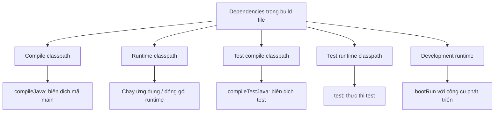
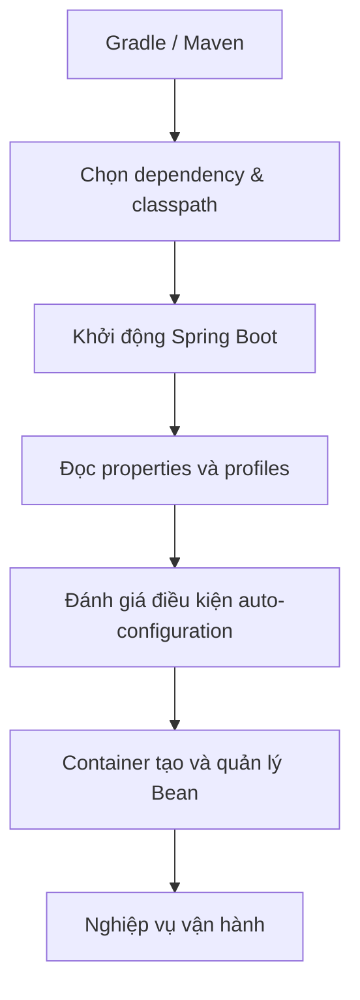
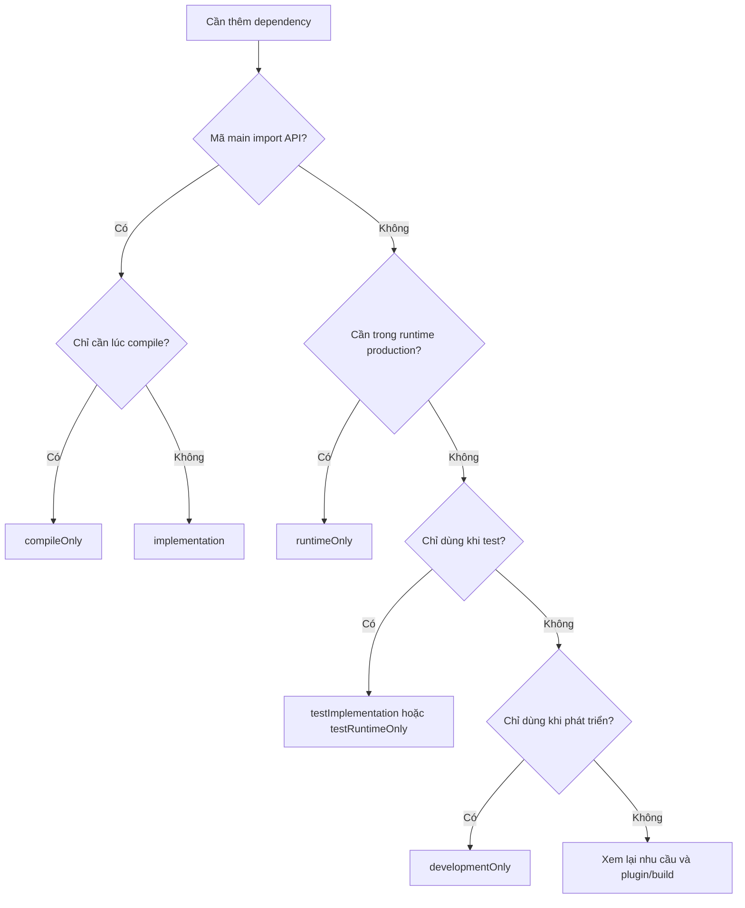

# Phạm vi compile, runtime, test và development-only trong Spring Boot

Khi thêm một dependency vào dự án Spring Boot, bạn cần trả lời hai câu hỏi: **cần thư viện nào** và **cần nó ở giai đoạn nào**. Thư viện chứa các API mà mã nguồn import thường cần khi biên dịch; JDBC driver có thể chỉ cần khi chạy; JUnit chỉ phục vụ test; còn Spring Boot DevTools hữu ích trong quá trình phát triển nhưng thường không nên đi theo bản phát hành.

Đó là lý do Maven có **dependency scope** và Gradle có **dependency configuration**. Chọn đúng phạm vi giúp classpath gọn và dễ hiểu, tránh tình huống “compile được nhưng chạy lỗi”, đồng thời tách rõ dependency phục vụ sản phẩm với dependency phục vụ người phát triển.

## 1. Compile và runtime là hai thời điểm khác nhau

Một chương trình Java trải qua ít nhất hai bước:

1. **Compile time:** Java compiler đọc mã nguồn cùng các class/API trên **compile classpath**, kiểm tra kiểu và sinh bytecode `.class`.
2. **Runtime:** JVM nạp bytecode và các class/tài nguyên trên **runtime classpath**, sau đó thực thi chương trình.

Ví dụ, controller sau cần thư viện Spring Web ở cả hai giai đoạn:

```java
package com.example.demo;

import org.springframework.web.bind.annotation.GetMapping;
import org.springframework.web.bind.annotation.RestController;

@RestController
public class HelloController {
    @GetMapping("/hello")
    public String hello() {
        return "Hello, Spring Boot!";
    }
}
```

Compiler phải nhìn thấy `@RestController` và `@GetMapping`. Khi ứng dụng chạy, Spring MVC cũng phải có mặt để khám phá controller, thiết lập request mapping và xử lý HTTP.

Ngược lại, với JDBC:

```java
import java.sql.Connection;
import java.sql.DriverManager;

public class ConnectionFactory {
    public Connection open(String url, String user, String password)
            throws Exception {
        return DriverManager.getConnection(url, user, password);
    }
}
```

Ở đây mã nguồn chỉ import API chuẩn `java.sql` của JDK. Compiler không cần class riêng của PostgreSQL driver. Nhưng nếu chạy với URL `jdbc:postgresql:...`, ứng dụng cần driver PostgreSQL trên runtime classpath. Đây là một trường hợp điển hình của **runtime-only dependency**.



Các nhánh trong sơ đồ có những thư viện chung nhưng không giống hệt nhau. Một dependency có mặt trong test runtime không có nghĩa nó sẽ được đóng vào executable jar cho production.

## 2. Gradle configuration và Maven scope không cùng cú pháp

Trong Spring Boot bạn thường gặp hai kiểu build:

- **Gradle:** `implementation`, `compileOnly`, `runtimeOnly`, `testImplementation`, `testRuntimeOnly`, `developmentOnly`.
- **Maven:** `compile`, `runtime`, `test`, `provided` và những thuộc tính liên quan.

Đừng nhầm từ “compile” trong khái niệm chung với configuration `compile` của Gradle đời cũ. Với Gradle hiện đại, configuration `compile` cũ đã bị loại bỏ; thư viện ứng dụng cần cả compile lẫn runtime thường được khai báo bằng **`implementation`**.

### Bảng phạm vi thường dùng trong Gradle

| Configuration | Biên dịch main | Runtime main | Biên dịch test | Runtime test | Vai trò |
|---|---|---|---|---|---|
| `implementation` | Có | Có | Thường có | Thường có | Thư viện ứng dụng cần để biên dịch và chạy |
| `compileOnly` | Có | Không | Không tự động | Không | API chỉ dùng lúc compile |
| `runtimeOnly` | Không | Có | Không | Thường có | Driver hoặc implementation chỉ cần lúc chạy |
| `annotationProcessor` | Processor path riêng | Không | Không | Không | Chạy bộ xử lý annotation cho main |
| `testImplementation` | Không | Không | Có | Có | Thư viện viết/chạy test |
| `testCompileOnly` | Không | Không | Có | Không | API chỉ cần khi compile test |
| `testRuntimeOnly` | Không | Không | Không | Có | Engine hoặc thành phần chỉ cần khi chạy test |
| `developmentOnly` | Không | Không thuộc runtime bản phát hành | Không phải scope test | Không phải scope test | Công cụ phát triển khi dùng Spring Boot Gradle plugin |

“Thường có” mô tả quan hệ mặc định giữa các configuration do Gradle Java plugin tạo. Project có thể tùy chỉnh chúng. `developmentOnly` là tính năng được Spring Boot Gradle plugin tích hợp, vì vậy cách nó tham gia vào classpath của các task cần được xét riêng.

## 3. `implementation`: dependency chính của ứng dụng

Trong một dự án đã áp dụng Java plugin, Spring Boot Gradle plugin và cơ chế quản lý phiên bản dependency phù hợp:

```groovy
dependencies {
    implementation 'org.springframework.boot:spring-boot-starter-web'
}
```

Starter web đưa Spring MVC, các thư viện xử lý JSON và embedded Servlet server mặc định vào nhóm dependency tương thích. Controller có thể import API Spring Web khi compile; lúc chạy những class và hạ tầng tương ứng tiếp tục có mặt.

Các ví dụ thường đặt trong `implementation`:

```groovy
dependencies {
    implementation 'org.springframework.boot:spring-boot-starter-web'
    implementation 'org.springframework.boot:spring-boot-starter-validation'
    implementation 'org.springframework.boot:spring-boot-starter-data-jpa'
}
```

Lưu ý ví dụ tập hợp nhiều starter để giải thích cách khai báo, không có nghĩa ứng dụng nào cũng cần cả ba. Thêm JPA starter có thể khiến Boot chuẩn bị datasource và persistence infrastructure; để chạy thực tế bạn còn cần driver và cấu hình cơ sở dữ liệu phù hợp.

**Cách suy luận:** nếu code main import và sử dụng API của thư viện, đồng thời thư viện ấy vẫn cần khi chương trình chạy, `implementation` thường là lựa chọn phù hợp.

### Phân biệt `implementation` và `api`

Với module dạng thư viện áp dụng Gradle `java-library` plugin, có thêm configuration `api`:

```groovy
plugins {
    id 'java-library'
}

dependencies {
    api 'org.example:contracts:1.0'
    implementation 'org.example:internal-utils:1.0'
}
```

Dependency trong `api` có thể xuất hiện trên compile classpath của **module sử dụng thư viện**, phù hợp nếu public API của thư viện lộ ra các kiểu của dependency ấy. `implementation` thường che chi tiết triển khai khỏi compile classpath của consumer. Một Spring Boot application module thông thường không cần chuyển mọi dependency sang `api`.

## 4. `compileOnly` và `annotationProcessor`: compile được nhưng không đóng gói để chạy

`compileOnly` cung cấp các class cho compiler, không tự cung cấp chúng khi chạy. Đây là lựa chọn cho một số annotation hoặc API mà môi trường khác cung cấp tại runtime.

Một ví dụ quen thuộc là Lombok:

```groovy
dependencies {
    compileOnly 'org.projectlombok:lombok'
    annotationProcessor 'org.projectlombok:lombok'
}
```

Hai configuration giải quyết hai nhu cầu khác nhau:

- `compileOnly` giúp compiler nhận diện các annotation của Lombok được import trong mã nguồn.
- `annotationProcessor` đưa Lombok lên **annotation processor path** để processor có thể xử lý annotation trong quá trình biên dịch.

Ví dụ:

```java
import lombok.RequiredArgsConstructor;

@RequiredArgsConstructor
public class OrderService {
    private final OrderRepository repository;
}
```

Ở đây `OrderRepository` là interface hoặc class của ứng dụng đã có sẵn; khi Lombok hoạt động đúng, constructor cần thiết được sinh trong quá trình compile. Ứng dụng không cần jar Lombok tại runtime chỉ để sử dụng constructor đã được biên dịch.

**Không dùng `compileOnly` cho thư viện thật sự cần ở runtime** nếu bạn không có nguồn khác cung cấp thư viện đó. Code có thể compile thành công nhưng JVM báo `NoClassDefFoundError` hoặc `ClassNotFoundException` khi đụng tới class thiếu.

Nếu source test cũng sử dụng annotation Lombok, test là source set riêng: bạn có thể cần bổ sung `testCompileOnly` và `testAnnotationProcessor` cho Lombok trong test. `compileOnly` của main không mặc nhiên có mặt trên test compile classpath.

## 5. `runtimeOnly`: cần implementation khi JVM chạy

Trường hợp điển hình là database driver. Giả sử ứng dụng Spring Boot dùng Spring Data JPA để truy cập PostgreSQL:

```groovy
dependencies {
    implementation 'org.springframework.boot:spring-boot-starter-data-jpa'
    runtimeOnly 'org.postgresql:postgresql'
}
```

Code ứng dụng làm việc với `JpaRepository`, `@Entity`, `@Transactional` và các API của Spring/JPA thông qua starter ở `implementation`. Driver PostgreSQL chỉ cần khi connection pool hoặc JDBC phải kết nối thực tế tới cơ sở dữ liệu.

Ví dụ cấu hình `src/main/resources/application.properties`:

```properties
spring.datasource.url=jdbc:postgresql://localhost:5432/shop
spring.datasource.username=shop_user
spring.datasource.password=${DB_PASSWORD}
```

`DB_PASSWORD` ở đây là biến môi trường dự kiến được cung cấp khi chạy. Ví dụ giả định database `shop` và user tồn tại, PostgreSQL đang hoạt động. Thêm driver không tự tạo database và cũng không cung cấp mật khẩu.

### Runtime-only không có nghĩa “chỉ dùng trên máy phát triển”

`runtimeOnly` là **dependency cần cho runtime thực tế**, bao gồm runtime ở production khi ứng dụng dùng chức năng đó. Spring Boot Gradle task `bootJar` thông thường đưa những runtime dependency phù hợp vào executable jar, thường dưới `BOOT-INF/lib/`.

Phân biệt:

- Gradle `jar` thông thường tạo plain jar từ output của module; nó không tự đóng tất cả dependency bắc cầu vào jar.
- Spring Boot `bootJar` tạo executable jar có thư viện runtime cần thiết đi kèm.

Nếu bạn tự chạy bằng một classpath ngoài hoặc triển khai theo cách khác, môi trường triển khai phải cung cấp runtime dependencies tương ứng. Việc đặt đúng scope trong build file không tự thay thế toàn bộ quy trình packaging/deployment.

### Khi nào driver không nên là `runtimeOnly`?

Nếu code Java import trực tiếp API đặc thù PostgreSQL:

```java
import org.postgresql.PGConnection;
```

compiler phải nhìn thấy class này. Khi đó `runtimeOnly` là chưa đủ cho đoạn code ấy; cần configuration có mặt khi compile, thường là `implementation`, hoặc nên thiết kế lại để code nghiệp vụ dựa trên abstraction chuẩn. Chọn scope dựa trên **cách code thật sự sử dụng thư viện**, không dựa vào tên artifact.

## 6. `testImplementation`, `testRuntimeOnly` và phạm vi test

Ứng dụng Java thông thường có hai source set:

```text
src/main/java/          Mã ứng dụng
src/main/resources/     Resource ứng dụng
src/test/java/          Mã kiểm thử
src/test/resources/     Resource kiểm thử
```

Test có compile classpath và runtime classpath riêng. Mã test cần thấy class của ứng dụng và các API kiểm thử, nhưng thư viện chỉ phục vụ test không nên trở thành dependency runtime của ứng dụng production.

### `testImplementation`

```groovy
dependencies {
    testImplementation 'org.springframework.boot:spring-boot-starter-test'
}
```

Starter test tập hợp các công cụ kiểm thử thông dụng của Spring Boot, như hỗ trợ Spring Test, JUnit Jupiter, AssertJ và Mockito tùy phiên bản Boot. Test source có thể import những API đó khi biên dịch, và runtime test có thể sử dụng chúng khi thực thi.

Ví dụ:

```java
package com.example.demo;

import org.junit.jupiter.api.Test;
import static org.junit.jupiter.api.Assertions.assertEquals;

class PriceCalculatorTest {
    @Test
    void addsPrices() {
        PriceCalculator calculator = new PriceCalculator();
        assertEquals(30, calculator.add(10, 20));
    }
}
```

Đoạn này giả định bạn đã có class `PriceCalculator` với method `add(int, int)`. Nó là unit test Java thông thường; không nhất thiết khởi động Spring context. Thư viện JUnit vẫn cần cho test dù không cần khi người dùng gọi REST API trong production.

### `testRuntimeOnly`

Một số thành phần cần cho **test runner** nhưng mã test không import trực tiếp. Ví dụ JUnit Platform launcher:

```groovy
dependencies {
    testRuntimeOnly 'org.junit.platform:junit-platform-launcher'
}

tasks.named('test') {
    useJUnitPlatform()
}
```

Launcher tham gia vào cơ chế thực thi test. `testRuntimeOnly` giúp thể hiện rõ rằng nó cần trong runtime test, không phải compile main hay runtime main.

Nếu một thư viện chỉ cần khi biên dịch test mà không cần khi thực thi, Gradle còn có `testCompileOnly`. Một ví dụ là annotation compile-time; với annotation processor của test, dùng thêm `testAnnotationProcessor` khi cần.

### Test có kế thừa dependency của main?

Với cấu hình mặc định của Gradle Java plugin, test classpath sử dụng output của main và thông thường có những dependency main cần nhờ quan hệ giữa `testImplementation`/`testRuntimeOnly` với các configuration chính. Bởi vậy test có thể gọi service của ứng dụng và sử dụng implementation mà service đó cần.

Tuy nhiên, **`compileOnly` của main không tự động có mặt trên test classpath**. Nếu test source tự dùng Lombok annotation hoặc một compile-only API khác, hãy khai báo tương ứng cho test.

## 7. `developmentOnly`: công cụ dành cho quá trình phát triển

Đây là configuration được **Spring Boot Gradle plugin** tạo và hỗ trợ, không phải một scope chuẩn của Java hay một configuration có sẵn trong mọi project Gradle.

```groovy
dependencies {
    developmentOnly 'org.springframework.boot:spring-boot-devtools'
}
```

Spring Boot DevTools hỗ trợ quá trình phát triển, chẳng hạn restart ứng dụng khi classpath thay đổi và một số thiết lập thuận tiện cho việc sửa code. Nó thường cần khi chạy ứng dụng trong IDE hoặc qua workflow Gradle như `bootRun`, nhưng không cần trong bản phát hành.

Theo cấu hình mặc định của Spring Boot Gradle plugin, các dependency `developmentOnly` phục vụ **runtime phát triển** và được **loại khỏi executable jar/war** tạo bởi `bootJar`/`bootWar`. Điều đó tạo ra khác biệt quan trọng với `runtimeOnly`:

| So sánh | `runtimeOnly` | `developmentOnly` |
|---|---|---|
| Mục đích | Cung cấp implementation cần khi ứng dụng chạy | Hỗ trợ người lập trình trong workflow phát triển |
| Ví dụ | PostgreSQL JDBC driver | Spring Boot DevTools |
| Cần cho biên dịch main? | Không | Không |
| Có thể dùng khi `bootRun`? | Có | Có, với tích hợp mặc định của Boot plugin |
| Nằm trong `bootJar` mặc định? | Có nếu là runtime dependency cần đóng gói | Không |
| Dùng trong production? | Có thể là bắt buộc | Thông thường không |

**Development-only không có nghĩa “chỉ bật khi Spring profile là dev”.** Đây là cấu hình build/classpath; còn profile là lựa chọn cấu hình/Bean của ứng dụng lúc chạy. Phạm vi classpath còn có thể phụ thuộc cách IDE hoặc task chạy ứng dụng được cấu hình.

Không đặt database driver production trong `developmentOnly`: khi đóng executable jar, bạn có nguy cơ làm mất driver. Cũng không đặt DevTools vào `implementation` theo thói quen nếu ý định là chỉ dùng trong quá trình phát triển.

## 8. Một `build.gradle` minh họa đầy đủ

Giả sử dự án dùng Spring Web, Spring Data JPA, PostgreSQL, Lombok, DevTools và framework kiểm thử. Phần cấu hình dependency có thể viết:

```groovy
dependencies {
    // Code main import API Spring; cần cả compile và runtime
    implementation 'org.springframework.boot:spring-boot-starter-web'
    implementation 'org.springframework.boot:spring-boot-starter-data-jpa'

    // Driver chỉ cần khi kết nối database
    runtimeOnly 'org.postgresql:postgresql'

    // Annotation + processor ở giai đoạn biên dịch
    compileOnly 'org.projectlombok:lombok'
    annotationProcessor 'org.projectlombok:lombok'

    // Công cụ dành cho phát triển
    developmentOnly 'org.springframework.boot:spring-boot-devtools'

    // Chỉ phục vụ test
    testImplementation 'org.springframework.boot:spring-boot-starter-test'
    testRuntimeOnly 'org.junit.platform:junit-platform-launcher'
}

tasks.named('test') {
    useJUnitPlatform()
}
```

Ví dụ **giả định project đã có** plugin Java, Spring Boot Gradle plugin và cơ chế quản lý phiên bản các dependency (ví dụ Spring Boot BOM). Cấu hình đó không tự chạy độc lập nếu thiếu plugin/build setup. Java/JDK cũng phải tương thích với phiên bản Spring Boot được dùng.

Lombok là tùy chọn; nếu không dùng annotation Lombok, bỏ cả `compileOnly` và `annotationProcessor` tương ứng. Nếu ứng dụng dùng JPA thật, cần database hoạt động, thông tin kết nối và cấu hình Hibernate/JPA phù hợp. Starter và scope không tự cung cấp database.

### Starter có phải một scope riêng không?

Không. **Starter là một artifact dependency**, còn configuration quyết định artifact ấy tham gia vào classpath nào:

```groovy
implementation 'org.springframework.boot:spring-boot-starter-web'
testImplementation 'org.springframework.boot:spring-boot-starter-test'
```

Cả hai đều là starter, nhưng một cái phục vụ ứng dụng chính, một cái phục vụ test. Từ `starter` trong tên không thay thế vai trò của `implementation` hoặc `testImplementation`.

## 9. Những gì xảy ra khi compile, chạy local, test và đóng gói

Đối với file Gradle minh họa:

| Task/hoạt động | Nhóm dependency đáng chú ý | Điều cần hiểu |
|---|---|---|
| `compileJava` | `implementation`, `compileOnly`; processor path riêng | Chỉ yêu cầu các API cần cho biên dịch main |
| `bootRun` | Runtime dependencies và hỗ trợ `developmentOnly` của Boot plugin | Chạy ứng dụng bằng classpath phát triển |
| `compileTestJava` | Test compile classpath và output main | Test thấy JUnit/API test, nhưng main `compileOnly` không tự kế thừa |
| `test` | Test runtime dependencies | Có test framework/engine và dependency chạy test |
| `bootJar` | Runtime dependencies của bản phát hành | Có thư viện cần cho ứng dụng; loại test và `developmentOnly` theo mặc định |

Một chuỗi minh họa:

```text
Khi biên dịch Java:
    Spring Web API, JPA API, annotation Lombok
    (processor Lombok chạy ở processor path)

Khi chạy local với bootRun:
    Spring Web + JPA + PostgreSQL driver
    + DevTools (developmentOnly)

Khi chạy test:
    Code ứng dụng + các runtime dependency thích hợp
    + JUnit/Mockito/Spring Test
    + test runtime launcher

Khi đóng executable jar cho production:
    Code ứng dụng + Spring Web + JPA + PostgreSQL driver
    (không kèm test libraries hoặc DevTools theo mặc định)
```

Đây là mô hình mặc định của một ứng dụng Spring Boot dùng Gradle. Plugin khác hoặc logic build tùy chỉnh có thể điều chỉnh classpath/packaging. **Chạy thành công bằng `bootRun` chưa chắc chứng minh executable jar có đúng các dependency production**.

## 10. Maven: `compile`, `runtime`, `test` và `provided`

Với Maven, cấu trúc cùng ý tưởng nhưng khai báo qua `<scope>`:

```xml
<dependencies>
    <!-- Không ghi scope: mặc định là compile -->
    <dependency>
        <groupId>org.springframework.boot</groupId>
        <artifactId>spring-boot-starter-web</artifactId>
    </dependency>

    <!-- Chỉ cần khi chạy -->
    <dependency>
        <groupId>org.postgresql</groupId>
        <artifactId>postgresql</artifactId>
        <scope>runtime</scope>
    </dependency>

    <!-- Chỉ dành cho test -->
    <dependency>
        <groupId>org.springframework.boot</groupId>
        <artifactId>spring-boot-starter-test</artifactId>
        <scope>test</scope>
    </dependency>

    <!-- Maven không có scope developmentOnly -->
    <dependency>
        <groupId>org.springframework.boot</groupId>
        <artifactId>spring-boot-devtools</artifactId>
        <optional>true</optional>
    </dependency>
</dependencies>
```

Ví dụ giả định Maven project có parent/BOM quản lý các phiên bản cần thiết.

| Maven scope | Compile main | Runtime main | Test | Ý nghĩa gần nhất trong Gradle |
|---|---|---|---|---|
| `compile` (mặc định) | Có | Có | Có | `implementation` trong app |
| `runtime` | Không | Có | Có | `runtimeOnly` |
| `test` | Không | Không | Có | `testImplementation` / `testRuntimeOnly` tùy thư viện |
| `provided` | Có | Không phải runtime đóng gói thông thường | Có | Có nét giống `compileOnly` nhưng không hoàn toàn tương đương |

### Maven không có `developmentOnly`

Trong Maven, cách dùng DevTools thường khai báo `optional=true`. **Optional chỉ điều chỉnh việc dependency lan truyền sang các project phụ thuộc**, không tự nó đảm bảo dependency bị loại khỏi artifact của chính project. Spring Boot Maven plugin có cơ chế **loại DevTools khi repackage theo mặc định**. Đây là lý do không thể coi `optional` là bản dịch một-một của Gradle `developmentOnly`.

`provided` trong Maven thường mô tả API có sẵn ở môi trường chạy ngoài, ví dụ trong một số kiểu triển khai WAR lên application server. Với Spring Boot chạy embedded server, không nên đổi bừa starter hoặc server dependency sang `provided`. Maven `provided` cũng hiện diện trong phạm vi test theo quy tắc của Maven, trong khi Gradle `compileOnly` của main không tự chuyển sang test classpath.

## 11. Dependency scope khác Spring profile và Bean scope

Ba tên nghe giống nhau nhưng giải quyết ba việc riêng:

| Khái niệm | Điều khiển điều gì? | Ví dụ |
|---|---|---|
| Dependency scope/configuration | Thư viện xuất hiện trên classpath nào và vào artifact nào | `runtimeOnly 'org.postgresql:postgresql'` |
| Spring profile | Cấu hình và Bean nào được kích hoạt lúc chạy | `@Profile("dev")`, `application-dev.properties` |
| Spring Bean scope | Vòng đời/phạm vi instance Bean trong container | `singleton`, `prototype`, `request` |

Ví dụ:

```properties
spring.profiles.active=dev
```

Lệnh trên không tự tải thư viện mới vào classpath. Một executable jar vốn không chứa DevTools sẽ không đột nhiên có DevTools vì bạn bật profile `dev`. Ngược lại, Gradle `bootRun` có thể đưa `developmentOnly` vào classpath phát triển bất kể tên profile được chọn.

Sơ đồ tầng trách nhiệm:



Dependency scope quyết định “những class nào có thể hiện diện”; Spring profile và auto-configuration quyết định “ứng dụng dùng những cấu hình và Bean nào trên nền classpath ấy”.

## 12. Dependency bắc cầu và Spring Boot BOM

Một starter có thể mang theo nhiều dependency:

```text
spring-boot-starter-web
    ├── Spring MVC và các thành phần Spring liên quan
    ├── Hỗ trợ JSON
    └── Embedded Servlet server mặc định
```

Vì vậy class bạn import có thể tới từ dependency **bắc cầu**, dù build file chỉ khai báo starter. Điều này tiện lợi, nhưng nếu code dùng API độc lập của một thư viện mà bạn cần kiểm soát lâu dài, việc khai báo trực tiếp dependency đó đôi khi rõ ràng hơn việc dựa vào thành phần nội bộ một starter.

Spring Boot thường có BOM/dependency management để quản lý **phiên bản** tương thích. Cần tách:

- **Artifact/dependency:** cần thư viện nào?
- **Version/BOM:** chọn phiên bản nào cho thư viện ấy?
- **Scope/configuration:** thư viện nằm ở compile, runtime, test hay development classpath nào?

BOM không tự thêm tất cả artifact được quản lý vào dự án và cũng không biến một test dependency thành runtime dependency production.

## 13. Quan sát classpath bằng Gradle

Khi bị lỗi thiếu class, cách giải quyết đáng tin cậy là nhìn vào dependency graph thay vì đoán từ tên artifact.

Trên macOS/Linux hoặc shell hỗ trợ wrapper:

```bash
./gradlew dependencies --configuration compileClasspath
./gradlew dependencies --configuration runtimeClasspath
./gradlew dependencies --configuration testCompileClasspath
./gradlew dependencies --configuration testRuntimeClasspath
```

Trên Windows PowerShell:

```powershell
.\gradlew.bat dependencies --configuration compileClasspath
.\gradlew.bat dependencies --configuration runtimeClasspath
.\gradlew.bat dependencies --configuration testCompileClasspath
.\gradlew.bat dependencies --configuration testRuntimeClasspath
```

Để tìm vì sao PostgreSQL driver có mặt trong runtime:

```bash
./gradlew dependencyInsight --dependency postgresql --configuration runtimeClasspath
```

Với multi-project build, hãy gọi các task trong project cụ thể đang sở hữu ứng dụng hoặc dùng đường dẫn task `:some-module:dependencies` tương ứng. Nếu muốn biết executable jar có gì, sau khi build có thể xem thư mục `BOOT-INF/lib/` bên trong file jar do `bootJar` tạo. Cây `runtimeClasspath` và nội dung archive có thể khác nhau khi plugin áp dụng quy tắc loại trừ hoặc dự án có logic packaging tùy chỉnh.

## 14. Lỗi thường gặp khi đặt sai phạm vi

| Triệu chứng | Khả năng liên quan đến scope | Cách kiểm tra và sửa |
|---|---|---|
| `package ... does not exist` khi compile main | Dependency bị đặt `runtimeOnly` hoặc `testImplementation` | Xem `compileClasspath`; chuyển sang `implementation` nếu main cần API |
| Test không import được `org.junit.jupiter.api.Test` | Thiếu test compile dependency | Dùng `testImplementation` phù hợp |
| Biên dịch xong nhưng JVM báo `ClassNotFoundException` hoặc `NoClassDefFoundError` | Thư viện thiếu tại runtime | Xem `runtimeClasspath`, classloader và artifact |
| `bootRun` thành công nhưng executable jar lỗi thiếu driver | Driver chỉ có trong development classpath hoặc bị loại khi đóng gói | Dùng `runtimeOnly`/`implementation` theo nhu cầu production |
| Ứng dụng không kết nối được database | Driver, URL, credentials, network hoặc database chưa đúng | Kiểm tra runtime dependency và cấu hình datasource; đừng mặc định lỗi chỉ do scope |
| Bản phát hành mang thư viện JUnit/Mockito không cần thiết | Test library nằm trong `implementation` | Chuyển vào test scope tương ứng |
| DevTools không có trong executable jar | `developmentOnly` mặc định bị loại khỏi archive | Đây thường là hành vi đúng, dùng `bootRun` khi phát triển |

Không phải lỗi runtime nào cũng do scope: sai phiên bản, cấu hình, packaging và classloader cũng có thể gây lỗi. Khi điều tra, kết hợp thông báo lỗi với cấu hình và dependency graph thực tế.

## 15. Chọn scope theo nhu cầu sử dụng

Khi thêm một dependency, lần lượt hỏi:

1. **Mã main có import API của nó không?** Nếu có và API cũng cần khi chạy, dùng `implementation`. Nếu chỉ cần lúc biên dịch, cân nhắc `compileOnly`.
2. **Nó chỉ là implementation cần khi chương trình chạy?** Cân nhắc `runtimeOnly`, điển hình là JDBC driver khi code chỉ dùng abstraction chuẩn.
3. **Nó chỉ phục vụ test?** Nếu mã test import API, dùng `testImplementation`; nếu chỉ cần khi chạy test, dùng `testRuntimeOnly`.
4. **Nó chỉ cải thiện trải nghiệm phát triển với Spring Boot Gradle plugin?** Cân nhắc `developmentOnly`, điển hình là DevTools.
5. **Nó là annotation processor?** Dùng `annotationProcessor` hoặc `testAnnotationProcessor`, cộng thêm configuration compile riêng nếu mã nguồn import annotation/API.
6. **Dự án là library công bố public API?** Xem xét `api` của Gradle `java-library` cho những dependency xuất hiện trong contract với consumer.

### Ba tình huống để tự suy luận

**A.** Controller import một thư viện chuyển đổi chuỗi và thật sự gọi nó mỗi request. Thư viện này cần ở compile-time lẫn runtime: thường dùng `implementation`.

**B.** Chỉ integration test dùng H2, còn production dùng PostgreSQL. Một cấu hình có thể là:

```groovy
dependencies {
    runtimeOnly 'org.postgresql:postgresql'
    testRuntimeOnly 'com.h2database:h2'
}
```

Bạn vẫn phải cấu hình datasource riêng cho test và production. Hai driver hiện diện không có nghĩa Spring tự hiểu database nào cần dùng ở mỗi môi trường.

**C.** Test dùng Mockito, ứng dụng production không cần Mockito. Dùng `testImplementation` (thường thông qua Spring Boot starter test), tránh đưa thư viện test vào `implementation`.

### Sơ đồ quyết định cho một dependency thông thường



Sơ đồ này là gợi ý cho các dependency thông thường; annotation processors, library API, configuration tùy chỉnh và những dependency bắc cầu còn có quy tắc riêng.

Khi đọc một file `build.gradle` hoặc `pom.xml`, hãy xem **tọa độ thư viện đi cùng phạm vi của nó**. `implementation` và Maven `compile` phục vụ code cần cả biên dịch lẫn chạy; `runtimeOnly` cung cấp thư viện cho JVM mà main không trực tiếp import; test scope phục vụ test; còn `developmentOnly` của Spring Boot Gradle plugin tách công cụ phát triển khỏi executable archive. Nắm được các khác biệt này giúp bạn hiểu classpath, xử lý lỗi thiếu class và xây ứng dụng Spring Boot có bản đóng gói phù hợp với môi trường sử dụng.
