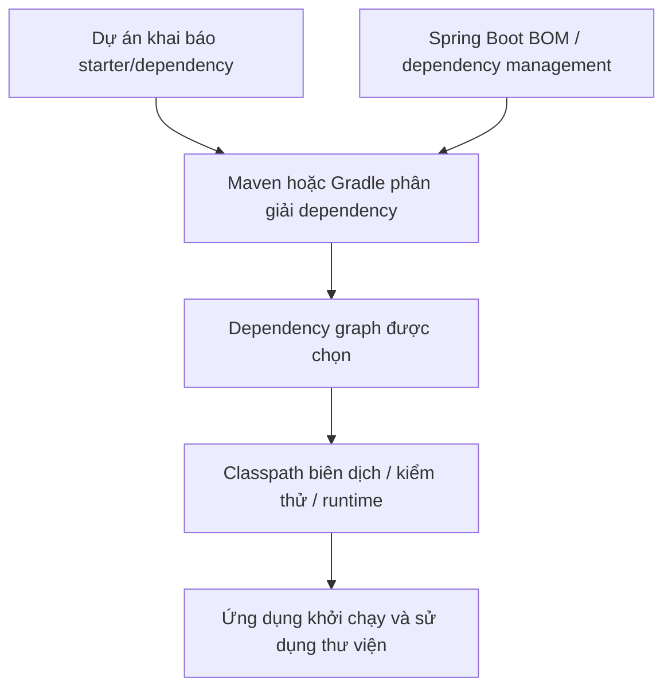
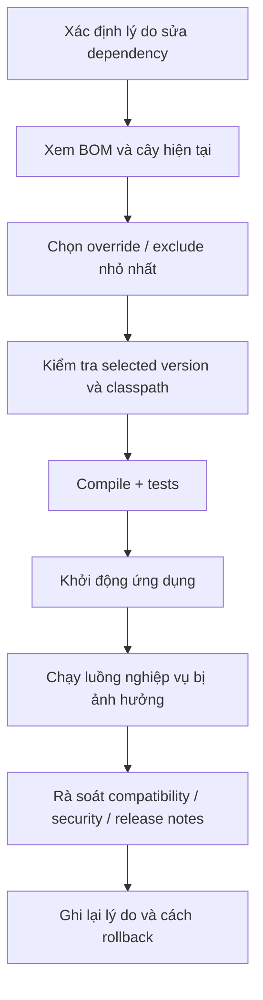

# Ghi đè phiên bản hoặc loại dependency và kiểm chứng tương thích

Spring Boot giúp khởi tạo ứng dụng nhanh nhờ các **starter** và cơ chế **quản lý phiên bản dependency**. Ví dụ, thêm `spring-boot-starter-web` có thể đưa vào project Spring MVC, thư viện xử lý JSON, logging và những thành phần cần thiết cho ứng dụng web. Người lập trình thường chỉ khai báo một starter, còn công cụ build tự giải quyết nhiều dependency bên dưới.

Đến một thời điểm, nhóm phát triển có thể cần **ghi đè phiên bản** của một thư viện hoặc **loại một dependency khỏi cây phụ thuộc**: thư viện có bản vá bảo mật, một thành phần gây xung đột, nhóm muốn đổi logging implementation, hoặc một tính năng không còn sử dụng thư viện cũ. Đây là thao tác có tác động tới cả ứng dụng. Một dòng cấu hình có thể thay đổi những class được tải lúc chạy, API có sẵn và khả năng tương thích của nhiều thư viện.

Trong phạm vi **Spring Boot Fundamentals → Dependency và starter**, bài học này giải thích cách Spring Boot, Maven và Gradle chọn dependency; cách ghi đè hoặc loại dependency có chủ đích; và cách **kiểm chứng bằng bằng chứng từ dependency graph, build và hành vi ứng dụng**. Trọng tâm là nắm cơ chế và quy trình ra quyết định, không ghi nhớ một lệnh sửa nhanh cho mọi dự án.

## 1. Trước hết, hiểu những gì đang được thay đổi

Một **dependency** là thư viện hoặc module mà project cần để biên dịch, kiểm thử hoặc thực thi. Có hai nguồn phổ biến:

- **Dependency trực tiếp (*direct dependency*)**: được khai báo trong `pom.xml` hoặc `build.gradle` của project.
- **Dependency bắc cầu (*transitive dependency*)**: được khai báo bởi một dependency khác, rồi được Maven/Gradle kéo vào qua các quan hệ phụ thuộc.

Ví dụ, hình dung một phần cây dependency:

```text
catalog-service
└── spring-boot-starter-web
    ├── spring-boot-starter
    │   └── spring-boot-starter-logging
    ├── spring-boot-starter-json
    └── spring-webmvc
```

Cây trên **chỉ minh họa quan hệ**, đã lược bỏ nhiều nhánh và không khẳng định mọi bản Spring Boot có cùng cấu trúc chi tiết. Trong dự án thật, phải lấy kết quả từ dependency report của bản build đang sử dụng.

Từ đó, cần phân biệt các thao tác:

| Thao tác | Kết quả mong muốn | Ví dụ |
| --- | --- | --- |
| Thêm dependency | Đưa khả năng mới vào classpath | Thêm một starter cho HTTP client |
| Ghi đè version | Chọn bản khác của cùng một thư viện | Nâng phiên bản `commons-lang3` |
| Loại trừ dependency (*exclude*) | Chặn một quan hệ dependency bắc cầu | Không kéo `spring-boot-starter-logging` qua một starter |
| Xóa khai báo trực tiếp | Project không còn chủ động yêu cầu thư viện ấy | Bỏ dependency không còn dùng |
| Đổi scope/configuration | Thay đổi classpath hoặc giai đoạn sử dụng | `testImplementation` thay cho `implementation` |
| Thay thế implementation | Dùng thư viện khác để thực hiện cùng vai trò | Chọn Log4j2 thay cho logging starter mặc định |

“Loại dependency” thường được hiểu là **loại bỏ một dependency khỏi cây phụ thuộc**. Nó khác với **đổi phạm vi sử dụng** của dependency. Ví dụ, chuyển thư viện test từ runtime sang test-only không giống với việc loại thư viện đó khỏi mọi classpath.

## 2. Spring Boot quản lý phiên bản dependency như thế nào?

Một ứng dụng Spring Boot thường dùng **BOM – Bill of Materials** (danh mục phiên bản tương thích đã được phối hợp). BOM `spring-boot-dependencies` cung cấp các phiên bản được quản lý cho nhiều thư viện thuộc hệ sinh thái Spring và thư viện liên quan.

Một cơ chế chung:



Ở cấu hình thường gặp, người dùng có thể khai báo:

```xml
<dependency>
    <groupId>org.springframework.boot</groupId>
    <artifactId>spring-boot-starter-web</artifactId>
</dependency>
```

Không có phần tử `<version>` trong ví dụ trên vì phiên bản starter được quản lý qua Spring Boot parent/BOM phù hợp. **Không viết version không có nghĩa là Maven tự chọn bản mới nhất trên Internet**.

### 2.1. Cần phân biệt ba tầng quyết định

1. **Phiên bản Spring Boot**: quyết định BOM hoặc bộ quản lý dependency mặc định tương ứng với bản Boot đang dùng.
2. **Phiên bản dependency được quản lý**: là phiên bản mặc định cho những tọa độ thư viện mà BOM biết tới.
3. **Phiên bản thực tế đã phân giải**: là bản mà Maven/Gradle chọn sau khi xét cả dependency trực tiếp, bắc cầu, các quy tắc version và quy tắc loại trừ.

Ba tầng này liên quan nhưng không luôn trùng khớp. Khi chủ động override một thư viện, **phiên bản thực tế** có thể khác phiên bản mà Spring Boot BOM khuyến nghị.

### 2.2. BOM hỗ trợ tương thích, không bảo đảm mọi cấu hình đều đúng

Một BOM giúp giảm xung đột do các starter và thư viện được chọn cùng một dòng phát hành. Tuy nhiên, BOM không thể bảo đảm:

- Mọi thư viện của bên thứ ba đều được quản lý phiên bản.
- Mọi tổ hợp Spring Boot, Spring Cloud, database driver, JDK và ứng dụng đều tương thích.
- Một phiên bản bị ghi đè vẫn giữ hợp đồng API/ABI của bản trước.
- Mọi dependency bị loại đều không ảnh hưởng đến runtime.

Vì vậy, **ưu tiên sử dụng phiên bản BOM quản lý** khi không có nhu cầu cụ thể. Việc ghi đè phải đi kèm lý do và kiểm chứng.

## 3. Khi nào cần ghi đè phiên bản?

Những tình huống thường gặp:

| Tình huống | Có thể cần override? | Điều phải xác minh |
| --- | --- | --- |
| Thư viện có lỗi bảo mật được vá ở bản mới | Có, nếu không thể nhận bản vá qua việc nâng Boot phù hợp | CVE/advisory áp dụng thật, phiên bản vá, khả năng tương thích |
| Thư viện có lỗi chức năng ảnh hưởng dự án | Có | Changelog, regression test cho lỗi cụ thể |
| Team muốn dùng API chỉ có ở bản mới | Có, nhưng cần cân nhắc nâng nền tảng | API được hỗ trợ và các dependency liên quan |
| Xung đột nhiều bản của cùng module | Có thể | Đường kéo dependency vào và cơ chế resolution |
| Muốn “mới nhất cho chắc” | Chưa đủ lý do | Có nhu cầu nào mà BOM không đáp ứng? |
| Một library đã được BOM quản lý ổn định | Thường chưa cần | Giữ mặc định, giảm số quyết định thủ công |

Quy trình quyết định nên là:

1. Xác định vấn đề thực tế (lỗi, lỗ hổng, incompatibility hoặc yêu cầu chức năng).
2. Xác định **tọa độ thư viện** bị ảnh hưởng: `groupId:artifactId` hoặc `group:name`.
3. Xem bản Spring Boot đang dùng quản lý phiên bản nào.
4. Kiểm tra có bản Spring Boot được hỗ trợ giải quyết vấn đề mà không cần override lẻ không.
5. Nếu vẫn cần override, chọn một bản mục tiêu có cơ sở, áp dụng một thay đổi nhỏ, sau đó kiểm chứng dependency graph và hành vi ứng dụng.

**Lưu ý về ví dụ phiên bản:** các số như `3.3.5` và `3.17.0` trong bài nhằm minh họa cú pháp. Chúng không phải đề xuất bản mới nhất hoặc khẳng định bản vá cho một lỗ hổng cụ thể. Dự án thực tế phải kiểm tra tài liệu tương thích và thông báo phát hành của phiên bản đang dùng.

## 4. Ghi đè phiên bản trong Maven

Giả sử ứng dụng Spring Boot dùng Maven và có starter parent. Một `pom.xml` rút gọn:

```xml
<project>
    <!-- Các thành phần metadata/schema tiêu chuẩn được lược bỏ -->
    <modelVersion>4.0.0</modelVersion>

    <parent>
        <groupId>org.springframework.boot</groupId>
        <artifactId>spring-boot-starter-parent</artifactId>
        <version>3.3.5</version>
        <relativePath/>
    </parent>

    <groupId>com.example</groupId>
    <artifactId>catalog-service</artifactId>
    <version>0.1.0-SNAPSHOT</version>

    <properties>
        <java.version>21</java.version>
    </properties>

    <dependencies>
        <dependency>
            <groupId>org.springframework.boot</groupId>
            <artifactId>spring-boot-starter-web</artifactId>
        </dependency>
    </dependencies>
</project>
```

Khi cần thay phiên bản `org.apache.commons:commons-lang3`, có một số cách. Cách phù hợp phụ thuộc vào việc bạn đang kế thừa Spring Boot parent, import BOM riêng, hay quản lý version từ parent của tổ chức.

### 4.1. Khai báo phiên bản trực tiếp cho dependency

```xml
<dependencies>
    <dependency>
        <groupId>org.apache.commons</groupId>
        <artifactId>commons-lang3</artifactId>
        <version>3.17.0</version>
    </dependency>
</dependencies>
```

Trong khai báo này, dự án **trực tiếp yêu cầu** `commons-lang3` bản `3.17.0`. Đây là cách dễ hiểu cho một trường hợp cụ thể. Nhược điểm là phiên bản có thể bị khai báo lặp lại nếu nhiều module trong cùng hệ thống cần dùng thống nhất.

### 4.2. Ghi đè tại `dependencyManagement`

Trong một Maven project hoặc parent POM quản lý nhiều module, có thể đặt phiên bản vào `dependencyManagement`:

```xml
<dependencyManagement>
    <dependencies>
        <dependency>
            <groupId>org.apache.commons</groupId>
            <artifactId>commons-lang3</artifactId>
            <version>3.17.0</version>
        </dependency>
    </dependencies>
</dependencyManagement>

<dependencies>
    <dependency>
        <groupId>org.apache.commons</groupId>
        <artifactId>commons-lang3</artifactId>
    </dependency>
</dependencies>
```

Ở đây, `dependencyManagement` quy định bản được dùng **khi dependency xuất hiện** trong cây với tọa độ phù hợp. Nó không tự thêm một thư viện vào ứng dụng chỉ vì có mục quản lý. Phần `<dependencies>` mới là yêu cầu trực tiếp dùng thư viện trong project.

Với một tổ chức có parent POM chung, cần xem version đã được quản lý ở đâu trước khi thêm khai báo mới. Một mục quản lý trong POM con có thể làm thay đổi chính sách phiên bản được thừa kế.

### 4.3. Override bằng property của Spring Boot parent

Khi sử dụng `spring-boot-starter-parent`, một số phiên bản được quản lý thông qua các Maven property có tên xác định. Với những property **thực sự tồn tại trong parent/BOM đã chọn**, có thể override trong `<properties>` của dự án; ví dụ cho dependency Commons Lang:

```xml
<properties>
    <java.version>21</java.version>
    <commons-lang3.version>3.17.0</commons-lang3.version>
</properties>
```

Trước khi dùng kỹ thuật này, hãy xác minh tên property ở tài liệu quản lý dependency/effective POM của **đúng phiên bản Spring Boot đang dùng**. Không nên tự đoán tên property từ tên artifact.

Quan trọng: khi **không kế thừa Spring Boot parent mà chỉ import BOM**, việc khai báo một property cùng tên trong project không nhất thiết sửa các version đã được nội suy trong BOM nhập vào. Với cách tổ chức đó, một mục `dependencyManagement` ghi đè tường minh thường dễ lý giải hơn.

### 4.4. Cách Maven chọn phiên bản và giới hạn của việc ghi đè

Maven phân giải dependency từ các đường trong cây và dùng các quy tắc mediation. Một nguyên tắc thường gặp là **nearest definition**: trong các xung đột bắc cầu không được quản lý khác, đường dependency gần project hơn thường được ưu tiên; ở cùng độ sâu có quy tắc về thứ tự khai báo. Tuy nhiên, dependency management có thể quyết định phiên bản cho những tọa độ được quản lý.

Vì thế, đừng chỉ nhìn một `<version>` xuất hiện trong POM rồi kết luận toàn bộ runtime đã dùng bản đó. Kiểm tra cây dependency và effective POM mới cho thấy Maven đang chọn gì.

Một ví dụ minh họa:

```text
catalog-service
├── library-a:1.0  ──> utility-x:1.2
└── library-b:1.0  ──> utility-x:2.1
```

Đây là xung đột phiên bản của `utility-x`. Phiên bản cuối cùng phụ thuộc vào quy tắc mediation và management đang có. **Không nên coi hai phiên bản sẽ luôn cùng tồn tại trên cùng runtime classpath chỉ vì cả hai xuất hiện trong mô tả nguồn.**

## 5. Ghi đè phiên bản trong Gradle

Gradle có cách phân giải phiên bản khác Maven. Khi nhiều dependency cùng yêu cầu một module với các version khác nhau, Gradle thường chọn phiên bản cao hơn theo conflict resolution mặc định, nhưng còn có **platform, dependency constraints, rich version constraints, capability và resolution rules**. Do đó, bản được chọn cần xác minh bằng report của Gradle.

Một ví dụ dùng Groovy DSL và Spring Boot plugin:

```groovy
plugins {
    id 'java'
    id 'org.springframework.boot' version '3.3.5'
    id 'io.spring.dependency-management' version '1.1.6'
}

group = 'com.example'
version = '0.1.0-SNAPSHOT'

repositories {
    mavenCentral()
}

dependencies {
    implementation 'org.springframework.boot:spring-boot-starter-web'
    implementation 'org.apache.commons:commons-lang3'
    testImplementation 'org.springframework.boot:spring-boot-starter-test'
}
```

Khi áp dụng `io.spring.dependency-management` cùng plugin Spring Boot, project có thể sử dụng các phiên bản được quản lý bởi Spring Boot BOM. Ví dụ trên giả định Gradle/plugin versions được chọn tương thích với nhau; nếu dự án dùng Kotlin DSL, cú pháp phải chuyển sang `build.gradle.kts` tương ứng.

### 5.1. Ghi version trực tiếp

```groovy
dependencies {
    implementation 'org.apache.commons:commons-lang3:3.17.0'
}
```

Đây là một yêu cầu version trực tiếp ở cấu hình `implementation`. **Trong Gradle, khai báo version trực tiếp không tự bảo đảm version đó là bản cuối cùng** nếu các constraint hoặc quy tắc resolution khác tham gia. Phải xem `dependencyInsight`.

### 5.2. Dùng dependency constraint với native Gradle BOM

Gradle hỗ trợ BOM qua `platform(...)`. Ví dụ minh họa một project sử dụng cách quản lý dependency gốc của Gradle:

```groovy
plugins {
    id 'java'
    id 'org.springframework.boot' version '3.3.5'
}

repositories {
    mavenCentral()
}

dependencies {
    implementation platform('org.springframework.boot:spring-boot-dependencies:3.3.5')
    implementation 'org.springframework.boot:spring-boot-starter-web'
    implementation 'org.apache.commons:commons-lang3'

    constraints {
        implementation('org.apache.commons:commons-lang3:3.17.0') {
            because 'Target version chosen after compatibility review'
        }
    }
}
```

`constraints` thể hiện chính sách version khi dependency tham gia vào configuration đó; riêng constraint không tự kéo một thư viện mới vào. `because` giúp lưu lý do ngay bên cạnh quyết định. Khi nhiều constraint khác nhau cùng tác động, Gradle vẫn giải quyết phiên bản theo quy tắc của nó.

Ví dụ này dùng **native platform** để dễ thấy cơ chế Gradle. Nếu dự án đã dùng plugin `io.spring.dependency-management`, hãy hiểu và thống nhất một chiến lược quản lý dependency trước khi trộn thêm nhiều lớp kiểm soát version.

### 5.3. Khi cần cố định chặt một version

Gradle hỗ trợ rich version constraints, chẳng hạn:

```groovy
dependencies {
    implementation('org.apache.commons:commons-lang3') {
        version {
            strictly '3.17.0'
        }
        because 'Compatibility review requires exactly this version'
    }
}
```

`strictly` diễn đạt rằng phiên bản phải thỏa điều kiện nghiêm ngặt. Nếu dependency khác đặt constraint không tương thích, việc phân giải có thể thất bại. Đó có thể là tín hiệu hữu ích vì hệ thống **không âm thầm chọn một phiên bản khác**.

Không dùng `strictly`, `force` hoặc `resolutionStrategy.force` như phản xạ đầu tiên mỗi khi có xung đột. Các lựa chọn mạnh có thể che giấu bất tương thích và khiến việc nâng cấp sau này khó hơn. Hãy xem dependency graph và nguyên nhân xung đột trước.

## 6. Loại trừ một dependency bắc cầu trong Maven

**Exclusion** giúp chặn một dependency được mang vào **qua một quan hệ phụ thuộc cụ thể**. Ví dụ thực tế dễ nhận biết là thay đổi logging implementation.

Spring Boot web starter thường kéo thành phần logging mặc định theo nhánh starter nền tảng. Nếu dự án có quyết định sử dụng Log4j2, có thể loại starter logging mặc định khỏi đường phụ thuộc này và thêm starter Log4j2:

```xml
<dependencies>
    <dependency>
        <groupId>org.springframework.boot</groupId>
        <artifactId>spring-boot-starter-web</artifactId>
        <exclusions>
            <exclusion>
                <groupId>org.springframework.boot</groupId>
                <artifactId>spring-boot-starter-logging</artifactId>
            </exclusion>
        </exclusions>
    </dependency>

    <dependency>
        <groupId>org.springframework.boot</groupId>
        <artifactId>spring-boot-starter-log4j2</artifactId>
    </dependency>
</dependencies>
```

Điểm cần hiểu:

- `<exclusion>` xác định dependency bằng **groupId và artifactId**; đây không phải nơi ghi version mục tiêu.
- Exclusion trong ví dụ áp dụng cho đường phụ thuộc bắt đầu từ `spring-boot-starter-web`.
- Nếu một starter khác cũng kéo `spring-boot-starter-logging`, dependency đó **vẫn có thể xuất hiện** từ đường khác.
- Thêm `spring-boot-starter-log4j2` là một **thay thế có chủ đích**; chỉ exclude logging mặc định mà không cung cấp cơ chế ghi log phù hợp có thể làm runtime logging không như mong đợi.

Ví dụ trên tập trung vào cơ chế exclude, không có nghĩa mọi ứng dụng đều nên đổi logging implementation. Các starter được chọn, backend logging đang có và đường dependency thực tế phải được xem trước khi làm.

### 6.1. Exclusion không xóa một thư viện khỏi mọi ngữ cảnh

Giả sử có cây:

```text
application
├── starter-a ──> library-x
└── starter-b ──> library-x
```

Nếu exclude `library-x` qua `starter-a`, bản build vẫn có thể kéo `library-x` qua `starter-b`. Muốn xác minh một thư viện đã vắng khỏi classpath, phải xem **mọi đường phụ thuộc** và configuration cần quan tâm.

### 6.2. Có thể xóa dependency trực tiếp thay vì exclude

Nếu chính project đang khai báo trực tiếp một library không còn sử dụng, việc hợp lý đầu tiên thường là **xóa khai báo trực tiếp**. Exclusion dùng khi một thư viện được kéo vào qua dependency khác, không phải để tạo một lớp cấu hình phức tạp bao quanh một khai báo có thể bỏ được.

## 7. Loại trừ dependency bắc cầu trong Gradle

Gradle cho phép khai báo exclusion trên một dependency cụ thể:

```groovy
dependencies {
    implementation('org.springframework.boot:spring-boot-starter-web') {
        exclude group: 'org.springframework.boot',
                module: 'spring-boot-starter-logging'
    }

    implementation 'org.springframework.boot:spring-boot-starter-log4j2'
}
```

Tương tự Maven, exclusion trên dependency này không nhất thiết chặn cùng một module nếu một dependency khác vẫn đưa nó vào configuration.

Gradle còn có thể exclude ở mức configuration:

```groovy
configurations.configureEach {
    exclude group: 'org.example.legacy', module: 'old-transport'
}
```

Đoạn cấu hình thứ hai **chỉ là ví dụ cú pháp** dùng tọa độ giả định để giải thích mức áp dụng rộng. Exclude ở mọi configuration có phạm vi ảnh hưởng lớn: mã chính, test, runtime và các task/plugin có thể chịu tác động tùy configuration. Chỉ sử dụng cách này khi đã hiểu tất cả đường phụ thuộc và lý do cần loại ở phạm vi đó.

### 7.1. Exclude dependency và đổi Gradle configuration là hai việc khác

Ví dụ:

```groovy
dependencies {
    implementation 'org.springframework.boot:spring-boot-starter-web'
    runtimeOnly 'org.postgresql:postgresql'
    testImplementation 'org.springframework.boot:spring-boot-starter-test'
}
```

Ở đây:

- `implementation` phục vụ mã ứng dụng và tham gia các classpath liên quan theo cấu hình plugin.
- `runtimeOnly` thêm dependency vào runtime classpath nhưng không dùng nó để biên dịch mã chính.
- `testImplementation` phục vụ biên dịch và thực thi mã kiểm thử theo quan hệ configuration của Gradle.

Đổi `runtimeOnly` thành `implementation` thường **không phải cách chữa xung đột version**. Việc chuyển phạm vi chỉ hợp lý khi mã nguồn thực sự cần loại thư viện đó ở giai đoạn tương ứng.

Với Maven, các khái niệm gần tương ứng được diễn đạt bằng scope như `compile`, `runtime`, `test` và `provided`. Quy tắc đưa dependency vào classpath của Maven và Gradle không hoàn toàn giống nhau; hãy đối chiếu scope/configuration cụ thể khi chuyển build tool.

## 8. Exclude thư viện khác với exclude auto-configuration

Trong Spring Boot có hai thao tác dễ bị lẫn:

**A. Loại một dependency khỏi graph** (Maven/Gradle):

```groovy
implementation('org.example:some-starter:1.0.0') {
    exclude group: 'org.example', module: 'unwanted-library'
}
```

**B. Không kích hoạt một auto-configuration class** (Spring Boot):

```java
@SpringBootApplication(exclude = DataSourceAutoConfiguration.class)
public class ExampleApplication {
    public static void main(String[] args) {
        SpringApplication.run(ExampleApplication.class, args);
    }
}
```

Ví dụ Java cần import `SpringBootApplication`, `SpringApplication` và `DataSourceAutoConfiguration` phù hợp. Nó biểu diễn việc yêu cầu Boot bỏ qua một cấu hình tự động nhất định trong quá trình khởi động.

Hai thao tác có ý nghĩa khác nhau:

| Cơ chế | Thay đổi gì? | Điều không tự làm |
| --- | --- | --- |
| Maven/Gradle `exclude` | Chặn đường đưa module dependency vào graph | Không sửa source code đang import class từ thư viện |
| Spring Boot `@SpringBootApplication(exclude = ...)` | Ngăn Boot áp dụng auto-configuration tương ứng | Không xóa JAR của thư viện khỏi classpath |
| `spring.autoconfigure.exclude` | Exclude auto-configuration theo property | Không thay đổi dependency graph |

Nếu ứng dụng không cần database, có thể cần bỏ dependency dữ liệu không sử dụng. Tạm exclude `DataSourceAutoConfiguration` có thể giải quyết một vấn đề khởi động cụ thể, nhưng thư viện gây xung đột vẫn hiện diện nếu nó còn nằm trong graph.

Ngược lại, loại một dependency là phần lõi mà auto-configuration đang cần có thể khiến điều kiện kích hoạt đổi khác hoặc làm code khác thiếu class. Phải xem yêu cầu thực tế trước khi chọn loại trừ dependency hay cấu hình.

## 9. Đọc dependency graph trước khi sửa

Thao tác override hoặc exclude nên bắt đầu từ **bằng chứng về phiên bản đang được chọn**. Ví dụ, nếu gặp `NoSuchMethodError` tại runtime, đừng đoán rằng chỉ cần đổi Spring Boot version. Trước tiên cần xác định class và thư viện nào cung cấp method đó, từ phiên bản nào, và classpath nào đang thực sự chạy.

### 9.1. Với Maven

Tại thư mục project Maven, có wrapper:

```bash
./mvnw dependency:tree
./mvnw dependency:tree -Dincludes=org.apache.commons:commons-lang3
./mvnw help:effective-pom
```

Ý nghĩa:

- `dependency:tree` in ra cấu trúc dependency mà Maven chọn.
- `-Dincludes=...` lọc theo tọa độ để tập trung vào một module cần điều tra; cú pháp hỗ trợ các mẫu tọa độ của Maven dependency plugin.
- `help:effective-pom` cho thấy cấu hình POM sau khi xử lý parent, inheritance, profile và plugin management, giúp tìm nguồn của phiên bản hoặc cấu hình.

Nếu project không có Maven Wrapper, nhóm có thể dùng bản Maven đã được thống nhất. Lệnh Windows PowerShell tương ứng thường dùng `.\mvnw.cmd` thay `./mvnw`.

Khi có nhiều module, hãy chạy trong module phù hợp hoặc sử dụng lựa chọn reactor tương ứng. Một report ở module gốc không nhất thiết cho biết classpath của mọi module con.

### 9.2. Với Gradle

Tại thư mục project Gradle:

```bash
./gradlew dependencies --configuration runtimeClasspath
./gradlew dependencyInsight --configuration runtimeClasspath --dependency commons-lang3
./gradlew dependencies --configuration compileClasspath
./gradlew dependencies --configuration testRuntimeClasspath
```

Các lệnh phục vụ các câu hỏi khác nhau:

- `dependencies` cho thấy cây hoặc graph dependency của một configuration.
- `dependencyInsight` tập trung vào **vì sao một module và phiên bản được chọn**, bao gồm đường dẫn phụ thuộc và lý do resolution khi Gradle có thể trình bày.
- `runtimeClasspath` mô tả những module dự kiến xuất hiện khi ứng dụng chạy trong cấu hình đó.
- `compileClasspath` liên quan tới lúc biên dịch mã chính.
- `testRuntimeClasspath` liên quan tới lúc chạy test.

Trên Windows có thể dùng `.\gradlew.bat`. Nếu project chứa nhiều subproject, hãy chọn task/configuration của subproject cần kiểm tra, chẳng hạn `:catalog-service:dependencyInsight` trong một build nhiều module khi tên task/project phù hợp.

Đừng xem một dòng version được khai báo trong `build.gradle` là bằng chứng đủ về version cuối cùng: hãy đọc **selected version** trong báo cáo phân giải.

### 9.3. Cách đọc một đường phụ thuộc

Giả sử report minh họa cho biết:

```text
catalog-service
└── library-a:2.0
    └── library-x:1.4 -> 2.1
```

Trong dạng báo cáo Gradle, biểu diễn `1.4 -> 2.1` thường có nghĩa một yêu cầu `1.4` đã được chọn thành `2.1` do dependency resolution. Dòng này không có nghĩa đang có hai bản được sử dụng đồng thời.

Một report Maven có thể trình bày conflict mediation và các phiên bản bị bỏ qua theo cách khác. Hãy nhận diện **version cuối cùng** và **đường nào yêu cầu nó** trước khi thêm override.

## 10. Kiểm chứng tương thích: từ dependency graph đến hành vi thực tế

**Dependency resolve thành công mới là điều kiện đầu tiên.** Build có thể phân giải được JAR nhưng ứng dụng vẫn thất bại khi biên dịch, khởi động hoặc thực hiện một chức năng.

Một trình tự kiểm chứng thường gồm các lớp sau:



### 10.1. Cấp 1 – Đúng phiên bản đã chọn

Mục tiêu: xác nhận Maven/Gradle thực sự phân giải đúng phiên bản mục tiêu hoặc đã loại đúng dependency ở các classpath liên quan.

Hãy kiểm tra:

- Tọa độ chính xác theo `group:artifact`, không chỉ theo tên hiển thị tương tự.
- Selected version ở `compileClasspath`, `runtimeClasspath` và `testRuntimeClasspath` nếu có liên quan.
- Có nhánh dependency nào còn kéo thư viện bị loại vào không?
- Có constraint/parent BOM/force rule nào đang ghi đè quyết định mới không?
- Có phải project đang có nhiều module với chính sách dependency khác nhau không?

Ví dụ, loại `spring-boot-starter-logging` nhưng vẫn còn một backend logging khác trên runtime classpath không nhất thiết là lỗi. Vấn đề là backend cuối cùng phải đúng với lựa chọn logging của dự án, không có tổ hợp gây xung đột và ứng dụng ghi log đúng khi chạy.

### 10.2. Cấp 2 – Biên dịch và kiểm thử

Ví dụ với Maven:

```bash
./mvnw clean verify
```

Ví dụ với Gradle:

```bash
./gradlew clean test bootJar
```

Đây là các **lệnh tham khảo để người thực hiện kiểm chứng dự án phù hợp**, không phải bằng chứng rằng ví dụ đã được chạy. Tùy dự án, Gradle `check`/`build`, Maven `verify` hoặc các task integration test được định nghĩa riêng có thể cần thiết.

Những vấn đề có thể lộ ra ở giai đoạn này:

- `package ... does not exist` hoặc `cannot find symbol`: một class/API cần thiết không còn trên compile classpath hoặc đã đổi.
- Method signature hoặc constructor khác khiến source không biên dịch.
- Bản mới của thư viện thay đổi hành vi serialization, validation hoặc truy vấn khiến test thất bại.
- Bản dependency loại trừ lại cần thiết cho một test framework hoặc build task.

Lỗi test không nên bị giải quyết bằng cách xóa assertion ngay lập tức. Cần xác định sự khác biệt đó là thay đổi mong muốn hay regression.

### 10.3. Cấp 3 – Khởi động ứng dụng

Một số vấn đề chỉ xuất hiện khi tạo Spring context hoặc load class:

- `ClassNotFoundException` hoặc `NoClassDefFoundError`: một class được cần đến nhưng không có trên runtime classpath.
- `NoSuchMethodError` hoặc `NoSuchFieldError`: mã đã được biên dịch theo một phiên bản API nhưng khi chạy lại gặp class không chứa method/field mong đợi.
- `BeanCreationException`: bean hoặc auto-configuration cần một dependency/configuration không còn phù hợp.
- Lỗi nhiều SLF4J provider/backend: logging dependency được thay đổi không nhất quán.
- Lỗi driver hoặc serialization khi dùng tính năng thực tế.

Lệnh ví dụ khi project có cấu hình Boot tương ứng:

```bash
# Maven
./mvnw spring-boot:run

# Gradle
./gradlew bootRun
```

Khởi động thành công là tín hiệu tốt, nhưng **chưa chứng minh luồng nghiệp vụ quan trọng tương thích**. Nhiều class chỉ được tải và thực thi khi một endpoint hoặc tác vụ cụ thể được gọi.

### 10.4. Cấp 4 – Chạy đúng luồng bị ảnh hưởng

Nếu đổi thư viện JSON, cần kiểm tra tối thiểu những đường xử lý request/response có kiểu dữ liệu đặc biệt, ngày giờ, enum, generic hoặc custom serialization.

Nếu đổi logging, cần kiểm tra log startup, log trong luồng xử lý, cấu hình mức log và cách ứng dụng xuất log vào hạ tầng.

Nếu đổi database driver, cần kiểm tra kết nối, transaction, truy vấn đặc thù và migration tương ứng.

Nếu loại một dependency liên quan tới security, cần kiểm tra cả đường request hợp lệ và request bị từ chối; một ứng dụng khởi động được nhưng mất bảo vệ truy cập là lỗi nghiêm trọng.

### 10.5. Cấp 5 – Kiểm tra ma trận phiên bản và hỗ trợ

Đặc biệt khi override thư viện lớn, phải xem:

| Thành phần | Điều cần đối chiếu |
| --- | --- |
| Java/JDK | Phiên bản tối thiểu và bản được thư viện hỗ trợ |
| Spring Boot | Release notes, dependency versions do BOM quản lý |
| Spring Framework | API hoặc hành vi tương thích với dòng Boot |
| Spring Cloud (nếu có) | Release train hỗ trợ dòng Spring Boot tương ứng |
| Servlet container/Jakarta | Namespace và phiên bản API tương thích |
| ORM/database driver | Khả năng kết nối và hỗ trợ phiên bản database |
| Test tooling | JUnit, Mockito, plugin build, container test |
| Bảo mật | Advisory áp dụng, phiên bản vá, đường dependency thực tế |

Không phải mọi thành phần đều liên quan tới từng lần override. Ví dụ đổi `commons-lang3` không đồng nghĩa phải kiểm thử toàn bộ PostgreSQL driver; nhưng thay một thư viện trung tâm như Jackson hoặc Spring Framework có thể ảnh hưởng nhiều nhánh hơn.

## 11. Vì sao một version mới hơn vẫn có thể làm hỏng ứng dụng?

Một ví dụ lý thuyết: thư viện `library-a` được biên dịch để gọi `utility-x.convert(String)`. Project nâng `utility-x` lên một bản mà method này bị xóa hoặc thay đổi chữ ký. Khi chạy đúng đoạn mã của `library-a`, JVM có thể báo `NoSuchMethodError`.

Đây là vấn đề **tương thích nhị phân (binary compatibility)**. Mã của project có thể không gọi trực tiếp `utility-x`, nên việc biên dịch mã ứng dụng vẫn thành công.

Ngoài API, thay version còn có thể ảnh hưởng:

- Tên package/class hoặc các dependency khác mà thư viện tự kéo theo.
- File metadata và cơ chế tự động đăng ký service/provider.
- Default configuration, định dạng JSON, validation và xử lý lỗi.
- Cách thư viện vận hành đa luồng, quản lý connection hoặc thực hiện timeout.
- Chính sách Java bytecode và module system.
- Các dependency có cùng nhóm phiên bản cần được nâng đồng bộ.

Vì vậy, không thể dùng công thức **“version cao hơn = luôn tương thích hơn”**. Chọn phiên bản dựa trên tài liệu phát hành, hỗ trợ của framework, kết quả dependency resolution và test của đúng ứng dụng.

## 12. Khi loại dependency làm thay đổi auto-configuration

Spring Boot có cơ chế auto-configuration theo điều kiện, trong đó **classpath là một điều kiện quan trọng**.

Ví dụ ở mức khái niệm:

```text
Có thư viện A trên classpath
          |
          v
Auto-configuration có thể thỏa điều kiện tạo bean X
          |
          v
Ứng dụng sử dụng bean X
```

Khi exclude thư viện A, điều kiện `@ConditionalOnClass` tương ứng có thể không còn đúng. Bean X sẽ không được tạo bởi auto-configuration đó, hoặc một đường khởi tạo khác có thể được lựa chọn.

Điều này có thể là:

- **Mong muốn:** loại một stack không sử dụng, tránh auto-configuration không cần thiết.
- **Không mong muốn:** một feature thực tế cần bean X nhưng không còn nhận được.

Khi điều tra, có thể bật thông tin về auto-configuration condition report theo khả năng của phiên bản Boot và cấu hình ứng dụng, ví dụ chạy ứng dụng với thuộc tính `debug=true` trong môi trường phát triển. Báo cáo điều kiện giúp thấy **vì sao auto-configuration được hoặc không được áp dụng**; nó không thay thế dependency graph hay phép thử nghiệp vụ.

Không nên loại một JAR chỉ để “tắt tính năng” khi tính năng đó có property cấu hình chính thức và thư viện vẫn được thành phần khác sử dụng. Cũng không nên chỉ tắt auto-configuration rồi cho rằng một dependency có lỗ hổng đã biến mất khỏi artifact phân phối.

## 13. Ghi lại lý do override và kế hoạch quay về mặc định

Một override tốt có **bối cảnh và vòng đời rõ ràng**. Trong code review, người sau cần trả lời được vì sao dự án dùng version khác BOM:

```text
Dependency: org.apache.commons:commons-lang3
Boot version: 3.3.5 (ví dụ)
Requested version: 3.17.0 (ví dụ)
Reason: yêu cầu cụ thể của dự án / issue đã được kiểm tra
Evidence: dependency graph trước và sau, kết quả test, release notes
Owner: nhóm chịu trách nhiệm
Removal condition: nâng Boot/BOM khi đã quản lý phiên bản phù hợp
```

Các giá trị trên là **mẫu ghi nhận**, không phải một kết luận tương thích hay thông tin CVE thật.

Nên tập trung override ở một nơi dễ tìm và tránh khai báo cùng một tọa độ nhiều phiên bản tại nhiều file build. Nếu project có nhiều module, một BOM/parent/convention chung có thể giúp các module đồng nhất, nhưng cần chắc chắn rằng không vô tình ép những module không liên quan phải dùng chung một phiên bản không phù hợp.

Khi Spring Boot BOM ở một bản mới đã đáp ứng nhu cầu, cân nhắc loại bỏ override thủ công sau khi kiểm thử. Giữ override vĩnh viễn có thể làm hệ dependency lệch dần khỏi cấu hình đã được framework kiểm tra.

## 14. Quy trình thực hành: đổi logging implementation có kiểm soát

Giả sử một project web Spring Boot đang sử dụng logging mặc định và nhóm có yêu cầu cụ thể sử dụng Log4j2.

**Bước 1 – Xem cấu hình hiện tại.** Xác nhận project có starter nào đang kéo `spring-boot-starter-logging` và backend nào đang trên runtime classpath.

**Bước 2 – Chọn một cách cấu hình theo build tool.** Với Maven, thêm `<exclusions>` trên đường cần loại và khai báo `spring-boot-starter-log4j2`. Với Gradle, dùng `exclude group/module` trên dependency cần thiết và thêm starter Log4j2.

**Bước 3 – Kiểm tra dependency graph sau khi sửa.** Đảm bảo runtime không còn cấu hình logging backend xung đột hoặc thiếu thành phần thực thi logging.

**Bước 4 – Chạy kiểm thử và khởi động.** Quan sát log startup và một đường xử lý request thật, xác nhận log được ghi theo cấu hình mong đợi.

**Bước 5 – Kiểm tra cấu hình log.** Nếu ứng dụng có tệp cấu hình logging riêng hoặc appender custom, cần kiểm tra lại cú pháp và hỗ trợ của backend mới.

**Bước 6 – Ghi rõ lý do thay đổi.** Không thay logging chỉ để giảm một dòng dependency graph nếu không có mục tiêu thực tế.

Kịch bản này cho thấy **exclude và replacement có thể đi cùng nhau**. Nhưng không phải mọi thư viện được loại đều cần thay thế: một dependency không dùng tới có thể chỉ cần xóa, miễn là build và các tính năng còn lại đã được kiểm chứng.

## 15. Quy trình thực hành: nâng một thư viện được BOM quản lý

Giả sử một advisory hoặc lỗi chức năng yêu cầu nâng một thư viện mà Spring Boot BOM hiện đang quản lý.

**Trước thay đổi:**

1. Ghi phiên bản Spring Boot, Java, Maven/Gradle.
2. In dependency graph để xác nhận thư viện đang được chọn ở phiên bản nào.
3. Đọc advisory và release notes để xác định phiên bản mục tiêu.
4. Kiểm tra khả năng nâng bản Spring Boot được hỗ trợ thay cho override riêng.

**Trong thay đổi:**

1. Chọn nơi ghi đè: parent/BOM, dependencyManagement, constraint hoặc khai báo trực tiếp.
2. Chỉ ghi đè tọa độ cần thiết; với thư viện có nhiều module đồng bộ, xem xét **cả nhóm phiên bản** theo hướng dẫn của nhà phát hành.
3. Ghi lý do trong mô tả thay đổi hoặc gần phần quản lý dependency.

**Sau thay đổi:**

1. Xác nhận **selected version** trong report.
2. Biên dịch, chạy unit/integration tests có liên quan.
3. Khởi động ứng dụng và kiểm tra đường thực thi chịu tác động.
4. Kiểm tra dependency tree để biết thư viện cũ còn được yêu cầu hoặc kéo vào từ nhánh nào.
5. Ghi kết quả, rủi ro còn lại và điều kiện gỡ override.

Nếu thay đổi không vượt qua kiểm chứng, nên xác định rõ nguyên nhân và chọn một phiên bản hay giải pháp khác có cơ sở. **Không nên làm test “xanh” bằng cách tắt kiểm thử liên quan đến đường chức năng đang gặp lỗi.**

## 16. Những sai lầm thường gặp

| Sai lầm | Vì sao có vấn đề | Cách xử lý đúng hướng |
| --- | --- | --- |
| Gắn version mới nhất cho mọi dependency | Dễ phá bộ phiên bản tương thích từ BOM | Chỉ override khi có lý do và có test |
| Xóa version từ POM rồi tưởng Maven sẽ tự tải bản mới nhất | Dependency version có thể do parent/BOM quản lý | Đọc effective POM, dependency tree |
| Exclude một đường nhưng thư viện vẫn còn trong graph | Có đường bắc cầu khác kéo thư viện vào | Tìm các đường bằng report |
| Exclude logging mặc định mà không thay thế đúng | Có thể thiếu backend hoặc tạo xung đột provider | Xem runtime classpath, test logging |
| Tin version trong file build là version cuối cùng | Conflict resolution có thể chọn bản khác | Dùng `dependencyInsight` hoặc `dependency:tree` |
| Chỉ kiểm tra compile | Lỗi binary compatibility thường xuất hiện lúc chạy | Test + startup + luồng bị ảnh hưởng |
| Tắt auto-configuration thay cho xóa dependency | JAR vẫn còn trên classpath | Chọn đúng cơ chế theo mục tiêu |
| Force version toàn cục khi gặp conflict | Có thể che giấu dependency constraints thật | Điều tra dependency graph trước |
| Dùng cùng dependency cho runtime và test không cần thiết | Tăng classpath, dễ phát sinh xung đột | Chọn scope/configuration thích hợp |
| Không ghi lý do override | Bản sau khó quyết định giữ hay xóa | Lưu cơ sở và tiêu chí gỡ override |

### Câu hỏi chẩn đoán khi thấy một lỗi sau nâng dependency

**Ứng dụng không build được?** Xem compiler error, JDK và API mới/cũ. Nếu lỗi là không tìm thấy package, kiểm tra compile classpath.

**Build được nhưng startup thất bại?** Xem stack trace nguyên nhân gốc và các class/runtime bean bị thiếu. Đối chiếu runtime classpath và condition report.

**Ứng dụng chạy nhưng một endpoint lỗi?** Kiểm tra đúng luồng vừa tác động, chẳng hạn JSON binding, validation, client call hoặc transaction behavior.

**Một dependency bị exclude nhưng report vẫn có?** Xác định nguồn kéo vào khác; đừng thêm exclusion toàn cục trước khi hiểu mọi đường.

**Phiên bản khai báo khác phiên bản thực tế?** Kiểm tra dependency management, platform, constraints, conflict resolution hoặc force rules trước khi sửa tiếp.

## 17. Bài tập áp dụng

### Bài tập A – Chỉ ra sự khác biệt giữa version yêu cầu và version được chọn

Một báo cáo Gradle minh họa:

```text
org.example:core-utils:1.8 -> 2.0
```

Hãy giải thích ý nghĩa của mũi tên, vì sao không thể kết luận ứng dụng đang chạy hai version, và dùng lệnh nào để xem lý do version `2.0` được chọn.

**Gợi ý:** đó là một yêu cầu version `1.8` được phân giải thành `2.0`; dùng `dependencyInsight --configuration runtimeClasspath --dependency core-utils` với cấu hình và tên module phù hợp để điều tra.

### Bài tập B – Exclusion theo đường dependency

Cho graph:

```text
application
├── library-a ──> legacy-codec
└── library-b ──> legacy-codec
```

Nếu chỉ exclude `legacy-codec` từ `library-a`, hãy dự đoán dependency có còn xuất hiện không. Sau đó nêu bước xác minh và rủi ro nếu loại tất cả đường đưa `legacy-codec` vào mà một phần hệ thống vẫn gọi API của nó.

**Gợi ý:** thư viện có thể còn từ `library-b`; việc loại khỏi mọi đường mà mã hoặc dependency khác vẫn cần có thể gây lỗi compile hay runtime.

### Bài tập C – Phân loại cách xử lý

Ghép tình huống với hướng xử lý hợp lý:

1. Một thư viện test đang được khai báo `implementation` dù ứng dụng không dùng khi chạy.
2. Một starter kéo logging backend không phù hợp với quyết định của team.
3. Một thư viện do BOM quản lý cần phiên bản vá cụ thể vì advisory đã được xác minh.
4. Spring Boot tự tạo một bean không phù hợp vì một auto-configuration được kích hoạt.

**Gợi ý đối chiếu:** (1) cân nhắc chuyển về `testImplementation`; (2) kiểm tra graph, loại đường logging không mong muốn và thay thế phù hợp; (3) ưu tiên nâng Boot được hỗ trợ, hoặc override có kiểm chứng; (4) kiểm tra điều kiện auto-configuration, property và cách cung cấp bean phù hợp trước khi quyết định loại thư viện khỏi graph.

### Bài tập D – Viết một bản ghi thay đổi dependency

Chọn một dependency trong project học tập và ghi vào tài liệu:

- Tọa độ `group:artifact`.
- Version được khai báo và **version được phân giải** trước thay đổi.
- Đường nào đang kéo nó vào.
- Lý do cần đổi/loại.
- File build và vị trí cấu hình dự kiến sửa.
- Những test hoặc chức năng sẽ kiểm chứng.
- Cách biết có thể gỡ override trong lần nâng cấp sau.

Bài tập này rèn kỹ năng **đọc và giải thích bằng chứng**, trước khi làm thay đổi thật.

## 18. Kết luận về cách quản lý dependency an toàn

Trong Spring Boot, starter giúp thêm một nhóm khả năng, còn BOM giúp lựa chọn các phiên bản mặc định có chủ đích. Maven và Gradle sẽ giải quyết **đồ thị phụ thuộc thực tế** theo cơ chế riêng. Khi ghi đè version hoặc loại một dependency, thao tác thành công trong file build chưa có nghĩa ứng dụng đã tương thích.

Hãy luôn xác định **vì sao cần thay**, **phiên bản nào thực sự được chọn**, **classpath nào bị tác động** và **chức năng nào cần chứng minh vẫn chạy đúng**. Chỉ nên giữ override khi giá trị của nó rõ ràng và có kết quả kiểm chứng hỗ trợ. Nhờ vậy, dự án Spring Boot đầu tiên có thể phát triển từ vài starter đơn giản thành ứng dụng nhiều tích hợp mà dependency graph vẫn dễ hiểu và có thể kiểm soát.
