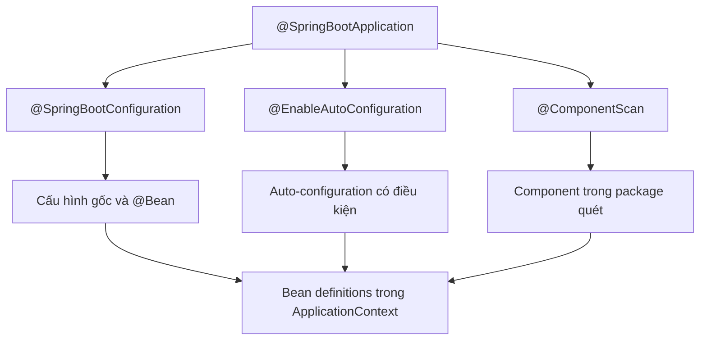
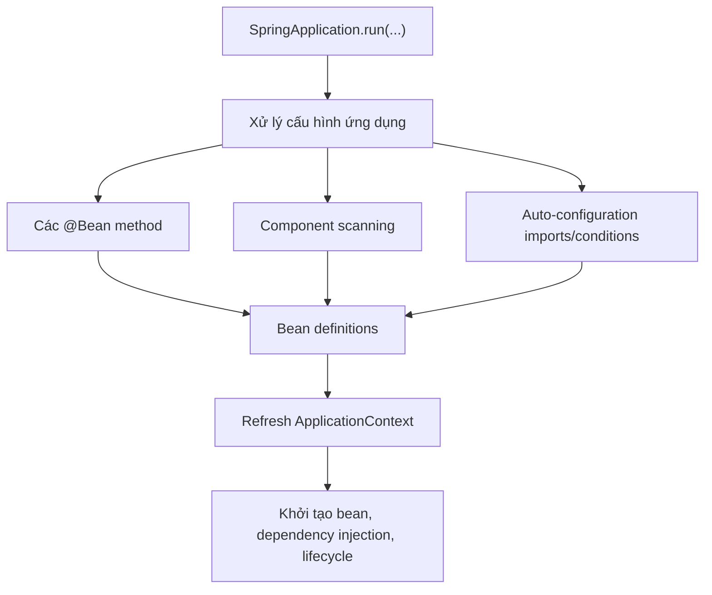

# Ba vai trò của @SpringBootConfiguration, @EnableAutoConfiguration và @ComponentScan

Một ứng dụng Spring Boot thường bắt đầu bằng lớp Java rất ngắn:

```java
package com.example.demo;

import org.springframework.boot.SpringApplication;
import org.springframework.boot.autoconfigure.SpringBootApplication;

@SpringBootApplication
public class DemoApplication {
    public static void main(String[] args) {
        SpringApplication.run(DemoApplication.class, args);
    }
}
```

Tuy chỉ gắn một annotation, `@SpringBootApplication` đảm nhận ba nhiệm vụ khác nhau: nhận diện **cấu hình gốc**, bật **tự cấu hình của Spring Boot** và **tìm những component do ứng dụng viết**. Hiểu rõ ba cơ chế giúp giải thích vì sao có dependency mà vẫn thiếu bean, vì sao controller tự được tìm thấy, vì sao ứng dụng tự có hạ tầng Spring MVC, và vì sao mở rộng package scan đôi khi gây lỗi ngoài ý muốn.

Bài học tập trung vào Spring Boot 3.x và Spring Framework 6 trên Java 21. Những ví dụ trong mỗi phần được viết để diễn giải một cơ chế; khi ghép vào một project thật, hãy đặt từng `public class` vào tệp Java cùng tên, khai báo package/import và các dependency phù hợp.

## 1. Một annotation tổng hợp, ba nhiệm vụ

`@SpringBootApplication` là một **composed annotation**: nó mang các meta-annotation có ý nghĩa chính sau.

| Annotation | Trách nhiệm | Câu hỏi nó trả lời |
| --- | --- | --- |
| `@SpringBootConfiguration` | Đánh dấu lớp là nguồn cấu hình Spring Boot; kế thừa ngữ nghĩa của `@Configuration` | “Cấu hình gốc của ứng dụng là lớp nào?” |
| `@EnableAutoConfiguration` | Cho phép Boot xét và nạp các auto-configuration phù hợp với classpath, property và những bean có sẵn | “Framework nên cấu hình sẵn những gì?” |
| `@ComponentScan` | Tìm các component/configuration được đánh dấu trong những package thuộc phạm vi quét | “Những lớp nào của ứng dụng cần đăng ký làm bean?” |



Để ghi nhớ, có thể hình dung gần đúng:

```java
@SpringBootConfiguration
@EnableAutoConfiguration
@ComponentScan
public class DemoApplication {
    // ...
}
```

Đây là **mô hình khái niệm**, không phải nội dung source đầy đủ của `@SpringBootApplication`. Annotation thực tế có thêm attribute chuyển tiếp và các bộ lọc riêng cho component scanning. Trong ứng dụng thông thường, nên dùng `@SpringBootApplication` để nhận đầy đủ mặc định của Boot.

Ba cơ chế cùng đóng góp vào **một quá trình xây dựng ApplicationContext**. Chúng không tạo ba container khác nhau. `ApplicationContext` quản lý bean definitions, khởi tạo bean thích hợp, inject dependency và điều phối lifecycle.

### 1.1. Phân biệt classpath, bean definition và bean instance

Ba khái niệm hay bị nhập nhằng:

- **Classpath** chứa những kiểu Java và resource mà class loader có thể đọc. Gradle/Maven dependency là một cách đưa JAR vào classpath.
- **Bean definition** mô tả cho Spring cách tạo và quản lý đối tượng, bao gồm kiểu, tên, scope, factory method và các metadata liên quan.
- **Bean instance** là đối tượng đã được Spring khởi tạo theo bean definition hoặc cơ chế đăng ký bean phù hợp.

Có class trên classpath **không bảo đảm** có bean definition, và lúc có bean definition **không nhất thiết** bean đã khởi tạo ngay. Chẳng hạn một bean `@Lazy` có thể được tạo muộn.

## 2. @SpringBootConfiguration: đánh dấu nguồn cấu hình gốc

`@SpringBootConfiguration` là biến thể Spring Boot của `@Configuration`. Do vậy một lớp `@SpringBootApplication` cũng là một nguồn cấu hình mà Spring có thể xử lý các phương thức `@Bean`.

Ví dụ khai báo đồng hồ dùng chung:

```java
package com.example.demo;

import java.time.Clock;
import org.springframework.boot.SpringApplication;
import org.springframework.boot.autoconfigure.SpringBootApplication;
import org.springframework.context.annotation.Bean;

@SpringBootApplication
public class DemoApplication {

    public static void main(String[] args) {
        SpringApplication.run(DemoApplication.class, args);
    }

    @Bean
    public Clock applicationClock() {
        return Clock.systemUTC();
    }
}
```

`Clock` là kiểu Java thuần, không có `@Component`. Nó vẫn trở thành Spring bean nhờ phương thức `@Bean` trong cấu hình đã được Spring nạp.

Một service được container quản lý có thể nhận bean này:

```java
package com.example.demo.order;

import java.time.Clock;
import java.time.Instant;
import org.springframework.stereotype.Service;

@Service
public class OrderTimeService {
    private final Clock clock;

    public OrderTimeService(Clock clock) {
        this.clock = clock;
    }

    public Instant createdAt() {
        return clock.instant();
    }
}
```

Trong ví dụ, service chỉ cần biết một `Clock`, không cần tự tạo `Clock.systemUTC()`. Unit test có thể trực tiếp dùng `new OrderTimeService(Clock.fixed(...))` để tránh lệ thuộc thời gian thực.

### 2.1. @Bean khác gì @Component?

`@Component` đánh dấu **lớp** để component scanner nhận diện; `@Bean` đánh dấu **phương thức factory** bên trong một configuration class đã được Spring xử lý.

```java
@Component
public class PriceCalculator {
    // Spring có thể phát hiện lớp này qua component scan.
}
```

```java
@Configuration(proxyBeanMethods = false)
public class PricingConfiguration {
    @Bean
    public ExchangeRateProvider exchangeRateProvider() {
        return new FixedExchangeRateProvider();
    }
}
```

Ở ví dụ thứ hai, `ExchangeRateProvider` và `FixedExchangeRateProvider` là kiểu ứng dụng giả định. `FixedExchangeRateProvider` không cần `@Component`: `@Bean` method tạo nó để Spring quản lý. Tuy nhiên, **configuration class phải được nạp vào context** trước, chẳng hạn nhờ component scan hoặc `@Import`; chỉ đặt `@Bean` vào một lớp ở ngoài mọi phạm vi cấu hình không đủ.

### 2.2. Vì sao “cấu hình gốc” quan trọng với test?

Spring Boot dùng `@SpringBootConfiguration` như một dấu hiệu để tìm cấu hình ứng dụng trong một số trường hợp, điển hình là `@SpringBootTest` khi không truyền `classes`. Framework có thể tìm từ package của lớp test lên những package cha để xác định lớp cấu hình Boot.

Giả sử:

```text
com.example.demo
├── DemoApplication                 (@SpringBootApplication)
└── order
    └── OrderTimeServiceTest        (@SpringBootTest)
```

Test nằm dưới package của cấu hình gốc nên thường có thể được Boot tìm thấy. Nếu lớp test ở package khác hẳn hoặc có nhiều cấu hình Boot cạnh tranh, hãy chỉ định rõ lớp:

```java
@SpringBootTest(classes = DemoApplication.class)
class OrderContextTest {
    // Kiểm thử cấu hình ứng dụng đã chỉ định.
}
```

`@SpringBootConfiguration` không tự khởi động server web. Chính `SpringApplication.run(...)` bootstrap ứng dụng; phần web server phụ thuộc dependency, loại ứng dụng và những điều kiện cấu hình tương ứng.

### 2.3. Thuộc tính proxyBeanMethods

`@SpringBootApplication` có thuộc tính `proxyBeanMethods`, mặc định là `true` trên Spring Boot 3.x. Điều này ảnh hưởng việc gọi trực tiếp giữa các `@Bean` method trong configuration class.

Ví dụ:

```java
@Configuration
class InfrastructureConfig {
    @Bean
    MailSender mailSender() {
        return new ConsoleMailSender();
    }

    @Bean
    MailService mailService() {
        return new MailService(mailSender());
    }
}
```

Khi sử dụng chế độ proxy đầy đủ, Spring có thể can thiệp lời gọi `mailSender()` giữa các bean method để nhận bean được container quản lý. Nếu đặt `proxyBeanMethods = false`, lời gọi ấy là lời gọi Java thông thường và có thể tạo đối tượng mới.

Để dùng chế độ không proxy rõ ràng, nên tiêm bean qua tham số:

```java
@Configuration(proxyBeanMethods = false)
class InfrastructureConfig {
    @Bean
    MailSender mailSender() {
        return new ConsoleMailSender();
    }

    @Bean
    MailService mailService(MailSender mailSender) {
        return new MailService(mailSender);
    }
}
```

`MailSender`, `ConsoleMailSender` và `MailService` ở đây là những kiểu minh họa. Điểm cần nhớ: Spring resolve dependency của `@Bean` method tương tự cách resolve tham số constructor của bean. Với `@SpringBootApplication(proxyBeanMethods = false)`, tránh dựa vào việc gọi trực tiếp một bean method khác để lấy singleton.

## 3. @EnableAutoConfiguration: tự cấu hình có điều kiện

`@EnableAutoConfiguration` yêu cầu Spring Boot xem xét các **auto-configuration class** trên classpath. Những class này mô tả điều kiện và bean mặc định cho các năng lực framework, như Spring MVC, HTTP message conversion, JDBC/DataSource, transaction, caching hoặc tích hợp các thư viện.

Auto-configuration thường được kích hoạt bởi tổ hợp:

1. **Classpath**: thư viện/kiểu Java cần thiết có mặt.
2. **Properties/environment**: cấu hình được bật và giá trị hợp lệ.
3. **Bean đang tồn tại**: chưa có implementation do ứng dụng tự cung cấp, hoặc đã có dependency mà cấu hình cần.
4. **Loại ứng dụng**: ví dụ Servlet Web, Reactive Web hay ứng dụng non-web.

Vì vậy, “auto” không có nghĩa là Boot tự khởi tạo tất cả class hay tất cả bean trong thư viện.

### 3.1. Ví dụ với spring-boot-starter-web

Khi ứng dụng thêm `spring-boot-starter-web`, những thư viện thích hợp cho ứng dụng Spring MVC được đưa vào classpath. Các auto-configuration của Spring Boot có thể chọn và đăng ký những bean nền tảng cho mô hình MVC, JSON serialization, embedded servlet container và hạ tầng web khác nếu điều kiện tương ứng thỏa mãn.

Đồng thời, ứng dụng tự viết:

```java
package com.example.demo.api;

import org.springframework.web.bind.annotation.GetMapping;
import org.springframework.web.bind.annotation.RestController;

@RestController
public class PingController {
    @GetMapping("/ping")
    public String ping() {
        return "pong";
    }
}
```

Hai cơ chế cùng làm việc nhưng giữ vai trò riêng:

- `@ComponentScan` giúp Spring tìm `PingController` dưới package được quét.
- `@EnableAutoConfiguration` giúp Boot cấu hình phần hạ tầng web phù hợp với classpath và điều kiện.

Nếu chỉ có class controller trên compile classpath nhưng không có hạ tầng web được cấu hình, không thể suy ra rằng request HTTP sẽ hoạt động.

### 3.2. Auto-configuration được khám phá từ metadata

Trong Spring Boot 3, những JAR cung cấp auto-configuration đăng ký các class tương ứng qua resource:

```text
META-INF/spring/org.springframework.boot.autoconfigure.AutoConfiguration.imports
```

Tệp chứa tên lớp đầy đủ, một lớp trên mỗi dòng. Ví dụ:

```text
com.example.shared.GreetingAutoConfiguration
```

Một thư viện có thể cung cấp:

```java
package com.example.shared;

@FunctionalInterface
public interface GreetingFormatter {
    String format(String name);
}
```

```java
package com.example.shared;

import org.springframework.boot.autoconfigure.AutoConfiguration;
import org.springframework.boot.autoconfigure.condition.ConditionalOnMissingBean;
import org.springframework.context.annotation.Bean;

@AutoConfiguration
public class GreetingAutoConfiguration {

    @Bean
    @ConditionalOnMissingBean(GreetingFormatter.class)
    public GreetingFormatter greetingFormatter() {
        return name -> "Xin chào " + name;
    }
}
```

Giả sử thư viện đã có dependency phù hợp và JAR chứa metadata imports như trên, khi ứng dụng Boot sử dụng thư viện:

- Nếu chưa có bean `GreetingFormatter`, cấu hình này có thể đăng ký formatter mặc định.
- Nếu ứng dụng đã tự khai báo bean phù hợp, `@ConditionalOnMissingBean` cho phép cấu hình mặc định lùi lại.

Lưu ý: `@AutoConfiguration` định nghĩa một cấu hình tự động của thư viện; `@EnableAutoConfiguration` ở phía ứng dụng là cơ chế kích hoạt việc xét các cấu hình đó. Đối với thư viện Boot 3, chỉ đặt `@AutoConfiguration` lên một class mà không thêm `AutoConfiguration.imports` **không đủ** để class ấy tự được Boot import từ JAR.

### 3.3. Các điều kiện hay gặp

| Annotation | Điều kiện | Ứng dụng điển hình |
| --- | --- | --- |
| `@ConditionalOnClass` | Một hoặc nhiều class có trên classpath | Chỉ tích hợp khi thư viện liên quan tồn tại |
| `@ConditionalOnMissingBean` | Chưa tồn tại bean phù hợp trong phạm vi kiểm tra | Cung cấp bean mặc định mà ứng dụng có thể thay |
| `@ConditionalOnBean` | Đã có bean cần thiết | Bật phần mở rộng khi dependency đã sẵn sàng |
| `@ConditionalOnProperty` | Property đáp ứng điều kiện | Bật/tắt tính năng |
| `@ConditionalOnWebApplication` | Có ngữ cảnh web phù hợp | Chỉ bật cấu hình cho ứng dụng web |

Ví dụ cấu hình mặc định có cờ bật/tắt:

```java
@AutoConfiguration
@ConditionalOnProperty(
    prefix = "feature.greeting",
    name = "enabled",
    havingValue = "true",
    matchIfMissing = true
)
public class GreetingAutoConfiguration {
    // @Bean method giống ví dụ phía trên.
}
```

```yaml
feature:
  greeting:
    enabled: false
```

Khi property là `false`, cấu hình này bị loại theo condition. Nếu controller vẫn yêu cầu `GreetingFormatter` và không còn bean nào khác cung cấp nó, context có thể khởi động thất bại vì thiếu dependency. Bật/tắt auto-configuration phải đi kèm cách thiết kế consumer thích hợp.

### 3.4. Điều chỉnh hoặc loại trừ auto-configuration

Mục đích của auto-configuration là cung cấp những mặc định hữu ích và cho phép ứng dụng tùy chỉnh. Có thể:

- Định nghĩa bean riêng nếu auto-configuration dùng `@ConditionalOnMissingBean`.
- Đổi property trong `application.yml` hoặc biến môi trường.
- Thay đổi dependency dẫn tới condition match/không match.
- Loại trừ một auto-configuration cụ thể khi thực sự không muốn sử dụng.

Ví dụ:

```java
import org.springframework.boot.autoconfigure.SpringBootApplication;
import org.springframework.boot.autoconfigure.jdbc.DataSourceAutoConfiguration;

@SpringBootApplication(exclude = DataSourceAutoConfiguration.class)
public class DemoApplication {
    // ...
}
```

`exclude` của `@SpringBootApplication` chuyển đến phần xử lý của `@EnableAutoConfiguration`. Nó **loại trừ một auto-configuration**, không tự xóa mọi `@Service` hay `@Repository` do ứng dụng khai báo và cũng không gỡ JAR khỏi classpath.

Có thể diễn đạt tương đương qua property:

```properties
spring.autoconfigure.exclude=org.springframework.boot.autoconfigure.jdbc.DataSourceAutoConfiguration
```

Đây chỉ là ví dụ về cú pháp. Nếu ứng dụng thật còn cần database, việc loại trừ `DataSourceAutoConfiguration` có thể làm nhiều bean khác không tạo được; cần xác định nguyên nhân trước khi exclude.

## 4. @ComponentScan: phát hiện lớp của ứng dụng

`@ComponentScan` tìm **component candidate** trong phạm vi package, thường là các lớp có `@Component` hoặc annotation mang ngữ nghĩa của `@Component`.

Các stereotype phổ biến:

| Annotation | Mục đích |
| --- | --- |
| `@Component` | Thành phần Spring thông thường |
| `@Service` | Lớp xử lý nghiệp vụ/dịch vụ |
| `@Repository` | Adapter truy cập dữ liệu, với một số ngữ nghĩa bổ sung của Spring |
| `@Controller` | Controller của Spring MVC |
| `@RestController` | Controller trả body trực tiếp, kết hợp `@Controller` và `@ResponseBody` |
| `@Configuration` | Cấu hình chứa bean definitions, thường có các `@Bean` method |

Những annotation chỉ giúp class trở thành **ứng viên**. Spring còn phải xét cấu hình scanning và các condition liên quan. `@ComponentScan` không đơn giản là “tạo bean từ mọi class”.

### 4.1. Package mặc định là package chứa lớp @SpringBootApplication

Với lớp main:

```text
com.example.demo
├── DemoApplication              (@SpringBootApplication)
├── api
│   └── GreetingController       (@RestController)
├── service
│   └── GreetingService          (@Service)
└── config
    └── ClockConfiguration       (@Configuration)
```

Spring component scan mặc định quét `com.example.demo` và các package con. Vì vậy những lớp đánh dấu như trên có thể được tìm thấy.

Một ví dụ đầy đủ của service và controller:

```java
package com.example.demo.service;

import org.springframework.stereotype.Service;

@Service
public class GreetingService {
    public String greet(String name) {
        return "Xin chào " + name;
    }
}
```

```java
package com.example.demo.api;

import com.example.demo.service.GreetingService;
import org.springframework.web.bind.annotation.GetMapping;
import org.springframework.web.bind.annotation.RequestParam;
import org.springframework.web.bind.annotation.RestController;

@RestController
public class GreetingController {
    private final GreetingService service;

    public GreetingController(GreetingService service) {
        this.service = service;
    }

    @GetMapping("/greet")
    public String greet(@RequestParam String name) {
        return service.greet(name);
    }
}
```

Khi có web starter và app được khởi động đúng cấu hình, `GET /greet?name=Lan` có thể trả về `Xin chào Lan`. `GreetingController` và `GreetingService` là các component được phát hiện bằng scanning; bean hạ tầng MVC và web server chủ yếu đến từ auto-configuration.

### 4.2. Package nằm ngoài cây mặc định sẽ không tự được quét

Giả sử:

```text
com.example.app
└── DemoApplication           (@SpringBootApplication)

com.example.shared
└── SharedMailer              (@Service)
```

Dù `shared-mailer.jar` nằm trên runtime classpath, `SharedMailer` ở package anh em `com.example.shared` **không mặc nhiên được component scan từ `com.example.app` tìm thấy**.

Có thể chỉ định rõ những package muốn quét:

```java
@SpringBootApplication(scanBasePackages = {
    "com.example.app",
    "com.example.shared"
})
public class DemoApplication {
    // ...
}
```

Hoặc dùng marker class để tránh viết chuỗi tên package:

```java
@SpringBootApplication(scanBasePackageClasses = {
    DemoApplication.class,
    SharedScanMarker.class
})
public class DemoApplication {
    // ...
}
```

Giả định `SharedScanMarker` là class được thư viện đặt ở package `com.example.shared`; ứng dụng phải import kiểu đó. Đây là cách quy định phạm vi scanning bằng kiểu Java, giúp IDE/refactoring hỗ trợ tốt hơn.

Hai attribute `scanBasePackages` và `scanBasePackageClasses` của `@SpringBootApplication` là alias cho phần cấu hình **component scanning**. Chúng **không tự thay đổi** phạm vi quét Spring Data repositories hoặc JPA entities. Với cấu trúc JPA nằm ngoài phạm vi mặc định, có thể cần xem `@EntityScan`, `@EnableJpaRepositories` hoặc cấu hình chuyên biệt của công nghệ dữ liệu.

### 4.3. Đặt lớp main ở đâu?

Đặt `DemoApplication` ở package gốc của ứng dụng, rồi đặt controller/service/config bên dưới là một cách tổ chức phổ biến:

```text
com.example.shop
├── ShopApplication
├── order
├── catalog
├── customer
└── infrastructure
```

Nếu lớp main nằm quá sâu như `com.example.shop.bootstrap`, các package anh em có thể bị bỏ qua. Ngược lại, đặt nó quá cao như `com.example` có thể làm scanner tìm cả các component của nhiều ứng dụng hoặc thư viện không thuộc chương trình hiện tại, dẫn đến bean không mong muốn.

### 4.4. Include và exclude filters

`@ComponentScan` hỗ trợ `includeFilters`, `excludeFilters` và `useDefaultFilters` khi cần điều chỉnh candidate selection:

```java
import org.springframework.context.annotation.ComponentScan;
import org.springframework.context.annotation.FilterType;

@ComponentScan(
    basePackages = "com.example.demo",
    excludeFilters = @ComponentScan.Filter(
        type = FilterType.ASSIGNABLE_TYPE,
        classes = ExperimentalNotifier.class
    )
)
public class ComponentScanningConfiguration {
}
```

Ở ví dụ này, `ExperimentalNotifier` là kiểu có trên classpath. Bộ lọc loại nó khỏi ứng viên của lần scan đó. Nó không phải cách chung để tắt auto-configuration đã được Boot import qua cơ chế riêng.

`@SpringBootApplication` thực tế cũng đặt một số bộ lọc scanning của Spring Boot. Điều đó giải thích thêm vì sao tự thay cả annotation bằng ba dòng `@SpringBootConfiguration`, `@EnableAutoConfiguration`, `@ComponentScan` không nhất thiết cho hành vi giống hệt ở mọi góc cạnh.

## 5. Ba cơ chế phối hợp trong lúc khởi động

Khi gọi `SpringApplication.run(DemoApplication.class, args)`, Spring Boot chuẩn bị context, nạp các nguồn cấu hình và xử lý bean definitions. Có thể hình dung luồng trách nhiệm:



Sơ đồ này diễn tả **mối quan hệ**, không khẳng định ba cơ chế chạy độc lập theo đúng thứ tự được vẽ. Spring xử lý configuration class, imports, conditions và bean post-processors qua nhiều bước trong vòng đời container.

Từ đây có thể trả lời ba câu hỏi:

**Nếu bỏ `@ComponentScan` thì sao?** Những lớp chỉ dựa vào component scanning có thể không được đăng ký. Tuy nhiên, các bean được khai báo bằng `@Bean`, `@Import` hoặc những cơ chế đăng ký khác vẫn có thể tồn tại.

**Nếu bỏ `@EnableAutoConfiguration` thì sao?** Ứng dụng có thể vẫn có các bean do mình đăng ký, nhưng nhiều mặc định của Spring Boot cho web, database và thư viện sẽ không được tự nạp; lập trình viên phải chủ động cấu hình các năng lực cần dùng.

**Nếu không có `@SpringBootConfiguration` thì sao?** Ứng dụng có thể vẫn dùng những nguồn `@Configuration` Spring khác, nhưng mất dấu hiệu cấu hình gốc theo quy ước Boot; những cơ chế tìm cấu hình chính trong một số bài kiểm thử có thể hoạt động khác hoặc yêu cầu khai báo tường minh.

### 5.1. Một bean có thể được đăng ký bằng nhiều con đường

Ví dụ ba nguồn bean khác nhau:

```java
// Đường 1: component scan nếu nằm trong package được quét
@Service
public class BusinessService {
}
```

```java
// Đường 2: @Bean trong cấu hình đã được nạp
@Configuration(proxyBeanMethods = false)
public class TimeConfiguration {
    @Bean
    public Clock clock() {
        return Clock.systemUTC();
    }
}
```

```java
// Đường 3: @Bean trong auto-configuration đã được Boot import
@AutoConfiguration
public class LibraryAutoConfiguration {
    @Bean
    @ConditionalOnMissingBean(LibraryClient.class)
    public LibraryClient libraryClient() {
        return new LibraryClient();
    }
}
```

Các kiểu `LibraryClient` và `BusinessService` chỉ mang tính minh họa. Đường 3 còn cần tệp `AutoConfiguration.imports`. Cả ba đường có thể tạo bean trong cùng context, nhưng mỗi đường có quy tắc lựa chọn khác nhau.

## 6. Ranh giới trong dự án nhiều module

Xem một dự án Gradle:

```text
multi-module-project/
├── settings.gradle
├── app/
│   └── src/main/java/com/example/app/DemoApplication.java
├── customer-feature/
│   └── src/main/java/com/example/customer/CustomerService.java
└── shared-spring/
    ├── src/main/java/com/example/shared/SharedAutoConfiguration.java
    └── src/main/resources/META-INF/spring/
        └── org.springframework.boot.autoconfigure.AutoConfiguration.imports
```

Nếu `app` khai báo dependency tới `customer-feature` và `shared-spring`, Gradle đưa các lớp và resource cần thiết vào classpath. Nhưng bean registration có quy tắc riêng:

| Thành phần | Có trên classpath | Có mặc nhiên thành bean? | Cơ chế phù hợp |
| --- | --- | --- | --- |
| `CustomerService` mang `@Service` ở `com.example.customer` | Có | Không nếu ngoài component scan | Điều chỉnh scan có chủ đích hoặc import cấu hình |
| `SharedAutoConfiguration` có imports metadata đúng | Có | Có thể, khi auto-configuration được bật và condition match | `@EnableAutoConfiguration` |
| `CustomerId` là value object Java thuần | Có | Không | Được tạo bằng `new` khi cần; thường không cần là bean |
| `SharedValidator` không có stereotype | Có | Không | Đăng ký bằng `@Bean`/cấu hình nếu cần DI |

**Mỗi Gradle subproject không tự có một `ApplicationContext`.** Các artifact từ nhiều subproject có thể hợp thành một ứng dụng Boot, dùng chung một context chính. Nếu có hai ứng dụng Boot chạy thành hai tiến trình riêng, mỗi ứng dụng có context của chính nó, kể cả khi dùng cùng một thư viện.

### 6.1. Dùng @Import để nạp cấu hình dùng chung

Nếu shared module có configuration class rõ ràng, ứng dụng có thể quyết định import:

```java
package com.example.shared;

import org.springframework.context.annotation.Bean;
import org.springframework.context.annotation.Configuration;

@Configuration(proxyBeanMethods = false)
public class SharedConfiguration {
    @Bean
    public SharedValidator sharedValidator() {
        return new SharedValidator();
    }
}
```

```java
package com.example.app;

import com.example.shared.SharedConfiguration;
import org.springframework.boot.autoconfigure.SpringBootApplication;
import org.springframework.context.annotation.Import;

@SpringBootApplication
@Import(SharedConfiguration.class)
public class DemoApplication {
    // ...
}
```

Ví dụ giả định `SharedValidator` là một lớp Java trong shared module. `@Import` nạp `SharedConfiguration` dù nó nằm ngoài package scan mặc định của `com.example.app`. Đây là giải pháp tường minh thường hữu ích cho thư viện nội bộ.

Nếu thư viện được dùng trong nhiều ứng dụng Boot và muốn cấp mặc định có điều kiện, auto-configuration với `AutoConfiguration.imports` có thể thích hợp hơn. Hạn chế nạp cùng một cấu hình qua nhiều con đường nếu điều đó dẫn đến bean trùng lặp hoặc khó biết ai sở hữu đăng ký bean.

### 6.2. Component scanning khác với auto-configuration package

Trong Spring Boot, vị trí lớp kích hoạt auto-configuration còn được dùng để xác định một số **auto-configuration packages** mặc định. Những package này có vai trò trong một số cơ chế khám phá dữ liệu, chẳng hạn entity/repository khi có tích hợp tương ứng.

Điều này khác với việc cấu hình `scanBasePackages` cho component scanning. Vì vậy, nếu di chuyển JPA entities/repositories sang module khác, không nên giả định mở rộng component scan sẽ tự giải quyết lỗi `Not a managed type` hoặc repository không được phát hiện. Hãy kiểm tra phạm vi entity/repository, dùng `@EntityScan`, `@EnableJpaRepositories` hay cấu hình tương ứng khi cần.

## 7. Phân biệt exclude auto-configuration với filter component scan

Hai thao tác có vẻ giống nhau nhưng tác động khác nhau:

```java
@SpringBootApplication(
    exclude = DataSourceAutoConfiguration.class
)
public class DemoApplication {
}
```

Đây là loại trừ một **auto-configuration**. Nó không tự xóa một repository hay service do ứng dụng viết.

```java
@ComponentScan(
    basePackages = "com.example.demo",
    excludeFilters = @ComponentScan.Filter(
        type = FilterType.ASSIGNABLE_TYPE,
        classes = DebugOnlyService.class
    )
)
public class ScanConfig {
}
```

Đây là loại một **candidate khỏi component scan**, giả định `DebugOnlyService` có trên classpath. Nó không có nghĩa Boot ngừng xét các auto-configuration web/database.

| Tùy chỉnh | Tác động trực tiếp |
| --- | --- |
| `@SpringBootApplication(exclude = ...)` | Loại lớp auto-configuration được chỉ định |
| `@SpringBootApplication(excludeName = ...)` | Loại auto-configuration theo tên lớp |
| `spring.autoconfigure.exclude` | Loại những auto-configuration được cấu hình qua property |
| `@ComponentScan(excludeFilters = ...)` | Lọc component candidate thuộc phạm vi scanning |
| Xóa một Gradle/Maven dependency | Thay đổi classpath, có thể làm điều kiện auto-configuration đổi kết quả |

Các thay đổi có thể có tác động gián tiếp: tắt một auto-configuration tạo `DataSource` có thể ảnh hưởng các bean đang yêu cầu `DataSource`; lọc một service có thể khiến controller thiếu dependency.

## 8. Chẩn đoán lỗi theo đúng trách nhiệm

### 8.1. “Required a bean ... could not be found”

Giả sử:

```text
Parameter 0 of constructor in com.example.demo.api.GreetingController
required a bean of type 'com.example.demo.service.GreetingService'
that could not be found.
```

Hãy xác định bean đáng lẽ được đăng ký bằng cách nào:

1. Lớp có `@Service` hoặc annotation được scanner nhận diện không?
2. Package của lớp có nằm trong vùng component scan không?
3. Nếu bean do `@Bean` tạo, configuration class đã được scan/import chưa?
4. Nếu do auto-configuration tạo, tệp `AutoConfiguration.imports` có được đóng gói trong JAR và condition có match không?
5. Bean có bị loại bởi profile/property, hoặc thiếu class/dependency cần thiết trên runtime classpath không?

Sửa đúng cơ chế đang chịu trách nhiệm. **Thêm `@ComponentScan` không chữa được việc JAR không có trên classpath**; thêm dependency không tự giải quyết việc package ngoài vùng quét.

### 8.2. Có nhiều bean cùng kiểu

Nếu có hai implementation `PaymentGateway` đều đăng ký bean và service yêu cầu một `PaymentGateway` duy nhất, Spring có thể không biết nên chọn bean nào.

Những giải pháp có chủ đích gồm `@Qualifier`, `@Primary`, thay đổi cấu hình đăng ký, hoặc thiết kế auto-configuration mặc định với `@ConditionalOnMissingBean`. Không nên dùng `@Primary` chỉ để che việc quét quá rộng đưa vào những bean không dành cho ứng dụng này.

### 8.3. Auto-configuration không kích hoạt

Một auto-configuration có thể được xem xét nhưng bị loại vì:

- Thiếu class cần thiết trên classpath.
- Property không thỏa điều kiện.
- Bean bắt buộc chưa có hoặc bean thay thế đã tồn tại.
- Không đúng loại context web/non-web.
- Cấu hình đã bị exclude.

Khi chẩn đoán ở môi trường phát triển, chạy ứng dụng với `--debug` giúp nhận báo cáo đánh giá điều kiện (*conditions evaluation report*) trong log:

```text
java -jar app.jar --debug
```

Tìm phần positive/negative matches và lý do condition match hay không. Nếu dùng Spring Boot Actuator và chủ động cấu hình endpoint cũng như quyền truy cập thích hợp, `/actuator/conditions` có thể cung cấp thông tin tương ứng. Không mặc định công khai endpoint chẩn đoán trên production.

### 8.4. Nhiều @SpringBootApplication trong cùng phạm vi

Một shared library thông thường không cần có `@SpringBootApplication` riêng. Nếu nhiều cấu hình gốc được quét hoặc được test discovery thấy, context có thể nạp cấu hình không mong muốn hoặc test không biết đâu là ứng dụng chính.

Thông thường, mỗi ứng dụng triển khai độc lập có entry point rõ ràng. Các module thư viện cung cấp `@Configuration` hoặc `@AutoConfiguration` tùy hợp đồng đăng ký bean.

## 9. Kiểm thử ba cơ chế

Không phải bài test nào cũng cần Spring context. Với `GreetingService` ở phần 4, unit test Java thuần đã đủ để kiểm chứng hành vi:

```java
import static org.junit.jupiter.api.Assertions.assertEquals;

import com.example.demo.service.GreetingService;
import org.junit.jupiter.api.Test;

class GreetingServiceTest {

    @Test
    void createsGreeting() {
        GreetingService service = new GreetingService();

        assertEquals("Xin chào Lan", service.greet("Lan"));
    }
}
```

Test đó **không chứng minh** Spring đã phát hiện bean. Khi muốn xác nhận application wiring, sử dụng bài test context của Boot:

```java
package com.example.demo;

import static org.junit.jupiter.api.Assertions.assertNotNull;

import com.example.demo.service.GreetingService;
import org.junit.jupiter.api.Test;
import org.springframework.beans.factory.annotation.Autowired;
import org.springframework.boot.test.context.SpringBootTest;
import org.springframework.context.ApplicationContext;

@SpringBootTest(classes = DemoApplication.class)
class DemoApplicationContextTest {

    @Autowired
    private ApplicationContext context;

    @Test
    void discoversGreetingService() {
        assertNotNull(context.getBean(GreetingService.class));
    }
}
```

Test này cần dependency `spring-boot-starter-test` hoặc bộ thư viện kiểm thử tương ứng. Nó kiểm tra việc context được dựng và service có mặt; không tự thay thế integration test về HTTP hoặc database.

### 9.1. Kiểm thử auto-configuration một cách độc lập

Spring Boot có `ApplicationContextRunner` để tạo context nhỏ và kiểm tra cấu hình tự động:

```java
import static org.assertj.core.api.Assertions.assertThat;

import org.junit.jupiter.api.Test;
import org.springframework.boot.autoconfigure.AutoConfigurations;
import org.springframework.boot.test.context.runner.ApplicationContextRunner;

class GreetingAutoConfigurationTest {

    private final ApplicationContextRunner runner =
            new ApplicationContextRunner()
                    .withConfiguration(
                        AutoConfigurations.of(GreetingAutoConfiguration.class)
                    );

    @Test
    void registersDefaultBean() {
        runner.run(context ->
                assertThat(context).hasSingleBean(GreetingFormatter.class)
        );
    }

    @Test
    void respectsApplicationBean() {
        runner.withBean(
                GreetingFormatter.class,
                () -> name -> "Chào " + name
        ).run(context -> {
            assertThat(context).hasSingleBean(GreetingFormatter.class);
            assertThat(context.getBean(GreetingFormatter.class).format("Lan"))
                    .isEqualTo("Chào Lan");
        });
    }
}
```

Test trên giả định các lớp `GreetingAutoConfiguration` và `GreetingFormatter` ở phần 3 đã tồn tại và có dependency test phù hợp. `ApplicationContextRunner` kiểm tra điều kiện/bean registration của auto-configuration mà không phải khởi động toàn bộ web application.

## 10. Những nhầm lẫn thường gặp

| Cách hiểu sai | Cách hiểu đúng |
| --- | --- |
| “`@SpringBootApplication` chỉ đánh dấu hàm main.” | Nó kết hợp ba vai trò cấu hình, auto-configuration và component scan. |
| “`@EnableAutoConfiguration` quét mọi `@Service`.” | Việc tìm `@Service` chủ yếu thuộc component scanning. |
| “Thêm dependency là mọi class thành bean.” | Dependency đưa class/resource vào classpath; bean còn cần được đăng ký. |
| “`@ComponentScan` tự tìm mọi package trong JAR.” | Nó quét những package nằm trong phạm vi đã cấu hình. |
| “`@Bean` ở bất cứ lớp nào đều được Spring chạy.” | Lớp chứa bean method cần được Spring nạp và xử lý thích hợp. |
| “Auto-configuration chắc chắn đăng ký tất cả bean.” | Điều kiện có thể khiến bean/config không được đăng ký. |
| “Exclude auto-configuration cũng loại các @Component.” | Đây là hai cơ chế khác nhau. |
| “`scanBasePackages` điều khiển toàn bộ JPA entity/repository discovery.” | Entity và repository có cơ chế phạm vi riêng. |
| “Mỗi Gradle module tạo một context.” | Các subproject có thể cùng được một ứng dụng và một context sử dụng. |

## 11. Bài tập thực hành

### Bài tập 1 — Quan sát phạm vi component scan

Đặt `DemoApplication` ở `com.example.demo`, service ở `com.example.demo.service` và controller ở `com.example.demo.api`. Khởi chạy, rồi chuyển service sang package `com.example.external` nằm ngoài vùng scan. Dự đoán lỗi lúc khởi động. Sửa bằng cách đặt lại package, cấu hình `scanBasePackageClasses`, hoặc import một configuration đăng ký service.

### Bài tập 2 — Phân biệt @Bean với @Component

Tạo `@Bean Clock clock()` trong `@Configuration`, inject `Clock` vào một service. Chứng minh `Clock` không cần annotation `@Component`. Sau đó chuyển configuration ra ngoài vùng scan, bỏ `@Import` nếu có, và giải thích vì sao bean biến mất khỏi context.

### Bài tập 3 — Kiểm tra auto-configuration có điều kiện

Viết thư viện có `GreetingFormatter`, `GreetingAutoConfiguration` dùng `@ConditionalOnMissingBean` và metadata `AutoConfiguration.imports`. Quan sát bean mặc định. Sau đó khai báo formatter riêng trong ứng dụng và dùng `ApplicationContextRunner` xác nhận bean người dùng được chọn.

### Bài tập 4 — Chẩn đoán thay vì thêm annotation ngẫu nhiên

Tạo một cấu hình bị vô hiệu hóa bởi `@ConditionalOnProperty`. Đọc conditions evaluation report trong môi trường phát triển và ghi rõ property/condition nào khiến bean không được tạo. Kiểm tra một controller phụ thuộc bean này sẽ có chuyện gì khi tính năng bị tắt.

### Bài tập 5 — Thiết kế cho nhiều module

Giả sử ứng dụng có `app`, `catalog`, `payment` và `shared-observability`. Chọn một trong các cách component scanning, `@Import` hoặc auto-configuration cho từng module. Giải thích sự khác biệt giữa dependency build, package scanning và bean registration trong quyết định của mình.

## 12. Kết luận

`@SpringBootApplication` kết hợp ba trách nhiệm liên quan nhưng không thay thế nhau. **`@SpringBootConfiguration`** xác định nguồn cấu hình gốc và cho phép khai báo `@Bean`; **`@EnableAutoConfiguration`** kích hoạt các cấu hình mặc định có điều kiện của Spring Boot; **`@ComponentScan`** tìm các component/configuration do ứng dụng khai báo trong phạm vi package được quét.

Khi gặp lỗi bean, hãy xác định bean đó đáng lẽ được đăng ký qua **configuration method**, **component scan**, **auto-configuration**, hay **explicit import**. Phân biệt được các con đường này giúp tổ chức source code theo package/module rõ ràng, tùy chỉnh Boot có chủ đích và tránh những sửa đổi cấu hình gây tác động ngoài mong muốn.

