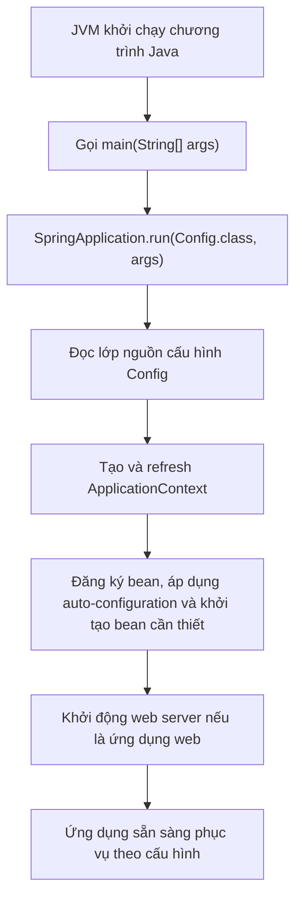
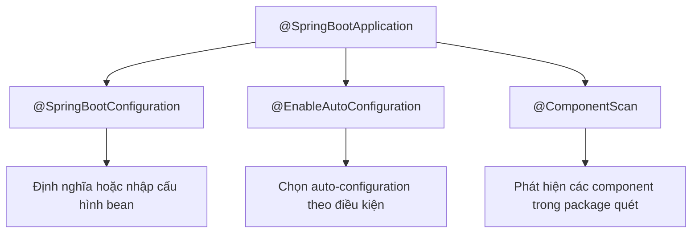

# Phân biệt lớp main Java với lớp cấu hình nguồn của Spring

Trong dự án Spring Boot đầu tiên, bạn thường gặp một lớp giống thế này:

```java
package com.example.demo;

import org.springframework.boot.SpringApplication;
import org.springframework.boot.autoconfigure.SpringBootApplication;

@SpringBootApplication
public class DemoApplication {

    public static void main(String[] args) {
        SpringApplication.run(DemoApplication.class, args);
    }
}
```

Vì `@SpringBootApplication` và `main()` cùng nằm trong một lớp, người mới học dễ nghĩ chúng là hai phần không thể tách rời: “Lớp main phải gắn `@SpringBootApplication`”, hoặc “Thấy `@SpringBootApplication` là Java tự chạy lớp đó”. Cả hai nhận định đều không chính xác.

**Lớp chứa `main()` là nơi JVM bắt đầu thực thi chương trình Java. Lớp cấu hình nguồn của Spring là nơi Spring lấy thông tin để xây dựng `ApplicationContext`.** Hai vai trò thường được đặt chung để dự án đơn giản, nhưng có thể nằm ở các lớp khác nhau.

Để hiểu rõ, cần phân biệt ba đối tượng:

1. **Java entry point:** phương thức `public static void main(String[] args)`.
2. **Spring Boot launcher:** lời gọi `SpringApplication.run(...)` bắt đầu quá trình bootstrap Spring.
3. **Spring configuration source:** lớp được truyền vào `run(...)`, thường mang `@SpringBootApplication`, mô tả cấu hình gốc để Spring xử lý.

## 1. Bức tranh tổng thể: Ai làm gì khi chạy ứng dụng?



Sơ đồ trên là luồng khái quát. Trong quá trình startup, Spring Boot còn chuẩn bị environment, xử lý event, thực thi các lifecycle callback và runner. Thứ tự chi tiết của một vài thành phần phụ thuộc phiên bản và loại ứng dụng.

Điểm quyết định là:

- **JVM** biết cách tìm và chạy một entry point Java; JVM không hiểu ý nghĩa của `@SpringBootApplication`.
- **SpringApplication** nhận một hoặc nhiều nguồn cấu hình và tổ chức quá trình tạo Spring context.
- **Spring container** dùng metadata cấu hình, component scanning và auto-configuration để tạo và quản lý bean.

Vì vậy, việc lớp `DemoApplication` xuất hiện hai lần trong ví dụ đầu tiên là do **cùng một lớp đang đảm nhận hai vai trò**: chứa `main()` và là nguồn cấu hình.

## 2. Lớp main Java: Trách nhiệm của Java trước khi Spring tồn tại

### 2.1. Main method là gì?

Trong ứng dụng Java truyền thống, entry point phổ biến có dạng:

```java
public class PlainJavaApplication {

    public static void main(String[] args) {
        System.out.println("Java program started");

        for (String arg : args) {
            System.out.println("Argument: " + arg);
        }
    }
}
```

Nếu chạy lớp này bằng Java launcher phù hợp, JVM sẽ thực thi `main(String[] args)`. Không cần Spring, không cần bean và không cần `ApplicationContext`.

Các phần trong chữ ký phương thức có ý nghĩa:

| Thành phần | Ý nghĩa trong entry point Java truyền thống |
|---|---|
| `public` | Có thể được launcher gọi theo hợp đồng entry point truyền thống |
| `static` | Không cần tạo instance của lớp trước khi gọi |
| `void` | Phương thức không trả giá trị cho bên gọi |
| `main` | Tên phương thức entry point |
| `String[] args` | Các tham số dòng lệnh gửi đến chương trình |

Đây là chữ ký quen thuộc và phù hợp để học Spring Boot cơ bản. Một số phiên bản Java mới hỗ trợ thêm các dạng chương trình/entry point khác, nhưng không ảnh hưởng tới cách giải thích về vai trò của Spring.

### 2.2. Lớp main không tự động là Spring bean

Xét mã:

```java
public class Launcher {

    public static void main(String[] args) {
        System.out.println("Start");
    }
}
```

JVM gọi phương thức tĩnh của lớp này, nhưng điều đó **không tạo một Spring bean tên `launcher`**, không bật dependency injection và không cấu hình các thành phần web.

Kể cả khi ứng dụng được chạy bằng `java -jar`, Java launcher vẫn chỉ làm nhiệm vụ khởi chạy entry point được mô tả trong cách đóng gói. Spring chỉ được khởi tạo khi mã thực thi thực sự gọi một cơ chế bootstrap Spring, thường là `SpringApplication.run(...)`.

### 2.3. Main method có thể làm nhiều việc, nhưng nên giữ gọn

Trong một ứng dụng Boot thông thường, phương thức main lý tưởng chỉ cần:

```java
public static void main(String[] args) {
    SpringApplication.run(DemoApplication.class, args);
}
```

Bạn có thể cấu hình `SpringApplication` trước khi chạy, nhưng **không nên viết trực tiếp toàn bộ logic nghiệp vụ trong `main()`**. Logic cần dependency injection, transaction hoặc lifecycle của Spring nên nằm trong bean phù hợp, chẳng hạn `@Service`, `ApplicationRunner` hay `CommandLineRunner`.

## 3. Lớp cấu hình nguồn của Spring: Spring dùng để làm gì?

Spring cần một điểm xuất phát để biết:

- Những cấu hình Java nào cần được xử lý.
- Những component nào cần phát hiện qua component scanning.
- Những cấu hình tự động nào có điều kiện phù hợp với classpath và environment.
- Những `@Bean`, `@Import` và metadata cấu hình liên quan nào cần đăng ký.

Lớp mang `@SpringBootApplication` thường là **nguồn cấu hình chính** (primary source) cung cấp điểm xuất phát đó.

```java
package com.example.demo;

import org.springframework.boot.autoconfigure.SpringBootApplication;

@SpringBootApplication
public class ApplicationConfiguration {
}
```

Lớp trên **không có `main()`**. Điều này không làm `@SpringBootApplication` mất tác dụng. Khi được một `SpringApplication` nhận làm nguồn cấu hình, Spring Boot vẫn có thể xử lý annotation, quét component và thực hiện auto-configuration.

Tuy nhiên, **bản thân lớp này không phải entry point Java**. Nếu bạn yêu cầu Java launcher chạy trực tiếp `ApplicationConfiguration` như một lớp main truyền thống, sẽ không có phương thức `main(String[] args)` để thực thi.

### 3.1. “Nguồn cấu hình” không phải file cấu hình duy nhất

Trong ngữ cảnh `SpringApplication.run(ApplicationConfiguration.class, args)`, chữ “source” nghĩa là **nguồn Java configuration được cung cấp cho quá trình bootstrap**.

Nó không đồng nghĩa:

- Toàn bộ cấu hình phải viết trong một lớp.
- Chỉ lớp này mới được tạo bean.
- Spring không đọc `application.properties` hoặc `application.yml`.
- Lớp này chứa tất cả giá trị cấu hình nghiệp vụ.

Một ứng dụng thực tế có thể kết hợp:

- `@SpringBootApplication` làm cấu hình gốc.
- `@Configuration` để tách cấu hình theo trách nhiệm.
- `@Bean` để đăng ký đối tượng do Spring quản lý.
- `@Component`, `@Service`, `@Repository` và `@Controller` được component scan tìm thấy.
- `application.yml`, biến môi trường và tham số dòng lệnh cung cấp giá trị cấu hình.
- Auto-configuration tạo bean có điều kiện dựa trên dependency và cấu hình thực tế.

## 4. `@SpringBootApplication` gồm những khả năng nào?

`@SpringBootApplication` là một annotation tổng hợp, về khái niệm tương đương với việc kết hợp:

- `@SpringBootConfiguration`: đánh dấu một lớp cấu hình Spring Boot, bản thân nó là dạng chuyên biệt của `@Configuration`.
- `@EnableAutoConfiguration`: cho phép Spring Boot xem xét các auto-configuration thích hợp.
- `@ComponentScan`: quét component từ vị trí package mặc định hoặc phạm vi được cấu hình.



### 4.1. `@SpringBootConfiguration` và `@Configuration`

`@Configuration` cho phép định nghĩa các bean và nhập các cấu hình khác:

```java
package com.example.demo.config;

import java.time.Clock;
import org.springframework.context.annotation.Bean;
import org.springframework.context.annotation.Configuration;

@Configuration
public class TimeConfiguration {

    @Bean
    public Clock applicationClock() {
        return Clock.systemUTC();
    }
}
```

Nếu cấu hình này nằm trong phạm vi component scan hoặc được `@Import`, Spring tạo bean `applicationClock`. Lớp không cần có `main()`.

`@SpringBootConfiguration` làm rõ đây là lớp cấu hình Spring Boot, thường là cấu hình gốc. `@SpringBootApplication` bao gồm nó nên cũng đóng vai trò configuration source.

### 4.2. `@EnableAutoConfiguration`

Spring Boot xem các auto-configuration có sẵn và các điều kiện liên quan, ví dụ:

- Có dependency phục vụ web theo Servlet hay Reactive?
- Đã có một bean do ứng dụng tự định nghĩa hay chưa?
- Có cấu hình thuộc tính nào bật hoặc tắt tính năng?
- Có dependency database, logging hoặc serialization tương ứng không?

Dựa vào điều kiện, Boot có thể đăng ký cấu hình phù hợp mà bạn không phải tự viết mọi `@Bean`.

**Auto-configuration không đồng nghĩa “tạo mọi bean bất kể project cần gì”.** Nó phản ứng với classpath, environment và các điều kiện. Nếu ứng dụng tự cung cấp bean phù hợp, nhiều auto-configuration sẽ nhường chỗ.

### 4.3. `@ComponentScan`

Giả sử cấu hình gốc nằm trong package `com.example.demo`:

```text
src/main/java/
└── com/example/demo/
    ├── ApplicationConfiguration.java  ← @SpringBootApplication
    ├── api/
    │   └── GreetingController.java   ← @RestController
    ├── service/
    │   └── GreetingService.java      ← @Service
    └── config/
        └── TimeConfiguration.java     ← @Configuration
```

Mặc định, component scanning từ `@SpringBootApplication` tìm các component trong package của lớp cấu hình và các package con.

Vì thế `GreetingController`, `GreetingService` và `TimeConfiguration` có thể được phát hiện.

Nếu `Launcher` chứa `main()` nhưng ở package khác, **vị trí của Launcher không tự quyết định phạm vi component scan**. Vị trí nguồn cấu hình và các thuộc tính quét mới là yếu tố cần xem.

### 4.4. Ba khả năng này không phải ba cách gọi `main()`

`@SpringBootConfiguration`, `@EnableAutoConfiguration` và `@ComponentScan` là metadata được Spring xử lý trong quá trình bootstrap. JVM không vì nhìn thấy các annotation này mà tự gọi `main()`.

Tương tự, khai báo `main()` không tự kích hoạt ba khả năng trên. Cần có nguồn cấu hình hoặc cơ chế đăng ký cấu hình tương đương.

## 5. Trường hợp phổ biến: Một lớp đảm nhận cả hai vai trò

Đây là cấu trúc thường thấy trong tài liệu Spring Boot nhập môn:

```java
package com.example.shop;

import org.springframework.boot.SpringApplication;
import org.springframework.boot.autoconfigure.SpringBootApplication;

@SpringBootApplication
public class ShopApplication {

    public static void main(String[] args) {
        SpringApplication.run(ShopApplication.class, args);
    }
}
```

Đọc từng thành phần:

| Dòng mã | Vai trò |
|---|---|
| `public class ShopApplication` | Khai báo một lớp Java |
| `@SpringBootApplication` | Đánh dấu lớp là cấu hình gốc kiểu Spring Boot |
| `public static void main(String[] args)` | Điểm bắt đầu thực thi Java |
| `SpringApplication.run(...)` | Khởi động Spring Boot và tạo application context |
| `ShopApplication.class` | Chỉ ra lớp **nguồn cấu hình** để Spring xử lý |
| `args` | Chuyển các tham số dòng lệnh tới quá trình bootstrap |

Dòng dễ gây hiểu lầm nhất là:

```java
SpringApplication.run(ShopApplication.class, args);
```

Không phải vì `run(...)` đang ở trong lớp `ShopApplication` nên nó “phải” nhận `ShopApplication.class`. Đây là **lựa chọn thiết kế thuận tiện**: lớp đang chứa `main()` cũng chính là cấu hình gốc.

Một cách đọc chính xác hơn:

> “Từ điểm bắt đầu Java này, hãy khởi động Spring Boot với `ShopApplication` làm nguồn cấu hình chính và chuyển tiếp các tham số dòng lệnh.”

Giá trị trả về của `SpringApplication.run(...)` là `ConfigurableApplicationContext`, cho phép truy cập Spring context khi có nhu cầu hợp lý.

## 6. Có thể tách lớp main và lớp cấu hình nguồn không?

**Có.** Ví dụ dưới đây tách riêng hoàn toàn hai trách nhiệm.

Cấu trúc project:

```text
src/main/java/
└── com/example/
    ├── bootstrap/
    │   └── ShopLauncher.java
    └── shop/
        ├── ShopConfiguration.java
        ├── api/
        │   └── GreetingController.java
        └── service/
            └── GreetingService.java
```

### 6.1. Lớp main thuần Java

```java
package com.example.bootstrap;

import com.example.shop.ShopConfiguration;
import org.springframework.boot.SpringApplication;

public class ShopLauncher {

    public static void main(String[] args) {
        SpringApplication.run(ShopConfiguration.class, args);
    }
}
```

Chú ý:

- `ShopLauncher` **có** `main()`.
- `ShopLauncher` **không có** `@SpringBootApplication`.
- Lớp này chỉ gọi Spring Boot và **chỉ định một lớp khác làm nguồn cấu hình**.

### 6.2. Lớp cấu hình Spring Boot

```java
package com.example.shop;

import org.springframework.boot.autoconfigure.SpringBootApplication;

@SpringBootApplication
public class ShopConfiguration {
}
```

Chú ý:

- `ShopConfiguration` **có** `@SpringBootApplication`.
- `ShopConfiguration` **không có** `main()`.
- Đây là điểm bắt đầu để Spring xử lý cấu hình, auto-configuration và component scanning.

### 6.3. Bean và endpoint nằm dưới package cấu hình

```java
package com.example.shop.service;

import org.springframework.stereotype.Service;

@Service
public class GreetingService {

    public String message() {
        return "Hello from Shop!";
    }
}
```

```java
package com.example.shop.api;

import com.example.shop.service.GreetingService;
import org.springframework.web.bind.annotation.GetMapping;
import org.springframework.web.bind.annotation.RestController;

@RestController
public class GreetingController {

    private final GreetingService greetingService;

    public GreetingController(GreetingService greetingService) {
        this.greetingService = greetingService;
    }

    @GetMapping("/greeting")
    public String greeting() {
        return greetingService.message();
    }
}
```

Với một web starter phù hợp và không có cấu hình cổng khác, khi chạy entry point `ShopLauncher.main()`, Spring Boot dùng `ShopConfiguration` trong package `com.example.shop` để phát hiện các component ở `com.example.shop.api` và `com.example.shop.service`.

Client có thể gọi:

```http
GET http://localhost:8080/greeting
```

Kết quả mong đợi:

```text
Hello from Shop!
```

**Điểm rút ra:** Chính `ShopConfiguration.class` cung cấp điểm gốc quét component trong ví dụ, trong khi `ShopLauncher.main()` chỉ khởi chạy tiến trình Java. Vị trí package `com.example.bootstrap` của launcher không làm thay đổi phạm vi quét mặc định của `ShopConfiguration`.

### 6.4. Vì sao cần quan tâm tới cách đóng gói?

Khi hai lớp khác nhau, công cụ build/IDE phải biết **entry point nào được chạy**. Chẳng hạn dự án Gradle dùng Spring Boot plugin có thể cấu hình main class rõ ràng:

```groovy
springBoot {
    mainClass = 'com.example.bootstrap.ShopLauncher'
}
```

Điều này giúp tác vụ chạy/đóng gói chọn đúng lớp Java có `main()`, tùy phiên bản plugin và cấu hình dự án.

Đừng nhầm cấu hình `mainClass` ở **build tool** với đối số `ShopConfiguration.class` ở **SpringApplication.run(...)`:

- `mainClass` của build tool trỏ tới **điểm bắt đầu Java**.
- `ShopConfiguration.class` được truyền vào Spring Boot để chọn **nguồn cấu hình**.

Đôi khi hai giá trị là cùng một lớp; ở ví dụ này chúng khác nhau có chủ đích.

## 7. Câu hỏi quan trọng: `SpringApplication.run(...)` làm gì?

Một lời gọi phổ biến:

```java
SpringApplication.run(ShopConfiguration.class, args);
```

có thể hiểu theo các bước khái quát:

1. Tạo/thiết lập `SpringApplication` với lớp `ShopConfiguration` là nguồn cấu hình ban đầu.
2. Chuẩn bị môi trường (`Environment`), property sources, profiles và các phần cần thiết cho bootstrap.
3. Xác định loại ứng dụng phù hợp (`SERVLET`, `REACTIVE` hoặc `NONE`) từ classpath và cấu hình.
4. Tạo `ApplicationContext` thích hợp và đăng ký những nguồn cấu hình được cung cấp.
5. Xử lý configuration classes, component scan, import, auto-configuration và bean definitions.
6. Khởi tạo những bean cần thiết, chạy lifecycle và khởi động web server nếu đó là web application.
7. Thực thi các callback/runner liên quan đến startup rồi thông báo trạng thái tương ứng.
8. Trả về `ConfigurableApplicationContext` nếu bootstrap hoàn tất.

Đây là mô hình tư duy; trình tự chi tiết phụ thuộc từng phiên bản Spring Boot và các extension được sử dụng.

**`run(...)` không đơn thuần “gọi `main()` của lớp được truyền vào”.** Nó dùng metadata cấu hình của lớp đó. Điều này giải thích vì sao truyền `ShopConfiguration.class` vẫn hoạt động dù lớp đó không có `main()`.

Một biến thể hữu ích nếu muốn giữ tham chiếu context:

```java
package com.example.bootstrap;

import com.example.shop.ShopConfiguration;
import org.springframework.boot.SpringApplication;
import org.springframework.context.ConfigurableApplicationContext;

public class ShopLauncher {

    public static void main(String[] args) {
        ConfigurableApplicationContext context =
                SpringApplication.run(ShopConfiguration.class, args);

        System.out.println("Context ID: " + context.getId());
    }
}
```

Trong ứng dụng web, context thường duy trì hoạt động để phục vụ request. Với ứng dụng non-web, vòng đời tiến trình có thể khác. Không nên chủ động `context.close()` ngay sau `run(...)` nếu mục tiêu là để HTTP server tiếp tục phục vụ.

## 8. So sánh `@Configuration` với `@SpringBootApplication` khi làm nguồn

Bạn có thể khởi tạo Spring với nguồn là một lớp `@Configuration` thông thường:

```java
package com.example.simple;

import org.springframework.context.annotation.Bean;
import org.springframework.context.annotation.Configuration;

@Configuration
public class MinimalConfiguration {

    @Bean
    public MessageProvider messageProvider() {
        return new MessageProvider();
    }
}
```

```java
package com.example.simple;

public class MessageProvider {

    public String value() {
        return "Configured bean";
    }
}
```

```java
package com.example.simple;

import org.springframework.boot.SpringApplication;
import org.springframework.context.ConfigurableApplicationContext;

public class MinimalLauncher {

    public static void main(String[] args) {
        try (ConfigurableApplicationContext context =
                     SpringApplication.run(MinimalConfiguration.class, args)) {
            System.out.println(
                    context.getBean(MessageProvider.class).value()
            );
        }
    }
}
```

Ví dụ này cho thấy:

- `MinimalLauncher` cung cấp entry point.
- `MinimalConfiguration` là nguồn cấu hình có `@Bean`.
- Không có `@SpringBootApplication` nên **không mặc nhiên kích hoạt bộ hành vi kết hợp** gồm `@EnableAutoConfiguration` và `@ComponentScan` như annotation đó.
- `SpringApplication.run(...)` vẫn có thể bootstrap một Spring context từ `@Configuration`.

Với ví dụ non-web nhỏ, việc tự đóng context bằng try-with-resources có thể hợp lý. Với ứng dụng cần phục vụ request liên tục, đừng tự đóng context ngay sau khi khởi động.

### 8.1. Bảng đối chiếu các lớp cấu hình

| Cách khai báo | Có tự là entry point Java? | Khi Spring xử lý làm nguồn cấu hình |
|---|---|---|
| Lớp chỉ có `main()` | **Có** | Không tự có ý nghĩa cấu hình nếu không được đăng ký thích hợp |
| Lớp chỉ có `@Configuration` | **Không** | Có thể khai báo `@Bean`, `@Import` và cấu hình Spring; không tự bao gồm toàn bộ cơ chế của `@SpringBootApplication` |
| Lớp chỉ có `@SpringBootConfiguration` | **Không** | Là lớp cấu hình Spring Boot; bản thân annotation này không tự tương đương với cả ba thành phần của `@SpringBootApplication` |
| Lớp có `@SpringBootApplication` | **Không**, nếu thiếu `main()` | Nguồn cấu hình tích hợp configuration, auto-configuration và component scan |
| Lớp có cả `@SpringBootApplication` và `main()` | **Có** | Có thể vừa là entry point Java vừa là Spring Boot configuration source |

Hãy đọc bảng theo hai chiều độc lập: **Java chạy vào đâu?** và **Spring lấy cấu hình từ đâu?**

## 9. Một ứng dụng có thể có nhiều nguồn cấu hình

Ứng dụng lớn thường không đặt mọi bean trong lớp `@SpringBootApplication`. Bạn có thể chia nhỏ cấu hình theo trách nhiệm:

```java
package com.example.shop.config;

import java.time.Clock;
import org.springframework.context.annotation.Bean;
import org.springframework.context.annotation.Configuration;

@Configuration
public class ClockConfiguration {

    @Bean
    public Clock clock() {
        return Clock.systemUTC();
    }
}
```

```java
package com.example.shop.config;

import org.springframework.context.annotation.Bean;
import org.springframework.context.annotation.Configuration;

@Configuration
public class FormattingConfiguration {

    @Bean
    public PriceFormatter priceFormatter() {
        return new PriceFormatter();
    }
}
```

Hai cấu hình này có thể được phát hiện qua component scan nếu nằm dưới package được quét, hoặc nhập tường minh:

```java
package com.example.shop;

import com.example.shop.config.ClockConfiguration;
import com.example.shop.config.FormattingConfiguration;
import org.springframework.boot.autoconfigure.SpringBootApplication;
import org.springframework.context.annotation.Import;

@SpringBootApplication
@Import({ClockConfiguration.class, FormattingConfiguration.class})
public class ShopConfiguration {
}
```

Ví dụ `@Import` chỉ nhằm minh họa cách khai báo tường minh. Nếu hai cấu hình đã ở trong package component scan, việc import lại chúng thường không cần thiết.

Bạn cũng có thể truyền nhiều source vào `SpringApplication`:

```java
import com.example.shop.ShopConfiguration;
import com.example.shop.config.ClockConfiguration;
import org.springframework.boot.SpringApplication;

public class ShopLauncher {

    public static void main(String[] args) {
        SpringApplication.run(
                new Class<?>[] {ShopConfiguration.class, ClockConfiguration.class},
                args
        );
    }
}
```

Trong trường hợp này, `ClockConfiguration` trở thành một source được chỉ định trực tiếp, nhưng đây chỉ là một cách tổ chức. Mặc định nên ưu tiên cấu hình gốc dễ tìm, các module cấu hình rõ ràng và phạm vi quét vừa đủ.

**Điều cần nhớ:** Nhiều nguồn cấu hình không có nghĩa ứng dụng có nhiều JVM entry points đang chạy đồng thời.

## 10. Package của lớp nào quyết định component scanning?

Đây là nguồn nhầm lẫn phổ biến nhất khi tách launcher và configuration source.

Xét cấu trúc:

```text
com.example
├── launcher
│   └── MainLauncher.java
└── app
    ├── MainConfiguration.java       ← @SpringBootApplication
    ├── web
    │   └── HelloController.java
    └── service
        └── HelloService.java

com.external
└── ExtraService.java               ← @Service
```

Giả sử:

```java
SpringApplication.run(MainConfiguration.class, args);
```

và `MainConfiguration` nằm trong `com.example.app`.

Trong thiết lập mặc định:

- `com.example.app.web.HelloController` có thể được phát hiện.
- `com.example.app.service.HelloService` có thể được phát hiện.
- `com.example.launcher.MainLauncher` **không tự thành bean** do chỉ có `main()`; nó cũng nằm ngoài phạm vi quét mặc định bắt đầu từ `com.example.app`.
- `com.external.ExtraService` nằm ngoài cây package mặc định và không được component scan thông thường tìm thấy.

### 10.1. Điều chỉnh phạm vi scan khi có lý do rõ ràng

Có thể cấu hình:

```java
package com.example.app;

import org.springframework.boot.autoconfigure.SpringBootApplication;

@SpringBootApplication(scanBasePackages = {
        "com.example.app",
        "com.external"
})
public class MainConfiguration {
}
```

Lúc đó component scan có thể bao phủ thêm `com.external`. Nhưng mở rộng scan sang package rộng hoặc thư viện ngoài có thể đăng ký nhiều bean không mong muốn, dẫn tới xung đột và khó hiểu khi startup.

Một cách tránh chuỗi package khó refactor là dùng `scanBasePackageClasses` với những lớp đánh dấu package rõ ràng:

```java
@SpringBootApplication(
        scanBasePackageClasses = {
                MainConfiguration.class,
                ExtraService.class
        }
)
public class MainConfiguration {
}
```

Ở đây cần có import đúng cho `ExtraService`; cấu hình nhằm minh họa cơ chế chỉ định package qua class. Khi thiết kế ứng dụng, **đặt cấu hình gốc ở package cha thích hợp** thường đơn giản hơn.

### 10.2. Component scan không giống mọi cơ chế scan khác

Thuộc tính `scanBasePackages` hoặc `scanBasePackageClasses` của `@SpringBootApplication` ảnh hưởng đến **component scanning**. Nó không mặc nhiên điều chỉnh mọi cơ chế tìm kiếm entity và repository.

Ví dụ với Spring Data JPA, tùy cấu trúc ứng dụng, có thể cần `@EntityScan`, `@EnableJpaRepositories` hoặc cấu hình tương đương để làm rõ vùng tìm entity/repository. Những package mà auto-configuration sử dụng có quy tắc riêng; không nên giả định đổi component scan thì tất cả package mặc định đều thay đổi tương ứng.

Khi một bean `@Service` không được phát hiện, kiểm tra component scan. Khi entity hoặc repository không được phát hiện, phải kiểm tra thêm cơ chế dữ liệu tương ứng.

## 11. Lớp cấu hình nguồn có được Spring tạo như bean không?

Trong quá trình xử lý `@Configuration`, Spring có thể đăng ký một bean đại diện cho lớp cấu hình và thực thi các phương thức `@Bean` của nó theo cơ chế configuration class. Nhưng cách hiểu này **không đồng nhất** lớp cấu hình với entry point Java.

Một vài điểm cần phân biệt:

- **Main method** là phương thức `static` do Java launcher gọi, thông thường không phải một `@Bean` và không cần đối tượng Spring tồn tại trước.
- **Configuration class** là đối tượng/metadata được container xử lý trong giai đoạn xây dựng application context.
- **Bean khai báo bằng `@Bean`** là một đối tượng do Spring quản lý; nó khác với chính lớp configuration chứa phương thức factory đó.
- **Component `@Service`** là bean nghiệp vụ; nó không cần có `main()`.

Ví dụ:

```java
package com.example.shop;

import org.springframework.boot.autoconfigure.SpringBootApplication;
import org.springframework.context.annotation.Bean;

@SpringBootApplication
public class ShopConfiguration {

    @Bean
    public CheckoutPolicy checkoutPolicy() {
        return new CheckoutPolicy();
    }
}
```

```java
package com.example.shop;

public class CheckoutPolicy {

    public boolean canCheckout(int quantity) {
        return quantity > 0;
    }
}
```

Khi Spring xử lý `ShopConfiguration`, phương thức `checkoutPolicy()` là cách khai báo bean `CheckoutPolicy`. **Không có quan hệ nào bắt buộc `main()` phải gọi `checkoutPolicy()` trực tiếp.**

Ứng dụng thực tế thường đặt `@Bean` trong các lớp `@Configuration` chuyên trách để dễ đọc và kiểm thử; đặt chúng trong lớp `@SpringBootApplication` vẫn là cách hợp lệ cho ví dụ nhỏ.

## 12. Nếu chỉ có `@SpringBootApplication` mà không có main, ứng dụng có chạy được không?

Có thể được **khởi động từ một entry point khác**. Ví dụ:

```java
package com.example.app;

import org.springframework.boot.autoconfigure.SpringBootApplication;

@SpringBootApplication
public class AppConfig {
}
```

```java
package com.example.launcher;

import com.example.app.AppConfig;
import org.springframework.boot.SpringApplication;

public class CommandLineEntry {

    public static void main(String[] args) {
        SpringApplication.run(AppConfig.class, args);
    }
}
```

Ở đây, khi chạy `CommandLineEntry`, ứng dụng vẫn khởi động. Nếu chỉ có `AppConfig` và không có **bất kỳ cơ chế khởi chạy nào**, JVM không thể tự suy ra “hãy chạy lớp có annotation này”.

Bên cạnh Java `main()`, có những cơ chế khởi tạo context phục vụ **kiểm thử tích hợp** hoặc **môi trường triển khai đặc biệt**. Chúng có thể nhận lớp cấu hình `@SpringBootApplication` mà không trực tiếp gọi `main()` do bạn viết.

### 12.1. Kiểm thử Spring Boot không nhất thiết gọi main

Ví dụ:

```java
package com.example.app;

import org.junit.jupiter.api.Test;
import org.springframework.boot.test.context.SpringBootTest;

@SpringBootTest(classes = AppConfig.class)
class ApplicationContextTest {

    @Test
    void contextLoads() {
        // Kiểm tra quá trình tạo context không báo lỗi.
    }
}
```

`@SpringBootTest(classes = AppConfig.class)` cung cấp lớp cấu hình cho Spring Boot test. Test framework khởi tạo context bằng cơ chế của nó; không cần gọi `CommandLineEntry.main()`.

Nếu không chỉ định `classes`, Spring Boot test thường tìm cấu hình mang `@SpringBootConfiguration` theo package của lớp test và các package cha phù hợp. Vì vậy vị trí lớp cấu hình gốc cũng quan trọng với cách test tự nhận diện cấu hình.

**Phân biệt:** “Spring context được load trong test” và “tiến trình chạy production từ `main()`” là hai luồng khởi tạo khác nhau, dù có thể dùng cùng nguồn cấu hình.

### 12.2. Tương tác với web stack

Khi app được bootstrap, Spring Boot sẽ xem dependency và cấu hình để chọn loại `WebApplicationType` phù hợp:

| Loại ứng dụng | ApplicationContext thường gặp | Đặc điểm |
|---|---|---|
| Servlet/MVC | `AnnotationConfigServletWebServerApplicationContext` | Khởi tạo Servlet web server nếu cấu hình phù hợp |
| Reactive/WebFlux | `AnnotationConfigReactiveWebServerApplicationContext` | Khởi tạo reactive web server |
| Non-web | `AnnotationConfigApplicationContext` | Không bắt buộc khởi tạo HTTP server |

Lớp chứa `main()` không tự quyết định ba loại này. Sự lựa chọn phụ thuộc classpath, configuration và thiết lập của `SpringApplication`.

Có thể có một launcher không gắn `@SpringBootApplication` nhưng khởi động web server, hoặc một lớp `@SpringBootApplication` được dùng cho app non-web.

## 13. Điều gì xảy ra nếu truyền sai lớp vào `SpringApplication.run(...)`?

Xét:

```java
public class Launcher {

    public static void main(String[] args) {
        SpringApplication.run(Launcher.class, args);
    }
}
```

Nếu `Launcher` không có `@SpringBootApplication` hoặc cấu hình Spring tương đương, thì việc truyền `Launcher.class` **không biến nó tự động thành lớp cấu hình Boot hoàn chỉnh**.

Trong các ngữ cảnh/version khác nhau, bootstrap có thể không đăng ký những bean bạn mong đợi hoặc không kích hoạt auto-configuration/component scanning như khi dùng lớp cấu hình gốc. Kết quả cuối cùng phụ thuộc vào nguồn cấu hình khác, thư viện và các thiết lập đang áp dụng.

Giải pháp là truyền đúng nguồn cấu hình:

```java
public class Launcher {

    public static void main(String[] args) {
        SpringApplication.run(AppConfig.class, args);
    }
}
```

hoặc chủ động đặt `@SpringBootApplication` lên `Launcher` khi quyết định gộp hai vai trò.

### 13.1. Đổi tên lớp không phải điều quyết định

Các tên `Application`, `Main`, `Bootstrap`, `Config` hay `Launcher` chỉ là quy ước đặt tên. Spring Boot không buộc class cấu hình nguồn có hậu tố `Application`, và Java cũng không bắt lớp main phải tên `Main`.

Điều quan trọng là:

- Có entry point phù hợp với cách chạy.
- Entrypoint khởi tạo Spring nếu dự án cần Spring.
- `SpringApplication` nhận source có cấu hình đúng.
- Package scan, dependency và environment phù hợp với ứng dụng.

### 13.2. Gắn `@SpringBootApplication` lên nhiều lớp có nên không?

Trong một ứng dụng thông thường, **nên có một lớp cấu hình gốc rõ ràng**. Tạo nhiều lớp `@SpringBootApplication` trong cùng phạm vi scan/test mà không có chủ đích có thể khiến:

- Cấu hình mặc định khó suy luận.
- Test tự tìm `@SpringBootConfiguration` bị nhập nhằng.
- Scan và auto-configuration khó kiểm soát.
- Người bảo trì khó biết launcher nào là entry point chính.

Nếu thực sự có nhiều ứng dụng độc lập trong một repository, chúng có thể có entry point và cấu hình gốc riêng. Khi đó hãy tách source/package/test và cách đóng gói rõ ràng.

## 14. Ví dụ đối chiếu bốn cấu trúc dự án

| Cấu trúc | Có chạy được như Spring Boot app? | Lý do |
|---|---|---|
| Một lớp có cả `main()` và `@SpringBootApplication`; `run(ChinhNo.class, args)` | **Có**, khi dependency và cấu hình phù hợp | Lớp vừa là Java entry point vừa là Boot configuration source |
| `Launcher.main()` gọi `run(AppConfig.class, args)`; `AppConfig` có `@SpringBootApplication` | **Có** | Hai trách nhiệm được tách hợp lệ |
| Chỉ có lớp `@SpringBootApplication`, không có launcher/entry point để chạy | **Chưa đủ để chạy trực tiếp bằng Java launcher truyền thống** | Annotation không tự tạo `main()` |
| Có `main()` nhưng chỉ `println`, không gọi Spring bootstrap | **Chạy được chương trình Java**, nhưng **chưa tạo Spring context** | Java entry point không tự khởi động Spring |

Đối chiếu thêm một trường hợp: `main()` gọi `SpringApplication.run(MinimalConfiguration.class, args)`, trong đó `MinimalConfiguration` chỉ có `@Configuration`. Spring context vẫn có thể khởi tạo với các bean tường minh, nhưng **không mặc định có hành vi đầy đủ do `@SpringBootApplication` cung cấp**.

## 15. Cách đọc log để biết vai trò nào đang hoạt động

Giả sử sử dụng kiến trúc tách lớp ở mục 6:

```text
com.example.bootstrap.ShopLauncher
com.example.shop.ShopConfiguration
```

Khi Java khởi chạy `ShopLauncher`:

1. JVM thực thi `ShopLauncher.main()`.
2. `ShopLauncher` gọi `SpringApplication.run(ShopConfiguration.class, args)`.
3. Spring dùng `ShopConfiguration` làm source.
4. Spring bắt đầu tạo application context và bean theo cấu hình.
5. Nếu là web application, web server khởi động theo web stack và cấu hình được chọn.

Bạn có thể thấy log liên quan đến startup, profile và server. Nhưng **một dòng log “Started ShopLauncher” hay “Started ShopConfiguration” không đủ để tự xác định phạm vi scan hoặc sự tồn tại của bean**; định dạng/tên hiển thị thay đổi theo cấu hình runtime.

Muốn hiểu ứng dụng đang quét gì, hãy đối chiếu **lớp được truyền vào `run(...)`**, annotation trên lớp đó, package và `@Import`. Muốn xác định JVM bắt đầu ở đâu, xem **run configuration hoặc mainClass được build tool chọn**.

Nếu log báo thiếu bean như:

```text
Parameter 0 of constructor in ... required a bean of type ...
that could not be found
```

một trong các nguyên nhân là component nằm ngoài phạm vi scan hoặc cấu hình tạo bean chưa được nạp. Đừng sửa tùy tiện bằng cách thêm `@Component` lên lớp launcher; hãy kiểm tra nguồn cấu hình và ranh giới package trước.

## 16. Một số hiểu lầm thường gặp

### Hiểu lầm 1: “Lớp có `main()` bắt buộc phải gắn `@SpringBootApplication`”

**Sai.** `main()` có thể nằm trong lớp `Launcher` không có annotation Spring, miễn gọi `SpringApplication.run(...)` với nguồn cấu hình phù hợp.

### Hiểu lầm 2: “`@SpringBootApplication` sẽ tự chạy Java main”

**Sai.** Annotation được Spring xử lý khi context được khởi tạo. Java launcher cần entry point hoặc cơ chế chạy riêng.

### Hiểu lầm 3: “Tham số `DemoApplication.class` chỉ để ghi tên app”

**Sai.** Trong `SpringApplication.run(DemoApplication.class, args)`, tham số class là **nguồn cấu hình**; nó ảnh hưởng trực tiếp đến việc Spring tìm cấu hình và tạo bean.

### Hiểu lầm 4: “Package của lớp main luôn là gốc quét component”

**Sai.** Khi launcher và source tách biệt, phạm vi mặc định chủ yếu gắn với vị trí `@ComponentScan` của cấu hình gốc. Không dùng package của launcher để suy luận nếu launcher không phải configuration source.

### Hiểu lầm 5: “Lớp `@SpringBootApplication` phải chứa mọi `@Bean`”

**Sai.** Bạn có thể tách nhiều lớp `@Configuration`, component và starter. `@SpringBootApplication` đóng vai trò điểm xuất phát cho việc phối hợp các cấu hình đó.

### Hiểu lầm 6: “Đưa một lớp thường vào `SpringApplication.run(...)` thì nó trở thành cấu hình Boot đầy đủ”

**Sai.** Spring xử lý các class theo metadata phù hợp. Chỉ truyền một lớp Java thường không thay thế các annotation cấu hình và cơ chế auto-configuration cần thiết.

### Hiểu lầm 7: “Lớp `@SpringBootApplication` luôn phải là bean nghiệp vụ”

**Sai.** Nó chủ yếu là cấu hình gốc. Bean nghiệp vụ nên được tổ chức trong service/component/repository tương ứng.

### Hiểu lầm 8: “`@SpringBootTest` luôn gọi phương thức `main()`”

**Sai.** Kiểm thử có thể tạo context từ cấu hình mà không gọi entry point. Muốn kiểm tra logic launcher riêng, cần chiến lược kiểm thử phù hợp với mục đích đó.

## 17. Bài thực hành: Tách một ứng dụng Spring Boot đầu tiên thành hai lớp

Mục tiêu: hiểu sự khác biệt bằng thay đổi **đường khởi động**, giữ nguyên các bean nghiệp vụ.

### Bước 1. Tạo cấu trúc ban đầu

```text
com.example.demo
├── DemoApplication.java
└── HelloController.java
```

`DemoApplication.java`:

```java
package com.example.demo;

import org.springframework.boot.SpringApplication;
import org.springframework.boot.autoconfigure.SpringBootApplication;

@SpringBootApplication
public class DemoApplication {

    public static void main(String[] args) {
        SpringApplication.run(DemoApplication.class, args);
    }
}
```

`HelloController.java`:

```java
package com.example.demo;

import org.springframework.web.bind.annotation.GetMapping;
import org.springframework.web.bind.annotation.RestController;

@RestController
public class HelloController {

    @GetMapping("/hello")
    public String hello() {
        return "Hello";
    }
}
```

Với `spring-boot-starter-web`, chạy ứng dụng và thử `GET /hello`. Khi cấu hình cổng mặc định và chưa có security khác, URL là `http://localhost:8080/hello`.

### Bước 2. Chuyển nhiệm vụ cấu hình sang lớp riêng

Thay `DemoApplication.java` bằng:

```java
package com.example.demo;

import org.springframework.boot.autoconfigure.SpringBootApplication;

@SpringBootApplication
public class DemoConfiguration {
}
```

File thực tế nên được đặt tên `DemoConfiguration.java` để khớp public class Java.

Sau đó tạo `DemoLauncher.java`:

```java
package com.example.demo;

import org.springframework.boot.SpringApplication;

public class DemoLauncher {

    public static void main(String[] args) {
        SpringApplication.run(DemoConfiguration.class, args);
    }
}
```

Chọn `DemoLauncher` làm main class trong run configuration hoặc cấu hình build. Giữ `HelloController` ở package `com.example.demo`.

### Bước 3. Quan sát kết quả

Sau khi chạy từ `DemoLauncher`:

- Spring vẫn nhận `DemoConfiguration` làm cấu hình gốc.
- Component scan vẫn phát hiện `HelloController` trong package phù hợp.
- API `GET /hello` vẫn có thể hoạt động như trước.

Về mặt kiến trúc, bạn đã **thay đổi nơi đặt entry point** nhưng không phải chuyển logic controller sang lớp launcher.

### Bước 4. Thử thay đổi vị trí package

Chuyển `DemoLauncher` sang `com.example.launcher`, còn `DemoConfiguration` và `HelloController` vẫn ở `com.example.demo`. Chạy từ `DemoLauncher` với import đúng cho `DemoConfiguration`.

Hãy dự đoán: API còn hoạt động không?

**Đáp án dự kiến:** Có, vì configuration source vẫn ở `com.example.demo` và component scan vẫn bao phủ controller. Việc launcher ra package khác không tự đổi cấu hình nguồn.

### Bước 5. Kiểm tra trường hợp cố tình truyền source sai

Đổi lời gọi thành:

```java
SpringApplication.run(DemoLauncher.class, args);
```

Đây là lớp Java thông thường, không được đánh dấu là Spring Boot configuration source trong ví dụ. Hãy quan sát khác biệt ở bean, web server và context, rồi **khôi phục**:

```java
SpringApplication.run(DemoConfiguration.class, args);
```

Hoạt động này giúp phân biệt **“chạy từ lớp nào”** và **“dùng lớp nào làm nguồn cấu hình”** bằng kết quả quan sát được, thay vì chỉ học thuộc annotation.

## 18. Tình huống suy luận

**Tình huống A**

```java
@SpringBootApplication
class Config {
}

public class Main {
    public static void main(String[] args) {
        SpringApplication.run(Config.class, args);
    }
}
```

Giả sử đã đặt package/import và file Java đúng quy tắc. Đây có phải cách dùng Spring Boot hợp lệ?

**Có.** Main là Java launcher, Config là Spring Boot configuration source. Tên lớp và vị trí code minh họa không làm thay đổi vai trò.

**Tình huống B**

```java
@SpringBootApplication
public class Application {
}
```

IDE báo không tìm được phương thức main khi chọn “Run Java Application”. Vì sao?

Vì lớp được đánh dấu là configuration source nhưng **không khai báo entry point Java**. Thêm một main launcher phù hợp hoặc dùng cơ chế chạy khác đã được cấu hình.

**Tình huống C**

```java
public class Main {
    public static void main(String[] args) {
        SpringApplication.run(OtherClass.class, args);
    }
}
```

`OtherClass` nằm ở package ngoài cây component của controller. API trả 404. Vấn đề cần điều tra là gì?

Trước tiên kiểm tra `OtherClass` có annotation cấu hình gì, nó có phải Spring Boot configuration source phù hợp không, component scan bắt đầu từ đâu, và controller có được Spring đăng ký không. `main()` nằm ở package nào chưa đủ để xác định nguyên nhân.

**Tình huống D**

Dự án chạy test với `@SpringBootTest(classes = AppConfig.class)` thành công, nhưng file JAR khởi động thất bại vì không tìm được main class. Điều này có mâu thuẫn không?

**Không.** Test framework có thể load context từ cấu hình. Khi chạy JAR như ứng dụng, build/runtime vẫn cần xác định **entry point Java phù hợp** và cách đóng gói thích hợp.

## 19. Ghi nhớ trong chủ đề `@SpringBootApplication`

| Khi đọc một dòng code | Hãy tự hỏi |
|---|---|
| `public static void main(String[] args)` | Java bắt đầu thực thi chương trình ở đâu? |
| `SpringApplication.run(...)` | Có quá trình bootstrap Spring Boot không? |
| `SomeConfig.class` trong `run(...)` | Spring đang lấy lớp nào làm nguồn cấu hình? |
| `@SpringBootApplication` | Lớp nào kết hợp cấu hình gốc, auto-configuration và component scanning? |
| `@Configuration` / `@Bean` | Bean được đăng ký như thế nào? |
| `@ComponentScan` / `scanBasePackages` | Những package component nào được Spring xem xét? |
| `mainClass` trong Gradle/IDE | Build tool hoặc trình chạy chọn entry point Java nào? |
| `@SpringBootTest(classes = ...)` | Test framework dùng cấu hình nào để tạo context? |

Quy ước **đặt `@SpringBootApplication` và `main()` trong cùng một lớp** thường rất tốt cho dự án đầu tiên vì ngắn gọn, dễ tìm và giảm cấu hình build. Nhưng đó là **quy ước thiết kế**, không phải yêu cầu kỹ thuật buộc hai vai trò luôn phải trùng nhau.

Khi gặp một ứng dụng Spring Boot, hãy xác định hai câu hỏi độc lập: **“Java chạy từ đâu?”** và **“Spring Boot lấy cấu hình bắt đầu từ đâu?”**. Trả lời được cả hai sẽ giúp bạn hiểu startup, component scanning, cách chia module, kiểm thử context và các lỗi cấu hình thường gặp.
