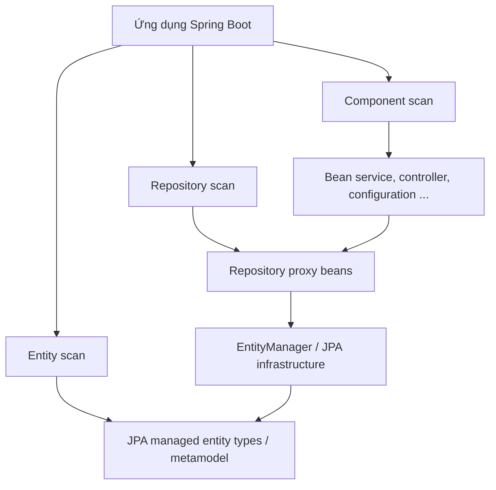
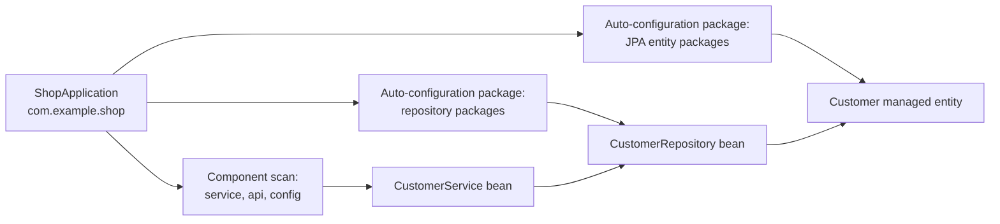
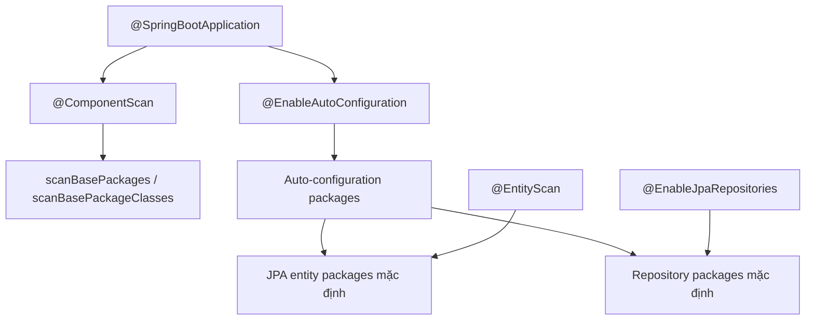
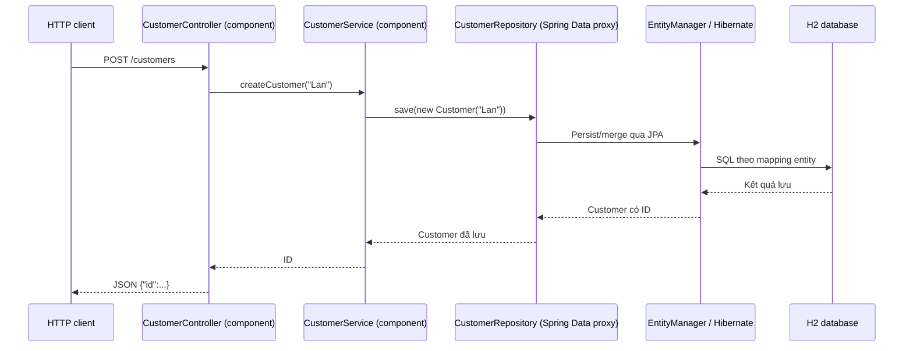

# Phạm vi component scan khác với entity scan hoặc repository scan

Khi mới làm việc với `@SpringBootApplication`, chúng ta thường được khuyên “đặt lớp main ở package gốc để Spring quét được các lớp bên dưới”. Lời khuyên đó hữu ích nhưng chưa đủ, nhất là khi dự án sử dụng Spring Data JPA. Một `@Service` không được tìm thấy, một `@Entity` không được Hibernate quản lý và một interface `JpaRepository` không tạo ra bean đều có thể xuất hiện dưới dạng **lỗi lúc khởi động**. Tuy nhiên, chúng thuộc **ba cơ chế phát hiện khác nhau** và không có cùng cách sửa.

Bài này giải thích ranh giới giữa **component scan**, **JPA entity scan** và **Spring Data repository scan** trong ngữ cảnh `@SpringBootApplication`. Ta sẽ bắt đầu với cách bố trí package thông dụng, quan sát chuyện gì xảy ra khi tách package rồi cấu hình từng phạm vi một cách có chủ đích.

Ví dụ minh họa dùng **Spring Boot 3.x**, **Java 21**, **Spring Data JPA** và kiểu import `jakarta.persistence.*`. Phần cơ chế áp dụng cho Spring Boot 3.x; tên package, lớp và thuộc tính có thể được thay cho phù hợp với dự án thực tế.

## 1. Ba thứ được tìm kiếm, ba kết quả khác nhau

Hãy hình dung ứng dụng có ba lớp sau:

```java
@Service
public class CustomerService { /* ... */ }

@Entity
public class Customer { /* ... */ }

public interface CustomerRepository extends JpaRepository<Customer, Long> {
}
```

Cả ba nằm trong source code, nhưng Spring xử lý chúng theo ba hướng:

| Đối tượng | Cơ chế phát hiện | Kết quả mong muốn | Annotation hoặc API liên quan |
|---|---|---|---|
| `CustomerService` | **Component scan** của Spring Framework | Bean `CustomerService` nằm trong `ApplicationContext` | `@Component`, `@Service`, `@Controller`, `@Repository` (trên lớp cụ thể), `@ComponentScan` |
| `Customer` | **Entity scan** phục vụ JPA/Hibernate | Kiểu `Customer` được ghi nhận trong JPA persistence unit/metamodel | `@Entity`, `@EntityScan` |
| `CustomerRepository` | **Repository scan** của Spring Data JPA | Spring Data tạo repository proxy bean để inject vào service | `JpaRepository`, `@EnableJpaRepositories`, repository auto-configuration |

**Entity không mặc nhiên là Spring bean.** Hibernate quản lý entity dưới dạng đối tượng được ánh xạ và gắn với persistence context trong những tình huống thích hợp. Ngược lại, repository interface có thể trở thành **Spring bean dạng proxy/factory-generated** khi Spring Data đăng ký repository, dù bạn không có class implementation tự viết.



Đây là khác biệt quan trọng: **cùng tên “scan” nhưng đầu ra không giống nhau**. Mở rộng phạm vi cho một loại scan không tự động mở rộng hai loại còn lại.

## 2. `@SpringBootApplication` thực sự làm gì?

Lớp main thường có dạng:

```java
package com.example.shop;

import org.springframework.boot.SpringApplication;
import org.springframework.boot.autoconfigure.SpringBootApplication;

@SpringBootApplication
public class ShopApplication {

    public static void main(String[] args) {
        SpringApplication.run(ShopApplication.class, args);
    }
}
```

`@SpringBootApplication` kết hợp các khả năng tương đương với:

- `@SpringBootConfiguration`: đánh dấu lớp cấu hình gốc.
- `@EnableAutoConfiguration`: cho Boot xem xét những auto-configuration thích hợp với classpath, bean và các điều kiện khác.
- `@ComponentScan`: phát hiện component ứng dụng trong phạm vi package được cấu hình.

Với lớp `ShopApplication` ở package `com.example.shop`, **component scan mặc định** tìm trong `com.example.shop` và các package con. Ví dụ:

```text
com.example.shop
├── ShopApplication
├── api
│   └── CustomerController      @RestController
├── service
│   └── CustomerService         @Service
├── persistence
│   ├── entity
│   │   └── Customer            @Entity
│   └── repository
│       └── CustomerRepository  extends JpaRepository<...>
└── config
    └── TimeConfiguration       @Configuration
```

Trong bố cục này, Spring có thể phát hiện `CustomerController`, `CustomerService` và `TimeConfiguration` qua component scan. Nhưng **không phải component scan đang tự tạo entity hay repository**:

1. `Customer` được Spring Boot/JPA xem xét như entity qua cơ chế xác định managed types.
2. `CustomerRepository` được Spring Data JPA phát hiện và tạo repository bean thông qua cơ chế repository registration.

### Package mặc định cho entity và repository đến từ đâu?

Khi dùng Spring Boot auto-configuration theo cách phổ biến, package chứa lớp `@SpringBootApplication` được ghi nhận như **auto-configuration base package**. Cơ chế này đi qua `@EnableAutoConfiguration` và `@AutoConfigurationPackage`, giúp những auto-configuration cần quét theo package, trong đó có các cấu hình dữ liệu, biết điểm bắt đầu phù hợp.

Với **Spring Data JPA auto-configuration mặc định** và không có cấu hình scan tường minh, các entity và repository thường được tìm từ auto-configuration base package đó. Vì thế cả ba cơ chế thường có kết quả “trùng vùng” trong một ứng dụng nhỏ có lớp main tại package gốc.

Tuy nhiên, **sự trùng nhau ở cấu hình mặc định không làm chúng trở thành một scan duy nhất**. Cấu hình riêng, auto-configuration của từng công nghệ và vị trí lớp chứa annotation có thể làm chúng dùng những package khác nhau.

## 3. Component scan: tìm lớp nào để Spring tạo bean?

`@ComponentScan` tìm các kiểu được đánh dấu bằng những annotation thành phần của Spring trong package phù hợp. Ví dụ:

```java
package com.example.shop.service;

import org.springframework.stereotype.Service;

@Service
public class CustomerService {
    public String displayName(String name) {
        return "Khách hàng: " + name;
    }
}
```

Một controller có thể yêu cầu service bằng constructor:

```java
package com.example.shop.api;

import com.example.shop.service.CustomerService;
import org.springframework.web.bind.annotation.GetMapping;
import org.springframework.web.bind.annotation.RequestParam;
import org.springframework.web.bind.annotation.RestController;

@RestController
public class CustomerController {
    private final CustomerService service;

    public CustomerController(CustomerService service) {
        this.service = service;
    }

    @GetMapping("/welcome")
    public String welcome(@RequestParam String name) {
        return service.displayName(name);
    }
}
```

Ở đây, `@Service` và `@RestController` đều là stereotype annotation liên quan đến `@Component`, nên Spring có thể phát hiện và đăng ký bean nếu chúng nằm trong phạm vi scan. Constructor injection hoạt động khi context có bean thỏa mãn kiểu `CustomerService`.

### `@Repository` có phải luôn là repository scan?

Không. Annotation `org.springframework.stereotype.Repository` có thể đặt trên **một class DAO tự viết**:

```java
package com.example.shop.dao;

import org.springframework.stereotype.Repository;

@Repository
public class LegacyCustomerDao {
    public long countFromLegacySource() {
        return 0L;
    }
}
```

Đây là **Spring component**, được component scan phát hiện giống các stereotype khác. Ngược lại:

```java
public interface CustomerRepository extends JpaRepository<Customer, Long> {
}
```

là **Spring Data repository interface**: Spring Data đăng ký một proxy/factory-produced bean dựa trên interface và metadata. Nó không cần bạn viết implementation cụ thể hay đánh dấu interface bằng `@Repository` trong trường hợp tiêu chuẩn. Hai trường hợp đều có thể dẫn tới bean mang vai trò truy cập dữ liệu, nhưng nguồn đăng ký bean khác nhau.

## 4. Entity scan: tìm kiểu nào được JPA quản lý?

JPA xử lý những class được ánh xạ bằng các annotation như `@Entity`. Ví dụ:

```java
package com.example.shop.persistence.entity;

import jakarta.persistence.Entity;
import jakarta.persistence.GeneratedValue;
import jakarta.persistence.GenerationType;
import jakarta.persistence.Id;
import jakarta.persistence.Table;

@Entity
@Table(name = "customers")
public class Customer {

    @Id
    @GeneratedValue(strategy = GenerationType.IDENTITY)
    private Long id;

    private String name;

    protected Customer() {
        // JPA cần constructor không tham số đủ quyền truy cập.
    }

    public Customer(String name) {
        this.name = name;
    }

    public Long getId() {
        return id;
    }

    public String getName() {
        return name;
    }
}
```

`@Entity` mô tả một kiểu dữ liệu mà JPA provider như Hibernate có thể quản lý và ánh xạ. Entity nằm trong **JPA metamodel** của persistence unit sau khi được nhận diện. Spring thường không đăng ký mỗi instance `Customer` thành singleton bean trong `ApplicationContext`.

Một entity do repository tải lên, hoặc entity mới do ứng dụng tạo bằng `new Customer("Lan")`, có vòng đời **JPA entity** (transient, managed, detached, removed tùy thao tác và persistence context), không phải vòng đời Spring singleton bean của `@Service`.

Do đó, sẽ sai về mô hình nếu viết:

```java
@Autowired
private Customer customer; // Không phải cách lấy entity theo bản ghi dữ liệu.
```

Muốn tải dữ liệu, hãy gọi repository hoặc `EntityManager`. Muốn tạo bản ghi mới, hãy tạo entity với giá trị phù hợp rồi lưu thông qua cơ chế persistence.

**Entity scan không tạo bảng dữ liệu một cách độc lập.** Việc schema có được tạo/cập nhật hay không phụ thuộc cấu hình database, Hibernate schema generation, script khởi tạo, Flyway/Liquibase và quy trình migration. “Entity đã được JPA quản lý” và “database đã có bảng” là hai trạng thái khác nhau.

### `@EntityScan` can thiệp vào đâu?

Nếu entity nằm ngoài package mặc định của ứng dụng, ta có thể khai báo:

```java
import com.example.shared.model.Customer;
import org.springframework.boot.autoconfigure.domain.EntityScan;

@EntityScan(basePackageClasses = Customer.class)
```

Đây là **đoạn annotation minh họa** để gắn trên class cấu hình, không phải một class Java độc lập. `basePackageClasses` dùng package chứa class làm điểm xuất phát, giảm lỗi khi đổi tên package so với chuỗi ký tự. Với Spring Boot JPA auto-configuration, `@EntityScan` tác động đến package tìm JPA managed types; nó **không khiến `@Service` ngoài vùng quét trở thành bean** và **không tự bật Spring Data repository scan**.

Trong hệ sinh thái Spring Boot, metadata về entity scan còn có thể được một số datastore mapping khác sử dụng; bài này chỉ xét hệ quả với JPA.

## 5. Repository scan: tìm interface để tạo repository bean

Spring Data JPA cung cấp các interface như `Repository`, `CrudRepository` và `JpaRepository`. Một khai báo thường thấy:

```java
package com.example.shop.persistence.repository;

import com.example.shop.persistence.entity.Customer;
import org.springframework.data.jpa.repository.JpaRepository;

public interface CustomerRepository extends JpaRepository<Customer, Long> {
    // Spring Data JPA cung cấp các thao tác cơ bản qua repository proxy.
}
```

Interface này không có body implementation do bạn viết. Khi Spring Data JPA được kích hoạt và tìm thấy repository, hạ tầng Spring Data tạo repository bean dùng JPA `EntityManager` để thực thi những thao tác phù hợp.

Service có thể tiêm repository:

```java
package com.example.shop.service;

import com.example.shop.persistence.entity.Customer;
import com.example.shop.persistence.repository.CustomerRepository;
import org.springframework.stereotype.Service;
import org.springframework.transaction.annotation.Transactional;

@Service
public class CustomerService {
    private final CustomerRepository repository;

    public CustomerService(CustomerRepository repository) {
        this.repository = repository;
    }

    @Transactional
    public Long register(String name) {
        Customer saved = repository.save(new Customer(name));
        return saved.getId();
    }
}
```

Trong biến thể service này, `CustomerService` là bean do **component scan** tìm thấy; `CustomerRepository` là bean được **repository infrastructure** tạo ra; `Customer` là kiểu **JPA managed entity**. Lời gọi `repository.save(...)` nối ba cơ chế lại với nhau, nhưng không hợp nhất chúng.

### `@EnableJpaRepositories` can thiệp vào đâu?

Bạn có thể khai báo tường minh:

```java
import com.example.shared.persistence.CustomerRepository;
import org.springframework.data.jpa.repository.config.EnableJpaRepositories;

@EnableJpaRepositories(basePackageClasses = CustomerRepository.class)
```

Annotation này điều khiển **vùng tìm Spring Data JPA repository interfaces**. Nếu không đặt `basePackages`/`basePackageClasses`, mặc định của `@EnableJpaRepositories` thường dựa trên package của class cấu hình mang annotation đó. Điều này khác với việc set `scanBasePackages` trên `@SpringBootApplication`.

Bạn không luôn cần `@EnableJpaRepositories`: khi dùng `spring-boot-starter-data-jpa` với auto-configuration được bật và cấu trúc package thông thường, Boot có thể tự bật cấu hình repository. Ta chỉ cần khai báo tường minh khi có nhu cầu xác định phạm vi hoặc cấu hình repository đặc biệt.

## 6. Một project đặt đúng package gốc: cả ba cùng hoạt động

Hãy dùng cấu trúc ví dụ:

```text
src/main/java/
└── com/example/shop/
    ├── ShopApplication.java
    ├── api/
    │   └── CustomerController.java
    ├── service/
    │   └── CustomerService.java
    └── persistence/
        ├── entity/
        │   └── Customer.java
        └── repository/
            └── CustomerRepository.java
```

Với ứng dụng có Spring Boot Data JPA starter, database phù hợp và auto-configuration JPA/repository không bị tắt, **không cần thêm `@ComponentScan`, `@EntityScan` hoặc `@EnableJpaRepositories` chỉ để hỗ trợ bố cục này**.

Một cấu hình dependency Gradle Groovy DSL minh họa:

```groovy
dependencies {
    implementation 'org.springframework.boot:spring-boot-starter-data-jpa'
    runtimeOnly 'com.h2database:h2'
    testImplementation 'org.springframework.boot:spring-boot-starter-test'
}
```

Đoạn trên chỉ là phần `dependencies` trong dự án đã có Spring Boot Gradle plugin, Java plugin và cơ chế quản lý phiên bản dependency phù hợp. Nó không phải `build.gradle` hoàn chỉnh.

Để thực hành database H2 trong bộ nhớ, bạn có thể thêm `src/main/resources/application.yml`:

```yaml
spring:
  datasource:
    url: jdbc:h2:mem:shopdb;DB_CLOSE_DELAY=-1
    driver-class-name: org.h2.Driver
    username: sa
    password: ""
  jpa:
    hibernate:
      ddl-auto: create-drop
    show-sql: true
```

`ddl-auto: create-drop` chỉ phù hợp cho **bài thực hành sử dụng database tạm**; khi ứng dụng thật có dữ liệu cần giữ, phải dùng chiến lược quản lý schema/migration phù hợp. Tên database và URL H2 ở đây không liên quan trực tiếp đến phạm vi scan, chúng chỉ giúp JPA khởi động đủ hạ tầng để quan sát.

Lưu ý: nếu bạn muốn sử dụng `CustomerController` HTTP trong ví dụ, cần thêm `spring-boot-starter-web`. Không có web starter, các lớp Spring MVC sẽ thiếu dependency. Để tập trung vào ba kiểu scan, bạn có thể dùng service/repository mà chưa viết controller.



Khi mọi class nằm dưới cùng gốc, các phạm vi mặc định thường tình cờ trùng nhau. Điều dễ gây nhầm là tưởng `@ComponentScan` đã làm toàn bộ công việc.

## 7. Trường hợp quan trọng: class nằm ngoài package gốc

Giả sử ta tổ chức nhiều module hoặc chia sẻ mô hình dữ liệu:

```text
src/main/java/
└── com/example/
    ├── shop/
    │   ├── ShopApplication.java               @SpringBootApplication
    │   └── api/
    │       └── CustomerController.java         @RestController
    ├── business/
    │   └── CustomerService.java               @Service
    └── shared/
        └── persistence/
            ├── Customer.java                  @Entity
            └── CustomerRepository.java        extends JpaRepository
```

Class main đặt tại `com.example.shop`. Trong cấu hình mặc định:

- `CustomerController` nằm dưới `com.example.shop` nên thuộc vùng component scan.
- `CustomerService` ở `com.example.business` **nằm ngoài** vùng component scan của lớp main.
- `Customer` ở `com.example.shared.persistence` **nằm ngoài** auto-configuration base package mặc định cho JPA entity.
- `CustomerRepository` ở `com.example.shared.persistence` **nằm ngoài** repository scan mặc định của Boot.

Để thấy sự tách biệt, thử sửa annotation main:

```java
@SpringBootApplication(scanBasePackages = "com.example")
public class ShopApplication {
    // ...
}
```

Khi đó component scan có thể tìm `CustomerService`, vì nó nằm dưới `com.example`. Nhưng **`scanBasePackages` là alias cho thuộc tính của `@ComponentScan`; nó không tự thay đổi phạm vi entity scan hoặc Spring Data repository scan**. Entity và repository bên ngoài auto-configuration base package vẫn có thể không được xử lý theo ý muốn.

Đây chính là tình huống cốt lõi của bài: một thay đổi tưởng như “quét tất cả” chỉ giải quyết **Spring components**, không bảo đảm JPA entity và Spring Data repositories được đăng ký.

## 8. Cấu hình ba phạm vi độc lập cho trường hợp package tách rời

Nếu project cần giữ những package ngang hàng như trên, hãy cấu hình rõ từng cơ chế. Một cách tránh dùng chuỗi package là dùng **type-safe package markers** từ những class/interface có thật.

Ví dụ `src/main/java/com/example/shop/ShopApplication.java`:

```java
package com.example.shop;

import com.example.business.CustomerService;
import com.example.shared.persistence.Customer;
import com.example.shared.persistence.CustomerRepository;
import org.springframework.boot.SpringApplication;
import org.springframework.boot.autoconfigure.SpringBootApplication;
import org.springframework.boot.autoconfigure.domain.EntityScan;
import org.springframework.data.jpa.repository.config.EnableJpaRepositories;

@SpringBootApplication(
        scanBasePackageClasses = {
                ShopApplication.class,
                CustomerService.class
        }
)
@EntityScan(basePackageClasses = Customer.class)
@EnableJpaRepositories(basePackageClasses = CustomerRepository.class)
public class ShopApplication {

    public static void main(String[] args) {
        SpringApplication.run(ShopApplication.class, args);
    }
}
```

Mỗi annotation có một mục đích cụ thể:

| Cấu hình | Package được suy ra | Hệ quả mong muốn |
|---|---|---|
| `scanBasePackageClasses = {ShopApplication.class, CustomerService.class}` | `com.example.shop` và `com.example.business` | Quét controller/service/configuration nằm dưới hai vùng này. |
| `@EntityScan(basePackageClasses = Customer.class)` | `com.example.shared.persistence` | Đưa `Customer` vào tập package JPA kiểm tra để nhận managed type. |
| `@EnableJpaRepositories(basePackageClasses = CustomerRepository.class)` | `com.example.shared.persistence` | Spring Data JPA tìm interface `CustomerRepository` để đăng ký repository bean. |

`basePackageClasses` lấy **package của kiểu được đưa vào**, không chỉ tìm duy nhất class đó. Nếu nhiều package có entity/repository, bạn có thể đưa nhiều marker class vào mảng thích hợp. Đối với một package không có class phù hợp để tham chiếu, có thể tạo marker type riêng hoặc dùng dạng `basePackages` dạng chuỗi, nhưng phải cân nhắc duy trì đường dẫn khi refactor.

**Không cần chèn `Customer.class` vào `scanBasePackageClasses` để biến nó thành Spring bean.** Entity thuộc JPA, nên phải được quản lý theo ngữ nghĩa JPA.

### Có thể đưa lớp main lên package `com.example` thay vì khai báo ba scan không?

Có. Nếu các class đều thuộc cùng ứng dụng và không có ràng buộc kiến trúc, đưa lớp main lên `com.example` thường khiến các phạm vi mặc định bao phủ cả ba nhánh. Nhưng trong dự án đa module, mở rộng root scan quá mức có thể đăng ký cả những service, configuration hoặc repositories không thuộc ứng dụng hiện tại.

Vì vậy quyết định tổ chức package nên dựa trên **ranh giới ứng dụng và module**, không chỉ dựa trên ý muốn làm biến mất một lỗi startup.

## 9. Chỉ chỉnh một scan sẽ xuất hiện chuyện gì?

Xét cấu trúc package tách rời của mục 7 và thực hiện từng thay đổi độc lập:

| Thay đổi | Thành phần được cải thiện | Điều vẫn có thể thiếu |
|---|---|---|
| Chỉ mở `@SpringBootApplication(scanBasePackages = "com.example")` | `CustomerService` và controller bên dưới vùng mới có thể trở thành bean | Entity `Customer` và Spring Data repository vẫn nằm ngoài phạm vi scan riêng. |
| Chỉ thêm `@EntityScan(basePackageClasses = Customer.class)` | JPA có thể nhận diện `Customer` là managed entity | Repository interface chưa chắc có bean, service ngoài package vẫn không được quét. |
| Chỉ thêm `@EnableJpaRepositories(basePackageClasses = CustomerRepository.class)` | Spring Data biết nơi tìm repository interface | Nếu JPA không nhận diện `Customer`, tạo repository có thể lỗi `Not a managed type`; service ngoài phạm vi vẫn thiếu. |
| Cấu hình đúng cả ba theo kiến trúc đã chọn | Spring có service bean, JPA có entity metadata, Spring Data có repository bean | Vẫn cần dependency và database/JPA infrastructure phù hợp để ứng dụng chạy. |

Một lỗi rất thường gặp là chỉ thêm `@EnableJpaRepositories` khi thấy `CustomerRepository` không tồn tại. Khi repository được tìm thấy, Spring Data bắt đầu tạo repository và lúc ấy mới phát hiện entity `Customer` chưa được JPA quản lý. **Thông báo lỗi chuyển từ “thiếu repository bean” sang “Not a managed type” là một gợi ý về bước cấu hình kế tiếp**, không phải bằng chứng rằng `@EnableJpaRepositories` đã tự giải quyết entity scan.

## 10. Vì sao `@SpringBootApplication(scanBasePackages=...)` không thay thế hai annotation còn lại?

Nhìn sâu thêm một mức:

1. `@SpringBootApplication` có thuộc tính `scanBasePackages`/`scanBasePackageClasses` làm alias cho **`@ComponentScan`**.
2. `@EnableAutoConfiguration` kích hoạt auto-configuration và đưa thông tin package gốc vào cơ chế **`@AutoConfigurationPackage`**.
3. JPA entity discovery và Spring Data repository registration có auto-configuration, base packages và annotation cấu hình riêng.
4. Việc đổi alias của `@ComponentScan` **không đồng nghĩa đổi base packages** cho toàn bộ cấu hình tự động khác.



Sơ đồ mô tả **lối cấu hình thông dụng** trong Spring Boot với JPA. Khi project có các class cấu hình JPA riêng, nhiều data source, nhiều entity manager hoặc đã tắt auto-configuration, những quy tắc riêng đó có thể quyết định phạm vi cuối cùng. Do vậy, nếu dự án dùng cấu hình persistence thủ công, phải kiểm tra cả nơi tạo `EntityManagerFactory` và cách repository tham chiếu đến nó.

## 11. Ví dụ hoàn chỉnh: service dùng repository và entity

Ta có thể nối ba lớp với nhau để thấy luồng chạy. Sử dụng lại class entity `Customer` ở mục 4 và repository interface `CustomerRepository` ở mục 5, đồng thời đặt chúng trong các package tương ứng.

Service sau thuộc `com.example.business`:

```java
package com.example.business;

import com.example.shared.persistence.Customer;
import com.example.shared.persistence.CustomerRepository;
import org.springframework.stereotype.Service;
import org.springframework.transaction.annotation.Transactional;

@Service
public class CustomerService {

    private final CustomerRepository customerRepository;

    public CustomerService(CustomerRepository customerRepository) {
        this.customerRepository = customerRepository;
    }

    @Transactional
    public Long createCustomer(String name) {
        Customer customer = new Customer(name);
        return customerRepository.save(customer).getId();
    }

    @Transactional(readOnly = true)
    public long countCustomers() {
        return customerRepository.count();
    }
}
```

Controller sau thuộc `com.example.shop.api`. Để dùng nó, project phải có thêm `spring-boot-starter-web`:

```java
package com.example.shop.api;

import com.example.business.CustomerService;
import org.springframework.web.bind.annotation.GetMapping;
import org.springframework.web.bind.annotation.PostMapping;
import org.springframework.web.bind.annotation.RequestBody;
import org.springframework.web.bind.annotation.RequestMapping;
import org.springframework.web.bind.annotation.RestController;

@RestController
@RequestMapping("/customers")
public class CustomerController {

    private final CustomerService service;

    public CustomerController(CustomerService service) {
        this.service = service;
    }

    @PostMapping
    public CustomerCreated create(@RequestBody CreateCustomer request) {
        return new CustomerCreated(service.createCustomer(request.name()));
    }

    @GetMapping("/count")
    public long count() {
        return service.countCustomers();
    }

    public record CreateCustomer(String name) {}

    public record CustomerCreated(Long id) {}
}
```

Cập nhật block dependencies trong dự án Gradle đã được cấu hình Boot:

```groovy
dependencies {
    implementation 'org.springframework.boot:spring-boot-starter-web'
    implementation 'org.springframework.boot:spring-boot-starter-data-jpa'
    runtimeOnly 'com.h2database:h2'
    testImplementation 'org.springframework.boot:spring-boot-starter-test'
}
```

Giữ annotation cấu hình ba phạm vi từ mục 8, cấu hình H2 dùng cho thực hành, rồi chạy ứng dụng trong chính dự án của bạn. Có thể gửi yêu cầu:

```bash
curl -X POST "http://localhost:8080/customers" \
     -H "Content-Type: application/json" \
     -d '{"name":"Lan"}'

curl "http://localhost:8080/customers/count"
```

Khi lưu một khách hàng thành công, API đầu trả về JSON chứa ID, còn API thứ hai trả về số lượng khách hàng hiện có. Giá trị ID cụ thể do database quyết định, nên không nên cố định rằng bản ghi đầu tiên luôn có ID bằng 1 trong mọi môi trường.

Luồng thực thi:



Controller và service được đăng ký nhờ **component scan**; repository interface được Spring Data biến thành **repository bean**; entity metadata được Hibernate đọc nhờ **entity scan**. Mỗi cơ chế hoàn thành một phần nhiệm vụ.

## 12. Dấu hiệu khi từng scan bị cấu hình sai

### 12.1. Service hoặc controller không được đăng ký

Một lỗi phổ biến:

```text
Parameter 0 of constructor in ...CustomerController
required a bean of type '...CustomerService'
that could not be found.
```

Nếu class `CustomerService` có `@Service` nhưng nằm ngoài component scan, Spring sẽ không đăng ký bean. Cần kiểm tra package của lớp main, stereotype annotation và phạm vi của `@ComponentScan`. Đừng sửa `@EntityScan` để chữa lỗi này.

### 12.2. Repository interface không có bean

Bạn có thể thấy:

```text
Parameter 0 of constructor in ...CustomerService
required a bean of type '...CustomerRepository'
that could not be found.
```

Khi đó cần điều tra repository scan và JPA infrastructure: có `spring-boot-starter-data-jpa` không, repository có nằm trong package được Spring Data JPA tìm không, auto-configuration đã bị tắt chưa, interface có đúng kiểu repository hay không.

Lưu ý: repository bean cũng có thể không được tạo do lỗi khác trong quá trình xây dựng context; hãy đọc nguyên nhân sâu nhất trong stack trace trước khi kết luận chỉ thiếu scan.

### 12.3. Repository có được tìm nhưng entity không được quản lý

Thông báo điển hình:

```text
java.lang.IllegalArgumentException: Not a managed type:
class com.example.shared.persistence.Customer
```

Lỗi này thường xảy ra khi repository đề cập tới kiểu domain mà JPA metamodel hiện tại chưa nhận diện. Cần xem `@Entity`, import `jakarta.persistence.Entity`, JPA entity scan packages, tên persistence unit và cấu hình `EntityManagerFactory`. **Mở rộng component scan không giải quyết gốc lỗi này.**

### 12.4. Entity được nhận diện nhưng bảng chưa có

Ví dụ:

```text
Table "CUSTOMERS" not found
```

Đây có thể là vấn đề schema/DDL, database URL, migration chưa chạy hoặc quy ước đặt tên bảng. Ngay cả khi entity scan đúng, cơ sở dữ liệu vẫn cần bảng phù hợp. Hãy phân biệt lỗi *managed type* với lỗi *table/column/schema*.

### 12.5. Repository khởi tạo thất bại vì query

Một method repository được đặt tên không khớp property entity có thể làm Spring Data báo lỗi phân tích truy vấn. Điều đó chứng minh repository có thể đã được **tìm thấy** rồi, nhưng cấu hình repository method không hợp lệ. Không phải tất cả lỗi repository đều do phạm vi scan.

## 13. Kiểm tra kết quả bằng context và JPA metamodel

Thay vì đoán một annotation có hiệu lực không, hãy nhìn đúng loại kết quả mà mỗi scan tạo ra:

| Bạn muốn chứng minh | Nguồn kiểm tra thích hợp |
|---|---|
| `CustomerService` là Spring bean | `ApplicationContext.getBean(CustomerService.class)` hoặc Actuator `/actuator/beans` khi đã bật phù hợp |
| `CustomerRepository` là Spring bean | `ApplicationContext.getBean(CustomerRepository.class)` |
| `Customer` là JPA managed type | `EntityManagerFactory.getMetamodel().entity(Customer.class)` |
| Bảng `customers` thực sự có trong database | Truy vấn metadata/schema hoặc thực hiện truy vấn repository có kiểm soát |

Một bài test khởi tạo context có thể minh họa sự khác biệt:

```java
package com.example.shop;

import static org.assertj.core.api.Assertions.assertThat;

import com.example.business.CustomerService;
import com.example.shared.persistence.Customer;
import com.example.shared.persistence.CustomerRepository;
import jakarta.persistence.EntityManagerFactory;
import org.junit.jupiter.api.Test;
import org.springframework.beans.factory.annotation.Autowired;
import org.springframework.boot.test.context.SpringBootTest;
import org.springframework.context.ApplicationContext;

@SpringBootTest
class ScanBoundariesTest {

    @Autowired
    ApplicationContext context;

    @Autowired
    EntityManagerFactory entityManagerFactory;

    @Test
    void serviceAndRepositoryAreBeansButCustomerIsJpaEntity() {
        assertThat(context.getBean(CustomerService.class)).isNotNull();
        assertThat(context.getBean(CustomerRepository.class)).isNotNull();

        assertThat(entityManagerFactory.getMetamodel()
                .entity(Customer.class).getJavaType()).isEqualTo(Customer.class);
    }
}
```

Test giả định các dependency và database cấu hình như phần trước, package main đặt đúng vùng dự án và context khởi động được. Kiểm tra `getBean(...)` là bằng chứng về Spring beans; kiểm tra metamodel là bằng chứng về JPA managed type. Ta **không kiểm tra entity bằng `context.getBean(Customer.class)`**, bởi vì entity không phải singleton Spring bean theo mặc định.

## 14. Lưu ý khi có nhiều module hoặc nhiều data source

Trong ứng dụng một database, một persistence unit và cấu trúc package gọn, ba scan thường không cần khai báo thủ công. Nhưng dự án lớn có thể có:

- Nhiều module cùng chứa các package `entity` và `repository`.
- Nhiều `DataSource` và `EntityManagerFactory`.
- Repository sử dụng các công nghệ khác nhau, ví dụ JPA và MongoDB.
- Các cấu hình Spring được import có chủ đích thay vì component scan toàn bộ.

Khi đó, scan cần gắn với **ranh giới chức năng và hạ tầng dữ liệu**. Với nhiều entity manager, `@EnableJpaRepositories` còn có các thuộc tính như `entityManagerFactoryRef` và `transactionManagerRef` để nối repository với đúng persistence unit/transaction manager. Đồng thời mỗi `EntityManagerFactory` phải quản lý đúng tập entity của nó (thường cấu hình riêng bằng packages hoặc managed types). Chỉ viết một `@EntityScan` rộng ở lớp main không giải quyết đầy đủ bài toán nhiều persistence unit.

Một điều cần nhớ khác: **repository scan là khái niệm theo từng Spring Data module**. `@EnableJpaRepositories` là của JPA; Spring Data MongoDB có cơ chế repository configuration khác. Không nên coi một annotation JPA là công tắc quét tất cả repository thuộc mọi công nghệ.

Với các ứng dụng dùng nhiều thư viện có auto-configuration hoặc component cùng tên, mở rộng `@ComponentScan("com")` một cách quá rộng có thể đưa vào các bean không mong muốn, gây xung đột hoặc thay đổi hành vi. Cấu hình phạm vi cụ thể và package marker class thường dễ duy trì hơn.

## 15. Bảng quyết định: gặp lỗi thì nhìn vào đâu trước?

| Câu hỏi | Nếu câu trả lời là “không” | Phần nên xem |
|---|---|---|
| Spring có bean `CustomerService` chưa? | Service chưa được quét/đăng ký hoặc context khởi tạo lỗi | `@ComponentScan`, `@Service`, package main |
| Spring có bean `CustomerRepository` chưa? | Repository scan hoặc Spring Data JPA setup chưa phù hợp | `@EnableJpaRepositories`, repository auto-configuration, dependency |
| JPA có managed type `Customer` chưa? | Entity discovery/metadata của persistence unit chưa đúng | `@Entity`, `@EntityScan`, `EntityManagerFactory` |
| Database có bảng `customers` chưa? | Schema/migration/connection chưa đúng | Hibernate DDL, Flyway/Liquibase, database |
| Repository method chạy được chưa? | Query, mapping, transaction hoặc dữ liệu chưa đúng | Repository declaration, JPA mapping và SQL |

Đọc stack trace theo **nguyên nhân sâu nhất**; nhiều lỗi xuất hiện dưới dạng “Failed to start ApplicationContext” nhưng điểm hỏng thực sự nằm ở bean injection, entity metadata hoặc database.

### Một quy trình chẩn đoán theo thứ tự

1. **Xác định package gốc:** lớp mang `@SpringBootApplication` đặt ở đâu?
2. **Xác định loại đối tượng:** thứ đang thiếu là Spring component, JPA entity hay Spring Data repository?
3. **Kiểm tra dependency:** có JPA starter, database driver và JPA configuration phù hợp không?
4. **Xác định cấu hình scan đang có:** component scan, entity scan, repository scan mặc định hay tường minh?
5. **Kiểm tra đúng đầu ra:** bean trong `ApplicationContext` hay managed type trong JPA metamodel?
6. **Sau đó mới sửa phạm vi:** thay package root hoặc khai báo scan cụ thể phù hợp với kiến trúc.

Quy trình này giúp tránh cách sửa “thêm một `@ComponentScan` bao phủ toàn bộ codebase” khi lỗi thực tế thuộc JPA hoặc repository infrastructure.

## 16. Bài thực hành: thử thay đổi đúng từng phạm vi

Tạo một project nhỏ như mục 7 với các package `com.example.shop`, `com.example.business` và `com.example.shared.persistence`. Giữ dependency JPA và H2 được cấu hình đầy đủ. Sau đó thực hiện từng thay đổi độc lập:

**Bước A — Chỉ mở component scan.** Đặt `scanBasePackages = "com.example"` trên `@SpringBootApplication`. Dự đoán service nào có thể được tìm thấy và vì sao entity/repository ngoài gốc vẫn có thể không hoạt động.

**Bước B — Thêm repository scan nhưng chưa thêm entity scan.** Dùng `@EnableJpaRepositories(basePackageClasses = CustomerRepository.class)`. Quan sát trường hợp repository được đăng ký nhưng JPA báo `Not a managed type` cho `Customer`.

**Bước C — Thêm entity scan.** Dùng `@EntityScan(basePackageClasses = Customer.class)`. Giải thích vì sao lúc này Spring Data có thể tạo repository với domain type mà JPA nhận diện.

**Bước D — Kiểm tra từng đầu ra.** Dùng `ApplicationContext` để lấy service/repository bean, dùng `EntityManagerFactory.getMetamodel()` để tìm entity. Đối chiếu với kết quả API hoặc thao tác repository.

**Bước E — Chuyển mọi thứ về chung package gốc.** Đặt `ShopApplication` ở package cấp trên thích hợp và bỏ các annotation scan tường minh. Giải thích vì sao cấu hình mặc định có thể đủ cho dự án nhỏ.

Trong mỗi bước, hãy ghi rõ **thay đổi nào tác động đến component bean, thay đổi nào tác động đến JPA managed type, và thay đổi nào tạo Spring Data repository proxy**. Đây là bằng chứng rằng bạn thực sự phân biệt được ba cơ chế.

## 17. Những câu hỏi bạn cần tự trả lời được

1. `@SpringBootApplication` bao gồm những annotation chính nào và phần nào chịu trách nhiệm quét component?
2. Nếu một class `@Service` nằm ngoài package chứa class main, Spring có tự đăng ký nó thành bean không?
3. Tại sao `@Entity` không khiến mỗi entity trở thành một singleton bean có thể `@Autowired`?
4. Một interface `JpaRepository` được Spring Data chuyển thành bean bằng cơ chế nào?
5. `@SpringBootApplication(scanBasePackages = "com.example")` có tự mở rộng JPA entity scan hoặc repository scan không? Vì sao?
6. `@EntityScan(basePackageClasses = Customer.class)` và `@EnableJpaRepositories(basePackageClasses = CustomerRepository.class)` giải quyết hai vấn đề khác nhau thế nào?
7. Lỗi thiếu `CustomerService` khác với lỗi thiếu `CustomerRepository` và `Not a managed type` ở điểm nào?
8. Vì sao có thể nhận diện đúng entity nhưng vẫn gặp lỗi bảng chưa tồn tại?
9. Khi có nhiều data source hoặc nhiều entity manager, chỉ mở rộng một package scan có đủ không?
10. Với dự án đầu tiên, nên đặt class main ở đâu để các mặc định của Spring Boot hoạt động dễ dự đoán?

### Mẫu giải thích đầy đủ

> Component scan tìm những class thành phần như `@Service`, `@Controller` và `@Configuration` để Spring quản lý chúng dưới dạng bean. Entity scan tìm kiểu `@Entity` để JPA/Hibernate biết cách ánh xạ dữ liệu và đưa kiểu đó vào metamodel; entity không mặc nhiên là Spring bean. Repository scan do Spring Data JPA thực hiện để tìm interface như `JpaRepository` và tạo repository proxy bean. Trong Spring Boot, ba phạm vi thường có cùng package gốc mặc định khi class `@SpringBootApplication` đặt ở root. Nhưng `scanBasePackages` trên annotation này chỉ điều chỉnh component scan, không tự điều chỉnh entity hoặc repository scan. Nếu entity và repository nằm ngoài vùng mặc định, cần cấu hình `@EntityScan` và `@EnableJpaRepositories` phù hợp hoặc tổ chức lại package gốc.

Khi có thể chỉ ra **component bean trong `ApplicationContext`**, **entity trong JPA metamodel**, và **repository proxy được Spring Data đăng ký**, bạn đã nắm đúng ranh giới mà `@SpringBootApplication` thường khiến người mới nhầm lẫn. Đây là nền tảng để xử lý các dự án Spring Boot có nhiều package, module hoặc persistence configuration mà không dùng một annotation scan cho tất cả.
