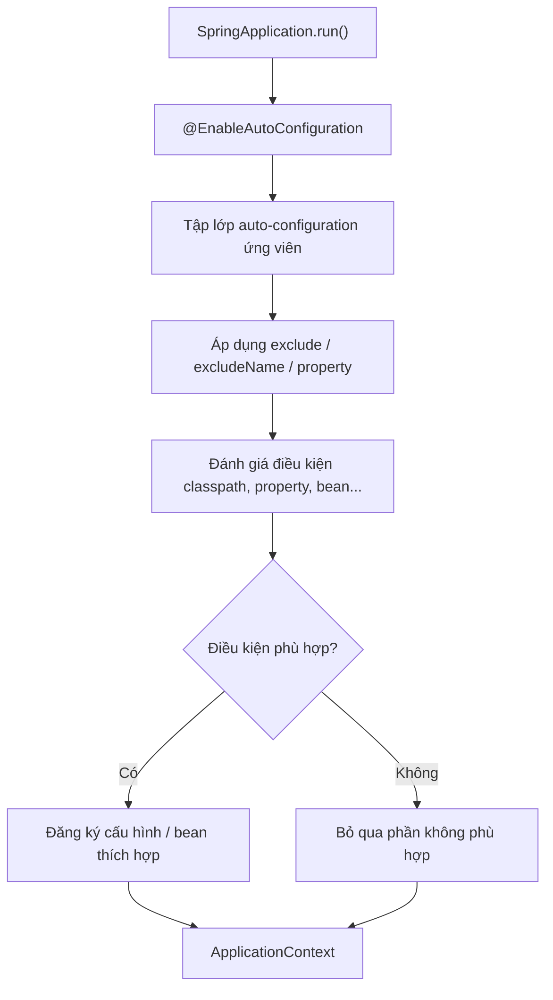

# `exclude`, `excludeName` và loại một auto-configuration cụ thể

> **Spring Boot Fundamentals → `@SpringBootApplication`**  
> Trong Spring Boot, rất nhiều bean hạ tầng được cấu hình tự động dựa trên các dependency, property và bean đang có. Đôi khi một auto-configuration không phù hợp với ứng dụng. `@SpringBootApplication` cung cấp hai thuộc tính **`exclude`** và **`excludeName`** để yêu cầu Spring Boot **không đưa một lớp auto-configuration cụ thể vào quá trình cấu hình tự động**. Bài học này hướng dẫn chọn đúng thuộc tính, hiểu giới hạn của việc loại trừ và kiểm tra kết quả một cách có hệ thống.

## 1. Vì sao đôi khi cần loại auto-configuration?

Một ưu điểm của Spring Boot là giảm cấu hình thủ công. Ví dụ, sau khi thêm `spring-boot-starter-jdbc`, Boot có thể tự thiết lập `DataSource`, transaction manager và những thành phần liên quan nếu điều kiện thích hợp. Sau khi thêm web starter, Boot có thể tạo hạ tầng Spring MVC và embedded server.

Tuy nhiên, **dependency có mặt trên classpath** không phải lúc nào cũng đồng nghĩa ứng dụng **muốn dùng tính năng đó ngay lúc chạy**. Một số tình huống:

- Một ứng dụng HTTP tạm thời có dependency JDBC từ module chung, nhưng ở giai đoạn này chưa cần kết nối database.
- Dự án muốn thay một cấu hình tự động bằng cơ chế riêng, sau khi đã xác định rõ các bean mà ứng dụng cần cung cấp.
- Một tích hợp tự cấu hình chưa tương thích với kiến trúc hoặc môi trường hiện tại.
- Một bộ kiểm thử hoặc ứng dụng phụ dùng cùng dependency nhưng không cần hạ tầng cụ thể được cấu hình tự động.

Spring Boot cho phép **loại trừ có chọn lọc**:

```java
@SpringBootApplication(exclude = DataSourceAutoConfiguration.class)
```

Dòng trên có nghĩa: khi lựa chọn các auto-configuration, **bỏ qua** lớp `DataSourceAutoConfiguration`. Nó không có nghĩa “xóa JDBC khỏi classpath”, “cấm tất cả bean `DataSource`” hoặc “tắt mọi tính năng database”.

### 1.1. Ba khái niệm cần phân biệt

| Hành động | Tác động | Ví dụ |
| --- | --- | --- |
| **Loại một auto-configuration** | Ngăn Spring Boot import cấu hình tự động được chỉ định | `@SpringBootApplication(exclude = DataSourceAutoConfiguration.class)` |
| **Loại một dependency** | Thay đổi những JAR có mặt trên classpath sau khi build | Gradle `exclude group: ..., module: ...` hoặc Maven `<exclusions>` |
| **Tùy chỉnh/định nghĩa bean** | Thay đổi thành phần thực tế trong `ApplicationContext`, có thể khiến một auto-configuration back off theo điều kiện | Khai báo `@Bean DataSource` của ứng dụng |

Ba cách giải quyết **những vấn đề khác nhau**. Có trường hợp chỉ cần property, trường hợp nên bỏ dependency dư thừa, và trường hợp cần exclude auto-configuration. Không nên chọn exclusion chỉ vì nó có vẻ là cách nhanh nhất để làm lỗi khởi động biến mất.

## 2. `@SpringBootApplication` liên quan gì tới auto-configuration?

Một lớp khởi động điển hình:

```java
package com.example.catalog;

import org.springframework.boot.SpringApplication;
import org.springframework.boot.autoconfigure.SpringBootApplication;

@SpringBootApplication
public class CatalogApplication {

    public static void main(String[] args) {
        SpringApplication.run(CatalogApplication.class, args);
    }
}
```

Annotation `@SpringBootApplication` tập hợp ba nhóm cơ chế chính:

| Annotation thành phần | Vai trò |
| --- | --- |
| `@SpringBootConfiguration` | Xác định lớp cấu hình chính của ứng dụng, dựa trên cơ chế `@Configuration` |
| `@EnableAutoConfiguration` | Cho phép Spring Boot lựa chọn và áp dụng các auto-configuration thích hợp |
| `@ComponentScan` | Quét component trong package của lớp khởi động và các package con theo mặc định |

`exclude` và `excludeName` trên `@SpringBootApplication` là các thuộc tính được chuyển tiếp tới cơ chế `@EnableAutoConfiguration`.

Điều này quan trọng bởi **component scan và auto-configuration không phải cùng một cơ chế**:

- `@ComponentScan` tìm controller, service, component và những bean do ứng dụng hoặc thư viện khai báo để quét trong phạm vi thích hợp.
- `@EnableAutoConfiguration` nhập các lớp auto-configuration mà Spring Boot biết đến, rồi áp dụng điều kiện tương ứng.

Không nên dùng `exclude` để thay thế việc giới hạn package quét, và cũng không nên dùng `scanBasePackages` để cố tắt một auto-configuration.

### 2.1. Spring Boot chọn auto-configuration thế nào?

Ở mức khái niệm, quá trình diễn ra như sau:



Spring Boot sử dụng metadata và cơ chế import auto-configuration phù hợp với phiên bản, không phải đơn giản component-scan tất cả lớp trong một package. Trong **Spring Boot 3.x**, một phần metadata đăng ký auto-configuration nằm dưới `META-INF/spring/org.springframework.boot.autoconfigure.AutoConfiguration.imports` trong các JAR tương ứng.

Điểm mấu chốt: `exclude`/`excludeName` được dùng để **loại ứng viên auto-configuration**. Những điều kiện như `@ConditionalOnClass`, `@ConditionalOnProperty` hay `@ConditionalOnMissingBean` vẫn là lớp kiểm tra riêng đối với các cấu hình không bị loại.

### 2.2. Có điều kiện không khớp khác với bị exclude

Ví dụ một auto-configuration cần class `javax.sql.DataSource` hoặc driver/cơ chế cụ thể. Nếu điều kiện cần không thỏa, nó có thể tự bỏ qua mà không cần lập trình viên viết `exclude`.

Hai trạng thái khác nhau:

- **Không khớp điều kiện:** Spring Boot đã xét đến cấu hình nhưng điều kiện làm cho nó không áp dụng.
- **Bị exclude:** lập trình viên yêu cầu bỏ hẳn cấu hình đó khỏi danh sách được áp dụng.

Khi xem condition evaluation report, hai tình huống thường có dấu hiệu riêng. Việc phân biệt này giúp hiểu liệu Spring Boot đang tự quyết định hợp lý hay bạn đã chủ động can thiệp.

## 3. `exclude`: chỉ định auto-configuration bằng class

Cú pháp `exclude` sử dụng kiểu `Class<?>[]`. Trong Java, nó nhận một hoặc nhiều class literal.

Ví dụ chính của bài học, dùng tên lớp trong **Spring Boot 3.x**:

```java
package com.example.catalog;

import org.springframework.boot.SpringApplication;
import org.springframework.boot.autoconfigure.SpringBootApplication;
import org.springframework.boot.autoconfigure.jdbc.DataSourceAutoConfiguration;

@SpringBootApplication(exclude = DataSourceAutoConfiguration.class)
public class CatalogApplication {

    public static void main(String[] args) {
        SpringApplication.run(CatalogApplication.class, args);
    }
}
```

### 3.1. Đọc ví dụ theo từng thành phần

- `@SpringBootApplication` đánh dấu lớp cấu hình/khởi động và bật auto-configuration.
- `exclude = ...` yêu cầu loại khỏi quá trình auto-configuration.
- `DataSourceAutoConfiguration.class` là **class literal**, không phải tên bean hoặc chuỗi property.
- `org.springframework.boot.autoconfigure.jdbc.DataSourceAutoConfiguration` là tên fully qualified của auto-configuration dùng trong ví dụ Spring Boot 3.x.
- `SpringApplication.run(...)` vẫn khởi động application context và những auto-configuration **không bị loại** khác.

Nếu ứng dụng có Spring Web phù hợp, web auto-configuration vẫn có thể hoạt động. Việc exclude datasource không tự động tắt HTTP server.

### 3.2. Vì sao `exclude` thường là lựa chọn rõ ràng nhất?

Khi class auto-configuration có mặt ở compile classpath và có thể import trực tiếp, `exclude` có những ưu điểm:

1. **IDE điều hướng được** đến lớp cần exclude.
2. **Compiler kiểm tra được tên class**; lỗi import hoặc class không tồn tại có thể được phát hiện sớm.
3. **Refactor dễ theo dõi hơn** khi code hoặc dependency thay đổi.
4. Người đọc không phải nhớ đường dẫn package dưới dạng string.

Ví dụ, Java compiler hiểu `DataSourceAutoConfiguration.class` là một class literal. Nếu nhập sai tên class hoặc package trong code, lỗi thường xuất hiện ngay khi biên dịch, trước khi chạy ứng dụng.

**Nhược điểm:** code phải có khả năng tham chiếu class đó lúc biên dịch. Nếu class của một auto-configuration tùy chọn không có trong compile classpath của module, cách viết bằng class literal không phù hợp.

### 3.3. Loại nhiều auto-configuration

Vì thuộc tính là một mảng class, có thể dùng cú pháp:

```java
import org.springframework.boot.autoconfigure.SpringBootApplication;
import org.springframework.boot.autoconfigure.jdbc.DataSourceAutoConfiguration;
import org.springframework.boot.autoconfigure.orm.jpa.HibernateJpaAutoConfiguration;

@SpringBootApplication(exclude = {
        DataSourceAutoConfiguration.class,
        HibernateJpaAutoConfiguration.class
})
public class CatalogApplication {
    // ...
}
```

Ví dụ này minh họa cú pháp nhiều class, **chỉ dùng khi ứng dụng thực sự muốn loại cả hai cấu hình**. `HibernateJpaAutoConfiguration` liên quan đến hạ tầng JPA; nếu ứng dụng có repository/service JPA cần `EntityManager`, việc loại nó có thể khiến ứng dụng không khởi động hoặc chức năng không hoạt động.

Không có lợi ích mặc định khi exclude càng nhiều càng tốt. Cần xác định chính xác lớp auto-configuration cần loại và lý do loại.

## 4. `excludeName`: chỉ định bằng tên class đầy đủ

`excludeName` cung cấp cách tương đương về mục tiêu nhưng khác **kiểu dữ liệu**: thay vì nhận `Class<?>[]`, nó nhận `String[]`.

Ví dụ:

```java
package com.example.catalog;

import org.springframework.boot.SpringApplication;
import org.springframework.boot.autoconfigure.SpringBootApplication;

@SpringBootApplication(
        excludeName =
                "org.springframework.boot.autoconfigure.jdbc.DataSourceAutoConfiguration"
)
public class CatalogApplication {

    public static void main(String[] args) {
        SpringApplication.run(CatalogApplication.class, args);
    }
}
```

Đây cũng là yêu cầu loại `DataSourceAutoConfiguration` trong bối cảnh ví dụ Spring Boot 3.x.

### 4.1. Khi nào `excludeName` có ích?

Nó hữu ích khi bạn cần **diễn đạt tên lớp auto-configuration bằng chuỗi**, chẳng hạn:

- Một module không muốn có compile-time reference trực tiếp tới class auto-configuration từ thư viện tùy chọn.
- Cấu hình phải có khả năng được biên dịch ngay cả khi một class auto-configuration không có trong compile classpath của module đó.
- Bạn cần mô tả một tên lớp đã biết mà không dùng import Java trực tiếp.

Tuy nhiên, `excludeName` không tự tải JAR và cũng không làm một lớp không có trên classpath trở thành bean. Nó chỉ cung cấp **tên cấu hình cần exclude** cho cơ chế lựa chọn auto-configuration.

### 4.2. Đổi lại, string cần được quản lý cẩn thận

`excludeName` có một số hạn chế:

- Java compiler **không kiểm tra đầy đủ tính đúng đắn** của chuỗi tên class.
- Nếu thư viện nâng cấp và auto-configuration đổi package hoặc tên, string có thể trở nên không còn phù hợp.
- IDE có thể hỗ trợ điều hướng chuỗi ở mức hạn chế tùy công cụ.
- Nếu tên không đúng hoặc trỏ tới class không được xem là auto-configuration, kết quả không như mong đợi; Spring Boot còn có thể báo lỗi cấu hình không hợp lệ tùy trường hợp.

Vì thế, khi class có sẵn để import và không cần tránh compile-time dependency, `exclude` thường dễ đọc và dễ duy trì hơn. `excludeName` là một công cụ dành cho tình huống có nhu cầu cụ thể, không phải cách tốt hơn trong mọi trường hợp.

### 4.3. Ví dụ nhiều tên

```java
@SpringBootApplication(excludeName = {
        "org.springframework.boot.autoconfigure.jdbc.DataSourceAutoConfiguration",
        "org.springframework.boot.autoconfigure.orm.jpa.HibernateJpaAutoConfiguration"
})
public class CatalogApplication {
    // ...
}
```

Cần dùng tên **fully qualified class name** đầy đủ. Chỉ viết `"DataSourceAutoConfiguration"` thường không đủ để xác định đúng lớp auto-configuration.

## 5. So sánh `exclude` và `excludeName`

| Tiêu chí | `exclude` | `excludeName` |
| --- | --- | --- |
| Kiểu dữ liệu | `Class<?>[]` | `String[]` |
| Cách chỉ định | `DataSourceAutoConfiguration.class` | `"org.springframework.boot.autoconfigure.jdbc.DataSourceAutoConfiguration"` |
| Cần class tham chiếu được khi compile? | Có | Không cần tham chiếu kiểu trực tiếp trong source |
| Compiler phát hiện sai tên lớp? | Thông thường có | Không kiểm tra tên lớp như một Java type |
| Hỗ trợ IDE/refactor | Thường tốt hơn | Phụ thuộc cách IDE xử lý chuỗi |
| Mục tiêu | Bỏ một hoặc nhiều auto-configuration | Bỏ một hoặc nhiều auto-configuration |
| Có xóa dependency khỏi JAR? | Không | Không |
| Có thay đổi component scan? | Không | Không |
| Có bảo đảm mọi bean liên quan biến mất? | Không | Không |
| Tình huống ưu tiên | Class sẵn có, muốn tham chiếu rõ ràng | Muốn chỉ định theo tên, tránh reference compile-time |

Hai thuộc tính cùng đi vào cơ chế exclusion của auto-configuration. Chúng **không đại diện hai mức mạnh/yếu khác nhau** về khả năng loại một cấu hình.

### 5.1. Có thể dùng cả hai cùng lúc không?

Về cú pháp, annotation có thể khai báo cả `exclude` và `excludeName`. Spring Boot xử lý các lớp/tên cần loại như một tập exclusion.

```java
@SpringBootApplication(
        exclude = DataSourceAutoConfiguration.class,
        excludeName = {
                "org.springframework.boot.autoconfigure.orm.jpa.HibernateJpaAutoConfiguration"
        }
)
public class CatalogApplication {
    // ...
}
```

Cách phối hợp này hợp lệ nếu có lý do cụ thể. Trong đa số dự án, giữ một cách viết nhất quán thường dễ theo dõi hơn. Nếu cùng một auto-configuration xuất hiện ở cả hai thuộc tính, việc lặp lại không tạo thêm ý nghĩa chức năng.

## 6. Ví dụ trọng tâm: ứng dụng web không cần `DataSource`

Giả sử một ứng dụng Spring Boot 3.x đang có dependency Spring Web và JDBC. Tuy nhiên, phiên bản hiện tại của dịch vụ chỉ trả dữ liệu tĩnh và **chưa cần truy cập database**.

### 6.1. Dependency trong Maven

Trích từ `pom.xml`:

```xml
<dependencies>
    <dependency>
        <groupId>org.springframework.boot</groupId>
        <artifactId>spring-boot-starter-web</artifactId>
    </dependency>

    <dependency>
        <groupId>org.springframework.boot</groupId>
        <artifactId>spring-boot-starter-jdbc</artifactId>
    </dependency>
</dependencies>
```

Giả định parent/BOM Spring Boot quản lý các version tương ứng.

`spring-boot-starter-jdbc` đưa những thành phần cần cho JDBC vào classpath. Khi Boot xét auto-configuration dữ liệu, nó có thể thử cấu hình `DataSource`. Nếu ứng dụng không có URL/driver hoặc embedded database phù hợp, startup có thể thất bại với thông báo kiểu:

```text
Failed to configure a DataSource:
'url' attribute is not specified and no embedded datasource could be configured.
```

Thông báo thực tế phụ thuộc phiên bản và điều kiện, nhưng ý nghĩa là Boot không thể thiết lập một datasource khả dụng từ thông tin hiện có.

### 6.2. Vì sao có thể xuất hiện lỗi này?

Các yếu tố thường liên quan:

1. JDBC/JPA dependencies khiến các điều kiện classpath của auto-configuration liên quan được đáp ứng.
2. Ứng dụng không cung cấp bean `DataSource` riêng.
3. Không có thông tin kết nối hoặc embedded database driver phù hợp để tạo datasource.
4. Boot cố cấu hình hạ tầng dữ liệu và gặp giới hạn cần thiết để khởi tạo.

Đây là một ví dụ cho thấy dependency ảnh hưởng đến việc **xét** auto-configuration, nhưng muốn sử dụng được tính năng còn cần cấu hình runtime đầy đủ.

### 6.3. Loại auto-configuration cụ thể

Nếu thực sự muốn ứng dụng **không cấu hình datasource tự động** trong giai đoạn này, có thể dùng:

```java
package com.example.catalog;

import org.springframework.boot.SpringApplication;
import org.springframework.boot.autoconfigure.SpringBootApplication;
import org.springframework.boot.autoconfigure.jdbc.DataSourceAutoConfiguration;

@SpringBootApplication(exclude = DataSourceAutoConfiguration.class)
public class CatalogApplication {

    public static void main(String[] args) {
        SpringApplication.run(CatalogApplication.class, args);
    }
}
```

Và một controller độc lập với database:

```java
package com.example.catalog.web;

import java.util.Map;
import org.springframework.web.bind.annotation.GetMapping;
import org.springframework.web.bind.annotation.RestController;

@RestController
public class StatusController {

    @GetMapping("/api/status")
    public Map<String, String> status() {
        return Map.of("status", "ready");
    }
}
```

Với các dependency web phù hợp và **không có thành phần ứng dụng nào bắt buộc phải có `DataSource`**, ứng dụng có thể khởi động HTTP server, đăng ký controller và trả response:

```http
GET /api/status HTTP/1.1
Host: localhost:8080
```

```json
{
  "status": "ready"
}
```

Việc loại `DataSourceAutoConfiguration` không tác động trực tiếp tới `StatusController` hay cấu hình Spring MVC. Các auto-configuration khác vẫn được xét bình thường.

### 6.4. Nhưng nếu code vẫn cần database thì sao?

Giả sử service:

```java
package com.example.catalog.product;

import javax.sql.DataSource;
import org.springframework.stereotype.Service;

@Service
public class ProductLookupService {

    private final DataSource dataSource;

    public ProductLookupService(DataSource dataSource) {
        this.dataSource = dataSource;
    }
}
```

Nếu không có bean `DataSource` nào khác được khai báo, Spring sẽ báo lỗi dependency injection khi tạo `ProductLookupService`. Loại auto-configuration không tạo ra database, không cung cấp bean thay thế và không khiến một service cần `DataSource` tự hoạt động.

**Kết luận từ ví dụ:** exclusion chỉ hợp lý khi ứng dụng không cần phần hạ tầng bị loại, hoặc khi lập trình viên đã chủ động cung cấp giải pháp thay thế hoàn chỉnh.

### 6.5. Khi nào nên xóa dependency thay vì exclude?

Nếu dịch vụ **hoàn toàn không cần JDBC** và dependency đó được thêm nhầm, giải pháp dễ hiểu hơn thường là **bỏ `spring-boot-starter-jdbc` khỏi build**. Khi thư viện liên quan không còn trên classpath, những auto-configuration dựa trên nó có thể tự bỏ qua theo điều kiện.

Chỉ dùng exclusion khi có lý do giữ dependency: ví dụ một dependency bắc cầu tạm thời cần cho phần khác, một module dùng chung, hoặc cấu hình ứng dụng có chủ đích.

Nếu đã dùng `spring-boot-starter-data-jpa` hoặc các thư viện dữ liệu cao hơn, loại riêng `DataSourceAutoConfiguration` chưa chắc đủ vì những auto-configuration còn lại có thể vẫn cần JPA infrastructure. Hãy xem **toàn bộ quan hệ phụ thuộc và các bean cần thiết**.

## 7. Một cách khác: thuộc tính `spring.autoconfigure.exclude`

Không phải trường hợp nào cũng cần hard-code exclusion trong annotation. Spring Boot còn hỗ trợ property:

`spring.autoconfigure.exclude`

Trong `application.properties`:

```properties
spring.autoconfigure.exclude=org.springframework.boot.autoconfigure.jdbc.DataSourceAutoConfiguration
```

Hoặc `application.yml`:

```yaml
spring:
  autoconfigure:
    exclude:
      - org.springframework.boot.autoconfigure.jdbc.DataSourceAutoConfiguration
```

Đây cũng là cách yêu cầu Spring Boot bỏ qua một auto-configuration cụ thể. Dạng property dùng **fully qualified class name**, giống tinh thần `excludeName`.

### 7.1. Khi nào property phù hợp?

- Cần điều chỉnh lựa chọn auto-configuration theo môi trường mà không sửa lớp khởi động.
- Muốn cấu hình được truyền từ một nguồn externalized configuration được Spring Boot hỗ trợ.
- Dự án dùng chung mã giữa một số kiểu chạy nhưng có nhu cầu bật/tắt một auto-configuration tại thời điểm khởi động.

Ví dụ môi trường thử nghiệm không cần JDBC, còn môi trường khác có kết nối database đầy đủ. Có thể cấu hình exclusion ở file profile hoặc nguồn property thích hợp, **nếu** các thành phần còn lại được thiết kế để vận hành với lựa chọn đó.

### 7.2. Thuộc tính này không phải feature flag động

`spring.autoconfigure.exclude` được áp dụng trong quá trình **khởi tạo application context**. Đổi property khi ứng dụng đang chạy không đồng nghĩa Spring Boot sẽ tự xây dựng lại toàn bộ bean graph ngay lập tức.

Hãy xem nó như **quyết định cấu hình khi startup**, không phải công tắc bật/tắt động một tính năng nghiệp vụ sau khi ứng dụng đã khởi động.

### 7.3. Annotation và property khác gì về nơi lưu quyết định?

| Nhu cầu | Cách viết | Đặc điểm |
| --- | --- | --- |
| Luôn loại một auto-configuration trong ứng dụng này | `@SpringBootApplication(exclude = ...)` | Quyết định nằm trong source Java |
| Cần tên class dưới dạng chuỗi | `@SpringBootApplication(excludeName = ...)` | Quyết định trong Java, không tham chiếu type trực tiếp |
| Cấu hình exclusion từ môi trường ngoài | `spring.autoconfigure.exclude` | Quyết định đi qua hệ thống property khi startup |

Cả ba đều có mục tiêu loại auto-configuration, khác nhau chủ yếu về **cách khai báo**. Không nên coi property là “thao tác khác cấp” so với annotation.

## 8. Exclude không phải thay thế cho conditional configuration

Spring Boot có nhiều cơ chế để quyết định một bean có nên được tạo hay không. Việc dùng exclusion là một lựa chọn khá rõ ràng và có phạm vi rộng đối với **một lớp auto-configuration**; không phải công cụ duy nhất.

### 8.1. `@ConditionalOnMissingBean`: tự nhường chỗ

Nhiều auto-configuration đã được thiết kế để **back off** khi ứng dụng tự cung cấp bean cùng vai trò.

Ví dụ **minh họa cơ chế**, không phải bản sao code nội bộ Spring Boot:

```java
import org.springframework.boot.autoconfigure.AutoConfiguration;
import org.springframework.boot.autoconfigure.condition.ConditionalOnMissingBean;
import org.springframework.context.annotation.Bean;

@AutoConfiguration
class ExampleClientAutoConfiguration {

    @Bean
    @ConditionalOnMissingBean(SomeClient.class)
    SomeClient someClient() {
        return new SomeClient();
    }
}
```

Nếu ứng dụng cung cấp bean `SomeClient` phù hợp, điều kiện thiếu bean không còn đúng và bean mặc định trong ví dụ sẽ không được tạo. Những auto-configuration **khác** vẫn được xét.

Điểm đáng nhớ: **không phải mọi bean tự tạo đều khiến mọi auto-configuration nhường chỗ**. Cần xem điều kiện thật của cấu hình đang sử dụng.

### 8.2. `@ConditionalOnProperty`: điều chỉnh bằng property

Một số tính năng hỗ trợ property chính thức để bật/tắt:

```java
@ConditionalOnProperty(
        prefix = "example.client",
        name = "enabled",
        havingValue = "true"
)
```

Đây là ví dụ của **cấu hình có điều kiện do developer hoặc thư viện khai báo**. Không phải một property có tên `enabled` tự động tồn tại cho mọi auto-configuration của Spring Boot.

Nếu framework có property chính thức để tắt phần bạn không cần, dùng property đó thường ít tác động hơn so với exclude toàn bộ auto-configuration.

### 8.3. Thứ tự lựa chọn giải pháp

Khi một auto-configuration gây hành vi không mong muốn, hãy suy nghĩ:

1. **Dependency có thật sự cần không?** Nếu không, bỏ dependency thừa.
2. **Có property chính thức điều chỉnh hành vi không?** Nếu có, dùng property.
3. **Có extension point hoặc bean tùy chỉnh được framework hỗ trợ không?** Nếu có, mở rộng tại vị trí đó.
4. **Có cần loại toàn bộ lớp auto-configuration không?** Nếu có, chọn `exclude`, `excludeName` hoặc `spring.autoconfigure.exclude` có chủ đích.
5. **Các bean khác còn phụ thuộc vào hạ tầng bị loại không?** Nếu có, phải xử lý các phụ thuộc đó.

Đây không phải quy tắc cứng cho mọi dự án, nhưng giúp tránh loại bỏ nhiều hạ tầng mặc định hơn mức cần thiết.

## 9. Những gì `exclude` **không** làm

Phần này rất quan trọng để tránh hiểu lầm khi sửa lỗi.

### 9.1. Không loại JAR khỏi runtime classpath

Giả sử `pom.xml` vẫn có:

```xml
<dependency>
    <groupId>org.springframework.boot</groupId>
    <artifactId>spring-boot-starter-jdbc</artifactId>
</dependency>
```

Ngay cả khi đã exclude `DataSourceAutoConfiguration`, các thư viện JDBC tương ứng vẫn có thể xuất hiện trong dependency tree và executable JAR. Nếu muốn loại thư viện khỏi runtime, cần sửa dependency/exclusion ở **Maven hoặc Gradle**.

### 9.2. Không cấm lập trình viên tự khai báo bean

Ứng dụng vẫn có thể tạo bean `DataSource` riêng:

```java
package com.example.catalog.config;

import javax.sql.DataSource;
import org.springframework.context.annotation.Bean;
import org.springframework.context.annotation.Configuration;

@Configuration(proxyBeanMethods = false)
public class CustomDatabaseConfiguration {

    @Bean
    DataSource dataSource() {
        // Ví dụ ý tưởng: trả về một DataSource được cấu hình hợp lệ.
        throw new UnsupportedOperationException("Implement for your environment");
    }
}
```

Đoạn trên **chỉ minh họa cấu trúc bean**, chưa phải implementation có thể sử dụng; thực tế phải trả về `DataSource` hợp lệ và quản lý tài nguyên của nó.

Điểm cần hiểu: exclude `DataSourceAutoConfiguration` không cấm tất cả bean `DataSource`. Một bean do ứng dụng hoặc một cơ chế cấu hình khác tạo vẫn có thể tồn tại.

### 9.3. Không xóa những bean đã được đăng ký bằng cách khác

Nếu một service có `@Service` trong vùng quét component, nó vẫn có thể được đăng ký. Nếu service đó yêu cầu bean thuộc phần bị exclude, ứng dụng sẽ gặp lỗi khi giải quyết dependency.

Đừng nghĩ exclusion sẽ tự loại luôn cả service, controller hay repository đang sử dụng tính năng tương ứng.

### 9.4. Không thay đổi package scan

`@SpringBootApplication(exclude = ...)` nhắm tới **auto-configuration**. Nó không ngăn `@ComponentScan` quét một package thông thường.

Ví dụ, muốn giới hạn một package cấu hình do ứng dụng tự viết, cần xem component scan, `@Import`, profile hoặc cách đăng ký bean tương ứng. Không đưa một lớp `@Service` hoặc `@Configuration` bất kỳ vào `exclude` rồi kỳ vọng nó biến mất.

### 9.5. Không bảo đảm vô hiệu hóa toàn bộ một lĩnh vực

Ví dụ bảo mật: loại một auto-configuration mặc định liên quan đến security **không đồng nghĩa** tất cả filter, security configuration hoặc các thành phần do ứng dụng/thư viện khác cung cấp đều bị tắt. Cũng không nên dùng exclusion như một “cách tắt security cho hết lỗi” khi chưa hiểu kiến trúc và rủi ro.

Ví dụ dữ liệu: loại `DataSourceAutoConfiguration` không có nghĩa mọi JPA/JDBC/transaction auto-configuration đều bị loại. Những cơ chế khác có thể vẫn tồn tại và yêu cầu các bean liên quan.

### 9.6. Không tự giải quyết một JAR lỗi hoặc version không tương thích

Nếu ứng dụng gặp `NoSuchMethodError` vì dependency version xung đột, exclude một auto-configuration có thể làm chậm thời điểm lỗi lộ ra hoặc thay đường chạy nhưng không sửa nguồn gốc mismatch. Cần kiểm tra dependency graph và version management.

## 10. Chẩn đoán một auto-configuration trước khi loại

Không phải cứ thấy một lỗi startup là phải lập tức exclude lớp được nhắc tới. Điều quan trọng là xác định **Spring Boot đã xét những điều kiện gì**.

### 10.1. Dùng `--debug` để xem condition evaluation report

Với executable JAR:

```bash
java -jar catalog-service.jar --debug
```

Hoặc Maven Wrapper:

```bash
./mvnw spring-boot:run -Dspring-boot.run.arguments=--debug
```

Hoặc Gradle Wrapper:

```bash
./gradlew bootRun --args='--debug'
```

Trong nhiều tình huống, Spring Boot in thêm **Condition Evaluation Report**. Báo cáo giúp thấy:

- Những cấu hình có điều kiện khớp.
- Những cấu hình không khớp và lý do.
- Những cấu hình bị exclude.
- Những bean hoặc class/property quyết định kết quả, tùy cấu hình và report.

`--debug` tăng lượng thông tin chẩn đoán khi khởi động; không đồng nghĩa đặt tất cả logger trong toàn bộ hệ thống về mức DEBUG.

### 10.2. Với Actuator: conditions endpoint

Nếu dự án có Spring Boot Actuator, endpoint chẩn đoán `conditions` có thể cho biết tình trạng đánh giá auto-configuration khi được bật/expose và có quyền truy cập phù hợp.

Không nên công khai thông tin nội bộ về điều kiện, bean hoặc cấu hình hệ thống ra Internet chỉ để tiện debug. Với môi trường vận hành, chọn cơ chế truy cập và bảo vệ thích hợp.

### 10.3. Đọc thông báo lỗi theo phạm vi

Giả sử log báo:

```text
Failed to configure a DataSource
```

Đó là dấu hiệu cần xem **cấu hình dữ liệu**:

- Ứng dụng có thực sự cần database?
- Có `spring.datasource.url`/driver/credential phù hợp chưa?
- Dependency nào kéo JDBC/JPA vào classpath?
- Có bean `DataSource` tự định nghĩa không?
- Có auto-configuration nào được kích hoạt theo điều kiện?

Nếu ứng dụng **cần database**, sửa URL/driver/credential có thể là hướng đúng; exclude datasource thường làm mất hạ tầng mà code cần.

Nếu ứng dụng **không cần database** và dependency đến từ phần không dùng, bỏ dependency hoặc loại auto-configuration có thể phù hợp.

### 10.4. Xem dependency tree

Maven:

```bash
./mvnw dependency:tree
```

Gradle:

```bash
./gradlew dependencies --configuration runtimeClasspath
```

Các lệnh này giúp biết vì sao một thư viện nằm trên classpath. Nếu thấy starter không hề được khai báo trực tiếp nhưng vẫn có trong graph, nó có thể đến từ dependency bắc cầu. Khi cần kiểm soát classpath, thay đổi ở build tool; khi cần ngăn một auto-configuration cụ thể được áp dụng, dùng exclusion.

## 11. Một thử nghiệm quan sát được trước và sau exclusion

Để hiểu rõ tác động, hãy xây một ứng dụng Spring Boot 3.x đơn giản.

### 11.1. Cấu hình build

Với Maven, giả sử `pom.xml` đã sử dụng `spring-boot-starter-parent` phù hợp và có các dependency:

```xml
<dependencies>
    <dependency>
        <groupId>org.springframework.boot</groupId>
        <artifactId>spring-boot-starter-web</artifactId>
    </dependency>

    <dependency>
        <groupId>org.springframework.boot</groupId>
        <artifactId>spring-boot-starter-jdbc</artifactId>
    </dependency>

    <dependency>
        <groupId>org.springframework.boot</groupId>
        <artifactId>spring-boot-starter-test</artifactId>
        <scope>test</scope>
    </dependency>
</dependencies>
```

Với Gradle, nếu project đã có `java`, Spring Boot plugin và dependency management phù hợp:

```groovy
dependencies {
    implementation 'org.springframework.boot:spring-boot-starter-web'
    implementation 'org.springframework.boot:spring-boot-starter-jdbc'
    testImplementation 'org.springframework.boot:spring-boot-starter-test'
}

tasks.named('test') {
    useJUnitPlatform()
}
```

Dự án cần một phiên bản Spring Boot và Java tương thích; chẳng hạn ví dụ theo hệ Spring Boot 3.x, Java 17.

### 11.2. Bước A: khởi động khi chưa có exclusion

Lớp khởi động:

```java
package com.example.catalog;

import org.springframework.boot.SpringApplication;
import org.springframework.boot.autoconfigure.SpringBootApplication;

@SpringBootApplication
public class CatalogApplication {
    public static void main(String[] args) {
        SpringApplication.run(CatalogApplication.class, args);
    }
}
```

Không khai báo datasource URL, cũng không bổ sung embedded database driver. Với dependency và điều kiện điển hình, Boot có thể cố cấu hình `DataSource` rồi báo không xác định được driver/URL.

Điểm cần quan sát không chỉ là lỗi, mà là **tại sao** datasource auto-configuration được xét: JDBC có mặt trên classpath và nhiều điều kiện liên quan có thể đã thỏa.

### 11.3. Bước B: dùng `exclude`

Chỉnh lớp khởi động:

```java
package com.example.catalog;

import org.springframework.boot.SpringApplication;
import org.springframework.boot.autoconfigure.SpringBootApplication;
import org.springframework.boot.autoconfigure.jdbc.DataSourceAutoConfiguration;

@SpringBootApplication(exclude = DataSourceAutoConfiguration.class)
public class CatalogApplication {
    public static void main(String[] args) {
        SpringApplication.run(CatalogApplication.class, args);
    }
}
```

Sau đó khởi động với `--debug` và tìm `DataSourceAutoConfiguration` trong báo cáo. Đồng thời quan sát endpoint web vẫn hoạt động nếu không có component nào cần `DataSource`.

### 11.4. Bước C: thay bằng `excludeName`

Đổi annotation thành:

```java
@SpringBootApplication(
        excludeName =
                "org.springframework.boot.autoconfigure.jdbc.DataSourceAutoConfiguration"
)
public class CatalogApplication {
    // ...
}
```

Kết quả mong đợi về auto-configuration bị loại tương đương bước B. Sự khác biệt nằm ở cú pháp và cách tham chiếu class.

### 11.5. Bước D: thay bằng property

Bỏ exclusion ở annotation, thêm `application.properties`:

```properties
spring.autoconfigure.exclude=org.springframework.boot.autoconfigure.jdbc.DataSourceAutoConfiguration
```

Khởi động lại và quan sát báo cáo condition. Không cần vừa khai báo annotation vừa property chỉ để xem việc loại một lớp giống nhau.

### 11.6. Bước E: xóa dependency JDBC

Nếu ứng dụng không cần JDBC, thử bỏ `spring-boot-starter-jdbc` khỏi build; đồng thời bỏ exclusion. Khởi động lại và xem khác biệt dependency graph.

So sánh:

| Phương án | JDBC JAR trên classpath | `DataSourceAutoConfiguration` được xét/áp dụng? | Ý nghĩa |
| --- | --- | --- | --- |
| JDBC starter, không exclusion | Có | Tùy điều kiện; có thể cố tạo datasource | Boot quyết định theo dependency và cấu hình |
| JDBC starter + `exclude` | Có | Lớp đó bị loại | Giữ thư viện, không dùng auto-configuration được chỉ định |
| JDBC starter + `excludeName` | Có | Lớp đó bị loại | Cùng mục tiêu, khai báo bằng tên |
| JDBC starter + property exclusion | Có | Lớp đó bị loại | Cấu hình exclusion bên ngoài code |
| Không JDBC starter, không exclusion | Có thể không còn tùy các dependency khác | Điều kiện classpath có thể không khớp | Loại nhu cầu/library từ gốc |

Cách hiểu quan trọng: không có một kết luận “mọi datasource đều không tồn tại” áp dụng cho tất cả các hàng trên, bởi một cấu hình khác hoặc code ứng dụng vẫn có thể cung cấp bean.

## 12. Kiểm thử kết quả cấu hình

Trong những dự án có test phù hợp, bạn có thể tạo integration test quan sát `ApplicationContext`. Ví dụ ứng dụng được thiết kế chạy **không cần datasource**:

```java
package com.example.catalog;

import static org.assertj.core.api.Assertions.assertThat;

import javax.sql.DataSource;

import org.junit.jupiter.api.Test;
import org.springframework.beans.factory.annotation.Autowired;
import org.springframework.boot.test.context.SpringBootTest;
import org.springframework.context.ApplicationContext;

@SpringBootTest
class WithoutDataSourceTest {

    @Autowired
    ApplicationContext context;

    @Test
    void doesNotCreateDataSourceBean() {
        assertThat(context.getBeanNamesForType(DataSource.class))
                .isEmpty();
    }
}
```

Test này quan sát việc **không có bean `DataSource` trong context cụ thể**. Nó không chứng minh rằng mọi class JDBC bị xóa khỏi classpath hay tất cả các auto-configuration về dữ liệu đều bị loại.

Nếu ứng dụng chạy với nhiều profile hoặc module, kết quả test còn phụ thuộc dependency, test config và profile thực tế của test context.

### 12.1. Khi nào test này có thể thất bại dù đã exclude?

Nếu có một `@Configuration` khác tự tạo `DataSource`, test sẽ thấy bean. Điều đó **không mâu thuẫn** với yêu cầu loại `DataSourceAutoConfiguration`; nó chỉ chứng minh exclusion không cấm bean do nguồn khác đăng ký.

Nếu một `@Service` khác đòi `DataSource` mà không có bean tương ứng, toàn bộ test context có thể thất bại trước khi chạy assertion. Đây là tín hiệu cần xử lý sự phụ thuộc thật của ứng dụng.

## 13. Các lỗi thường gặp khi dùng `exclude` hoặc `excludeName`

| Triệu chứng | Điều cần kiểm tra | Giải thích/hướng xử lý |
| --- | --- | --- |
| IDE/Java không tìm thấy `DataSourceAutoConfiguration` | Phiên bản Spring Boot, dependency, import | `exclude` cần class ở compile classpath; kiểm tra tên package theo version |
| `excludeName` không có hiệu quả mong đợi | Tên fully qualified class, cấu hình nào tạo bean | Tên string có thể sai hoặc bean đến từ auto-configuration khác |
| Exclude xong vẫn có bean `DataSource` | Bean tự định nghĩa hoặc thư viện/cấu hình khác | Exclusion không xóa bean từ nguồn khác |
| Exclude xong app báo thiếu bean | Service/repository còn phụ thuộc hạ tầng bị loại | Cần cung cấp bean thay thế, điều chỉnh chức năng hoặc không exclude |
| Exclude datasource nhưng JPA tiếp tục báo lỗi | Các auto-configuration và bean JPA còn phụ thuộc datasource | Hiểu đầy đủ graph phụ thuộc, tránh loại từng lớp ngẫu nhiên |
| Exclude không làm JAR nhỏ hơn | Thư viện JDBC vẫn nằm trong dependency graph | Muốn giảm JAR phải xem dependency ở Maven/Gradle |
| Cố exclude class `@Service` hay cấu hình thường | Đang nhầm cơ chế auto-configuration với component scan | Dùng cơ chế quét/đăng ký bean tương ứng |
| Tính năng web biến mất sau khi exclude web config | Đã loại hạ tầng MVC mà controller cần | Khôi phục hoặc thay thế cấu hình bị loại theo mục tiêu cụ thể |
| Ứng dụng chạy khác nhau giữa môi trường | Profile và property source khác nhau | Xem `spring.autoconfigure.exclude`, startup args và config data |
| Nâng Boot version khiến tên string không còn đúng | Lớp auto-configuration đã đổi package/tên | Cập nhật tên theo version, ưu tiên loại bằng class khi khả thi |
| Chỉ thêm `excludeName` nhưng vẫn có lỗi driver | Auto-configuration khác hoặc code app cần driver | Điều tra dependency và yêu cầu runtime thay vì coi exclude là giải pháp tổng quát |

### 13.1. Nhầm với `@ComponentScan(excludeFilters = ...)`

Hai cú pháp có từ `exclude` nhưng không cùng tác động:

```java
@SpringBootApplication(
        exclude = DataSourceAutoConfiguration.class
)
```

và:

```java
@ComponentScan(
        excludeFilters = @ComponentScan.Filter(
                type = FilterType.ASSIGNABLE_TYPE,
                classes = SomeApplicationComponent.class
        )
)
```

Đoạn thứ hai chỉ minh họa **cơ chế lọc component scan**; nếu dùng trong code thật cần import các annotation/class và xét phạm vi quét. Nó không tương đương yêu cầu loại một auto-configuration khỏi danh sách import của Spring Boot.

Nếu muốn một `@Service` không được quét, hãy suy nghĩ về component scan hoặc điều kiện đăng ký bean. Nếu muốn một cấu hình tự động cụ thể không áp dụng, dùng cơ chế exclusion của auto-configuration.

### 13.2. Nhầm với Maven/Gradle dependency exclusion

Gradle:

```groovy
dependencies {
    implementation('com.example:some-library:1.0.0') {
        exclude group: 'com.example', module: 'optional-module'
    }
}
```

Maven:

```xml
<dependency>
    <groupId>com.example</groupId>
    <artifactId>some-library</artifactId>
    <version>1.0.0</version>
    <exclusions>
        <exclusion>
            <groupId>com.example</groupId>
            <artifactId>optional-module</artifactId>
        </exclusion>
    </exclusions>
</dependency>
```

Đây là ví dụ cú pháp loại **transitive dependency** ở build tool. Nó làm thay đổi resolved dependency graph. Ngược lại, `@SpringBootApplication(exclude = ...)` là quyết định khi Spring Boot lựa chọn auto-configuration lúc khởi động.

Một tên `exclude` xuất hiện ở nhiều tầng của hệ thống; luôn xác định **tầng nào đang được cấu hình**.

## 14. Những trường hợp cần cân nhắc kỹ

### 14.1. Exclude cấu hình security

Không dùng exclusion như một mẹo chung để “tắt hết bảo mật”. Spring Security có thể được cấu hình từ nhiều bean, filter chain, auto-configuration và cấu hình nghiệp vụ. Bỏ một auto-configuration mặc định không bảo đảm toàn bộ security infrastructure biến mất, cũng không bảo đảm ứng dụng còn có cơ chế kiểm soát truy cập phù hợp.

Nếu mục tiêu là thay quy tắc bảo mật, cấu hình `SecurityFilterChain` hoặc cơ chế Spring Security được hỗ trợ thường có tính chủ động và rõ ràng hơn.

### 14.2. Exclude web auto-configuration

Có thể có yêu cầu đặc thù phải thay một phần web infrastructure, nhưng loại các auto-configuration về MVC/servlet server dễ làm mất message converter, handler mapping hoặc embedded server factory. Không nên làm nếu chỉ muốn đổi port hoặc context path; những nhu cầu đó đã có property.

### 14.3. Exclude database trong ứng dụng thực sự dùng JPA

Nếu các Spring Data repository đang cần `EntityManager` và giao dịch, không thể coi việc bỏ datasource auto-configuration là giải pháp hoàn chỉnh. Cần kết nối datasource thật hoặc thiết kế một chiến lược chạy không database có chủ đích, bao gồm điều kiện đăng ký repository/service liên quan.

### 14.4. Exclude trong starter/module dùng chung

Nếu một module library được chia sẻ cho nhiều ứng dụng, annotation `@SpringBootApplication` thường thuộc ứng dụng đầu cuối. Vì vậy quyết định loại auto-configuration của ứng dụng A không mặc nhiên phải áp dụng cho ứng dụng B.

Khi phát triển một **starter tùy chỉnh**, nên sử dụng các conditional annotation phù hợp để tích hợp nhã nhặn với ứng dụng sử dụng; tránh buộc mọi consumer phải exclude thủ công nếu có thể cung cấp property bật/tắt chính thức.

## 15. Bài thực hành theo từng mục tiêu

### Thực hành A — Nhận diện phạm vi

Xem ba đoạn:

```java
@SpringBootApplication(
        exclude = DataSourceAutoConfiguration.class
)
```

```properties
spring.autoconfigure.exclude=org.springframework.boot.autoconfigure.jdbc.DataSourceAutoConfiguration
```

```groovy
dependencies {
    implementation('com.example:sample-library:1.0.0') {
        exclude group: 'com.example', module: 'unneeded-lib'
    }
}
```

Hãy trả lời:

1. Đoạn nào can thiệp vào quyết định auto-configuration tại runtime startup?
2. Đoạn nào chỉnh dependency graph do build tool resolve?
3. Đoạn nào bắt buộc compile-time reference tới class auto-configuration?
4. Đoạn nào thuận tiện hơn khi muốn thay exclusion theo nguồn cấu hình?

### Thực hành B — So sánh `exclude` và `excludeName`

1. Tạo một Spring Boot web app với dependency JDBC nhưng không cấu hình database; tránh thêm service cần `DataSource`.
2. Khởi động và quan sát thông báo/báo cáo điều kiện khi thiếu datasource.
3. Thêm `exclude = DataSourceAutoConfiguration.class` rồi khởi động lại.
4. Thay bằng `excludeName` với đầy đủ tên package; quan sát kết quả.
5. Thử dùng `spring.autoconfigure.exclude` trong `application.yml` thay cho annotation.
6. Xem dependency tree để xác nhận JDBC JAR vẫn hiện diện trong ba phương án exclusion.

Giải thích vì sao kết quả khởi động có thể thay đổi mà dependency graph không thay đổi.

### Thực hành C — Tạo phụ thuộc thực sự vào `DataSource`

Thêm một bean service có constructor yêu cầu `DataSource`. Khởi động với exclusion và quan sát thông báo lỗi bean thiếu.

Trả lời:

- Tại sao `exclude` không xóa service đó?
- Nếu muốn ứng dụng truy cập database, đâu là cách phù hợp để giải quyết vấn đề?
- Nếu muốn ứng dụng chạy **không cần** database, cần thay đổi những dependency hoặc bean nào?

### Thực hành D — Đọc Condition Evaluation Report

Khởi động với `--debug` và tìm `DataSourceAutoConfiguration`. Đối chiếu trạng thái khi:

1. Không có exclusion.
2. Có `exclude`.
3. Có property exclusion.
4. Không còn JDBC starter và không có exclusion.

Phân biệt “cấu hình bị loại” với “cấu hình được xét nhưng điều kiện không phù hợp”.

### Câu hỏi tự kiểm tra

1. `@SpringBootApplication` có những vai trò lớn nào?
2. `exclude` và `excludeName` khác nhau ở kiểu dữ liệu ra sao?
3. Khi nào `excludeName` hữu ích hơn `exclude`?
4. Exclude `DataSourceAutoConfiguration` có làm JDBC JAR biến mất khỏi artifact không?
5. Vì sao một bean `DataSource` vẫn có thể tồn tại sau exclusion?
6. Tại sao ứng dụng có repository JPA có thể tiếp tục lỗi dù datasource auto-configuration bị loại?
7. `spring.autoconfigure.exclude` có tác động khi nào trong vòng đời ứng dụng?
8. `@ComponentScan(excludeFilters = ...)` có tương đương `@SpringBootApplication(exclude = ...)` không?
9. Làm sao biết một auto-configuration được loại có chủ đích hay không khớp điều kiện?
10. Khi thấy lỗi thiếu connection string, điều gì cần xác định trước khi quyết định exclude datasource?

## 16. Tổng hợp cách lựa chọn

| Tình huống | Hướng xử lý hợp lý |
| --- | --- |
| Dependency không dùng đến | Bỏ dependency hoặc transitive dependency không cần thiết |
| Chỉ muốn đổi port, timeout hoặc behavior có property chính thức | Dùng property |
| Cần điều chỉnh một bean theo API mở rộng được hỗ trợ | Dùng customizer hoặc bean cấu hình phù hợp |
| Muốn ngăn một auto-configuration cụ thể mà class có sẵn | `@SpringBootApplication(exclude = SomeAutoConfiguration.class)` |
| Muốn loại theo tên class, tránh reference compile-time | `@SpringBootApplication(excludeName = "fully.qualified.SomeAutoConfiguration")` |
| Muốn khai báo exclusion từ externalized configuration | `spring.autoconfigure.exclude` |
| Muốn giới hạn những `@Component` được quét | Component scan/filter hoặc thiết kế package phù hợp |
| Cần xác minh vì sao một auto-configuration được chọn/bỏ qua | Condition Evaluation Report và dependency graph |
| Exclude làm thiếu bean mà nghiệp vụ cần | Cung cấp bean thay thế hoặc xem lại quyết định exclude |

**Ý tưởng then chốt:** `exclude` và `excludeName` là những công cụ **loại trừ chính xác ở tầng auto-configuration**. Chúng không tắt toàn bộ Spring Boot, không xóa dependency và không bảo đảm mọi thành phần có liên quan sẽ biến mất. Hãy chọn đúng lớp auto-configuration cần loại, hiểu các bean còn phụ thuộc vào nó, và dùng báo cáo điều kiện để giải thích điều Spring Boot đã làm.
