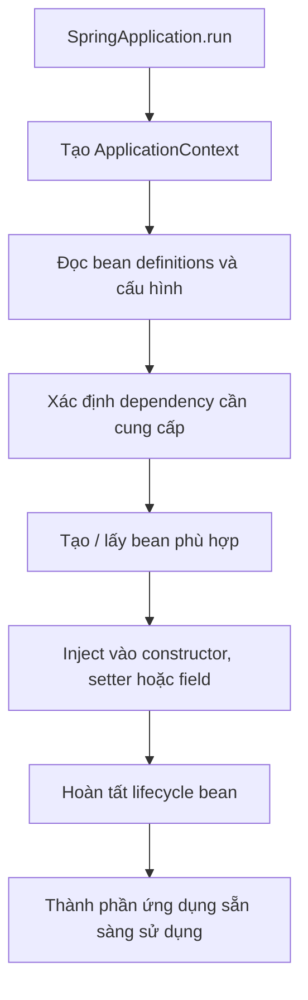
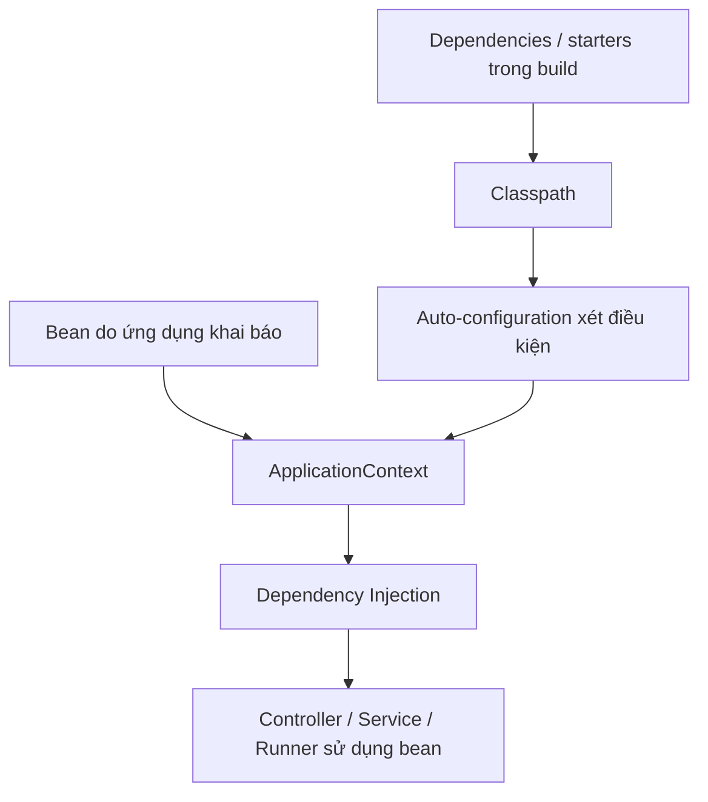

# Dependency injection là một cách thực hiện IoC

Trong ứng dụng Spring Boot, ta thường thấy một class `@Service` nhận một repository qua constructor, một controller nhận service, hoặc một phương thức `@Bean` nhận các bean khác làm tham số. Các đối tượng ấy có thể hoạt động cùng nhau mà mã nguồn không cần tự tìm, khởi tạo hay quản lý toàn bộ chuỗi phụ thuộc. Cơ chế này liên quan trực tiếp tới hai khái niệm nền tảng: **Inversion of Control (IoC)** và **Dependency Injection (DI)**.

Điều dễ gây nhầm là nhiều tài liệu dùng hai thuật ngữ gần như thay thế cho nhau. Thực tế, **IoC là nguyên lý tổng quát về việc chuyển quyền điều khiển**, còn **DI là một kỹ thuật cụ thể để thực hiện IoC trong việc cung cấp những đối tượng mà một class cần sử dụng**. Spring Framework dùng IoC container để quản lý bean và thực hiện DI; Spring Boot giúp chuẩn bị và cấu hình container thuận tiện hơn.

Bài này tập trung vào quan hệ giữa IoC và DI, cách container của Spring giải quyết dependency, những cách inject phổ biến, và các tình huống thường gặp khi tổ chức ứng dụng Spring Boot.

## 1. Bắt đầu từ vấn đề: ai quyết định tạo dependency?

Giả sử một ứng dụng tính số tiền phải trả sau giảm giá. `CheckoutService` cần một chính sách giảm giá. Ban đầu, ta viết mọi thứ trong cùng một class:

```java
package com.example.shop.application;

import com.example.shop.domain.PercentageDiscountPolicy;
import java.math.BigDecimal;

public class CheckoutService {

    private final PercentageDiscountPolicy policy =
            new PercentageDiscountPolicy(new BigDecimal("0.10"));

    public BigDecimal totalAfterDiscount(BigDecimal subtotal) {
        return subtotal.subtract(policy.discountFor(subtotal));
    }
}
```

Giả sử `PercentageDiscountPolicy` là class hỗ trợ tính chiết khấu, được định nghĩa ở phần tiếp theo.

Trong ví dụ trên, `CheckoutService` tự quyết định ba việc:

1. **Cần triển khai nào:** sử dụng trực tiếp `PercentageDiscountPolicy`.
2. **Khởi tạo triển khai ra sao:** gọi `new PercentageDiscountPolicy(...)`.
3. **Cấu hình triển khai bằng gì:** gắn cố định tỷ lệ giảm giá `0.10`.

Khi chính sách đổi theo nhóm khách hàng, khi test cần một policy giả, hoặc khi chính sách phải đọc từ cấu hình, ta buộc phải sửa hoặc mở rộng `CheckoutService`. Class vừa tính toán đơn hàng vừa nắm chi tiết tạo dependency.

Vấn đề không nằm ở từ khóa `new`. Tạo đối tượng bằng `new` là một phần bình thường của Java. Vấn đề là **class đang thực hiện nghiệp vụ tự ràng buộc với cách xây dựng và lựa chọn dependency cụ thể**, khiến các thay đổi khó tách biệt.

## 2. IoC là gì?

**Inversion of Control** có thể hiểu là *đảo ngược quyền điều khiển*. Trong cách viết truyền thống, mã ứng dụng chủ động gọi những hàm và tạo những thành phần mà nó cần. Với IoC, một phần trách nhiệm điều phối được chuyển cho một thành phần bên ngoài, chẳng hạn framework hoặc container.

Xét cách tổ chức đơn giản:

```text
Không có cơ chế IoC container:

main()
  |
  +-- new DiscountPolicy(...)
  |
  +-- new CheckoutService(policy)
  |
  +-- gọi service.totalAfterDiscount(...)

Có Spring IoC container:

SpringApplication.run(...)
  |
  +-- tạo ApplicationContext
        |
        +-- xác định các bean cần có
        +-- tạo DiscountPolicy
        +-- tạo CheckoutService bằng dependency đã có
        +-- quản lý vòng đời các bean
        |
        +-- cung cấp các bean cho thành phần ứng dụng
```

Trong trường hợp thứ hai, ứng dụng khai báo **những thành phần cần thiết và quan hệ phụ thuộc giữa chúng**, còn Spring container quyết định cách khởi tạo và kết nối các bean theo cấu hình.

### 2.1. “Đảo ngược” so với điều gì?

Nếu một class tự làm:

```java
DiscountPolicy policy = new PercentageDiscountPolicy(
        new BigDecimal("0.10")
);
CheckoutService service = new CheckoutService(policy);
```

thì đoạn mã đang trực tiếp điều khiển việc tạo đối tượng. Nếu một framework thực hiện việc tạo và cung cấp các dependency này, **quyền điều khiển khởi tạo** chuyển ra ngoài class cần sử dụng.

IoC còn xuất hiện trong các hình thức khác:

- Framework gọi phương thức ứng dụng khi có sự kiện hoặc yêu cầu phù hợp, thay vì mã ứng dụng tự thực hiện vòng lặp điều phối mọi sự kiện.
- Framework áp dụng callback, listener hoặc lifecycle hook ở thời điểm đã quy định.
- Container khởi tạo, liên kết và quản lý vòng đời đối tượng theo cấu hình.

Ví dụ, Spring MVC gọi handler/controller phù hợp khi nhận HTTP request cũng thể hiện ý tưởng một framework điều phối luồng xử lý. Nhưng việc Spring MVC gọi controller **không tự đồng nghĩa** với việc dependency của controller được inject. Hai cơ chế có thể xuất hiện cùng nhau nhưng là hai khía cạnh khác nhau của IoC.

### 2.2. IoC là nguyên lý, không phải một annotation

Không có annotation duy nhất tên `@IoC` mà thêm vào là hoàn tất thiết kế. `@Component`, `@Bean`, `@Autowired` hoặc constructor injection là những cơ chế liên quan tới **Spring container và DI**. Nguyên lý IoC rộng hơn danh sách annotation đó.

## 3. Dependency Injection là gì?

**Dependency** là một đối tượng hoặc dịch vụ mà một thành phần khác cần để thực hiện công việc. **Dependency Injection** là cách **cung cấp dependency từ bên ngoài cho thành phần sử dụng**, thay vì để thành phần đó tự tìm hoặc tự tạo mọi dependency.

Một class chỉ cần biết **mình cần khả năng gì**; đối tượng nào cụ thể đáp ứng khả năng đó có thể được quyết định ở nơi lắp ghép ứng dụng.

Ví dụ, ta định nghĩa hợp đồng giảm giá:

```java
// src/main/java/com/example/shop/domain/DiscountPolicy.java
package com.example.shop.domain;

import java.math.BigDecimal;

@FunctionalInterface
public interface DiscountPolicy {
    BigDecimal discountFor(BigDecimal subtotal);
}
```

Một triển khai cho chính sách giảm giá theo tỷ lệ:

```java
// src/main/java/com/example/shop/domain/PercentageDiscountPolicy.java
package com.example.shop.domain;

import java.math.BigDecimal;
import java.util.Objects;

public final class PercentageDiscountPolicy implements DiscountPolicy {

    private final BigDecimal rate;

    public PercentageDiscountPolicy(BigDecimal rate) {
        Objects.requireNonNull(rate, "rate");
        if (rate.signum() < 0 || rate.compareTo(BigDecimal.ONE) > 0) {
            throw new IllegalArgumentException("rate must be between 0 and 1");
        }
        this.rate = rate;
    }

    @Override
    public BigDecimal discountFor(BigDecimal subtotal) {
        Objects.requireNonNull(subtotal, "subtotal");
        if (subtotal.signum() < 0) {
            throw new IllegalArgumentException("subtotal cannot be negative");
        }
        return subtotal.multiply(rate);
    }
}
```

Sau đó viết lại service để nó nhận hợp đồng thay vì tự khởi tạo implementation:

```java
// src/main/java/com/example/shop/application/CheckoutService.java
package com.example.shop.application;

import com.example.shop.domain.DiscountPolicy;
import java.math.BigDecimal;
import java.util.Objects;

public final class CheckoutService {

    private final DiscountPolicy discountPolicy;

    public CheckoutService(DiscountPolicy discountPolicy) {
        this.discountPolicy = Objects.requireNonNull(
                discountPolicy, "discountPolicy"
        );
    }

    public BigDecimal totalAfterDiscount(BigDecimal subtotal) {
        Objects.requireNonNull(subtotal, "subtotal");
        if (subtotal.signum() < 0) {
            throw new IllegalArgumentException("subtotal cannot be negative");
        }
        return subtotal.subtract(discountPolicy.discountFor(subtotal));
    }
}
```

Điểm thay đổi quyết định:

| Trước khi áp dụng DI | Sau khi áp dụng DI |
| --- | --- |
| Service gọi `new PercentageDiscountPolicy(...)` | Service nhận `DiscountPolicy` qua constructor |
| Service quyết định mức giảm giá cụ thể | Nơi khởi tạo chọn và cấu hình policy |
| Service phụ thuộc trực tiếp vào class triển khai | Service phụ thuộc vào hợp đồng `DiscountPolicy` |
| Muốn thay policy thường phải sửa service | Có thể truyền một policy khác mà giữ nguyên service |
| Test khó thay dependency khi nó bị khởi tạo cứng | Test có thể truyền fake hoặc stub dễ dàng |

Việc dùng interface không phải điều kiện bắt buộc để DI hoạt động: Spring có thể inject một class cụ thể. Interface chỉ giúp diễn đạt rõ hợp đồng khi thật sự có nhu cầu hoán đổi hoặc tách implementation.

## 4. DI có thể tồn tại mà không cần Spring

Ví dụ sau là **Dependency Injection bằng Java thuần**:

```java
import com.example.shop.application.CheckoutService;
import com.example.shop.domain.DiscountPolicy;
import com.example.shop.domain.PercentageDiscountPolicy;
import java.math.BigDecimal;

public class Demo {

    public static void main(String[] args) {
        DiscountPolicy policy =
                new PercentageDiscountPolicy(new BigDecimal("0.10"));

        CheckoutService checkoutService = new CheckoutService(policy);

        BigDecimal result = checkoutService.totalAfterDiscount(
                new BigDecimal("1200000")
        );

        System.out.println(result); // 1080000.00
    }
}
```

Ở đây, `Demo` lắp ghép các đối tượng; `CheckoutService` chỉ nhận dependency và sử dụng. **Không có Spring IoC container**, nhưng DI đã diễn ra vì dependency được cung cấp từ bên ngoài.

Đoạn mã này giúp phân biệt:

- **DI là kỹ thuật thiết kế:** dependency được truyền vào từ bên ngoài.
- **Spring IoC container là cơ chế tự động hóa:** quản lý bean, chọn implementation, cung cấp dependency và hỗ trợ vòng đời theo cấu hình.

Vì vậy, nói “DI chỉ tồn tại khi có Spring” là sai. Và nói “cứ có Spring Boot là mọi class Java đều được DI” cũng sai: chỉ những thành phần được quản lý hoặc được lắp ghép phù hợp mới nhận dependency từ container.

### Một từ khóa quan trọng: composition root

Đoạn mã hoặc module có nhiệm vụ **tạo những đối tượng quan trọng và kết nối chúng lại** thường được gọi là *composition root*. Trong ứng dụng Java thuần, đó có thể là `main` hoặc một factory. Trong Spring Boot, composition root thường được thực hiện bởi cấu hình bean và Spring application context.

Không nên hiểu “tránh `new` trong nghiệp vụ” thành “không được dùng `new` ở bất cứ đâu”. Việc tạo một đối tượng giá trị như `new BigDecimal("100")` hoặc tạo policy tại composition root vẫn hợp lý. DI giải quyết vấn đề **ai sở hữu quan hệ phụ thuộc**, chứ không cấm tạo object.

## 5. Spring IoC container thực hiện DI ra sao?

Spring Framework cung cấp các abstraction như `BeanFactory` và `ApplicationContext`. Trong ứng dụng Spring Boot thông thường, `ApplicationContext` là container trung tâm quản lý các bean.

Một **Spring bean** là đối tượng được container tạo hoặc đăng ký và quản lý theo định nghĩa bean. Một Java object được tạo bằng `new` bên ngoài container không tự trở thành Spring bean.

Spring Boot dùng `SpringApplication.run(...)` để khởi tạo ứng dụng và tạo application context phù hợp với loại ứng dụng cùng cấu hình.

Quá trình khái quát:



Đây là sơ đồ khái niệm; Spring còn có nhiều bước xử lý nội bộ như bean post-processing, proxy, lazy initialization và các scope. Để nắm nguyên lý DI, điều quan trọng là thấy **container đọc định nghĩa quan hệ phụ thuộc và cung cấp bean**, chứ không phải các service tự tìm dependency bằng cách gọi `ApplicationContext.getBean(...)`.

### 5.1. Spring tìm bean definition từ đâu?

Những cách phổ biến:

- **Component scanning:** tìm các class đánh dấu `@Component`, `@Service`, `@Repository`, `@Controller` và các stereotype liên quan trong phạm vi scan.
- **Java configuration:** các phương thức `@Bean` trong class `@Configuration` khai báo đối tượng do container quản lý.
- **Auto-configuration của Spring Boot:** dựa trên classpath, property, bean hiện có và các điều kiện để tạo các bean thông dụng.
- **Cơ chế import hoặc đăng ký bean khác:** được dùng khi dự án có module hoặc cấu hình chuyên biệt.

Chọn cách nào phụ thuộc vào việc class thuộc quyền quản lý của ứng dụng, có cần truyền tham số tạo phức tạp hay là class từ thư viện bên thứ ba.

### 5.2. Bean phải nằm trong context phù hợp

Một class có `@Service` không có nghĩa mọi Spring Boot application sẽ tự thấy nó. Component scan mặc định thường bắt đầu từ package chứa class `@SpringBootApplication` và các package con. Nếu component ở ngoài phạm vi đó, container có thể không đăng ký bean.

Tương tự, một interface Java không thể tự trở thành implementation chỉ vì đã được khai báo. Spring phải có một bean cụ thể phù hợp để inject.

## 6. Dùng @Configuration và @Bean để thực hiện DI

Tiếp tục với `DiscountPolicy` và `CheckoutService` là Java class thuần. Ta khai báo cách lắp ghép trong Spring:

```java
// src/main/java/com/example/shop/config/CheckoutConfiguration.java
package com.example.shop.config;

import com.example.shop.application.CheckoutService;
import com.example.shop.domain.DiscountPolicy;
import com.example.shop.domain.PercentageDiscountPolicy;
import java.math.BigDecimal;
import org.springframework.context.annotation.Bean;
import org.springframework.context.annotation.Configuration;

@Configuration
public class CheckoutConfiguration {

    @Bean
    DiscountPolicy discountPolicy() {
        return new PercentageDiscountPolicy(new BigDecimal("0.10"));
    }

    @Bean
    CheckoutService checkoutService(DiscountPolicy policy) {
        return new CheckoutService(policy);
    }
}
```

Phương thức `discountPolicy()` nói với Spring cách cung cấp một bean kiểu `DiscountPolicy`. Phương thức `checkoutService(DiscountPolicy policy)` khai báo dependency bằng tham số. Khi cần tạo `CheckoutService`, Spring cung cấp một bean tương thích với `DiscountPolicy` rồi gọi phương thức `@Bean`.

Class ứng dụng có thể khai báo một runner để quan sát:

```java
// src/main/java/com/example/shop/ShopApplication.java
package com.example.shop;

import com.example.shop.application.CheckoutService;
import java.math.BigDecimal;
import org.springframework.boot.CommandLineRunner;
import org.springframework.boot.SpringApplication;
import org.springframework.boot.autoconfigure.SpringBootApplication;
import org.springframework.context.annotation.Bean;

@SpringBootApplication
public class ShopApplication {

    public static void main(String[] args) {
        SpringApplication.run(ShopApplication.class, args);
    }

    @Bean
    CommandLineRunner checkoutDemo(CheckoutService service) {
        return args -> System.out.println(
                service.totalAfterDiscount(new BigDecimal("1200000"))
        );
    }
}
```

Khi project đã có Spring Boot starter phù hợp để chạy ứng dụng, các class nằm dưới package `com.example.shop` được đưa vào phạm vi component scan mặc định. Spring tạo các bean trong `CheckoutConfiguration` và cung cấp `CheckoutService` cho runner. Với số liệu trên, kết quả in ra có giá trị **1.080.000** theo biểu diễn `BigDecimal`.

Điểm cần quan sát:

1. `ShopApplication` khởi động container.
2. Container tìm thấy `CheckoutConfiguration`.
3. Phương thức `@Bean discountPolicy()` tạo implementation.
4. Phương thức `@Bean checkoutService(...)` nhận implementation ấy từ container.
5. `CommandLineRunner` nhận `CheckoutService` rồi thực hiện nghiệp vụ.

Mã `CheckoutService` không hề gọi `SpringApplication.run`, `ApplicationContext.getBean` hay `new PercentageDiscountPolicy`. Nó chỉ diễn đạt rằng mình cần `DiscountPolicy`. Đây là **DI do Spring IoC container thực hiện**.

### 6.1. Vì sao không đưa @Component lên mọi class?

Với `PercentageDiscountPolicy`, constructor nhận một giá trị `BigDecimal rate`. Nếu chỉ thêm `@Component` mà không cung cấp giá trị phù hợp, Spring không thể mặc nhiên đoán tỷ lệ giảm giá bạn muốn. Việc tạo bean qua `@Bean` giúp định nghĩa rõ tham số.

Đối tượng của bên thứ ba mà ta không thể chỉnh sửa source cũng có thể được cung cấp bằng `@Bean`. Vì vậy, `@Configuration` và `@Bean` là một cách biểu diễn DI bên cạnh annotation scanning, không phải dấu hiệu rằng ứng dụng không dùng IoC.

## 7. Dùng stereotype annotations để Spring quản lý class

Với class do dự án sở hữu, nhiều ứng dụng dùng `@Component` và các annotation chuyên biệt để Spring tự đăng ký bean.

Ví dụ một luồng gửi thông báo:

```java
// com/example/shop/notification/Notifier.java
package com.example.shop.notification;

public interface Notifier {
    void send(String message);
}
```

```java
// com/example/shop/notification/ConsoleNotifier.java
package com.example.shop.notification;

import org.springframework.stereotype.Component;

@Component
public class ConsoleNotifier implements Notifier {
    @Override
    public void send(String message) {
        System.out.println(message);
    }
}
```

```java
// com/example/shop/notification/RegistrationService.java
package com.example.shop.notification;

import org.springframework.stereotype.Service;

@Service
public class RegistrationService {

    private final Notifier notifier;

    public RegistrationService(Notifier notifier) {
        this.notifier = notifier;
    }

    public void register(String username) {
        // Ví dụ rút gọn: chưa có lưu dữ liệu hoặc kiểm tra đầu vào.
        notifier.send("Registered: " + username);
    }
}
```

Nếu các class thuộc phạm vi component scan:

- `ConsoleNotifier` được đăng ký làm bean qua `@Component`.
- `RegistrationService` được đăng ký qua `@Service`, một stereotype của `@Component`.
- Constructor của `RegistrationService` khai báo dependency `Notifier`.
- Spring tìm một bean phù hợp, là `ConsoleNotifier` trong ví dụ, và inject vào service.

Với class chỉ có **một constructor**, Spring có thể sử dụng constructor đó để inject dependency mà không cần ghi `@Autowired`. Việc không có `@Autowired` ở ví dụ này **không có nghĩa DI đã bị tắt**.

### 7.1. @Component, @Service và @Repository không thay thế việc thiết kế trách nhiệm

| Annotation | Vai trò phổ biến | Ghi chú về DI |
| --- | --- | --- |
| `@Component` | Component tổng quát do Spring quản lý | Có thể được scan thành bean |
| `@Service` | Đánh dấu lớp dịch vụ ứng dụng/nghiệp vụ | Về cơ chế scan, là stereotype chuyên biệt |
| `@Repository` | Thành phần truy cập dữ liệu | Ngoài stereotype còn có ngữ nghĩa hỗ trợ xử lý exception trong ngữ cảnh thích hợp |
| `@Controller` / `@RestController` | Thành phần tiếp nhận request web | Vẫn có thể nhận dependency qua constructor |
| `@Configuration` | Lớp khai báo bean và cấu hình | Thường chứa phương thức `@Bean` |

Annotation giúp Spring nhận diện bean, nhưng **không tự bảo đảm** rằng class có trách nhiệm rõ ràng hoặc kiến trúc đúng. Một controller tự tạo database client và tính giá vẫn bị phụ thuộc chặt cho dù controller đó là Spring bean.

### 7.2. Chọn một cách đăng ký bean rõ ràng

Nếu đã dùng `@Bean` để tạo `CheckoutService`, không nên đồng thời thêm `@Service` cho cùng class rồi giữ cả hai cách tạo mà không có mục đích rõ ràng. Điều đó có thể tạo nhiều bean cùng kiểu và dẫn tới lỗi inject mơ hồ.

Hai cách đều hợp lệ:

**Cách A:** dùng class Java thuần và khai báo bean trong `@Configuration`.

**Cách B:** đánh dấu implementation bằng `@Service` hoặc `@Component`, để Spring scan và dùng constructor injection.

Chọn cách dễ đọc và nhất quán với cấu trúc dự án.

## 8. Ba hình thức Dependency Injection thông dụng

DI trong Spring thường được giới thiệu qua ba hình thức: **constructor injection**, **setter injection** và **field injection**. Chúng khác nhau ở thời điểm cung cấp dependency và khả năng biểu diễn điều kiện bắt buộc.

### 8.1. Constructor injection

```java
@Service
public class InvoiceService {

    private final TaxCalculator taxCalculator;

    public InvoiceService(TaxCalculator taxCalculator) {
        this.taxCalculator = taxCalculator;
    }
}
```

Trong ví dụ, `TaxCalculator` là một kiểu dependency giả định đã có bean phù hợp trong Spring context.

Ưu điểm:

- Constructor thể hiện rõ class **không thể hoạt động đúng nếu thiếu dependency**.
- Có thể khai báo trường `final`, tránh thay dependency ngoài ý muốn sau khi xây dựng.
- Dễ tạo class trong unit test mà không nạp Spring context.
- Nếu thiếu bean phù hợp, lỗi thường bộc lộ khi container cố tạo service.
- Các dependency bắt buộc tập trung trong chữ ký constructor, giúp phát hiện class có quá nhiều trách nhiệm.

Với dependency bắt buộc, **constructor injection thường là lựa chọn ưu tiên**.

### 8.2. Setter injection

```java
@Component
public class ReportGenerator {

    private ReportFormatter formatter = new PlainTextFormatter();

    @Autowired
    public void setFormatter(ReportFormatter formatter) {
        this.formatter = formatter;
    }
}
```

Giả sử `ReportFormatter` và `PlainTextFormatter` là interface/implementation của ví dụ. Setter injection cung cấp dependency bằng cách gọi một phương thức sau khi đối tượng được tạo. Cách này có thể phù hợp khi dependency có thể thay đổi hoặc có cấu hình tùy chọn được thiết kế rõ ràng.

Tuy nhiên, **setter được đánh dấu `@Autowired` theo cách thông thường vẫn yêu cầu bean phù hợp**. Việc sử dụng setter không tự khiến dependency trở thành tùy chọn. Có thể dùng `@Autowired(required = false)` hoặc các cơ chế phù hợp khác khi thực sự muốn bỏ qua một dependency không có sẵn.

Nhược điểm của setter injection là class có thể tồn tại trước khi dependency được gán; cần thiết kế trạng thái mặc định và thời điểm sử dụng thật cẩn thận. Không nên dùng setter chỉ để che việc class phụ thuộc vào một dịch vụ bắt buộc.

### 8.3. Field injection

```java
@Service
public class LegacyInvoiceService {

    @Autowired
    private TaxCalculator taxCalculator;
}
```

Spring có thể inject trực tiếp vào field thông qua cơ chế container. Cú pháp ngắn, nhưng có những bất lợi:

- Dependency bị ẩn khỏi constructor; nhìn chữ ký khởi tạo không thấy class cần gì.
- Khó tạo instance đầy đủ trong unit test Java thuần.
- Field không thuận tiện để là `final` theo cách inject này.
- Có thể khiến class phụ thuộc vào container ngay cả khi logic không cần Spring.

Vì vậy, với mã ứng dụng mới, nên **ưu tiên constructor injection** và chỉ sử dụng field injection khi có lý do cụ thể, chẳng hạn đang làm việc với mã cũ hoặc framework có ràng buộc đặc biệt.

### 8.4. So sánh nhanh

| Tiêu chí | Constructor | Setter | Field |
| --- | --- | --- | --- |
| Dependency bắt buộc | Diễn đạt rất rõ | Cần quy ước rõ | Bị ẩn khỏi API khởi tạo |
| Hỗ trợ `final` | Tốt | Không phù hợp khi cần gán sau | Không phù hợp với field injection thông dụng |
| Unit test không dùng Spring | Thuận tiện | Cần gọi setter | Khó hơn |
| Thay thế sau khi tạo object | Không theo API constructor | Có thể thiết kế | Không có API công khai |
| Khuyến nghị cho service mới | Thường ưu tiên | Dùng khi phù hợp mục tiêu | Hạn chế sử dụng |

## 9. Khi có nhiều implementation của một interface

Spring không luôn biết nên chọn bean nào nếu cùng một type có nhiều bean ứng viên.

Giả sử có hai chính sách cùng thực hiện `DiscountPolicy`:

```java
@Configuration
class DiscountConfiguration {

    @Bean("standardDiscountPolicy")
    DiscountPolicy standardDiscountPolicy() {
        return new PercentageDiscountPolicy(new BigDecimal("0.05"));
    }

    @Bean("vipDiscountPolicy")
    DiscountPolicy vipDiscountPolicy() {
        return new PercentageDiscountPolicy(new BigDecimal("0.15"));
    }
}
```

Nếu constructor chỉ nhận một `DiscountPolicy` mà không có thông tin phân biệt, container có thể báo lỗi kiểu `NoUniqueBeanDefinitionException` vì có nhiều ứng viên phù hợp.

### 9.1. Dùng @Qualifier

```java
@Service
class StandardCheckoutService {

    private final DiscountPolicy policy;

    StandardCheckoutService(
            @Qualifier("standardDiscountPolicy") DiscountPolicy policy
    ) {
        this.policy = policy;
    }
}
```

Ở đây, `@Qualifier` hướng container chọn bean có qualifier phù hợp. Ví dụ đã lược bỏ phần sử dụng `policy` để tập trung vào cơ chế inject. Cần import `org.springframework.beans.factory.annotation.Qualifier`.

### 9.2. Dùng @Primary

Nếu một bean nên được ưu tiên khi inject theo kiểu mà không có qualifier cụ thể, có thể khai báo:

```java
@Bean
@Primary
DiscountPolicy standardDiscountPolicy() {
    return new PercentageDiscountPolicy(new BigDecimal("0.05"));
}
```

`@Primary` giúp ưu tiên bean này giữa các ứng viên cùng kiểu trong tình huống phù hợp. Tuy nhiên, không nên dùng nó để che việc ứng dụng chưa xác định rõ chính sách cần dùng.

Với nghiệp vụ có nhiều chính sách thực sự (khách hàng VIP, khách hàng thường, khuyến mại theo sự kiện), đôi khi use case cần một **bộ chọn chính sách theo dữ liệu nghiệp vụ** thay vì container chọn cố định lúc khởi động. `@Qualifier` và `@Primary` là công cụ cấu hình bean; chúng không thay thế thuật toán chọn chính sách theo khách hàng lúc chạy.

### 9.3. Tránh nhầm tên bean với tên class

Bean name là danh tính bean trong container; Java class name là danh tính type. Mỗi class có thể tương ứng với một hoặc nhiều bean trong những cấu hình khác nhau. Vì thế, việc tên class chứa chữ “Vip” không tự đảm bảo Spring sẽ chọn nó cho mọi yêu cầu VIP. Cần kiểm tra tên bean, qualifier, primary và cách wiring thực tế.

## 10. Thiếu dependency, dependency tùy chọn và lazy lookup

### 10.1. Thiếu bean bắt buộc

Giả sử có:

```java
@Service
class PaymentService {

    PaymentService(PaymentGateway gateway) {
        this.gateway = gateway;
    }

    private final PaymentGateway gateway;
}
```

Nếu `PaymentGateway` chưa có implementation được đăng ký thành bean, Spring không thể thỏa mãn constructor này. Khi container cố khởi tạo `PaymentService`, ứng dụng có thể thất bại với lỗi kiểu `UnsatisfiedDependencyException` hoặc thông tin gốc liên quan tới `NoSuchBeanDefinitionException`.

Cách điều tra hợp lý:

1. Tìm interface/class `PaymentGateway` và implementation được kỳ vọng.
2. Xem implementation đã được đánh dấu để scan hoặc được khai báo qua `@Bean` chưa.
3. Kiểm tra package scan, profile, conditional configuration và những bean cùng kiểu.
4. Xác nhận module/dependency cung cấp implementation có ở classpath.

Không nên sửa lỗi bằng cách tạo `new` cho một implementation bất kỳ ngay trong `PaymentService`; hành động đó có thể bỏ qua cơ chế quản lý của container và chuyển coupling vào nghiệp vụ.

### 10.2. Dependency thật sự tùy chọn

Một số tính năng có thể chạy khi một bean không có sẵn, ví dụ module ghi thêm thống kê tùy chọn. Khi đó, có thể diễn đạt rõ tính tùy chọn bằng `Optional<T>`, `ObjectProvider<T>` hoặc cấu hình điều kiện, tùy tình huống.

Ví dụ:

```java
@Service
class OptionalMetricsService {

    private final Optional<MetricsPublisher> publisher;

    OptionalMetricsService(Optional<MetricsPublisher> publisher) {
        this.publisher = publisher;
    }

    void record(String event) {
        publisher.ifPresent(p -> p.publish(event));
    }
}
```

`MetricsPublisher` ở đây là một interface ví dụ. Khi Spring inject `Optional<MetricsPublisher>`, ứng dụng có thể thể hiện sự vắng mặt hợp lệ của bean nếu không có ứng viên. Cần quyết định rõ việc bỏ qua ghi metric có phù hợp với yêu cầu hay không.

Với dependency bắt buộc, dùng `Optional` để né lỗi khởi động thường chỉ khiến vấn đề bị dời sang lúc chạy. Đừng thay một ràng buộc bắt buộc bằng giá trị rỗng nếu nghiệp vụ không thể hoạt động thiếu nó.

### 10.3. ObjectProvider dùng khi cần lấy bean theo thời điểm

`ObjectProvider<T>` là một khả năng của Spring cho phép lấy bean linh hoạt, ví dụ lấy khi thực sự cần hoặc tương tác với dependency có scope đặc biệt.

```java
@Service
class JobService {

    private final ObjectProvider<JobContext> contextProvider;

    JobService(ObjectProvider<JobContext> contextProvider) {
        this.contextProvider = contextProvider;
    }

    void execute() {
        JobContext context = contextProvider.getObject();
        context.run();
    }
}
```

Ví dụ giả định có bean `JobContext` tương ứng. `getObject()` có thể thất bại khi bean bắt buộc không tồn tại hoặc không xác định duy nhất; nó không tự tạo ra implementation ngoài container. `ObjectProvider` đặc biệt hữu ích khi có yêu cầu lấy bean theo thời điểm, nhưng không cần dùng cho mọi dependency thông thường.

## 11. Scope của bean ảnh hưởng tới DI

Trong Spring, bean có **scope** xác định phạm vi của instance do container quản lý.

| Scope | Ý nghĩa cơ bản | Điểm liên quan đến DI |
| --- | --- | --- |
| `singleton` | Một instance cho mỗi bean definition trong một Spring container | Scope mặc định với bean Spring thông thường |
| `prototype` | Container tạo instance mới mỗi lần có yêu cầu lấy bean phù hợp | Không tự tạo instance mới ở mỗi lời gọi phương thức của một singleton đã inject nó |
| `request` | Một instance gắn với một HTTP request khi có web context thích hợp | Không tự tồn tại trong ứng dụng non-web |
| `session` | Một instance trong phạm vi phiên HTTP khi hỗ trợ | Cần hiểu vòng đời phiên và đối tượng nhận nó |

Ví dụ:

```java
@Component
@Scope("prototype")
class WorkUnit {
}
```

Nếu một singleton service nhận `WorkUnit` trực tiếp qua constructor, Spring thường giải quyết dependency **khi tạo singleton**. Service không tự nhận một `WorkUnit` mới mỗi lần chạy method. Nếu yêu cầu thật sự là một instance mới theo mỗi lần xử lý, có thể cần `ObjectProvider<WorkUnit>` hoặc cách tạo đối tượng phù hợp.

Scope cũng liên quan tới thread safety. Nhiều request có thể dùng chung một singleton service, nên việc lưu dữ liệu trạng thái từng request vào field có thể gây lỗi đồng thời. DI quản lý cách kết nối object; **DI không tự làm mọi singleton thread-safe**.

### Singleton của Spring khác singleton theo mọi nghĩa tuyệt đối

Spring singleton là phạm vi một bean definition trong một container. Nó không có nghĩa cả JVM chỉ tồn tại duy nhất một instance của Java class đó, và cũng không ngăn code khác gọi `new` để tạo một object tương tự.

## 12. DI và vòng đời bean: Spring quản lý điều gì?

Khi một object trở thành bean, container có thể:

- Khởi tạo instance và giải quyết dependency.
- Áp dụng lifecycle callbacks và bean post-processors theo cấu hình.
- Tạo proxy khi cần tính năng như transaction hoặc AOP.
- Gọi cơ chế hủy bean tương ứng với scope được hỗ trợ khi context đóng.

Ví dụ:

```java
@Component
class LocalCache {

    @PostConstruct
    void initialize() {
        // Khởi tạo dữ liệu cache sau khi dependency đã được cung cấp.
    }

    @PreDestroy
    void cleanup() {
        // Giải phóng tài nguyên khi container hủy bean này.
    }
}
```

Với các phiên bản Spring Boot sử dụng Jakarta APIs, cần import `jakarta.annotation.PostConstruct` và `jakarta.annotation.PreDestroy`. Vòng đời thực tế phụ thuộc scope; với prototype, Spring không tự theo dõi và gọi đầy đủ callback hủy cho mọi instance sau khi trao nó cho người dùng.

Điều này cho thấy IoC container làm nhiều việc hơn chỉ truyền tham số constructor. **DI là một phần của việc container quản lý các thành phần**, nhưng container còn xử lý configuration, scopes và lifecycle.

Không nên tạo manual instance bằng `new` rồi kỳ vọng các callback, transaction proxy hoặc annotation do Spring quản lý tự có hiệu lực trên instance đó. Đối tượng do code tạo ngoài container là object Java bình thường, trừ khi được tích hợp bằng một cơ chế đặc biệt.

## 13. Circular dependency: khi các bean cần lẫn nhau

Một vấn đề dễ gặp:

```text
OrderService cần PaymentService
          ^
          |
          v
PaymentService cần OrderService
```

Nếu cả hai class đều sử dụng constructor injection bắt buộc, Spring không thể tạo object đầu tiên vì mỗi object đòi object còn lại đã được tạo. Trường hợp này thường dẫn tới lỗi tạo bean do **circular dependency**.

Ví dụ tối giản:

```java
@Service
class OrderService {
    OrderService(PaymentService paymentService) {
    }
}

@Service
class PaymentService {
    PaymentService(OrderService orderService) {
    }
}
```

Đôi lúc có thể trì hoãn việc lấy một bean bằng `@Lazy` hoặc provider trong tình huống đặc biệt, nhưng đó không phải giải pháp thiết kế mặc định. Khi hai service phụ thuộc lẫn nhau, hãy xem lại trách nhiệm:

- Có thể đưa luồng phối hợp sang một use case/application service riêng không?
- Một trong hai lớp đang mang quá nhiều trách nhiệm chăng?
- Hai lớp có đang truy cập cùng dữ liệu qua một contract chung có thể tách ra không?
- Dependency có thực sự cần thiết ở cả hai chiều không?

Constructor injection làm quan hệ vòng dễ lộ ra sớm. Đây là một lợi ích thiết kế, dù nó khiến ứng dụng không khởi động trong trường hợp cấu trúc phụ thuộc không hợp lý.

## 14. DI so với Service Locator

Hai cách sau có thể cùng dùng Spring container nhưng mang mức độ phụ thuộc khác nhau.

### Cách 1: class tự tìm dependency từ container

```java
@Service
class OrderProcessor {

    private final ApplicationContext context;

    OrderProcessor(ApplicationContext context) {
        this.context = context;
    }

    void process() {
        PaymentGateway gateway = context.getBean(PaymentGateway.class);
        gateway.charge();
    }
}
```

Đây là ví dụ mang đặc điểm **Service Locator**: class tự truy xuất một registry/container để lấy thứ mình cần. Dependency `PaymentGateway` bị ẩn khỏi chữ ký constructor, dù class vẫn phụ thuộc vào nó để làm việc. Mã ứng dụng cũng bị gắn với `ApplicationContext`.

### Cách 2: container inject dependency trực tiếp

```java
@Service
class OrderProcessor {

    private final PaymentGateway gateway;

    OrderProcessor(PaymentGateway gateway) {
        this.gateway = gateway;
    }

    void process() {
        gateway.charge();
    }
}
```

Đây là constructor injection: `OrderProcessor` khai báo thẳng dependency cần dùng. Khi test, ta có thể cung cấp fake gateway mà không cần tạo Spring container.

`PaymentGateway` trong hai ví dụ là interface minh họa, giả định có phương thức `charge()` và một bean phù hợp.

Không phải mọi lời gọi `getBean` đều sai. Ở code tích hợp framework hoặc nơi cần chọn bean động, việc truy xuất container đôi khi có lý do kỹ thuật. Nhưng đối với business service thông thường, **constructor injection làm dependency dễ nhìn và dễ kiểm soát hơn**.

## 15. DI trong Spring Boot có quan hệ gì với auto-configuration?

**Spring Boot auto-configuration** hỗ trợ đăng ký một số bean dựa trên điều kiện như classpath, properties và bean hiện có. **DI** là cơ chế cung cấp bean phù hợp cho đối tượng cần nó.

Hai cơ chế phối hợp nhưng không giống nhau:



Ví dụ, khi một starter và cấu hình phù hợp khiến Boot tạo `ObjectMapper` hoặc các bean liên quan, application service có thể nhận bean đó qua constructor. Nếu ứng dụng tự khai báo bean thay thế, auto-configuration có thể thay đổi hành vi theo điều kiện của nó.

Vì vậy:

- **Starter** giải quyết nhóm dependency cần đưa vào project.
- **Auto-configuration** giúp định nghĩa một số bean trong context theo điều kiện.
- **IoC container** quản lý những bean đã được đăng ký và vòng đời của chúng.
- **DI** cung cấp bean cho thành phần khác cần sử dụng.

Không nên nói “có starter thì bean chắc chắn tồn tại”. Bean có được đăng ký hay không còn phụ thuộc vào điều kiện cụ thể. Cũng không nên nói “đã tạo bean là DI xong”: chỉ khi dependency được cung cấp cho đối tượng sử dụng, khía cạnh injection mới thực sự diễn ra.

## 16. Unit test cho thấy lợi ích thực tế của DI

`CheckoutService` được viết bằng constructor injection và nhận `DiscountPolicy`. Nhờ vậy, ta có thể thay dependency bằng một fake đơn giản:

```java
import static org.junit.jupiter.api.Assertions.assertEquals;

import com.example.shop.application.CheckoutService;
import com.example.shop.domain.DiscountPolicy;
import java.math.BigDecimal;
import org.junit.jupiter.api.Test;

class CheckoutServiceTest {

    @Test
    void returnsSubtotalWhenDiscountIsZero() {
        DiscountPolicy noDiscount = subtotal -> BigDecimal.ZERO;
        CheckoutService checkoutService = new CheckoutService(noDiscount);

        BigDecimal total = checkoutService.totalAfterDiscount(
                new BigDecimal("900")
        );

        assertEquals(new BigDecimal("900"), total);
    }
}
```

Đây là unit test Java thông thường với JUnit. Không cần `@SpringBootTest` hoặc Spring application context, bởi class đang kiểm thử không tự tìm bean và không yêu cầu container để hoạt động.

Nếu muốn kiểm tra bản thân chính sách giảm giá, ta có thể kiểm thử `PercentageDiscountPolicy` độc lập. Nếu muốn kiểm tra rằng Spring nhận diện `CheckoutConfiguration` và wire bean đúng, ta dùng một bài kiểm thử tích hợp có Spring context phù hợp. **Mỗi loại test xác nhận một câu hỏi khác nhau**:

| Câu hỏi | Cách kiểm chứng phù hợp |
| --- | --- |
| Quy tắc giảm giá tính đúng không? | Unit test `PercentageDiscountPolicy` |
| Service dùng dependency được truyền đúng không? | Unit test `CheckoutService` với fake policy |
| Spring có tạo được bean khi khởi động không? | Context/integration test |
| Controller có nhận request và trả response đúng không? | Web test hoặc integration test |
| Repository thật có lưu dữ liệu như mong đợi không? | Persistence/integration test |

DI tạo điều kiện để kiểm thử ranh giới của từng thành phần, nhưng **DI tự nó không bảo đảm logic đúng**. Vẫn cần test đúng hành vi và tình huống nghiệp vụ quan trọng.

## 17. Phân biệt DI với những khái niệm gần giống

### 17.1. DI và interface

Interface giúp abstraction, nhưng không tự tạo DI. Class có thể khai báo field kiểu interface rồi tự `new` implementation:

```java
private final Notifier notifier = new ConsoleNotifier();
```

Đoạn mã dùng interface nhưng vẫn chọn và tạo dependency ngay bên trong class. Ngược lại, constructor nhận một class cụ thể từ bên ngoài vẫn là DI, dù không dùng interface.

### 17.2. DI và Factory

Factory có trách nhiệm tạo object theo quy tắc nào đó. DI có trách nhiệm cung cấp dependency cho đối tượng cần nó. Factory có thể được dùng **bên trong composition root** để tạo bean và đưa vào một service; vì vậy, hai kỹ thuật không loại trừ nhau.

Khi dependency thực sự cần thay đổi theo từng lời gọi, một factory được inject hoặc provider có thể phù hợp hơn một implementation được cố định tại startup.

### 17.3. DI và singleton

Bean singleton có thể được inject vào nhiều service. Nhưng DI không đồng nghĩa singleton: bean prototype, scoped bean hoặc object được tạo thủ công đều có thể được cung cấp thông qua một hình thức injection thích hợp.

### 17.4. DI và dependency management

Trong file build, từ “dependency” thường chỉ thư viện như `spring-boot-starter-web` hoặc `junit-jupiter`. Trong thiết kế object, dependency có thể là instance `DiscountPolicy` mà service cần để chạy.

Hai khái niệm có quan hệ: dependency trong build giúp cung cấp type/class, còn DI liên quan đến việc **đối tượng cụ thể được đưa cho đối tượng khác lúc chương trình chạy**. Khai báo một JAR trong Maven/Gradle không tự inject mọi class của JAR đó.

### 17.5. DI và AOP

AOP thường được dùng để tách những mối quan tâm xuyên suốt như transaction hoặc một số cơ chế logging. Spring có thể tạo proxy quanh bean để áp dụng các hành vi này. DI cung cấp bean/proxy phù hợp cho đối tượng sử dụng, nhưng **AOP và DI là hai cơ chế khác nhau**.

Một service không cần biết mình đang được inject trực tiếp implementation hay một proxy phù hợp. Tuy nhiên, khi điều tra hành vi transaction/proxy, phải hiểu rằng lời gọi bên trong cùng một object có thể không đi qua proxy theo cách gọi từ bean khác.

## 18. Những hiểu lầm thường gặp khi mới học

| Nhận định | Cách hiểu chính xác hơn |
| --- | --- |
| “IoC chính là DI.” | DI là một cách thực hiện IoC; IoC có phạm vi rộng hơn. |
| “Không dùng Spring thì không có DI.” | Java thuần có thể inject qua constructor hoặc setter. |
| “Có `@Autowired` mới là DI.” | Constructor duy nhất thường không cần ghi `@Autowired`. |
| “Class có `@Component` sẽ luôn được tạo.” | Class phải thuộc phạm vi scan và thỏa các điều kiện liên quan. |
| “Đặt annotation lên interface là Spring tự biết implementation.” | Phải có bean implementation phù hợp hoặc bean được khai báo rõ. |
| “Dùng interface là đã tách dependency.” | Nếu class vẫn tự tạo implementation, coupling chưa được giải quyết đầy đủ. |
| “Cấm mọi lệnh `new` mới là DI đúng.” | Tạo object ở composition root hoặc value object vẫn hoàn toàn hợp lý. |
| “DI làm service thread-safe.” | Scope và trạng thái chia sẻ vẫn phải được thiết kế an toàn. |
| “Thiếu bean thì cứ dùng `Optional`.” | Dependency bắt buộc nên được cung cấp đúng thay vì che lỗi. |
| “Mọi class đều phải thành bean.” | Object dữ liệu tạm thời, domain value object và nhiều class Java thuần không cần container quản lý. |

## 19. Cách điều tra lỗi DI trong ứng dụng Spring Boot

Khi gặp lỗi khởi động liên quan đến dependency, nên đọc **nguyên nhân gốc trong stack trace**, xác định bean nào đang được tạo và dependency nào không thỏa mãn.

### Trường hợp A: không có bean phù hợp

Thông báo có thể mô tả rằng constructor cần một bean kiểu `PaymentGateway` nhưng không tìm thấy.

Kiểm tra implementation, `@Component`/`@Bean`, package scan, điều kiện profile, classpath và khả năng auto-configuration. Không nên vội đổi `@Service` thành `@Component` vì hai annotation đó đều có thể được nhận diện qua component scan theo cơ chế stereotype.

### Trường hợp B: có nhiều bean cùng kiểu

Nếu hai bean cùng thực hiện `DiscountPolicy`, một constructor chỉ nhận `DiscountPolicy` có thể không xác định duy nhất. Hãy xem bean nào là mặc định, có thể dùng `@Qualifier`, `@Primary` hoặc một factory chọn theo ngữ cảnh nghiệp vụ hay không.

### Trường hợp C: vòng phụ thuộc

Nếu A cần B, còn B cần A qua constructor, hãy xem lại ranh giới trách nhiệm và chiều phụ thuộc. Việc bật tùy chọn cho phép circular reference chỉ để ứng dụng khởi động thường không phải lựa chọn thiết kế tốt.

### Trường hợp D: dependency null dù class có @Autowired

Một nguyên nhân có thể là đối tượng đó được tạo bằng `new` ngoài container:

```java
// Ví dụ minh họa một sai lầm:
ReportService service = new ReportService();
```

Nếu `ReportService` dựa vào field injection do Spring thực hiện, instance tự tạo này sẽ không được container inject như một bean Spring. Cách giải quyết là để container cung cấp bean đúng, hoặc thiết kế constructor injection và tự cung cấp dependency khi cần khởi tạo ngoài container.

### Trường hợp E: bean tồn tại nhưng sai môi trường

`@Profile` hoặc các điều kiện cấu hình có thể khiến bean chỉ tồn tại trong một số môi trường. Hãy xác minh profile active và điều kiện thực tế thay vì giả định bean có mặt ở mọi deployment.

## 20. Bài tập thực hành: tự tay quan sát DI

### Bài tập 1: chuyển từ tự tạo dependency sang constructor injection

Cho class:

```java
class MessageService {
    private final EmailSender sender = new SmtpEmailSender();

    void notifyUser(String email) {
        sender.send(email, "Welcome");
    }
}
```

Hãy sửa theo hướng:

1. Khai báo interface `EmailSender` có phương thức gửi phù hợp.
2. Cho `MessageService` nhận `EmailSender` qua constructor.
3. Tạo một implementation `SmtpEmailSender` tại nơi lắp ghép ứng dụng.
4. Khi kiểm thử, truyền `FakeEmailSender` để xác minh thông điệp đã được yêu cầu gửi.

Kết quả mong muốn: `MessageService` không còn tự quyết định nên sử dụng SMTP hay một cách gửi khác.

### Bài tập 2: phân biệt IoC và DI

Xem ba trường hợp:

- Một method được Spring MVC gọi khi có HTTP request.
- Một `@Service` nhận repository bean qua constructor.
- Một hàm Java thuần nhận implementation của interface qua constructor.

Hãy trả lời mỗi trường hợp thể hiện **quyền điều khiển bị chuyển giao** như thế nào và trường hợp nào trực tiếp thể hiện **Dependency Injection**.

Gợi ý: trường hợp thứ nhất chủ yếu thể hiện framework điều phối callback/handler; trường hợp thứ hai dùng DI qua Spring container; trường hợp thứ ba cũng là DI nhưng không cần Spring.

### Bài tập 3: phân tích lỗi bean không duy nhất

Cho hai bean:

```java
@Bean("smsNotifier")
Notifier smsNotifier() {
    return new SmsNotifier();
}

@Bean("emailNotifier")
Notifier emailNotifier() {
    return new EmailNotifier();
}
```

Giả sử cả hai implementation và interface đều được định nghĩa hợp lệ. Một service có constructor:

```java
NotificationService(Notifier notifier) {
    this.notifier = notifier;
}
```

Hãy xác định điều gì xảy ra nếu không có cơ chế chọn bean rõ ràng. Sau đó thử viết hai cách để chỉ định đúng bean: bằng `@Qualifier("emailNotifier")` và bằng `@Primary` cho một trong hai bean.

### Bài tập 4: phân tích một vòng phụ thuộc

Cho `UserService` nhận `NotificationService` và `NotificationService` lại nhận `UserService` qua constructor. Hãy xác định trách nhiệm nào có thể chuyển sang một use case hoặc event handler riêng để hai service không còn phụ thuộc lẫn nhau.

Thử vẽ lại hướng phụ thuộc sau khi tách, rồi nêu lợi ích của việc nhận diện vòng từ constructor trước khi ứng dụng chạy.

### Bài tập 5: kiểm thử mà không cần ApplicationContext

Từ `CheckoutService` ở đầu bài, tạo một `DiscountPolicy` trả giảm giá cố định là 20.000 đồng cho đơn hợp lệ. Tạo `CheckoutService` bằng `new` và kiểm tra tổng tiền còn lại khi subtotal là 100.000 đồng.

Nếu viết được bài test mà không dùng `@SpringBootTest`, bạn đã quan sát một lợi ích quan trọng của constructor injection: **service có thể hoạt động độc lập với cơ chế khởi động của framework**.

## 21. Những điểm cần nắm trước khi sang chủ đề tiếp theo

Sau khi học bài này, bạn nên giải thích được:

1. **IoC** là sự chuyển quyền điều khiển một phần công việc cho framework, container hoặc thành phần bên ngoài.
2. **DI** là kỹ thuật cung cấp dependency cho một đối tượng thay vì để nó tự tìm và tạo dependency.
3. **DI là một cách thực hiện IoC**, nhưng IoC còn bao gồm việc framework điều phối callback, lifecycle và các cơ chế khác.
4. **Spring IoC container** quản lý bean và thực hiện DI theo bean definitions, component scan, cấu hình và các điều kiện có hiệu lực.
5. **Spring Boot** hỗ trợ khởi tạo và tự cấu hình ứng dụng trên Spring Framework; nó không làm DI trở thành khái niệm riêng chỉ có trong Boot.
6. **Constructor injection** thường là lựa chọn tốt cho dependency bắt buộc vì rõ ràng và dễ kiểm thử.
7. Các vấn đề như **thiếu bean, nhiều bean cùng kiểu, scope, circular dependency và tạo object ngoài container** cần được phân tích từ quan hệ phụ thuộc thực tế.

Khi hiểu rằng **class chỉ cần mô tả năng lực mình sử dụng, còn composition root/container chịu trách nhiệm lắp ghép**, người học sẽ dễ tổ chức service, repository, controller và cấu hình Spring Boot hơn. Đây là ý nghĩa thực tiễn của câu nói **“Dependency injection là một cách thực hiện IoC”**: quyền lựa chọn và cung cấp dependency được chuyển khỏi class sử dụng, tạo nên mã nguồn có quan hệ phụ thuộc rõ ràng, dễ thay thế và dễ kiểm thử.
