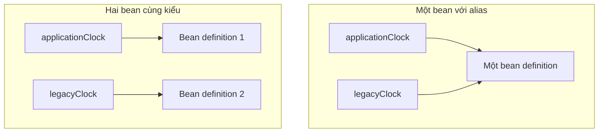

# Tên bean, kiểu bean và alias trong Spring IoC container

Trong Spring Boot, lập trình viên thường dùng `@Component`, `@Service`, `@Repository`, `@Controller` và `@Bean` để đăng ký những đối tượng cho **IoC container** quản lý. Các đối tượng này được gọi là **Spring beans**. Mỗi bean có thể được nhận diện bằng **tên**, có **kiểu Java** để Spring lựa chọn khi dependency injection, và đôi khi có thêm **alias** — những tên phụ cùng trỏ về bean đó.

Ba khái niệm này liên quan nhưng không thể thay thế cho nhau:

| Khái niệm | Trả lời câu hỏi | Ví dụ |
|---|---|---|
| **Tên bean (bean name)** | Container định danh bean này bằng chuỗi nào? | `orderService`, `primaryDataSource` |
| **Kiểu bean (bean type)** | Bean có thể được sử dụng như kiểu Java nào? | `OrderService`, `PaymentGateway`, `Clock` |
| **Alias** | Ngoài tên chính, còn tên nào trỏ về cùng bean? | `legacyClock` là alias của `applicationClock` |

Nếu hiểu sự khác biệt này, bạn sẽ đọc được các lỗi autowiring, biết khi nào cần `@Qualifier` hoặc `@Primary`, và tránh nhầm “hai tên” với “hai bean khác nhau”.

## 1. Bean là gì trong IoC container?

**IoC (Inversion of Control)** nghĩa là việc tạo và kết nối các đối tượng quan trọng được chuyển cho container. Trong Spring, container dùng thông tin về bean để tạo instance, liên kết dependency và quản lý vòng đời phù hợp.

Ví dụ:

```java
package com.example.shop;

import org.springframework.stereotype.Service;

@Service
public class OrderService {

    public String placeOrder() {
        return "Order placed";
    }
}
```

Khi cấu hình component scanning bao phủ package trên, Spring đăng ký bean từ class `OrderService`. Với quy ước tên thông thường, bean này có tên `orderService`.

Một cách hình dung:

```text
ApplicationContext
┌──────────────────────────────────────────────────┐
│ Bean definition                                  │
│   bean name: "orderService"                      │
│   Java type: com.example.shop.OrderService       │
│   scope: singleton (mặc định)                    │
│   cách tạo: container khởi tạo/đăng ký object    │
└──────────────────────────────────────────────────┘
```

Bean không đồng nhất với class. **Một class có thể dùng để tạo nhiều bean khác nhau**, và **một bean có thể được truy xuất thông qua nhiều kiểu Java** như class, interface hoặc kiểu cha phù hợp.

Thông tin trong container gồm cả **bean definition** (metadata để tạo/quản lý) và instance bean được cung cấp theo scope. Không nên mặc định lúc nào cũng chỉ có một instance cho mỗi definition: điều đó còn phụ thuộc scope, factory và cách Spring trả về đối tượng.

## 2. Tên bean: định danh bằng chuỗi

Tên bean là định danh mà Spring dùng để phân biệt các bean được đăng ký trong một container.

Ví dụ:

```java
@Component("cardPaymentGateway")
public class CardPaymentGateway implements PaymentGateway {
    // ...
}
```

Trong trường hợp này:

- `cardPaymentGateway` là **tên bean**.
- `CardPaymentGateway` là **class Java**.
- `PaymentGateway` là **interface** mà bean thực hiện.

Spring có thể lấy bean theo tên:

```java
PaymentGateway gateway =
        context.getBean("cardPaymentGateway", PaymentGateway.class);
```

Chuỗi `"cardPaymentGateway"` không phải tên class; nó là **key để tra cứu trong container**. Tên bean thông thường phân biệt chữ hoa và chữ thường: `paymentGateway` và `PaymentGateway` không tự động được coi là một tên.

### 2.1. Tên mặc định khi dùng `@Component`

Nếu không đặt tên tường minh:

```java
@Component
public class InventoryService {
}
```

Spring thường tạo tên `inventoryService` từ tên class `InventoryService`.

Các stereotype annotation như `@Service`, `@Repository` và `@Controller` cũng có thể dùng cơ chế đặt tên khi component scanning:

```java
@Service
public class PricingService {
    // Tên thường được sinh: pricingService
}
```

Quy tắc suy tên không chỉ đơn giản là luôn viết thường ký tự đầu trong mọi trường hợp. Spring dùng cơ chế tương tự JavaBeans `Introspector.decapitalize`: những tên bắt đầu bằng hai chữ cái viết hoa liên tiếp có thể giữ nguyên phần đầu. Cơ chế tạo tên cũng có thể được tùy chỉnh bằng `BeanNameGenerator`.

Vì vậy, khi bean name là hợp đồng quan trọng với thành phần khác, **đặt tên tường minh** thường rõ ràng hơn việc phụ thuộc vào quy ước.

### 2.2. Tên tường minh khi dùng `@Component`

```java
@Service("regionalPricingService")
public class PricingService {
}
```

Tên đã khai báo là `regionalPricingService`. Đừng mặc định `pricingService` vẫn được đăng ký như tên phụ. Nếu chưa khai báo alias, tên này không tự động có thêm alias chỉ vì class tên `PricingService`.

### 2.3. Tên mặc định khi dùng `@Bean`

Với `@Bean`, tên bean mặc định thường là **tên phương thức**:

```java
package com.example.shop.config;

import java.time.Clock;
import org.springframework.context.annotation.Bean;
import org.springframework.context.annotation.Configuration;

@Configuration
public class TimeConfiguration {

    @Bean
    public Clock utcClock() {
        return Clock.systemUTC();
    }
}
```

Trong ví dụ:

- Tên bean: `utcClock`.
- Kiểu khai báo: `Clock`.
- Phương thức factory: `utcClock()`.
- Lớp chứa cấu hình: `TimeConfiguration`.

Chính phương thức `utcClock()` khai báo cách tạo đối tượng; không cần tên bean là `clock` hoặc `TimeConfiguration`.

Có thể chỉ định tên:

```java
@Bean("applicationClock")
public Clock utcClock() {
    return Clock.systemUTC();
}
```

Lúc này tên chính là `applicationClock`. Tên phương thức `utcClock` không mặc nhiên là alias.

### 2.4. So sánh cách đặt tên

| Khai báo | Tên bean dự kiến | Kiểu bean |
|---|---|---|
| `@Component` trên `InventoryService` | `inventoryService` theo quy ước | `InventoryService` |
| `@Component("warehouse")` trên `InventoryService` | `warehouse` | `InventoryService` |
| `@Bean Clock appClock()` | `appClock` | `Clock` |
| `@Bean("systemClock") Clock appClock()` | `systemClock` | `Clock` |

Tên bean là **định danh trong container**. Nó không bắt buộc giống tên class, tên biến Java, tên package hoặc tên file.

## 3. Kiểu bean: Spring nhìn bean qua kiểu nào?

Kiểu bean liên quan đến hệ thống kiểu của Java. Một implementation có thể đáp ứng một interface, một class cha hoặc nhiều interface cùng lúc.

Ví dụ:

```java
public interface MessageSender {
    void send(String message);
}

public class EmailSender implements MessageSender {

    @Override
    public void send(String message) {
        System.out.println("EMAIL: " + message);
    }
}
```

Đăng ký bean:

```java
@Configuration
public class SenderConfiguration {

    @Bean
    public MessageSender emailSender() {
        return new EmailSender();
    }
}
```

Ở đây:

- Tên bean là `emailSender`.
- Kiểu trả về **được khai báo** của factory method là `MessageSender`.
- Instance thông thường do method tạo là `EmailSender`.
- Các thành phần khác có thể phụ thuộc vào interface `MessageSender`.

```java
@Service
public class NotificationService {

    private final MessageSender sender;

    public NotificationService(MessageSender sender) {
        this.sender = sender;
    }

    public void notifyCustomer() {
        sender.send("Your order is ready");
    }
}
```

Khi chỉ có một bean ứng viên phù hợp với `MessageSender`, Spring có thể inject vào constructor mà không cần gọi `getBean(...)` thủ công.

### 3.1. Một kiểu có thể có nhiều bean

Giả sử bổ sung:

```java
@Component("emailSender")
public class EmailSender implements MessageSender {
    @Override
    public void send(String message) {
        System.out.println("EMAIL: " + message);
    }
}
```

```java
@Component("smsSender")
public class SmsSender implements MessageSender {
    @Override
    public void send(String message) {
        System.out.println("SMS: " + message);
    }
}
```

Trong cấu hình dùng hai component này và **không đồng thời đăng ký thêm `emailSender` từ ví dụ cấu hình trước**, container có hai bean:

```text
"emailSender" ---> EmailSender instance ---┐
                                            ├---> MessageSender
"smsSender"   ---> SmsSender instance -----┘
```

Khi gọi:

```java
context.getBean(MessageSender.class);
```

Spring cần tìm một bean phù hợp với `MessageSender`. Nếu có hai ứng viên và không có quy tắc nào chọn được một, nó có thể ném `NoUniqueBeanDefinitionException`.

**Đây là xung đột lựa chọn theo kiểu**, không phải xung đột tên: hai bean có tên khác nhau nhưng cùng thỏa `MessageSender`.

### 3.2. Một class có thể có nhiều bean mang tên khác nhau

Ví dụ:

```java
public class ApiClient {
    private final String baseUrl;

    public ApiClient(String baseUrl) {
        this.baseUrl = baseUrl;
    }

    public String baseUrl() {
        return baseUrl;
    }
}
```

```java
@Configuration
public class ApiClientConfiguration {

    @Bean("primaryClient")
    public ApiClient primaryClient() {
        return new ApiClient("https://primary.example.test");
    }

    @Bean("backupClient")
    public ApiClient backupClient() {
        return new ApiClient("https://backup.example.test");
    }
}
```

Đây là **hai bean khác nhau**, có cùng kiểu `ApiClient`:

| Tên | Kiểu | Cấu hình |
|---|---|---|
| `primaryClient` | `ApiClient` | Base URL chính |
| `backupClient` | `ApiClient` | Base URL dự phòng |

Không được xem `backupClient` là alias chỉ vì hai bean dùng cùng class.

### 3.3. Kiểu được khai báo và class runtime

Một `@Bean` có thể trả về interface:

```java
@Bean
public MessageSender emailSender() {
    return new EmailSender();
}
```

Kiểu công khai được khai báo là `MessageSender`, còn đối tượng cụ thể được trả về có class `EmailSender`. Ngoài ra, Spring có thể tạo **proxy** để phục vụ transaction, AOP, caching và các tính năng khác. Khi đó `bean.getClass()` có thể là class proxy thay vì class gốc.

Vì thế, trong code ứng dụng, hãy ưu tiên hợp đồng interface hoặc kiểu được công bố. Đừng cố lấy bean theo implementation chỉ dựa trên giả định class runtime luôn đúng bằng class bạn viết.

## 4. Alias: nhiều tên cùng dẫn tới một bean

**Alias** là tên bổ sung cho một bean đã có định danh. Alias giúp hỗ trợ tên cũ, tên tương thích với các thành phần khác hoặc cách gọi thống nhất mà không tạo thêm bean definition.

Ví dụ:

```java
package com.example.shop.config;

import java.time.Clock;
import org.springframework.context.annotation.Bean;
import org.springframework.context.annotation.Configuration;

@Configuration
public class ClockConfiguration {

    @Bean(name = {"applicationClock", "legacyClock"})
    public Clock applicationClock() {
        return Clock.systemUTC();
    }
}
```

Ở đây:

- `applicationClock` là **tên chính**.
- `legacyClock` là **alias**.
- Spring đăng ký **một bean definition** cho `Clock`.
- Hai tên dùng để truy cập cùng bean đã đăng ký.

```java
Clock first = context.getBean("applicationClock", Clock.class);
Clock second = context.getBean("legacyClock", Clock.class);
```

Với scope `singleton` mặc định, hai biến trên thường tham chiếu **cùng một instance**:

```java
System.out.println(first == second); // true đối với singleton thông thường
```

### 4.1. Alias không đồng nghĩa tạo hai bean

So sánh:

**Một bean có hai tên:**

```java
@Bean(name = {"applicationClock", "legacyClock"})
Clock clock() {
    return Clock.systemUTC();
}
```

**Hai bean khác nhau, cùng kiểu:**

```java
@Bean("applicationClock")
Clock firstClock() {
    return Clock.systemUTC();
}

@Bean("legacyClock")
Clock secondClock() {
    return Clock.systemUTC();
}
```

Ví dụ đầu tạo **một bean definition** có hai cách gọi. Ví dụ sau tạo **hai bean definitions** qua hai phương thức factory, dù cả hai có thể trả đối tượng `Clock`.



### 4.2. Những cách khai báo alias

Với Java configuration, cách dễ hiểu nhất là đưa nhiều tên vào `@Bean`:

```java
@Bean(name = {"primaryName", "alternativeName"})
public SomeService someService() {
    return new SomeService();
}
```

Spring cũng hỗ trợ đăng ký alias thông qua API registry và cấu hình XML truyền thống:

```xml
<alias name="primaryName" alias="alternativeName"/>
```

Ví dụ XML chỉ nhằm minh họa cơ chế. Trong dự án Spring Boot hiện đại dùng Java config, thường không cần tạo XML chỉ để có alias. Đăng ký alias bằng API programmatic là công việc hạ tầng cần thực hiện ở giai đoạn lifecycle thích hợp, không nên tùy tiện thay đổi registry trong lúc request đang chạy.

### 4.3. Alias và scope — một điểm rất dễ hiểu nhầm

Câu “hai tên luôn trỏ tới cùng bean” nói về **định danh/definition**, không bảo đảm **mọi lần gọi đều trả cùng một object**.

- **Singleton:** một bean singleton trong cùng container thường trả cùng instance bất kể dùng tên chính hay alias.
- **Prototype:** mỗi lần yêu cầu bean có thể tạo một instance mới, kể cả hai lần dùng cùng tên.
- **Request/session scope:** instance phụ thuộc ngữ cảnh request/session và cách truy xuất.

Ví dụ:

```java
@Bean(name = {"requestToken", "token"})
@Scope("prototype")
RequestToken token() {
    return new RequestToken();
}
```

```java
Object a = context.getBean("requestToken");
Object b = context.getBean("token");

System.out.println(a == b); // thường false vì prototype
```

Alias vẫn hợp lệ: cả hai tên tham chiếu **cùng bean definition**, nhưng scope prototype quyết định cách tạo instance cho từng lần lookup.

## 5. Tra cứu bean theo tên và theo kiểu

Spring cung cấp API để nhìn vào container thông qua `ApplicationContext`.

| API | Công dụng |
|---|---|
| `getBean("name")` | Lấy bean theo tên hoặc alias, kiểu trả về chung là `Object` |
| `getBean("name", Type.class)` | Tra theo tên và kiểm tra kiểu |
| `getBean(Type.class)` | Tìm một bean phù hợp với kiểu |
| `getBeanNamesForType(Type.class)` | Liệt kê tên bean phù hợp với kiểu |
| `getAliases("name")` | Liệt kê các alias liên quan |
| `containsBean("name")` | Kiểm tra bean có thể được tra cứu theo tên/alias |
| `getType("name")` | Xem kiểu mà container có thể xác định |
| `isTypeMatch("name", Type.class)` | Kiểm tra bean có tương thích với kiểu không |

Với cấu hình `ClockConfiguration` ở mục 4:

```java
Clock byName = context.getBean("applicationClock", Clock.class);
Clock byAlias = context.getBean("legacyClock", Clock.class);
Clock byType = context.getBean(Clock.class);
```

Lời gọi `getBean(Clock.class)` có thể hoạt động nếu có một bean `Clock` phù hợp duy nhất. Nếu app có hai hoặc nhiều bean `Clock` và không chọn được một, tra cứu bằng kiểu đơn lẻ sẽ không đủ.

### 5.1. Liệt kê tên và alias

```java
import java.time.Clock;
import java.util.Arrays;

String[] names = context.getBeanNamesForType(Clock.class);
String[] aliases = context.getAliases("applicationClock");

System.out.println(Arrays.toString(names));
System.out.println(Arrays.toString(aliases));
```

Trong ví dụ đơn giản với một bean `Clock`:

```text
[applicationClock]
[legacyClock]
```

**Điểm quan trọng:** `getBeanNamesForType` thường trả tên bean phù hợp kiểu; alias **không trở thành bean definition thứ hai** chỉ vì có tên phụ.

Danh sách thực tế có thể khác nếu ứng dụng có thêm bean khác cùng kiểu hoặc dùng cấu hình đặc biệt.

### 5.2. `containsBean` khác `containsBeanDefinition`

`containsBean("legacyClock")` có thể trả `true` vì `legacyClock` là alias hợp lệ. Nhưng điều đó **không có nghĩa** registry chứa một bean definition riêng mang tên `legacyClock`.

Trong mô hình Spring:

- Một **bean definition** mô tả việc tạo/quản lý bean.
- Một **bean name** nhận diện bean trong factory.
- Một **alias** ánh xạ sang tên bean.
- Một số singleton có thể được đăng ký trực tiếp mà không đi qua bean definition kiểu thông thường.

Các API kiểm tra definition và API tra cứu bean không hoàn toàn giống nhau. Đây là lý do không nên lấy số lượng alias để đếm số bean trong ứng dụng.

### 5.3. Khi nào nên gọi `getBean(...)` trực tiếp?

Trong bài thực hành, `getBean(...)` rất hữu ích để học cách container ánh xạ tên và kiểu. Nhưng với code nghiệp vụ, hãy ưu tiên **constructor injection**:

```java
@Service
public class ReportService {

    private final Clock clock;

    public ReportService(Clock clock) {
        this.clock = clock;
    }
}
```

Dependency được thể hiện ngay trong constructor, dễ kiểm thử và dễ nhận biết hơn việc service giữ `ApplicationContext` rồi liên tục lấy bean theo tên. Tra cứu động phù hợp hơn cho hạ tầng, factory, plugin hoặc trường hợp thực sự cần chọn bean tại runtime.

## 6. Tên bean, alias và `@Qualifier` có giống nhau không?

**Không.** Chúng có thể cùng được sử dụng khi chọn dependency, nhưng đảm nhận vai trò khác nhau:

- **Bean name:** định danh chính, ví dụ `emailSender`.
- **Alias:** tên phụ cùng ánh xạ tới bean `emailSender`.
- **Qualifier:** thông tin lọc hoặc chỉ định **candidate khi autowiring**. Giá trị qualifier có thể trùng tên/alias nhưng không mặc định tạo tên mới.

Giả sử có hai implementation:

```java
public interface MessageSender {
    void send(String message);
}
```

```java
@Component("emailSender")
public class EmailSender implements MessageSender {

    @Override
    public void send(String message) {
        System.out.println("EMAIL: " + message);
    }
}
```

```java
@Component("smsSender")
public class SmsSender implements MessageSender {

    @Override
    public void send(String message) {
        System.out.println("SMS: " + message);
    }
}
```

Nếu constructor chỉ yêu cầu một `MessageSender`:

```java
@Service
public class NotificationService {

    private final MessageSender sender;

    public NotificationService(MessageSender sender) {
        this.sender = sender;
    }
}
```

Spring có hai bean cùng kiểu nên có thể không chọn được một. Lúc này `@Qualifier` giúp chỉ rõ:

```java
import org.springframework.beans.factory.annotation.Qualifier;
import org.springframework.stereotype.Service;

@Service
public class NotificationService {

    private final MessageSender sender;

    public NotificationService(
            @Qualifier("emailSender") MessageSender sender
    ) {
        this.sender = sender;
    }
}
```

### 6.1. Qualifier là metadata, không nhất thiết là tên bean

Ví dụ:

```java
@Component("outboundEmailSender")
@Qualifier("transactional")
public class TransactionalEmailSender implements MessageSender {
    // ...
}
```

Ở đây `outboundEmailSender` là tên bean; `transactional` là qualifier. Spring có thể dùng qualifier để lọc candidate cho injection, nhưng gọi:

```java
context.getBean("transactional");
```

không mặc định thành công vì `@Qualifier("transactional")` **không tự đăng ký alias** mang tên `transactional`.

### 6.2. `@Primary` lựa chọn mặc định

Nếu nhiều bean cùng kiểu và cần một ứng viên ưu tiên:

```java
@Component("emailSender")
@Primary
public class EmailSender implements MessageSender {
    // ...
}
```

`@Primary` cho Spring biết bean này được ưu tiên trong autowiring phù hợp khi có nhiều candidate. Nó **không đổi tên bean**, **không tạo alias** và **không xóa những bean khác**.

So sánh:

| Cơ chế | Ý nghĩa |
|---|---|
| `@Primary` | Ưu tiên một bean trong lựa chọn autowiring |
| `@Qualifier("emailSender")` | Thu hẹp/chỉ định candidate theo qualifier |
| Alias `legacyEmailSender` | Cho phép tra cứu bean bằng một tên khác |
| `getBean("emailSender")` | Tra cứu theo tên |
| `getBean(MessageSender.class)` | Tra cứu theo kiểu |

Quy tắc lựa chọn thực tế còn có thể xét generic type, qualifier, priority, tên tham số/field và cấu hình candidate. Đừng kết luận rằng Spring **luôn** lấy bean có tên giống tên biến.

### 6.3. Tên tham số có thể ảnh hưởng autowiring

Khi có nhiều bean cùng kiểu, một số phiên bản/cấu hình Spring có thể sử dụng tên tham số constructor để giúp chọn bean, ví dụ:

```java
public NotificationService(MessageSender emailSender) {
    this.sender = emailSender;
}
```

Điều này tùy metadata tên tham số có được lưu khi biên dịch và quy tắc resolution của phiên bản Spring. Với Java, tham số biên dịch như `-parameters` có thể liên quan. Trong thiết kế nghiệp vụ cần chỉ định một implementation, `@Qualifier` nêu ý định tường minh hơn việc dựa vào tên biến.

### 6.4. `@Resource` thường tra cứu theo tên

Jakarta Annotations cung cấp:

```java
import jakarta.annotation.Resource;

@Resource(name = "emailSender")
private MessageSender sender;
```

`@Resource` thường thực hiện logic dựa vào tên được chỉ định, còn `@Autowired` ưu tiên phân giải theo kiểu và các quy tắc lựa chọn. Dù vậy, `@Resource` **không phải cơ chế tạo alias**. Với dependency bắt buộc, constructor injection thường rõ ràng và dễ kiểm thử.

## 7. Lỗi trùng tên và lỗi trùng kiểu là hai bài toán

### 7.1. Trùng tên bean

Ví dụ hai cấu hình muốn đăng ký cùng tên:

```java
@Configuration
class FirstConfig {
    @Bean("emailSender")
    MessageSender senderOne() {
        return new EmailSender();
    }
}

@Configuration
class SecondConfig {
    @Bean("emailSender")
    MessageSender senderTwo() {
        return new SmsSender();
    }
}
```

Đây là **xung đột tên bean**. Với Spring Boot hiện đại, bean definition overriding thường bị vô hiệu hóa mặc định; startup có thể thất bại vì hai definitions dùng tên trùng.

Cấu hình liên quan:

```properties
spring.main.allow-bean-definition-overriding=false
```

Không nên bật overriding để lờ đi vấn đề. Hãy xác định bean nào phải tồn tại, xử lý cấu hình trùng lặp hoặc dùng tên khác khi thực sự cần hai bean.

### 7.2. Trùng kiểu, khác tên

Ví dụ:

```java
@Bean("emailSender")
MessageSender senderOne() {
    return new EmailSender();
}

@Bean("smsSender")
MessageSender senderTwo() {
    return new SmsSender();
}
```

Hai bean này có tên khác nên không xung đột tên. Nhưng nếu inject một `MessageSender` đơn lẻ, có thể xảy ra **ambiguous dependency**.

Hướng xử lý:

- Dùng `@Qualifier` nếu cần một implementation cụ thể.
- Dùng `@Primary` khi có mặc định hợp lý.
- Inject `List<MessageSender>` hoặc `Map<String, MessageSender>` nếu cần sử dụng tất cả.
- Loại bỏ bean bị tạo nhầm khi bản chất chỉ cần một.

Ví dụ lấy tất cả:

```java
@Service
public class NotificationRouter {

    private final Map<String, MessageSender> senders;

    public NotificationRouter(Map<String, MessageSender> senders) {
        this.senders = senders;
    }

    public void sendByBeanName(String beanName, String message) {
        MessageSender sender = senders.get(beanName);
        if (sender == null) {
            throw new IllegalArgumentException("Unknown sender: " + beanName);
        }
        sender.send(message);
    }
}
```

Trong cách injection `Map<String, MessageSender>` thông thường, các key tương ứng **tên bean**, không tự nhân đôi mỗi bean thành nhiều entry vì nó có alias.

## 8. Alias và lifecycle của bean

Alias không điều khiển thứ tự tạo bean. Spring xác định các dependency và vòng đời từ cấu hình, constructor, bean definition và các cơ chế liên quan.

Ví dụ:

```java
@Service
public class OrderService {

    private final InventoryService inventoryService;

    public OrderService(InventoryService inventoryService) {
        this.inventoryService = inventoryService;
    }
}
```

Spring cần cung cấp `InventoryService` khi tạo `OrderService`. Việc tên `orderService` đứng trước `inventoryService` trong bảng chữ cái không phải nguyên nhân xác định thứ tự khởi tạo.

Nếu cần phụ thuộc khởi tạo đặc biệt giữa những bean không có dependency biểu lộ trực tiếp, có các cơ chế như `@DependsOn`. Alias chỉ là **cách gọi tên**, không phải công cụ quyết định lifecycle.

## 9. Trường hợp nâng cao: `FactoryBean` và dấu `&`

Spring có interface `FactoryBean<T>`, cho phép một bean làm nhiệm vụ **tạo ra đối tượng sản phẩm**. Với một `FactoryBean` được đăng ký tên `clientFactory`:

- `context.getBean("clientFactory")` thường trả **sản phẩm** mà factory tạo.
- `context.getBean("&clientFactory")` trả **chính đối tượng FactoryBean**.

```text
"clientFactory"
      |
      +-- getBean("clientFactory")  --> sản phẩm
      |
      +-- getBean("&clientFactory") --> FactoryBean
```

Dấu `&` ở đây là **cú pháp đặc biệt để dereference factory**, không phải alias được khai báo bằng tên phụ.

Đối với các bean dạng factory hoặc bean có proxy, kiểu được container công bố và class runtime thực tế có thể cần phân tích riêng. Không nên áp đặt quy tắc “tên trỏ trực tiếp tới instance của chính class khai báo” lên mọi loại bean của Spring.

## 10. Thực hành: Đăng ký một bean với tên chính và alias

Giả sử tạo ứng dụng Spring Boot có `spring-boot-starter` để sử dụng `ApplicationRunner`. Cấu trúc:

```text
src/main/java/com/example/beans/
├── BeanNamesApplication.java
├── ClockConfiguration.java
├── GreetingService.java
└── BeanInspector.java
```

### 10.1. Lớp khởi động

```java
package com.example.beans;

import org.springframework.boot.SpringApplication;
import org.springframework.boot.autoconfigure.SpringBootApplication;

@SpringBootApplication
public class BeanNamesApplication {

    public static void main(String[] args) {
        SpringApplication.run(BeanNamesApplication.class, args);
    }
}
```

### 10.2. Đăng ký bean có hai tên

```java
package com.example.beans;

import java.time.Clock;
import org.springframework.context.annotation.Bean;
import org.springframework.context.annotation.Configuration;

@Configuration
public class ClockConfiguration {

    @Bean(name = {"applicationClock", "legacyClock"})
    public Clock applicationClock() {
        return Clock.systemUTC();
    }
}
```

### 10.3. Inject bean theo kiểu kèm qualifier

```java
package com.example.beans;

import java.time.Clock;
import org.springframework.beans.factory.annotation.Qualifier;
import org.springframework.stereotype.Service;

@Service
public class GreetingService {

    private final Clock clock;

    public GreetingService(
            @Qualifier("applicationClock") Clock clock
    ) {
        this.clock = clock;
    }

    public String greeting() {
        return "Current time: " + clock.instant();
    }
}
```

Nếu `Clock` là bean duy nhất trong context, inject theo kiểu đơn lẻ cũng thường đủ; ở đây qualifier nhằm minh họa cách chỉ định.

### 10.4. In thông tin từ container

```java
package com.example.beans;

import java.time.Clock;
import java.util.Arrays;
import org.springframework.boot.ApplicationRunner;
import org.springframework.context.ApplicationContext;
import org.springframework.context.annotation.Bean;
import org.springframework.context.annotation.Configuration;

@Configuration
public class BeanInspector {

    @Bean
    ApplicationRunner inspect(
            ApplicationContext context,
            GreetingService greetingService
    ) {
        return args -> {
            Clock primary =
                    context.getBean("applicationClock", Clock.class);
            Clock viaAlias =
                    context.getBean("legacyClock", Clock.class);

            System.out.println("Same object: " + (primary == viaAlias));
            System.out.println("Names for Clock: " +
                    Arrays.toString(context.getBeanNamesForType(Clock.class)));
            System.out.println("Aliases: " +
                    Arrays.toString(context.getAliases("applicationClock")));
            System.out.println(greetingService.greeting());
        };
    }
}
```

Trong ứng dụng ví dụ, đầu ra có ý nghĩa tương tự:

```text
Same object: true
Names for Clock: [applicationClock]
Aliases: [legacyClock]
Current time: 2026-11-13T...
```

Dòng thời gian thay đổi ở mỗi lần chạy. Đầu ra dự kiến minh họa rằng `legacyClock` và `applicationClock` không phải hai bean riêng, còn `Clock.class` là kiểu được dùng khi tra cứu hoặc inject.

### 10.5. Thử ba thay đổi để nhận ra khác biệt

1. Đổi `@Bean(name={"applicationClock","legacyClock"})` thành `@Bean("applicationClock")` và thử tra cứu `legacyClock`: tên phụ không còn được khai báo.
2. Thêm bean `Clock` tên `secondaryClock`: lúc đó câu hỏi “chọn bean `Clock` nào?” trở nên cần thiết khi autowiring theo kiểu.
3. Đặt `@Scope("prototype")` cho bean và tra cứu qua tên chính/alias hai lần: alias vẫn hợp lệ nhưng hai lần có thể tạo hai instance.

Hãy thay đổi một điểm ở mỗi lần thực hành để dễ thấy nguyên nhân.

## 11. Các lỗi thường gặp và cách đọc chúng

### 11.1. `NoSuchBeanDefinitionException`

Ví dụ:

```text
No bean named 'legacyClock' available
```

Container không tìm được bean với tên yêu cầu. Những điều cần kiểm tra:

- Bean đã được đăng ký chưa?
- Tên có đúng chữ hoa/chữ thường?
- Alias có thật sự được đăng ký?
- `@Component` có nằm trong vùng scan?
- Lớp `@Configuration` chứa `@Bean` đã được load chưa?
- `@Profile` hoặc `@Conditional` có khiến bean không được tạo?
- Bạn có đang kiểm tra đúng `ApplicationContext` không?

Nếu lỗi nói *No qualifying bean of type ...*, cần kiểm tra **kiểu** và các điều kiện chọn candidate, không chỉ tên.

### 11.2. `NoUniqueBeanDefinitionException`

Ví dụ:

```text
No qualifying bean of type 'MessageSender' available:
expected single matching bean but found 2: emailSender,smsSender
```

Có nhiều bean phù hợp cùng kiểu nhưng không chọn được một. Hãy xem `@Qualifier`, `@Primary` hoặc chuyển sang collection injection khi cần tất cả.

Không nên xóa alias để sửa lỗi này vì một alias đơn thuần **không tạo thêm bean candidate**.

### 11.3. Lỗi trùng tên/overriding

Ví dụ log có thể nêu bean `emailSender` đã được định nghĩa và không thể đăng ký lại. Đây là xung đột **bean name hoặc bean definition**, khác với nhiều bean cùng kiểu.

Cần tìm các nơi khai báo trùng, điều kiện cấu hình hoặc component scan chồng lấn. Không giải quyết bằng việc tùy tiện bật bean overriding.

### 11.4. Tên đúng nhưng kiểu không khớp

```java
context.getBean("emailSender", PaymentGateway.class);
```

Nếu `emailSender` không tương thích với kiểu `PaymentGateway`, yêu cầu tra cứu vẫn thất bại dù tên tồn tại. **Tra theo tên kèm kiểu** đòi hỏi cả định danh và kiểu đều hợp lệ.

## 12. Những hiểu lầm phổ biến

| Nhận định | Đúng hay sai? | Giải thích |
|---|---|---|
| Tên bean luôn giống tên class Java | **Sai** | Có thể do quy ước hoặc được đặt tường minh |
| Hai bean cùng kiểu luôn là cùng đối tượng | **Sai** | Có thể là hai definitions khác nhau |
| Alias tạo một bean instance thứ hai | **Sai** | Alias chỉ là tên phụ cho bean đã có |
| Hai tên qua alias luôn trả cùng Java object | **Không phải mọi scope** | Prototype hoặc scope khác có thể tạo/trả instance khác qua các lần lookup |
| `@Qualifier("fast")` luôn tạo alias `fast` | **Sai** | Qualifier có thể là metadata lựa chọn dependency |
| `@Primary` đổi tên bean | **Sai** | Chỉ ảnh hưởng ưu tiên autowiring phù hợp |
| `getBean(Type.class)` luôn đủ rõ nếu có bean của kiểu đó | **Sai** | Có thể có nhiều candidate không phân giải được |
| `@Bean` mặc định dùng tên class làm tên bean | **Sai** | Thường dùng tên phương thức |
| `applicationClock` và `ApplicationClock` là cùng tên | **Sai** | Tên bean thông thường phân biệt chữ hoa/chữ thường |
| Hai alias tạo hai entry trong `Map<String, Type>` injection | **Sai** | Alias không nhân đôi bean definition |
| Một bean luôn có class runtime giống class đã khai báo | **Sai** | Proxy, factory hoặc kiểu trả về interface làm vấn đề tinh tế hơn |

## 13. Câu hỏi tự kiểm tra

**Câu 1.** Xét đoạn mã:

```java
@Bean("pricingEngine")
public PriceCalculator calculator() {
    return new DiscountCalculator();
}
```

Tên bean là gì? Kiểu công khai là gì? Tên `calculator` có tự trở thành alias không?

**Gợi ý:** Tên là `pricingEngine`; kiểu trả về được khai báo `PriceCalculator`; method tạo `DiscountCalculator` nếu đó là subtype hợp lệ. Tên `calculator` không tự trở thành alias khi tên tường minh đã được chỉ định.

**Câu 2.** Đoạn nào có một bean với hai tên?

```java
@Bean(name = {"defaultClock", "clock"})
Clock defaultClock() {
    return Clock.systemUTC();
}
```

**Đáp án:** Một bean definition với tên chính `defaultClock` và alias `clock`.

**Câu 3.** Hai bean `emailSender` và `smsSender` đều implements `MessageSender`. Vì sao constructor `NotificationService(MessageSender sender)` có thể lỗi?

**Đáp án:** Có nhiều bean candidates phù hợp với kiểu `MessageSender` và không có quy tắc đủ để chọn một.

**Câu 4.** Bean tên `outboundEmailSender` có `@Qualifier("transactional")`. Có thể mặc định gọi `getBean("transactional")` không?

**Đáp án:** Không. Qualifier không tự khai báo tên/alias của bean.

**Câu 5.** Alias `token` trỏ về bean `requestToken` có scope prototype. Vì sao hai lần `getBean` có thể nhận hai object khác nhau?

**Đáp án:** Scope prototype tạo instance theo mỗi lần tra cứu; alias không quyết định instance identity.

**Câu 6.** Vì sao `getBeanNamesForType(Clock.class)` có thể chỉ liệt kê `applicationClock` mà không có `legacyClock`?

**Đáp án:** `legacyClock` là alias, không phải bean definition riêng được liệt kê như một bean mới.

## 14. Quy tắc dùng tên bean trong dự án Spring Boot

Khi thiết kế ứng dụng, đặt tên bean tường minh có ích nếu:

- Có nhiều implementation cùng kiểu, như `primaryDataSource` và `auditDataSource`.
- Cần một định danh ổn định phục vụ cấu hình hoặc tích hợp.
- Đang chuyển đổi tên bean và cần alias để tương thích trong thời gian chuyển tiếp.
- Định danh có ý nghĩa nghiệp vụ đáng thể hiện trực tiếp.

Ngược lại, với một `@Service` đơn giản chỉ được inject theo kiểu, tên bean mặc định thường đủ dùng.

Nên:

- Đặt tên theo vai trò, ví dụ `auditEventPublisher` hoặc `systemClock`.
- Dùng nhất quán quy ước `lowerCamelCase`.
- Chỉ tạo alias khi có mục đích nhận diện rõ ràng.
- Dùng `@Qualifier` khi injection phải chọn một implementation cụ thể.
- Dùng `@Primary` cho lựa chọn mặc định hợp lý.
- Khi xuất hiện lỗi autowiring, kiểm tra **tên bean, kiểu bean, qualifier và số lượng candidate** thay vì đoán từ class name.

## 15. Ghi nhớ

Hãy hình dung Spring container như một bảng quản lý:

```text
ApplicationContext
  Tên chính  ───────────────> Bean definition
                                  ├── Kiểu/metadata
  Alias A ────> Tên chính          ├── Scope
  Alias B ────> Tên chính          ├── Cách tạo instance
                                  └── Dependency/lifecycle

  Tra theo tên:   "applicationClock"
  Tra theo alias: "legacyClock"
  Tra theo kiểu:  Clock.class
```

**Tên bean** trả lời: *“Định danh nào chỉ đến bean này?”*

**Kiểu bean** trả lời: *“Đối tượng có thể được dùng dưới kiểu Java nào?”*

**Alias** trả lời: *“Có tên phụ nào cũng chỉ đến bean này?”*

Khi phân biệt ba điều trên, bạn sẽ hiểu vì sao Spring inject dependency theo interface, vì sao nhiều implementation gây ambiguity, vì sao `@Qualifier` và alias không phải một, và vì sao một bean có nhiều tên vẫn có thể chỉ là **một bean definition** trong IoC container.
