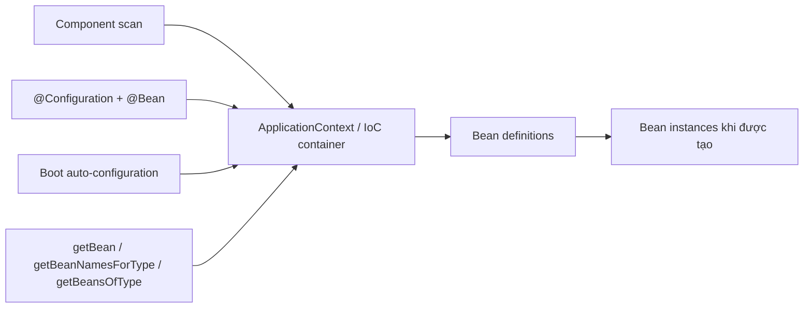
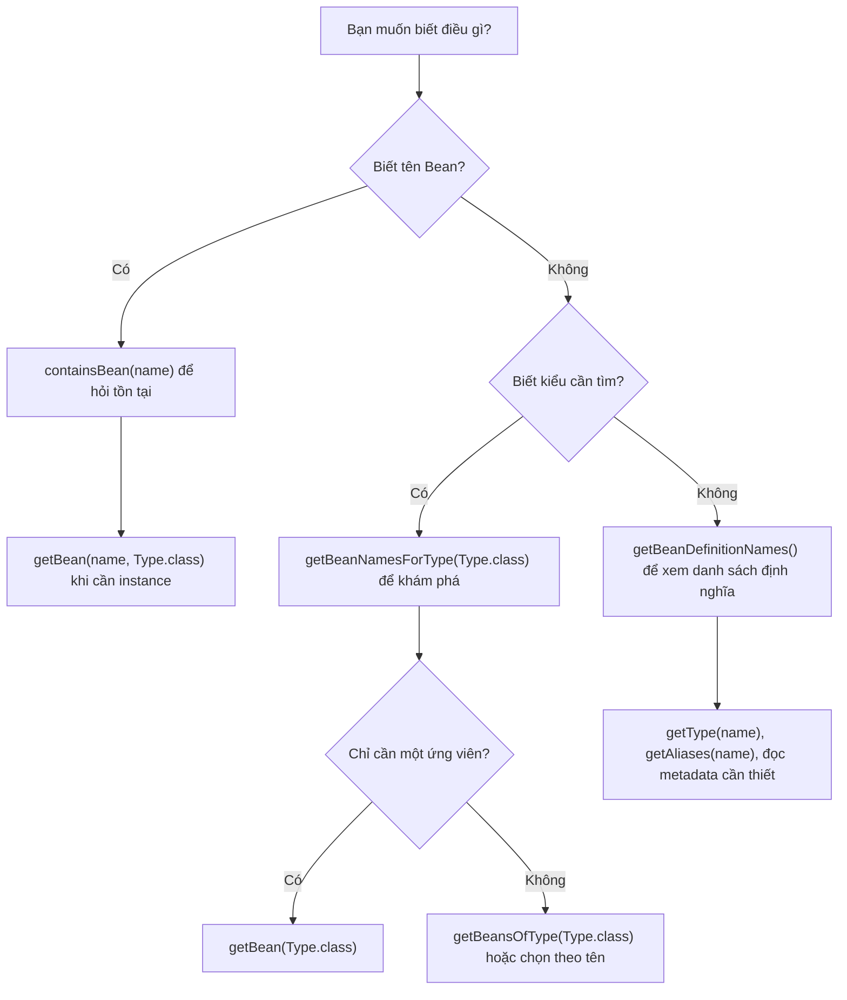

# Tra cứu Bean bằng tên hoặc kiểu để quan sát IoC container

Khi ứng dụng Spring Boot khởi động, rất nhiều đối tượng được đăng ký và quản lý bên trong **IoC container**. Đó có thể là service và controller do bạn viết, Bean được khai báo bằng `@Bean`, hoặc các thành phần hạ tầng mà Spring Boot tự cấu hình. Khi một dependency không được tiêm như mong muốn, bạn thường phải trả lời những câu hỏi cụ thể:

- Container hiện có Bean nào?
- Bean tên `greetingService` có tồn tại không? Nó thuộc kiểu nào?
- Có bao nhiêu Bean cùng triển khai một interface?
- Vì sao tra cứu bằng kiểu `MessageFormatter` bị mơ hồ nhưng tra cứu bằng tên lại thành công?
- Việc lấy một Bean ra khỏi container có khiến nó được khởi tạo không?

Spring cung cấp các API trên `ApplicationContext` và `BeanFactory` để quan sát những điều đó. Bài học này đi từ cách tra cứu cơ bản đến một ứng dụng Spring Boot nhỏ có thể chạy, sau đó giải thích các tình huống nhiều Bean, tên/alias, scope và những tác động cần lưu ý khi kiểm tra container.

> **Mục đích chính của tra cứu trực tiếp:** học cách container quản lý Bean, hỗ trợ điều tra lỗi và viết các điểm tích hợp hạ tầng khi cần. Với phần lớn service nghiệp vụ, hãy tiếp tục ưu tiên **constructor injection** thay vì gọi `getBean(...)` ở khắp nơi.

## 1. Bean ở trong container nghĩa là gì?

Một **Bean** là đối tượng được container Spring đăng ký và quản lý theo một **Bean definition** hoặc cơ chế đăng ký tương ứng. Mỗi Bean có một tên, một kiểu có thể được Spring nhận diện, một scope và các thông tin liên quan đến cách tạo/quản lý nó.

Hai khái niệm cần tách biệt:

- **Bean definition:** metadata hoặc công thức để container biết cách tạo và quản lý Bean.
- **Bean instance:** đối tượng cụ thể do container cung cấp, có thể đã được khởi tạo hoặc chỉ được tạo khi cần (ví dụ với `@Lazy`).

Thông thường, một Spring Boot application có một `ApplicationContext` chính. Context này triển khai các hợp đồng như `BeanFactory` và `ListableBeanFactory`, nên có thể:

1. Lấy một Bean theo tên hoặc kiểu.
2. Hỏi tên của tất cả Bean phù hợp một kiểu.
3. Liệt kê các Bean definition đã đăng ký.
4. Xem thông tin như tên alias, kiểu Bean và scope.



Các API tra cứu không tự biến một object được tạo bằng `new` bên ngoài thành Bean. Chúng chỉ làm việc với những đối tượng/định nghĩa mà container biết đến.

## 2. Các API tra cứu quan trọng

`ApplicationContext` kế thừa những khả năng cần thiết để tra cứu Bean:

| API | Kết quả | Khi nào dùng? |
|---|---|---|
| `getBean("name")` | Một `Object` theo tên | Biết tên nhưng chưa chỉ định kiểu |
| `getBean("name", SomeType.class)` | Một Bean theo tên và kiểm tra kiểu | Muốn lấy đúng Bean với kiểu rõ ràng |
| `getBean(SomeType.class)` | Một Bean duy nhất/phù hợp theo kiểu | Chỉ có một ứng viên hoặc Spring xác định được ứng viên ưu tiên |
| `getBeanNamesForType(SomeType.class)` | Mảng tên các Bean phù hợp kiểu | Khám phá những Bean ứng viên mà chưa cần lấy tất cả instance |
| `getBeansOfType(SomeType.class)` | `Map<String, SomeType>` | Muốn lấy tất cả instance phù hợp cùng tên của chúng |
| `containsBean("name")` | `boolean` | Kiểm tra một tên/alias có thể được phân giải không |
| `containsBeanDefinition("name")` | `boolean` | Kiểm tra một Bean definition với tên đó có được đăng ký **trong factory hiện tại** không |
| `getType("name")` | `Class<?>` hoặc `null` | Hỏi kiểu mà container có thể xác định cho tên Bean |
| `getBeanDefinitionNames()` | Mảng tên các Bean definition | Quan sát các định nghĩa đã đăng ký |
| `getBeanDefinitionCount()` | `int` | Đếm Bean definition được biết tới trong factory hiện tại |
| `getAliases("name")` | Mảng alias | Xem những tên khác của một Bean |
| `isSingleton("name")` / `isPrototype("name")` | `boolean` | Hỏi đặc tính scope của Bean theo tên |

**Một lưu ý về cách đọc bảng:** “tra cứu theo kiểu” không nhất thiết là lấy instance của đúng class khai báo trong source. Một interface có thể có nhiều implementation; một Bean cũng có thể được Spring proxy, và kiểu thực tế của object trả về có thể khác class bạn viết trong file Java.

## 3. Tra cứu theo tên: `getBean(String name)`

Khi đã biết tên Bean:

```java
Object object = applicationContext.getBean("greetingService");
```

API này trả về `Object` vì tên Bean là một chuỗi; compiler không biết trước kiểu cụ thể. Nếu bạn ép kiểu thủ công:

```java
GreetingService service =
        (GreetingService) applicationContext.getBean("greetingService");
```

thì bạn tự chịu trách nhiệm về cast. Một cách rõ ràng hơn là dùng overload có cả tên và kiểu:

```java
GreetingService service =
        applicationContext.getBean("greetingService", GreetingService.class);
```

Ở đây Spring kiểm tra Bean tương ứng có tương thích với `GreetingService` hay không. Nếu không, nó ném lỗi kiểu không phù hợp, chẳng hạn `BeanNotOfRequiredTypeException`.

Nếu container không tìm thấy tên Bean, `getBean("name")` và các overload tương ứng thường ném `NoSuchBeanDefinitionException`. Vì vậy không nên suy diễn rằng `getBean` sẽ trả `null` khi Bean không tồn tại.

### Bean có tên từ đâu?

Tên Bean có thể được gán tường minh:

```java
@Component("upperFormatter")
public class UpperFormatter implements MessageFormatter {
    // ...
}
```

Hoặc do Spring đặt mặc định:

```java
@Service
public class GreetingService {
    // Tên Bean mặc định thường là "greetingService".
}
```

Với `@Bean`, tên mặc định thường là tên method, trừ khi khai báo tên riêng:

```java
@Configuration(proxyBeanMethods = false)
class FormatterConfiguration {
    @Bean("bracketFormatter")
    MessageFormatter bracketFormatter() {
        return text -> "[" + text + "]";
    }
}
```

Điều cần nhớ: tên Bean được xác định qua quy tắc đặt tên/annotation/đăng ký, **không nhất thiết luôn bằng tên class viết thường chữ đầu**. Nếu code phụ thuộc vào tên cụ thể, hãy khai báo tên tường minh hoặc kiểm tra thông tin container.

## 4. Tra cứu theo kiểu: `getBean(Class<T> requiredType)`

Trong rất nhiều tình huống bạn không cần biết tên Bean. Nếu `GreetingService` là kiểu duy nhất được đăng ký:

```java
GreetingService service =
        applicationContext.getBean(GreetingService.class);
```

Điểm thuận tiện là bạn viết code theo kiểu Java thay vì chuỗi tên. Tuy nhiên “theo kiểu” có nghĩa là Spring xét **những Bean có thể gán cho kiểu được yêu cầu**, không chỉ Bean có class chính xác bằng kiểu đó.

Ví dụ:

```java
public interface MessageFormatter {
    String format(String text);
}
```

Giả sử trong container có hai Bean:

```text
Bean name           Type
---------------------------------
upperFormatter      UpperFormatter implements MessageFormatter
bracketFormatter    Một implementation khác của MessageFormatter
```

Lời gọi sau không chỉ rõ Bean nào:

```java
MessageFormatter formatter =
        applicationContext.getBean(MessageFormatter.class);
```

Nếu không có cơ chế chọn ưu tiên phù hợp, Spring ném `NoUniqueBeanDefinitionException` thay vì chọn ngẫu nhiên theo thứ tự khai báo. Bạn có thể:

- Tra cứu chính xác theo tên và kiểu: `getBean("upperFormatter", MessageFormatter.class)`.
- Dùng `@Primary` khi thiết kế một implementation làm mặc định.
- Dùng `@Qualifier` tại **điểm injection** để chỉ rõ Bean cần thiết.
- Lấy danh sách/map các ứng viên khi mục đích thực sự là xử lý nhiều Bean.

Một Bean có `@Primary` có thể được ưu tiên khi phân giải theo kiểu, nhưng `@Primary` không đổi tên Bean và không khiến những Bean còn lại biến mất khỏi container.

## 5. Ví dụ Spring Boot hoàn chỉnh để quan sát container

Ta xây một ứng dụng console nhỏ dùng Spring Boot, không cần HTTP server hoặc database. Mục tiêu là có:

- Một `GreetingService` duy nhất.
- Hai Bean cùng triển khai `MessageFormatter`.
- Một Bean được phát hiện bằng `@Component`, một Bean được khai báo bằng `@Bean`.
- Một `ApplicationRunner` tra cứu Bean và in những điều container biết.

### 5.1. Khai báo dependency

Trong dự án **đã thiết lập Spring Boot Gradle plugin, Java plugin và cơ chế quản lý phiên bản dependency**:

```groovy
dependencies {
    implementation 'org.springframework.boot:spring-boot-starter'
}
```

Ví dụ không sử dụng Spring MVC, nên không cần `spring-boot-starter-web`. Với một dự án Spring Boot 3.x tương thích, các lớp container/core của Spring đã có qua starter phù hợp.

### 5.2. Cấu trúc mã nguồn

```text
src/main/java/com/example/beanlookup/
├── BeanLookupApplication.java
├── MessageFormatter.java
├── UpperFormatter.java
└── GreetingService.java
```

**File `MessageFormatter.java`**

```java
package com.example.beanlookup;

public interface MessageFormatter {
    String format(String text);
}
```

**File `UpperFormatter.java`**

```java
package com.example.beanlookup;

import java.util.Locale;
import org.springframework.stereotype.Component;

@Component("upperFormatter")
public class UpperFormatter implements MessageFormatter {
    @Override
    public String format(String text) {
        return text.toUpperCase(Locale.ROOT);
    }
}
```

**File `GreetingService.java`**

```java
package com.example.beanlookup;

import org.springframework.beans.factory.annotation.Qualifier;
import org.springframework.stereotype.Service;

@Service
public class GreetingService {
    private final MessageFormatter formatter;

    public GreetingService(
            @Qualifier("upperFormatter") MessageFormatter formatter) {
        this.formatter = formatter;
    }

    public String greet(String name) {
        return formatter.format("Xin chào " + name);
    }
}
```

Ở đây constructor chỉ rõ `@Qualifier("upperFormatter")` vì lát nữa sẽ có **hai** Bean `MessageFormatter`. Không cần `@Autowired` vì class chỉ có một constructor.

**File `BeanLookupApplication.java`**

```java
package com.example.beanlookup;

import java.util.Arrays;
import java.util.Map;
import org.springframework.beans.factory.NoUniqueBeanDefinitionException;
import org.springframework.boot.ApplicationRunner;
import org.springframework.boot.SpringApplication;
import org.springframework.boot.autoconfigure.SpringBootApplication;
import org.springframework.context.ApplicationContext;
import org.springframework.context.annotation.Bean;

@SpringBootApplication
public class BeanLookupApplication {

    public static void main(String[] args) {
        SpringApplication.run(BeanLookupApplication.class, args);
    }

    // Bean thứ hai có kiểu MessageFormatter.
    @Bean("bracketFormatter")
    MessageFormatter bracketFormatter() {
        return text -> "[" + text + "]";
    }

    @Bean
    ApplicationRunner inspectBeans(ApplicationContext context) {
        return args -> {
            // 1. Tra cứu theo kiểu: chỉ có một GreetingService.
            GreetingService serviceByType =
                    context.getBean(GreetingService.class);

            // 2. Tra cứu theo tên và kiểu.
            GreetingService serviceByName =
                    context.getBean("greetingService", GreetingService.class);

            System.out.println(serviceByType.greet("Lan"));
            System.out.println("Cùng instance: "
                    + (serviceByType == serviceByName));

            // 3. Liệt kê tên của tất cả MessageFormatter.
            String[] formatterNames =
                    context.getBeanNamesForType(MessageFormatter.class);
            Arrays.sort(formatterNames);
            System.out.println("Tên formatter: "
                    + Arrays.toString(formatterNames));

            // 4. Lấy chính xác Bean theo tên và kiểu.
            MessageFormatter upper =
                    context.getBean("upperFormatter", MessageFormatter.class);
            MessageFormatter bracket =
                    context.getBean("bracketFormatter", MessageFormatter.class);
            System.out.println(upper.format("spring"));
            System.out.println(bracket.format("spring"));

            // 5. Lấy toàn bộ instance phù hợp một kiểu.
            Map<String, MessageFormatter> all =
                    context.getBeansOfType(MessageFormatter.class);
            System.out.println("Số formatter: " + all.size());
            all.forEach((name, bean) ->
                    System.out.println(name + " -> " + bean.format("hello")));

            // 6. Tra cứu theo kiểu không xác định được một ứng viên.
            try {
                context.getBean(MessageFormatter.class);
            } catch (NoUniqueBeanDefinitionException ex) {
                System.out.println("Có nhiều MessageFormatter: "
                        + ex.getNumberOfBeansFound());
            }

            // 7. Các câu hỏi quan sát khác.
            System.out.println("Có Bean greetingService? "
                    + context.containsBean("greetingService"));
            System.out.println("Kiểu của greetingService: "
                    + context.getType("greetingService"));
            System.out.println("Singleton? "
                    + context.isSingleton("greetingService"));
            System.out.println("Tổng số Bean definition: "
                    + context.getBeanDefinitionCount());
        };
    }
}
```

### 5.3. Diễn giải những gì sẽ xảy ra

1. `SpringApplication.run(...)` tạo/khởi động `ApplicationContext` thích hợp.
2. `@SpringBootApplication` kích hoạt component scanning từ package `com.example.beanlookup`. Spring phát hiện `UpperFormatter` và `GreetingService`.
3. Method `@Bean("bracketFormatter")` đăng ký thêm một Bean kiểu `MessageFormatter`.
4. Khi tạo `GreetingService`, container dùng qualifier để chọn `upperFormatter`.
5. `ApplicationRunner` được gọi khi ứng dụng đã được chuẩn bị để chạy; nó hỏi context các thông tin mà container biết.

Một phần kết quả có dạng:

```text
XIN CHÀO LAN
Cùng instance: true
Tên formatter: [bracketFormatter, upperFormatter]
SPRING
[spring]
Số formatter: 2
bracketFormatter -> [hello]
upperFormatter -> HELLO
Có nhiều MessageFormatter: 2
Có Bean greetingService? true
Kiểu của greetingService: class com.example.beanlookup.GreetingService
Singleton? true
Tổng số Bean definition: ...
```

Đây là **kết quả minh họa**. Thứ tự dòng do `Map.forEach(...)` in ra không nên được dùng làm một cam kết về thứ tự Bean; số lượng Bean definition còn phụ thuộc vào cấu hình, phiên bản và các auto-configuration của ứng dụng. `Arrays.sort(...)` trong ví dụ chỉ làm cho **mảng tên** dễ đọc hơn.

Ứng dụng trên là console app; sau khi `ApplicationRunner` hoàn thành, JVM có thể kết thúc vì không có server hoặc tác vụ nền nào giữ tiến trình sống. Điều đó không ảnh hưởng đến việc tra cứu trong thời gian runner chạy.

## 6. Vì sao hai cách tra cứu có kết quả khác nhau?

Trong ví dụ trên, Spring có:

```text
ApplicationContext
├── greetingService     : GreetingService
│      └── phụ thuộc upperFormatter
├── upperFormatter      : UpperFormatter implements MessageFormatter
├── bracketFormatter    : MessageFormatter (instance do @Bean trả về)
├── inspectBeans        : ApplicationRunner
└── Các Bean hạ tầng do Spring Boot/Spring đăng ký
```

Mỗi lời gọi trả lời một câu hỏi khác nhau:

```java
context.getBean("upperFormatter", MessageFormatter.class);
```

**“Lấy Bean có tên chính xác `upperFormatter`, và đảm bảo nó phù hợp với `MessageFormatter`.”** Với hai Bean cùng kiểu, cách này vẫn rõ ràng.

```java
context.getBean(GreetingService.class);
```

**“Hãy tìm một Bean phù hợp với `GreetingService`.”** Do chỉ có một ứng viên, Spring lấy được.

```java
context.getBean(MessageFormatter.class);
```

**“Hãy tìm một Bean phù hợp với `MessageFormatter`.”** Có hai ứng viên; ví dụ không có Bean ưu tiên nên đây là phép tra cứu mơ hồ.

```java
context.getBeanNamesForType(MessageFormatter.class);
```

**“Những Bean nào phù hợp với kiểu `MessageFormatter`?”** Phép tra cứu này phục vụ quan sát, trả về nhiều tên thay vì đòi một Bean duy nhất.

```java
context.getBeansOfType(MessageFormatter.class);
```

**“Hãy trả về tất cả instance phù hợp với `MessageFormatter`, kèm tên của từng Bean.”** Đây là lúc bạn cần thao tác trên các Bean thật, không chỉ đọc tên.

## 7. Dùng `getBeanNamesForType` để khám phá trước khi lấy Bean

Hai API liệt kê theo kiểu thường dễ bị đánh đồng:

| | `getBeanNamesForType(T.class)` | `getBeansOfType(T.class)` |
|---|---|---|
| Trả về | `String[]` | `Map<String, T>` |
| Dùng để | Tìm tên các ứng viên | Lấy instance của các ứng viên |
| Có lấy instance để trả về? | Không, trả tên | Có |
| Khả năng gây khởi tạo | Có ngoại lệ với cơ chế suy luận kiểu và `FactoryBean` | Có thể khởi tạo Bean chưa được tạo |
| Khi cần quan sát nhẹ | Thường phù hợp hơn | Chỉ dùng nếu thật sự cần đối tượng |

Ví dụ tìm tất cả controller:

```java
String[] names = context.getBeanNamesForType(
        org.springframework.web.bind.annotation.RestController.class);
```

Đoạn trên **không phải** cách thông thường để tìm controller, vì `@RestController` là **annotation**, không phải supertype của class controller. Để quan sát controller theo annotation, dùng API phù hợp:

```java
String[] controllerNames =
        context.getBeanNamesForAnnotation(
                org.springframework.web.bind.annotation.RestController.class);
```

Ví dụ dùng `getBeanNamesForType` đúng nghĩa là tìm Bean theo class/interface:

```java
String[] names = context.getBeanNamesForType(MessageFormatter.class);
Arrays.sort(names);
for (String name : names) {
    System.out.println(name);
}
```

Với Spring Boot có nhiều thành phần tự cấu hình, tìm **một loại cụ thể** sẽ hữu ích hơn nhiều so với in hàng trăm tên Bean.

### Có thể hạn chế khởi tạo eager khi tìm kiểu

`ListableBeanFactory` cung cấp overload:

```java
String[] names = context.getBeanNamesForType(
        MessageFormatter.class,
        true,   // includeNonSingletons
        false   // allowEagerInit
);
```

Tham số `allowEagerInit=false` giúp tránh một số trường hợp phải khởi tạo sớm các `FactoryBean` hoặc Bean liên quan chỉ để xác định kiểu. Nó hữu ích khi viết công cụ quan sát container. Đổi lại, những Bean có kiểu chưa thể xác định nếu không khởi tạo có thể không xuất hiện trong kết quả.

Đây không phải lời hứa rằng mọi thao tác quan sát đều hoàn toàn không có tác động: tùy Bean definition và phiên bản/cấu hình, việc xác định kiểu có thể phức tạp. Khi muốn chỉ đọc metadata, nên ưu tiên các API tên/definition phù hợp và tránh gọi `getBeansOfType` không cần thiết.

## 8. Kiểm tra sự tồn tại của Bean

### `containsBean` không giống `getBean`

`containsBean("name")` chỉ trả về `true` hoặc `false` cho khả năng phân giải một Bean theo tên; nó không trả về object:

```java
if (context.containsBean("greetingService")) {
    System.out.println("Container biết tên greetingService");
}
```

Khác với `getBean(...)`, kiểm tra sự tồn tại theo tên là bước quan sát thích hợp trước khi tra cứu một Bean có thể vắng mặt. Nhưng giữa hai thao tác trạng thái của container có thể thay đổi trong các hệ thống động; với code nghiệp vụ thông thường, hãy khai báo dependency bắt buộc qua constructor và để Spring báo lỗi cấu hình ngay khi khởi động.

### `containsBeanDefinition` kiểm tra điều gì?

`ListableBeanFactory` cung cấp:

```java
boolean locallyDefined =
        context.containsBeanDefinition("greetingService");
```

Nó kiểm tra một **Bean definition được đăng ký tại factory hiện tại** với tên được hỏi. Điều này không đồng nghĩa mọi Bean có thể phân giải đều phải có một Bean definition trực tiếp dưới chính tên đó:

- Một Bean có thể có **alias**; alias được dùng để lấy Bean nhưng không tạo definition thứ hai.
- Một số singleton có thể được đăng ký trực tiếp mà không qua Bean definition chuẩn.
- Với hệ thống có **parent context**, `containsBean` có thể phân giải Bean ở context cha, còn `containsBeanDefinition` chỉ xét definition trong factory hiện tại.

Vì vậy `containsBean("someAlias")` và `containsBeanDefinition("someAlias")` có thể cho kết quả khác nhau mà không mâu thuẫn.

### Kiểm tra kiểu và tên alias

```java
Class<?> type = context.getType("greetingService");
String[] aliases = context.getAliases("greetingService");

System.out.println(type);
System.out.println(Arrays.toString(aliases));
```

`getType(...)` có thể trả `null` khi không xác định được kiểu. Đừng mặc định mọi Bean đều có kiểu lớp implementation đoán được từ tên; Bean có thể đến từ factory method, proxy hoặc `FactoryBean`.

## 9. Liệt kê Bean definition để nhìn toàn bộ container

Đôi khi bạn muốn biết container đã đăng ký những định nghĩa gì, không chỉ một interface:

```java
String[] allNames = context.getBeanDefinitionNames();
Arrays.sort(allNames);

System.out.println("Số Bean definition: "
        + context.getBeanDefinitionCount());

for (String name : allNames) {
    System.out.println(name);
}
```

Lưu ý:

- Một ứng dụng Spring Boot có thể chứa **rất nhiều** Bean nội bộ. Danh sách đầy đủ dễ làm log bị nhiễu.
- `getBeanDefinitionNames()` là tên các definition được factory hiện tại biết tới, **không phải** tên của mọi object Java trong JVM.
- `getBeanDefinitionCount()` là số lượng definition, **không phải** số instance đã được tạo.
- Với Bean `prototype`, một definition có thể tạo nhiều instance. Với Bean `@Lazy`, một definition có thể đã tồn tại dù chưa có instance.

Nếu muốn chỉ xem Bean của ứng dụng, bạn có thể lọc tên hoặc kiểu theo package/annotation một cách có chủ đích. Không nên suy luận “mọi Bean do tôi viết” từ tiền tố tên đơn giản, vì tên có thể do `@Bean`, alias hoặc custom naming strategy tạo ra.

### Xem metadata của một Bean definition

Khi cần thông tin sâu hơn, bạn có thể làm việc với `ConfigurableApplicationContext` và `ConfigurableListableBeanFactory`:

```java
import org.springframework.beans.factory.config.BeanDefinition;
import org.springframework.beans.factory.config.ConfigurableListableBeanFactory;
import org.springframework.context.ConfigurableApplicationContext;

ConfigurableApplicationContext configurableContext = /* context hiện có */;
ConfigurableListableBeanFactory factory =
        configurableContext.getBeanFactory();

if (factory.containsBeanDefinition("greetingService")) {
    BeanDefinition definition =
            factory.getBeanDefinition("greetingService");

    System.out.println("Scope metadata: " + definition.getScope());
    System.out.println("Bean class metadata: "
            + definition.getBeanClassName());
}
```

Đây là **đoạn minh họa** cách đọc metadata, không phải một chương trình độc lập: bạn cần có instance `ConfigurableApplicationContext`. Một cách lấy trong ứng dụng là inject kiểu context phù hợp vào một component phục vụ chẩn đoán.

Vài điểm quan trọng khi diễn giải:

- `definition.getScope()` có thể là chuỗi rỗng để biểu thị scope mặc định; không nên kết luận chuỗi rỗng nghĩa là Bean “không có scope”.
- `getBeanClassName()` có thể trả `null` cho những definition tạo qua factory method hoặc cơ chế mà Spring không lưu tên class trực tiếp tại vị trí đó.
- Metadata cung cấp góc nhìn về **cách đăng ký**, trong khi `context.getType(name)` hỏi về **kiểu Bean mà container có thể nhận diện**. Hai API không phải lúc nào cũng trả về cùng thông tin.

## 10. Bean name, alias và FactoryBean

Spring hỗ trợ nhiều tên cho cùng một Bean:

```java
@Bean(name = {"friendlyFormatter", "displayFormatter"})
MessageFormatter friendlyFormatter() {
    return text -> "<" + text + ">";
}
```

Ở đây `friendlyFormatter` là tên chính của Bean, còn `displayFormatter` là alias. Cả hai có thể phân giải đến cùng một Bean:

```java
MessageFormatter a =
        context.getBean("friendlyFormatter", MessageFormatter.class);
MessageFormatter b =
        context.getBean("displayFormatter", MessageFormatter.class);
System.out.println(a == b); // true với singleton mặc định
```

Đối với Bean mặc định singleton, tra cứu qua alias không tạo thêm singleton khác. Bạn có thể dùng `getAliases("friendlyFormatter")` để quan sát alias.

Một trường hợp nâng cao là `FactoryBean<T>`, cơ chế Spring cho phép Bean factory chuyên biệt tạo **một object sản phẩm**:

- `getBean("someFactory")` thường lấy **object sản phẩm** do `FactoryBean` cung cấp.
- `getBean("&someFactory")` yêu cầu **FactoryBean object** chính nó.

Ký tự `&` ở đây là quy ước riêng của `BeanFactory` khi xử lý `FactoryBean`; nó không phải cú pháp thêm vào tên mọi Bean. Người mới học có thể để dành cơ chế này cho lúc gặp thư viện dùng `FactoryBean`, chẳng hạn một số thành phần infrastructure/phần tích hợp framework.

## 11. Scope và lazy initialization ảnh hưởng kết quả tra cứu thế nào?

### Singleton: lấy cùng Bean nhiều lần

Scope mặc định trong Spring là `singleton`: thường có một instance cho mỗi Bean definition trong **một container**.

```java
GreetingService first = context.getBean(GreetingService.class);
GreetingService second = context.getBean(GreetingService.class);

System.out.println(first == second); // true trong cấu hình singleton mặc định
```

Đây không phải “toàn JVM chỉ được có một instance của class này”. Có nhiều context hoặc Bean definition khác nhau thì có thể có nhiều instance cùng class.

### Prototype: mỗi lần yêu cầu có thể là instance mới

```java
import org.springframework.context.annotation.Scope;
import org.springframework.stereotype.Component;

@Component
@Scope("prototype")
public class TraceToken {
}
```

Khi tra cứu:

```java
TraceToken a = context.getBean(TraceToken.class);
TraceToken b = context.getBean(TraceToken.class);

System.out.println(a == b); // false với prototype thông thường
System.out.println(context.isPrototype("traceToken")); // true
```

Container vẫn chỉ có **một Bean definition** tương ứng với `TraceToken`, mặc dù có thể tạo nhiều instance khi bạn gọi `getBean`. Với Bean prototype, Spring thường thực hiện giai đoạn tạo/khởi tạo nhưng không quản lý hủy instance theo cách giống singleton; việc giải phóng tài nguyên riêng của prototype có thể cần do phía sử dụng đảm nhiệm.

### `@Lazy`: hỏi tên khác với lấy object

```java
import org.springframework.context.annotation.Lazy;
import org.springframework.stereotype.Component;

@Lazy
@Component
public class ExpensiveClient {
    public ExpensiveClient() {
        System.out.println("ExpensiveClient vừa được tạo");
    }
}
```

Khi Bean lazy chưa được tạo, `containsBean("expensiveClient")` hoặc đọc Bean definition vẫn có thể cho thấy Bean đã đăng ký. Nhưng:

```java
ExpensiveClient client = context.getBean(ExpensiveClient.class);
```

có thể **kích hoạt việc tạo instance**. Tương tự, `getBeansOfType(ExpensiveClient.class)` lấy các instance nên không phải thao tác quan sát thuần metadata.

Điều này đặc biệt quan trọng nếu Bean cần mở kết nối, tạo file, gọi dịch vụ hoặc khởi tạo tài nguyên đắt tiền. Không nên chạy một bộ “dump toàn bộ Bean” trong ứng dụng thật chỉ để kiểm tra số lượng nếu nó vô tình tạo các Bean chưa cần dùng.

## 12. Các exception thường gặp khi tra cứu

| Thao tác | Tình huống | Kết quả thường gặp | Cách xử lý |
|---|---|---|---|
| `getBean("unknownBean")` | Không có tên tương ứng | `NoSuchBeanDefinitionException` | Kiểm tra tên, component scan, điều kiện `@Bean` và auto-configuration |
| `getBean(MissingService.class)` | Không có Bean phù hợp kiểu | `NoSuchBeanDefinitionException` | Đăng ký Bean hoặc kiểm tra package scan/điều kiện |
| `getBean(MessageFormatter.class)` | Có hai implementation, không chọn được ứng viên | `NoUniqueBeanDefinitionException` | Dùng tên+kiểu, `@Primary` hoặc qualifier khi inject |
| `getBean("upperFormatter", WrongType.class)` | Có Bean tên đó nhưng kiểu không tương thích | `BeanNotOfRequiredTypeException` | Sửa kiểu yêu cầu hoặc tên Bean |
| `getBean("brokenClient")` | Có definition nhưng quá trình tạo Bean thất bại | Thường là `BeanCreationException` hoặc lỗi liên quan | Xem nguyên nhân gốc bên trong stack trace |
| `getBeansOfType(...)` | Một số Bean cần khởi tạo và không tạo được | Có thể ném exception từ quá trình khởi tạo | Ưu tiên quan sát metadata/tên, điều tra Bean gây lỗi |

Ví dụ ghi nhận lỗi không có Bean:

```java
import org.springframework.beans.factory.NoSuchBeanDefinitionException;

try {
    context.getBean("notRegistered");
} catch (NoSuchBeanDefinitionException ex) {
    System.out.println("Chưa có Bean tên notRegistered");
}
```

Đừng bắt rồi bỏ qua mọi `BeansException` trong luồng khởi động để “ứng dụng vẫn chạy”. Nếu một dependency bắt buộc thiếu hoặc khởi tạo lỗi, việc fail fast và đọc nguyên nhân gốc thường an toàn hơn việc che đi lỗi cấu hình.

## 13. Lấy Bean trực tiếp khác dependency injection thế nào?

Hai cách dưới đây có thể lấy được cùng một instance singleton, nhưng vai trò thiết kế rất khác nhau.

**Cách ưu tiên trong code nghiệp vụ — constructor injection:**

```java
@Service
public class OrderService {
    private final GreetingService greetingService;

    public OrderService(GreetingService greetingService) {
        this.greetingService = greetingService;
    }

    public String describe(String customer) {
        return greetingService.greet(customer);
    }
}
```

Dependency được biểu đạt trong chữ ký constructor; Spring cung cấp nó khi tạo `OrderService`. Unit test có thể truyền fake/test double trực tiếp mà không cần khởi động container.

**Cách tra cứu tường minh — phù hợp khi thực sự cần truy vấn container:**

```java
GreetingService greetingService =
        context.getBean(GreetingService.class);
```

Code cần có tham chiếu tới container, rồi chủ động tìm dependency. Nếu sử dụng trong mọi method nghiệp vụ, dependency bị giấu trong body và code khó kiểm thử độc lập hơn. Mẫu này thường được gọi là **service locator** khi lạm dụng để tìm tất cả service từ container.

Các trường hợp dùng tra cứu trực tiếp hợp lý hơn:

- Viết công cụ chẩn đoán container để hiển thị danh sách Bean, kiểu và scope.
- Xây framework/integration cần chọn Bean từ một tập được đăng ký động.
- Viết các đoạn nghiên cứu/giảng dạy để quan sát cơ chế IoC.
- Thực hiện một số thao tác hạ tầng tại điểm khởi tạo ứng dụng, nơi context thực sự là đối tượng đang được quản lý.

Khi muốn inject nhiều Bean cùng interface vào một service, đôi khi **inject `List<MessageFormatter>` hoặc `Map<String, MessageFormatter>`** thích hợp hơn việc truyền `ApplicationContext` rồi gọi `getBeansOfType`:

```java
@Service
public class FormatterCatalog {
    private final Map<String, MessageFormatter> formatters;

    public FormatterCatalog(Map<String, MessageFormatter> formatters) {
        this.formatters = Map.copyOf(formatters);
    }

    public MessageFormatter get(String name) {
        MessageFormatter formatter = formatters.get(name);
        if (formatter == null) {
            throw new IllegalArgumentException("Không có formatter: " + name);
        }
        return formatter;
    }
}
```

Đoạn này giả định Bean `MessageFormatter` đã tồn tại và việc lấy snapshot map trong constructor phù hợp với nhu cầu ứng dụng. Spring có thể tiêm map theo tên Bean. Với Bean động/lazy hoặc vòng đời đặc biệt, cần xem xét thêm thời điểm tạo và giải pháp phù hợp.

## 14. Quan sát container bằng test

Ngoài `ApplicationRunner`, một integration test có thể xác nhận cấu trúc container theo cách rõ ràng. Nếu dự án dùng `spring-boot-starter-test`:

```groovy
dependencies {
    testImplementation 'org.springframework.boot:spring-boot-starter-test'
}
```

Một test minh họa:

```java
package com.example.beanlookup;

import static org.junit.jupiter.api.Assertions.assertEquals;
import static org.junit.jupiter.api.Assertions.assertSame;
import static org.junit.jupiter.api.Assertions.assertTrue;

import org.junit.jupiter.api.Test;
import org.springframework.beans.factory.annotation.Autowired;
import org.springframework.boot.test.context.SpringBootTest;
import org.springframework.context.ApplicationContext;

@SpringBootTest
class BeanLookupTest {

    @Autowired
    ApplicationContext context;

    @Test
    void canLookUpBeanByNameAndType() {
        GreetingService byType = context.getBean(GreetingService.class);
        GreetingService byName =
                context.getBean("greetingService", GreetingService.class);

        assertSame(byType, byName);
        assertTrue(context.containsBean("greetingService"));
        assertEquals(2,
                context.getBeanNamesForType(MessageFormatter.class).length);
    }
}
```

Test này kiểm tra cách container được lắp ghép, vì vậy cần chạy Spring test context. Nó có mục đích khác với unit test `GreetingService` tạo bằng `new` cùng fake formatter: unit test chỉ kiểm tra logic class, integration test kiểm tra cả việc đăng ký và phân giải Bean.

Lưu ý `@SpringBootTest` có thể kích hoạt `ApplicationRunner` của ví dụ; nếu runner in log hoặc thực hiện tác vụ không phù hợp môi trường test, nên thiết kế runner/configuration theo mục đích rõ ràng thay vì để startup logic gây tác dụng phụ ngoài ý muốn.

## 15. Một số điểm nâng cao khi quan sát ứng dụng lớn

### Parent context và child context

Một số kiến trúc dùng nhiều tầng `ApplicationContext`. Context con có thể tra cứu Bean từ context cha khi phù hợp, nhưng các API liệt kê như `getBeansOfType`/`getBeanDefinitionNames` chủ yếu phản ánh Bean definitions của factory đang hỏi.

Nếu thật sự cần liệt kê theo kiểu **bao gồm Bean từ các ancestor factory**, Spring cung cấp helper trong `BeanFactoryUtils`, ví dụ `beansOfTypeIncludingAncestors(...)`. Với ứng dụng Spring Boot thông thường chỉ có một context chính, bạn có thể chưa cần đến mức này.

### Proxy và kiểu được yêu cầu

Spring AOP hoặc transaction management có thể bọc Bean trong proxy. Nếu Bean được proxy theo interface, truy vấn theo **interface** thường là hướng ổn định hơn so với giả định object runtime luôn có thể cast sang concrete implementation.

Ví dụ một service triển khai interface `PaymentService` và được proxy kiểu JDK có thể được phân giải theo `PaymentService.class`, nhưng việc ép kiểu nó sang class implementation cụ thể không phải lúc nào cũng hợp lệ. Khi gặp lỗi kiểu không khớp, hãy phân biệt **target class** với **kiểu instance được expose bởi proxy**.

### Generic type

`getBean(SomeClass.class)` dùng `Class` thông thường, nên không biểu đạt được đầy đủ một kiểu generic như `Repository<Customer>` so với `Repository<Order>`. Với tình huống cần phân giải kiểu generic, Spring còn hỗ trợ các cơ chế như `ResolvableType` và overload `getBeanProvider(ResolvableType)`. Đây là chủ đề nâng cao; trước hết hãy nắm chắc phân giải theo tên và kiểu Java thông thường.

### Không in toàn bộ Bean ở môi trường production

Bean definitions và thông tin điều kiện có thể bộc lộ cấu trúc nội bộ của ứng dụng, các tên integration hoặc chi tiết cấu hình. Khi viết endpoint chẩn đoán, hãy giới hạn thông tin được phép lộ và cơ chế truy cập. Một đoạn in tên Bean trong console demo khác hoàn toàn với một API công khai liệt kê mọi thành phần infrastructure.

## 16. Thực hành: tự đặt câu hỏi cho container

Hãy thử thay đổi **từng điểm** trong ví dụ hoàn chỉnh để thấy API trả về gì:

1. **Đổi tên Bean.** Đổi `@Component("upperFormatter")` thành `@Component("shoutFormatter")` nhưng chưa đổi qualifier trong `GreetingService`. Quan sát lỗi startup; sau đó sửa qualifier thành tên mới và kiểm tra kết quả `getBeanNamesForType`.
2. **Thêm `@Primary`.** Đánh dấu `UpperFormatter` là `@Primary` rồi gọi lại `context.getBean(MessageFormatter.class)`. Xem Bean nào được chọn và kiểm tra rằng `getBeansOfType` vẫn trả hai Bean.
3. **Thêm Bean `@Lazy`.** Khai báo một Bean có log trong constructor. Dùng `containsBean` hoặc liệt kê tên trước, sau đó gọi `getBean` và quan sát thời điểm log constructor xuất hiện.
4. **Thử Bean prototype.** Khai báo `@Scope("prototype")` rồi gọi `getBean` hai lần; so sánh identity bằng `==` và kiểm tra `isPrototype`.
5. **Xem số definition.** Dùng `getBeanDefinitionCount` và `getBeanDefinitionNames` trước/sau khi thêm một `@Bean` mới. Phân biệt số definition với số instance thực tế.

Các thử nghiệm giúp bạn hình dung được quan hệ giữa **tên Bean**, **kiểu Bean**, **Bean definition**, **instance**, **scope** và **quy tắc chọn ứng viên**.

## 17. Mô hình ghi nhớ khi cần điều tra container



Khi gỡ lỗi dependency injection, một trình tự hữu ích là:

1. Xác định **kiểu dependency** mà constructor thực sự yêu cầu.
2. Hỏi container bằng `getBeanNamesForType(RequiredType.class)` để biết có **0, 1 hay nhiều** ứng viên.
3. Nếu không có ứng viên: kiểm tra component scan, `@Bean`, điều kiện auto-configuration, profile và phạm vi context.
4. Nếu có nhiều ứng viên: xem tên Bean, qualifier, `@Primary` và mục đích thiết kế.
5. Nếu có ứng viên nhưng tạo Bean thất bại: đọc stack trace và nguyên nhân khởi tạo, vì **“được đăng ký”** không đồng nghĩa **“instance chắc chắn tạo thành công”**.

Tra cứu bằng **tên** phù hợp khi bạn cần một Bean cụ thể; tra cứu bằng **kiểu** phù hợp khi muốn dùng abstraction hoặc tìm toàn bộ implementation; các API **liệt kê/metadata** phù hợp khi chỉ muốn quan sát container. Dù dùng API nào, hãy nhớ rằng IoC container đã chịu trách nhiệm tạo, kết nối và quản lý các Bean cho ứng dụng. Việc tra cứu trực tiếp nên giúp bạn hiểu và chẩn đoán cấu trúc ấy; code nghiệp vụ bình thường vẫn nên bộc lộ dependency qua constructor để dễ đọc, dễ thay thế và dễ kiểm thử.
