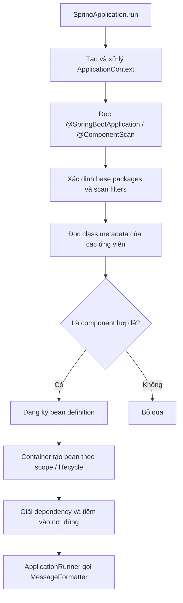
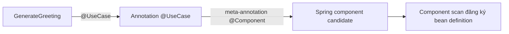
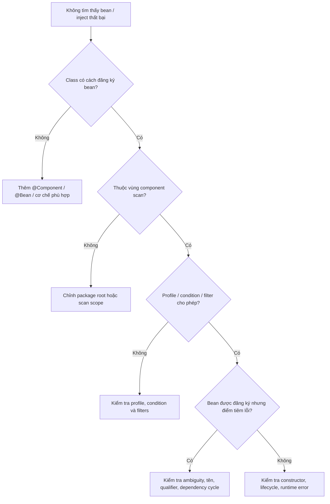

# @Component và cơ chế phát hiện thành phần

Một trong những thao tác đầu tiên khi học Spring Boot là đặt `@Component` lên một class rồi nhận thấy class ấy có thể được tiêm vào nơi khác mà không cần tự viết `new`. Đằng sau hành vi tưởng như đơn giản đó có một chuỗi bước: **xác định vùng quét package → tìm ứng viên component → đăng ký bean definition → tạo bean → kết nối dependency**. Hiểu được từng bước giúp bạn giải thích vì sao một class có annotation nhưng đôi khi vẫn không trở thành Spring bean.

Bài học thuộc chương **Đăng ký bean** của *Spring Boot Fundamentals*. Ta sẽ thực hành với một ứng dụng Java nhỏ, tìm hiểu bản chất của `@Component`, cách `@ComponentScan` hoạt động, cách tên bean và phạm vi bean được xác định, cách tạo stereotype riêng, cùng những trường hợp thường khiến Spring không phát hiện component.

Ví dụ sử dụng **Java 21 và Spring Boot 3.x**, với package gốc `com.example.demo`. Bạn có thể áp dụng cùng nguyên lý cho một dự án Spring Framework thuần hoặc Spring Boot dùng Maven/Gradle.

## 1. Mục tiêu cần đạt

Sau khi hoàn thành bài này, bạn có thể tự trả lời bằng code và quan sát thực tế:

1. `@Component` thể hiện điều gì, và nó có tự tạo bean ngay lúc JVM nạp class hay không?
2. Component scan tìm những class nào, dựa trên package và annotation nào?
3. `@SpringBootApplication` liên quan tới `@ComponentScan` như thế nào?
4. Vì sao Spring có thể tiêm một service vào constructor mà ứng dụng không phải tự khởi tạo?
5. Tên bean được tạo mặc định ra sao và khi nào cần chỉ định tên?
6. `@Service`, `@Repository`, `@Controller` khác `@Component` ở đâu?
7. Khi một class đã có `@Component` nhưng vẫn báo “bean not found”, cần kiểm tra những gì?

Điểm cần nhớ từ đầu: **annotation là dấu hiệu để cơ chế quét xem xét class; chính Spring container mới quản lý bean**.

## 2. `@Component` là gì?

`@Component` là một annotation của Spring Framework, nằm trong package:

```java
import org.springframework.stereotype.Component;
```

Nó đánh dấu một class là **ứng viên để được Spring container tự động phát hiện và đăng ký**, khi class ấy nằm trong phạm vi component scanning phù hợp. Ví dụ:

```java
package com.example.demo;

import org.springframework.stereotype.Component;

@Component
public class MessageFormatter {

    public String format(String name) {
        return "Xin chào, " + name + "!";
    }
}
```

`MessageFormatter` vẫn là class Java bình thường. Method `format` không phụ thuộc vào Spring, không trở thành một API HTTP, và không được tự gọi chỉ vì class có `@Component`.

Annotation giúp Spring biết rằng: **nếu cơ chế quét đi qua class này và các điều kiện đăng ký phù hợp, hãy xem xét tạo bean definition cho nó**.

### Class Java và Spring bean khác nhau ở đâu?

Một class Java mô tả khuôn mẫu để tạo object. Bạn có thể tự tạo một instance:

```java
MessageFormatter formatter = new MessageFormatter();
System.out.println(formatter.format("Lan"));
```

Instance đó là object Java được code của bạn tạo ra. Còn khi Spring phát hiện `MessageFormatter`, Spring có thể tạo và giữ instance trong `ApplicationContext`, sau đó cung cấp instance đó cho những bean cần nó. Instance do Spring tạo và quản lý được gọi là **Spring bean**.

| Đối tượng tự tạo bằng `new` | Spring bean |
|---|---|
| Code tự quyết định lúc tạo object và chỗ lưu reference. | Container tạo/quản lý theo bean definition, scope và vòng đời. |
| Không tự động được Spring cung cấp cho bean khác. | Có thể được tìm theo kiểu/tên và tiêm vào dependency thích hợp. |
| Không tự hưởng các cơ chế do container gắn vào instance. | Có thể nhận dependency injection, callback vòng đời và các xử lý framework phù hợp. |
| Vẫn gọi method Java bình thường. | Vẫn là object Java nhưng nằm trong hệ thống quản lý của Spring. |

**`@Component` không biến mọi instance của class thành bean.** Nếu bạn vừa cho Spring đăng ký `MessageFormatter` vừa tự gọi `new MessageFormatter()`, bạn đang có những instance khác nhau. Instance do `new` bên ngoài container không tự trở thành bean chỉ vì class của nó được annotate.

## 3. Dự án tối thiểu để quan sát cơ chế

Trong Spring Initializr, tạo dự án Java 21, Spring Boot 3.x, Gradle với dependency nền tảng `spring-boot-starter`. Có thể thêm `spring-boot-starter-test` nếu muốn thực hành kiểm chứng bằng test.

Đoạn `dependencies` trong `build.gradle` có thể là:

```groovy
dependencies {
    implementation 'org.springframework.boot:spring-boot-starter'
    testImplementation 'org.springframework.boot:spring-boot-starter-test'
}
```

Đây là **đoạn cấu hình dependency**, không phải toàn bộ file Gradle. Giữ nguyên plugin, repository, toolchain và phần còn lại do công cụ khởi tạo dự án tạo ra.

Cấu trúc source ban đầu:

```text
src/main/java/
└── com/example/demo/
    ├── DemoApplication.java
    ├── MessageFormatter.java
    └── StartupReporter.java
```

Tệp `DemoApplication.java`:

```java
package com.example.demo;

import org.springframework.boot.SpringApplication;
import org.springframework.boot.autoconfigure.SpringBootApplication;

@SpringBootApplication
public class DemoApplication {

    public static void main(String[] args) {
        SpringApplication.run(DemoApplication.class, args);
    }
}
```

Tệp `MessageFormatter.java`:

```java
package com.example.demo;

import org.springframework.stereotype.Component;

@Component
public class MessageFormatter {

    public String format(String name) {
        return "Xin chào, " + name + "!";
    }
}
```

Tệp `StartupReporter.java`:

```java
package com.example.demo;

import org.springframework.boot.ApplicationArguments;
import org.springframework.boot.ApplicationRunner;
import org.springframework.context.ApplicationContext;
import org.springframework.stereotype.Component;

@Component
public class StartupReporter implements ApplicationRunner {

    private final MessageFormatter formatter;
    private final ApplicationContext context;

    public StartupReporter(
            MessageFormatter formatter,
            ApplicationContext context) {
        this.formatter = formatter;
        this.context = context;
    }

    @Override
    public void run(ApplicationArguments args) {
        System.out.println(formatter.format("Lan"));
        System.out.println("Có bean formatter: "
                + context.containsBean("messageFormatter"));
        System.out.println("Số bean kiểu MessageFormatter: "
                + context.getBeansOfType(MessageFormatter.class).size());
    }
}
```

Ở ví dụ này, **cả `MessageFormatter` lẫn `StartupReporter` đều có `@Component`**. Spring cần đăng ký cả hai thành bean; sau đó Spring Boot mới có thể gọi runner lúc khởi động.

### Chạy ứng dụng

Trên Linux/macOS:

```bash
./gradlew bootRun
```

Trên Windows PowerShell:

```powershell
.\gradlew.bat bootRun
```

Những dòng do ứng dụng in ra sẽ tương đương:

```text
Xin chào, Lan!
Có bean formatter: true
Số bean kiểu MessageFormatter: 1
```

Ứng dụng không có web starter hay một công việc nền dài hạn nên có thể khởi động rồi thoát bình thường sau khi runner chạy. Không cần thử gọi `localhost:8080` trong bài này.

Quan sát được ba điều: Spring tạo bean `MessageFormatter`, Spring tiêm bean đó vào `StartupReporter`, và `ApplicationContext` có thể tìm bean theo tên hoặc kiểu.

## 4. Cơ chế phát hiện component diễn ra như thế nào?

Một cách hiểu hữu ích là chia quá trình thành các chặng rõ ràng:



### Bước 1 — Xác định vùng quét

Spring cần biết **tìm component ở những package nào**. Với `@SpringBootApplication` đặt trong `com.example.demo`, vùng component scan mặc định là package này và các package con.

### Bước 2 — Tìm class ứng viên

Spring có cơ chế đọc metadata của các class trong classpath thuộc vùng quét. Nó tìm những class có annotation component phù hợp, bao gồm annotation trực tiếp hoặc meta-annotation liên quan.

Không nên hình dung Spring phải gọi constructor của **mọi** class trong package để xem có phải component hay không. Việc phát hiện ứng viên và việc tạo instance là những giai đoạn khác nhau.

### Bước 3 — Đăng ký bean definition

Khi `MessageFormatter` đáp ứng tiêu chí, container đăng ký **bean definition**: mô tả cách tạo bean, tên, kiểu, scope và các thông tin cần thiết khác. Bean definition là thông tin đăng ký; bản thân nó chưa đồng nghĩa mọi instance đã được tạo.

### Bước 4 — Tạo bean và nối dependency

Trong cấu hình mặc định, một bean singleton thông thường được tạo khi context khởi tạo. Spring thấy constructor `StartupReporter(MessageFormatter, ApplicationContext)` và cung cấp các dependency thích hợp.

### Bước 5 — Thành phần tiêu thụ bean hoạt động

Sau giai đoạn khởi tạo context, Spring Boot gọi các bean triển khai `ApplicationRunner`. Runner dùng formatter đã được tiêm để tạo lời chào.

Đây là mối quan hệ **IoC/DI**: việc khởi tạo, giữ reference và nối dependency được giao cho Spring container; business method vẫn do code ứng dụng định nghĩa và gọi khi cần.

## 5. `@SpringBootApplication` bật component scan như thế nào?

`@SpringBootApplication` là annotation tổng hợp những khả năng chính:

| Thành phần | Trách nhiệm |
|---|---|
| `@SpringBootConfiguration` | Đánh dấu lớp cấu hình của ứng dụng Boot. |
| `@EnableAutoConfiguration` | Cho Boot xem xét các auto-configuration phù hợp. |
| `@ComponentScan` | Phát hiện component theo phạm vi package và bộ lọc. |

Nếu lớp main ở:

```java
package com.example.demo;
```

thì các lớp bên dưới thường được tìm thấy:

```text
com.example.demo
├── DemoApplication                    @SpringBootApplication
├── MessageFormatter                  @Component          ✓
├── runner
│   └── StartupReporter               @Component          ✓
└── service
    └── OrderService                  @Service            ✓

com.example.shared
└── ExternalFormatter                 @Component          ngoài vùng mặc định
```

**Đặt class main ở package gốc phù hợp** là cách đơn giản nhất để những component thuộc ứng dụng được Spring phát hiện theo mặc định.

### Mở rộng phạm vi scan có chủ đích

Khi thực sự cần dùng các component ở package khác, `@SpringBootApplication` hỗ trợ:

```java
@SpringBootApplication(
        scanBasePackages = {
                "com.example.demo",
                "com.example.shared"
        }
)
public class DemoApplication {
    // ...
}
```

Thuộc tính `scanBasePackages` là một cách cấu hình phạm vi của `@ComponentScan`. Các chuỗi package cần được cập nhật khi bạn di chuyển hoặc đổi tên package.

Một cách khác dùng class làm dấu mốc:

```java
import com.example.shared.ExternalFormatter;

@SpringBootApplication(
        scanBasePackageClasses = {
                DemoApplication.class,
                ExternalFormatter.class
        }
)
public class DemoApplication {
    // ...
}
```

Ví dụ giả định `ExternalFormatter` là class có thật trong package `com.example.shared`. `scanBasePackageClasses` lấy **package chứa các class được đưa vào**, từ đó quét cả package và các package con; nó không chỉ quét đúng những class trong mảng.

Đặt nhiều package vào scan scope quá rộng có thể khiến Spring đăng ký những bean hoặc cấu hình mà ứng dụng không muốn dùng. Vì vậy nên chọn vùng scan phản ánh **ranh giới ứng dụng**, thay vì mặc định quét từ `com` hay `org`.

### Trường hợp không khai báo package cho lớp main

Không nên để `DemoApplication` ở **default package** (không có dòng `package ...;`). Khi đó việc xác định phạm vi component scan có thể trở nên quá rộng, dễ kéo nhiều class và cấu hình ngoài dự kiến vào quá trình quét. Hãy đặt lớp main trong một package có tên và tổ chức các component bên dưới package ấy.

## 6. `@Component` và các stereotype annotation

Spring có những annotation chuyên biệt được **meta-annotated** bằng `@Component`, trong đó phổ biến nhất là:

| Annotation | Ý nghĩa dự kiến | Có thuộc cơ chế component scan thông thường? |
|---|---|---|
| `@Component` | Component tổng quát không nhất thiết gắn với một tầng cụ thể. | Có |
| `@Service` | Class chứa logic nghiệp vụ hoặc dịch vụ ứng dụng. | Có |
| `@Repository` | Class thao tác dữ liệu/DAO do ứng dụng viết. | Có |
| `@Controller` | Spring MVC controller trả view hoặc xử lý request. | Có |
| `@RestController` | Controller REST; kết hợp `@Controller` và `@ResponseBody`. | Có |
| `@Configuration` | Class cấu hình có thể chứa các method `@Bean`. | Có |

`@Service` và `@Repository` không phải “công nghệ DI khác” so với `@Component`: chúng truyền đạt **vai trò của class** và có thể được component scan nhận diện thông qua meta-annotation.

Ví dụ:

```java
package com.example.demo.service;

import org.springframework.stereotype.Service;

@Service
public class PriceService {
    public long priceWithTax(long basePrice) {
        return Math.round(basePrice * 1.1);
    }
}
```

Spring có thể tìm thấy bean `PriceService` vì `@Service` là một stereotype của `@Component`. Đặt `@Service` giúp code diễn đạt vai trò “dịch vụ nghiệp vụ” rõ hơn so với `@Component` chung.

### Lưu ý riêng về `@Repository`

Một **class DAO cụ thể** được đánh dấu `@Repository` có thể được component scan phát hiện. Tuy nhiên, một interface `JpaRepository<Customer, Long>` của Spring Data JPA thường được hạ tầng **Spring Data repository scanning** đăng ký thành repository proxy bean. Không nên coi mọi repository interface đều được component scan xử lý như một class `@Component` thông thường.

Tương tự, JPA `@Entity` là kiểu dữ liệu do JPA quản lý; nó **không mặc nhiên là Spring component bean** chỉ vì nằm cùng package.

## 7. Tên bean mặc định được chọn thế nào?

Khi bạn viết:

```java
@Component
public class MessageFormatter {
}
```

tên bean mặc định thường là `messageFormatter`: Spring dùng tên class ngắn rồi áp dụng quy tắc decapitalize theo cơ chế đặt tên mặc định. Vì vậy ví dụ `ApplicationContext.containsBean("messageFormatter")` hoạt động.

Bạn có thể chỉ định tên tường minh:

```java
@Component("customerMessageFormatter")
public class MessageFormatter {
}
```

Khi đó tên bean là `customerMessageFormatter` thay vì tên được sinh mặc định. Nếu muốn tiêm theo **kiểu duy nhất** `MessageFormatter`, bạn thường không cần biết tên bean. Tên trở nên quan trọng khi tra bean theo tên hoặc khi có nhiều bean cùng kiểu.

**Tên bean không giống tên biến Java hay package.** Ví dụ field `formatter` trong runner chỉ là tên biến tham chiếu; nó không quyết định bean có được đăng ký hay không.

### Nếu hai class có cùng tên đơn giản thì sao?

Giả sử có:

```text
com.example.demo.email.NotificationSender
com.example.demo.sms.NotificationSender
```

Cả hai cùng được annotate `@Component` và nằm trong vùng quét. Tên mặc định có thể cùng là `notificationSender`, dẫn tới xung đột định nghĩa bean hoặc tình huống cần xử lý theo quy tắc đăng ký cụ thể.

Bạn có thể dùng tên rõ ràng như `@Component("emailNotificationSender")` và `@Component("smsNotificationSender")` để tránh đụng tên; đồng thời thiết kế interface và điểm tiêm rõ ràng khi có nhiều implementation.

## 8. Tiêm dependency qua constructor

Giả sử service cần sử dụng `MessageFormatter`:

```java
package com.example.demo;

import org.springframework.stereotype.Service;

@Service
public class GreetingService {

    private final MessageFormatter formatter;

    public GreetingService(MessageFormatter formatter) {
        this.formatter = formatter;
    }

    public String greet(String name) {
        return formatter.format(name);
    }
}
```

Khi Spring tạo bean `GreetingService`, nó nhìn constructor và tìm bean phù hợp với kiểu `MessageFormatter`. Nếu chỉ có một candidate thích hợp, Spring truyền bean đó vào constructor. Trong Spring hiện đại, **constructor duy nhất không bắt buộc thêm `@Autowired`**.

Vì sao constructor injection thường được ưu tiên?

- Dependency bắt buộc xuất hiện rõ ở chữ ký constructor.
- Field có thể là `final` và không cần setter thay đổi về sau.
- Khi thiếu dependency, Spring có thể báo lỗi ngay trong giai đoạn tạo context.
- Class dễ kiểm thử bằng Java thuần nếu bạn tự tạo dependency kiểm thử và truyền vào constructor.

Trong ví dụ, `GreetingService` và `MessageFormatter` đều là Spring bean khi được quét, nhưng **nơi cung cấp bean** và **nơi tiêu thụ bean** là hai trách nhiệm khác nhau.

### Nếu có nhiều implementation cùng kiểu?

Giả sử tách formatter thành interface:

```java
package com.example.demo;

public interface TextFormatter {
    String format(String name);
}
```

Tạo hai component:

```java
package com.example.demo;

import org.springframework.stereotype.Component;

@Component("friendlyFormatter")
public class FriendlyFormatter implements TextFormatter {
    @Override
    public String format(String name) {
        return "Chào " + name + "!";
    }
}
```

```java
package com.example.demo;

import org.springframework.stereotype.Component;

@Component("formalFormatter")
public class FormalFormatter implements TextFormatter {
    @Override
    public String format(String name) {
        return "Kính chào " + name + ".";
    }
}
```

Nếu một constructor chỉ yêu cầu `TextFormatter`:

```java
public GreetingService(TextFormatter formatter) {
    this.formatter = formatter;
}
```

thì có **hai bean cùng thỏa mãn kiểu**, Spring có thể báo lỗi không xác định được bean nào cần tiêm. Để làm rõ lựa chọn, dùng `@Qualifier`:

```java
import org.springframework.beans.factory.annotation.Qualifier;

public GreetingService(
        @Qualifier("friendlyFormatter") TextFormatter formatter) {
    this.formatter = formatter;
}
```

Đây là **biến thể** của `GreetingService`, nên để áp dụng cần đổi field sang `private final TextFormatter formatter;`. Bạn cũng có thể đánh dấu một implementation bằng `@Primary` để thiết lập ưu tiên mặc định trong những tình huống tiêm phù hợp.

Điểm quan trọng: **cả hai component có thể đều đã được quét thành công**, lỗi xảy ra ở bước *chọn bean để tiêm* chứ không phải ở bước component scanning.

## 9. `@Component` khác `@Bean` như thế nào?

Component scanning không phải cách duy nhất để đăng ký bean. Với một class bạn không thể hoặc không muốn annotate trực tiếp (chẳng hạn class từ thư viện ngoài), bạn có thể định nghĩa factory method `@Bean`:

```java
package com.example.demo;

import java.time.Clock;
import org.springframework.context.annotation.Bean;
import org.springframework.context.annotation.Configuration;

@Configuration(proxyBeanMethods = false)
public class TimeConfiguration {

    @Bean
    Clock clock() {
        return Clock.systemUTC();
    }
}
```

Spring phát hiện `TimeConfiguration` như một class cấu hình nếu nó nằm trong vùng quét hoặc được đăng ký bằng cách khác, rồi xử lý method `@Bean`. Kết quả trả về từ `clock()` trở thành Spring bean theo bean definition tương ứng.

So sánh:

| `@Component` | `@Bean` |
|---|---|
| Đặt trực tiếp trên class. | Đặt trên method tạo hoặc trả về object trong class cấu hình được Spring xử lý. |
| Component scan có thể tự tìm class ứng viên. | Spring cần trước hết biết đến cấu hình chứa method `@Bean`. |
| Thích hợp với class ứng dụng bạn quản lý source. | Thích hợp với object của thư viện, factory method hoặc logic tạo instance đặc biệt. |
| Bean được tạo theo cấu hình và constructor tương ứng. | Bean được tạo từ kết quả method factory. |

Nếu một class không có `@Component` nhưng được method `@Bean` trả về, class ấy **vẫn có Spring bean**. Ngược lại, một class có `@Component` nhưng không nằm trong bất kỳ vùng quét nào và không được đăng ký bằng cách khác có thể **không có bean**.

### Liên hệ với auto-configuration

Trong Spring Boot, `@EnableAutoConfiguration` đưa các lớp auto-configuration được đăng ký phù hợp vào quá trình xử lý configuration. Các cấu hình này có thể khai báo `@Bean` kèm điều kiện, chẳng hạn có class cần thiết trên classpath hoặc chưa tồn tại bean cụ thể.

**Component scanning và auto-configuration là hai cơ chế liên quan nhưng khác nhau.** Không phải mọi bean bạn thấy trong `ApplicationContext` đều được tìm bằng cách quét `@Component` từ package ứng dụng.

## 10. `@ComponentScan` có bộ lọc như thế nào?

Mặc định, component scan dùng các tiêu chí thông thường để tìm component và stereotype đã được annotate phù hợp. Khi cần kiểm soát phạm vi, Spring hỗ trợ `includeFilters`, `excludeFilters` và `useDefaultFilters`.

Ví dụ, một class cấu hình có thể chỉ quét một package và loại ra một component cụ thể:

```java
package com.example.demo.config;

import com.example.demo.experimental.ExperimentalClient;
import org.springframework.context.annotation.ComponentScan;
import org.springframework.context.annotation.Configuration;
import org.springframework.context.annotation.FilterType;

@Configuration(proxyBeanMethods = false)
@ComponentScan(
        basePackages = "com.example.demo.experimental",
        excludeFilters = @ComponentScan.Filter(
                type = FilterType.ASSIGNABLE_TYPE,
                classes = ExperimentalClient.class
        )
)
public class ExperimentalScanConfiguration {
}
```

Đoạn code minh họa giả định `ExperimentalClient` là class có thật. Filter loại trừ khi xử lý **lần scan do annotation này cấu hình**; nếu cùng component cũng được phát hiện qua một lần scan hoặc cách đăng ký khác, bean vẫn có thể xuất hiện trong context. Với dự án Spring Boot thông thường, nên bắt đầu bằng tổ chức package hợp lý và dùng mặc định trước khi thêm các filter phức tạp.

Những filter thường gặp:

| Kiểu filter | Ý nghĩa |
|---|---|
| `FilterType.ANNOTATION` | Chọn hoặc loại class theo annotation. |
| `FilterType.ASSIGNABLE_TYPE` | Chọn hoặc loại class theo kiểu hoặc quan hệ kiểu. |
| `FilterType.REGEX` | So khớp tên class bằng biểu thức chính quy. |
| `FilterType.CUSTOM` | Dùng `TypeFilter` tự định nghĩa. |

Nếu dùng `useDefaultFilters = false`, Spring không còn áp dụng mặc định cùng cách như trước; bạn phải khai báo filter phù hợp để tìm những component cần thiết. Đây là lựa chọn nâng cao, hữu ích trong trường hợp có lý do rõ ràng để kiểm soát đăng ký component.

## 11. Meta-annotation: tự tạo stereotype trên nền `@Component`

Bạn có thể tạo annotation thể hiện một vai trò riêng của ứng dụng, đồng thời cho phép component scan nhận diện nó. Ví dụ muốn đánh dấu các class xử lý use case:

```java
package com.example.demo.stereotype;

import java.lang.annotation.Documented;
import java.lang.annotation.ElementType;
import java.lang.annotation.Retention;
import java.lang.annotation.RetentionPolicy;
import java.lang.annotation.Target;
import org.springframework.stereotype.Component;

@Target(ElementType.TYPE)
@Retention(RetentionPolicy.RUNTIME)
@Documented
@Component
public @interface UseCase {
}
```

Sau đó sử dụng:

```java
package com.example.demo.usecase;

import com.example.demo.stereotype.UseCase;

@UseCase
public class GenerateGreeting {

    public String execute(String name) {
        return "Xin chào, " + name + "!";
    }
}
```

Nếu cả `com.example.demo.stereotype` và `com.example.demo.usecase` nằm trong package quét, `GenerateGreeting` được coi là component candidate thông qua **meta-annotation `@Component`** trên `@UseCase`.

Cấu trúc quan hệ:



Đây là cơ sở để hiểu vì sao `@Service`, `@Repository` hay `@Controller` được tìm thấy dù source của các class không viết trực tiếp `@Component`.

Nếu custom stereotype cần cho phép đặt tên bean bằng tham số của annotation, phải thiết kế alias phù hợp với `@Component.value`; không nên giả định Spring tự liên kết mọi thuộc tính `value` của annotation tự định nghĩa với tên bean.

## 12. Bean scope: quét được không có nghĩa mỗi lần dùng sẽ tạo object mới

Với `@Component`, scope mặc định là **singleton** trong một Spring container. Ví dụ:

```java
@Component
public class RequestCounter {
    private int count;
}
```

Nếu nhiều bean tiêm cùng `RequestCounter` mặc định, họ thường sử dụng chung một instance. Trong ứng dụng có nhiều luồng, một singleton có mutable state phải được thiết kế cẩn thận vì các luồng có thể truy cập đồng thời.

Bạn có thể khai báo scope khác:

```java
import org.springframework.context.annotation.Scope;
import org.springframework.stereotype.Component;

@Component
@Scope("prototype")
public class TraceToken {
}
```

Với prototype scope, Spring có thể tạo instance mới mỗi khi bean được yêu cầu trực tiếp từ container. Tuy nhiên, nếu **một singleton được tạo một lần và constructor của nó nhận prototype bean**, dependency đó thường chỉ được resolve tại thời điểm singleton được tạo; không tự đổi thành instance mới ở mỗi lần gọi method của singleton.

Khi thực sự cần lấy prototype nhiều lần từ singleton, một cách là tiêm `ObjectProvider<TraceToken>` rồi gọi `getObject()` khi cần:

```java
import org.springframework.beans.factory.ObjectProvider;
import org.springframework.stereotype.Component;

@Component
public class TraceService {
    private final ObjectProvider<TraceToken> tokens;

    public TraceService(ObjectProvider<TraceToken> tokens) {
        this.tokens = tokens;
    }

    public TraceToken newToken() {
        return tokens.getObject();
    }
}
```

**Component scan** giúp đăng ký bean definition; **scope** quyết định quy tắc cung cấp instance. Hai mối quan tâm này không nên gộp làm một.

## 13. `@Lazy` và `@Profile` ảnh hưởng điều gì?

### 13.1. Lazy initialization

Mặc định, nhiều singleton bean được tạo trong giai đoạn khởi tạo context. Với:

```java
import org.springframework.context.annotation.Lazy;
import org.springframework.stereotype.Component;

@Component
@Lazy
public class ExpensiveCalculator {
    public ExpensiveCalculator() {
        System.out.println("Đã tạo ExpensiveCalculator");
    }
}
```

bean definition vẫn có thể được đăng ký qua component scan, nhưng Spring sẽ hoãn việc tạo instance cho tới khi thật sự cần, tùy cách bean được sử dụng. Nếu một singleton eager khác có dependency bắt buộc vào `ExpensiveCalculator`, việc giải dependency đó có thể khiến bean lazy được tạo ngay lúc startup.

Vì vậy **không thấy log constructor lúc khởi động không chứng minh component không được đăng ký**. Hãy phân biệt bean definition với instance được tạo.

### 13.2. Profile và conditional registration

Một class có thể vừa được đánh dấu component, vừa chỉ hợp lệ trong profile cụ thể:

```java
import org.springframework.context.annotation.Profile;
import org.springframework.stereotype.Component;

@Component
@Profile("dev")
public class DevDiagnostics {
    public String description() {
        return "Chẩn đoán dành cho môi trường dev";
    }
}
```

Khi profile `dev` không hoạt động, Spring không đăng ký bean `DevDiagnostics` theo điều kiện `@Profile`. Nếu chỉ bật profile bằng:

```bash
./gradlew bootRun --args='--spring.profiles.active=dev'
```

thì bean có thể được đăng ký trong lần chạy đó. Với Windows PowerShell, có thể gọi `.\gradlew.bat bootRun --args="--spring.profiles.active=dev"`.

Trong Spring Boot còn có các annotation điều kiện như `@ConditionalOnProperty` để quyết định đăng ký dựa trên property. Điều kiện là một tầng kiểm soát khác: component scan có thể **nhận thấy class là ứng viên**, nhưng điều kiện khiến nó không trở thành bean trong context hiện tại.

## 14. Vì sao có `@Component` nhưng bean vẫn không tồn tại?

Cùng là triệu chứng “Spring không tìm thấy bean”, nhưng nguyên nhân có thể khác nhau:

| Triệu chứng hoặc cấu hình | Điều cần kiểm tra |
|---|---|
| Class nằm ngoài package gốc | `@SpringBootApplication` đặt ở đâu? `scanBasePackages` đã bao gồm vùng đó chưa? |
| Class có annotation nhưng bị exclude | Có `excludeFilters`, cấu hình quét đặc biệt hoặc cấu hình khác loại bỏ candidate không? |
| Component nằm trong profile không hoạt động | Có `@Profile` hoặc điều kiện tương tự không? |
| Class không có component stereotype | Cần `@Component`/`@Service` hoặc được đăng ký qua `@Bean`, `@Import` hay cơ chế phù hợp. |
| Class trong thư viện ngoài không được tìm thấy | JAR có trên classpath không? Package thư viện có nằm trong phạm vi scan không? |
| Nhiều bean cùng kiểu | Có phải bean đã tồn tại nhưng điểm tiêm bị **ambiguous**? |
| Xung đột tên bean | Hai component có tên trùng hoặc một bean definition khác trùng tên không? |
| Context không khởi tạo được | Đọc nguyên nhân sâu nhất: thiếu dependency, lỗi constructor, bean cycle hoặc điều kiện cấu hình? |
| Bean lazy chưa chạy constructor | Kiểm tra đăng ký bean thay vì chỉ dựa vào log constructor. |

Ví dụ lỗi thiếu bean khi Spring tạo `GreetingService`:

```text
Parameter 0 of constructor in ...GreetingService
required a bean of type '...MessageFormatter'
that could not be found.
```

Đây là hình thức thông báo **minh họa**; log thực tế còn tùy phiên bản và nguyên nhân. Dòng “bean not found” mới chỉ nói Spring không có candidate phù hợp cho điểm tiêm đó. Cần điều tra vì sao candidate vắng mặt.

### Trường hợp package nằm ngoài vùng quét

Giả sử:

```text
com.example.application
└── DemoApplication           @SpringBootApplication

com.example.shared
└── SharedFormatter           @Component
```

Mặc định, scan từ `com.example.application` **không tự đi sang** `com.example.shared`. Dù `SharedFormatter` có `@Component`, việc quét mặc định không thấy nó. Có thể di chuyển class về package con phù hợp, đưa lớp main lên root thích hợp, hoặc cấu hình rõ phạm vi package bổ sung.

Đừng khắc phục bằng cách quét toàn bộ classpath một cách tùy tiện: điều đó dễ đưa vào context những cấu hình/component không thuộc trách nhiệm của ứng dụng.

## 15. Cách quan sát component thực sự được đăng ký

### 15.1. Truy vấn `ApplicationContext`

Trong ví dụ `StartupReporter`, ta đã dùng:

```java
context.containsBean("messageFormatter");
context.getBeansOfType(MessageFormatter.class);
```

Bạn cũng có thể lấy bean theo kiểu:

```java
MessageFormatter bean = context.getBean(MessageFormatter.class);
System.out.println(bean.format("Minh"));
```

`getBean(Class<T>)` phù hợp khi có duy nhất một bean candidate tương ứng hoặc quy tắc chọn bean cho phép xác định một bean. Nếu không có bean hoặc có nhiều candidate không thể phân giải, nó sẽ báo lỗi.

Để xem tên bean theo kiểu mà không buộc code phụ thuộc vào tên:

```java
import java.util.Arrays;

String[] names = context.getBeanNamesForType(MessageFormatter.class);
System.out.println(Arrays.toString(names));
```

Với ví dụ ban đầu, danh sách thường chứa `messageFormatter`.

### 15.2. Dùng test khởi tạo Spring context

Nếu dự án có `spring-boot-starter-test`, bạn có thể tạo test:

```java
package com.example.demo;

import static org.assertj.core.api.Assertions.assertThat;

import org.junit.jupiter.api.Test;
import org.springframework.beans.factory.annotation.Autowired;
import org.springframework.boot.test.context.SpringBootTest;
import org.springframework.context.ApplicationContext;

@SpringBootTest
class ComponentDiscoveryTest {

    @Autowired
    ApplicationContext context;

    @Test
    void discoversMessageFormatter() {
        assertThat(context.getBeanNamesForType(MessageFormatter.class))
                .contains("messageFormatter");
        assertThat(context.getBean(MessageFormatter.class)
                .format("Lan"))
                .isEqualTo("Xin chào, Lan!");
    }
}
```

Khi test tạo toàn bộ context, `StartupReporter` cũng có thể được Spring Boot gọi và in kết quả ra console. Đó là hiệu ứng bình thường khi có bean triển khai `ApplicationRunner` trong một application context được bootstrapped theo đường `@SpringBootTest`.

### 15.3. Log phát hiện component

Khi cần điều tra sâu cơ chế quét trong môi trường phát triển, bạn có thể tăng log cho phần component scan:

```properties
logging.level.org.springframework.context.annotation=TRACE
```

Đặt vào `application.properties` của dự án thực hành, quan sát log khi startup và tắt lại sau khi điều tra. Mức TRACE có thể tạo rất nhiều log; tên log cụ thể khác nhau theo phiên bản Spring.

Nếu ứng dụng có Actuator, endpoint `/actuator/beans` (khi được expose và được bảo vệ phù hợp) cũng giúp quan sát những bean đã đăng ký. Không cần thêm Actuator chỉ để hoàn thành ví dụ này.

## 16. Component scan không phải là “quét tất cả mọi thứ”

Tên “scan” đôi khi làm người học nghĩ Spring sẽ tìm mọi class trong mọi JAR và tự tạo instance. Cách hiểu này sai ở nhiều điểm:

1. **Có vùng package cụ thể.** Phạm vi được xác định từ lớp cấu hình hoặc khai báo `@ComponentScan`.
2. **Có tiêu chí ứng viên.** Class Java bình thường không tự trở thành component chỉ vì nằm trong package quét.
3. **Có điều kiện và bộ lọc.** Không phải mọi ứng viên đều dẫn đến bean definition đang hoạt động.
4. **Có nhiều cách đăng ký bean khác.** `@Bean`, `@Import`, auto-configuration và framework integration có thể tạo bean không xuất phát từ component scanning thông thường.
5. **Có vòng đời và scope sau khi đăng ký.** Đăng ký bean definition không nhất thiết khiến constructor chạy ngay lập tức.

Một thư viện JAR trên runtime classpath **có thể** chứa component được quét nếu package của nó thuộc vùng scan và metadata phù hợp. Nhưng việc thêm JAR vào dependencies **không tự hứa rằng mọi class `@Component` bên trong JAR sẽ được phát hiện**. Các starter/autoconfiguration có thể cung cấp bean theo cơ chế khác với component scanning của package ứng dụng.

## 17. Bài thực hành từng bước

Hãy giữ lại ba class `DemoApplication`, `MessageFormatter` và `StartupReporter` từ mục 3, sau đó thực hiện từng biến thể độc lập. Sau mỗi biến thể, khôi phục trạng thái gốc trước khi làm biến thể kế tiếp.

### Bài A — Không có annotation `@Component`

Xóa `@Component` khỏi `MessageFormatter`. Chạy lại chương trình.

**Cần giải thích:** vì sao runner vẫn là component nhưng Spring không thể tạo runner khi constructor cần `MessageFormatter` mà không có bean tương ứng? Lỗi này phát sinh ở khâu giải dependency, trong khi nguyên nhân là thiếu cách đăng ký formatter.

### Bài B — Component có annotation nhưng nằm ngoài package

Di chuyển `MessageFormatter` sang `com.example.shared`, cập nhật import trong runner, giữ `@Component`.

**Cần giải thích:** vì sao package `com.example.shared` không nằm dưới `com.example.demo` nên formatter không được scan? Sau đó thử cấu hình `scanBasePackageClasses` hoặc đặt lại class theo ranh giới package phù hợp.

### Bài C — Đổi tên bean

Đổi annotation thành `@Component("mainFormatter")`. Trong runner, sửa phép kiểm tra:

```java
System.out.println(context.containsBean("mainFormatter"));
```

**Cần giải thích:** thay tên bean có làm thay đổi kiểu `MessageFormatter` hay hành vi constructor injection khi chỉ có một bean cùng kiểu không?

### Bài D — Tạo hai implementation

Tạo interface `TextFormatter` và hai class `FriendlyFormatter`, `FormalFormatter` như mục 8. Cho runner hoặc service tiêm theo `TextFormatter`; quan sát tình huống có nhiều bean. Sau đó dùng `@Qualifier("friendlyFormatter")` hoặc `@Primary` để chọn một implementation.

**Cần giải thích:** lỗi này khác lỗi thiếu bean ở điểm nào?

### Bài E — Tạo bean không dùng `@Component`

Xóa `@Component` trên `MessageFormatter` và tạo một method `@Bean` trả về `new MessageFormatter()` trong một class `@Configuration` dưới package gốc.

**Cần giải thích:** tại sao formatter vẫn có thể là Spring bean dù class không còn component annotation? Phân biệt **được container quản lý** và **được component scan phát hiện**.

### Bài F — Dùng profile để điều khiển đăng ký

Thêm `@Profile("dev")` vào một component độc lập, rồi so sánh context khi bật và không bật `dev`.

**Cần giải thích:** Spring có thể quét thấy class ứng viên nhưng điều kiện profile khiến nó không được đăng ký thành bean trong lần chạy hiện tại như thế nào?

## 18. Mô hình chẩn đoán lỗi component trong ứng dụng Spring Boot

Khi một component “không hoạt động”, hãy hỏi theo thứ tự:



Đừng kết luận vội rằng “Spring quét sai”. Có những lỗi ở giai đoạn đăng ký candidate, những lỗi chỉ xuất hiện khi tạo instance, và những lỗi xảy ra khi lựa chọn bean cho constructor.

Trong một ứng dụng lớn, bạn còn cần biết bean đến từ đâu: **component scan**, **method `@Bean`**, **repository infrastructure**, hay **Spring Boot auto-configuration**. Cách khắc phục phụ thuộc nguồn gốc đăng ký, không chỉ phụ thuộc tên class.

## 19. Câu hỏi tự đánh giá

1. Nếu một class có `@Component` nhưng nằm trong package ngoài vùng quét, nó có tự trở thành Spring bean không?
2. `@SpringBootApplication` đã bật khả năng nào để tìm component mặc định?
3. “Bean definition được đăng ký” và “bean instance được tạo” khác nhau như thế nào?
4. Tại sao Spring có thể cung cấp `MessageFormatter` vào constructor `StartupReporter` dù không có lệnh `new` trong runner?
5. `@Service` và `@Controller` được component scan nhận diện liên quan thế nào tới `@Component`?
6. Tên bean `messageFormatter` có nghĩa gì, và khi nào nên chỉ định tên bean tường minh?
7. Nếu có hai implementation cùng kiểu, tại sao có thể xảy ra lỗi tiêm dependency dù cả hai đã được scan?
8. Khi nào dùng method `@Bean` hợp lý hơn việc annotate class `@Component`?
9. `@Lazy` và `@Profile` ảnh hưởng đến thời điểm tạo instance và điều kiện đăng ký khác nhau như thế nào?
10. Vì sao thêm Spring Boot starter có thể làm xuất hiện bean nhờ auto-configuration, kể cả khi bạn không tự quét package của thư viện?

### Lời giải thích mẫu

> `@Component` đánh dấu class là ứng viên để Spring phát hiện qua component scanning. Với ứng dụng Spring Boot, `@SpringBootApplication` bao gồm `@ComponentScan` nên theo mặc định Spring tìm các class thành phần trong package chứa lớp main và các package con. Khi tìm được candidate phù hợp, Spring đăng ký bean definition; sau đó container tạo instance theo scope, giải dependency và tiêm vào những bean cần nó. `@Service`, `@Controller` hay stereotype tự định nghĩa có thể được nhận diện thông qua meta-annotation `@Component`. Một class có `@Component` vẫn có thể không thành bean nếu ở ngoài vùng quét hoặc không thỏa điều kiện. Ngoài component scan, Spring còn có các cách đăng ký bean khác như `@Bean` và auto-configuration.

Khi bạn có thể **chỉ ra component được quét từ đâu, bean definition được đăng ký trong điều kiện nào và bean được cung cấp cho constructor ra sao**, bạn đã hiểu cơ chế phát hiện thành phần thay vì chỉ ghi nhớ cú pháp `@Component`. Đây là nền tảng để đọc và xử lý mọi dự án Spring Boot có nhiều service, controller hoặc cấu hình phụ thuộc nhau.
