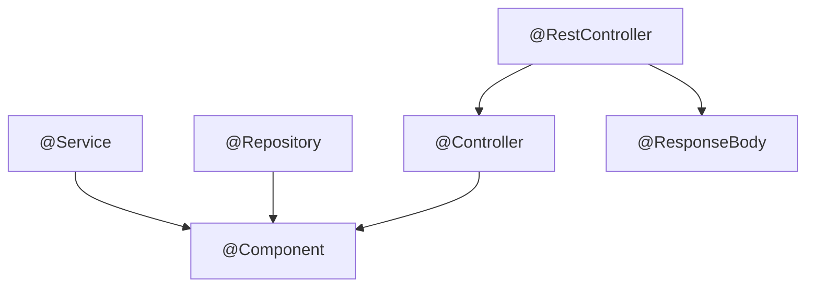
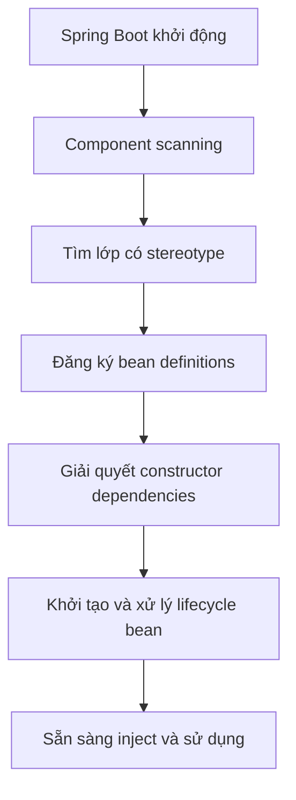
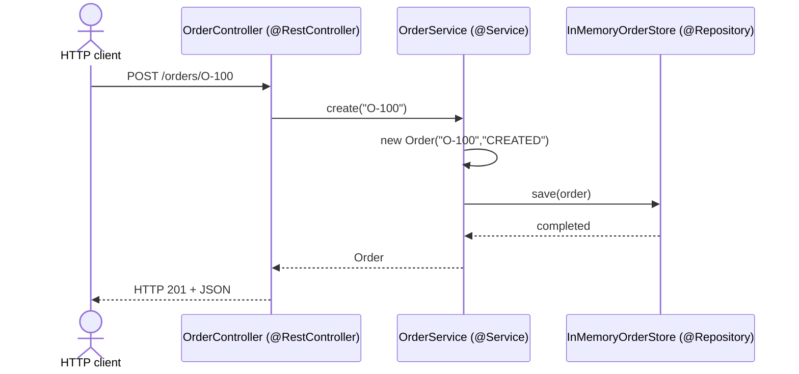

# @Service, @Repository, @Controller và ý nghĩa stereotype

Trong Spring Boot, các lớp có thể mang annotation `@Service`, `@Repository` hoặc `@Controller` để mô tả vai trò của chúng trong ứng dụng. Đây là các **stereotype annotation**: những nhãn mang ý nghĩa kiến trúc, đồng thời cho phép Spring nhận diện lớp và đăng ký bean thông qua component scanning.

Điểm quan trọng là hiểu **cả hai mặt** của chúng. Về đăng ký bean, cả ba đều là dạng chuyên biệt của `@Component`. Về ý nghĩa, chúng giúp người đọc và framework phân biệt lớp xử lý nghiệp vụ, lớp truy cập dữ liệu và lớp tiếp nhận yêu cầu từ client. Một số stereotype còn gắn với xử lý đặc thù của Spring, vì vậy không nên xem chúng đơn thuần là ba cách viết tùy ý cho cùng một việc.

Bài học trình bày cơ chế đăng ký bean, vai trò của từng annotation, cách chúng phối hợp trong Spring MVC, các lỗi thường gặp, và một ví dụ nhỏ có thể mở rộng thành ứng dụng Spring Boot thực tế.

## 1. Stereotype là gì?

Trong thiết kế phần mềm, *stereotype* là cách phân loại thành phần theo vai trò. Trong Spring Framework, các stereotype quen thuộc gồm:

| Annotation | Vai trò dự kiến | Điểm đáng chú ý |
| --- | --- | --- |
| `@Component` | Thành phần Spring tổng quát | Được nhận diện khi component scan phù hợp |
| `@Service` | Lớp cung cấp nghiệp vụ hoặc một năng lực của ứng dụng | Là một dạng `@Component`; bản thân annotation không tạo transaction |
| `@Repository` | Thành phần truy cập, truy vấn hoặc lưu trữ dữ liệu | Là `@Component`; có vai trò trong cơ chế chuyển đổi persistence exception |
| `@Controller` | Lớp nhận và điều phối request web kiểu Spring MVC | Là `@Component`; được các thành phần MVC nhận diện là controller |
| `@RestController` | Controller trả dữ liệu phản hồi trực tiếp | Kết hợp `@Controller` và `@ResponseBody` |

Ví dụ về các cách khai báo:

```java
import org.springframework.stereotype.Component;
import org.springframework.stereotype.Service;
import org.springframework.stereotype.Repository;
import org.springframework.stereotype.Controller;
import org.springframework.web.bind.annotation.RestController;

@Component
class DateFormatterComponent {}

@Service
class CheckoutService {}

@Repository
class ProductRepositoryAdapter {}

@Controller
class CatalogPageController {}

@RestController
class CatalogApiController {}
```

Những lớp trên là các ví dụ độc lập về stereotype; ví dụ chạy xuyên suốt ở phần sau sẽ khai báo đầy đủ các thành phần thực tế.

### 1.1. Quan hệ với `@Component`

Các annotation `@Service`, `@Repository` và `@Controller` được định nghĩa với meta-annotation `@Component`. `@RestController` được xây dựng trên `@Controller` và `@ResponseBody`.

Có thể hình dung:



Khi component scanning tìm thấy một lớp được đánh dấu bằng stereotype hợp lệ, nó có thể tạo **bean definition** cho lớp đó. Từ bean definition, Spring container giải quyết dependency, khởi tạo đối tượng và quản lý lifecycle theo cấu hình.

Tuy nhiên, việc một annotation có `@Component` không có nghĩa mọi chức năng liên quan sẽ tự động được bật. Chẳng hạn `@Service` không tự mở transaction; `@Controller` cần chạy trong hệ thống web có cấu hình xử lý request phù hợp mới thực sự đóng vai trò HTTP endpoint.

### 1.2. Bean, lớp Java và object khác nhau thế nào?

Ba khái niệm thường bị trộn lẫn:

- **Class**: định nghĩa kiểu Java, ví dụ `OrderService`.
- **Object**: một instance được tạo bằng `new OrderService(...)` hoặc cơ chế khác.
- **Spring bean**: object được Spring `ApplicationContext` quản lý theo một bean definition hoặc cơ chế đăng ký tương đương.

Nếu viết:

```java
OrderService service = new OrderService(repository);
```

thì `service` là object Java thông thường. Nó không tự động là bean chỉ vì class có `@Service`. Ngược lại, nếu Spring đăng ký và khởi tạo `OrderService`, container mới quản lý lifecycle, injection và những interceptor/proxy phù hợp.

## 2. Từ stereotype đến bean trong `ApplicationContext`

Trong một ứng dụng Spring Boot điển hình:

```java
package com.example.orders;

import org.springframework.boot.SpringApplication;
import org.springframework.boot.autoconfigure.SpringBootApplication;

@SpringBootApplication
public class OrdersApplication {
    public static void main(String[] args) {
        SpringApplication.run(OrdersApplication.class, args);
    }
}
```

`@SpringBootApplication` bao gồm cơ chế `@ComponentScan`. Mặc định, Spring quét package của class ứng dụng và các package con:

```text
com.example.orders
├── OrdersApplication                @SpringBootApplication
├── web
│   └── OrderController              @RestController
├── application
│   └── OrderService                 @Service
└── persistence
    └── InMemoryOrderStore           @Repository
```

Với bố trí trên, các lớp thành phần có thể được phát hiện. Chuỗi xử lý ở mức khái niệm:



**Classpath và component scan là hai điều kiện khác nhau.** Một lớp có trong thư viện được thêm làm dependency vẫn có thể không được quét nếu package của nó nằm ngoài phạm vi scan. Ngược lại, Spring cũng có thể tạo bean từ phương thức `@Bean` dù class trả về hoàn toàn không có stereotype.

## 3. `@Service`: tầng xử lý nghiệp vụ

`@Service` đánh dấu class chịu trách nhiệm thực hiện nghiệp vụ hoặc điều phối một trường hợp sử dụng (*use case*) của ứng dụng.

Service thường đảm nhận các việc như kiểm tra quy tắc nghiệp vụ, xử lý một giao dịch tạo đơn, phối hợp nhiều cổng dữ liệu hoặc gửi thông báo theo yêu cầu nghiệp vụ. Service không nên phụ thuộc trực tiếp vào API HTTP nếu cùng logic còn cần được dùng từ message consumer, scheduled job hoặc CLI.

Ví dụ:

```java
package com.example.orders.application;

import com.example.orders.domain.Order;
import com.example.orders.domain.OrderStore;
import java.util.Optional;
import org.springframework.stereotype.Service;

@Service
public class OrderService {
    private final OrderStore store;

    public OrderService(OrderStore store) {
        this.store = store;
    }

    public Order create(String orderId) {
        Order order = new Order(orderId, "CREATED");
        store.save(order);
        return order;
    }

    public Optional<Order> findById(String orderId) {
        return store.findById(orderId);
    }
}
```

Đoạn này minh họa **constructor injection**: `OrderService` yêu cầu một `OrderStore` và Spring sẽ tìm bean phù hợp để truyền vào constructor.

Cấu trúc này tạo ra hai lợi ích:

1. Dependency bắt buộc được thể hiện ngay trong constructor. Không có `OrderStore` phù hợp thì việc tạo bean service sẽ thất bại rõ ràng.
2. Service chỉ phụ thuộc vào hợp đồng `OrderStore`, nên có thể dùng implementation trong bộ nhớ, trong database hoặc fake trong unit test.

### 3.1. `@Service` có tự tạo transaction không?

**Không.** Annotation `@Service` mô tả vai trò và cho phép component scanning. Muốn áp dụng transaction declarative, cần cấu hình hỗ trợ transaction thích hợp cùng `@Transactional` tại vị trí cần thiết:

```java
import org.springframework.stereotype.Service;
import org.springframework.transaction.annotation.Transactional;

@Service
public class PaymentService {
    private final PaymentRepository repository;

    public PaymentService(PaymentRepository repository) {
        this.repository = repository;
    }

    @Transactional
    public void settlePayment(String paymentId) {
        // Đọc và thay đổi dữ liệu theo quy tắc nghiệp vụ.
        repository.markSettled(paymentId);
    }
}
```

`PaymentRepository` là interface minh họa của ứng dụng. Cần có một transaction manager tương thích và một bean repository phù hợp thì đoạn code mới có thể hoạt động trong ứng dụng thực tế.

Lưu ý thêm: cơ chế transaction dựa trên proxy thông thường chỉ chặn những lời gọi đi qua proxy. Gọi một phương thức `@Transactional` từ phương thức khác **trên chính instance đó** thường không kích hoạt interceptor theo cách bạn kỳ vọng. Đây là hành vi của cơ chế AOP/proxy, không phải chức năng riêng của `@Service`.

### 3.2. Service không nhất thiết là “một lớp thật lớn”

Nên chia service theo trách nhiệm rõ ràng. Một service có thể triển khai use case, một service khác có thể phụ trách phép tính domain; không bắt buộc tất cả logic nằm trong một class có tên `BusinessService`. Nếu controller chỉ chuyển tham số rồi service lại gọi repository thuần túy, hãy đánh giá vai trò của lớp trung gian theo độ phức tạp thực tế, thay vì thêm lớp theo nghi thức.

## 4. `@Repository`: tầng truy cập dữ liệu

`@Repository` đánh dấu một thành phần làm việc với cơ chế lưu trữ. Đây có thể là adapter dùng JDBC, JPA, một client cơ sở dữ liệu NoSQL hoặc một kho dữ liệu trong bộ nhớ phục vụ minh họa.

Trong thiết kế tách biệt nghiệp vụ và hạ tầng, nên để service phụ thuộc vào một interface:

```java
package com.example.orders.domain;

import java.util.Optional;

public interface OrderStore {
    void save(Order order);

    Optional<Order> findById(String orderId);
}
```

Một kiểu dữ liệu dùng chung:

```java
package com.example.orders.domain;

public record Order(String id, String status) {
    public Order {
        if (id == null || id.isBlank()) {
            throw new IllegalArgumentException("order id must not be blank");
        }
        if (status == null || status.isBlank()) {
            throw new IllegalArgumentException("status must not be blank");
        }
    }
}
```

Implementation trong bộ nhớ:

```java
package com.example.orders.persistence;

import com.example.orders.domain.Order;
import com.example.orders.domain.OrderStore;
import java.util.Optional;
import java.util.concurrent.ConcurrentHashMap;
import java.util.concurrent.ConcurrentMap;
import org.springframework.stereotype.Repository;

@Repository
public class InMemoryOrderStore implements OrderStore {
    private final ConcurrentMap<String, Order> orders = new ConcurrentHashMap<>();

    @Override
    public void save(Order order) {
        orders.put(order.id(), order);
    }

    @Override
    public Optional<Order> findById(String orderId) {
        return Optional.ofNullable(orders.get(orderId));
    }
}
```

Với ví dụ này, Spring quét `InMemoryOrderStore` và đăng ký một bean tương thích `OrderStore`. Khi tạo `OrderService`, Spring có thể inject implementation đó.

Đây chỉ là kho dữ liệu **tạm trong tiến trình**: khi ứng dụng dừng, dữ liệu mất; mỗi instance ứng dụng có kho riêng. `ConcurrentHashMap` làm an toàn hơn cho các thao tác truy cập map riêng lẻ khi có nhiều request, nhưng không cung cấp transaction hoặc tính bền vững như database.

### 4.1. `@Repository` khác `@Component` ở đâu?

Cả hai cho phép bean được nhận diện bằng component scanning. Nhưng `@Repository` còn được Spring xem là dấu hiệu của tầng persistence, và có liên hệ với **persistence exception translation**.

Trong ứng dụng có hạ tầng phù hợp, Spring có thể dùng `PersistenceExceptionTranslationPostProcessor` và các `PersistenceExceptionTranslator` để chuyển một số lỗi riêng của nhà cung cấp persistence thành họ ngoại lệ chung `DataAccessException` của Spring. Việc đó giúp tầng gọi xử lý lỗi truy cập dữ liệu mà ít phụ thuộc tên exception cụ thể của công nghệ lưu trữ.

Ví dụ biểu diễn:

```text
Lỗi từ persistence provider
          ↓
@Repository bean qua cơ chế exception translation phù hợp
          ↓
DataAccessException (họ ngoại lệ Spring)
          ↓
Service / tầng xử lý lỗi
```

Những giới hạn cần nhớ:

- Không phải mọi exception trong một lớp `@Repository` đều được tự động chuyển đổi.
- Cần có cơ chế dịch exception và translator tương thích được cấu hình.
- Việc gọi qua proxy/interceptor có thể ảnh hưởng đến khả năng dịch lỗi.
- `JdbcTemplate` vốn có cơ chế chuyển đổi `SQLException` riêng; không phải mọi `DataAccessException` đều đến từ `@Repository`.
- Annotation này không tự mở transaction và không thay thế cấu hình nguồn dữ liệu hay persistence provider.

Với `InMemoryOrderStore` dùng `ConcurrentHashMap` ở trên, điểm chính của `@Repository` là mô tả vai trò và đăng ký bean; ví dụ không có persistence exception của database cần chuyển đổi.

### 4.2. Spring Data repository interface có cần thêm `@Repository` không?

Khi dùng Spring Data JPA, người học thường gặp:

```java
import org.springframework.data.jpa.repository.JpaRepository;

public interface OrderJpaRepository extends JpaRepository<OrderEntity, Long> {
    // Spring Data tạo proxy implementation khi cấu hình repository hợp lệ.
}
```

`OrderEntity` là một JPA entity phải được định nghĩa và ánh xạ riêng. Đây là ví dụ định hướng, không phải phần mở rộng trực tiếp của record `Order` dùng trong kho bộ nhớ.

Với Spring Data, repository interface được nhận diện bởi **cơ chế repository scanning và repository factory**; Spring Data tạo implementation/proxy cho các interface phù hợp. Thông thường không cần đặt `@Repository` trên mỗi interface `JpaRepository` chỉ để Spring Data tạo bean. Đây là cơ chế khác với component scanning một class triển khai bình thường.

Nếu tự viết adapter dùng `EntityManager`, `JdbcTemplate` hoặc SDK database, `@Repository` trên concrete class lại diễn đạt vai trò rất rõ. Đừng giả định chỉ thêm `@Repository` vào một interface tự tạo là Spring sẽ tự sinh implementation cho interface đó.

## 5. `@Controller`: tầng nhận HTTP request trong Spring MVC

`@Controller` đánh dấu class đóng vai trò controller của ứng dụng MVC. Khi Spring MVC hoạt động, infrastructure như `RequestMappingHandlerMapping` sử dụng metadata của các controller để xác định phương thức xử lý request.

Ví dụ controller phục vụ trang HTML:

```java
package com.example.orders.web;

import org.springframework.stereotype.Controller;
import org.springframework.ui.Model;
import org.springframework.web.bind.annotation.GetMapping;

@Controller
public class OrderPageController {
    private final OrderQueryService queryService;

    public OrderPageController(OrderQueryService queryService) {
        this.queryService = queryService;
    }

    @GetMapping("/orders/page")
    public String showOrders(Model model) {
        model.addAttribute("orders", queryService.listAll());
        return "orders/list";
    }
}
```

`OrderQueryService` ở đây là một service ví dụ cần được định nghĩa thành bean riêng. Đoạn code trình bày hành vi MVC: `return "orders/list"` được hiểu là **tên view logic** khi dùng cách trả view thông thường, không phải chuỗi JSON.

Nếu dùng Thymeleaf, dự án cần dependency, cấu hình view resolver và template tương ứng, chẳng hạn `src/main/resources/templates/orders/list.html`. Chỉ thêm `@Controller` không tự tạo file HTML hoặc cơ chế render template.

### 5.1. `@Controller` có bắt buộc trả HTML không?

Không. Trong Spring MVC, một phương thức của `@Controller` cũng có thể trả body trực tiếp nếu đánh dấu `@ResponseBody`:

```java
import org.springframework.stereotype.Controller;
import org.springframework.web.bind.annotation.GetMapping;
import org.springframework.web.bind.annotation.ResponseBody;

@Controller
public class HealthTextController {
    @GetMapping("/health-text")
    @ResponseBody
    public String healthText() {
        return "ok";
    }
}
```

Vì có `@ResponseBody`, giá trị `"ok"` trở thành **nội dung response body**, được ghi qua cơ chế HTTP message converter tương ứng. Nếu bỏ `@ResponseBody` trong một controller MVC trả `String`, Spring thường diễn giải chuỗi theo quy tắc tên view.

Đây là khác biệt quan trọng giữa **trả tên view** và **trả dữ liệu HTTP**.

## 6. `@RestController`: controller phục vụ API

`@RestController` là annotation kết hợp `@Controller` và `@ResponseBody`. Nó rất phổ biến với JSON REST API.

Dựa trên `OrderService` ở phần 3, có thể tạo API:

```java
package com.example.orders.web;

import com.example.orders.application.OrderService;
import com.example.orders.domain.Order;
import org.springframework.http.HttpStatus;
import org.springframework.http.ResponseEntity;
import org.springframework.web.bind.annotation.GetMapping;
import org.springframework.web.bind.annotation.PathVariable;
import org.springframework.web.bind.annotation.PostMapping;
import org.springframework.web.bind.annotation.RequestMapping;
import org.springframework.web.bind.annotation.RestController;

@RestController
@RequestMapping("/orders")
public class OrderController {
    private final OrderService service;

    public OrderController(OrderService service) {
        this.service = service;
    }

    @PostMapping("/{orderId}")
    public ResponseEntity<Order> create(@PathVariable String orderId) {
        Order created = service.create(orderId);
        return ResponseEntity.status(HttpStatus.CREATED).body(created);
    }

    @GetMapping("/{orderId}")
    public ResponseEntity<Order> find(@PathVariable String orderId) {
        return service.findById(orderId)
                .map(ResponseEntity::ok)
                .orElseGet(() -> ResponseEntity.notFound().build());
    }
}
```

Khi ứng dụng có `spring-boot-starter-web` và Jackson phù hợp, record `Order` có thể được chuyển thành JSON:

```http
POST /orders/O-100
```

Phản hồi minh họa:

```http
HTTP/1.1 201 Created
Content-Type: application/json

{"id":"O-100","status":"CREATED"}
```

Sau đó:

```http
GET /orders/O-100
```

Phản hồi:

```json
{"id":"O-100","status":"CREATED"}
```

Đây là API demo dùng mã đơn hàng từ URL; ứng dụng sản xuất cần xác định quyền truy cập, chống tạo trùng, validation ở ranh giới HTTP, phương thức tạo mã, tính bền vững, và trạng thái phản hồi tùy hợp đồng API.

### 6.1. Vị trí của `@GetMapping` và `@PostMapping`

`@Controller`/`@RestController` phân loại **class** thành controller, còn `@GetMapping`, `@PostMapping`, `@PutMapping`, `@DeleteMapping` là annotation mô tả **handler method** cho HTTP request phù hợp. `@RequestMapping` trên class có thể thiết lập tiền tố chung.

Ví dụ:

```java
@RestController
@RequestMapping("/products")
class ProductController {
    @GetMapping("/{sku}")
    ProductDto get(@PathVariable String sku) {
        // ...
        return product;
    }
}
```

Đây là đoạn minh họa cấu trúc mapping; `ProductDto` và `product` phải được định nghĩa trong ứng dụng thực tế. Một method không trở thành HTTP endpoint chỉ vì nó nằm trong `@Service`; framework MVC cần nhận diện nó là handler trong ngữ cảnh controller.

### 6.2. So sánh `@Controller` và `@RestController`

| Tiêu chí | `@Controller` | `@RestController` |
| --- | --- | --- |
| Mục đích phổ biến | MVC trả view hoặc kết hợp nhiều kiểu response | API trả body |
| Có meta-annotation `@Controller` | Chính annotation đó | Có |
| Có `@ResponseBody` trên toàn class | Không mặc định | Có |
| Phương thức trả `String` thông thường | Có thể là tên view | Là dữ liệu response body |
| Trả JSON | Có, khi dùng `@ResponseBody` hoặc `ResponseEntity` | Có, khi converter phù hợp |
| Có tự cấu hình serializer không? | Không | Không; vẫn cần HTTP message converter phù hợp |

Dù tên là “REST”, `@RestController` **không tự bảo đảm** API tuân thủ mọi quy tắc REST như tài nguyên, tính idempotent, status code hoặc caching. Đây là trách nhiệm thiết kế giao diện HTTP của ứng dụng.

## 7. Ba stereotype phối hợp với nhau thế nào?

Với ví dụ đơn hàng, luồng cơ bản là:



Các tầng phân chia trách nhiệm:

- **Controller**: diễn giải HTTP (path variable, request body, status, header), gọi use case và tạo HTTP response.
- **Service**: kiểm tra và thực hiện quy tắc nghiệp vụ, điều phối các dependency liên quan.
- **Repository/adapter**: truy xuất, ghi nhận dữ liệu qua công nghệ được lựa chọn.
- **Domain model**: biểu diễn các khái niệm và invariant của nghiệp vụ; không bắt buộc có stereotype.

Đồ thị phụ thuộc khi biên dịch có thể là `Controller → Service → OrderStore interface`, trong khi implementation `InMemoryOrderStore` được Spring nối vào interface lúc khởi động. Nhờ đó, thay đổi công nghệ lưu trữ không bắt buộc phải sửa controller.

**Không có quy định rằng mọi request bắt buộc đi qua đúng ba lớp**. Đây là mẫu tổ chức phổ biến và hữu ích, nhưng một lớp không nên được tạo chỉ để đủ số tầng khi không có trách nhiệm thực chất.

## 8. Dùng annotation đúng chưa đủ: điều kiện để bean được tạo

Các stereotype có hiệu lực khi Spring thực sự nhận diện lớp.

### 8.1. Package nằm ngoài vùng component scan

Giả sử cấu trúc:

```text
com.example.app
└── AppApplication            @SpringBootApplication

com.example.shared
└── AuditService              @Service
```

Vùng scan mặc định bắt đầu từ `com.example.app`, nên `com.example.shared.AuditService` không được phát hiện chỉ nhờ annotation. Có thể:

- Đặt lớp ứng dụng tại package cha phù hợp nếu kiến trúc cho phép.
- Cấu hình `@ComponentScan`/`scanBasePackages` cho package cần thiết.
- Import một `@Configuration` đăng ký bean tường minh.
- Với thư viện Boot tái sử dụng, cung cấp auto-configuration đúng cơ chế.

Ví dụ mở rộng scan:

```java
@SpringBootApplication(scanBasePackages = {
    "com.example.app",
    "com.example.shared"
})
public class AppApplication {
    // ...
}
```

Không nên quét quá rộng vì có thể kéo vào context các thành phần không thuộc ứng dụng, tạo bean dư hoặc xung đột.

### 8.2. Bean được đăng ký bằng `@Bean` thay vì stereotype

Khi lớp thuộc thư viện bên ngoài, không sửa được source, hoặc việc tạo instance cần logic riêng, có thể dùng:

```java
import org.springframework.context.annotation.Bean;
import org.springframework.context.annotation.Configuration;

@Configuration(proxyBeanMethods = false)
class NotificationConfiguration {
    @Bean
    NotificationSender notificationSender() {
        return new SmtpNotificationSender();
    }
}
```

Đây là đoạn minh họa: `NotificationSender` và `SmtpNotificationSender` cần được định nghĩa hoặc đưa vào dependency. `@Bean` đăng ký bean từ giá trị trả về của method ngay cả khi `SmtpNotificationSender` không có `@Component`.

Khi muốn **thay implementation** cho một interface, `@Bean` cũng là điểm lắp ghép rõ ràng. Stereotype scanning và Java configuration có thể kết hợp, nhưng cần hiểu bean nào được tạo từ cơ chế nào để tránh đăng ký trùng.

### 8.3. Component scanning không thay thế repository/entity scanning

Việc quét các class `@Component` là một cơ chế. Spring Data repository interface và JPA entity còn có cơ chế khám phá riêng. Ví dụ:

- `@EnableJpaRepositories` hoặc auto-configuration của Spring Data JPA quyết định cách nhận diện repository interfaces khi điều kiện thích hợp.
- `@EntityScan` có thể chỉ định vùng tìm JPA entities khi nằm ngoài phạm vi mặc định.
- `@ConfigurationPropertiesScan` tìm các kiểu `@ConfigurationProperties` theo cấu hình tương ứng.

Nếu app báo “Not a managed type”, việc thêm `@Service` hay `@Component` lên entity thường không phải giải pháp.

### 8.4. `@Profile` và condition có thể ngăn đăng ký bean

Ví dụ:

```java
@Repository
@Profile("dev")
public class DevOrderStore implements OrderStore {
    // ...
}
```

Khi profile `dev` không active, bean này không được đăng ký từ class đó. Tương tự, các condition có thể quyết định có tạo bean hay không. Vì vậy việc class được đặt đúng package chưa bảo đảm nó hiện diện trong mọi môi trường.

## 9. Nếu có nhiều bean của cùng một kiểu thì sao?

Một interface có thể có nhiều implementation:

```java
@Repository
class JdbcOrderStore implements OrderStore { /* ... */ }

@Repository
class InMemoryOrderStore implements OrderStore { /* ... */ }
```

Nếu cả hai được đăng ký và `OrderService` inject một `OrderStore` mà không có cách chọn rõ ràng, Spring có thể báo `NoUniqueBeanDefinitionException`.

Có thể chỉ định implementation mong muốn bằng `@Qualifier`:

```java
import org.springframework.beans.factory.annotation.Qualifier;
import org.springframework.stereotype.Service;

@Service
public class OrderService {
    private final OrderStore store;

    public OrderService(@Qualifier("jdbcOrderStore") OrderStore store) {
        this.store = store;
    }
}
```

Hoặc dùng `@Primary` để đánh dấu một implementation ưu tiên khi injection không chỉ rõ hơn:

```java
@Repository
@Primary
class JdbcOrderStore implements OrderStore {
    // ...
}
```

Các fragment `JdbcOrderStore` ở đây chỉ minh họa ý tưởng; một class triển khai `OrderStore` thực tế phải viết đầy đủ hai phương thức của interface.

Một số trường hợp nên dùng `@Profile` để chỉ bật một adapter cho môi trường tương ứng, hoặc dùng auto-configuration với `@ConditionalOnMissingBean` để cung cấp implementation mặc định. Không nên dùng `@Primary` nhằm che xung đột thiết kế khi thực ra chỉ được phép có một adapter.

## 10. Bean name, bean scope và lifecycle

Khi Spring scan một stereotype mà không cung cấp tên, bean name thường được suy ra từ tên lớp theo `AnnotationBeanNameGenerator`. Ví dụ `OrderService` thường thành `orderService` và `InMemoryOrderStore` thường thành `inMemoryOrderStore`. Có quy tắc bổ sung cho acronym và cấu hình naming strategy; đừng dựa vào thao tác viết thường ký tự đầu trong mọi trường hợp.

Có thể chỉ định tên:

```java
@Service("primaryOrderService")
public class OrderService {
    // ...
}
```

Tuy nhiên, chương trình thường nên inject theo kiểu và dùng qualifier khi cần lựa chọn; không cần đặt tên thủ công cho tất cả bean.

### 10.1. Scope mặc định là singleton theo context

Các bean stereotype mặc định dùng scope `singleton`, nghĩa là một instance cho một bean definition trong **một Spring container**. Singleton của Spring không đồng nghĩa với một object duy nhất trên toàn JVM, càng không chia sẻ object giữa các microservice chạy trong những tiến trình riêng.

Một `@Service` singleton nên tránh giữ dữ liệu thay đổi theo từng HTTP request trong field:

```java
@Service
class UnsafeCheckoutService {
    private String currentUserId;

    void checkout(String userId) {
        this.currentUserId = userId; // Có nguy cơ bị request khác ghi đè.
    }
}
```

Dữ liệu request nên được truyền qua tham số/phương thức hoặc giữ tại phạm vi vòng đời phù hợp. Annotation stereotype tự nó không bảo đảm thread safety.

### 10.2. `@Repository` và transaction không đồng nghĩa

Scope, transaction, exception translation và stereotype là những trục khác nhau:

| Trục | Cơ chế phổ biến |
| --- | --- |
| Đăng ký bean theo vai trò | `@Component`, `@Service`, `@Repository`, `@Controller` |
| Điều khiển transaction | `@Transactional` cùng transaction infrastructure |
| Xử lý ngoại lệ tầng dữ liệu | API truy cập dữ liệu và exception translation phù hợp |
| Chọn bean theo môi trường | `@Profile`, condition |
| Chọn thời gian sống của bean | `@Scope`, `@RequestScope`, các scope khác |
| Chọn đúng bean khi trùng kiểu | `@Qualifier`, `@Primary` |

Việc phân biệt giúp chẩn đoán đúng nguyên nhân nếu ứng dụng khởi động thất bại hoặc logic chạy khác kỳ vọng.

## 11. Controller còn liên quan đến validation và xử lý lỗi HTTP

Stereotype xác định vai trò của class; nó không tự kiểm tra tính hợp lệ của mọi request.

Ví dụ controller nhận JSON:

```java
import jakarta.validation.Valid;
import jakarta.validation.constraints.NotBlank;
import org.springframework.web.bind.annotation.PostMapping;
import org.springframework.web.bind.annotation.RequestBody;
import org.springframework.web.bind.annotation.RestController;

record CreateOrderRequest(@NotBlank String orderId) {}

@RestController
class CreateOrderController {
    private final OrderService service;

    CreateOrderController(OrderService service) {
        this.service = service;
    }

    @PostMapping("/new-orders")
    Order create(@Valid @RequestBody CreateOrderRequest request) {
        return service.create(request.orderId());
    }
}
```

Để Jakarta Bean Validation hoạt động, ứng dụng cần thêm provider thích hợp, trong Spring Boot thường qua dependency `spring-boot-starter-validation`. `@Valid` và `@NotBlank` không phải các chức năng do `@RestController` tự cung cấp.

Khi validation thất bại, Spring MVC có cơ chế trả response lỗi theo cấu hình và exception handling của ứng dụng. Với lỗi nghiệp vụ, có thể cung cấp `@ControllerAdvice` hoặc `@RestControllerAdvice` để xử lý nhất quán:

```java
import java.util.Map;
import org.springframework.http.HttpStatus;
import org.springframework.http.ResponseEntity;
import org.springframework.web.bind.annotation.ExceptionHandler;
import org.springframework.web.bind.annotation.RestControllerAdvice;

@RestControllerAdvice
class ApiErrorHandler {
    @ExceptionHandler(IllegalArgumentException.class)
    ResponseEntity<Map<String, String>> handleBadInput(
            IllegalArgumentException exception) {
        return ResponseEntity.status(HttpStatus.BAD_REQUEST)
                .body(Map.of("error", exception.getMessage()));
    }
}
```

Đây là cách xử lý minh họa. Trong ứng dụng thật, không nên mặc nhiên quy đổi **mọi** `IllegalArgumentException` thành lỗi từ client; cần phân biệt lỗi nhập liệu, lỗi nghiệp vụ và lỗi lập trình, đồng thời tránh lộ dữ liệu nhạy cảm trong thông báo exception.

`@ControllerAdvice` mở rộng phạm vi xử lý cho controller; `@RestControllerAdvice` còn áp dụng ngữ nghĩa trả response body. Hai annotation này bổ sung cho controller và không phải lựa chọn thay thế cho `@Service` hay `@Repository`.

## 12. Kiểm thử theo đúng trách nhiệm của mỗi tầng

Vì stereotype phục vụ việc đưa lớp vào context, không phải mọi test đều cần khởi động Spring.

### 12.1. Unit test service độc lập

Dùng fake repository để kiểm tra logic:

```java
import static org.junit.jupiter.api.Assertions.assertEquals;
import static org.junit.jupiter.api.Assertions.assertTrue;

import com.example.orders.application.OrderService;
import com.example.orders.domain.Order;
import com.example.orders.domain.OrderStore;
import java.util.HashMap;
import java.util.Map;
import java.util.Optional;
import org.junit.jupiter.api.Test;

class OrderServiceTest {
    @Test
    void createsAndStoresOrder() {
        Map<String, Order> saved = new HashMap<>();

        OrderStore fake = new OrderStore() {
            @Override
            public void save(Order order) {
                saved.put(order.id(), order);
            }

            @Override
            public Optional<Order> findById(String orderId) {
                return Optional.ofNullable(saved.get(orderId));
            }
        };

        OrderService service = new OrderService(fake);

        Order created = service.create("O-100");

        assertEquals("CREATED", created.status());
        assertTrue(service.findById("O-100").isPresent());
        assertEquals(created, saved.get("O-100"));
    }
}
```

Test này tập trung vào hành vi của service với hợp đồng lưu trữ. Nó không cần `@SpringBootTest`, không cần thực hiện component scan, và không cần database.

### 12.2. Web slice test cho controller

Khi cần kiểm tra mapping, JSON serialization, status code và validation HTTP, có thể dùng `@WebMvcTest` để tải phần Spring MVC cần thiết, rồi cung cấp hoặc mock các dependency của controller theo phiên bản Spring Boot đang sử dụng.

Một web slice không đồng nghĩa với toàn bộ ứng dụng: các service và repository ở tầng dưới thường không tự được tải đầy đủ như khi chạy `@SpringBootTest`. Đây là hành vi có chủ đích để kiểm tra ranh giới HTTP một cách tập trung.

### 12.3. Integration test cho wiring và persistence

Dùng kiểm thử tích hợp khi mục tiêu là xác nhận context có đủ bean, repository tương tác database chính xác, transaction hoạt động, hoặc một luồng HTTP đi qua nhiều tầng. Với Spring Data JPA có thể dùng `@DataJpaTest` khi phù hợp; với toàn bộ ứng dụng có thể dùng `@SpringBootTest`.

Mỗi loại test trả lời câu hỏi khác nhau:

| Loại test | Câu hỏi trọng tâm |
| --- | --- |
| Unit test service | Với dependency giả, nghiệp vụ có đúng không? |
| MVC slice test | Request được mapping, validate và chuyển thành response đúng không? |
| Persistence slice test | Mapping/query/adapter dữ liệu có đúng không? |
| Integration test toàn ứng dụng | Bean graph và các tầng có phối hợp đúng không? |

Một test khởi động context thành công không chứng minh mọi nhánh nghiệp vụ đã được kiểm tra; ngược lại unit test Java thuần cũng không phát hiện việc quên component scan hoặc trùng bean.

## 13. Những hiểu lầm thường gặp

| Hiểu lầm | Giải thích chính xác |
| --- | --- |
| “`@Service` và `@Repository` chỉ để đặt tên cho đẹp.” | Chúng giúp component scanning và truyền đạt vai trò; `@Repository` còn có thể tham gia exception translation. |
| “Class có `@Service` chắc chắn được Spring inject.” | Chỉ khi được đăng ký thành bean trong context phù hợp. |
| “Chỉ cần thêm dependency JAR là Spring quét tất cả class.” | Classpath có class chưa có nghĩa package được scan. |
| “`@Service` tự tạo transaction.” | Cần `@Transactional` và hạ tầng transaction tương ứng. |
| “`@Repository` tự sinh SQL hoặc implementation của mọi interface.” | Repository interfaces của Spring Data dùng cơ chế factory riêng; interface tự tạo không tự có implementation. |
| “`@Controller` luôn trả JSON.” | Không có `@ResponseBody`, một `String` thường là tên view trong MVC. |
| “`@RestController` luôn trả status 200.” | Có thể điều khiển status qua `ResponseEntity`, `@ResponseStatus` hoặc exception handling. |
| “Bean singleton tự động thread-safe.” | Singleton chỉ mô tả scope; mutable state vẫn có thể xảy ra race condition. |
| “Mọi class đều phải gắn một stereotype.” | Value object, DTO, entity và domain model có thể được tạo và quản lý theo cơ chế khác nhau. |
| “Cứ dùng `@Primary` là hết lỗi nhiều bean.” | Nó chọn ưu tiên injection nhưng không sửa nguyên nhân đăng ký dư bean hoặc sai kiến trúc. |
| “Unit test có `new Service(...)` không hợp lệ vì thiếu Spring.” | Với logic thuần và dependency được truyền rõ ràng, đây thường là cách kiểm thử đơn giản, phù hợp. |

## 14. Khi nào viết stereotype tùy biến?

Trong dự án lớn, một số nhóm muốn định nghĩa stereotype có ý nghĩa riêng như `@DomainService`. Spring hỗ trợ **composed annotation**: annotation tùy biến mang meta-annotation `@Service`.

Ví dụ:

```java
package com.example.orders.support;

import java.lang.annotation.Documented;
import java.lang.annotation.ElementType;
import java.lang.annotation.Retention;
import java.lang.annotation.RetentionPolicy;
import java.lang.annotation.Target;
import org.springframework.stereotype.Service;

@Target(ElementType.TYPE)
@Retention(RetentionPolicy.RUNTIME)
@Documented
@Service
public @interface DomainService {
}
```

Sử dụng:

```java
@DomainService
public class PricingPolicyService {
    // ...
}
```

Khi class được quét trong phạm vi phù hợp, meta-annotation giúp nó tham gia cơ chế phát hiện component. Annotation tùy biến có thể giúp diễn đạt quy ước kiến trúc riêng; tuy nhiên **nó không tự chặn việc class gọi sai tầng hoặc vi phạm dependency rule**. Nếu cần bắt buộc quy tắc kiến trúc, có thể bổ sung kiểm tra kiến trúc trong build/test.

Nếu muốn annotation tùy biến hỗ trợ tên bean hoặc các attribute của annotation gốc, cần thiết kế cơ chế alias bằng `@AliasFor` đúng cách; ví dụ `@DomainService` phía trên chỉ định nghĩa vai trò, không thêm attribute mới.

## 15. Thực hành có hướng dẫn

### Bài tập 1 — Đọc và phân loại trách nhiệm

Cho bốn class: `CheckoutService`, `JdbcPaymentAdapter`, `CheckoutApiController` và `Money`. Chọn annotation thích hợp cho từng class và giải thích vì sao `Money` (một value object) không nhất thiết phải là bean.

### Bài tập 2 — Chẩn đoán lỗi không tìm thấy bean

Đặt `@SpringBootApplication` ở package `com.acme.shop` nhưng `@Service` ở `com.acme.shared`. Tạo constructor injection từ controller sang service. Khi ứng dụng báo thiếu bean, hãy giải thích sự khác nhau giữa classpath và component scanning, rồi sửa bằng phạm vi scan hợp lý hoặc `@Configuration`/`@Import`.

### Bài tập 3 — Thay repository thật bằng fake

Viết interface `CustomerStore`, một adapter `JdbcCustomerStore` có `@Repository`, và service `CustomerService` nhận interface qua constructor. Viết unit test không dùng Spring, truyền một fake store, xác nhận dữ liệu được tìm/ghi đúng theo yêu cầu.

### Bài tập 4 — Phân biệt view và response body

Viết hai endpoint trả chuỗi `"hello"`: một endpoint trong `@Controller` trả tên view và một endpoint dùng `@ResponseBody` hoặc `@RestController` trả nội dung HTTP body. Giải thích cách MVC chọn xử lý và cần những dependency nào để render view.

### Bài tập 5 — Phân biệt annotation và cơ chế hạ tầng

Trả lời các câu hỏi: `@Service` có bảo đảm transaction không? `@Repository` có thay thế Spring Data scanning không? `@RestController` có tự xử lý validation không? Nếu hai bean cùng implement `PaymentGateway`, bạn sẽ dùng bean selection ra sao?

## 16. Tư duy áp dụng trong dự án Spring Boot

Khi bắt đầu thiết kế một chức năng mới, hãy xác định vai trò của mỗi class trước: lớp này nhận request, xử lý nghiệp vụ, truy xuất dữ liệu hay chỉ biểu diễn một giá trị? Sau đó chọn stereotype tương ứng **nếu lớp thực sự cần được Spring quản lý**.

`@Controller` hoặc `@RestController` đặt trách nhiệm giao tiếp HTTP tại ranh giới web. `@Service` diễn đạt logic và quy trình nghiệp vụ. `@Repository` gắn với adapter dữ liệu và có thể tham gia cơ chế chuyển đổi lỗi persistence. Tất cả được đưa vào `ApplicationContext` nhờ một cơ chế đăng ký bean phù hợp; component scanning chỉ là một trong các cơ chế đó.

Hiểu đúng ý nghĩa stereotype giúp bạn đọc mã Spring Boot nhanh hơn, tổ chức các tầng rõ hơn và chẩn đoán đúng loại lỗi khi ứng dụng không tìm thấy bean, có nhiều implementation cạnh tranh hoặc xử lý HTTP/transaction không như mong đợi.
