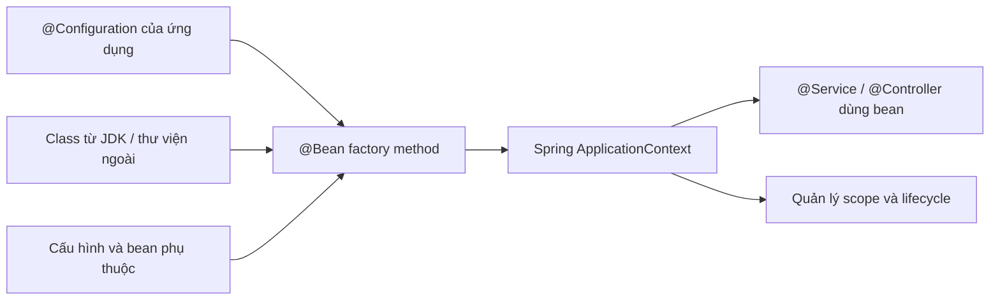

# `@Bean` cho thư viện bên ngoài hoặc đối tượng cần tạo tường minh

> **Spring Boot Fundamentals · Đăng ký bean**  
> Khi xây dựng ứng dụng Spring Boot, không phải mọi đối tượng đều có thể hoặc nên gắn `@Component`. Có những class thuộc thư viện bên ngoài, object phải tạo bằng factory/builder, hoặc object cần constructor argument lấy từ cấu hình. `@Bean` là cách khai báo tường minh: **hãy gọi phương thức này để tạo một đối tượng, đưa kết quả vào Spring ApplicationContext và để Spring quản lý nó như một bean**.

Bài học tập trung vào quyết định **khi nào dùng `@Bean`, viết phương thức factory thế nào, kết nối bean với các thành phần khác, xử lý nhiều bean cùng kiểu và quản lý vòng đời của đối tượng được tạo**.

## 1. Vấn đề: không phải class nào cũng do ứng dụng sở hữu

Trong một ứng dụng Spring Boot, ta thường viết:

```java
package com.example.catalog.product;

import org.springframework.stereotype.Service;

@Service
public class ProductService {

    public String findName(long id) {
        return "Product #" + id;
    }
}
```

Với `@Service`, Spring có thể phát hiện `ProductService` bằng component scan rồi tạo bean. Đây là cách thuận tiện khi **class do chính ứng dụng viết** và có thể đánh dấu bằng annotation.

Nhưng điều gì xảy ra khi cần một đối tượng như:

- `java.time.Clock` để xác định “bây giờ” trong logic nghiệp vụ, có thể thay bằng đồng hồ cố định khi test.
- `java.net.http.HttpClient` cần timeout và một số cấu hình tạo lúc startup.
- Một cache của thư viện **Caffeine** cần định nghĩa giới hạn dung lượng và thời gian hết hạn.
- SDK client của một hệ thống bên ngoài có factory method/builder, cần nhận endpoint hoặc credential.
- Một `ExecutorService` cần có vòng đời khởi động/dừng được quản lý rõ ràng.

Các class này có thể không mang annotation của Spring, và nhiều class đến từ thư viện mà ta **không sửa được mã nguồn**. Viết `@Component` lên chúng là không khả thi, không cần thiết hoặc không đúng trách nhiệm.

Giải pháp là tạo **một lớp cấu hình do ứng dụng sở hữu**, dùng phương thức `@Bean` để tạo đối tượng.



**Điểm cần nhớ:** Bean là một **đối tượng do Spring container quản lý**. `@Bean` là một cách đăng ký bean; `@Component` và các stereotype annotation là những cách khác.

## 2. Ba cách tạo object: `new`, `@Component` và `@Bean`

| Cách | Ai tạo object? | Có tự thành bean trong Spring không? | Khi nào dùng? |
| --- | --- | --- | --- |
| `new SomeClass()` trong code nghiệp vụ | Code gọi trực tiếp | Không | Object ngắn hạn, dữ liệu tạm thời hoặc giá trị không cần DI/lifecycle |
| `@Component` / `@Service` trên class | Spring qua component scan | Có, khi class nằm trong vùng quét | Class của ứng dụng mà Spring nên tạo và quản lý |
| `@Bean` trên phương thức trong cấu hình được Spring nạp | Spring gọi factory method, nhận object trả về | Có | Object bên ngoài, cần builder/factory/constructor đặc biệt, cấu hình tường minh |

Ví dụ `new`:

```java
Clock clock = Clock.systemUTC();
Instant now = clock.instant();
```

Đoạn trên tạo và dùng object Java bình thường. Nó **không tự động đăng ký `Clock` vào ApplicationContext**, do đó các Spring bean khác không thể inject object ấy chỉ bằng cách yêu cầu `Clock`.

Ví dụ `@Bean`:

```java
package com.example.catalog.config;

import java.time.Clock;
import org.springframework.context.annotation.Bean;
import org.springframework.context.annotation.Configuration;

@Configuration(proxyBeanMethods = false)
public class TimeConfiguration {

    @Bean
    public Clock applicationClock() {
        return Clock.systemUTC();
    }
}
```

Nếu Spring tìm thấy và nạp `TimeConfiguration`, nó sẽ đăng ký một bean `Clock`. Các bean khác có thể yêu cầu `Clock` qua constructor injection.

### 2.1. `@Bean` không biến class bên ngoài thành component

Ví dụ `Clock` thuộc JDK, không có `@Component`. Ta cũng không chỉnh sửa class `Clock`. Spring chỉ quản lý **instance trả về** từ phương thức `applicationClock()`.

Do đó, dù đối tượng thuộc thư viện bên ngoài, **lớp cấu hình vẫn thuộc dự án của mình** và được đưa vào ApplicationContext bằng component scan hoặc cơ chế import thích hợp.

### 2.2. Không phải object nào cũng cần đưa vào container

Một object kiểu `StringBuilder` tạo mới trong mỗi phương thức thường không cần là bean. DTO nhận từ request cũng thường không phải singleton bean. Nếu mọi object nhỏ đều được đăng ký bằng `@Bean`, ApplicationContext trở nên khó theo dõi và làm lẫn lộn **trạng thái nghiệp vụ ngắn hạn** với **dịch vụ/hạ tầng dùng chung**.

Một câu hỏi thực tế: “Đối tượng này có cần dùng chung, cấu hình tập trung, inject cho nhiều thành phần, hoặc quản lý vòng đời không?” Nếu có, `@Bean` có thể phù hợp.

## 3. Cấu trúc cơ bản của một phương thức `@Bean`

Một cấu hình tối giản:

```java
package com.example.catalog.config;

import java.time.Clock;
import org.springframework.context.annotation.Bean;
import org.springframework.context.annotation.Configuration;

@Configuration(proxyBeanMethods = false)
public class TimeConfiguration {

    @Bean
    Clock applicationClock() {
        return Clock.systemUTC();
    }
}
```

Phân tích:

1. `@Configuration` đánh dấu lớp chứa khai báo bean. Để có hiệu lực, lớp này cần được Spring đăng ký, ví dụ nằm trong vùng component scan hoặc được `@Import`.
2. `@Bean` đánh dấu phương thức factory mà Spring xử lý khi tạo bean.
3. Kiểu trả về `Clock` thường là kiểu mà các thành phần khác có thể inject.
4. Tên phương thức `applicationClock` thường trở thành **tên bean mặc định**.
5. Nội dung `return Clock.systemUTC()` quyết định cách đối tượng được tạo.
6. Bean có scope **singleton theo mặc định**, nghĩa là một instance trong phạm vi một Spring ApplicationContext theo quy tắc container.

`@Configuration(proxyBeanMethods = false)` là lựa chọn phù hợp khi các phương thức `@Bean` không cần được gọi trực tiếp để Spring chặn/proxy các lời gọi nội bộ. Ta sẽ giải thích điều này ở phần sau; đây không phải yêu cầu bắt buộc đối với mọi lớp `@Configuration`.

### 3.1. `@Bean` nằm trong lớp nào?

Thông thường nên đặt trong một lớp cấu hình có nhiệm vụ rõ ràng:

```text
src/main/java/com/example/catalog/
├── CatalogApplication.java
├── config/
│   ├── TimeConfiguration.java
│   ├── ClientConfiguration.java
│   └── CacheConfiguration.java
├── product/
│   └── ProductService.java
└── web/
    └── ProductController.java
```

Lớp khởi động:

```java
package com.example.catalog;

import org.springframework.boot.SpringApplication;
import org.springframework.boot.autoconfigure.SpringBootApplication;

@SpringBootApplication
public class CatalogApplication {
    public static void main(String[] args) {
        SpringApplication.run(CatalogApplication.class, args);
    }
}
```

Vì `com.example.catalog.config` là package con của `com.example.catalog`, Spring Boot thường phát hiện các lớp `@Configuration` trong đó qua component scan mặc định.

Nếu đặt cấu hình ngoài vùng quét, phải đăng ký nó rõ ràng, ví dụ với `@Import(TimeConfiguration.class)` trong một configuration phù hợp. Chỉ tạo file Java hoặc thêm `@Bean` chưa đảm bảo Spring đã nạp cấu hình ấy.

### 3.2. Có thể viết nhiều `@Bean` trong một cấu hình không?

Có. Nên nhóm các bean liên quan khi điều đó giúp dễ đọc. Ví dụ:

```java
@Configuration(proxyBeanMethods = false)
class TimeConfiguration {

    @Bean
    Clock applicationClock() {
        return Clock.systemUTC();
    }

    @Bean
    TimeFormatter timeFormatter(Clock applicationClock) {
        return new TimeFormatter(applicationClock);
    }
}
```

`TimeFormatter` trong đoạn này là một class minh họa do ứng dụng tự định nghĩa, cần có constructor nhận `Clock`. Điều cần chú ý là Spring có thể **truyền bean `Clock` vào tham số phương thức `@Bean`**. Không cần tự gọi `applicationClock()` bên trong factory method khác.

## 4. Spring inject bean trả về từ `@Bean` như thế nào?

Khi Spring tạo bean `ProductService`, nó nhìn constructor của class để giải quyết những dependency đã khai báo. Nếu có bean phù hợp trong context, Spring truyền instance vào.

Ví dụ service dùng `Clock`:

```java
package com.example.catalog.product;

import java.time.Clock;
import java.time.Instant;
import org.springframework.stereotype.Service;

@Service
public class ProductAuditService {

    private final Clock clock;

    public ProductAuditService(Clock clock) {
        this.clock = clock;
    }

    public Instant recordedAt() {
        return Instant.now(clock);
    }
}
```

Với bean `Clock` được cấu hình ở phần trước, Spring có thể tạo service như sau (ý tưởng khái niệm):

```text
Spring tạo Clock qua @Bean
            ↓
Bean Clock được đăng ký trong ApplicationContext
            ↓
Spring tạo ProductAuditService
            ↓
Truyền Clock vào constructor ProductAuditService
            ↓
Các method của service sử dụng Clock đã inject
```

Trong ứng dụng Spring hiện đại, với class chỉ có một constructor, thường không cần `@Autowired` trên constructor ấy.

### 4.1. Tại sao constructor injection là lựa chọn tốt?

- Dependency của class được công khai ngay trong constructor.
- Object thường có thể dùng `final` và không bị thay đổi sau khi tạo.
- Dễ viết unit test bằng cách truyền dependency giả.
- Spring phát hiện thiếu bean khi khởi tạo, thay vì để lỗi xuất hiện muộn khi gọi phương thức.

Ví dụ unit test **không cần Spring context**:

```java
package com.example.catalog.product;

import static org.junit.jupiter.api.Assertions.assertEquals;

import java.time.Clock;
import java.time.Instant;
import java.time.ZoneOffset;

import org.junit.jupiter.api.Test;

class ProductAuditServiceTest {

    @Test
    void recordsFixedTime() {
        Instant fixed = Instant.parse("2026-01-15T10:00:00Z");
        Clock clock = Clock.fixed(fixed, ZoneOffset.UTC);

        ProductAuditService service = new ProductAuditService(clock);

        assertEquals(fixed, service.recordedAt());
    }
}
```

Đây là một lợi ích trực tiếp của việc dùng `Clock` làm dependency: code ứng dụng không phải gọi `Instant.now()` dựa trên đồng hồ hệ thống ở mọi nơi; khi test có thể truyền thời gian cố định, tạo kết quả xác định.

## 5. Trường hợp thực tế: dùng `@Bean` cho class thư viện ngoài

Ta xét một thư viện Java không thuộc Spring: **Caffeine**, cung cấp bộ nhớ đệm trong process.

Giả sử ứng dụng cần cache tối đa 500 bản xem trước sản phẩm, mỗi bản hết hạn sau 5 phút. Class cache thuộc thư viện bên ngoài nên ta không thêm `@Component` vào source của nó. Thay vào đó, khai báo bean bằng factory.

### 5.1. Thêm dependency Caffeine

Maven, trong một dự án có Spring Boot BOM/parent đang quản lý phiên bản tương ứng:

```xml
<dependency>
    <groupId>com.github.ben-manes.caffeine</groupId>
    <artifactId>caffeine</artifactId>
</dependency>
```

Gradle Groovy DSL, nếu dự án đã cấu hình dependency management phù hợp:

```groovy
dependencies {
    implementation 'com.github.ben-manes.caffeine:caffeine'
}
```

Nếu dự án không quản lý version cho Caffeine qua BOM hoặc cơ chế khác, bạn cần khai báo version tương thích theo build tool đang dùng. Việc không ghi version trong ví dụ **dựa trên giả định** dự án có cơ chế quản lý version.

### 5.2. Tạo bean qua builder của thư viện

```java
package com.example.catalog.config;

import java.time.Duration;

import com.github.benmanes.caffeine.cache.Cache;
import com.github.benmanes.caffeine.cache.Caffeine;

import org.springframework.context.annotation.Bean;
import org.springframework.context.annotation.Configuration;

@Configuration(proxyBeanMethods = false)
public class CacheConfiguration {

    @Bean("productPreviewCache")
    Cache<String, String> productPreviewCache() {
        return Caffeine.newBuilder()
                .maximumSize(500)
                .expireAfterWrite(Duration.ofMinutes(5))
                .build();
    }
}
```

Phần tạo đối tượng:

```java
Caffeine.newBuilder()
        .maximumSize(500)
        .expireAfterWrite(Duration.ofMinutes(5))
        .build();
```

là API của **Caffeine**, không phải API tạo bean của Spring. Vai trò của `@Bean` là nhận object trả về và đăng ký với container.

### 5.3. Inject cache vào service

```java
package com.example.catalog.product;

import com.github.benmanes.caffeine.cache.Cache;
import org.springframework.beans.factory.annotation.Qualifier;
import org.springframework.stereotype.Service;

@Service
public class ProductPreviewService {

    private final Cache<String, String> cache;

    public ProductPreviewService(
            @Qualifier("productPreviewCache") Cache<String, String> cache) {
        this.cache = cache;
    }

    public String findPreview(String productId) {
        return cache.get(productId, id -> "Preview of " + id);
    }
}
```

Phương thức `cache.get(key, mappingFunction)` nạp giá trị bằng function nếu chưa có cache entry phù hợp. Đây là ví dụ dễ quan sát; ứng dụng thật có thể lấy dữ liệu từ repository hoặc hệ thống ngoài.

**Lưu ý thiết kế:** cache bean mặc định là singleton trong **một Spring ApplicationContext**, do đó nhiều service trong cùng process có thể dùng chung cache. Nếu ứng dụng chạy nhiều instance/server, mỗi instance thường có cache riêng. Caffeine local cache không tự trở thành distributed cache chỉ vì được đăng ký bằng `@Bean`.

### 5.4. `@Bean` trong ví dụ đã giải quyết vấn đề gì?

- Tạo object bằng builder API riêng của thư viện.
- Tập trung cấu hình `maximumSize` và `expireAfterWrite` ở một chỗ.
- Làm object có thể inject thay vì mỗi service tự xây cache mới.
- Cho phép Spring quản lý phạm vi bean; dễ thay bằng implementation khác khi nhu cầu đổi.
- Cho phép test service bằng cách truyền cache test hoặc mock, tách khỏi chi tiết Spring context.

`@Bean` **không tự bật cơ chế `@Cacheable` của Spring** trong ví dụ này. Service đang gọi **API Caffeine trực tiếp**. Muốn sử dụng annotation caching của Spring, cần thiết kế `CacheManager` và bật caching theo cơ chế Spring phù hợp; đó là một lớp tích hợp khác.

## 6. Đối tượng phải tạo tường minh dù không phải thư viện ngoài

Không phải mọi trường hợp dùng `@Bean` đều có dependency từ bên thứ ba.

Ví dụ `java.net.http.HttpClient` thuộc JDK, nhưng có builder, timeout và có thể cần instance dùng chung:

```java
package com.example.catalog.config;

import java.net.http.HttpClient;
import java.time.Duration;

import org.springframework.context.annotation.Bean;
import org.springframework.context.annotation.Configuration;

@Configuration(proxyBeanMethods = false)
public class HttpClientConfiguration {

    @Bean
    HttpClient partnerHttpClient() {
        return HttpClient.newBuilder()
                .connectTimeout(Duration.ofSeconds(3))
                .followRedirects(HttpClient.Redirect.NORMAL)
                .build();
    }
}
```

Một client service có thể inject nó:

```java
package com.example.catalog.partner;

import java.net.http.HttpClient;
import java.net.http.HttpRequest;
import java.net.http.HttpResponse;
import java.net.URI;
import java.time.Duration;

import org.springframework.stereotype.Service;

@Service
public class PartnerStatusClient {

    private final HttpClient httpClient;

    public PartnerStatusClient(HttpClient httpClient) {
        this.httpClient = httpClient;
    }

    public int statusCode(URI endpoint) throws Exception {
        HttpRequest request = HttpRequest.newBuilder(endpoint)
                .timeout(Duration.ofSeconds(5))
                .GET()
                .build();

        HttpResponse<Void> response = httpClient.send(
                request, HttpResponse.BodyHandlers.discarding());

        return response.statusCode();
    }
}
```

Ví dụ minh họa cách Spring quản lý một object được tạo từ builder của JDK. Ở sản phẩm thật, cần thêm xử lý lỗi mạng, retry theo chính sách phù hợp, xác thực, giám sát và giới hạn tài nguyên. Không tùy tiện nhận một URI không tin cậy rồi gửi request trong endpoint công khai; ví dụ service giả định endpoint do ứng dụng kiểm soát.

### 6.1. Vì sao không tạo `HttpClient` mỗi lần request?

Mỗi lần gọi `HttpClient.newHttpClient()` trong controller/service đều có thể tạo object riêng với cấu hình riêng, làm khó kiểm soát timeout và tài nguyên. Đăng ký một client dùng chung giúp các consumer nhận cùng chính sách khởi tạo.

Nhưng cũng không nên đưa mọi object như `HttpRequest` thành singleton bean: request chứa thông số cụ thể của từng lần gọi, thường nên tạo theo yêu cầu. Phân biệt **hạ tầng dùng chung** (client) với **dữ liệu của một thao tác** (request).

## 7. Spring giải quyết dependency cho phương thức `@Bean`

Phương thức `@Bean` không chỉ có thể gọi constructor không tham số. Nó có thể nhận các **bean phụ thuộc** qua tham số, tương tự constructor injection.

Ví dụ tạo một service Java thuần không gắn annotation:

```java
package com.example.catalog.audit;

import java.time.Clock;
import java.time.Instant;

public class AuditStampFactory {

    private final Clock clock;

    public AuditStampFactory(Clock clock) {
        this.clock = clock;
    }

    public Instant createStamp() {
        return clock.instant();
    }
}
```

Đăng ký:

```java
package com.example.catalog.config;

import java.time.Clock;

import com.example.catalog.audit.AuditStampFactory;

import org.springframework.context.annotation.Bean;
import org.springframework.context.annotation.Configuration;

@Configuration(proxyBeanMethods = false)
public class AuditConfiguration {

    @Bean
    Clock clock() {
        return Clock.systemUTC();
    }

    @Bean
    AuditStampFactory auditStampFactory(Clock clock) {
        return new AuditStampFactory(clock);
    }
}
```

Khi Spring tạo `auditStampFactory`, container giải quyết tham số `Clock` từ các bean đang có.

**Tránh làm thế này khi `proxyBeanMethods = false`:**

```java
@Bean
AuditStampFactory auditStampFactory() {
    return new AuditStampFactory(clock()); // Gọi phương thức Java trực tiếp.
}
```

Vì `clock()` là lời gọi Java bình thường trong cấu hình không proxy, nó có thể tạo **instance mới** thay vì lấy singleton bean Spring đang quản lý. Dùng method parameter `Clock clock` giúp thể hiện quan hệ dependency rõ ràng và hoạt động ổn định dù cấu hình bật/tắt proxy bean methods.

### 7.1. `@Configuration(proxyBeanMethods = true)` thì sao?

Chế độ `proxyBeanMethods = true` (giá trị mặc định của `@Configuration`) cho phép Spring dùng proxy để xử lý những lời gọi từ phương thức `@Bean` này sang phương thức `@Bean` khác trong cùng lớp theo semantics của container, khi điều kiện proxy phù hợp.

Ví dụ có code gọi `clock()` từ phương thức `auditStampFactory()`, Spring có thể intercept lời gọi và trả bean đã quản lý thay vì tạo object mới.

Tuy nhiên, **method parameter injection** vẫn dễ hiểu hơn: khai báo dependency ở chữ ký phương thức, không phụ thuộc vào việc lời gọi có được proxy hay không.

### 7.2. Có cần `@Autowired` trên phương thức `@Bean` không?

Thông thường **không**. Spring tự resolve các tham số của factory method:

```java
@Bean
AuditStampFactory auditStampFactory(Clock clock) {
    return new AuditStampFactory(clock);
}
```

Cách này ngắn gọn và bộc lộ dependency rõ ràng. Điều kiện là có bean `Clock` phù hợp để inject.

### 7.3. Có thể inject property vào factory method không?

Có. Ví dụ:

```java
import java.time.Duration;
import java.net.http.HttpClient;

import org.springframework.beans.factory.annotation.Value;
import org.springframework.context.annotation.Bean;

@Bean
HttpClient partnerHttpClient(
        @Value("${partner.connect-timeout-seconds:3}") long timeoutSeconds) {

    return HttpClient.newBuilder()
            .connectTimeout(Duration.ofSeconds(timeoutSeconds))
            .build();
}
```

Ở đây `@Value` đọc property `partner.connect-timeout-seconds`, dùng `3` làm default trong biểu thức ví dụ nếu property không được cung cấp. Với nhiều property liên quan hoặc cần validation, nên dùng `@ConfigurationProperties` để quản lý tập cấu hình có kiểu dữ liệu rõ ràng.

## 8. `@ConfigurationProperties` kết hợp `@Bean` cho cấu hình rõ ràng

Khi một SDK/client có nhiều tham số, nhồi nhiều chuỗi `@Value` vào factory method có thể khó bảo trì.

Ví dụ định nghĩa property của ứng dụng:

```yaml
# src/main/resources/application.yml
partner:
  client:
    connect-timeout: 3s
    follow-redirects: false
```

Lớp properties dạng record trên Spring Boot 3.x + Java 17:

```java
package com.example.catalog.config;

import java.time.Duration;

import org.springframework.boot.context.properties.ConfigurationProperties;

@ConfigurationProperties(prefix = "partner.client")
public record PartnerClientProperties(
        Duration connectTimeout,
        boolean followRedirects
) {}
```

Lớp cấu hình đăng ký property và dùng nó để tạo client:

```java
package com.example.catalog.config;

import java.net.http.HttpClient;
import java.net.http.HttpClient.Redirect;

import org.springframework.boot.context.properties.EnableConfigurationProperties;
import org.springframework.context.annotation.Bean;
import org.springframework.context.annotation.Configuration;

@Configuration(proxyBeanMethods = false)
@EnableConfigurationProperties(PartnerClientProperties.class)
public class PartnerClientConfiguration {

    @Bean
    HttpClient partnerHttpClient(PartnerClientProperties properties) {
        Redirect redirects = properties.followRedirects()
                ? Redirect.NORMAL
                : Redirect.NEVER;

        return HttpClient.newBuilder()
                .connectTimeout(properties.connectTimeout())
                .followRedirects(redirects)
                .build();
    }
}
```

Từ ví dụ:

- `@ConfigurationProperties` mô tả **dữ liệu cấu hình**, không phải factory tạo HTTP client.
- `@EnableConfigurationProperties` đăng ký kiểu properties để Spring bind dữ liệu.
- `@Bean` sử dụng properties đã bind và gọi API JDK để tạo client.
- Các service khác chỉ inject `HttpClient`, không cần biết property được đọc từ YAML, environment variable hay nguồn cấu hình nào.

Trong hệ thống thực tế, cần đảm bảo timeout có giá trị hợp lệ và các default/validation phù hợp; một trường `Duration` để trống có thể dẫn đến lỗi trong builder. Có thể dùng Bean Validation, constructor logic hoặc giá trị mặc định được định nghĩa rõ.

### 8.1. Tập trung cấu hình để dễ thay môi trường

Môi trường development có thể có timeout khác production. Khi dùng `@ConfigurationProperties`, Spring Boot có thể bind property từ config data và externalized configuration theo cơ chế của phiên bản đang dùng; factory method vẫn giữ nguyên.

Không hard-code bí mật kết nối trong lớp `@Configuration` hoặc `application.yml` đã commit. Với API key, password, certificate hoặc token, dùng secret manager và nguồn cấu hình an toàn phù hợp.

## 9. Tên bean, kiểu bean và cách Spring chọn khi inject

Mặc định, tên bean do `@Bean` tạo thường là **tên phương thức**.

```java
@Bean
Clock applicationClock() {
    return Clock.systemUTC();
}
```

Tên bean mặc định: `applicationClock`. Kiểu bean phù hợp: `Clock`.

Có thể đặt tên tường minh:

```java
@Bean("auditClock")
Clock auditClock() {
    return Clock.systemUTC();
}
```

hoặc:

```java
@Bean(name = {"auditClock", "businessClock"})
Clock auditClock() {
    return Clock.systemUTC();
}
```

Trong ví dụ thứ hai, `businessClock` là tên alias cho bean cùng instance, không tự tạo thêm một `Clock` thứ hai.

### 9.1. Nếu có hai bean cùng kiểu?

Ví dụ cần hai múi giờ khác nhau:

```java
package com.example.catalog.config;

import java.time.Clock;
import java.time.ZoneId;
import java.time.ZoneOffset;

import org.springframework.context.annotation.Bean;
import org.springframework.context.annotation.Configuration;

@Configuration(proxyBeanMethods = false)
public class ClockConfiguration {

    @Bean("utcClock")
    Clock utcClock() {
        return Clock.systemUTC();
    }

    @Bean("businessClock")
    Clock businessClock() {
        return Clock.system(ZoneId.of("Asia/Ho_Chi_Minh"));
    }
}
```

Một constructor chỉ yêu cầu `Clock` mà không có chỉ dẫn sẽ trở nên **không xác định** nếu Spring không có quy tắc chọn được một ứng viên duy nhất. Một lỗi thường gặp là `NoUniqueBeanDefinitionException`.

Cách giải quyết rõ ràng:

```java
package com.example.catalog.audit;

import java.time.Clock;
import org.springframework.beans.factory.annotation.Qualifier;
import org.springframework.stereotype.Service;

@Service
public class AuditService {

    private final Clock clock;

    public AuditService(@Qualifier("utcClock") Clock clock) {
        this.clock = clock;
    }
}
```

`@Qualifier("utcClock")` yêu cầu đúng bean được định danh. Điều này đặc biệt hữu ích khi cấu hình hai HTTP client, hai cache, hai serializer hoặc hai datasource.

### 9.2. Khi nào dùng `@Primary`?

Nếu đa số consumer nên dùng một bean mặc định, có thể đánh dấu:

```java
@Bean
@Primary
Clock utcClock() {
    return Clock.systemUTC();
}
```

Khi inject theo kiểu `Clock` mà không có qualifier cụ thể, bean được đánh dấu `@Primary` thường được ưu tiên so với những ứng viên cùng kiểu khác, theo quy tắc autowiring của Spring.

Cần import:

```java
import org.springframework.context.annotation.Primary;
```

**`@Primary` không thay thế `@Qualifier` trong mọi trường hợp.** Qualifier diễn đạt một lựa chọn cụ thể, còn primary biểu diễn ứng viên mặc định khi có nhiều bean cùng kiểu.

### 9.3. Bean name không phải class name

`@Bean(name = "partnerHttpClient")` đặt **tên một bean trong context**. Nó không đổi tên Java class `HttpClient`, không tạo package mới và không thay thế hoàn toàn việc match theo type trong dependency injection.

Nếu nhiều bean có cùng type, Spring có thể dùng qualifier, primary hoặc các quy tắc resolution khác để chọn. Với code cần rõ ràng, ưu tiên qualifier tường minh khi vai trò các bean khác nhau.

## 10. Vòng đời của bean: lúc nào tạo, lúc nào giải phóng?

Một bean không chỉ là biến global. Spring có quy tắc về **scope, thời điểm tạo, khởi tạo và hủy**.

### 10.1. Singleton mặc định

Với:

```java
@Bean
Clock clock() {
    return Clock.systemUTC();
}
```

bean thường có **singleton scope**, nghĩa là Spring quản lý một instance theo mỗi bean definition trong **một ApplicationContext**. Hai service inject bean đó sẽ nhận cùng instance trong context ấy.

Singleton của Spring **không đồng nghĩa** một singleton duy nhất cho toàn JVM hoặc tất cả process chạy ứng dụng. Nếu có nhiều ApplicationContext, mỗi context có thể có bean riêng. Nếu triển khai ba replica, mỗi replica có context và instance riêng.

### 10.2. Prototype khi mỗi lần yêu cầu cần object mới

Có thể chỉ định:

```java
import org.springframework.beans.factory.config.ConfigurableBeanFactory;
import org.springframework.context.annotation.Scope;

@Bean
@Scope(ConfigurableBeanFactory.SCOPE_PROTOTYPE)
MyWorker myWorker() {
    return new MyWorker();
}
```

`MyWorker` ở đây là class minh họa do ứng dụng tự định nghĩa. Với prototype scope, mỗi lần container thực hiện lookup/injection theo yêu cầu phù hợp, Spring có thể tạo instance mới.

Nhưng cần lưu ý: **inject prototype vào singleton constructor một lần không khiến mỗi lần gọi method của singleton có prototype mới**. Nếu cần lấy object mới theo từng thao tác, dùng `ObjectProvider<MyWorker>`, factory abstraction hoặc cơ chế scope phù hợp.

Ngoài ra, container thông thường không tự quản lý đầy đủ bước hủy của prototype như singleton. Không dùng prototype để “tự động bảo đảm đóng mọi tài nguyên” mà không có kế hoạch lifecycle rõ ràng.

### 10.3. `@Lazy` và thời điểm khởi tạo

Bean singleton thường được tạo trong quá trình context startup nếu không có cơ chế lazy hoặc điều kiện đặc biệt. Có thể đánh dấu:

```java
@Bean
@Lazy
ExpensiveClient expensiveClient() {
    return createExpensiveClient();
}
```

Cần import `org.springframework.context.annotation.Lazy`. Ở đây `ExpensiveClient` và `createExpensiveClient()` là tên minh họa, không phải API có sẵn.

`@Lazy` có thể trì hoãn tạo bean đến lúc cần, nhưng phụ thuộc vào cách bean được inject và tiêu thụ. Khi singleton khác yêu cầu bean lazy trực tiếp trong startup, vẫn có thể kích hoạt tạo nó sớm; lazy không phải bảo đảm tuyệt đối rằng mọi chi phí khởi tạo đều được dời đi.

### 10.4. Cleanup cho object có tài nguyên

Một số object giữ thread, connection, socket hoặc file handle. Với chúng, cần xem cơ chế đóng tài nguyên của thư viện.

Ví dụ `ExecutorService` là object JDK có phương thức `shutdown()`:

```java
package com.example.catalog.config;

import java.util.concurrent.ExecutorService;
import java.util.concurrent.Executors;

import org.springframework.context.annotation.Bean;
import org.springframework.context.annotation.Configuration;

@Configuration(proxyBeanMethods = false)
public class WorkerConfiguration {

    @Bean(destroyMethod = "shutdown")
    ExecutorService reportExecutor() {
        return Executors.newFixedThreadPool(4);
    }
}
```

Khi Spring context đóng bình thường và bean singleton được quản lý, Spring gọi phương thức destroy đã cấu hình. Như vậy việc tạo và giải phóng executor được quản lý tập trung.

**`shutdown()` yêu cầu executor ngừng nhận việc mới nhưng không tự đợi toàn bộ task chạy xong vô thời hạn.** Nếu cần graceful shutdown với giới hạn thời gian và hủy task còn treo, hãy thiết kế thêm lifecycle và chính sách dừng phù hợp. Đừng cho rằng `destroyMethod` tự giải quyết mọi vấn đề đồng bộ.

### 10.5. Initialization và destroy callback

`@Bean` cũng có thuộc tính `initMethod` và `destroyMethod`:

```java
@Bean(initMethod = "start", destroyMethod = "stop")
SomeExternalClient someExternalClient() {
    return new SomeExternalClient(...);
}
```

Đây là **mã minh họa**: `SomeExternalClient` phải thực sự có những method phù hợp và constructor hợp lệ trong thư viện cụ thể.

Spring có thể tự phát hiện một số phương thức đóng tài nguyên phổ biến như `close`/`shutdown` trên bean phù hợp; nhưng với SDK cụ thể, khai báo lifecycle rõ ràng thường dễ hiểu hơn. Không tự gọi `start()` và để Spring lại gọi `initMethod = "start"` một lần nữa nếu việc gọi hai lần không được hỗ trợ.

## 11. `@Bean` và auto-configuration của Spring Boot

Spring Boot tạo sẵn nhiều bean bằng **auto-configuration**. Khi bạn tự khai báo bean, điều quan trọng là biết auto-configuration nào sẽ **nhường chỗ** và auto-configuration nào vẫn tiếp tục tạo hạ tầng khác.

Ví dụ `@Bean Clock` là bean do ứng dụng khai báo. Với các thư viện khác, có thể Boot đã tạo sẵn một client, serializer, DataSource hoặc CacheManager khi điều kiện phù hợp.

### 11.1. `@ConditionalOnMissingBean`

Một auto-configuration có thể định nghĩa:

```java
@AutoConfiguration
public class ExampleClientAutoConfiguration {

    @Bean
    @ConditionalOnMissingBean(ExampleClient.class)
    ExampleClient exampleClient() {
        return new ExampleClient();
    }
}
```

Đây là **đoạn mô phỏng cơ chế**, không phải mã nguồn thật của Spring Boot. Nó diễn tả rằng khi ứng dụng đã cung cấp `ExampleClient` phù hợp, bean mặc định trong auto-configuration ấy không cần tạo.

Nhưng không nên suy ra:

- Mọi auto-configuration đều dùng `@ConditionalOnMissingBean`.
- Mọi bean tự khai báo đều ghi đè được bean Spring Boot.
- Việc tạo một bean custom sẽ tự tắt tất cả hạ tầng liên quan.
- Hai bean cùng tên luôn được phép ghi đè định nghĩa của nhau.

Hãy xem điều kiện của auto-configuration cụ thể đang dùng.

### 11.2. Cẩn trọng khi tự khai báo `ObjectMapper`

Jackson `ObjectMapper` là ví dụ một class thuộc thư viện ngoài có thể tạo bằng:

```java
@Bean
ObjectMapper objectMapper() {
    return new ObjectMapper();
}
```

Nhưng **không nên sao chép đoạn này vào một Spring Boot REST app mà không hiểu hệ quả**. Spring Boot có thể đã tự cấu hình `ObjectMapper` kèm các module và property JSON phù hợp. Bean tự khai báo có thể khiến một số cấu hình mặc định back off, đồng thời làm mất các customizations mà app đang trông đợi.

Khi chỉ muốn đổi serialization setting, nên xem các property cấu hình Jackson hoặc extension point như builder/customizer do Spring Boot phiên bản đang dùng hỗ trợ. Khi thực sự cần mapper độc lập, đặt tên và qualifier rõ ràng, xem ảnh hưởng tới auto-configuration rồi kiểm chứng behavior.

Điều này minh họa quy tắc: **biết cách tạo bean bằng `@Bean` chưa có nghĩa luôn nên thay bean framework đã cấu hình sẵn**.

### 11.3. Khi chỉ cần property, đừng thay cả bean

Ví dụ muốn đổi timeout HTTP, cache size hoặc JDBC pool setting, hãy tìm property/customizer chính thức của tích hợp. Chỉ tự tạo bean khi cần kiểm soát toàn bộ object, dùng builder đặc thù hoặc framework không cung cấp cấu hình phù hợp.

Cách này giữ được nhiều cơ chế tiện ích, lifecycle và integration do Spring Boot cung cấp.

### 11.4. Exclude auto-configuration có phải điều kiện để dùng `@Bean`?

Không. Nhiều auto-configuration đã có cơ chế back off đúng khi ứng dụng tự định nghĩa bean. `@Bean` không đòi `@SpringBootApplication(exclude = ...)`.

Chỉ loại auto-configuration khi đã hiểu lớp cấu hình cụ thể cần bỏ và tác động đến các bean còn phụ thuộc nó. Đừng dùng exclusion như thủ tục mặc định khi thêm một `@Bean`.

## 12. Phân biệt `@Bean` với `@Component` ở góc độ thiết kế

### 12.1. Class do mình viết, đơn giản và có thể quét

Khi viết:

```java
@Service
public class ProductService {
    private final ProductRepository repository;

    public ProductService(ProductRepository repository) {
        this.repository = repository;
    }
}
```

component scan thường là lựa chọn đơn giản. Không cần thêm một cấu hình:

```java
@Bean
ProductService productService(ProductRepository repository) {
    return new ProductService(repository);
}
```

chỉ để thay thế `@Service`, trừ khi có nhu cầu kiểm soát factory hoặc biên giới module rõ ràng.

### 12.2. Class từ SDK hoặc thư viện ngoài

Bạn có thể không thể sửa class `Caffeine`, `HttpClient`, `Clock` hoặc SDK client của vendor. `@Bean` giải quyết tốt tình huống cần chọn tham số và cách khởi tạo.

### 12.3. Một implementation cụ thể được chọn tại startup

Một ứng dụng có interface:

```java
package com.example.catalog.notification;

public interface NotificationSender {
    void send(String recipient, String text);
}
```

Có thể quyết định implementation bằng config:

```java
@Configuration(proxyBeanMethods = false)
class NotificationConfiguration {

    @Bean
    NotificationSender notificationSender() {
        return new ConsoleNotificationSender();
    }
}
```

Đoạn này giả định `ConsoleNotificationSender` là implementation do ứng dụng cung cấp và có constructor tương ứng. Dùng `@Bean` ở đây giúp thể hiện **quyết định chọn implementation ở composition root**.

Một phương án khác là `@Component` trên từng implementation kết hợp `@Profile`, `@Conditional` hoặc qualifier. Cả hai đều khả thi; chọn cách thể hiện ý định rõ nhất cho dự án.

### 12.4. Không tạo đối tượng thủ công rồi bỏ container qua một bên

Nếu một Spring-managed service làm:

```java
public class ReportService {
    private final RemoteClient client = new RemoteClient(...);
}
```

thì Spring không quản lý trực tiếp vòng đời `RemoteClient`, khó thay cấu hình và khó tạo fake client trong test. Thay vào đó có thể inject:

```java
public class ReportService {
    private final RemoteClient client;

    public ReportService(RemoteClient client) {
        this.client = client;
    }
}
```

và tạo `RemoteClient` tại một `@Bean`. `RemoteClient` ở đây là class minh họa của SDK ngoài. Điều cần tránh là giấu việc tạo hạ tầng bên trong consumer khiến consumer biết quá nhiều về chi tiết kết nối.

## 13. Những lỗi thường gặp và cách suy luận

| Triệu chứng | Nguyên nhân có thể | Cách kiểm tra |
| --- | --- | --- |
| `NoSuchBeanDefinitionException` | Lớp `@Configuration` chưa được nạp; phương thức không được xử lý; bean có điều kiện không khớp | Xem package scan, `@Import`, profile, conditional và tên/kiểu bean |
| `NoUniqueBeanDefinitionException` | Nhiều bean cùng kiểu, Spring không chọn được ứng viên | Dùng `@Qualifier` hoặc `@Primary` khi phù hợp |
| `BeanCreationException` | Factory method `@Bean` ném exception hoặc dependency khởi tạo lỗi | Đọc root cause, xác định constructor/builder/property lỗi |
| Bean được tạo hai lần | Gọi trực tiếp phương thức factory, dùng nhiều context hoặc tạo `new` ngoài Spring | Xem `proxyBeanMethods`, injection và chỗ khởi tạo object |
| Định nghĩa bean cùng tên bị xung đột | Nhiều khai báo dùng trùng bean name | Đổi tên/qualifier hoặc xem lại cấu hình; tránh bật overriding bừa |
| Class từ thư viện ngoài không import được | Thiếu dependency hoặc version sai | Xem Maven/Gradle dependency graph, classpath, package thực tế |
| Startup thành công nhưng gọi SDK lỗi network | Endpoint, auth, timeout, DNS, TLS hoặc runtime dependency | Tách lỗi tạo bean khỏi lỗi gọi API và đọc exception thực tế |
| Object bị đóng sớm hoặc không đóng | Lifecycle quản lý không phù hợp | Kiểm tra singleton/prototype, destroyMethod và cách context shutdown |
| Tùy chỉnh `ObjectMapper` làm JSON khác trước | Bean mới ảnh hưởng auto-configuration/customizer | Kiểm tra điều kiện và cấu hình Jackson thay vì chỉ đổi `@Bean` |
| Dữ liệu giữa request bị lẫn | Singleton bean giữ mutable per-request state | Giữ bean service stateless hoặc quản lý concurrency/scope phù hợp |
| `@Bean` nằm trong class bình thường không được đăng ký | Spring không hề xử lý class chứa phương thức | Đặt trong configuration/component được nạp hoặc dùng `@Import` |

### 13.1. Tại sao có `@Bean` mà Spring vẫn báo thiếu bean?

Hãy xem theo thứ tự:

1. Class chứa `@Bean` có được nạp vào Spring ApplicationContext không?
2. Method `@Bean` có bị giới hạn bởi `@Profile` hoặc `@Conditional` không?
3. Kiểu trả về có tương thích với kiểu constructor cần inject không?
4. Có nhiều ApplicationContext khác nhau khiến bean nằm ở context khác không?
5. Bean có được đặt tên/qualifier khác mà consumer không chỉ rõ không?
6. Factory method có ném exception khiến bean chưa tạo được không?

Cách kiểm tra này thường hiệu quả hơn việc thêm `@ComponentScan` ngẫu nhiên vào nhiều chỗ.

### 13.2. Khi nào dùng `@Import`?

Nếu một cấu hình bean nằm ngoài vùng component scan hoặc được đóng gói thành module tách biệt, có thể import rõ ràng:

```java
package com.example.catalog;

import com.example.shared.TimeConfiguration;
import org.springframework.boot.autoconfigure.SpringBootApplication;
import org.springframework.context.annotation.Import;

@SpringBootApplication
@Import(TimeConfiguration.class)
public class CatalogApplication {}
```

Ví dụ giả định class `com.example.shared.TimeConfiguration` thực sự tồn tại và là cấu hình được dự án sở hữu. Khi một cấu hình được dùng như library, cách tổ chức auto-configuration của Spring Boot cho starter tùy chỉnh là một chủ đề mở rộng khác; không phải cứ tạo class `@Configuration` trong JAR là mọi ứng dụng sẽ tự nạp.

### 13.3. Tại sao Spring báo `BeanCurrentlyInCreationException`?

Một khả năng là **circular dependency**: bean A cần B trong constructor, bean B lại cần A trong constructor. Đưa factory method vào `@Configuration` không xóa vòng phụ thuộc ấy. Cần xem lại quan hệ giữa các thành phần và tách trách nhiệm hoặc dùng cơ chế giải quyết phù hợp khi có lý do rõ ràng.

Không nên coi bật circular references là cách thiết kế chuẩn để giải quyết mọi vòng dependency.

### 13.4. Singleton và thread safety

Một bean `@Bean` mặc định là singleton và có thể được nhiều request dùng đồng thời. Nếu object thư viện có trạng thái mutable và không thread-safe, đăng ký singleton có thể dẫn đến race condition.

Trước khi đưa client, formatter hoặc parser vào singleton, hãy kiểm tra **thread-safety contract** của thư viện. Có thể cần:

- Một instance immutable/thread-safe dùng chung.
- Tạo object mới mỗi thao tác bằng factory/prototype.
- Đồng bộ truy cập hoặc thiết kế phân vùng trạng thái.
- Thư viện có pooling hoặc concurrency model chuyên biệt.

Đặt `@Bean` không biến một object vốn không thread-safe thành thread-safe.

## 14. Test đối tượng được tạo bằng `@Bean`

### 14.1. Unit test logic dùng dependency được truyền trực tiếp

Với `ProductAuditService` từ phần 4, chỉ cần truyền `Clock.fixed` vào constructor; không cần Spring context. Đây thường là cách đơn giản để test logic phụ thuộc vào một abstraction.

### 14.2. Test khả năng đăng ký bean

Khi muốn kiểm tra `@Configuration` có tạo bean như mong đợi, có thể dùng Spring Test:

```java
package com.example.catalog.config;

import static org.junit.jupiter.api.Assertions.assertNotNull;

import java.time.Clock;
import org.junit.jupiter.api.Test;
import org.springframework.beans.factory.annotation.Autowired;
import org.springframework.test.context.junit.jupiter.SpringJUnitConfig;

@SpringJUnitConfig(TimeConfiguration.class)
class TimeConfigurationTest {

    @Autowired
    Clock clock;

    @Test
    void registersClock() {
        assertNotNull(clock);
    }
}
```

Ví dụ dùng Spring Test + JUnit Jupiter, giả định dependency test đã được cấu hình. `@SpringJUnitConfig(TimeConfiguration.class)` tạo Spring test context với lớp cấu hình chỉ định; không cần khởi động toàn bộ ứng dụng Boot.

### 14.3. Thay bean trong Spring integration test

Có thể cung cấp một bean `Clock` ưu tiên cho test:

```java
package com.example.catalog;

import java.time.Clock;
import java.time.Instant;
import java.time.ZoneOffset;

import org.springframework.boot.test.context.TestConfiguration;
import org.springframework.context.annotation.Bean;
import org.springframework.context.annotation.Primary;

@TestConfiguration(proxyBeanMethods = false)
class FixedClockTestConfiguration {

    @Bean
    @Primary
    Clock fixedTestClock() {
        return Clock.fixed(
                Instant.parse("2026-01-15T10:00:00Z"),
                ZoneOffset.UTC);
    }
}
```

Trong test, có thể import cấu hình:

```java
@SpringBootTest
@Import(FixedClockTestConfiguration.class)
class ProductAuditIntegrationTest {
    // Các bean inject Clock theo kiểu chung sẽ ưu tiên bean @Primary.
}
```

Đoạn test rút gọn này cần các import JUnit/Spring tương ứng trong file thực tế. Khi dùng `@Primary`, **bean `Clock` cũ vẫn có thể còn trong context**; Spring chọn bean ưu tiên khi resolve injection không có qualifier. Không nên hiểu `@Primary` là xóa bean còn lại.

Nếu ứng dụng gắn `@Qualifier("utcClock")` tại injection point, `@Primary` trên bean khác không nhất thiết thay được lựa chọn đó. Test cần phù hợp với cách consumer đã định danh bean.

### 14.4. Test factory method với dependency giả

Nếu cấu hình tạo một SDK client từ property/bean phụ thuộc, nên có test đảm bảo factory nhận cấu hình đúng. Có thể làm bằng unit test trực tiếp method factory (khi logic đơn giản) hoặc Spring context test nếu cần kiểm tra wiring, conditional và lifecycle thật.

Không nên khởi động embedded web server hoặc database thật chỉ để kiểm tra một `Clock` bean đơn giản; chọn mức test phù hợp với hành vi muốn quan sát.

## 15. Bài thực hành: từ object Java thành Spring bean

### Bài 1 — Đăng ký đồng hồ ứng dụng

Tạo class `TimeConfiguration`:

```java
@Configuration(proxyBeanMethods = false)
public class TimeConfiguration {

    @Bean
    Clock appClock() {
        return Clock.systemUTC();
    }
}
```

Đặt dưới package con của lớp `@SpringBootApplication`, thêm import cần thiết và tạo service inject `Clock` qua constructor. Service trả về `Instant.now(clock)`.

Quan sát rằng không cần đánh dấu class `Clock` bằng `@Component`.

### Bài 2 — Hai bean cùng kiểu

Thêm bean thứ hai:

```java
@Bean("localClock")
Clock localClock() {
    return Clock.system(ZoneId.of("Asia/Ho_Chi_Minh"));
}
```

Cố inject `Clock` không có qualifier, quan sát cách Spring giải quyết hoặc báo lỗi. Sau đó dùng `@Qualifier("appClock")` để xác định đúng clock. Thử thêm `@Primary` và giải thích sự khác biệt với qualifier.

### Bài 3 — Cấu hình object ngoài bằng builder

Thêm Caffeine dependency và `CacheConfiguration` ở phần 5. Inject `Cache<String,String>` vào `ProductPreviewService`.

Thử gọi `findPreview("P-101")` hai lần và dùng cache API để quan sát giá trị trong cache. Đổi `maximumSize` và `expireAfterWrite` để hiểu ý nghĩa cấu hình. Không nhầm cache trong một process với cache phân tán giữa nhiều instance.

### Bài 4 — Lấy bean qua parameter injection

Viết:

```java
@Bean
AuditStampFactory auditStampFactory(Clock appClock) {
    return new AuditStampFactory(appClock);
}
```

Giải thích vì sao cách này rõ ràng hơn việc gọi trực tiếp `appClock()` trong cùng configuration, nhất là với `proxyBeanMethods = false`.

### Bài 5 — Vòng đời object có tài nguyên

Tạo bean `ExecutorService` với `destroyMethod = "shutdown"`. Giải thích khi nào Spring gọi phương thức đóng và vì sao cần cơ chế chờ dừng task phù hợp nếu ứng dụng xử lý công việc dài.

### Bài 6 — Điều tra bean không có trong context

Di chuyển `TimeConfiguration` ra package ngoài vùng quét rồi khởi động ứng dụng có service cần `Clock`. Quan sát lỗi, sau đó khôi phục bằng cách đặt configuration vào đúng package hoặc `@Import` rõ ràng.

Từ đó xác nhận: `@Bean` chỉ có tác dụng khi lớp chứa nó **được Spring xử lý**.

### Câu hỏi tự kiểm tra

1. Vì sao một class của thư viện bên ngoài thường thích hợp được khai báo qua `@Bean`?
2. `@Bean` tạo bean bằng gì? Ai gọi factory method và quản lý instance trả về?
3. `new HttpClient(...)` trong service khác gì `@Bean HttpClient` rồi inject vào service?
4. Tên mặc định của bean trả về bởi phương thức `applicationClock()` là gì?
5. Có hai bean `Clock` thì làm sao chỉ định clock cho service audit?
6. `@Primary` có xóa các bean cùng kiểu khác khỏi context không?
7. Vì sao method parameter injection được khuyến nghị thay cho gọi trực tiếp phương thức `@Bean`?
8. Singleton bean có nghĩa là một instance duy nhất cho tất cả replica trong Kubernetes không?
9. Nếu thư viện ngoài tạo thread, socket hoặc connection, cần cân nhắc điều gì ở lifecycle?
10. Nếu Spring Boot đã có auto-configured `ObjectMapper`, vì sao không nên tùy tiện tạo `new ObjectMapper()` trong một `@Bean`?
11. `@Bean` có tự kích hoạt Spring caching annotation hay chỉ đăng ký object cache trong ví dụ Caffeine?
12. Có `@Bean` mà app vẫn báo thiếu bean: bạn sẽ kiểm tra package scan, conditional và injection ra sao?

## 16. Tổng kết các lựa chọn

| Nhu cầu | Cơ chế nên cân nhắc |
| --- | --- |
| Class ứng dụng tự viết, đơn giản và cần DI | `@Component`, `@Service`, `@Repository` hoặc stereotype phù hợp |
| Class từ SDK/thư viện/JDK cần tạo qua builder/factory | `@Bean` trong `@Configuration` |
| Đối tượng cần config từ YAML/environment | `@Bean` nhận `@ConfigurationProperties` hoặc property phù hợp |
| Có nhiều bean cùng kiểu | `@Qualifier` hoặc `@Primary` khi phù hợp |
| Hai bean có quan hệ phụ thuộc | Tham số phương thức `@Bean` hoặc constructor injection |
| Bean giữ tài nguyên có lifecycle riêng | `@Bean(initMethod=..., destroyMethod=...)` hoặc callback/lifecycle thích hợp |
| Một object tạm thời cho một request/method | `new` hoặc factory theo nhu cầu, không nhất thiết đăng ký singleton |
| Spring Boot đã auto-configure bean tương ứng | Kiểm tra property/customizer/condition trước khi tự thay thế |
| Cấu hình `@Bean` không được nạp | Đặt dưới package scan hoặc dùng `@Import` đúng nơi |
| Test logic phụ thuộc vào thời gian/client | Constructor injection và fake/fixed dependency |
| Test chính việc wiring bean | Spring context test với cấu hình liên quan |

**Ý nghĩa cốt lõi:** `@Bean` là cách đưa một object được tạo tường minh vào hệ thống dependency injection của Spring. Đối tượng có thể đến từ thư viện bên ngoài, từ JDK hoặc là một implementation do ứng dụng chọn. Từ lúc bean được đăng ký, Spring có thể inject nó theo type/name/qualifier, quản lý scope và hỗ trợ lifecycle. Việc dùng `@Bean` có giá trị lớn nhất khi cách khởi tạo object cần được tập trung và các thành phần sử dụng chỉ nên biết **hợp đồng của dependency**, thay vì tự xử lý chi tiết tạo đối tượng.
