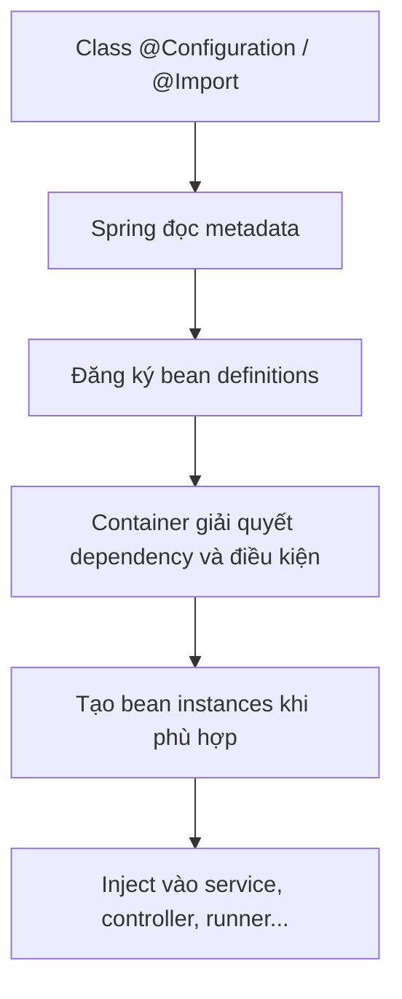
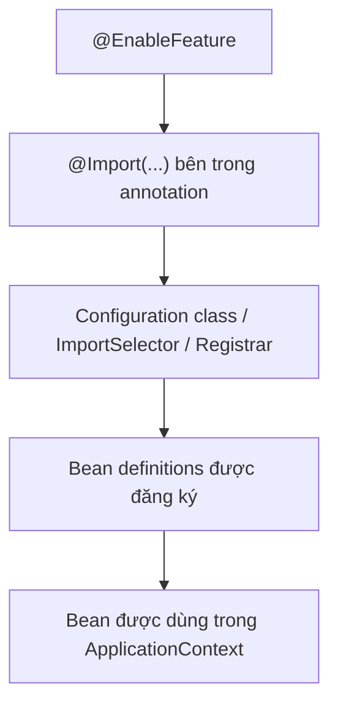
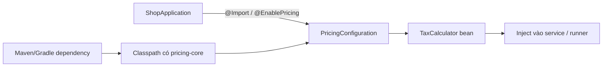

# @Import để đưa lớp cấu hình hoặc thành phần vào context

Trong Spring Boot, các bean thường được đăng ký bằng `@Component`, `@Service`, `@Repository` hoặc phương thức `@Bean` trong một class `@Configuration`. Nhưng không phải lúc nào cấu hình hoặc thành phần cần dùng cũng nằm trong phạm vi component scan của ứng dụng. Có lúc chúng thuộc một package khác, một module dùng chung, hoặc một thư viện chỉ nên được kích hoạt khi ứng dụng **chủ động chọn sử dụng**.

**`@Import` là một công cụ để đưa lớp cấu hình hoặc thành phần được chỉ định vào quá trình đăng ký bean của Spring container.** Thay vì mở rộng việc quét package tới mọi nơi, ứng dụng có thể nói rõ: “Tôi cần nhóm cấu hình này” hoặc “Tôi cần thành phần này”. Spring xử lý thông tin đó khi xây dựng `ApplicationContext`.

Trong chương **Đăng ký bean** của *Spring Boot Fundamentals*, mục tiêu là hiểu `@Import` hoạt động ở đâu trong vòng đời context, cách dùng đúng với `@Configuration` và class thông thường, cách phân biệt nó với `@ComponentScan`, cùng những tình huống lỗi và giới hạn thường gặp.

## 1. Vì sao cần một cơ chế import vào Spring context?

Giả sử hệ thống có một ứng dụng bán hàng:

```text
com.example.shop
└── ShopApplication

com.example.shared.pricing
├── TaxCalculator
└── PricingConfiguration
```

`ShopApplication` nằm trong `com.example.shop`. Theo cấu hình thường gặp, `@SpringBootApplication` kích hoạt component scan từ package chứa class ứng dụng và các package con. Package `com.example.shared.pricing` nằm bên ngoài vùng đó.

Nếu `PricingConfiguration` ở package ngoài không được đăng ký bằng một cơ chế khác, Spring sẽ không tự phát hiện các `@Bean` bên trong chỉ vì class tồn tại trên classpath. Điều này có thể khiến một bean `TaxCalculator` cần thiết không có trong context.

Có nhiều cách giải quyết, mỗi cách mang ý nghĩa thiết kế khác nhau:

- Mở rộng component scan để quét thêm package.
- Đưa một bean cụ thể vào bằng phương thức `@Bean`.
- Đăng ký một cấu hình qua `@Import(PricingConfiguration.class)`.
- Dùng cơ chế thư viện/auto-configuration chuyên biệt nếu đang xây dựng một starter có cấu hình tự kích hoạt theo điều kiện.

Khi ứng dụng muốn **chọn tường minh một nhóm cấu hình**, `@Import` là lựa chọn tự nhiên và dễ đọc. Việc import thể hiện một quyết định của ứng dụng: cấu hình đó là một phần của context hiện tại.

## 2. @Import là gì và khác gì với import của Java?

Spring cung cấp annotation:

```java
import org.springframework.context.annotation.Import;
```

Ta có thể sử dụng:

```java
@Import(PricingConfiguration.class)
```

Hai chữ “import” ở đây có nhiệm vụ hoàn toàn khác nhau:

| Cơ chế | Xảy ra ở đâu? | Tác dụng |
| --- | --- | --- |
| `import com.example...PricingConfiguration;` | Cú pháp ngôn ngữ Java | Cho phép dùng tên class ngắn trong source |
| `@Import(PricingConfiguration.class)` | Quá trình Spring xử lý metadata cấu hình | Yêu cầu Spring xử lý class được chỉ định và đăng ký bean tương ứng |
| Maven/Gradle dependency | Cấu hình build và dependency graph | Làm cho mã/thư viện có mặt trên classpath phù hợp |

Chỉ thêm một câu lệnh Java `import` **không khiến Spring tạo bean**. Ngược lại, `@Import` **không tải một thư viện chưa có**: class được tham chiếu vẫn phải có sẵn để project biên dịch và chạy.

Điều được import bởi Spring là **metadata của class**, từ đó container tạo bean definition hoặc xử lý cấu hình. `@Import` không có nghĩa nó lập tức tạo một instance ngay tại dòng annotation.

### 2.1. Bean definition khác bean instance

Một *bean definition* mô tả cho Spring cách quản lý một thành phần: kiểu class, cách tạo, scope, dependency và các metadata liên quan. Bean instance là đối tượng Java cụ thể được container cung cấp khi đến thời điểm thích hợp.



Với singleton không lazy, Spring thường tạo các bean trong quá trình khởi tạo context. Với lazy bean, prototype hoặc bean có scope khác, thời điểm tạo instance có thể khác. Vì vậy, khi nói `@Import` “đưa bean vào context”, ta đang mô tả khả năng **đăng ký và quản lý thành phần**, chứ không khẳng định mọi instance đều được tạo ngay tức thì.

## 3. Ví dụ hoàn chỉnh: import lớp cấu hình nằm ngoài component scan

Xây dựng ứng dụng Spring Boot tối giản tính thuế theo một tỷ lệ cố định. Mục tiêu của ví dụ là quan sát `@Import` nên không cần web server, database hoặc Spring Data.

Giả sử project có Spring Boot starter nền tảng và các file:

```text
src/main/java/
├── com/example/shop/
│   └── ShopApplication.java
└── com/example/shared/pricing/
    ├── TaxCalculator.java
    └── PricingConfiguration.java
```

### 3.1. Tạo class nghiệp vụ

`TaxCalculator.java`:

```java
package com.example.shared.pricing;

import java.math.BigDecimal;
import java.util.Objects;

public final class TaxCalculator {

    private final BigDecimal rate;

    public TaxCalculator(BigDecimal rate) {
        Objects.requireNonNull(rate, "rate");
        if (rate.signum() < 0 || rate.compareTo(BigDecimal.ONE) > 0) {
            throw new IllegalArgumentException("Rate must be from 0 to 1");
        }
        this.rate = rate;
    }

    public BigDecimal taxOn(BigDecimal amount) {
        Objects.requireNonNull(amount, "amount");
        if (amount.signum() < 0) {
            throw new IllegalArgumentException("Amount must be non-negative");
        }
        return amount.multiply(rate);
    }
}
```

`TaxCalculator` là class Java thuần; nó không cần phụ thuộc vào Spring. Nó chỉ biểu diễn phép tính.

### 3.2. Khai báo cấu hình tạo bean

`PricingConfiguration.java`:

```java
package com.example.shared.pricing;

import java.math.BigDecimal;
import org.springframework.context.annotation.Bean;
import org.springframework.context.annotation.Configuration;

@Configuration(proxyBeanMethods = false)
public class PricingConfiguration {

    @Bean
    public TaxCalculator taxCalculator() {
        return new TaxCalculator(new BigDecimal("0.08"));
    }
}
```

Lớp cấu hình định nghĩa một bean có kiểu `TaxCalculator`. Nó chưa tự được đưa vào context của ứng dụng nếu package này nằm ngoài phạm vi scan và chưa có cơ chế import/đăng ký khác.

Trong ví dụ, `proxyBeanMethods = false` phù hợp vì phương thức `@Bean` độc lập và không gọi trực tiếp phương thức `@Bean` khác để dựa vào cơ chế proxy. Giá trị này không bắt buộc để `@Import` hoạt động; có thể dùng `@Configuration` đơn giản khi học cơ chế đăng ký bean.

### 3.3. Import cấu hình tại class ứng dụng

`ShopApplication.java`:

```java
package com.example.shop;

import com.example.shared.pricing.PricingConfiguration;
import com.example.shared.pricing.TaxCalculator;
import java.math.BigDecimal;
import org.springframework.boot.CommandLineRunner;
import org.springframework.boot.SpringApplication;
import org.springframework.boot.autoconfigure.SpringBootApplication;
import org.springframework.context.annotation.Bean;
import org.springframework.context.annotation.Import;

@SpringBootApplication
@Import(PricingConfiguration.class)
public class ShopApplication {

    public static void main(String[] args) {
        SpringApplication.run(ShopApplication.class, args);
    }

    @Bean
    CommandLineRunner demo(TaxCalculator calculator) {
        return args -> System.out.println(
                calculator.taxOn(new BigDecimal("100000"))
        );
    }
}
```

Khi ứng dụng khởi động bình thường, runner in ra giá trị thuế **8.000** theo cách biểu diễn của `BigDecimal`. Ví dụ này chỉ minh họa phép tính với một tỷ lệ giả định; chính sách thuế thực tế có thể phức tạp hơn.

### 3.4. Spring đã xử lý những gì?

1. `SpringApplication.run` tạo application context.
2. Spring xử lý metadata của `ShopApplication`, trong đó có `@SpringBootApplication` và `@Import`.
3. `@Import(PricingConfiguration.class)` khiến `PricingConfiguration` được xử lý như một lớp cấu hình dù nằm ngoài package scan mặc định.
4. Spring đọc phương thức `@Bean taxCalculator()` và đăng ký bean definition tương ứng.
5. Container cung cấp bean `TaxCalculator` cho tham số `demo(TaxCalculator calculator)`.
6. Khi runner chạy, nó sử dụng instance đã được inject.


Điểm quan trọng: **`@Import` chọn lớp cấu hình; `@Bean` định nghĩa thành phần; DI cung cấp thành phần đó cho người cần**. Ba cơ chế phối hợp nhưng không đồng nghĩa.

### 3.5. Nếu bỏ @Import đi thì sao?

Trong đúng cấu trúc package của ví dụ, khi bỏ `@Import(PricingConfiguration.class)` mà không bổ sung cơ chế đăng ký nào khác, `PricingConfiguration` không được tìm thấy qua component scan mặc định. Vì `TaxCalculator` không được đăng ký theo cách khác, Spring không thể cung cấp bean cho tham số của runner. Quá trình tạo context có thể thất bại vì thiếu bean kiểu `TaxCalculator`.

Vấn đề không nằm ở câu lệnh Java `import`. Class `TaxCalculator` vẫn có thể tồn tại trong project, nhưng **có class trên classpath khác với có bean trong container**.

## 4. Import nhiều cấu hình cùng lúc

`@Import` nhận một mảng class, cho phép một lớp cấu hình hoặc class ứng dụng chọn nhiều thành phần:

```java
@SpringBootApplication
@Import({
    PricingConfiguration.class,
    AuditConfiguration.class,
    NotificationConfiguration.class
})
public class ShopApplication {
}
```

Trong ví dụ minh họa, `AuditConfiguration` và `NotificationConfiguration` là các class cấu hình giả định tồn tại trên classpath. Spring xử lý metadata của cả ba để đăng ký những bean mà chúng cung cấp.

Cách này phù hợp khi ứng dụng muốn công bố các khả năng được bật một cách tường minh:

- Pricing cho chức năng tính giá.
- Audit cho ghi nhận sự kiện.
- Notification cho gửi thông báo.

Tuy nhiên, đừng import mọi cấu hình sẵn có chỉ để “chắc chắn có bean”. Một cấu hình có thể tạo kết nối, khởi động tác vụ hoặc yêu cầu property riêng. Chỉ đưa vào context những thành phần mà ứng dụng thực sự cần.

### 4.1. Import lồng nhau

Một configuration class được import có thể lại import configuration khác:

```java
@Configuration
@Import(EmailTransportConfiguration.class)
public class NotificationConfiguration {
}
```

Nếu ứng dụng import `NotificationConfiguration`, Spring còn xử lý các cấu hình được tham chiếu qua `@Import` trong đó. Điều này cho phép gom một tập chức năng thành một điểm kích hoạt.

Vì quan hệ import có thể truyền qua nhiều lớp, khi điều tra vì sao một bean xuất hiện, cần kiểm tra cả **các cấu hình được import gián tiếp**. Không nên suy luận rằng một bean chỉ được đăng ký nếu class ứng dụng import trực tiếp lớp định nghĩa nó.

## 5. @Import có thể đưa class thông thường vào context

`@Import` không chỉ dành cho class có `@Configuration`. Spring có thể xử lý một class thành phần thông thường được tham chiếu bởi `@Import` và đăng ký nó như một bean, dù class đó không đánh dấu `@Component`.

Ví dụ:

```java
package com.example.shared.format;

public class BannerFormatter {

    public String format(String title) {
        return "=== " + title + " ===";
    }
}
```

Ứng dụng khai báo:

```java
@SpringBootApplication
@Import(BannerFormatter.class)
public class ShopApplication {

    @Bean
    CommandLineRunner banner(BannerFormatter formatter) {
        return args -> System.out.println(
                formatter.format("Spring Boot")
        );
    }
}
```

Trong ví dụ, class có constructor mặc định phù hợp và không cần cấu hình thêm. Spring đăng ký `BannerFormatter` thông qua `@Import` rồi cung cấp nó cho runner qua DI.

Một số điểm cần nhớ:

- `BannerFormatter` không bắt buộc phải có `@Component` trong tình huống này.
- Nó không cần nằm trong package được quét vì đã được import tường minh.
- Với một class có constructor cần dependency, container vẫn phải tìm được các bean phù hợp để khởi tạo.
- Với cấu hình khởi tạo phức tạp, tham số cần truyền tường minh hoặc class thuộc thư viện bên ngoài, phương thức `@Bean` thường biểu đạt ý định rõ hơn.

Không nên hiểu cơ chế này là “`@Import` tự tạo một bean cho mọi class mà imported class tham chiếu”. Nếu constructor của `BannerFormatter` cần `FormatterSettings`, Spring vẫn cần một định nghĩa bean phù hợp cho `FormatterSettings`.

## 6. Khác nhau giữa @Import, @ComponentScan và @Bean

Đây là ba cơ chế có thể cùng xuất hiện trong một Spring Boot application nhưng mục tiêu sử dụng không giống nhau.

| Cơ chế | Ta khai báo điều gì? | Spring làm gì? | Dùng khi nào? |
| --- | --- | --- | --- |
| `@ComponentScan` | Package cần tìm kiếm | Quét class ứng viên theo các bộ lọc và đăng ký component | Ứng dụng có cấu trúc package rõ ràng, nhiều component |
| `@Bean` | Phương thức tạo một object | Đăng ký bean từ kết quả phương thức | Cần kiểm soát cách tạo, truyền tham số, tích hợp class bên thứ ba |
| `@Import` | Danh sách class cấu hình/thành phần hoặc bộ chọn/registrar | Đưa chúng vào quá trình xử lý đăng ký bean | Chọn một tập cấu hình hoặc thành phần cụ thể |

Ví dụ đối chiếu:

```java
// Cách 1: quét package chứa các component phù hợp
@SpringBootApplication
@ComponentScan(basePackages = {
    "com.example.shop",
    "com.example.shared"
})
class ScanApplication {
}
```

```java
// Cách 2: chỉ chọn một cấu hình cụ thể
@SpringBootApplication
@Import(PricingConfiguration.class)
class ImportApplication {
}
```

```java
// Cách 3: tạo trực tiếp một bean trong cấu hình hiện tại
@Configuration
class LocalPricingConfiguration {
    @Bean
    TaxCalculator taxCalculator() {
        return new TaxCalculator(new BigDecimal("0.08"));
    }
}
```

Ba đoạn trên là các phương án riêng để minh họa sự khác biệt, không phải ba class khởi động cần đồng thời đặt trong cùng project ví dụ. Cần chọn một cách đăng ký phù hợp để tránh đăng ký trùng những bean có cùng vai trò.

### 6.1. Phạm vi chọn lựa

`@ComponentScan("com.example.shared")` có thể phát hiện nhiều class ứng viên trong package cùng các package con. Điều này thuận tiện khi toàn bộ vùng mã có chủ đích thuộc application context, nhưng cũng có thể rộng hơn nhu cầu thực tế.

`@Import(PricingConfiguration.class)` thể hiện quyết định cụ thể hơn: cần cấu hình pricing. Nếu `PricingConfiguration` tự import thêm cấu hình hoặc đăng ký bean bổ sung thì các thành phần liên quan vẫn có thể được đưa vào; **tường minh ở điểm bắt đầu không có nghĩa kết quả cuối cùng luôn chỉ là một bean**.

`@Bean` hữu ích nếu ứng dụng chỉ cần tự tạo một bean cụ thể mà không có nhu cầu tạo lớp cấu hình riêng.

### 6.2. @SpringBootApplication đã bao gồm component scan

`@SpringBootApplication` là annotation tổng hợp bao gồm `@SpringBootConfiguration`, `@EnableAutoConfiguration` và `@ComponentScan` (cùng các alias/metadata liên quan). Do đó, trong phần lớn ứng dụng Spring Boot thông thường, không cần thêm `@ComponentScan` chỉ để tìm các component trong package của class ứng dụng và các package con.

Việc thêm một `@ComponentScan` tường minh là quyết định cấu hình riêng, cần xem lại phạm vi và tác động tới cấu hình mặc định thay vì sao chép máy móc từ ví dụ khác.

## 7. @Import đặt trên class nào?

Thông thường, `@Import` được đặt trên:

- Class khởi động `@SpringBootApplication`.
- Class `@Configuration` đại diện cho một tính năng.
- Một annotation tự định nghĩa để tạo điểm kích hoạt cấu hình dễ đọc.

Ví dụ đặt trên configuration class:

```java
@Configuration
@Import(PricingConfiguration.class)
public class CommerceConfiguration {
}
```

Ứng dụng sau đó chỉ cần import `CommerceConfiguration` khi muốn bật nhóm khả năng liên quan.

Điều quan trọng là class chứa `@Import` cũng phải **được Spring xử lý như nguồn cấu hình**. Nếu một class ngẫu nhiên không được scan, không được import, không được đăng ký hoặc không được cơ chế khác đưa vào quá trình xử lý metadata, `@Import` đặt trên class đó sẽ không có tác dụng đối với context hiện tại.

Tương tự, việc một class có `@Import` trong mã nguồn không tự “phát tín hiệu toàn cục” cho mọi `ApplicationContext` chạy trong JVM.

## 8. Import với annotation tự định nghĩa

Khi xây một module dùng chung, nhóm phát triển có thể muốn người sử dụng chỉ cần khai báo `@EnablePricing` để bật toàn bộ thành phần cần thiết. Một cách thực hiện phổ biến là tạo annotation meta-annotated bằng `@Import`.

Ví dụ:

```java
package com.example.shared.pricing;

import java.lang.annotation.ElementType;
import java.lang.annotation.Retention;
import java.lang.annotation.RetentionPolicy;
import java.lang.annotation.Target;
import org.springframework.context.annotation.Import;

@Target(ElementType.TYPE)
@Retention(RetentionPolicy.RUNTIME)
@Import(PricingConfiguration.class)
public @interface EnablePricing {
}
```

Ứng dụng dùng:

```java
@SpringBootApplication
@EnablePricing
public class ShopApplication {
    public static void main(String[] args) {
        SpringApplication.run(ShopApplication.class, args);
    }
}
```

Khi Spring xử lý metadata của class ứng dụng, nó nhận biết `@Import` gắn trên `@EnablePricing` và xử lý `PricingConfiguration` tương ứng.

Mẫu này thường được dùng khi một thư viện muốn cung cấp API cấu hình thân thiện:

- Người dùng chọn bật tính năng thông qua một annotation có tên mang ý nghĩa.
- Chi tiết những configuration class hoặc registrar được import nằm bên trong module.
- Thư viện có thể thay đổi cách đăng ký nội bộ mà giao diện `@EnablePricing` vẫn giữ ổn định, miễn hợp đồng công khai được bảo đảm.

Tuy nhiên, đừng tự tạo một annotation `@Enable...` cho mọi bean nhỏ. Nó hữu ích khi đại diện cho **một tính năng có ý nghĩa và tập cấu hình cần được tái sử dụng**.

## 9. Cơ chế nâng cao: ImportSelector

Ngoài nhập trực tiếp configuration class, `@Import` có thể nhận một class triển khai `ImportSelector`. Selector cho phép **trả về danh sách tên class cần import** dựa trên metadata của lớp đang yêu cầu import.

Ví dụ minh họa:

```java
package com.example.shared.reports;

import org.springframework.context.annotation.ImportSelector;
import org.springframework.core.type.AnnotationMetadata;

public class ReportingSelector implements ImportSelector {

    @Override
    public String[] selectImports(AnnotationMetadata importingClassMetadata) {
        return new String[] {
            ReportingConfiguration.class.getName()
        };
    }
}
```

Trong ví dụ, `ReportingConfiguration` là một configuration class hợp lệ đã được định nghĩa ở module dùng chung.

Sử dụng selector:

```java
@Configuration
@Import(ReportingSelector.class)
public class ReportsFeatureConfiguration {
}
```

Container gọi `selectImports(...)` trong quá trình xử lý cấu hình, sau đó xử lý các class name được trả về. Tham số `AnnotationMetadata` giúp selector biết metadata của class yêu cầu import, từ đó có thể chọn cấu hình theo một annotation hoặc thuộc tính phù hợp.

Điểm khác biệt:

- `@Import(ReportingConfiguration.class)`: danh sách class được viết tường minh tại annotation.
- `@Import(ReportingSelector.class)`: class cần import do selector xác định khi Spring xử lý metadata.

`ImportSelector` hữu ích cho thư viện và cấu hình có nhiều nhánh chọn. Với bài toán chỉ cần thêm một cấu hình, import trực tiếp thường đơn giản hơn.

### 9.1. DeferredImportSelector

Spring còn có `DeferredImportSelector`, một dạng selector được xử lý ở pha phù hợp muộn hơn so với `ImportSelector` thông thường khi phân tích configuration. Đây là cơ chế quan trọng trong cách Spring xử lý những cấu hình có tính chất tổng hợp và điều kiện, trong đó có những cơ chế liên quan tới auto-configuration.

Ở mức Fundamentals, chỉ cần biết **Spring có nhiều pha xử lý metadata** và `@Import` có thể được mở rộng bằng selector. Không cần tự triển khai `DeferredImportSelector` cho một project CRUD nhỏ.

## 10. Cơ chế nâng cao: ImportBeanDefinitionRegistrar

Một loại class khác được `@Import` hỗ trợ là `ImportBeanDefinitionRegistrar`. Khác với việc nhập một configuration class chứa các `@Bean` có sẵn, registrar có thể **đăng ký bean definition bằng mã lập trình**.

Ví dụ:

```java
package com.example.shared.audit;

import org.springframework.beans.factory.support.BeanDefinitionRegistry;
import org.springframework.beans.factory.support.RootBeanDefinition;
import org.springframework.context.annotation.ImportBeanDefinitionRegistrar;
import org.springframework.core.type.AnnotationMetadata;

public class AuditRegistrar implements ImportBeanDefinitionRegistrar {

    @Override
    public void registerBeanDefinitions(
            AnnotationMetadata importingClassMetadata,
            BeanDefinitionRegistry registry
    ) {
        if (!registry.containsBeanDefinition("auditClock")) {
            registry.registerBeanDefinition(
                    "auditClock",
                    new RootBeanDefinition(AuditClock.class)
            );
        }
    }
}
```

`AuditClock` trong ví dụ là một class giả định có constructor phù hợp và đã có mặt trên classpath.

Kích hoạt:

```java
@Configuration
@Import(AuditRegistrar.class)
public class AuditFeatureConfiguration {
}
```

Registrar thực hiện việc đăng ký một bean definition có tên `auditClock`. Container sau đó quản lý việc tạo bean theo định nghĩa đó.

### 10.1. Khi nào thật sự cần registrar?

Registrar thường xuất hiện trong thư viện hoặc framework cần đăng ký bean dựa trên metadata, annotation, classpath hay số lượng interface được phát hiện. Ví dụ một thư viện có thể cần tạo proxy/adapter cho nhiều interface mà người dùng khai báo.

Với một ứng dụng đơn giản, những lựa chọn dễ bảo trì hơn thường là:

1. `@Component` trên class do ứng dụng quản lý.
2. `@Bean` nếu cần tự tạo object.
3. `@Import` một configuration class để kích hoạt một nhóm bean.

Chỉ dùng registrar khi có nhu cầu đăng ký bean động mà các cách trên không biểu đạt rõ. Registrar thêm độ phức tạp về metadata, tên bean, điều kiện và thứ tự xử lý.

## 11. @Import có liên quan thế nào đến các annotation @Enable...?

Nhiều annotation mang tên `@Enable...` trong hệ sinh thái Spring sử dụng hoặc phối hợp với cơ chế import cấu hình bên dưới.

Ví dụ về ý tưởng:



Vì vậy, khi một annotation `@Enable...` khiến bean xuất hiện, hãy tìm hiểu nó import cấu hình nào hoặc bật cơ chế đăng ký nào. Điều này đặc biệt hữu ích khi đọc mã một thư viện cung cấp tính năng theo module.

Không phải mọi annotation bắt đầu bằng `Enable` đều có cùng cơ chế, và không nên suy đoán hành vi từ tên. Cần đọc hợp đồng và cấu hình thực tế của annotation đang dùng.

## 12. @Import và auto-configuration của Spring Boot

Trong Spring Boot, **auto-configuration** giúp đăng ký bean theo điều kiện như dependency trên classpath, property, bean đã có và loại ứng dụng. `@Import` cũng tham gia vào hệ sinh thái xử lý cấu hình Spring nhưng không đồng nghĩa với “bật auto-configuration”.

### 12.1. Import thường là quyết định tường minh

```java
@SpringBootApplication
@Import(PricingConfiguration.class)
class ShopApplication {
}
```

Ứng dụng tự chọn `PricingConfiguration`. Bean trong cấu hình vẫn có thể phụ thuộc điều kiện, nhưng điểm kích hoạt import là tường minh.

### 12.2. Auto-configuration quyết định theo điều kiện

Một auto-configuration class có thể sử dụng `@ConditionalOnClass`, `@ConditionalOnMissingBean` hoặc các điều kiện khác để xác định bean nào phù hợp. Với các thế hệ Spring Boot hiện đại, cấu hình tự động từ thư viện được khai báo qua cơ chế metadata dành riêng cho auto-configuration, chẳng hạn tệp `META-INF/spring/org.springframework.boot.autoconfigure.AutoConfiguration.imports` trong JAR.

Do đó, **chỉ viết `@Import(MyAutoConfiguration.class)` trong ứng dụng không đồng nghĩa đã tạo một Spring Boot starter đúng nghĩa**. Nó là cách import trực tiếp cấu hình đó và có thể bỏ qua ý định lựa chọn/tổ chức vốn dành cho cơ chế auto-configuration của thư viện.

Nếu đang xây module riêng mà chỉ cần một điểm bật thủ công, `@Import` hoặc một annotation `@Enable...` có thể đủ. Nếu đang phân phối starter tự cấu hình theo dependency, cần học đúng hợp đồng auto-configuration tương ứng với dòng Spring Boot đang sử dụng.

### 12.3. @Import không bỏ qua điều kiện trên bean

Giả sử cấu hình đã được import nhưng có:

```java
@Configuration
@ConditionalOnProperty(
    prefix = "feature.audit",
    name = "enabled",
    havingValue = "true"
)
class AuditConfiguration {

    @Bean
    AuditService auditService() {
        return new AuditService();
    }
}
```

Đoạn minh họa giả định `AuditService` là class có constructor mặc định phù hợp. Nếu property và các điều kiện không thỏa, cấu hình/bean có thể không được đăng ký dù `AuditConfiguration` được tham chiếu bởi `@Import`. Điều kiện được Spring Boot đánh giá trong quá trình xử lý metadata.

Vì vậy, khi bean không xuất hiện, phải phân biệt **cấu hình không được import** với **cấu hình đã import nhưng điều kiện không thỏa**.

## 13. @Import và profile theo môi trường

Spring cho phép đặt `@Profile` trên configuration class hoặc bean definition để chọn thành phần theo profile đang hoạt động.

Ví dụ:

```java
@Configuration
@Profile("dev")
public class DevMailConfiguration {

    @Bean
    MailSender mailSender() {
        return new ConsoleMailSender();
    }
}
```

`MailSender` và `ConsoleMailSender` trong đoạn ví dụ là các kiểu giả định; chúng đại diện cho hợp đồng gửi thư và implementation in ra console.

Ứng dụng có thể import:

```java
@SpringBootApplication
@Import(DevMailConfiguration.class)
class ShopApplication {
}
```

Nếu profile `dev` không active, các điều kiện profile trên cấu hình sẽ ngăn bean tương ứng được tạo. **Import tường minh không ép Spring bỏ qua `@Profile`**.

Hãy tách hai quyết định:

- `@Import`: cấu hình nào được đưa vào quá trình xử lý.
- `@Profile` và các `@Conditional...`: cấu hình/bean đó có thỏa điều kiện để đăng ký hay không.

Khi dùng cả hai, nên tránh thiết kế một tính năng chỉ hoạt động nhờ chuỗi điều kiện ngầm khó nhìn. Tên và tài liệu cấu hình cần giúp người phát triển biết vì sao bean được hoặc không được khởi tạo.

## 14. Những sai lầm phổ biến khi dùng @Import

### 14.1. Nhầm import Java với @Import

```java
import com.example.shared.pricing.PricingConfiguration;
```

Đây chỉ là câu lệnh giúp source sử dụng class. Muốn cấu hình được xử lý theo cách import của Spring, phải đặt `@Import(PricingConfiguration.class)` trên một nguồn cấu hình mà Spring thực sự xử lý, hoặc dùng một cơ chế đăng ký bean khác.

### 14.2. Tưởng @Import làm class xuất hiện trên classpath

Nếu module không có dependency chứa `PricingConfiguration`, Java source tham chiếu `PricingConfiguration.class` sẽ không biên dịch. Trước tiên phải thêm dependency Maven/Gradle phù hợp, rồi mới đăng ký cấu hình vào Spring context.

### 14.3. Đặt @Import trên class không được Spring đọc

```java
@Import(PricingConfiguration.class)
public class UnusedHelper {
}
```

Nếu `UnusedHelper` không được xử lý như configuration class hoặc thành phần tham gia cơ chế cấu hình, annotation này sẽ không làm gì trong application context chỉ vì file Java tồn tại. Cần xác định điểm nhập thực sự là gì.

### 14.4. Import nhầm thành phần và gây xung đột bean

Nếu hai configuration class khác nhau cùng tạo bean có cùng tên hoặc nhiều bean có cùng type được inject mà không có cách phân biệt, ứng dụng có thể gặp lỗi đăng ký hoặc lỗi chọn dependency.

Ví dụ:

```java
@Configuration
class LocalPricingConfiguration {
    @Bean
    TaxCalculator taxCalculator() {
        return new TaxCalculator(new BigDecimal("0.05"));
    }
}
```

Nếu ứng dụng đồng thời import `PricingConfiguration` đã định nghĩa `taxCalculator()` và khai báo cấu hình trên, hai phương thức cùng gợi ý tên bean `taxCalculator`. Tùy chính sách bean overriding và cách phát hiện cấu hình, context có thể từ chối đăng ký trùng tên hoặc phát sinh hành vi không mong muốn. Đừng dựa vào thứ tự load class để chọn một version chính sách.

Nên xác định bean nào là nguồn chính thức, hoặc chọn một cơ chế thay thế có chủ đích với tên, qualifier hay điều kiện phù hợp.

### 14.5. Mở rộng component scan quá rộng chỉ để tìm một cấu hình

Nếu chỉ cần `PricingConfiguration`, việc quét toàn bộ `com.example.shared` có thể khiến nhiều component không liên quan trở thành ứng viên đăng ký bean. `@Import` cụ thể có thể dễ kiểm soát hơn.

Tuy vậy, nếu toàn bộ package được thiết kế để scan như một phần của ứng dụng, component scan vẫn hợp lý. Lựa chọn phụ thuộc vào **ranh giới module và mức kiểm soát mong muốn**.

### 14.6. Tưởng import một class thông thường tương đương với chạy mọi cấu hình có liên quan

`@Import(BannerFormatter.class)` có thể đăng ký class đó làm bean, nhưng không tự tạo các dependency khác chỉ vì chúng là field hoặc tham số constructor của class. Nếu cần một bộ bean phối hợp, cấu hình qua `@Bean` hoặc import một `@Configuration` thường dễ đọc hơn.

### 14.7. Nhầm @Import với @ImportResource

Spring còn có `@ImportResource` để đưa định nghĩa bean từ tài nguyên cấu hình, chẳng hạn XML:

```java
@Configuration
@ImportResource("classpath:legacy-beans.xml")
public class LegacyIntegrationConfiguration {
}
```

`@ImportResource` dùng **đường dẫn tài nguyên**. `@Import` nhận **class** (configuration/component/selector/registrar). Không nên sử dụng hai annotation thay thế cho nhau nếu dữ liệu cấu hình đầu vào không cùng loại.

## 15. Kiểm tra một bean có xuất hiện trong context không

Khi học `@Import`, nên tách hai câu hỏi: “Spring đã xử lý cấu hình chưa?” và “Bean mà ứng dụng cần có thể được resolve không?”.

### 15.1. Quan sát bằng CommandLineRunner

Một ví dụ dành cho môi trường phát triển:

```java
@Bean
CommandLineRunner inspectContext(ApplicationContext context) {
    return args -> {
        boolean present = context.containsBean("taxCalculator");
        System.out.println("taxCalculator registered: " + present);
    };
}
```

Đoạn này cần import `org.springframework.context.ApplicationContext` và `org.springframework.boot.CommandLineRunner`. Với `PricingConfiguration` ở trên, phương thức `@Bean taxCalculator()` thường tạo bean mang tên `taxCalculator`.

Kiểm tra tên chỉ phù hợp khi biết chắc tên bean. Nếu cần kiểm tra theo kiểu, có thể thử truy vấn context theo `TaxCalculator.class`, nhưng phải lưu ý rằng có nhiều bean cùng type thì yêu cầu lấy một bean có thể không xác định duy nhất.

Trong ứng dụng nghiệp vụ thông thường, **constructor injection** vẫn là cách tốt để biểu diễn dependency. Đừng biến mọi service thành class chủ động gọi `ApplicationContext.getBean(...)` chỉ để kiểm tra xem import có hoạt động không.

### 15.2. Kiểm chứng bằng test có Spring context

Ví dụ kiểm tra wiring sau khi import:

```java
package com.example.shop;

import static org.junit.jupiter.api.Assertions.assertEquals;

import com.example.shared.pricing.TaxCalculator;
import java.math.BigDecimal;
import org.junit.jupiter.api.Test;
import org.springframework.beans.factory.annotation.Autowired;
import org.springframework.boot.test.context.SpringBootTest;

@SpringBootTest
class ShopApplicationContextTest {

    @Autowired
    private TaxCalculator taxCalculator;

    @Test
    void importedConfigurationProvidesCalculator() {
        assertEquals(
                new BigDecimal("8000.0000"),
                taxCalculator.taxOn(new BigDecimal("100000.00"))
        );
    }
}
```

Đây là ví dụ về một bài **context/integration test** cần dependency Spring Boot Test phù hợp. Nó nạp application context, xác nhận `TaxCalculator` được inject và dùng trong phép tính. Kết quả `BigDecimal` trong ví dụ có cùng scale khi nhân `100000.00` với `0.08`.

Với quy tắc tính toán thuần túy, bạn vẫn có thể viết unit test không cần Spring:

```java
TaxCalculator calculator =
        new TaxCalculator(new BigDecimal("0.08"));
```

Hai kiểu test trả lời hai câu hỏi khác nhau: unit test kiểm tra công thức; context test kiểm tra đường đăng ký và DI.

### 15.3. Dùng log và condition report khi cần

Khi ứng dụng dùng conditional configuration, thông tin debug/condition evaluation report của Spring Boot có thể giúp giải thích vì sao một auto-configuration hoặc condition được/chưa được áp dụng. Tuy nhiên, report điều kiện không thay thế việc kiểm tra trực tiếp tên/type bean trong context hoặc tìm đường import từ class khởi động.

## 16. Tình huống thực tế: kích hoạt module dùng chung một cách tường minh

Giả sử nhóm đang có hai module Java:

```text
shop-app/
  └── ShopApplication

pricing-core/
  ├── TaxCalculator
  ├── PricingConfiguration
  └── EnablePricing
```

Module `pricing-core` chứa các class Java và cấu hình Spring để cung cấp chức năng pricing. Ứng dụng `shop-app` thêm module này vào dependency của bản build.

Hai quyết định phải có:

1. **Build-time dependency:** làm cho class của `pricing-core` tồn tại trên classpath của `shop-app`.
2. **Runtime/container registration:** cho Spring biết cấu hình pricing cần được xử lý, chẳng hạn dùng `@Import(PricingConfiguration.class)` hoặc `@EnablePricing`.

Đây là điểm mạnh của cách cấu hình theo module: người phát triển nhìn vào class khởi động hoặc configuration của ứng dụng sẽ thấy nó chọn dùng những chức năng nào.

Khi viết thư viện tái sử dụng, cần xác định rõ **hợp đồng kích hoạt**:

- Người dùng phải gọi `@Import` trực tiếp?
- Thư viện có annotation `@Enable...` riêng?
- Hay thư viện là Spring Boot starter với auto-configuration theo điều kiện?

Các cách này đều có thể phù hợp, nhưng không nên trộn lẫn mà không có mô tả rõ. Người sử dụng cần biết chỉ thêm dependency đã đủ hay còn cần một bước kích hoạt.

### Một sơ đồ phân tầng



Sơ đồ cho thấy **classpath** và **bean registration** có quan hệ nhưng là hai việc độc lập.

## 17. Checklist nhận diện đúng phạm vi sử dụng @Import

Khi muốn thêm `@Import`, có thể tự hỏi:

1. **Class cần import đã có trên classpath chưa?** Nếu chưa, phải xử lý dependency build trước.
2. **Đây là `@Configuration`, thành phần thông thường, selector hay registrar?** Mỗi loại tạo ra hành vi đăng ký khác nhau.
3. **Class đặt `@Import` có được Spring xử lý không?** Nếu không, import không kích hoạt.
4. **Bean cần dùng được định nghĩa ở đâu?** Tại phương thức `@Bean`, class được import, hay một cấu hình được import tiếp?
5. **Có điều kiện `@Profile` hoặc `@Conditional...` không?** Nếu có, import không bảo đảm bean luôn xuất hiện.
6. **Có khả năng trùng tên bean hoặc nhiều ứng viên cùng type không?** Nếu có, phải thiết kế cách phân biệt rõ.
7. **Nên import một class hay quét cả package?** Chọn phạm vi phù hợp với ranh giới module.
8. **Có nên dùng auto-configuration thay vì import thủ công không?** Với thư viện dành riêng cho Spring Boot, cần xét mô hình phân phối và kích hoạt.

Checklist này chỉ giúp xác định hướng thiết kế. Không có quy tắc rằng mọi ứng dụng đều phải dùng `@Import` hay mọi cấu hình đều phải quét bằng component scan.

## 18. Bài tập thực hành

### Bài tập 1 – Dự đoán bean có trong context hay không

Cho cấu trúc:

```text
com.example.inventory.InventoryApplication
com.example.common.TimeConfiguration
com.example.common.SystemClock
```

`InventoryApplication` có `@SpringBootApplication`. `TimeConfiguration` có `@Configuration` và một phương thức `@Bean` tạo `SystemClock`. Không có component scan mở rộng.

Hãy trả lời:

1. Chỉ thêm Java `import com.example.common.TimeConfiguration;` vào source có đủ để đăng ký `SystemClock` không?
2. Đặt `@Import(TimeConfiguration.class)` trên `InventoryApplication` sẽ thay đổi gì?
3. Có cần thêm `@Component` vào `SystemClock` nếu đã có phương thức `@Bean` đăng ký nó không?

**Gợi ý:** chỉ Java import không đổi context; Spring `@Import` đưa cấu hình vào quá trình xử lý; một bean có thể được tạo qua `@Bean` mà class không cần annotation `@Component`.

### Bài tập 2 – So sánh @ComponentScan và @Import

Một module dùng chung `com.example.shared` chứa hai cấu hình:

```text
com.example.shared.pricing.PricingConfiguration
com.example.shared.mail.MailConfiguration
```

Ứng dụng chỉ muốn dùng pricing. Hãy phân tích điểm khác nhau giữa:

```java
@ComponentScan("com.example.shared")
```

và:

```java
@Import(PricingConfiguration.class)
```

**Gợi ý:** cấu hình scan có thể chọn nhiều component ứng viên trong phạm vi package; import thể hiện rõ lớp cấu hình cần xử lý. Kết quả thực tế còn phụ thuộc annotation trên các class và các import/condition khác.

### Bài tập 3 – Tìm lỗi khi bean không xuất hiện

Một `@Configuration` đã được import, nhưng bean trong đó đánh dấu `@Profile("dev")`. Ứng dụng đang chạy với profile `prod`.

Hãy giải thích vì sao `@Import` không đủ để bean xuất hiện và nêu cách xác minh profile/condition thực tế.

### Bài tập 4 – Dùng annotation @Enable... riêng

Viết một annotation `@EnableAudit` có:

- `@Target(ElementType.TYPE)`.
- `@Retention(RetentionPolicy.RUNTIME)`.
- `@Import(AuditConfiguration.class)`.

Sau đó đặt `@EnableAudit` lên class ứng dụng Spring Boot. Hãy giải thích đường đi từ annotation đến `AuditConfiguration` và các `@Bean` của nó.

### Bài tập 5 – Chọn cơ chế đăng ký

Xét bốn nhu cầu:

| Nhu cầu | Gợi ý cơ chế |
| --- | --- |
| Đăng ký một class ứng dụng thuộc package được scan | `@Component` hoặc stereotype phù hợp |
| Tạo HTTP client có tham số constructor đặc biệt | Phương thức `@Bean` trong configuration |
| Bật một bộ cấu hình nằm ở module dùng chung | `@Import` hoặc annotation `@Enable...` |
| Viết thư viện tự quyết định nhiều bean dựa trên metadata annotation | Xem xét `ImportSelector`/`ImportBeanDefinitionRegistrar` khi thật cần |

Với mỗi lựa chọn, hãy giải thích **ai chịu trách nhiệm tạo bean definition**, **khi nào configuration được xử lý** và **bean có điều kiện kích hoạt nào không**.

## 19. Ghi nhớ về @Import trong Spring Boot Fundamentals

`@Import` là một cơ chế **đăng ký cấu hình và thành phần có chọn lọc** trong Spring IoC container. Nó đặc biệt hữu ích khi ứng dụng muốn sử dụng một configuration class ngoài vùng component scan hoặc muốn bật một nhóm tính năng rõ ràng từ module dùng chung.

Nắm vững những phân biệt sau sẽ giúp tránh phần lớn nhầm lẫn:

- **Java `import`** giải quyết cách tham chiếu class trong source.
- **Dependency Maven/Gradle** giải quyết việc thư viện có mặt trên classpath.
- **Spring `@Import`** đưa class chỉ định vào quá trình xử lý cấu hình/đăng ký bean.
- **`@Configuration` và `@Bean`** mô tả cách cung cấp các đối tượng cụ thể.
- **`@ComponentScan`** tìm thành phần theo package và các bộ lọc.
- **`@Profile` và các điều kiện** quyết định bean có được đăng ký khi xử lý cấu hình hay không.
- **DI** cung cấp bean đã được đăng ký cho service, controller hoặc runner cần nó.

Khi đọc một ứng dụng Spring Boot, hãy đi theo chuỗi: **cấu hình nào được Spring nhận diện → cấu hình nào được import → bean nào được định nghĩa → điều kiện nào được áp dụng → bean nào được inject vào thành phần sử dụng**. Cách nhìn này giúp hiểu vì sao một bean có mặt trong context, vì sao nó biến mất ở một môi trường khác và khi nào nên dùng `@Import` thay cho việc quét thêm package hoặc tự khai báo bean.
