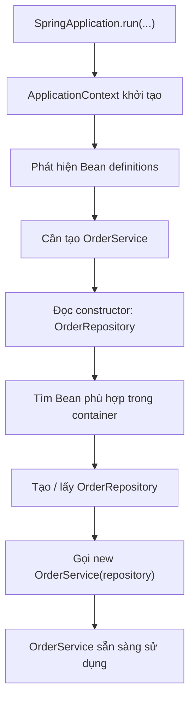
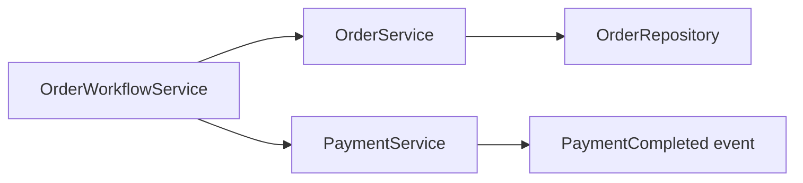
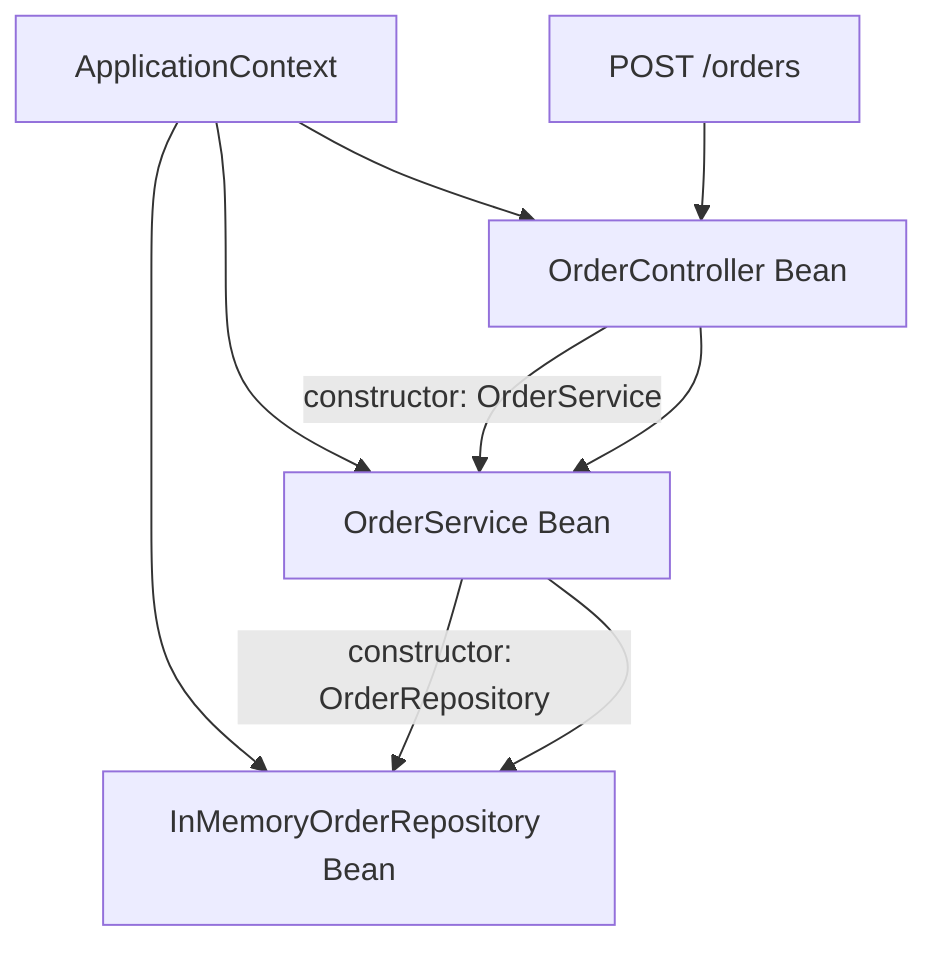

# Tiêm qua hàm dựng (constructor injection) cho phụ thuộc bắt buộc

Trong một ứng dụng Spring Boot, một service hiếm khi tự làm mọi việc. Nó có thể cần repository để đọc dữ liệu, một gateway để gọi dịch vụ bên ngoài, hoặc một thành phần khác để thực hiện nghiệp vụ. Những đối tượng cộng tác này được gọi là **dependency** (phụ thuộc).

Khi dependency là điều kiện bắt buộc để một object hoạt động đúng, cách thể hiện rõ ràng nhất thường là **constructor injection**: khai báo dependency trong tham số constructor, rồi để Spring IoC container cung cấp Bean phù hợp khi tạo object.

Ví dụ:

```java
@Service
public class OrderService {
    private final OrderRepository orderRepository;

    public OrderService(OrderRepository orderRepository) {
        this.orderRepository = orderRepository;
    }
}
```

Đoạn code nói rõ rằng một `OrderService` hợp lệ phải có `OrderRepository` ngay từ lúc được tạo. Spring không cần đợi một field được gán sau đó; container phân giải dependency và truyền nó vào constructor.

Constructor injection đặc biệt phù hợp với phụ thuộc bắt buộc vì nó giúp object không rơi vào trạng thái “đã được tạo nhưng chưa đủ thành phần để làm việc”. Nó cũng làm cấu trúc phụ thuộc dễ đọc, hỗ trợ dùng `final`, phát hiện vòng phụ thuộc sớm và giúp unit test không cần khởi động Spring.

## 1. Dependency bắt buộc là gì?

Hãy xét một service xử lý đơn hàng. Để tạo đơn, nó cần lưu đơn vào repository:

```java
public class OrderService {
    private OrderRepository repository;

    public void placeOrder(Order order) {
        repository.save(order);
    }
}
```

Nếu một đoạn code tạo object bằng `new OrderService()`, field `repository` vẫn là `null`. Lỗi chỉ xuất hiện khi gọi `placeOrder()`. Người đọc class cũng không biết từ chữ ký constructor rằng repository là thành phần không thể thiếu.

Một dependency được xem là **bắt buộc** khi service không thể thực hiện trách nhiệm của nó một cách đúng đắn nếu thiếu dependency ấy. Ví dụ:

- `OrderService` cần repository để lưu đơn.
- `PaymentService` cần một cổng thanh toán để thực hiện giao dịch.
- `InvoiceService` cần formatter để tạo nội dung hóa đơn.
- `UserController` cần service xử lý nghiệp vụ mà controller ủy quyền.

Ngược lại, một tích hợp có thể thật sự tùy chọn nếu ứng dụng vẫn hoạt động đúng khi nó không được cấu hình, ví dụ một notifier bổ sung trong môi trường không bật thông báo. Khi đó cần biểu đạt tính tùy chọn rõ ràng bằng kiểu/API phù hợp, không giả vờ rằng một dependency bắt buộc có thể vắng mặt.

## 2. Constructor injection hoạt động như thế nào?

Trong Spring, container chịu trách nhiệm tạo các Bean và nối chúng lại thành một object graph. Với constructor injection, các tham số constructor mô tả những Bean cần thiết để tạo Bean hiện tại.



Sơ đồ mô tả nguyên lý, không phải thứ tự chi tiết của mọi callback trong Spring. Bean có thể được tạo sớm hoặc muộn tùy scope, lazy initialization và cách nó được sử dụng.

Các bước chính:

1. Spring biết class nào cần được đăng ký thành Bean, ví dụ qua `@Service`, `@Component` hoặc method `@Bean`.
2. Khi cần tạo Bean, container xem constructor mà Spring chọn.
3. Với từng tham số, Spring tìm dependency phù hợp trong các Bean đã đăng ký.
4. Nếu tìm được đúng ứng viên, container truyền các đối tượng đó vào constructor.
5. Constructor hoàn tất, object được khởi tạo và tiếp tục qua các bước lifecycle tương ứng.

Nếu một dependency bắt buộc không tồn tại hoặc không thể phân giải duy nhất, Spring thường báo lỗi trong quá trình khởi tạo context. Đây là hành vi có ích: ứng dụng phát hiện cấu hình thiếu trước khi nhận request nghiệp vụ.

## 3. Viết constructor injection cơ bản

Ví dụ dưới đây dùng một interface để tách service khỏi cách lưu trữ cụ thể:

```java
public interface OrderRepository {
    void save(Order order);
}
```

Service nhận repository qua constructor:

```java
import org.springframework.stereotype.Service;

@Service
public class OrderService {
    private final OrderRepository orderRepository;

    public OrderService(OrderRepository orderRepository) {
        this.orderRepository = orderRepository;
    }

    public void placeOrder(Order order) {
        orderRepository.save(order);
    }
}
```

Ở đây:

- `OrderRepository` là dependency của `OrderService`.
- Constructor yêu cầu một đối tượng tương thích với interface đó.
- Field `final` được gán đúng một lần trong constructor.
- Service không tự tạo repository bằng `new SomeOrderRepository()`.
- Service không tự gọi `applicationContext.getBean(...)` để tìm repository.

Một implementation có thể được Spring phát hiện:

```java
import org.springframework.stereotype.Repository;

@Repository
public class InMemoryOrderRepository implements OrderRepository {
    @Override
    public void save(Order order) {
        // Ví dụ minh họa; ứng dụng thật có thể lưu vào database.
        System.out.println("Saved order: " + order.id());
    }
}
```

Ví dụ giả định `Order` là một kiểu dữ liệu có method `id()`. Khi `OrderService` và `InMemoryOrderRepository` nằm trong package được component scan, Spring có thể đăng ký cả hai Bean và inject implementation vào service.

## 4. Một constructor duy nhất không cần @Autowired

Trong Spring Framework hiện đại (từ Spring 4.3), nếu một Bean chỉ có **một constructor**, Spring tự sử dụng constructor đó để autowire. Bạn không cần thêm `@Autowired`.

```java
@Service
public class CatalogService {
    private final ProductRepository repository;

    public CatalogService(ProductRepository repository) {
        this.repository = repository;
    }
}
```

Đây là cách viết thông thường và gọn nhất cho một service có một constructor.

Bạn vẫn có thể viết:

```java
@Autowired
public CatalogService(ProductRepository repository) {
    this.repository = repository;
}
```

nhưng annotation này không cần thiết khi constructor là duy nhất. Việc bỏ annotation không làm mất constructor injection.

### Nếu class có nhiều constructor thì sao?

Khi class có nhiều constructor, Spring cần biết constructor nào dùng để tạo Bean và inject dependency. Có thể đánh dấu constructor mong muốn:

```java
@Service
public class ReportService {
    private final ReportRepository repository;

    public ReportService() {
        this(null);
    }

    @Autowired
    public ReportService(ReportRepository repository) {
        this.repository = repository;
    }
}
```

Đây chỉ là ví dụ cú pháp để cho thấy cách chọn constructor, **không phải thiết kế nên dùng**: constructor không tham số truyền `null` sẽ tạo ra một object không có dependency bắt buộc. Nếu class là Spring Bean cần repository, hãy ưu tiên một constructor thể hiện đúng hợp đồng thay vì thêm constructor rỗng chỉ để “cho Spring dễ tạo”.

Trong ứng dụng thông thường, giữ một constructor duy nhất giúp cấu trúc rõ hơn. Nếu thực sự cần nhiều constructor, đọc quy tắc autowiring của Spring và đánh dấu rõ constructor injection phù hợp; đừng dựa vào phỏng đoán rằng Spring luôn chọn constructor có nhiều tham số nhất.

## 5. Vì sao nên dùng field final?

Với dependency bắt buộc, khai báo field `final` là một tín hiệu thiết kế hữu ích:

```java
@Service
public class ShippingService {
    private final ShippingRepository repository;
    private final ShippingRateCalculator calculator;

    public ShippingService(
            ShippingRepository repository,
            ShippingRateCalculator calculator) {
        this.repository = repository;
        this.calculator = calculator;
    }
}
```

Sau khi constructor chạy xong, hai tham chiếu dependency không thể bị gán lại. Điều đó không tự làm object mà chúng trỏ tới trở nên immutable, nhưng nó bảo vệ cấu trúc cộng tác của service khỏi bị thay đổi vô tình.

Constructor cũng giúp tránh trạng thái nửa khởi tạo. Nếu constructor cần ba dependency, người gọi không thể tạo object hợp lệ mà bỏ quên dependency thứ ba.

### Đối chiếu với field injection

```java
@Service
public class ShippingService {
    @Autowired
    private ShippingRepository repository;
}
```

Field injection có vẻ ít code hơn, nhưng có một số bất lợi:

- Dependency không xuất hiện trong public constructor, nên người đọc khó biết object cần gì để hoạt động.
- Field không thể là `final` theo cách injection thông thường.
- Object có thể tồn tại trước khi field được Spring inject; tự tạo object trong unit test sẽ để field `null`.
- Test thường phải khởi động Spring hoặc dùng reflection để gán field.
- Việc có quá nhiều dependency bị che trong field khiến class dễ nhận quá nhiều trách nhiệm.

### Đối chiếu với setter injection

```java
@Service
public class ShippingService {
    private ShippingRepository repository;

    @Autowired
    public void setRepository(ShippingRepository repository) {
        this.repository = repository;
    }
}
```

Setter injection hữu ích khi dependency thật sự tùy chọn hoặc có lý do cần thay đổi sau khi object được tạo. Nhưng nếu repository là điều kiện để service hoạt động, setter cho phép object tồn tại trong trạng thái chưa có repository. Constructor injection diễn đạt yêu cầu bắt buộc chặt chẽ hơn.

| Tiêu chí | Constructor injection | Setter injection | Field injection |
|---|---|---|---|
| Dependency thể hiện trong constructor | Có | Không | Không |
| Dễ dùng field `final` | Có | Không theo cách thông thường | Không |
| Có thể tạo object thiếu dependency | Khó/không nếu constructor bắt buộc | Có | Có trước khi inject |
| Unit test bằng `new` | Dễ | Cần gọi setter | Cần Spring/reflection |
| Hợp với dependency bắt buộc | Rất phù hợp | Ít phù hợp | Ít phù hợp |
| Hợp với dependency tùy chọn | Có thể, nếu biểu đạt optional rõ | Có thể | Có thể nhưng thường khó kiểm thử |

## 6. Nhiều dependency cùng kiểu: dùng @Qualifier hoặc @Primary

Constructor injection yêu cầu Spring phân giải mỗi tham số theo kiểu và các metadata liên quan. Nếu container chỉ có một Bean phù hợp, việc chọn rất đơn giản. Nhưng nếu có nhiều implementation cùng interface thì cần quy tắc chọn.

Ví dụ:

```java
public interface NotificationSender {
    void send(String recipient, String message);
}
```

Hai implementation:

```java
@Component("emailSender")
public class EmailNotificationSender implements NotificationSender {
    @Override
    public void send(String recipient, String message) {
        // Gửi email.
    }
}
```

```java
@Component("smsSender")
public class SmsNotificationSender implements NotificationSender {
    @Override
    public void send(String recipient, String message) {
        // Gửi SMS.
    }
}
```

Nếu constructor chỉ khai báo:

```java
public AlertService(NotificationSender sender) {
    this.sender = sender;
}
```

Spring thấy hai ứng viên và không thể tự chọn theo ý nghiệp vụ. Thông thường context sẽ thất bại với lỗi nhiều Bean phù hợp (ví dụ `NoUniqueBeanDefinitionException`).

### Chọn bằng @Qualifier

```java
@Service
public class AlertService {
    private final NotificationSender sender;

    public AlertService(
            @Qualifier("emailSender") NotificationSender sender) {
        this.sender = sender;
    }
}
```

`@Qualifier("emailSender")` thu hẹp lựa chọn vào Bean có qualifier tương ứng. Trong ví dụ này tên component cũng được dùng làm qualifier mặc định, nên chuỗi `emailSender` khớp với tên Bean. Trong hệ thống lớn, có thể tạo qualifier annotation riêng để biểu đạt vai trò nghiệp vụ rõ hơn thay vì dựa vào chuỗi tên.

### Chọn mặc định bằng @Primary

Nếu một implementation nên là lựa chọn mặc định cho phần lớn nơi inject:

```java
@Primary
@Component
public class EmailNotificationSender implements NotificationSender {
    @Override
    public void send(String recipient, String message) {
        // Gửi email.
    }
}
```

Khi có một Bean primary phù hợp, injection theo kiểu có thể chọn nó. Các Bean còn lại vẫn tồn tại và có thể được chọn bằng qualifier hoặc inject thành collection.

**Nên chọn qualifier hay primary?**

- Dùng `@Qualifier` khi một consumer cụ thể cần một implementation cụ thể.
- Dùng `@Primary` khi có một implementation mặc định hợp lý cho toàn ứng dụng.
- Dùng collection khi nghiệp vụ cần chạy qua tất cả implementation.

Đừng thêm `@Primary` chỉ để che lỗi thiết kế nếu hai implementation thực sự có vai trò khác nhau và mỗi consumer cần chọn rõ.

## 7. Constructor injection với nhiều dependency

Một service có thể cần nhiều dependency bắt buộc:

```java
@Service
public class CheckoutService {
    private final OrderRepository orderRepository;
    private final PaymentGateway paymentGateway;
    private final InventoryService inventoryService;

    public CheckoutService(
            OrderRepository orderRepository,
            PaymentGateway paymentGateway,
            InventoryService inventoryService) {
        this.orderRepository = orderRepository;
        this.paymentGateway = paymentGateway;
        this.inventoryService = inventoryService;
    }

    public Order checkout(Cart cart) {
        inventoryService.reserve(cart);
        paymentGateway.charge(cart.total());

        Order order = Order.from(cart);
        orderRepository.save(order);
        return order;
    }
}
```

Đây là ví dụ cấu trúc, giả định các kiểu nghiệp vụ `Cart`, `Order` và các method tương ứng đã được định nghĩa. Ý nghĩa quan trọng không phải số lượng tham số, mà là constructor làm rõ mọi collaborator bắt buộc.

Nếu constructor ngày càng có quá nhiều tham số, đó thường là dấu hiệu cần xem lại trách nhiệm của class. Có thể service đang điều phối quá nhiều nghiệp vụ hoặc một nhóm dependency nên thuộc về một collaborator có trách nhiệm rõ ràng. Không nên gom dependency vào một object “container” tổng hợp chỉ để làm constructor ngắn hơn, vì như vậy lại che giấu quan hệ phụ thuộc.

### Inject một collection khi cần nhiều implementation

Spring có thể inject tất cả Bean phù hợp vào collection:

```java
@Service
public class NotificationCoordinator {
    private final List<NotificationSender> senders;

    public NotificationCoordinator(List<NotificationSender> senders) {
        this.senders = List.copyOf(senders);
    }

    public void broadcast(String recipient, String message) {
        senders.forEach(sender -> sender.send(recipient, message));
    }
}
```

Hoặc inject map theo tên Bean:

```java
@Service
public class NotificationRegistry {
    private final Map<String, NotificationSender> senders;

    public NotificationRegistry(Map<String, NotificationSender> senders) {
        this.senders = Map.copyOf(senders);
    }

    public NotificationSender get(String name) {
        NotificationSender sender = senders.get(name);
        if (sender == null) {
            throw new IllegalArgumentException("Unknown sender: " + name);
        }
        return sender;
    }
}
```

Đây vẫn là constructor injection: constructor nhận collection/map đã được container xây dựng. Nó phù hợp khi bản thân nghiệp vụ cần một tập implementation; không phải cách né việc lựa chọn một dependency bắt buộc đơn lẻ.

## 8. Dependency thật sự tùy chọn: biểu đạt rõ ràng

Không phải mọi collaborator đều bắt buộc. Ví dụ hệ thống có thể hoạt động dù không bật một integration bổ sung. Khi đó hãy biểu đạt tính tùy chọn trong kiểu constructor thay vì để một field có thể âm thầm là `null`.

### Dùng Optional

```java
@Service
public class OrderNotificationService {
    private final Optional<NotificationSender> optionalSender;

    public OrderNotificationService(
            Optional<NotificationSender> optionalSender) {
        this.optionalSender = optionalSender;
    }

    public void notifyIfAvailable(String customer, String message) {
        optionalSender.ifPresent(
                sender -> sender.send(customer, message));
    }
}
```

Ví dụ này chỉ phù hợp nếu thiếu `NotificationSender` là một trạng thái hợp lệ. Nếu gửi thông báo là yêu cầu bắt buộc của nghiệp vụ, dùng `Optional` sẽ làm suy yếu hợp đồng và có thể che giấu cấu hình thiếu.

### Dùng ObjectProvider khi cần phân giải muộn

`ObjectProvider<T>` hữu ích khi dependency có thể chưa tồn tại hoặc bạn muốn lấy nó tại thời điểm sử dụng:

```java
@Service
public class OptionalReportExporter {
    private final ObjectProvider<ReportExporter> exporters;

    public OptionalReportExporter(ObjectProvider<ReportExporter> exporters) {
        this.exporters = exporters;
    }

    public void export(Report report) {
        ReportExporter exporter = exporters.getIfAvailable();
        if (exporter != null) {
            exporter.export(report);
        }
    }
}
```

Đây là một ví dụ về dependency được phân giải qua provider; nó hữu ích cho một số tích hợp hạ tầng hoặc lựa chọn runtime. Nếu ứng dụng luôn phải có exporter, inject trực tiếp `ReportExporter` sẽ diễn đạt yêu cầu mạnh và đơn giản hơn.

Spring còn hỗ trợ `@Nullable` và các cơ chế optional khác trong những tình huống phù hợp. Dù chọn cách nào, hãy để người đọc biết dependency có thể vắng mặt và code xử lý tình huống đó một cách chủ động.

## 9. Vòng phụ thuộc constructor: dấu hiệu thiết kế cần xem lại

Constructor injection làm lộ rõ vòng phụ thuộc:

```java
@Service
public class OrderService {
    public OrderService(PaymentService paymentService) {
        // ...
    }
}

@Service
public class PaymentService {
    public PaymentService(OrderService orderService) {
        // ...
    }
}
```

Muốn tạo `OrderService`, container cần `PaymentService`. Muốn tạo `PaymentService`, container lại cần `OrderService`. Hai constructor không thể hoàn tất theo cách trực tiếp này. Spring thường phát hiện circular dependency và báo lỗi tạo Bean (thường có thông tin về vòng tham chiếu, ví dụ `BeanCurrentlyInCreationException`).

Thay vì cố bật cho phép circular reference, hãy xem lại hướng phụ thuộc:

- Tách phần logic dùng chung sang một service thứ ba có trách nhiệm nhỏ, rõ.
- Đưa điều phối quy trình vào một application service; hai service nghiệp vụ không cần gọi ngược nhau.
- Phát sự kiện khi một nghiệp vụ hoàn tất nếu giao tiếp nên tách rời và bất đồng bộ.
- Đảo chiều phụ thuộc qua interface/cổng nếu hai module đang biết quá nhiều về nhau.

Ví dụ, nếu Order cần yêu cầu Payment nhưng Payment chỉ cần phát tín hiệu “đã thanh toán”, có thể thiết kế luồng điều phối một chiều:



Đây chỉ là một hướng kiến trúc có thể cân nhắc; cách triển khai sự kiện cần xử lý tính nhất quán giao dịch, retry và thứ tự nghiệp vụ. Mục tiêu là làm dependency graph có hướng rõ ràng, không tạo vòng lặp trong constructor.

## 10. Constructor injection giúp unit test như thế nào?

Khi class nhận dependency qua constructor, bạn có thể test nó bằng Java thuần. Không cần khởi động Spring, không cần component scan, không cần tạo application context.

Giả sử service:

```java
public class DiscountService {
    private final DiscountPolicy policy;

    public DiscountService(DiscountPolicy policy) {
        this.policy = policy;
    }

    public int priceAfterDiscount(int originalPrice) {
        return policy.apply(originalPrice);
    }
}
```

Trong unit test, tạo fake dependency:

```java
import static org.junit.jupiter.api.Assertions.assertEquals;

import org.junit.jupiter.api.Test;

class DiscountServiceTest {
    @Test
    void delegatesDiscountCalculationToPolicy() {
        DiscountPolicy fixedPolicy = price -> price - 10;
        DiscountService service = new DiscountService(fixedPolicy);

        assertEquals(90, service.priceAfterDiscount(100));
    }
}
```

Ví dụ giả định `DiscountPolicy` là functional interface có method `apply(int)`. Fake policy làm test tập trung vào cách service phối hợp với dependency; không cần gọi database hay network.

Nếu dùng Mockito, có thể tạo mock và truyền vào constructor:

```java
@ExtendWith(MockitoExtension.class)
class DiscountServiceMockitoTest {
    @Mock
    DiscountPolicy policy;

    @Test
    void usesConfiguredPolicy() {
        when(policy.apply(100)).thenReturn(85);

        DiscountService service = new DiscountService(policy);

        assertEquals(85, service.priceAfterDiscount(100));
        verify(policy).apply(100);
    }
}
```

Đoạn này cần import static các API Mockito phù hợp (ví dụ `when`, `verify`) và JUnit extension. Điểm chính là dependency được cung cấp ngay khi tạo object, nên test không phải dùng reflection để gán field private.

### Unit test khác Spring integration test

- **Unit test:** tự tạo class bằng `new Service(fakeDependency)` để kiểm tra logic của class.
- **Spring integration test:** khởi động context (ví dụ `@SpringBootTest`) để kiểm tra Bean registration, qualifier, auto-configuration và kết nối giữa các thành phần.

Constructor injection hỗ trợ cả hai: nó cho phép kiểm thử độc lập và vẫn để Spring tự phân giải Bean trong context thật.

## 11. Ví dụ Spring Boot đầy đủ: xử lý đơn hàng

Ta ghép các ý trên thành một ví dụ nhỏ. Ứng dụng có một controller nhận request, một service xử lý đơn hàng và một repository lưu đơn. Ví dụ dùng in-memory implementation để tập trung vào constructor injection, không cần database.

### Cấu trúc package

```text
src/main/java/com/example/orders/
├── OrdersApplication.java
├── Order.java
├── OrderRepository.java
├── InMemoryOrderRepository.java
├── OrderService.java
└── OrderController.java
```

**OrdersApplication.java**

```java
package com.example.orders;

import org.springframework.boot.SpringApplication;
import org.springframework.boot.autoconfigure.SpringBootApplication;

@SpringBootApplication
public class OrdersApplication {
    public static void main(String[] args) {
        SpringApplication.run(OrdersApplication.class, args);
    }
}
```

**Order.java**

```java
package com.example.orders;

public record Order(Long id, String customer, int amount) {
}
```

**OrderRepository.java**

```java
package com.example.orders;

public interface OrderRepository {
    Order save(Order order);
}
```

**InMemoryOrderRepository.java**

```java
package com.example.orders;

import java.util.concurrent.atomic.AtomicLong;
import org.springframework.stereotype.Repository;

@Repository
public class InMemoryOrderRepository implements OrderRepository {
    private final AtomicLong sequence = new AtomicLong();

    @Override
    public Order save(Order order) {
        return new Order(
                sequence.incrementAndGet(),
                order.customer(),
                order.amount());
    }
}
```

**OrderService.java**

```java
package com.example.orders;

import org.springframework.stereotype.Service;

@Service
public class OrderService {
    private final OrderRepository repository;

    public OrderService(OrderRepository repository) {
        this.repository = repository;
    }

    public Order create(String customer, int amount) {
        if (customer == null || customer.isBlank()) {
            throw new IllegalArgumentException("Customer is required");
        }
        if (amount <= 0) {
            throw new IllegalArgumentException("Amount must be positive");
        }

        return repository.save(new Order(null, customer, amount));
    }
}
```

**OrderController.java**

```java
package com.example.orders;

import org.springframework.http.HttpStatus;
import org.springframework.web.bind.annotation.PostMapping;
import org.springframework.web.bind.annotation.RequestMapping;
import org.springframework.web.bind.annotation.RequestParam;
import org.springframework.web.bind.annotation.ResponseStatus;
import org.springframework.web.bind.annotation.RestController;

@RestController
@RequestMapping("/orders")
public class OrderController {
    private final OrderService orderService;

    public OrderController(OrderService orderService) {
        this.orderService = orderService;
    }

    @PostMapping
    @ResponseStatus(HttpStatus.CREATED)
    public Order create(
            @RequestParam String customer,
            @RequestParam int amount) {
        return orderService.create(customer, amount);
    }
}
```

Giả sử project đã khai báo `spring-boot-starter-web` và cấu hình Spring Boot Gradle/Maven phù hợp. Chạy ứng dụng, gửi request:

```bash
curl -X POST "http://localhost:8080/orders?customer=Lan&amount=250"
```

Response JSON dự kiến:

```json
{
  "id": 1,
  "customer": "Lan",
  "amount": 250
}
```

### Container nối các Bean như thế nào?



Controller chỉ biết service, service chỉ biết abstraction repository. Khi muốn thay in-memory repository bằng JPA repository, bạn có thể cung cấp một implementation khác phù hợp mà không phải sửa logic tạo đơn trong service. Đây là lợi ích của việc kết hợp constructor injection với dependency inversion.

## 12. Lombok và constructor injection

Trong dự án đã cấu hình Lombok annotation processor, `@RequiredArgsConstructor` có thể sinh constructor cho các field `final` (và các field được đánh dấu `@NonNull`):

```java
@Service
@RequiredArgsConstructor
public class OrderService {
    private final OrderRepository repository;
    private final PaymentGateway paymentGateway;
}
```

Lombok tạo constructor tương đương:

```java
public OrderService(
        OrderRepository repository,
        PaymentGateway paymentGateway) {
    this.repository = repository;
    this.paymentGateway = paymentGateway;
}
```

Với một constructor duy nhất được sinh ra, Spring tự inject mà không cần `@Autowired`. Tuy nhiên:

- Người đọc phải biết annotation Lombok tạo constructor nào; với class nhỏ, viết constructor tường minh đôi khi dễ hiểu hơn.
- Build cần annotation processor Lombok được cấu hình đúng.
- `@RequiredArgsConstructor` không tự giải quyết việc có nhiều Bean cùng kiểu. Bạn vẫn cần qualifier hoặc cách chọn phù hợp.
- Đừng dùng Lombok để che một thiết kế có quá nhiều dependency; constructor dài vẫn là tín hiệu cần xem lại trách nhiệm của class.

## 13. Những lỗi và cách xử lý thường gặp

| Hiện tượng | Nguyên nhân thường gặp | Cách xử lý |
|---|---|---|
| `NoSuchBeanDefinitionException` | Không có Bean phù hợp với tham số constructor | Kiểm tra component scan, `@Bean`, profile và điều kiện auto-configuration |
| `NoUniqueBeanDefinitionException` | Nhiều Bean cùng kiểu, chưa có lựa chọn rõ | Dùng `@Qualifier`, `@Primary` hoặc inject collection |
| `BeanCurrentlyInCreationException` / circular reference | Các Bean phụ thuộc constructor vòng tròn | Tách trách nhiệm, đảo hướng gọi hoặc dùng event khi phù hợp |
| Field dependency bị `null` trong unit test | Tạo service bằng `new` nhưng trước đây dựa vào field injection | Chuyển sang constructor injection và truyền fake/mock |
| Constructor quá dài | Class đang nhận quá nhiều trách nhiệm hoặc phối hợp quá nhiều subsystem | Xem lại ranh giới service, tách collaborator có ý nghĩa |
| Không tìm thấy constructor phù hợp | Nhiều constructor hoặc tham số không thể phân giải | Giữ một constructor rõ ràng hoặc đánh dấu constructor autowire phù hợp |

### Thiếu Bean do component scan

Nếu `OrderService` yêu cầu `OrderRepository` nhưng implementation nằm ngoài package scan, Spring không tự biết nó cần đăng ký. Với `@SpringBootApplication`, mặc định component scan bắt đầu từ package chứa class ứng dụng chính và đi xuống các package con.

Ví dụ:

```text
com.example.orders.OrdersApplication
com.example.orders.service.OrderService
com.example.orders.repository.InMemoryOrderRepository
```

Đây là cấu trúc package thuận lợi vì các class nằm dưới package gốc `com.example.orders`. Nếu implementation ở một package ngoài cây đó, bạn cần cấu hình scan/import hoặc đăng ký Bean rõ ràng.

### Nhiều Bean cùng kiểu do auto-configuration

Một số starter hoặc thư viện có thể tự đăng ký Bean. Nếu bạn cũng khai báo một Bean cùng kiểu, cần xem điều kiện auto-configuration, qualifier, primary và mục tiêu override. Đừng vội thêm `@Primary` khi chưa biết Bean nào được tạo và tại sao.

### Không nên giải quyết mọi vấn đề bằng @Lazy

`@Lazy` có thể trì hoãn việc tạo Bean và đôi khi thay đổi thời điểm một số vòng phụ thuộc được phân giải, nhưng nó không thay thế việc thiết kế dependency graph tốt. Nếu hai service cần biết lẫn nhau để hoàn thành trách nhiệm, hãy xem lại kiến trúc trước khi trì hoãn việc tạo object.

## 14. Các nguyên tắc thực hành tốt

**Khai báo tất cả dependency bắt buộc trong constructor.** Người đọc nhìn vào chữ ký là biết object cần gì để tồn tại.

**Dùng `private final` cho collaborator không cần thay thế sau khi tạo.** Điều này làm cấu trúc object rõ ràng và tránh gán lại ngoài ý muốn.

**Ưu tiên một constructor duy nhất.** Khi chỉ có một constructor, Spring tự inject; không cần `@Autowired`.

**Phụ thuộc vào interface khi nó thể hiện một contract hữu ích.** Không cần tạo interface cho mọi class một cách máy móc; hãy tách abstraction khi có ranh giới thay thế, kiểm thử hoặc kiến trúc thực sự.

**Dùng qualifier khi có nhiều implementation.** Tên/qualifier cần có ý nghĩa và ổn định; tránh phụ thuộc vào thứ tự khai báo Bean.

**Không truyền toàn bộ ApplicationContext vào service chỉ để lấy Bean.** Điều đó làm dependency ẩn và gắn logic nghiệp vụ với container.

**Giữ constructor vừa đủ.** Constructor có quá nhiều tham số thường cho thấy class đang làm quá nhiều việc; tách trách nhiệm thay vì gom dependency vào một object túi chứa.

**Dùng optional type chỉ khi thiếu dependency là hợp lệ.** Một integration thật sự tùy chọn có thể dùng `Optional<T>` hoặc `ObjectProvider<T>`; một repository bắt buộc thì nên được inject trực tiếp.

**Để container phát hiện lỗi cấu hình sớm.** Không bắt và bỏ qua lỗi thiếu dependency bắt buộc chỉ để ứng dụng tiếp tục khởi động.

## 15. Thực hành để củng cố

Với ví dụ Order ở trên, hãy thử từng thay đổi và quan sát hành vi:

1. Xóa `@Repository` khỏi `InMemoryOrderRepository` mà không đăng ký nó theo cách khác. Khởi động ứng dụng và xem lỗi constructor injection báo thiếu Bean nào.
2. Thêm một implementation `OrderRepository` thứ hai. Quan sát vì sao Spring không biết chọn Bean nào; sau đó thử `@Primary` hoặc `@Qualifier`.
3. Thay field `repository` thành `final`, xóa constructor và quan sát lỗi compile. Điều này cho thấy field final phải được gán trong constructor hoặc tại nơi khai báo.
4. Viết unit test cho `OrderService` bằng một fake `OrderRepository`. Tạo service bằng `new OrderService(fakeRepository)` và kiểm tra dữ liệu được truyền vào `save`.
5. Thử tạo vòng phụ thuộc giữa `OrderService` và một service khác. Quan sát lỗi startup, rồi sửa bằng cách tách phần điều phối sang một class thứ ba.
6. Thêm một dependency thật sự tùy chọn bằng `ObjectProvider<T>`, không dùng cách này cho repository bắt buộc.

Khi thực hành, hãy phân biệt lỗi ở ba tầng: **compile error** do constructor/kiểu Java không khớp; **context startup error** do container không phân giải được Bean; và **runtime business error** do logic hoặc hệ thống bên ngoài thất bại. Constructor injection giúp các lỗi cấu hình dependency xuất hiện sớm ở tầng khởi động thay vì chờ đến khi một method nghiệp vụ được gọi.

## 16. Kết nối với bức tranh IoC container

Constructor injection là một biểu hiện cụ thể của **Inversion of Control**:

```text
Không dùng DI:
OrderService tự new InMemoryOrderRepository
    → Service tự quyết định implementation
    → Khó thay thế và khó test độc lập

Dùng constructor injection:
OrderService khai báo cần OrderRepository
    → ApplicationContext tìm Bean phù hợp
    → Container truyền dependency vào constructor
    → Service tập trung vào nghiệp vụ
```

Bạn có thể nhìn vào constructor của một Bean và xem nó như bản mô tả các điều kiện để Bean đó hoạt động. Spring container chịu trách nhiệm đáp ứng các điều kiện ấy bằng những Bean đã đăng ký. Nếu dependency bắt buộc vắng mặt hoặc mơ hồ, context báo lỗi trong lúc khởi tạo; nếu mọi dependency được phân giải, object được tạo trong trạng thái có đủ cộng tác viên.

Vì thế, với một service thông thường, hãy bắt đầu bằng constructor injection cho mọi dependency bắt buộc. Cách này làm rõ hợp đồng của class, giữ tham chiếu dependency ổn định, giảm phụ thuộc trực tiếp vào Spring API và tạo điều kiện viết unit test bằng Java thuần. Các cơ chế setter, field, provider hoặc lookup trực tiếp vẫn có chỗ dùng trong những tình huống đặc biệt, nhưng nên được lựa chọn theo đúng bản chất của dependency thay vì chỉ để giảm vài dòng code.
