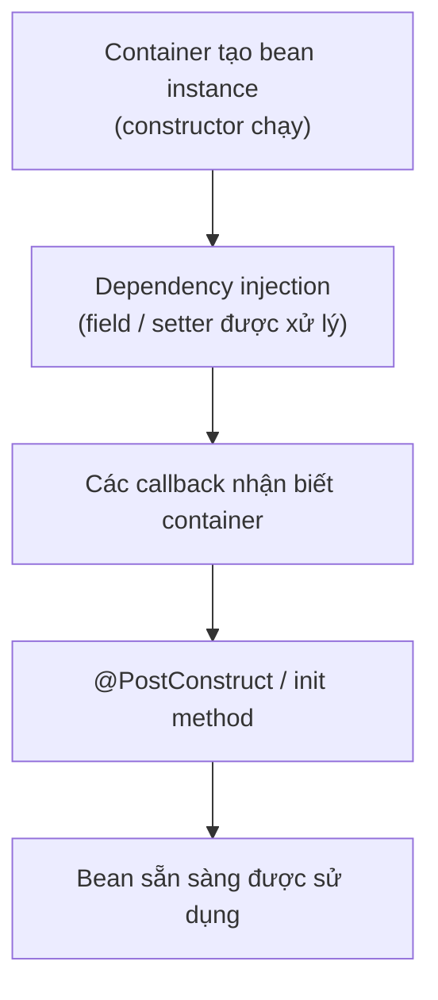
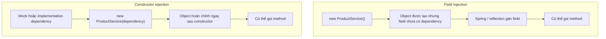

# Tiêm trực tiếp vào trường dữ liệu và ảnh hưởng tới khả năng kiểm thử

Spring hỗ trợ nhiều cách đưa dependency vào một bean. Một cách khá dễ bắt gặp trong code cũ là **field injection**: đặt `@Autowired` trực tiếp lên field để Spring gán dependency vào trường dữ liệu sau khi tạo object. Cách này ngắn và nhìn qua có vẻ tiện, nhưng nó làm dependency bị ẩn khỏi constructor, khiến object khó được khởi tạo hợp lệ bằng Java thông thường và làm unit test phải dựa vào Spring context hoặc kỹ thuật hỗ trợ như reflection.

Trong chương **Tiêm phụ thuộc** của *Spring Boot Fundamentals*, bài này tập trung vào field injection và hệ quả đối với khả năng kiểm thử. Ta sẽ:

- Nhận diện field injection và hiểu thời điểm Spring thực hiện việc gán field.
- So sánh field injection với constructor injection và setter injection.
- Viết cùng một service theo hai cách để thấy sự khác nhau khi kiểm thử.
- Hiểu vì sao test dùng Spring context thường nặng hơn một unit test thuần.
- Biết khi nào cần dependency tùy chọn và cách biểu đạt nó rõ ràng.
- Chọn cách tiêm phù hợp cho code mới và xử lý code legacy.

Ví dụ sử dụng Java 21, Spring Boot 3.x, JUnit 5 và Mockito. Các đoạn test giả định dự án có `spring-boot-starter-test`.

## 1. Field injection là gì?

Field injection là cách tiêm dependency trực tiếp vào field của một class, thường thông qua `@Autowired`:

```java
package com.example.demo.service;

import org.springframework.beans.factory.annotation.Autowired;
import org.springframework.stereotype.Service;

@Service
public class ProductService {

    @Autowired
    private ProductCatalog productCatalog;

    public String displayName(long productId) {
        return productCatalog.findName(productId);
    }
}
```

Trong ví dụ, `ProductService` cần `ProductCatalog` để thực hiện công việc. Bạn không thấy dependency đó trong constructor. Spring vẫn có thể cung cấp nó vì container xử lý annotation injection trên field khi tạo bean.

Một interface đơn giản để minh họa:

```java
package com.example.demo.catalog;

public interface ProductCatalog {
    String findName(long productId);
}
```

Một implementation có thể được đăng ký thành bean:

```java
package com.example.demo.catalog;

import org.springframework.stereotype.Component;

@Component
public class InMemoryProductCatalog implements ProductCatalog {

    @Override
    public String findName(long productId) {
        return switch ((int) productId) {
            case 1 -> "Keyboard";
            case 2 -> "Mouse";
            default -> "Unknown product";
        };
    }
}
```

Khi Spring khởi tạo `ProductService`, nó tìm một bean phù hợp với kiểu `ProductCatalog` và gán vào field `productCatalog`. Sau khi injection hoàn tất, method `displayName` có thể sử dụng dependency.

### Field injection không phải phép gán tự động của Java

Nếu bạn tự tạo object:

```java
ProductService service = new ProductService();
System.out.println(service.displayName(1));
```

thì Java không biết gì về `@Autowired`. Field `productCatalog` chưa được gán và vẫn là `null`. Khi gọi method, bạn có thể gặp `NullPointerException`.

Điều này là một điểm khác biệt cốt lõi: **object chỉ hoạt động đúng sau khi được Spring container xử lý**, dù constructor Java của nó đã chạy xong.

## 2. Spring thực hiện field injection vào thời điểm nào?

Để hiểu vì sao field injection ảnh hưởng đến khả năng kiểm thử, hãy nhìn thứ tự khởi tạo bean theo mô hình đơn giản:



Với field injection:

1. Spring tạo instance của `ProductService` bằng constructor.
2. Cơ chế xử lý annotation injection tìm field mang `@Autowired`.
3. Spring resolve dependency theo kiểu/qualifier và gán vào field.
4. Các bước callback khởi tạo tiếp theo được thực hiện; bean trở nên sẵn sàng để sử dụng.

Vì dependency được gán **sau constructor**, constructor không thể dùng field đó như một dependency đã sẵn sàng. Nếu constructor gọi một method phụ thuộc vào `productCatalog`, field vẫn có thể là `null` tại thời điểm đó.

Spring có thể inject vào field `private` nhờ cơ chế reflection. Điều đó không có nghĩa field private tự trở nên public hoặc Java tự gọi setter; container truy cập và gán field trong quá trình xử lý bean.

Ví dụ không nên viết:

```java
@Service
public class ProductService {

    @Autowired
    private ProductCatalog productCatalog;

    public ProductService() {
        // Không nên sử dụng productCatalog ở đây.
        // Field injection chưa diễn ra.
    }
}
```

Nếu logic khởi tạo cần dependency, constructor injection diễn đạt đúng thứ tự và yêu cầu của class hơn.

## 3. Ưu điểm ngắn hạn và nhược điểm dài hạn

Field injection có một ưu điểm dễ thấy: code ngắn, không cần viết constructor hay setter. Trong một class nhỏ, nó có thể trông rất tiện.

Nhưng khi số lượng dependency tăng, những bất lợi trở nên rõ hơn:

| Khía cạnh | Field injection | Ảnh hưởng |
|---|---|---|
| Khả năng nhìn thấy dependency | Dependency nằm rải rác ở field | Người đọc phải xem toàn bộ class mới biết class cần gì. |
| Tạo object bằng Java | Constructor mặc định vẫn có thể tạo object nhưng dependency chưa được gán | Object có thể ở trạng thái không hợp lệ nếu dùng ngoài Spring. |
| Unit test | Thường phải khởi tạo Spring context, dùng reflection hoặc cơ chế tiêm của test framework | Test khó viết gọn và phụ thuộc framework hơn. |
| Tính bất biến | Field thường không thể khai báo `final` theo cách injection thông thường | Dependency có thể bị thay đổi sau khi object được tạo. |
| Kiểm tra dependency bắt buộc | Lỗi có thể chỉ lộ ra khi Spring xử lý field hoặc khi method được gọi | Hợp đồng của constructor không thể hiện dependency bắt buộc. |
| Constructor và khởi tạo | Dependency chưa có trong lúc constructor chạy | Không phù hợp khi invariant khởi tạo cần dependency. |
| Refactor | Có thể thêm field injection mà không thay chữ ký constructor | Dễ làm class tích lũy nhiều dependency ẩn. |

Field injection không khiến unit test bất khả thi. Vẫn có thể dùng Spring Test, Mockito hoặc reflection để gán field. Vấn đề là **test phải bù đắp cho một thiết kế không thể hiện dependency ngay trong constructor**.

## 4. Constructor injection: dependency hiện rõ ngay khi tạo object

Viết lại `ProductService`:

```java
package com.example.demo.service;

import com.example.demo.catalog.ProductCatalog;
import org.springframework.stereotype.Service;

@Service
public class ProductService {

    private final ProductCatalog productCatalog;

    public ProductService(ProductCatalog productCatalog) {
        this.productCatalog = productCatalog;
    }

    public String displayName(long productId) {
        return productCatalog.findName(productId);
    }
}
```

Spring tìm constructor duy nhất và cung cấp bean `ProductCatalog` phù hợp. Không cần `@Autowired` trên constructor duy nhất trong Spring hiện đại.

Sự khác biệt không chỉ là số dòng code:

- Dependency trở thành một phần của **hợp đồng tạo object**.
- Field có thể khai báo `final`.
- Không thể tạo một `ProductService` hợp lệ mà không truyền `ProductCatalog`.
- Một unit test có thể tự tạo mock và truyền vào constructor, không cần khởi động Spring.

Ví dụ dùng Java thuần:

```java
ProductCatalog catalog = productId -> "Test product";
ProductService service = new ProductService(catalog);

System.out.println(service.displayName(1));
```

Đây là một object có dependency hợp lệ dù không có `ApplicationContext`. Chính đặc điểm đó giúp class dễ kiểm thử và có thể dùng trong những môi trường không khởi tạo Spring.

## 5. Kiểm thử field injection: phải dựng container hoặc gán field

Hãy tưởng tượng ta cần kiểm thử `ProductService.displayName` mà không muốn truy cập database, API hoặc hệ thống thật. Ta có thể tạo một mock `ProductCatalog`.

### 5.1. Vì sao cách tạo object thông thường thất bại?

Với phiên bản field injection:

```java
ProductService service = new ProductService();
service.displayName(1);
```

Field `productCatalog` không được gán. Test không thể đơn giản truyền mock vào constructor vì class không khai báo constructor nhận dependency.

### 5.2. Dùng Spring context để test

Một cách là khởi động Spring context và yêu cầu Spring tiêm dependency:

```java
package com.example.demo.service;

import static org.assertj.core.api.Assertions.assertThat;

import org.junit.jupiter.api.Test;
import org.springframework.beans.factory.annotation.Autowired;
import org.springframework.boot.test.context.SpringBootTest;

@SpringBootTest
class ProductServiceSpringTest {

    @Autowired
    ProductService productService;

    @Test
    void shouldReturnProductName() {
        assertThat(productService.displayName(1))
                .isEqualTo("Keyboard");
    }
}
```

Test này kiểm tra wiring và hành vi với implementation thật `InMemoryProductCatalog`. Tuy nhiên, `@SpringBootTest` thường khởi tạo application context của ứng dụng: component scan, auto-configuration và những bean liên quan có thể được tạo. Nó phù hợp cho integration test hoặc kiểm tra wiring, nhưng thường quá rộng nếu mục tiêu chỉ là test một method nhỏ.

Nếu ứng dụng có database, message broker hoặc nhiều cấu hình tự động, context test có thể chậm và cần thêm cấu hình. Test cũng có thể thất bại vì một thành phần không liên quan đến logic `displayName`.

### 5.3. Dùng reflection để gán field trong unit test

Nếu vẫn cần kiểm thử class field injection mà không khởi động toàn bộ Spring context, có thể dùng `ReflectionTestUtils` trong Spring Test:

```java
package com.example.demo.service;

import static org.assertj.core.api.Assertions.assertThat;
import static org.mockito.Mockito.mock;
import static org.mockito.Mockito.when;

import com.example.demo.catalog.ProductCatalog;
import org.junit.jupiter.api.Test;
import org.springframework.test.util.ReflectionTestUtils;

class ProductServiceFieldInjectionTest {

    @Test
    void shouldUseInjectedCatalog() {
        ProductCatalog catalog = mock(ProductCatalog.class);
        when(catalog.findName(7)).thenReturn("Test keyboard");

        ProductService service = new ProductService();
        ReflectionTestUtils.setField(service, "productCatalog", catalog);

        assertThat(service.displayName(7)).isEqualTo("Test keyboard");
    }
}
```

Đoạn test này giả định `ProductService` đang là **phiên bản field injection có constructor mặc định**, không phải phiên bản constructor injection ở mục trước. `ReflectionTestUtils.setField` truy cập field theo tên và gán mock vào đó.

Test chạy được, nhưng có một chi tiết cần suy nghĩ: nếu đổi tên field `productCatalog`, test cũng phải đổi chuỗi `"productCatalog"`. Test biết đến cấu trúc nội bộ của class và cần kỹ thuật reflection chỉ để đưa dependency vào object.

Đây là một workaround hợp lệ khi xử lý code legacy hoặc một số tình huống kiểm thử đặc thù, nhưng không phải lý do tốt để chọn field injection cho code mới.

## 6. Kiểm thử constructor injection bằng unit test thuần

Với phiên bản constructor injection, test đơn giản hơn:

```java
package com.example.demo.service;

import static org.assertj.core.api.Assertions.assertThat;
import static org.mockito.Mockito.mock;
import static org.mockito.Mockito.verify;
import static org.mockito.Mockito.when;

import com.example.demo.catalog.ProductCatalog;
import org.junit.jupiter.api.Test;

class ProductServiceTest {

    @Test
    void shouldReturnCatalogName() {
        ProductCatalog catalog = mock(ProductCatalog.class);
        when(catalog.findName(7)).thenReturn("Test keyboard");

        ProductService service = new ProductService(catalog);

        assertThat(service.displayName(7)).isEqualTo("Test keyboard");
        verify(catalog).findName(7);
    }
}
```

Test chỉ cần:

1. Tạo mock `ProductCatalog`.
2. Định nghĩa kết quả mock trả về khi nhận `findName(7)`.
3. Tạo `ProductService` bằng constructor và truyền mock.
4. Gọi method cần test, kiểm tra kết quả và tương tác.

Không có `@SpringBootTest`, không tạo `ApplicationContext`, không cần component scan, không cần database và không dùng reflection.

Sơ đồ so sánh:



Khác biệt quan trọng là **đường tạo object trong test**. Với constructor injection, test sử dụng đúng API công khai của class để cung cấp dependency. Với field injection, test cần một bước bổ sung để sửa trạng thái nội bộ sau khi tạo object.

## 7. Dependency bắt buộc và tính bất biến

Hãy xem một service cần ba dependency:

```java
@Service
public class CheckoutService {
    @Autowired
    private CartRepository cartRepository;

    @Autowired
    private PaymentGateway paymentGateway;

    @Autowired
    private ReceiptSender receiptSender;
}
```

Người đọc chỉ biết class có ba field. Constructor không thể hiện rằng ba dependency này là bắt buộc để tạo một checkout service hợp lệ.

Constructor injection thể hiện hợp đồng trực tiếp:

```java
@Service
public class CheckoutService {
    private final CartRepository cartRepository;
    private final PaymentGateway paymentGateway;
    private final ReceiptSender receiptSender;

    public CheckoutService(
            CartRepository cartRepository,
            PaymentGateway paymentGateway,
            ReceiptSender receiptSender) {
        this.cartRepository = cartRepository;
        this.paymentGateway = paymentGateway;
        this.receiptSender = receiptSender;
    }
}
```

Một object `CheckoutService` không thể được tạo qua constructor này nếu thiếu một trong ba dependency. Java compiler và chữ ký constructor giúp người gọi nhìn thấy yêu cầu trước khi chạy ứng dụng.

Các field `final` cũng thể hiện rằng reference dependency không được gán lại sau constructor. Điều này không tự làm mọi object trong dependency bất biến, nhưng làm cấu trúc phụ thuộc của service ổn định hơn.

### Dependency bắt buộc không nên bị biến thành tùy chọn một cách vô tình

Với field injection, người viết có thể dùng `@Autowired(required = false)` để không yêu cầu dependency. Khi dependency không có, field có thể vẫn là `null`. Sau đó code phải kiểm tra null ở mọi nơi cần dùng.

Nếu dependency thực sự tùy chọn, hãy biểu đạt ý định đó rõ ràng bằng kiểu dữ liệu hoặc API phù hợp, ví dụ:

```java
@Service
public class ReportService {
    private final Optional<ReportExporter> exporter;

    public ReportService(Optional<ReportExporter> exporter) {
        this.exporter = exporter;
    }

    public void exportIfAvailable(Report report) {
        exporter.ifPresent(value -> value.export(report));
    }
}
```

Spring hỗ trợ giải quyết `Optional<T>` khi tiêm dependency; nếu không có bean phù hợp, giá trị có thể là `Optional.empty()`. Với trường hợp cần tra một dependency nhiều lần hoặc cần quyết định lúc runtime, `ObjectProvider<T>` cũng là một lựa chọn. Không nên dùng optional injection chỉ để che giấu một dependency thực tế luôn bắt buộc.

## 8. Setter injection và khi nào nó hợp lý?

Setter injection đưa dependency qua một method setter:

```java
package com.example.demo.service;

import com.example.demo.catalog.ProductCatalog;
import org.springframework.beans.factory.annotation.Autowired;
import org.springframework.stereotype.Service;

@Service
public class ProductService {

    private ProductCatalog productCatalog;

    @Autowired
    public void setProductCatalog(ProductCatalog productCatalog) {
        this.productCatalog = productCatalog;
    }

    public String displayName(long productId) {
        return productCatalog.findName(productId);
    }
}
```

Giống field injection, dependency được cung cấp sau khi object đã được tạo. Khác biệt là việc gán đi qua method có tên, có thể đặt validation hoặc xử lý phụ trợ trong setter. Tuy nhiên, object vẫn có thể tồn tại trước khi setter được gọi và dependency vẫn không bắt buộc bởi constructor.

Setter injection có thể phù hợp cho **dependency tùy chọn** hoặc một cấu hình cần thay đổi sau khi object được tạo, nhưng nên dùng có chủ đích. Nếu dependency là điều kiện bắt buộc để object hoạt động, constructor injection thường rõ ràng hơn.

| Kiểu tiêm | Thời điểm dependency được cung cấp | Phù hợp nhất với |
|---|---|---|
| Constructor | Trong lúc tạo object | Dependency bắt buộc |
| Setter | Sau khi tạo object, qua setter | Dependency tùy chọn hoặc có thể cấu hình sau |
| Field | Sau khi tạo object, container gán trực tiếp field | Code legacy hoặc trường hợp framework đặc thù có lý do rõ ràng |

## 9. Vì sao field injection làm test dễ phụ thuộc Spring context?

Hãy nhìn vào một unit test thuần:

```java
ProductService service = new ProductService();
```

Với field injection, object chưa hoàn chỉnh. Để test gọi method an toàn, bạn phải:

- khởi động Spring để Spring tự inject;
- dùng reflection để gán field;
- dùng test framework có khả năng inject field;
- hoặc thêm setter/constructor phụ chỉ phục vụ test, làm API class phức tạp hơn.

Nếu chọn `@SpringBootTest`, test không còn chỉ kiểm tra một class. Nó thường khởi động cả application context và các cấu hình liên quan. Đôi khi đó chính là điều bạn muốn — ví dụ kiểm tra component wiring, auto-configuration hoặc transaction. Nhưng nếu mục tiêu chỉ là kiểm tra một nhánh logic, unit test thuần thường nhanh, ít phụ thuộc và dễ khoanh vùng lỗi hơn.

Constructor injection không làm test tự động đúng, nhưng nó **làm dependency có thể cung cấp trực tiếp** và cho phép test chạy mà không cần container.

### Unit test và integration test không cạnh tranh nhau

| Unit test | Spring integration test |
|---|---|
| Tạo class trực tiếp, truyền mock/fake qua constructor | Khởi tạo một phần hoặc toàn bộ Spring context |
| Nhanh, phạm vi nhỏ | Kiểm tra wiring và tương tác giữa nhiều thành phần |
| Không cần component scan | Có thể cần component scan và auto-configuration |
| Phù hợp kiểm tra logic của service | Phù hợp kiểm tra cấu hình bean, persistence, transaction, web integration |

Một dự án tốt thường kết hợp cả hai. Không nên cố biến mọi unit test thành `@SpringBootTest`, và cũng không nên chỉ dựa vào unit test để kết luận toàn bộ cấu hình Spring hoạt động đúng.

## 10. Dùng Mockito `@InjectMocks` có giải quyết nhược điểm field injection không?

Mockito có annotation `@InjectMocks` để hỗ trợ tạo object cần test và đưa các mock phù hợp vào. Ví dụ:

```java
@ExtendWith(MockitoExtension.class)
class ProductServiceTest {

    @Mock
    ProductCatalog catalog;

    @InjectMocks
    ProductService service;
}
```

Mockito có thể thử tiêm qua constructor, setter hoặc field theo quy tắc của nó. Cách này tiện cho test, nhưng cần hiểu:

- Mockito injection **không phải Spring dependency injection**.
- Nó không chứng minh component scan hay Spring context hoạt động.
- Nó có thể dùng reflection để gán field, vì vậy test vẫn có thể che đi việc dependency bị ẩn.
- Nếu constructor injection đã có, test thường rõ ràng hơn khi tạo class trực tiếp và truyền mock qua constructor.

`@InjectMocks` hữu ích trong nhiều test Mockito, nhưng không nên dùng nó làm lý do để chọn field injection trong code production.

## 11. Field injection và các trường hợp dễ gặp lỗi

### 11.1. Field là `null` khi object được tạo ngoài Spring

Một class có `@Autowired private ProductCatalog productCatalog` không thể tự bảo đảm dependency đã có khi người khác gọi `new ProductService()`. Đây là lỗi thường thấy trong unit test, utility code hoặc một đối tượng được tạo bởi thư viện ngoài container.

### 11.2. Không thể dùng field dependency trong constructor

Spring tạo instance trước rồi mới xử lý field injection. Nếu constructor cần gọi dependency, field chưa được gán. Constructor injection giải quyết trực tiếp vấn đề thứ tự này.

### 11.3. Field injection không hỗ trợ static field theo cách thông thường

`@Autowired` không được thiết kế để tiêm vào static field. Dependency thuộc về instance bean, vì vậy hãy tránh tạo trạng thái global static rồi kỳ vọng container quản lý nó như một field thông thường.

### 11.4. Field thường không thể là `final` theo cách tiêm này

Field injection thông thường yêu cầu Spring gán giá trị sau khi object được tạo. Một field `final` đã phải được khởi tạo trong constructor hoặc tại điểm khai báo; do đó field injection không phải lựa chọn thích hợp cho dependency muốn giữ bất biến.

### 11.5. Dependency cycle

Khi A cần B và B cần A, field/setter injection đôi khi có thể làm một số chu trình phụ thuộc được xử lý theo cơ chế tham chiếu sớm của Spring. Tuy nhiên, Spring Boot mặc định không khuyến khích và thường không cho phép circular references trong cấu hình ứng dụng mới. Dùng field injection để né lỗi constructor cycle là dấu hiệu thiết kế cần xem lại, không phải cách chữa tốt.

Nên tìm cách tách trách nhiệm, đảo chiều dependency qua interface, đưa phần phối hợp vào một service thứ ba hoặc thiết kế lại luồng gọi để loại bỏ chu trình.

## 12. Annotation injection khác nhau thế nào?

Trong Spring, field injection có thể được thực hiện bằng những annotation tương thích với cơ chế xử lý dependency injection:

| Annotation | Ý nghĩa thường gặp |
|---|---|
| `@Autowired` | Annotation của Spring để tự động resolve dependency theo kiểu và các quy tắc liên quan. |
| `@Qualifier` | Thu hẹp lựa chọn khi có nhiều bean cùng kiểu, có thể dùng trên field/parameter. |
| `@Resource` | Annotation chuẩn Jakarta để tìm resource, thường có quy tắc dựa trên tên trước rồi đến kiểu. |
| `@Inject` | Annotation chuẩn Jakarta cho dependency injection; Spring hỗ trợ trong môi trường phù hợp. |

Ví dụ:

```java
@Autowired
@Qualifier("friendlyFormatter")
private TextFormatter formatter;
```

Đoạn này cho Spring biết cần tiêm bean `TextFormatter` có qualifier/name phù hợp. Nó vẫn là **field injection** vì annotation được đặt trực tiếp trên field. Thay `@Autowired` bằng `@Inject` hoặc `@Resource` không làm dependency tự xuất hiện trong constructor và không loại bỏ những hệ quả testability của field injection.

## 13. Dùng Lombok có giúp constructor injection gọn hơn?

Nếu dự án đã dùng Lombok, `@RequiredArgsConstructor` có thể tạo constructor cho các field `final` hoặc field được đánh dấu `@NonNull`:

```java
package com.example.demo.service;

import com.example.demo.catalog.ProductCatalog;
import lombok.RequiredArgsConstructor;
import org.springframework.stereotype.Service;

@Service
@RequiredArgsConstructor
public class ProductService {

    private final ProductCatalog productCatalog;

    public String displayName(long productId) {
        return productCatalog.findName(productId);
    }
}
```

Lombok sinh constructor tương đương về ý tưởng với:

```java
public ProductService(ProductCatalog productCatalog) {
    this.productCatalog = productCatalog;
}
```

Spring vẫn dùng constructor duy nhất để tiêm dependency. Bạn không cần thêm `@Autowired` chỉ vì constructor được Lombok sinh.

Tuy nhiên, đừng thêm Lombok vào dự án chỉ để tránh viết một constructor đơn giản. Hãy dùng khi dự án đã chấp nhận Lombok và nhóm phát triển hiểu annotation processing.

## 14. Cách chuyển một class legacy từ field injection sang constructor injection

Giả sử code cũ:

```java
@Service
public class InvoiceService {
    @Autowired
    private InvoiceRepository invoiceRepository;

    @Autowired
    private TaxCalculator taxCalculator;

    public Invoice calculate(long id) {
        Invoice invoice = invoiceRepository.findById(id).orElseThrow();
        invoice.setTax(taxCalculator.calculate(invoice));
        return invoice;
    }
}
```

Chuyển sang:

```java
@Service
public class InvoiceService {
    private final InvoiceRepository invoiceRepository;
    private final TaxCalculator taxCalculator;

    public InvoiceService(
            InvoiceRepository invoiceRepository,
            TaxCalculator taxCalculator) {
        this.invoiceRepository = invoiceRepository;
        this.taxCalculator = taxCalculator;
    }

    public Invoice calculate(long id) {
        Invoice invoice = invoiceRepository.findById(id).orElseThrow();
        invoice.setTax(taxCalculator.calculate(invoice));
        return invoice;
    }
}
```

Việc chuyển đổi thường gồm:

1. Liệt kê các dependency field đang được tiêm.
2. Đưa những dependency bắt buộc vào constructor.
3. Gán vào field `private final`.
4. Xóa `@Autowired` khỏi các field đã chuyển.
5. Cập nhật những nơi tự tạo class bằng `new` (nếu có) để truyền dependency.
6. Viết unit test bằng mock/fake qua constructor.
7. Chạy test Spring context thích hợp để xác nhận wiring vẫn hoạt động.

Nếu class có quá nhiều dependency, đừng chỉ chuyển hết thành constructor dài rồi coi như đã thiết kế tốt. Danh sách dependency dài có thể cho thấy class đang có quá nhiều trách nhiệm hoặc đang phụ thuộc quá nhiều thành phần. Constructor injection làm vấn đề lộ rõ, từ đó giúp bạn có cơ hội phân chia trách nhiệm.

## 15. Một ví dụ test hoàn chỉnh với fake thay vì Mockito

Không phải test nào cũng cần mock framework. Với interface nhỏ, bạn có thể tạo fake trực tiếp:

```java
package com.example.demo.service;

import static org.assertj.core.api.Assertions.assertThat;

import com.example.demo.catalog.ProductCatalog;
import org.junit.jupiter.api.Test;

class ProductServiceFakeTest {

    @Test
    void shouldUseProvidedCatalog() {
        ProductCatalog fakeCatalog = productId -> {
            if (productId == 10) {
                return "Test monitor";
            }
            return "Unknown";
        };

        ProductService service = new ProductService(fakeCatalog);

        assertThat(service.displayName(10)).isEqualTo("Test monitor");
        assertThat(service.displayName(99)).isEqualTo("Unknown");
    }
}
```

Fake này chỉ là một implementation nhỏ phục vụ test. Nó làm test độc lập với Spring và không cần reflection. Người đọc nhìn constructor của `ProductService` sẽ hiểu ngay test cung cấp dependency nào.

Đây là một lợi ích thiết kế rộng hơn testability: dependency injection qua constructor khiến code phụ thuộc vào **abstraction** (interface) và cho phép thay implementation ở từng môi trường mà không thay logic của service.

## 16. Khi nào field injection vẫn xuất hiện?

Bạn có thể bắt gặp field injection trong:

- Dự án legacy được viết theo phong cách Spring cũ.
- Ví dụ ngắn hoặc mã thử nghiệm ưu tiên số dòng ít.
- Một số tích hợp framework hoặc tình huống đặc thù có lý do kỹ thuật cụ thể.
- Test code dùng reflection/test utilities để gán field.

Việc bắt gặp không có nghĩa phải sửa tất cả ngay lập tức. Khi thay đổi một class, hãy cân nhắc chuyển dependency bắt buộc sang constructor nếu không phá vỡ hợp đồng hoặc cách framework khởi tạo class. Đối với những class do framework tạo theo quy tắc riêng, cần hiểu lifecycle của framework trước khi thay đổi.

Với code ứng dụng Spring Boot thông thường, **constructor injection là lựa chọn mặc định nên ưu tiên**. Field injection không bị cấm bởi Spring; nó chỉ có trade-off khiến dependency khó nhìn thấy và class khó tạo/test độc lập hơn.

## 17. Bài thực hành: so sánh hai cách tiêm bằng cùng một logic

Hãy tạo interface `ProductCatalog` và một method `findName(long id)` như mục 1. Sau đó thực hiện:

### Bài A — Phiên bản field injection

Viết `ProductService` với:

```java
@Autowired
private ProductCatalog productCatalog;
```

Tạo unit test thuần, thử khởi tạo bằng `new ProductService()` và quan sát trạng thái dependency. Dùng `ReflectionTestUtils` để gán mock, rồi xác nhận test chạy.

**Cần giải thích:** tại sao test cần reflection? Điều gì khiến object chưa sẵn sàng ngay sau constructor?

### Bài B — Phiên bản constructor injection

Đổi service sang:

```java
private final ProductCatalog productCatalog;

public ProductService(ProductCatalog productCatalog) {
    this.productCatalog = productCatalog;
}
```

Viết lại test, tạo mock rồi truyền trực tiếp qua constructor.

**Cần giải thích:** test có cần Spring context không? Chữ ký constructor cho biết điều gì về hợp đồng của service?

### Bài C — Đưa một dependency thành tùy chọn

Giả sử service chỉ gửi thông báo bổ sung khi có `NotificationSender`. Dùng `Optional<NotificationSender>` trong constructor và viết test cho cả hai trường hợp có/không có dependency.

**Cần giải thích:** tại sao biểu đạt tùy chọn bằng kiểu dữ liệu rõ ràng hơn một field có thể null do `@Autowired(required = false)`?

### Bài D — Kiểm tra wiring của Spring riêng biệt

Tạo một test `@SpringBootTest` hoặc context test nhỏ để xác nhận Spring có thể tạo `ProductService` và tiêm `ProductCatalog`. So sánh mục tiêu test này với unit test logic ở bài B.

**Cần giải thích:** test nào kiểm tra business logic nhanh, test nào kiểm tra wiring và cấu hình container?

## 18. Quy trình chọn kiểu injection trong dự án

Khi viết một bean mới, hãy đặt câu hỏi:

1. Dependency có bắt buộc để object hoạt động đúng không? Nếu có, ưu tiên constructor.
2. Dependency có cần thay đổi sau khi object được tạo không? Nếu có lý do rõ ràng, cân nhắc setter.
3. Dependency có thực sự tùy chọn không? Dùng `Optional`, `ObjectProvider` hoặc API phù hợp thay vì để field null khó đoán.
4. Có thể test class bằng Java thuần và mock/fake qua constructor không?
5. Class có quá nhiều dependency, cho thấy cần tách trách nhiệm không?
6. Có một framework lifecycle đặc biệt yêu cầu cách khởi tạo riêng không?

Một bảng quyết định ngắn:

| Nhu cầu | Cách thường nên chọn |
|---|---|
| Dependency bắt buộc | Constructor injection |
| Dependency tùy chọn, cấu hình sau khi tạo | Setter injection hoặc kiểu tùy chọn được biểu đạt rõ |
| Cần lấy instance theo yêu cầu/lúc runtime | `ObjectProvider<T>` hoặc factory abstraction phù hợp |
| Code legacy đang dùng field injection | Giữ ổn định trong thay đổi nhỏ, chuyển dần khi có cơ hội và test phù hợp |
| Muốn unit test class không khởi động Spring | Constructor injection với mock/fake |

## 19. Những câu hỏi tự đánh giá

1. `@Autowired` trên field được Spring xử lý ở giai đoạn nào trong quá trình tạo bean?
2. Vì sao `new ProductService()` không tự có `ProductCatalog` dù class mang `@Service`?
3. Field injection khác constructor injection về khả năng thể hiện dependency bắt buộc như thế nào?
4. Vì sao constructor injection thường cho phép khai báo dependency bằng `private final`?
5. Khi nào `@SpringBootTest` là lựa chọn phù hợp, và khi nào nó quá rộng cho một unit test?
6. `ReflectionTestUtils.setField` giúp gì trong test field injection và cái giá của cách làm đó là gì?
7. Mockito `@InjectMocks` có phải Spring dependency injection không?
8. Setter injection khác field injection ở điểm nào, và khi nào nó hữu ích?
9. Vì sao không nên dùng field injection để né circular dependency?
10. Nếu một class có tám dependency bắt buộc trong constructor, điều đó có thể báo hiệu vấn đề thiết kế nào?

### Mẫu giải thích hoàn chỉnh

> Field injection là cách Spring gán dependency trực tiếp vào field, thường qua `@Autowired`, sau khi object đã được tạo. Vì dependency không xuất hiện trong constructor, object có thể được tạo bằng Java thuần nhưng vẫn thiếu dependency và không thể sử dụng an toàn. Unit test phải khởi động Spring context hoặc dùng reflection/test framework để gán field. Constructor injection đưa dependency vào constructor ngay lúc tạo object, cho phép field là `final` và làm rõ những dependency bắt buộc. Test có thể tạo mock/fake rồi truyền trực tiếp vào constructor mà không cần Spring. Vì vậy, với bean ứng dụng Spring Boot thông thường, constructor injection là lựa chọn nên ưu tiên; field injection chủ yếu nên được hiểu để đọc và duy trì code hiện có.

Khi có thể viết cùng một unit test bằng cách tạo service trực tiếp, truyền dependency qua constructor và kiểm tra hành vi mà không khởi động Spring, bạn đã thấy rõ mối liên hệ giữa **cách thiết kế dependency** và **khả năng kiểm thử**.
