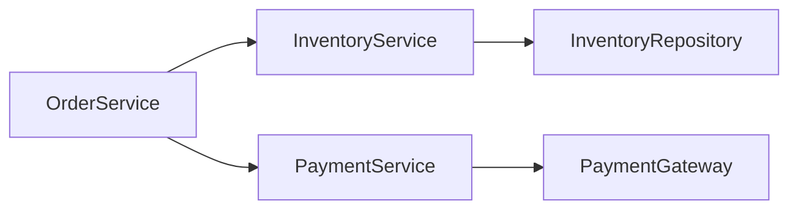
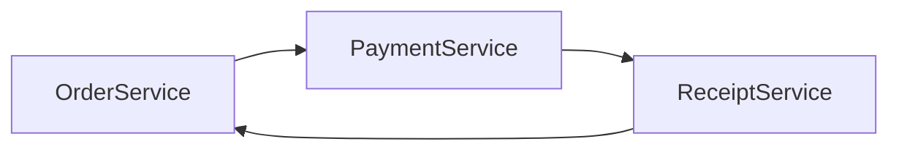
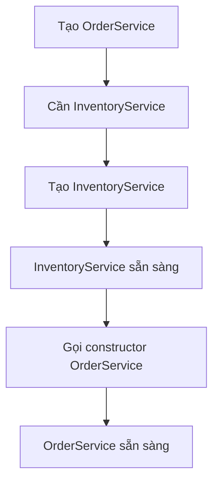
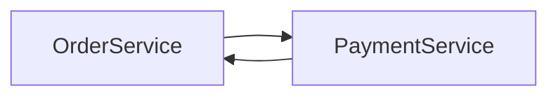
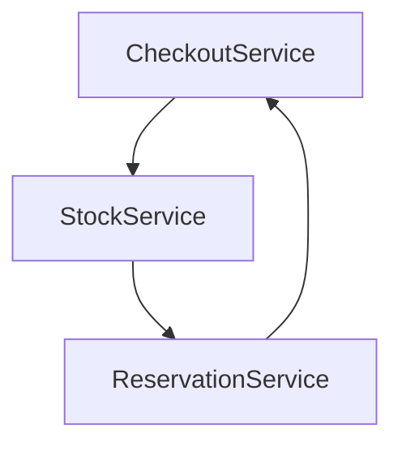
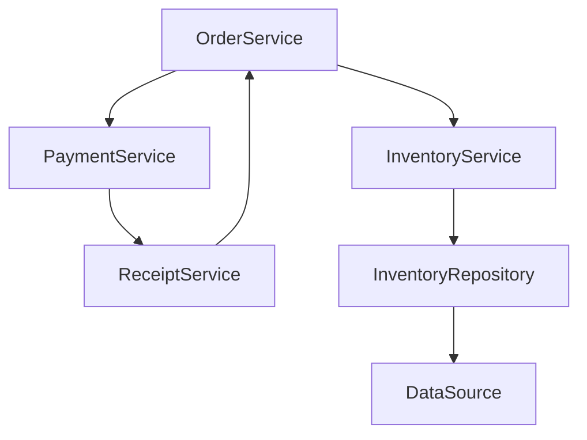
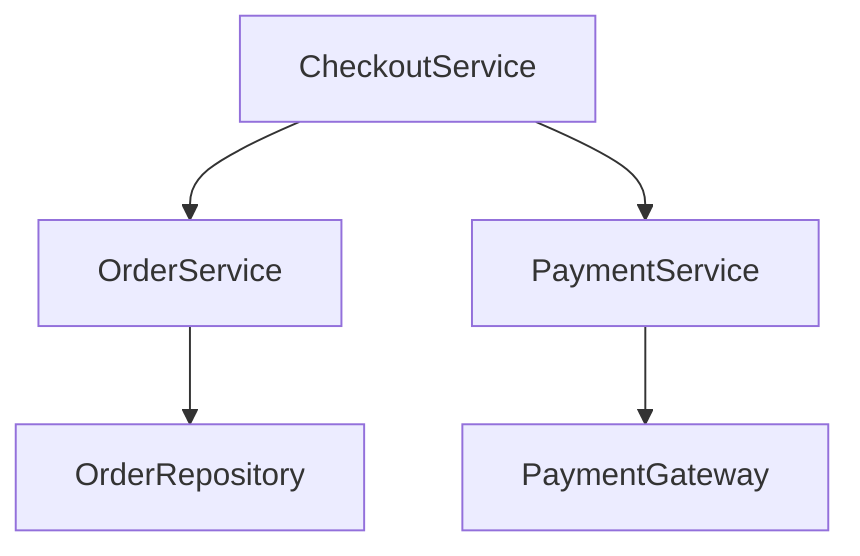
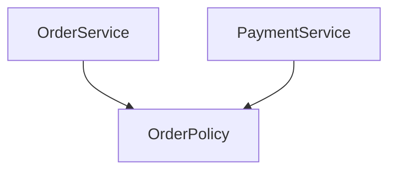
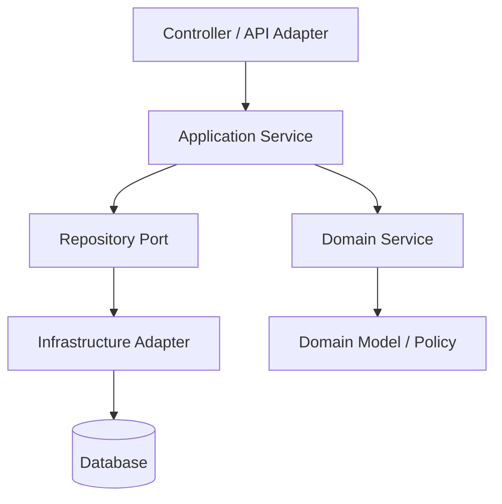

# Dependency vòng và nguyên nhân lỗi khi tạo đồ thị bean

Trong ứng dụng Spring Boot, một bean thường cần những bean khác để thực hiện công việc. Ví dụ, `OrderService` cần `PaymentService` để xử lý thanh toán; `PaymentService` lại có thể cần `OrderService` để kiểm tra hoặc cập nhật đơn hàng. Khi các dependency quay lại phụ thuộc lẫn nhau, container có thể gặp **dependency vòng (circular dependency)** trong lúc tạo bean.

Dependency vòng là một nguyên nhân phổ biến khiến Spring context không khởi động được. Để xử lý đúng, cần hiểu **đồ thị dependency**, cách Spring tạo bean, vì sao constructor injection phát hiện vòng lặp và cách thiết kế lại ranh giới trách nhiệm để loại bỏ quan hệ phụ thuộc không cần thiết.

## 1. Dependency giữa các bean là gì?

Một bean có thể khai báo dependency thông qua constructor, field, setter hoặc phương thức cấu hình. Ví dụ:

```java
@Service
public class OrderService {
    private final InventoryService inventoryService;

    public OrderService(InventoryService inventoryService) {
        this.inventoryService = inventoryService;
    }
}
```

Để tạo `OrderService`, Spring phải cung cấp một instance `InventoryService` cho constructor. Vì vậy `OrderService` **phụ thuộc vào** `InventoryService`.

Trong bài này, mũi tên đi từ bean **đang cần dependency** đến bean **mà nó cần**:

```text
OrderService  ─────depends on─────>  InventoryService
```

Một hệ thống có nhiều bean có thể được mô hình hóa bằng đồ thị có hướng:

- **Đỉnh (node):** bean hoặc bean definition.
- **Cạnh (edge):** quan hệ một bean cần bean khác để tạo/cấu hình.
- **Đường đi (path):** chuỗi dependency giữa các bean.
- **Chu trình (cycle):** đường đi bắt đầu ở một bean và quay trở lại chính bean đó.

Ví dụ không có chu trình:



`OrderService` cần `InventoryService` và `PaymentService`; mỗi service cần một dependency riêng. Không có đường dependency quay trở lại bean ban đầu. Đây là đồ thị có thể sắp xếp theo thứ tự tạo phù hợp.

Ngược lại:



Ta có chu trình:

```text
OrderService
    → PaymentService
        → ReceiptService
            → OrderService
```

Muốn tạo `OrderService` cần `PaymentService`. Muốn tạo `PaymentService` cần `ReceiptService`. Muốn tạo `ReceiptService` lại cần `OrderService`. Không có điểm bắt đầu tự nhiên để hoàn tất chuỗi constructor dependency.

Một vòng có thể chỉ gồm hai bean (`A → B → A`) hoặc nhiều bean hơn (`A → B → C → D → A`). Vòng gián tiếp thường khó nhận ra hơn vì từng constructor nhìn riêng lẻ có vẻ hợp lý.

## 2. Vì sao Spring cần xây dựng đồ thị bean?

Khi Spring khởi tạo `ApplicationContext`, container phải chuẩn bị bean definitions và cung cấp instance theo các quan hệ dependency. Với constructor injection, quy trình khái quát là:

1. Spring xác định bean cần tạo.
2. Container đọc constructor được chọn.
3. Spring tìm bean phù hợp cho từng tham số.
4. Các dependency được tạo/cung cấp trước khi gọi constructor của bean hiện tại.
5. Khi dependency đã sẵn sàng, Spring tạo instance bean.
6. Container tiếp tục các bước injection, initialization callback, post-processing và quản lý lifecycle.

Ví dụ `OrderService` cần `InventoryService`:



Spring không tạo mọi class theo thứ tự alphabet. Container sử dụng metadata bean và quan hệ dependency để cung cấp những bean cần thiết đúng lúc.

Với đồ thị không có chu trình, có thể hình dung thứ tự tạo như một **topological ordering**. Nếu đồ thị có chu trình, không tồn tại thứ tự tuyến tính thỏa mãn mọi quan hệ dependency theo cách thông thường.

## 3. Constructor injection và vòng dependency

Constructor injection thể hiện dependency bắt buộc rõ ràng:

```java
@Service
public class OrderService {
    private final PaymentService paymentService;

    public OrderService(PaymentService paymentService) {
        this.paymentService = paymentService;
    }

    public void placeOrder() {
        paymentService.charge();
    }
}
```

```java
@Service
public class PaymentService {
    private final OrderService orderService;

    public PaymentService(OrderService orderService) {
        this.orderService = orderService;
    }

    public void charge() {
        // Xử lý thanh toán
    }
}
```

Đồ thị dependency:



Để tạo `OrderService`, Spring cần `PaymentService`. Nhưng để tạo `PaymentService`, constructor lại cần `OrderService` đang được tạo. Cả hai constructor đều yêu cầu đối tượng kia phải tồn tại trước.

### 3.1. Vì sao constructor cycle không thể giải quyết theo cách thông thường?

Giả sử Spring bắt đầu tạo `OrderService`:

1. Container chưa có instance `OrderService` hoàn chỉnh.
2. Container cần `PaymentService` để gọi constructor `OrderService`.
3. Container bắt đầu tạo `PaymentService`.
4. Constructor `PaymentService` cần `OrderService`.
5. `OrderService` chưa thể hoàn tất vì vẫn đang chờ `PaymentService`.

Chuỗi này không có bước nào có thể hoàn tất constructor đầu tiên. Spring thường báo lỗi dạng `BeanCurrentlyInCreationException` hoặc thông báo mô tả dependency cycle.

**Constructor injection không cho Spring một instance chưa hoàn chỉnh để đưa ngược lại vào constructor còn lại.** Vì vậy vòng constructor dependency thường thất bại ngay khi tạo context.

### 3.2. Vòng gián tiếp qua nhiều bean

```java
@Service
public class CheckoutService {
    public CheckoutService(StockService stockService) {
    }
}

@Service
public class StockService {
    public StockService(ReservationService reservationService) {
    }
}

@Service
public class ReservationService {
    public ReservationService(CheckoutService checkoutService) {
    }
}
```

Đồ thị:



Không cần có cặp class nào trực tiếp inject nhau. Chỉ cần dependency gián tiếp quay về bean ban đầu là đã có chu trình.

## 4. Spring báo lỗi như thế nào?

Khi Spring không thể giải quyết vòng dependency, startup có thể dừng với thông báo tương tự:

```text
APPLICATION FAILED TO START

The dependencies of some of the beans in the application context form a cycle:

┌─────┐
| checkoutService
↑     ↓
| reservationService
└─────┘
```

Hoặc stack trace có thể chứa:

```text
org.springframework.beans.factory.BeanCurrentlyInCreationException:
Error creating bean with name 'orderService':
Requested bean is currently in creation
```

Thông điệp cụ thể thay đổi theo phiên bản Spring Framework, Spring Boot và đường tạo bean. Khi đọc lỗi, hãy tập trung vào:

- **Tên bean** được nêu trong thông báo.
- Chuỗi bean mà Spring mô tả là đang phụ thuộc lẫn nhau.
- Constructor hoặc phương thức cấu hình đã yêu cầu dependency đó.
- Bean nào được tạo đầu tiên trong quá trình startup và bean nào yêu cầu quay ngược lại.
- Lỗi xảy ra trong giai đoạn tạo context hay chỉ xảy ra khi một request được xử lý sau startup.

### 4.1. `BeanCurrentlyInCreationException` có nghĩa gì?

Exception này cho biết container gặp yêu cầu lấy một bean trong khi bean đó vẫn đang ở trạng thái tạo, trong ngữ cảnh mà Spring không thể cung cấp đối tượng phù hợp.

Đây là dấu hiệu thường gặp của circular dependency, nhưng khi điều tra vẫn cần xem toàn bộ cause chain và thông báo đi kèm. Không nên chỉ nhìn tên exception rồi sửa ngẫu nhiên một constructor.

### 4.2. Phân biệt với các lỗi dependency khác

| Lỗi | Ý nghĩa thường gặp |
|---|---|
| `NoSuchBeanDefinitionException` | Không có bean phù hợp theo tên/kiểu cần tìm |
| `NoUniqueBeanDefinitionException` | Có nhiều bean cùng phù hợp nhưng không chọn được một |
| `BeanCurrentlyInCreationException` | Bean đang được tạo lại bị yêu cầu theo cách container không thể giải quyết; thường gặp trong dependency vòng |
| `UnsatisfiedDependencyException` | Dependency của bean không thể được cung cấp; cần xem `Caused by` để biết nguyên nhân sâu hơn |

`UnsatisfiedDependencyException` không tự nói rằng nguyên nhân chắc chắn là vòng lặp. Nó có thể bao quanh lỗi thiếu bean, lỗi tạo bean, lỗi constructor hoặc lỗi cấu hình khác.

## 5. Spring Framework và Spring Boot xử lý circular reference

Cần phân biệt **khả năng kỹ thuật của Spring Framework** và **mặc định cấu hình của Spring Boot**.

### 5.1. Constructor injection cycle

Vòng phụ thuộc qua constructor không thể giải quyết bằng cơ chế early reference thông thường. Bean chưa có instance hoàn chỉnh để đưa cho constructor khác.

Ví dụ:

```java
@Service
class AService {
    AService(BService bService) {
    }
}

@Service
class BService {
    BService(AService aService) {
    }
}
```

Dù bật cho phép circular references, constructor cycle vẫn không trở thành thiết kế hợp lệ theo cơ chế tạo bean thông thường.

### 5.2. Setter/field injection cycle

Với bean singleton, Spring Framework có cơ chế **early singleton reference** để hỗ trợ một số trường hợp vòng dependency khi bean được khởi tạo theo cách cho phép tạo instance trước, sau đó mới inject property hoặc setter.

Ví dụ về mặt kỹ thuật:

```java
@Service
public class AService {
    private BService bService;

    @Autowired
    public void setBService(BService bService) {
        this.bService = bService;
    }
}
```

```java
@Service
public class BService {
    private AService aService;

    @Autowired
    public void setAService(AService aService) {
        this.aService = aService;
    }
}
```

Nếu cơ chế circular reference được cho phép, container có thể tạo một instance trước, cung cấp early reference cho bean còn lại, rồi hoàn tất property injection. Tuy nhiên, điều này chỉ áp dụng cho những trường hợp phù hợp với lifecycle và loại bean; không phải mọi cycle đều được giải quyết.

**Đây là khả năng tương thích kỹ thuật, không phải khuyến nghị thiết kế.** Bean có thể bị tham chiếu khi chưa hoàn tất mọi bước khởi tạo; điều này khiến hành vi và lỗi khó hiểu hơn.

### 5.3. Spring Boot mặc định không cho phép circular references

Từ **Spring Boot 2.6**, circular references bị cấm theo mặc định. Nếu ứng dụng có vòng setter/field mà cấu hình hoặc phiên bản cũ có thể cho phép xử lý, Spring Boot hiện đại thường báo lỗi và yêu cầu thiết kế lại.

Thuộc tính liên quan:

```yaml
spring:
  main:
    allow-circular-references: false
```

Đặt `true` có thể cho phép Spring Framework xử lý **một số** vòng dependency có thể giải quyết bằng early reference:

```yaml
spring:
  main:
    allow-circular-references: true
```

Không nên bật thuộc tính này như cách sửa lỗi mặc định. Nó có thể che giấu coupling giữa các bean và không giải quyết được constructor cycle hoặc những trường hợp không thể cung cấp early reference an toàn.

### 5.4. Prototype scope và các trường hợp khác

Cơ chế early singleton reference gắn với việc quản lý singleton trong container. Prototype bean có lifecycle khác: container tạo object khi được yêu cầu và không quản lý quá trình hoàn thiện/cleanup theo cùng cách singleton. Vì vậy không nên kỳ vọng vòng prototype dependency được giải quyết bằng cơ chế singleton.

Proxy, factory method, `FactoryBean`, custom scope hoặc post-processor cũng có thể làm quá trình tạo bean phức tạp hơn. Khi lỗi xuất hiện ở những trường hợp này, hãy đọc thông báo thực tế thay vì áp dụng một quy tắc đơn giản cho mọi loại bean.

## 6. Dependency vòng thường hình thành từ đâu?

Một chu trình thường phản ánh **trách nhiệm của các class bị đan xen**.

### 6.1. Hai service biết quá nhiều về nhau

```java
@Service
class OrderService {
    OrderService(PaymentService paymentService) {
    }
}

@Service
class PaymentService {
    PaymentService(OrderService orderService) {
    }
}
```

Có thể `OrderService` quản lý toàn bộ vòng đời đơn hàng, còn `PaymentService` vừa xử lý thanh toán vừa muốn truy cập lại mọi hành vi của đơn hàng. Ranh giới trách nhiệm chưa rõ.

### 6.2. Một service vừa điều phối vừa làm nghiệp vụ

Một class có thể làm quá nhiều việc: kiểm tra tồn kho, tính giá, ghi đơn, thu tiền và phát thông báo. Các class khác phải gọi ngược nó để sử dụng một phần chức năng, dẫn đến dependency vòng.

Dấu hiệu cần xem xét là service đóng vai trò **orchestrator** nhưng lại bị các service cấp thấp phụ thuộc ngược vào.

### 6.3. Chia class theo kỹ thuật nhưng không theo trách nhiệm

Ví dụ hệ thống có `OrderService`, `OrderHelper`, `PaymentHelper` và `CommonService`. Nếu `CommonService` chứa logic nghiệp vụ của nhiều module, các module có thể phụ thuộc ngược vào nhau qua class “common”.

Tên `CommonService` không làm cho dependency trở nên trung lập. Cần xem nó thực sự sở hữu trách nhiệm nào.

### 6.4. Callback biến thành lời gọi đồng bộ hai chiều

Một service xử lý đơn hàng gọi dịch vụ thanh toán. Sau đó dịch vụ thanh toán gọi ngược vào service đơn hàng để cập nhật trạng thái. Nếu hai chiều đều được biểu diễn bằng constructor injection, có thể tạo vòng.

Với workflow bất đồng bộ, phát event nghiệp vụ như `PaymentCompleted` có thể giảm phụ thuộc trực tiếp. Nhưng event cũng cần contract, transaction, retry và idempotency phù hợp; không phải cứ đổi method call thành event là mọi vấn đề biến mất.

## 7. Cách phát hiện chu trình bằng sơ đồ dependency

Khi startup thất bại, hãy viết lại dependency thành danh sách có hướng:

```text
OrderService
  needs PaymentService
  needs InventoryService

PaymentService
  needs ReceiptService

ReceiptService
  needs OrderService

InventoryService
  needs InventoryRepository

InventoryRepository
  needs DataSource
```

Tách thành đồ thị:



Chu trình nằm ở:

```text
OrderService → PaymentService → ReceiptService → OrderService
```

`InventoryService`, `InventoryRepository` và `DataSource` không thuộc chu trình này. Đừng thay đổi những bean đó nếu chúng không liên quan đến lỗi.

Một cách phân tích thực dụng:

1. Lấy danh sách bean trong thông báo cycle.
2. Mở constructor hoặc phương thức `@Bean` tương ứng.
3. Ghi lại bean mà mỗi tham số yêu cầu.
4. Theo tiếp dependency cho đến khi quay về bean đã xuất hiện.
5. Xác định quan hệ nào thể hiện trách nhiệm bị đặt sai chỗ.
6. Thiết kế lại sao cho các dependency đi theo một hướng rõ ràng.

Đối với project lớn, có thể tạo sơ đồ từ code hoặc công cụ phân tích dependency, nhưng đồ thị cần phản ánh dependency thực sự được container tạo, không chỉ quan hệ gọi method trong code.

## 8. Cách xử lý tốt nhất: Thiết kế lại trách nhiệm

Ví dụ ban đầu:

```java
@Service
public class OrderService {
    private final PaymentService paymentService;

    public OrderService(PaymentService paymentService) {
        this.paymentService = paymentService;
    }

    public void placeOrder() {
        // Lưu đơn hàng và gọi thanh toán
    }

    public void markPaid(Long orderId) {
        // Cập nhật trạng thái đơn hàng
    }
}
```

```java
@Service
public class PaymentService {
    private final OrderService orderService;

    public PaymentService(OrderService orderService) {
        this.orderService = orderService;
    }

    public void charge(Long orderId) {
        // Đọc thông tin đơn hàng
        // Thực hiện thanh toán
        // Gọi orderService.markPaid(...)
    }
}
```

Ở đây, `OrderService` gọi `PaymentService`, nhưng `PaymentService` lại gọi ngược `OrderService`.

### 8.1. Tạo application service điều phối

Một thiết kế rõ hơn:



Code minh họa:

```java
@Service
public class OrderService {
    private final OrderRepository orderRepository;

    public OrderService(OrderRepository orderRepository) {
        this.orderRepository = orderRepository;
    }

    public Order createPendingOrder(CheckoutCommand command) {
        Order order = Order.pending(command);
        return orderRepository.save(order);
    }

    public void markPaid(Long orderId) {
        Order order = orderRepository.findById(orderId).orElseThrow();
        order.markPaid();
        orderRepository.save(order);
    }
}
```

```java
@Service
public class PaymentService {
    private final PaymentGateway paymentGateway;

    public PaymentService(PaymentGateway paymentGateway) {
        this.paymentGateway = paymentGateway;
    }

    public PaymentResult charge(Order order) {
        return paymentGateway.charge(order.totalAmount());
    }
}
```

```java
@Service
public class CheckoutService {
    private final OrderService orderService;
    private final PaymentService paymentService;

    public CheckoutService(
            OrderService orderService,
            PaymentService paymentService
    ) {
        this.orderService = orderService;
        this.paymentService = paymentService;
    }

    public void checkout(CheckoutCommand command) {
        Order order = orderService.createPendingOrder(command);
        PaymentResult result = paymentService.charge(order);

        if (result.successful()) {
            orderService.markPaid(order.id());
        }
    }
}
```

Trong thiết kế này:

- `CheckoutService` là application-level orchestrator, điều phối use case.
- `OrderService` tập trung vào nghiệp vụ đơn hàng.
- `PaymentService` tập trung vào thanh toán.
- `OrderService` không cần inject `PaymentService`.
- `PaymentService` không cần inject ngược `OrderService`.

Đồ thị dependency đi theo một hướng:

```text
CheckoutService
  ├──> OrderService
  │      └──> OrderRepository
  └──> PaymentService
         └──> PaymentGateway
```

Đây là ví dụ cấu trúc. Hệ thống thực tế còn phải xử lý thanh toán thất bại, timeout, hoàn tiền và tính nhất quán; không nên coi đoạn code ngắn này là một transaction thanh toán hoàn chỉnh.

### 8.2. Tách logic chung thành bean có trách nhiệm độc lập

Đôi khi hai service phụ thuộc lẫn nhau chỉ vì cùng cần một phần logic. Có thể đưa phần đó vào một component nhỏ hơn:



Ví dụ:

```java
@Component
public class OrderPolicy {
    public boolean canBePaid(Order order) {
        return order.status() == OrderStatus.PENDING
                && order.totalAmount().signum() > 0;
    }
}
```

Cả hai service có thể phụ thuộc vào `OrderPolicy` mà không cần gọi ngược nhau. Tuy nhiên, chỉ tách class để phá vòng kỹ thuật là chưa đủ; component mới phải có **trách nhiệm nghiệp vụ rõ ràng**.

### 8.3. Dùng event để chuyển quan hệ gọi ngược thành thông báo một chiều

Nếu `PaymentService` chỉ cần thông báo thanh toán đã hoàn tất, nó không nhất thiết phải biết `OrderService`.

Định nghĩa event:

```java
public record PaymentCompleted(Long orderId) {
}
```

Phát event:

```java
@Service
public class PaymentService {
    private final ApplicationEventPublisher events;
    private final PaymentGateway gateway;

    public PaymentService(
            ApplicationEventPublisher events,
            PaymentGateway gateway
    ) {
        this.events = events;
        this.gateway = gateway;
    }

    public void charge(Order order) {
        PaymentResult result = gateway.charge(order.totalAmount());

        if (result.successful()) {
            events.publishEvent(new PaymentCompleted(order.id()));
        }
    }
}
```

Bean khác xử lý event:

```java
@Component
public class PaymentEventHandler {
    private final OrderService orderService;

    public PaymentEventHandler(OrderService orderService) {
        this.orderService = orderService;
    }

    @EventListener
    public void onPaymentCompleted(PaymentCompleted event) {
        orderService.markPaid(event.orderId());
    }
}
```

`PaymentService` phát thông báo mà không inject `OrderService`. `PaymentEventHandler` nhận event và gọi nghiệp vụ cập nhật đơn hàng.

**Lưu ý về transaction:** Spring application event thông thường trong cùng process không tự trở thành message bền vững. Nếu cần chỉ xử lý sau khi transaction commit, có thể xem `@TransactionalEventListener`; nếu cần bảo đảm phát event qua ranh giới database/process, cân nhắc outbox hoặc message broker cùng cơ chế retry/idempotency phù hợp.

## 9. Kỹ thuật trì hoãn dependency và giới hạn

Không phải mọi trường hợp đều có thể refactor ngay. Spring có công cụ giúp trì hoãn việc lấy dependency. Chúng có ích khi có chủ đích, nhưng không nên dùng để che giấu thiết kế vòng.

### 9.1. `@Lazy`

`@Lazy` trên injection point có thể khiến Spring cung cấp proxy trì hoãn việc lấy bean thực tế cho đến khi proxy được sử dụng:

```java
@Service
public class AService {
    private final BService bService;

    public AService(@Lazy BService bService) {
        this.bService = bService;
    }
}
```

Cách này có thể phá vòng **tại thời điểm khởi tạo**, vì constructor `AService` nhận một proxy mà không cần tạo ngay `BService` thật. Nhưng khi gọi phương thức trên proxy, Spring vẫn phải phân giải bean đích. Nếu hai service thực sự phụ thuộc nghiệp vụ lẫn nhau, vấn đề coupling vẫn tồn tại.

Proxy cũng có thể ảnh hưởng đến việc quan sát class runtime, identity và cách xử lý exception. Dùng `@Lazy` khi có lý do rõ ràng về lifecycle, không phải mặc định cho mọi dependency vòng.

### 9.2. `ObjectProvider<T>`

`ObjectProvider<T>` cho phép bean yêu cầu dependency **khi cần**, thay vì buộc lấy instance ngay lúc constructor chạy:

```java
@Service
public class AService {
    private final ObjectProvider<BService> bServiceProvider;

    public AService(ObjectProvider<BService> bServiceProvider) {
        this.bServiceProvider = bServiceProvider;
    }

    public void execute() {
        BService bService = bServiceProvider.getObject();
        bService.run();
    }
}
```

Điều này trì hoãn lookup. Tuy nhiên, nếu `BService` gọi ngược `AService` hoặc hai bean cần nhau ngay trong quá trình xử lý, coupling và nguy cơ đệ quy vẫn còn. `ObjectProvider` phù hợp hơn khi dependency thực sự tùy chọn, lazy hoặc phụ thuộc thời điểm sử dụng.

Một API khác là `jakarta.inject.Provider<T>` nếu project có dependency tương ứng.

### 9.3. Setter injection

Setter injection cho phép tạo instance trước rồi mới gán dependency:

```java
@Service
public class AService {
    private BService bService;

    @Autowired
    public void setBService(BService bService) {
        this.bService = bService;
    }
}
```

Nó có thể giúp giải quyết một số singleton cycle khi circular reference được cho phép. Nhưng dependency bắt buộc không còn được thể hiện bằng constructor argument `final`; object có thể tồn tại trước khi setter được gọi.

Trong Spring Boot hiện đại, circular reference mặc định bị tắt, vì vậy đổi constructor sang setter **không bảo đảm ứng dụng sẽ khởi động**.

### 9.4. Field injection

```java
@Service
public class AService {
    @Autowired
    private BService bService;
}
```

Field injection cũng có thể được xử lý sau khi object được tạo trong một số lifecycle. Nhưng nó che giấu dependency trong class, gây khó khăn cho unit test và không giúp giải quyết constructor cycle nếu Spring Boot đang cấm circular references.

Với dependency bắt buộc, constructor injection thường được ưu tiên.

### 9.5. `@DependsOn` không phá vòng

`@DependsOn` biểu đạt thứ tự khởi tạo giữa các bean, ví dụ bean A cần bean B được khởi tạo trước vì một tác dụng phụ cụ thể. Nhưng nếu A phụ thuộc B và B lại phụ thuộc A, việc thêm `@DependsOn` không làm mất chu trình; nó có thể làm ràng buộc thứ tự còn chặt hơn.

Đừng nhầm **sắp xếp thứ tự khởi tạo** với **loại bỏ dependency vòng**.

## 10. Vì sao không nên bật `allow-circular-references=true` như cách sửa đầu tiên?

Có thể gặp gợi ý trong thông báo lỗi:

```text
Relying upon circular references is discouraged and they are prohibited by default.
Update your application to remove the dependency cycle between beans.
```

Một cách xử lý nhanh có thể là:

```yaml
spring:
  main:
    allow-circular-references: true
```

Nhưng điều này có rủi ro:

1. **Che giấu vấn đề thiết kế:** hai service vẫn biết quá nhiều về nhau.
2. **Phụ thuộc lifecycle phức tạp:** một bean có thể nhận reference sớm trước khi toàn bộ quá trình khởi tạo hoàn tất.
3. **Không xử lý được mọi loại cycle:** constructor cycle không được giải quyết chỉ bằng việc bật cờ.
4. **Khó kiểm thử và bảo trì:** thay đổi thứ tự khởi tạo, proxy hoặc post-processor có thể làm hành vi khác đi.
5. **Phụ thuộc cấu hình đặc biệt:** người bảo trì sau này có thể không hiểu tại sao ứng dụng cần bật circular references.

Nếu phải bật tạm trong một hệ thống cũ để giữ tương thích trong thời gian chuyển đổi, hãy ghi nhận chính xác bean cycle, phạm vi ảnh hưởng và kế hoạch loại bỏ. Đối với dự án mới, hãy giữ mặc định an toàn và thiết kế dependency theo một chiều.

## 11. Phân biệt bean dependency cycle với vòng gọi phương thức

Hai service có thể gọi lẫn nhau ở runtime mà **không nhất thiết** tạo circular dependency lúc khởi tạo, miễn là graph tạo bean không có chu trình.

Ví dụ:

```java
public void runA() {
    bService.runB();
}

public void runB() {
    aService.runA();
}
```

Nếu `runA()` gọi `runB()` và `runB()` lại gọi `runA()` mà không có điều kiện dừng, chương trình có thể lặp vô hạn hoặc gây `StackOverflowError`.

Đây là **vòng gọi phương thức (runtime call cycle)**, khác với **vòng dependency khi tạo bean**.

| Tiêu chí | Bean creation cycle | Runtime call cycle |
|---|---|---|
| Thời điểm | Khi Spring tạo/khởi tạo bean | Khi code thực thi phương thức |
| Dấu hiệu | Context startup thất bại, exception tạo bean | Đệ quy vô hạn, logic lặp, call stack tăng |
| Nguyên nhân | Quan hệ dependency giữa bean definitions | Luồng gọi phương thức quay lại điểm ban đầu |
| Hướng xử lý | Thiết kế lại dependency graph | Thiết kế lại control flow và điều kiện dừng |

Một hệ thống có thể gặp cả hai loại cùng lúc, nhưng phải chẩn đoán riêng.

## 12. Đồ thị dependency tốt thường có hướng rõ ràng

Không phải mọi dependency hai chiều đều xấu trong mọi mô hình lập trình, nhưng ở tầng service của ứng dụng Spring, vòng constructor dependency thường là dấu hiệu trách nhiệm đang trộn lẫn.

Một cấu trúc phân lớp thường gặp:



Đây chỉ là một hướng tổ chức phổ biến. Điểm quan trọng là dependency đi theo ranh giới trách nhiệm; infrastructure không nên gọi ngược application service chỉ để hoàn tất một thao tác mà application service đang điều phối.

- Nếu `OrderService` cần chức năng từ `OrderController`, hãy xem lại thiết kế. Controller là adapter nhận HTTP request, không nên là nơi chứa logic nghiệp vụ để service gọi ngược.
- Repository nên tập trung truy cập dữ liệu. Nếu repository inject service nghiệp vụ để điều phối quy trình, ranh giới tầng có thể đã bị đảo ngược.
- Nếu nhiều service cùng cần một policy, xem xét tách policy đó thành một abstraction có trách nhiệm độc lập.

### 12.1. Interface không tự động phá circular dependency

```java
interface OrderOperations {
    void updateStatus(Long id);
}

@Service
class OrderService implements OrderOperations {
    OrderService(PaymentService paymentService) {
    }
}

@Service
class PaymentService {
    PaymentService(OrderOperations orderOperations) {
    }
}
```

Đổi kiểu tham chiếu từ class sang interface **không làm mất chu trình**:

```text
OrderService → PaymentService → OrderOperations
                              └── implementation là OrderService
```

Dependency vẫn quay về cùng bean. Interface có thể cải thiện abstraction và hướng dependency trong một số thiết kế, nhưng chỉ đổi class thành interface không giải quyết vòng nếu implementation vẫn phụ thuộc ngược.

## 13. Cách điều tra trong một dự án Spring Boot

Khi ứng dụng báo lỗi circular dependency, tiến hành theo thứ tự:

### Bước 1. Xác nhận lỗi xảy ra khi startup

Tìm thông báo `APPLICATION FAILED TO START`, `BeanCurrentlyInCreationException` hoặc phần mô tả bean cycle. Phân biệt với lỗi chỉ xuất hiện sau khi một endpoint được gọi.

### Bước 2. Ghi lại danh sách bean trong chu trình

Ví dụ:

```text
orderService
paymentService
receiptService
orderService
```

Chuỗi này cho biết đường đi quay lại điểm bắt đầu.

### Bước 3. Mở constructor và cấu hình bean tương ứng

Kiểm tra:

- Constructor parameters.
- Field/setter có `@Autowired`.
- Phương thức `@Bean` nhận bean khác làm tham số.
- `@DependsOn`.
- `@Lazy`, `ObjectProvider` hoặc factory/proxy.
- Cấu hình được bật theo profile hoặc condition.

### Bước 4. Vẽ lại đồ thị

Dùng một mũi tên cho mỗi quan hệ dependency. Khi quay về bean ban đầu, đánh dấu chu trình. Nếu có nhiều chu trình, giải quyết từng chu trình theo ranh giới trách nhiệm.

### Bước 5. Hỏi vì sao hai bean cần nhau

- Có service nào vừa điều phối use case vừa thực hiện nghiệp vụ chi tiết?
- Có logic nào nên thuộc domain model hoặc một service thứ ba?
- Một service có đang gọi ngược chỉ để thông báo kết quả?
- Có thể dùng event hoặc kết quả trả về để bỏ quan hệ gọi ngược?
- Có abstraction nào thực sự thuộc tầng dưới và có thể được cả hai phía sử dụng?

### Bước 6. Refactor và khởi động lại

Sau khi loại bỏ chu trình, chạy lại ứng dụng và xác nhận Spring context khởi tạo thành công. Nếu còn lỗi, đọc chu trình mới; một ứng dụng có thể có nhiều vòng độc lập.

### Bước 7. Kiểm tra hành vi nghiệp vụ

Context startup thành công chỉ xác nhận container tạo được bean. Hãy chạy test/use case liên quan để bảo đảm luồng đơn hàng, thanh toán hoặc tồn kho vẫn đúng sau khi tách trách nhiệm.

## 14. Bảng lựa chọn cách xử lý

| Tình huống | Hướng xử lý nên cân nhắc | Vì sao |
|---|---|---|
| Hai service constructor inject lẫn nhau | Refactor trách nhiệm, tách orchestrator hoặc service chung có cohesion rõ | Loại bỏ chu trình ở gốc |
| Một service chỉ cần thông báo sự kiện cho service khác | Application event hoặc messaging phù hợp | Giảm phụ thuộc gọi trực tiếp |
| Dependency chỉ cần tại thời điểm muộn và có lý do hợp lệ | `ObjectProvider<T>` hoặc `@Lazy` | Trì hoãn lookup có chủ đích |
| Legacy singleton setter cycle trong giai đoạn chuyển đổi | Đánh giá khả năng early reference và phạm vi tạm thời | Không nên xem là giải pháp dài hạn |
| Bean prototype phụ thuộc vòng | Thiết kế lại lifecycle và dependency | Không dựa vào cơ chế early singleton reference |
| Dùng `@DependsOn` để sửa cycle | Không dùng như giải pháp phá vòng | Chỉ điều khiển thứ tự, không loại bỏ quan hệ vòng |
| Đổi class thành interface nhưng vẫn inject ngược | Xem lại graph thực tế | Interface không tự thay đổi hướng dependency |
| Hai bean cùng kiểu gây lỗi chọn bean | `@Qualifier`, `@Primary` hoặc collection injection | Đây là ambiguity theo kiểu, không phải cycle |

## 15. Những hiểu lầm thường gặp

| Nhận định | Đúng hay sai? | Giải thích |
|---|---|---|
| Hai bean cùng gọi method của nhau thì chắc chắn có bean cycle | **Sai** | Bean cycle phụ thuộc quan hệ tạo/injection; runtime call cycle là vấn đề khác |
| Constructor injection tạo vòng dependency dễ được Spring tự giải quyết | **Sai** | Constructor cần dependency trước khi instance hoàn chỉnh tồn tại |
| Bật `allow-circular-references=true` sửa được mọi cycle | **Sai** | Không giải quyết constructor cycle và các trường hợp không hỗ trợ early reference |
| Setter injection luôn là cách sửa tốt hơn constructor injection | **Sai** | Có thể che giấu dependency bắt buộc và làm object tồn tại ở trạng thái chưa hoàn chỉnh |
| `@Lazy` xóa hẳn quan hệ phụ thuộc | **Sai** | Nó chủ yếu trì hoãn việc phân giải dependency |
| `@DependsOn` phá được chu trình | **Sai** | Nó chỉ thêm ràng buộc thứ tự khởi tạo |
| Đổi class dependency thành interface tự động phá cycle | **Sai** | Implementation vẫn có thể phụ thuộc ngược |
| `@Primary` giải quyết circular dependency | **Sai** | Nó chọn giữa nhiều bean cùng kiểu, không thay đổi dependency graph |
| Spring Boot luôn cho phép circular reference mặc định | **Sai** | Từ Spring Boot 2.6, mặc định circular references bị cấm |
| Context khởi động thành công thì logic gọi qua lại chắc chắn không đệ quy | **Sai** | Runtime call cycle có thể chỉ xuất hiện khi thực thi use case |

## 16. Bài tập tự kiểm tra

### Bài 1: Nhận diện vòng hai bean

```java
@Service
class CustomerService {
    CustomerService(AddressService addressService) {
    }
}

@Service
class AddressService {
    AddressService(CustomerService customerService) {
    }
}
```

**Câu hỏi:** Đồ thị có chu trình nào? Vì sao constructor injection không thể hoàn tất?

**Gợi ý:** `CustomerService → AddressService → CustomerService`. Mỗi constructor yêu cầu instance còn lại trước khi chính nó được tạo xong.

### Bài 2: Phát hiện vòng gián tiếp

```java
@Service
class InvoiceService {
    InvoiceService(TaxService taxService) {
    }
}

@Service
class TaxService {
    TaxService(CustomerService customerService) {
    }
}

@Service
class CustomerService {
    CustomerService(InvoiceService invoiceService) {
    }
}
```

**Câu hỏi:** Bean nào tạo thành chu trình?

**Gợi ý:** `InvoiceService → TaxService → CustomerService → InvoiceService`. Không cần hai bean trực tiếp inject lẫn nhau mới có circular dependency.

### Bài 3: Phân biệt cycle và ambiguity

Có hai bean `emailSender` và `smsSender` cùng implement `MessageSender`. Một service inject `MessageSender` và startup báo `NoUniqueBeanDefinitionException`.

**Câu hỏi:** Có phải dependency vòng không?

**Đáp án:** Không. Đây là nhiều candidate cùng kiểu. Hãy dùng `@Qualifier`, `@Primary` hoặc inject collection tùy mục đích.

### Bài 4: Đánh giá `@Lazy`

Một constructor cycle được tạm xử lý bằng `@Lazy` trên một dependency.

**Câu hỏi:** Quan hệ phụ thuộc đã biến mất chưa?

**Đáp án:** Chưa. Việc phân giải được trì hoãn qua proxy; khi gọi dependency, bean đích vẫn được yêu cầu. Cần xác định vì sao hai service phụ thuộc nhau và liệu có thể tách trách nhiệm.

### Bài 5: Thiết kế lại luồng thanh toán

`OrderService` gọi `PaymentService`; `PaymentService` gọi ngược `OrderService` để cập nhật trạng thái.

**Câu hỏi:** Có thể tổ chức lại như thế nào?

**Gợi ý:** Để một application service điều phối cả hai, hoặc để `PaymentService` phát event `PaymentCompleted` và một handler cập nhật đơn hàng. Chọn cách phù hợp với transaction, yêu cầu đồng bộ/bất đồng bộ và khả năng xử lý lỗi.

## 17. Ghi nhớ

- **Dependency graph** mô tả bean nào cần bean nào để được tạo hoặc cấu hình.
- **Circular dependency** xảy ra khi một đường dependency quay lại bean ban đầu, trực tiếp hoặc gián tiếp.
- **Constructor injection** làm dependency bắt buộc rõ ràng; constructor cycle thường không thể được giải quyết bằng cách tạo instance từng bước.
- **Setter/field injection** có thể được hỗ trợ trong một số singleton cycle nhờ early references, nhưng Spring Boot hiện đại mặc định cấm circular references.
- **`@Lazy` và `ObjectProvider`** có thể trì hoãn lookup, song không tự sửa coupling về mặt thiết kế.
- **Refactor trách nhiệm, tạo application service điều phối hoặc dùng event** là những cách thường giúp loại bỏ dependency vòng từ gốc.
- **`@DependsOn`, `@Primary`, `@Qualifier` và việc đổi sang interface** không tự động phá một chu trình dependency.

Khi gặp lỗi tạo bean, hãy vẽ lại đồ thị và hỏi: **“Bean này thực sự cần bean kia để làm gì, và tại sao dependency lại quay ngược trở về?”** Trả lời được câu hỏi đó thường dẫn đến cách sửa bền vững hơn việc bật một cờ để container chấp nhận vòng lặp.
