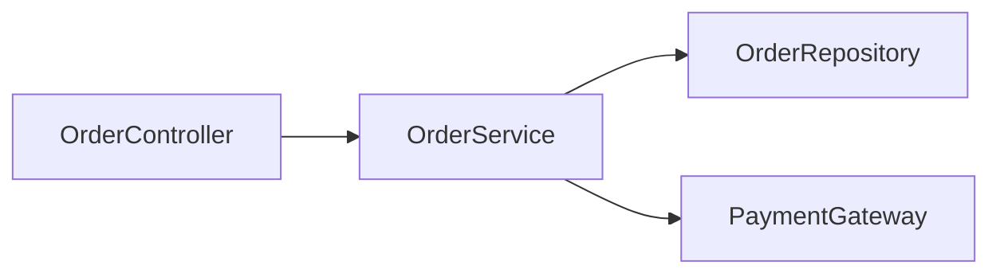
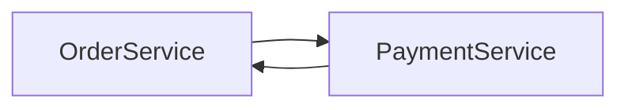
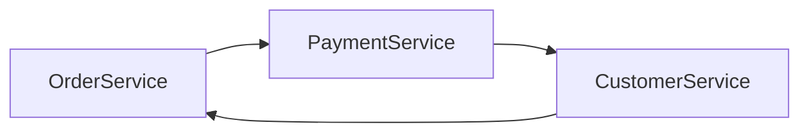
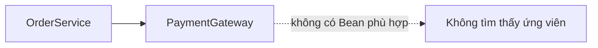
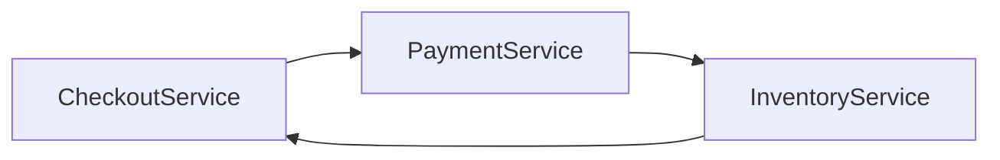
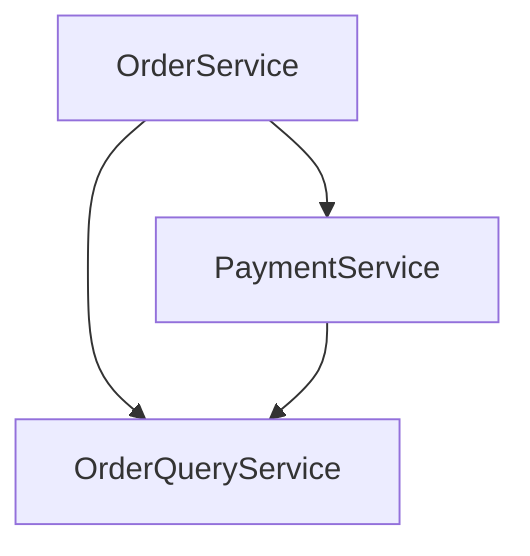
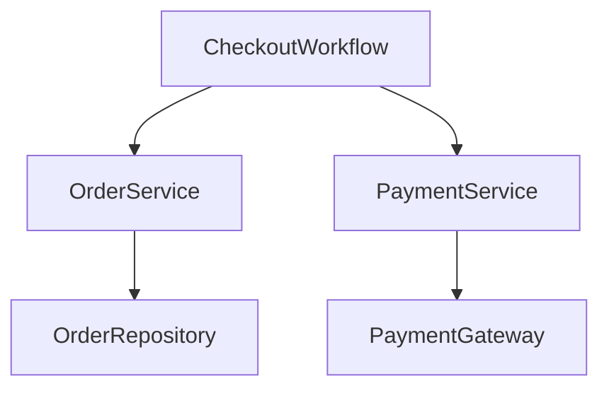

# Phân biệt vòng phụ thuộc trong thiết kế với lỗi thiếu Bean

Khi Spring Boot không thể tạo một Bean, log thường nhắc đến dependency, constructor hoặc ApplicationContext. Hai tình huống dễ bị nhầm là:

- **Vòng phụ thuộc (circular dependency):** Bean A cần Bean B, đồng thời Bean B lại cần Bean A, trực tiếp hoặc qua một chuỗi Bean khác. Dependency graph có một chu trình.
- **Lỗi thiếu Bean (missing bean):** một Bean cần dependency nhưng container không tìm được Bean phù hợp để cung cấp. Dependency graph có một cạnh không có ứng viên hợp lệ.

Cả hai đều có thể khiến ứng dụng không khởi động, và cả hai đều có thể xuất hiện bên trong exception tổng quát như **UnsatisfiedDependencyException**. Nhưng nguyên nhân và cách sửa khác nhau. Nếu nhầm vòng phụ thuộc thành thiếu Bean, bạn có thể cố thêm implementation mới dù vấn đề thực sự là hai service đang gọi ngược nhau. Nếu nhầm thiếu Bean thành vòng phụ thuộc, bạn có thể tách class không cần thiết trong khi chỉ cần đăng ký đúng Bean hoặc sửa điều kiện cấu hình.

Bài học này giải thích cách đọc dependency graph, nhận diện dấu hiệu trong exception, hiểu vì sao constructor cycle không thể được tạo theo cách thông thường, và chọn hướng sửa phù hợp với thiết kế.

## 1. Nhìn dependency như một đồ thị có hướng

Mỗi Bean là một nút. Nếu Bean A cần Bean B để được tạo hoặc hoạt động, ta biểu diễn một cạnh từ A sang B:

**A → B** nghĩa là A phụ thuộc vào B.

Ví dụ một luồng phụ thuộc bình thường:



OrderController cần OrderService; OrderService cần repository và cổng thanh toán. Không có đường nào quay ngược lại để tạo thành chu trình.

Một vòng phụ thuộc trực tiếp:



Một vòng phụ thuộc gián tiếp:



Một lỗi thiếu Bean có hình dạng khác:



Ở hình cuối, vấn đề không phải một chu trình. OrderService cần PaymentGateway, nhưng container không có Bean nào đáp ứng kiểu hoặc qualifier yêu cầu.

| Đặc điểm | Vòng phụ thuộc | Thiếu Bean |
|---|---|---|
| Cấu trúc đồ thị | Có chu trình A → B → … → A | Có dependency không tìm thấy ứng viên |
| Câu hỏi chính | Các Bean đang cần nhau theo vòng nào? | Bean nào đang cần một kiểu chưa được đăng ký/phân giải? |
| Dấu hiệu thường gặp | Circular reference, BeanCurrentlyInCreationException | NoSuchBeanDefinitionException |
| Hướng xử lý | Phá chu trình hoặc thiết kế lại quan hệ cộng tác | Đăng ký đúng Bean, sửa scan/condition/profile/qualifier |
| Có thể xảy ra cùng lúc? | Có | Có |

Hai tình huống không loại trừ nhau. Một chu trình có thể chứa thêm một dependency chưa được đăng ký; khi đó cần xử lý cả hai vấn đề. Hãy đọc nguyên nhân gốc và dựng lại graph thay vì chỉ nhìn exception ngoài cùng.

## 2. Vòng phụ thuộc trực tiếp bằng constructor

Giả sử hai service được viết như sau:

```java
@Service
public class OrderService {
    private final PaymentService paymentService;

    public OrderService(PaymentService paymentService) {
        this.paymentService = paymentService;
    }
}
```

```java
@Service
public class PaymentService {
    private final OrderService orderService;

    public PaymentService(OrderService orderService) {
        this.orderService = orderService;
    }
}
```

Khi tạo OrderService, Spring cần có PaymentService để truyền vào constructor. Nhưng muốn tạo PaymentService, Spring lại cần một OrderService hoàn chỉnh. Hai constructor đều yêu cầu đối tượng kia đã sẵn sàng.

Quá trình bị mắc kẹt:

```text
Tạo OrderService
    ↓ cần PaymentService
        ↓ tạo PaymentService
            ↓ cần OrderService
                ↓ OrderService chưa tạo xong
                    ↓ không thể hoàn tất chuỗi khởi tạo
```

Với constructor injection, container không thể tạo một trong hai object trước rồi gán dependency còn thiếu sau khi constructor hoàn tất. Object không có trạng thái hợp lệ để cung cấp cho constructor còn lại.

Kết quả thường là context khởi động thất bại với thông báo circular dependency hoặc exception liên quan đến Bean đang được tạo, chẳng hạn **BeanCurrentlyInCreationException**. Exception bọc bên ngoài có thể là **UnsatisfiedDependencyException**; cần xem chuỗi nguyên nhân và thông báo vòng tham chiếu để xác nhận.

### Vòng phụ thuộc không nhất thiết chỉ có hai class

```java
@Service
class CheckoutService {
    CheckoutService(PaymentService paymentService) {}
}

@Service
class PaymentService {
    PaymentService(InventoryService inventoryService) {}
}

@Service
class InventoryService {
    InventoryService(CheckoutService checkoutService) {}
}
```

Đồ thị thực tế là:



Khi đọc log, đừng chỉ tìm một cặp class trùng nhau. Hãy theo chuỗi dependency cho đến khi thấy một Bean quay lại Bean đã xuất hiện trước đó.

## 3. Vì sao Spring Boot mặc định từ chối circular references?

Spring Framework có một số cơ chế hỗ trợ vòng phụ thuộc giữa các singleton trong những trường hợp nhất định, đặc biệt khi dependency được gán sau khi instance đã được khởi tạo. Tuy nhiên cơ chế này không thể giải quyết vòng constructor theo cách tổng quát.

Từ Spring Boot 2.6, Boot mặc định không cho phép circular references trong application context (property **spring.main.allow-circular-references** mặc định là **false**). Các phiên bản Spring Boot hiện đại tiếp tục khuyến khích dependency graph không có chu trình. Vì vậy một số ứng dụng cũ từng khởi động được nhờ cơ chế tham chiếu sớm có thể bắt đầu lỗi khi nâng cấp.

Bạn có thể gặp property sau trong ứng dụng cũ:

```properties
spring.main.allow-circular-references=true
```

Property này chỉ bật lại cơ chế cho phép một số circular reference mà Spring có thể giải quyết. Nó **không thể biến mọi vòng constructor thành hợp lệ**, và cũng không sửa được thiết kế phụ thuộc lẫn nhau. Không nên bật nó như phản xạ đầu tiên khi thấy lỗi khởi động.

### Setter/field cycle khác constructor cycle ra sao?

Với setter injection, về mặt kỹ thuật Spring có thể tạo instance trước rồi mới gán dependency:

```java
@Service
public class ReportService {
    private NotificationService notificationService;

    @Autowired
    public void setNotificationService(
            NotificationService notificationService) {
        this.notificationService = notificationService;
    }
}
```

Nếu NotificationService lại cần ReportService bằng setter, container có thể dùng cơ chế singleton early reference trong một số trường hợp. Nhưng điều này phụ thuộc scope, proxy và lifecycle; không phải mọi vòng đều có thể giải quyết.

Object có thể được tạo trước khi các dependency được gán xong. Nếu lifecycle callback hoặc logic khởi tạo truy cập collaborator quá sớm, ứng dụng vẫn có thể gặp lỗi. Vì vậy setter cycle có thể được Spring giải quyết không có nghĩa đó là thiết kế tốt.

Với constructor injection, các dependency phải sẵn sàng tại thời điểm tạo object; vòng constructor không thể giải quyết bằng cách cấp một object chưa hoàn chỉnh.

## 4. Lỗi thiếu Bean: dependency không có ứng viên phù hợp

Xét service:

```java
@Service
public class OrderService {
    private final PaymentGateway paymentGateway;

    public OrderService(PaymentGateway paymentGateway) {
        this.paymentGateway = paymentGateway;
    }
}
```

Nếu application context không có Bean nào implement PaymentGateway, Spring không thể gọi constructor. Lỗi thường có dạng:

```text
Parameter 0 of constructor in OrderService required a bean of type
'PaymentGateway' that could not be found.
```

Nguyên nhân gốc thường là **NoSuchBeanDefinitionException**. Đây là một dependency bị thiếu, không phải circular dependency.

### Một interface không tự trở thành Bean

```java
public interface PaymentGateway {
    void charge(long amount);
}
```

Khai báo interface chỉ tạo ra một kiểu Java. Nó không tạo instance và cũng không đăng ký Bean vào Spring container.

Bạn cần một implementation được đăng ký:

```java
@Component
public class DemoPaymentGateway implements PaymentGateway {
    @Override
    public void charge(long amount) {
        System.out.println("Charged: " + amount);
    }
}
```

Hoặc khai báo Bean trong configuration:

```java
@Configuration(proxyBeanMethods = false)
public class PaymentConfiguration {
    @Bean
    PaymentGateway paymentGateway() {
        return new DemoPaymentGateway();
    }
}
```

Chỉ cần một cách đăng ký phù hợp. Nếu implementation được component scan đúng phạm vi, @Component là đủ; nếu object đến từ thư viện bên ngoài hoặc cần factory logic, @Bean thường phù hợp hơn.

## 5. Những nguyên nhân thường gặp khiến Bean bị thiếu

Một Bean có thể không được tìm thấy vì nhiều lý do. Hãy kiểm tra từng khả năng thay vì thêm một class mới ngay lập tức.

### 5.1. Class nằm ngoài phạm vi component scan

@SpringBootApplication bao gồm component scanning bắt đầu từ package chứa class ứng dụng chính và đi xuống các package con.

Ví dụ:

```text
com.example.shop.ShopApplication
com.example.shop.order.OrderService
com.example.shop.payment.DemoPaymentGateway
```

Ba class cùng nằm dưới com.example.shop, nên cấu trúc package này thuận lợi cho component scan mặc định.

Nhưng nếu implementation nằm ở:

```text
com.example.shop.ShopApplication
com.example.shop.order.OrderService
org.example.payment.DemoPaymentGateway
```

thì org.example.payment không nằm dưới package com.example.shop. Spring không tự quét package bên ngoài chỉ vì class có @Component.

Giải pháp có thể là:

- Đưa implementation vào package con phù hợp với package gốc của ứng dụng.
- Cấu hình @ComponentScan với base package rõ ràng.
- Import configuration hoặc đăng ký Bean bằng cơ chế phù hợp.

Không nên mở component scan quá rộng theo kiểu quét toàn bộ root package nếu việc đó có thể kéo cả những component không liên quan vào context.

### 5.2. Quên đăng ký implementation

Interface và class Java bình thường không tự trở thành Spring Bean:

```java
public class DemoPaymentGateway implements PaymentGateway {
    // Không có @Component và không có @Bean đăng ký class này.
}
```

Nếu class không được scan/import và không được tạo qua @Bean, constructor cần PaymentGateway sẽ không có ứng viên.

### 5.3. Configuration chứa @Bean chưa được nạp

Một method @Bean chỉ có hiệu lực khi class cấu hình của nó được Spring phát hiện hoặc import:

```java
@Configuration
public class PaymentConfiguration {
    @Bean
    PaymentGateway paymentGateway() {
        return new DemoPaymentGateway();
    }
}
```

Nếu PaymentConfiguration nằm ngoài vùng scan và không được @Import, method này không tự chạy. Kiểm tra package, @Import, điều kiện cấu hình và cách ứng dụng nạp configuration.

### 5.4. @Profile không khớp môi trường

Bean có thể chỉ được đăng ký trong một profile:

```java
@Profile("production")
@Component
public class RealPaymentGateway implements PaymentGateway {
    // Tích hợp thanh toán thật.
}
```

Nếu ứng dụng đang chạy với profile dev, Bean này không được đăng ký. Nếu không có implementation thay thế cho dev, dependency bắt buộc bị thiếu.

Hãy kiểm tra:

```properties
spring.profiles.active=dev
```

và các cấu hình profile tương ứng. Câu hỏi cần trả lời là: trong profile hiện tại có Bean nào implement kiểu cần thiết không?

### 5.5. Điều kiện auto-configuration không thỏa

Spring Boot và thư viện có thể đăng ký Bean theo điều kiện:

- **@ConditionalOnClass:** thư viện/class cần thiết có trên classpath không?
- **@ConditionalOnProperty:** property có giá trị phù hợp không?
- **@ConditionalOnBean:** Bean phụ thuộc đã có chưa?
- **@ConditionalOnMissingBean:** có Bean người dùng nào khiến cấu hình mặc định rút lui không?
- **@ConditionalOnWebApplication:** ứng dụng có đúng loại web context không?

Nếu điều kiện không thỏa, Bean mặc định có thể không được tạo. Đây là vấn đề điều kiện đăng ký, không phải vòng phụ thuộc.

Khi cần, chạy ứng dụng với --debug để xem Condition Evaluation Report của Spring Boot:

```bash
java -jar app.jar --debug
```

Báo cáo cho biết các auto-configuration nào match hoặc không match và có thể chỉ ra điều kiện nào chưa đáp ứng.

### 5.6. Có nhiều Bean nhưng không có Bean duy nhất phù hợp

Đây là tình huống thứ ba, khác cả vòng phụ thuộc lẫn thiếu Bean.

Giả sử hai class cùng implement PaymentGateway:

```java
@Component("bankGateway")
class BankPaymentGateway implements PaymentGateway { /* ... */ }

@Component("walletGateway")
class WalletPaymentGateway implements PaymentGateway { /* ... */ }
```

Constructor:

```java
public OrderService(PaymentGateway paymentGateway) {
    this.paymentGateway = paymentGateway;
}
```

Container tìm thấy hai ứng viên nhưng không biết chọn cái nào. Lỗi thường là **NoUniqueBeanDefinitionException**, được bọc trong **UnsatisfiedDependencyException**.

Giải quyết bằng @Qualifier:

```java
public OrderService(
        @Qualifier("bankGateway") PaymentGateway paymentGateway) {
    this.paymentGateway = paymentGateway;
}
```

Hoặc đánh dấu một implementation mặc định bằng @Primary nếu đó thực sự là lựa chọn mặc định hợp lý.

## 6. Đọc exception: phân biệt nguyên nhân gốc và exception bọc ngoài

Spring thường tạo exception ở tầng cao hơn để cung cấp ngữ cảnh Bean đang khởi tạo. Vì vậy dòng đầu tiên của stack trace không phải lúc nào cũng nói nguyên nhân cuối cùng.

### Dấu hiệu vòng phụ thuộc

Bạn có thể gặp thông báo dạng:

```text
The dependencies of some of the beans in the application context form a cycle:

   orderService
      ↓
   paymentService
      ↓
   orderService
```

Hoặc chuỗi exception có **BeanCurrentlyInCreationException**, kèm mô tả Bean đang được yêu cầu trong lúc chính nó chưa tạo xong.

Hãy dựng graph từ danh sách Bean trong chu trình. Nếu có đường quay về Bean ban đầu, đó là dấu hiệu circular dependency.

### Dấu hiệu thiếu Bean

Ví dụ thông báo:

```text
Parameter 0 of constructor in OrderService required a bean of type
'PaymentGateway' that could not be found.
```

Nguyên nhân lồng bên trong có thể là:

```text
NoSuchBeanDefinitionException:
No qualifying bean of type 'PaymentGateway' available
```

Thông báo nói rõ kiểu dependency không có ứng viên phù hợp. Hãy kiểm tra Bean registration, scan, profile, condition và qualifier.

### Dấu hiệu nhiều Bean cùng kiểu

```text
NoUniqueBeanDefinitionException:
expected single matching bean but found 2
```

Container không thiếu Bean; nó có nhiều hơn một ứng viên. Cần xác định consumer muốn implementation nào hoặc có thật sự cần xử lý toàn bộ collection hay không.

### Exception có thể được bọc lồng nhau

Một log có thể trông như:

```text
UnsatisfiedDependencyException
    Caused by: NoSuchBeanDefinitionException
```

hoặc:

```text
UnsatisfiedDependencyException
    Caused by: BeanCurrentlyInCreationException
```

UnsatisfiedDependencyException chỉ cho biết Spring không thể đáp ứng dependency cần thiết cho Bean. Cần đọc sâu đến nguyên nhân lồng bên trong để biết là thiếu ứng viên, nhiều ứng viên, vòng khởi tạo hay một lỗi tạo Bean khác.

| Exception/dấu hiệu | Ý nghĩa ban đầu | Việc cần kiểm tra |
|---|---|---|
| NoSuchBeanDefinitionException | Không có Bean phù hợp | Kiểu yêu cầu, scan, @Bean, profile, conditions |
| NoUniqueBeanDefinitionException | Có nhiều Bean cùng kiểu | Qualifier, Primary, collection injection |
| BeanCurrentlyInCreationException | Bean được yêu cầu trong lúc đang tạo | Dependency graph, vòng constructor/setter, proxy |
| Circular dependency report A → B → A | Có chu trình Bean | Tìm lý do A và B cần nhau |
| BeanCreationException | Một Bean tạo thất bại | Đọc nguyên nhân gốc; có thể là config hoặc lỗi trong constructor |
| UnsatisfiedDependencyException | Không đáp ứng tham số/field/method injection | Đọc nested cause để phân biệt các trường hợp |

Không kết luận chỉ từ tên exception ngoài cùng. BeanCreationException cũng có thể do lỗi kết nối database trong factory method; điều đó không tự động là circular dependency.

## 7. Cách sửa vòng phụ thuộc ở cấp thiết kế

Khi có chu trình, mục tiêu là làm cho dependency graph có hướng rõ ràng. Không nên chỉ tìm cách trì hoãn thời điểm Spring tạo object.

### 7.1. Tách trách nhiệm chung thành một service thứ ba

Giả sử:

```text
OrderService → PaymentService
PaymentService → OrderService
```

Có thể hai service đang cùng cần một phần logic như đọc thông tin đơn hoặc kiểm tra trạng thái. Tách phần đó thành một collaborator có trách nhiệm riêng:



Trong thiết kế mới, hai service cùng phụ thuộc OrderQueryService, còn luồng điều phối đi theo một hướng. Không nên tạo class thứ ba chỉ để chuyển tiếp method; nó cần sở hữu một trách nhiệm có ý nghĩa.

### 7.2. Đưa điều phối vào application service

Nếu hai service gọi ngược nhau vì mỗi bên đang điều phối một nửa quy trình, có thể đưa workflow lên một lớp cao hơn:



CheckoutWorkflow gọi các service theo trình tự nghiệp vụ. OrderService không cần gọi ngược PaymentService, và PaymentService không cần giữ tham chiếu tới OrderService.

### 7.3. Dùng event khi các thành phần không cần gọi trực tiếp nhau

Nếu một service chỉ cần thông báo rằng sự kiện đã xảy ra, event có thể giảm coupling:

```java
public record PaymentCompleted(Long orderId) {
}
```

Một service xử lý thanh toán có thể phát event sau khi hoàn tất; listener khác cập nhật trạng thái đơn. Đây là hướng minh họa, cần thiết kế thêm về transaction, retry, idempotency và bảo đảm event không bị mất trong ứng dụng thực tế.

Event không phải giải pháp tự động cho mọi vòng phụ thuộc. Nếu listener lại gọi ngược service phát event theo cùng một vòng đồng bộ, chu trình logic vẫn còn.

### 7.4. Đảo chiều dependency bằng abstraction khi đúng ranh giới

Interface có thể giúp module cấp cao không phụ thuộc vào implementation cụ thể. Nhưng **thêm interface không tự phá vòng phụ thuộc** nếu A vẫn inject B và B vẫn inject A. Điều cần thay đổi là hướng phụ thuộc và quyền sở hữu trách nhiệm, không chỉ tên kiểu Java.

## 8. Vì sao không nên bật circular references để chữa lỗi ngay?

Bạn có thể tìm thấy gợi ý:

```properties
spring.main.allow-circular-references=true
```

Đây là lựa chọn tương thích cho một số ứng dụng cũ, nhưng có các giới hạn:

- Vòng constructor vẫn không thể được giải quyết theo cách tạo một object hoàn chỉnh trước khi có object kia.
- Cơ chế early reference liên quan đến singleton và có thể phức tạp khi Bean được proxy (ví dụ AOP/transaction).
- Bean có thể được expose trước khi quá trình inject/lifecycle hoàn tất; code khởi tạo sớm có thể nhìn thấy trạng thái chưa hoàn chỉnh.
- Vòng phụ thuộc vẫn khiến module khó hiểu, khó kiểm thử và khó thay đổi.
- Ứng dụng có thể khởi động được nhưng lỗi nghiệp vụ hoặc lifecycle xuất hiện muộn hơn.

Chỉ cân nhắc property này khi phải duy trì hệ thống legacy, đã hiểu chính xác vòng phụ thuộc và có kiểm thử phù hợp. Với code mới, hãy sửa graph để các Bean có quan hệ một chiều rõ ràng.

### Còn @Lazy hoặc ObjectProvider?

Hai cơ chế này có thể trì hoãn việc phân giải một dependency:

```java
@Service
public class AService {
    private final BService bService;

    public AService(@Lazy BService bService) {
        this.bService = bService;
    }
}
```

Hoặc:

```java
@Service
public class AService {
    private final ObjectProvider<BService> bServiceProvider;

    public AService(ObjectProvider<BService> bServiceProvider) {
        this.bServiceProvider = bServiceProvider;
    }

    public void runWhenNeeded() {
        BService bService = bServiceProvider.getObject();
        bService.execute();
    }
}
```

Chúng hữu ích khi cần khởi tạo muộn hoặc có dependency động/tùy chọn. Nhưng nếu A và B vẫn gọi nhau để thực hiện cùng một quy trình, việc trì hoãn chỉ che thời điểm xảy ra vấn đề; nó không làm mất coupling. Dùng chúng vì một yêu cầu runtime rõ ràng, không dùng như miếng vá mặc định cho mọi cycle.

## 9. Cách xử lý lỗi thiếu Bean theo nguyên nhân

Khác với vòng phụ thuộc, lỗi thiếu Bean thường sửa bằng cách đảm bảo container có đúng Bean cần thiết trong đúng context.

| Nguyên nhân | Cách kiểm tra | Hướng xử lý |
|---|---|---|
| Chưa có implementation | Chỉ có interface hoặc class chưa được đăng ký | Tạo implementation và dùng @Component hoặc @Bean |
| Ngoài vùng component scan | Package implementation nằm ngoài package gốc | Điều chỉnh package, @ComponentScan hoặc @Import |
| Configuration chưa được nạp | Class có @Bean không được scan/import | Đăng ký configuration rõ ràng |
| Profile không khớp | @Profile loại Bean khỏi profile hiện tại | Kiểm tra spring.profiles.active và cung cấp Bean cho môi trường đó |
| Conditional không thỏa | Thiếu class/property/Bean hoặc sai loại ứng dụng | Đọc Condition Evaluation Report và sửa điều kiện cần thiết |
| Qualifier sai | Có Bean nhưng qualifier không khớp | Sửa qualifier hoặc metadata Bean |
| Dependency không có trên classpath | Module/thư viện chứa implementation chưa được thêm | Kiểm tra dependency Gradle/Maven của project |

### Component scan và package gốc

Với:

```text
com.example.shop.ShopApplication
com.example.shop.order.OrderService
com.example.shop.payment.DemoPaymentGateway
```

component scan mặc định từ com.example.shop có thể tìm thấy các component trong package con. Nếu implementation nằm ở org.example.payment, package đó không nằm trong cây scan này chỉ vì class có @Component.

### Profile và môi trường chạy

Nếu Bean thật chỉ có @Profile("production") mà ứng dụng đang chạy với profile dev, Bean đó không được đăng ký. Nếu dependency là bắt buộc ở mọi môi trường, cần cung cấp implementation phù hợp cho dev (ví dụ fake/local gateway), hoặc thiết kế rõ môi trường nào được phép chạy chức năng đó.

### Auto-configuration

Boot có thể không tạo Bean mặc định khi điều kiện không thỏa. Các điều kiện thường gặp gồm @ConditionalOnClass, @ConditionalOnProperty, @ConditionalOnBean, @ConditionalOnMissingBean và @ConditionalOnWebApplication.

Chạy:

```bash
java -jar app.jar --debug
```

để xem Condition Evaluation Report. Báo cáo giúp xác định cấu hình nào được áp dụng, cấu hình nào bị bỏ qua và vì sao. Nó hữu ích khi Bean từ starter không xuất hiện; nó không thay thế việc phân tích graph khi lỗi là vòng phụ thuộc giữa Bean ứng dụng.

## 10. Quy trình điều tra từng bước

Khi ứng dụng báo không tạo được Bean, hãy làm theo trình tự:

1. **Tìm Bean đầu tiên được nhắc tới.** Đọc dòng “Error creating bean with name ...” và tham số/field/method dependency liên quan.
2. **Đọc hết chuỗi nguyên nhân.** Phân biệt NoSuchBeanDefinitionException, NoUniqueBeanDefinitionException, BeanCurrentlyInCreationException và exception do code khởi tạo ném ra.
3. **Vẽ dependency graph nhỏ.** Ghi A → B cho từng dependency của constructor. Nếu quay lại Bean đã xuất hiện, có cycle. Nếu một kiểu không có ứng viên, đó là cạnh bị thiếu.
4. **Nếu thiếu Bean, kiểm tra đăng ký.** Component scan, @Bean, @Import, dependency classpath, profile và conditional configuration.
5. **Nếu có nhiều Bean, kiểm tra lựa chọn.** Qualifier, Primary hoặc collection injection.
6. **Nếu có cycle, tìm lý do hai phía cần nhau.** Tách trách nhiệm, chuyển điều phối lên tầng cao hơn hoặc dùng event khi phù hợp.
7. **Khởi động lại context hoặc chạy test khởi động.** Xác nhận lỗi đã biến mất trong đúng profile và cấu hình ứng dụng cần.

### Một bài tập phân loại

**Tình huống A**

```java
@Service
class CustomerService {
    CustomerService(AddressService addressService) {}
}
```

Không có class/Bean nào triển khai hoặc cung cấp AddressService. Đây là lỗi thiếu Bean. Hãy đăng ký dependency phù hợp hoặc sửa kiểu yêu cầu nếu nó sai.

**Tình huống B**

```java
@Service
class CustomerService {
    CustomerService(AddressService addressService) {}
}

@Service
class AddressService {
    AddressService(CustomerService customerService) {}
}
```

Hai constructor cần nhau trực tiếp. Đây là vòng phụ thuộc. Thêm một AddressService thứ hai không giải quyết vấn đề; cần thiết kế lại quan hệ.

**Tình huống C**

```java
@Component("emailGateway")
class EmailGateway implements MessageGateway {}

@Component("smsGateway")
class SmsGateway implements MessageGateway {}

@Service
class AlertService {
    AlertService(MessageGateway gateway) {}
}
```

Container có hai Bean phù hợp với MessageGateway. Đây là lỗi nhiều ứng viên, không phải thiếu Bean và cũng không phải cycle. Dùng qualifier, primary hoặc collection tùy nghiệp vụ.

## 11. Kết nối với constructor injection và IoC container

Constructor injection làm dependency graph hiện ra ngay trong mã nguồn. Ví dụ:

```java
public OrderService(
        OrderRepository repository,
        PaymentGateway paymentGateway) {
    this.repository = repository;
    this.paymentGateway = paymentGateway;
}
```

Từ chữ ký constructor, bạn có thể liệt kê các cạnh:

```text
OrderService → OrderRepository
OrderService → PaymentGateway
```

Nếu container không tạo được OrderService, câu hỏi tiếp theo là:

- Có Bean OrderRepository không?
- Có Bean PaymentGateway không?
- Có nhiều Bean cùng kiểu không?
- Một trong các dependency có đường quay lại OrderService không?

Đó là cách biến stack trace dài thành một đồ thị nhỏ có thể suy luận. **Thiếu Bean** nghĩa là container không tìm thấy ứng viên cho một cạnh; **vòng phụ thuộc** nghĩa là các cạnh hiện có tạo thành một chu trình; **nhiều Bean cùng kiểu** nghĩa là có nhiều ứng viên nhưng chưa có quy tắc chọn.

Với ứng dụng Spring Boot, constructor injection giúp khai báo dependency bắt buộc minh bạch và để container phát hiện vấn đề sớm. Khi gặp lỗi, hãy xác định chính xác cấu trúc graph trước khi thay đổi code: đăng ký Bean còn thiếu, chọn đúng implementation, hay phá chu trình thiết kế. Ba hành động này giải quyết ba nguyên nhân khác nhau và giúp kiến trúc dễ hiểu, dễ kiểm thử, dễ mở rộng hơn.
