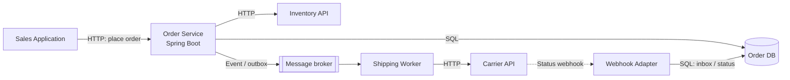
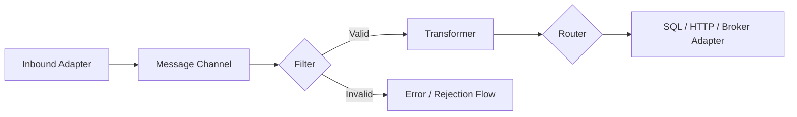
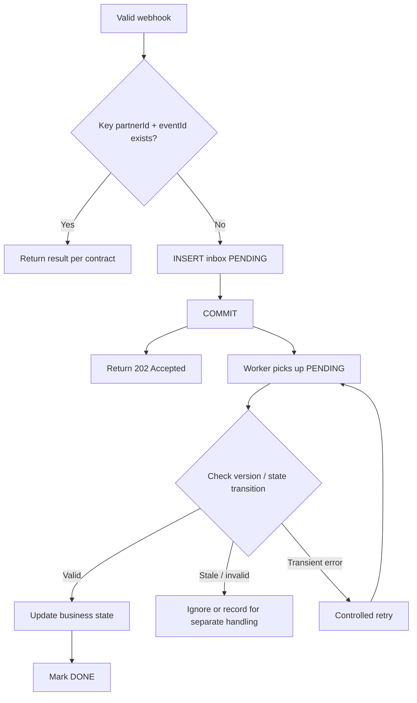

# What Is System Integration and What Problems Must Be Solved in a Spring Boot Application

A Spring Boot application rarely operates in complete isolation. A sales system needs to check inventory; a shipping service needs to receive orders and send status updates; a payment gateway sends transaction notifications; the application must read/write SQL, use a cache, publish events, or consume messages. **System integration** is the process of enabling components with separate boundaries to exchange data and coordinate behavior according to a clear contract.

In the **SPRING_BOOT_INTEGRATION** module, integration is approached as a complete engineering and operational problem: organizing integration via HTTP clients, databases, caches, message brokers, and Spring Integration adapters; while handling configuration, data contracts, transactions, errors, duplicates, testing, and observing real-world flows. This lesson builds an overall picture so you can choose the right tools and identify risks before diving into each technique.

## 1. Learning Objectives

After this lesson, you will be able to:

1. Explain which system is integrating with which system, across which boundaries and contracts.
2. Compare synchronous calls, asynchronous processing, batch data exchange, and event-driven data synchronization.
3. Identify common problems: timeouts, flaky networks, schema changes, distributed transactions, retries, duplicates, out-of-order delivery, and backlogs.
4. Distinguish the roles of HTTP clients, JDBC, caches, message brokers, and Spring Integration in Spring Boot.
5. Sketch an integration flow with error handling, idempotency, security, testing, and observability.

## 2. What Is System Integration?

### 2.1. From Internal Method Calls to Crossing Boundaries

Within a single application, a call like `orderService.createOrder()` usually happens in the same process, uses the same codebase version, and can share a local transaction. When the application calls a partner's API or publishes an event to a broker, those assumptions no longer hold by default:

- The receiving side has its own deployment schedule, availability, and data ownership.
- Response times are affected by the network, connection pools, queues, and system load.
- One side may have processed a request successfully even though the other side did not receive the result.
- Data must be **serialized**, exchanged according to a schema/contract, and interpreted consistently.
- You cannot rely solely on a local SQL transaction to control changes in a remote system.

Therefore, an integration must answer these questions: **Who** sends? **What** is sent? **Through which channel**? **When is it considered successful**? **What happens on error or retry**? **How can each step be traced**?

### 2.2. Example: Order Processing Across Multiple Services

A sales channel receives an order, records it in the database, requests stock reservation at the inventory service, and sends a shipment creation request to the shipping carrier. The customer later receives delivery status updates via events or webhooks.



This is **one business flow** composed of multiple exchanges across different boundaries. Each arrow has its own data contract, authentication rules, timeout, error handling, and observability responsibilities.

### 2.3. Integration Does Not Mean Continuous Data Synchronization

Not every integration tries to replicate the exact same dataset. There are at least four purposes:

| Purpose | Example | What Must Be Guaranteed |
| --- | --- | --- |
| **Request an action** | Send a shipment creation command | The receiver understands the request and the outcome can be verified |
| **Look up information** | Check inventory stock | Latency/freshness meets decision-making needs |
| **Broadcast events** | `OrderCreated` | Interested parties receive and process according to the contract |
| **Synchronize a data replica** | Update the product catalog to a search system | Reconcile discrepancies, handle delayed updates, and recover |

The choice depends on business requirements: response time, data freshness, tolerance for delayed processing, and coupling between parties.

## 3. Communication Styles and How to Choose

### 3.1. Synchronous via HTTP

A service calls an API and waits for the result, such as `GET /inventory/{sku}` before confirming an order.

**Advantages:** easy to follow the request/response flow, the result is returned immediately, and it fits user actions requiring an instant decision.

**Limitations:** the calling service must wait; a slow component can slow down the entire flow; timeouts or lost responses can leave the result state **unknown**. When a request traverses too many chained services, latency and failure probability accumulate.

In Spring Boot, you can use `RestClient` for a synchronous HTTP client or `WebClient` for flows that need a reactive/non-blocking API. Choose based on your execution model and application needs; you do not have to apply reactive programming to every integration.

### 3.2. Asynchronous via Message Broker

The application publishes a message; the consumer processes it later without the sender having to keep an HTTP request open.

**Advantages:** reduces dependence on the immediate availability of the consumer, can buffer load bursts, and allows scaling the processing side as needed.

**Limitations:** requires managing queues, retry counts, failed messages, end-to-end latency, identifier keys, and ordering. A broker acknowledging that it **received** a message does not necessarily mean the business logic on the consumer side **has completed**.

Kafka, RabbitMQ, and other brokers have different storage, ordering, delivery, and acknowledgment models. Do not assume every message broker provides the same level of guarantees.

### 3.3. Scheduled or Batch Processing

For example: exporting a CSV file of reconciliation data every night; a job fetching data from an ERP system page by page.

**Advantages:** suitable for high volumes, sources that only communicate periodically, or reconciliation requirements.

**Limitations:** data has latency, requiring progress checkpoints, protection against overlapping scheduled runs, detection of missing data, and the ability to rerun individual batches.

### 3.4. Synchronization via Data Changes

Change Data Capture (CDC) or outbox can help stream database changes into an event flow. CDC captures changes from a database's transaction/log tracking mechanism depending on the product; outbox writes an intended outgoing event in the same transaction as the business data, and a separate process publishes it later.

This solution helps reduce the gap between **committing data** and **publishing a message**, but consumers must still be ready to handle duplicates when retries or failures occur at acknowledgment time.

### 3.5. Quick Comparison Table

| Criterion | Synchronous HTTP | Message broker | Batch / polling |
| --- | --- | --- | --- |
| Result for the caller | Usually immediate or timeout | Usually arrives later | Periodic |
| Temporal coupling | Higher | Lower if the broker is healthy | Low, schedule-dependent |
| Error handling | Timeout, retry, circuit breaker | Retry, redelivery, dead-letter | Checkpoint, backfill, reconciliation |
| Data freshness | At response time | Depends on consumer lag | Depends on run cadence |
| Best suited for | Lookups / immediate decisions | Event broadcasting and background work | Periodic sync, bulk import |

Real-world systems typically **combine** multiple styles: HTTP receives commands, SQL stores state, outbox emits events, and consumers call third-party APIs.

## 4. Eight Core Problems of an Integration Flow

### 4.1. Data Contracts and Compatibility

Every integration boundary must clearly specify:

- Field names, data types, required/optional status, units, time zones, and encoding.
- Business meaning of each status, error code, identifier field, and relationship.
- How to version, add new fields, deprecate old fields, and handle unrecognized data.
- How to validate input data, enforce size limits, and avoid exposing internal objects across the boundary.

For example, `amount: 100` is not clear enough without `currency` and unit conventions. `createdAt` must specify an offset/time zone; you should use an explicit timezone timestamp following ISO 8601. An order's `status` field must have a consistent state transition definition between both sides.

**A DTO/API contract is different from a database entity.** You should not expose internal entities directly and force partners to understand table structures or persistence lifecycles.

### 4.2. Configuration and Deployment Environments

An application may integrate with multiple endpoints or systems. Minimum configuration typically includes:

- Base URL/broker address/SQL URL for each environment.
- Credentials, certificates, and TLS policies.
- Timeouts, pool sizes, concurrency limits, and retry strategies.
- Topic/queue names, consumer groups, schema names, and API versions.
- Feature flags to enable/disable integrations or operational thresholds.

Configuration should be separated from application code using `application.yml`, environment variables, and a secret manager. Never hardcode passwords/tokens in source code, public examples, or logs.

### 4.3. Errors and Unknown Outcome States

Suppose a client calls `POST /shipments`. The partner created the shipment and was about to return `201 Created`, but the network dropped before the response arrived. The client only knows the call **timed out**; if it retries without an idempotency key, two shipments could be created.

Error categories to distinguish:

| Status | Example | Handling Decision |
| --- | --- | --- |
| Invalid data | `400 Bad Request` due to invalid fields | Fix data/contract; usually do not retry as-is |
| Unauthorized | `401`/`403` | Fix authentication/authorization configuration |
| Business conflict | `409 Conflict` | Check business rules and existing state |
| Rate limited | `429 Too Many Requests` | Respect `Retry-After` when present; throttle load |
| Downstream error | `5xx` | May retry with backoff and bounded attempts |
| Timeout or connection lost | Unclear if destination committed | Query by operation/idempotency key before or when retrying |

Do not retry indefinitely; budget for a **retry budget**, backoff with jitter, an overall deadline, and classification of non-recoverable errors. A **circuit breaker** can temporarily halt calls when an external dependency is failing; a **bulkhead** limits the share of resources one dependency can consume; **backpressure** helps slow down upstream work submission when downstream is slow.

### 4.4. Distributed Transactions and Consistency

A regular `@Transactional` annotation protects operations on a local transactional resource, such as a single database via a `DataSource`. It **does not** turn a SQL commit and an HTTP call or broker publish into a single atomic operation.

Example causing a lost event:

```text
1. INSERT order into SQL.
2. COMMIT order succeeds.
3. Application stops unexpectedly.
4. OrderCreated has not been published to the broker yet.
```

The **transactional outbox** pattern addresses part of this risk by writing `order` and `outbox_event` in the same SQL transaction, after which a separate process sends the outbox record to the broker. Retrying can produce duplicates, so you still need to design idempotency on the consumer side.

When multiple services participate in a long-running business process, consider a **Saga**, where each step commits locally and executes compensating actions when needed. Do not equate compensation with a SQL rollback: a compensating action can fail and must be monitored.

### 4.5. Duplicates and Idempotency

**Idempotency** means that repeating the same request with the same operation key does not produce unintended side effects.

For example: a carrier webhook resends `Delivered` because it did not receive an acknowledgment. If the system keeps awarding loyalty points to the customer every time it receives it, the outcome will be wrong even though each request is valid.

Typical solutions include:

1. Defining a stable source and key such as `(partnerId, eventId)`.
2. Recording the processed key in the database with a **unique constraint**.
3. Deciding the behavior on redelivery: return the previous result, ignore it, or check the processing state before continuing.
4. Ensuring any resulting side effects also have appropriate deduplication protection.

Relying only on in-memory keys or doing a `SELECT` followed by an `INSERT` without a database constraint can break when multiple instances run concurrently.

### 4.6. Ordering and Data Freshness

Events `OrderPacked` and `OrderShipped` may arrive out of order due to multiple consumers, multiple partitions, retries, or different network paths. Do not infer business order solely from message arrival time.

You can include `aggregateId`, `version`, or `sequenceNumber`; choose an appropriate partition key when the broker supports it; and apply state transition rules and stale version detection. Actual ordering guarantees depend on the technology and consumer configuration.

### 4.7. Performance, Bottlenecks, and Resource Limits

Incoming request rates can exceed the capacity of the database, broker, or partner API. Bottlenecks include HTTP connection pools, thread pools, JDBC pools, consumer concurrency, rate limits, and disk backlogs.

The design must **bound queues**, configure timeouts, limit concurrent work, and define overload policies. Adding more workers does not necessarily increase throughput if they share a single SQL database or hit the same partner rate limit.

Caching can reduce repeated queries, but introduces the risk of **stale data**. Define TTLs, invalidation conditions, cache keys, miss handling, and which data must never be decided using a stale copy (for example, certain financial decisions).

### 4.8. Security and Observability

Every integration must authenticate callers, authorize access appropriately, and protect data in transit. Examples include HTTPS/TLS, OAuth2 client credentials, securely managed API keys, or webhook signatures with timestamp/nonce checks to mitigate replay attacks.

In parallel, you need to know **which request/event** went through which step, where it failed, what the latency was, and how it can be recovered. Logs should not contain secrets, tokens, or personal data beyond operational needs.

## 5. Integration Tools in the Spring Boot Ecosystem

Spring Boot supports configuring components via dependencies, properties, and Spring beans. **Choose dependencies based on need**, and avoid pulling every library into the application when it is not used.

| Need | Common Spring Components | Responsibility |
| --- | --- | --- |
| Expose HTTP APIs/webhooks | Spring MVC (`spring-boot-starter-web`) or WebFlux | Receive requests, validate input, return HTTP responses |
| Call external REST APIs | `RestClient`, `WebClient` | HTTP methods, headers, bodies, response/status handling |
| Connect to SQL | `spring-boot-starter-jdbc`, `JdbcTemplate`, `DataSource` | Queries, writes, SQL transactions |
| Repository-based SQL access | Spring Data JDBC/JPA | Mapping and repositories suited to the data model |
| Data caching | Spring Cache abstraction + cache provider | Cache keys, TTL/invalidation per provider |
| Messaging with Kafka | Spring for Apache Kafka | Producers, listeners, offsets, error handling |
| Messaging with RabbitMQ | Spring AMQP | Exchanges/queues, listeners, acknowledgments |
| Message-driven flow orchestration | Spring Integration | Channels, gateways, transformers, routers, filters, adapters |
| Health/metrics/traces | Spring Boot Actuator, Micrometer, tracing SDK/bridge | Observing and diagnosing flows |

### 5.1. Adapters and Dependency Boundaries

A clean design typically separates:

- **Inbound adapter**: receives HTTP requests, messages, scheduled triggers, or files; turns transport data into a valid request for the application.
- **Application service**: business decisions, transactions, and idempotency rules.
- **Outbound port/adapter**: calls partner APIs, persists to SQL, publishes messages, or uses a cache.
- **Contract**: versioned DTOs/events at the communication boundary.

This organization makes it possible to test business logic without starting all infrastructure, and allows swapping adapters when technologies change.

### 5.2. When to Use Spring Integration?

**Spring Integration** implements enterprise integration patterns such as `Message`, `MessageChannel`, `IntegrationFlow`, gateway, splitter, aggregator, transformer, router, filter, and adapters for external protocols/systems.

Conceptual example:



Spring Integration is useful when there are multiple routing, transformation, message correlation steps, or multi-protocol integrations that you want to model as a pipeline. For a simple HTTP endpoint calling a service and writing to a database, using Spring MVC and JDBC directly can be easier to understand. Choose a framework based on the **actual complexity** of the flow.

## 6. End-to-End Example: Receiving a Delivery Webhook and Processing Asynchronously

Suppose a shipping carrier calls the webhook `POST /api/v1/shipping-events` to notify status events. The system needs to authenticate the sender, persist durably, avoid duplicate processing, and handle status updates in a background process.

This is a conceptual example of the **inbox** pattern: the receiver stores the event first, and a worker processes it later. The example uses Java records, Spring MVC, Jakarta Validation, and PostgreSQL SQL; security configuration, the full worker, and migrations are described separately rather than fully implemented in the code snippets.

### 6.1. Defining the Inbound Contract

Example JSON request:

```json
{
  "eventId": "evt_1059",
  "shipmentId": "ship_204",
  "status": "DELIVERED",
  "occurredAt": "2026-11-21T03:00:00Z",
  "version": 3
}
```

The contract should specify:

- `eventId` uniquely identifies a notification **within the partner's scope**.
- `shipmentId` is the business key; it must map to an order in our system.
- `status` only accepts values from an agreed-upon set.
- `occurredAt` is when the event occurred at the source, not necessarily when our system received it.
- `version` increases per `shipmentId` if the sender supports it; used to detect stale events.

Do not merely check whether the JSON parses: you must verify the webhook signature or agreed authentication mechanism, partner permissions, body size limits, and domain constraints.

### 6.2. Persisting Received Events in the Database

A minimal table, with the partner identifier separated to avoid key collisions across partners:

```sql
CREATE TABLE shipping_inbox (
    id BIGINT GENERATED ALWAYS AS IDENTITY PRIMARY KEY,
    partner_id VARCHAR(64) NOT NULL,
    event_id VARCHAR(128) NOT NULL,
    shipment_id VARCHAR(128) NOT NULL,
    status VARCHAR(32) NOT NULL,
    occurred_at TIMESTAMPTZ NOT NULL,
    event_version BIGINT NOT NULL,
    process_state VARCHAR(16) NOT NULL DEFAULT 'PENDING',
    received_at TIMESTAMPTZ NOT NULL DEFAULT CURRENT_TIMESTAMP,
    UNIQUE (partner_id, event_id)
);
```

The database-enforced `UNIQUE` constraint prevents duplicate writes under concurrent processing across multiple instances. When receiving a payload for an existing `eventId` with different data, the system should detect and handle it per contract rather than blindly treating it as a valid redelivery.

### 6.3. Illustrative Inbound DTO and Controller

Core dependencies for the example include `spring-boot-starter-web`, `spring-boot-starter-validation`, `spring-boot-starter-jdbc`, and the PostgreSQL JDBC driver. In a normally configured Spring Boot application, `NamedParameterJdbcTemplate` can be injected when datasource/JDBC auto-configuration conditions are met.

```java
package com.example.integration;

import jakarta.validation.Valid;
import jakarta.validation.constraints.NotBlank;
import jakarta.validation.constraints.NotNull;
import jakarta.validation.constraints.Positive;

import java.time.OffsetDateTime;

import org.springframework.http.ResponseEntity;
import org.springframework.web.bind.annotation.PostMapping;
import org.springframework.web.bind.annotation.RequestBody;
import org.springframework.web.bind.annotation.RequestHeader;
import org.springframework.web.bind.annotation.RequestMapping;
import org.springframework.web.bind.annotation.RestController;

record ShippingEvent(
        @NotBlank String eventId,
        @NotBlank String shipmentId,
        @NotBlank String status,
        @NotNull OffsetDateTime occurredAt,
        @NotNull @Positive Long version
) {}

@RestController
@RequestMapping("/api/v1/shipping-events")
class ShippingWebhookController {
    private final ShippingInboxService inboxService;

    ShippingWebhookController(ShippingInboxService inboxService) {
        this.inboxService = inboxService;
    }

    @PostMapping
    ResponseEntity<Void> receive(
            @RequestHeader("X-Partner-Id") String partnerId,
            @Valid @RequestBody ShippingEvent event) {
        // In a real system: verify the signature and determine
        // partnerId from the authenticated identity before persisting.
        boolean created = inboxService.accept(partnerId, event);
        return created
                ? ResponseEntity.accepted().build()
                : ResponseEntity.ok().build();
    }
}
```

In this example, **`202 Accepted`** means the system has received and persisted the event for later processing, **not** that the status update has finished processing. Returning `200 OK` for a duplicate event is a contract choice, not a rule applicable to every partner. In production, `X-Partner-Id` must not be trusted as an identity by itself: the header or path must be bound to an actual authentication mechanism.

### 6.4. Service and Repository Writing to the Inbox in One Transaction

```java
package com.example.integration;

import java.util.Map;

import org.springframework.jdbc.core.namedparam.NamedParameterJdbcTemplate;
import org.springframework.stereotype.Repository;
import org.springframework.stereotype.Service;
import org.springframework.transaction.annotation.Transactional;

@Repository
class ShippingInboxRepository {
    private final NamedParameterJdbcTemplate jdbc;

    ShippingInboxRepository(NamedParameterJdbcTemplate jdbc) {
        this.jdbc = jdbc;
    }

    boolean insertIfAbsent(String partnerId, ShippingEvent event) {
        int updated = jdbc.update("""
                INSERT INTO shipping_inbox (
                    partner_id, event_id, shipment_id,
                    status, occurred_at, event_version
                )
                VALUES (
                    :partnerId, :eventId, :shipmentId,
                    :status, :occurredAt, :version
                )
                ON CONFLICT (partner_id, event_id) DO NOTHING
                """, Map.of(
                "partnerId", partnerId,
                "eventId", event.eventId(),
                "shipmentId", event.shipmentId(),
                "status", event.status(),
                "occurredAt", event.occurredAt(),
                "version", event.version()
        ));
        return updated == 1;
    }
}

@Service
class ShippingInboxService {
    private final ShippingInboxRepository repository;

    ShippingInboxService(ShippingInboxRepository repository) {
        this.repository = repository;
    }

    @Transactional
    public boolean accept(String partnerId, ShippingEvent event) {
        return repository.insertIfAbsent(partnerId, event);
    }
}
```

Here:

1. The repository uses named parameters, avoiding direct concatenation of external data into SQL.
2. PostgreSQL `ON CONFLICT ... DO NOTHING` handles key collisions directly in the database.
3. `@Transactional` creates a SQL transaction boundary for the write operation; `202` should only be returned after the transaction completes. The example method is invoked from the controller through a Spring bean, allowing transaction advice to apply properly.
4. A separate worker reads `PENDING` rows, applies state transition rules, and marks them `DONE` or `FAILED`; job claiming, locking, retries, and handling mid-flight worker crashes must be implemented separately.

The code above **is not a complete production endpoint**: it still requires webhook authentication, checking allowed `status` values, verifying payloads on key collision, handling database errors, bounding body size, and processing state by version. These requirements are part of the integration contract, not minor details.

### 6.5. Background Worker and Failure Cases

Conceptual state flow:



If the worker crashes after updating business state but before marking the inbox row `DONE`, the event may be processed again. Therefore, you should put the business update and the inbox status update in the **same database transaction** when using the same data source, while also applying idempotency rules. If the worker calls an external API, a local SQL transaction does not cover that side effect: you need an external operation key, durable state, and a compensation/reconciliation mechanism.

This is an example of **eventual consistency**: the system acknowledges receipt of the event and updates the business state afterward. Acceptable latency must be agreed upon and measured.

## 7. Which Decisions Shape a Good Integration Flow?

Before writing code, establish an "operational contract" for each exchange arrow:

| Decision | Question to Answer | Example |
| --- | --- | --- |
| Source and destination | Who owns the data, and who is allowed to update it? | Partner owns the source delivery status |
| Channel | Is an immediate response needed? | Fast-accept webhook, background worker processes later |
| Data contract | Required fields, types, versioning, and errors? | `eventId`, `status`, `occurredAt` |
| Authentication | How is the sender's identity proven? | HMAC signature and timestamp check |
| Success | Is success defined at receipt, persistence, or completion? | HTTP 202 after inbox commit |
| Retry | Which errors are retried, and how many times? | `5xx`/timeout with backoff and a retry budget |
| Idempotency | Deduplication key and scope? | `(partnerId, eventId)` |
| Ordering | Can stale events arrive late? | Use version per shipment |
| Transactions | Which updates must be atomic? | Inbox + business state in the same DB |
| Observability | How do you locate where an event is? | `eventId`, correlation ID, trace |
| Recovery | Who handles unrecoverable failed messages? | Quarantine/DLQ and controlled replay tooling |

This table can serve as a design review template for integrations over HTTP, SQL, cache, or brokers. Non-applicable fields should be justified based on the use case.

## 8. What Should Integration Testing Verify?

Unit tests verify business decisions, but they do not prove that SQL drivers, HTTP contracts, broker acknowledgments, and transactions behave as they do in a real environment.

### 8.1. Testing Layers

| Level | Goal | Common Techniques |
| --- | --- | --- |
| Unit test | Mapping rules, validation, retry policy, idempotency decisions | Mock/stub ports |
| Contract test | Both sides agree on request/response/event and compatibility | Consumer/provider contract tests, schema validation |
| Integration test | JDBC, SQL dialect, HTTP adapter, consumer with real infrastructure | Testcontainers, mock HTTP server/WireMock, test broker |
| End-to-end | Cross-service flow in a simulated environment | Sandbox or integration test environment |
| Failure test | Timeouts, 429, temporary broker outage, duplicates, out-of-order | Controlled fault injection |

For example, with PostgreSQL `ON CONFLICT`, using PostgreSQL in integration tests is more valuable than running only on H2. For HTTP, you need to verify `4xx`/`5xx` status mappings and behavior when responses are lost, not just the happy path.

### 8.2. Mandatory Test Scenarios for the Sample Webhook

1. Valid event for the first time: writes one `PENDING` row, returns 202.
2. Same `(partnerId, eventId)` resent: does not create a second row, returns the contract response.
3. Two duplicate requests sent concurrently: the unique constraint still keeps only one row.
4. Payload with duplicate key but different content: detects and handles the conflict per policy.
5. Database unavailable: does not acknowledge receipt as successful before commit.
6. Worker receives a stale version: does not regress an already updated state.
7. Worker fails after one step: reruns safely and state remains observable.
8. Invalid signature/unauthorized data: rejects before creating side effects.

In particular, you must test **failure points between steps**: failures before write, after write before commit, after commit before response, and inside the worker. This is where many integration bugs appear.

## 9. Monitoring, Operations, and Recovery

Spring Boot Actuator and Micrometer help expose health/metrics signals; tracing can connect HTTP and messaging steps when configured and context is propagated properly.

Signals typically needed:

- **Success/failure rate** by adapter, partner, API endpoint, topic/consumer, and error type.
- **Latency** end-to-end and per step; counts of timeouts, 429s, or 5xxs.
- **Backlog**: messages waiting to be processed, inbox/outbox rows stuck `PENDING`, dead-letter counts, retry counts.
- **Resources**: HTTP connection pool, JDBC active/idle/pending, consumer lag, thread saturation.
- **Data quality**: counts of duplicate events, rejections, mapping errors, stale versions, missing fields.
- **Tracing**: trace/correlation IDs linking inbound requests to messages, jobs, and outbound operations.

Operational targets can be defined upfront: 99% of valid webhooks are written to the inbox below a latency threshold; the number of events `PENDING` for over 5 minutes stays below an acceptable threshold; spikes in partner errors trigger alerts. **Specific thresholds** should be based on real SLOs and traffic rather than copied from examples.

### 9.1. When a Partner Experiences an Outage

Practical response steps:

1. Detect via timeout/error rate, logs, and traces with correlation IDs.
2. Limit in-flight requests, apply backoff, and trip a circuit breaker if appropriate.
3. Keep pending operations in durable state so they can be retried; do not leave requests only in RAM.
4. Surface backlog and wait times, and alert when thresholds are exceeded.
5. When the partner recovers, drain the queue **in a bounded manner**, continuing to check idempotency and reconcile data.

If there is a DLQ/quarantine, there must be a process to inspect causes, fix data, and replay in a controlled manner. An unmonitored error queue is just a place to hide errors.

### 9.2. Common Mistakes

- Chaining multiple synchronous API calls without an overall timeout or resource limits.
- Retrying write operations without an idempotency key.
- Treating a SQL transaction as covering broker/HTTP operations as well.
- Using a cache as the source of truth for data requiring high consistency.
- Acknowledging a message before required data is durably persisted, without a corresponding recovery mechanism.
- Sharing a database schema across services without clarifying ownership, causing one side's table change to break the other.
- Using one "internal" event schema for every partner without version management.
- Logging only generic exceptions, missing correlation/event IDs and failing to measure queue lag.
- Assuming "exactly-once" is guaranteed end-to-end across broker, database, and HTTP without checking the specific guarantee scope of each component.

## 10. Approach Roadmap in Spring Boot

From a real integration requirement, you can implement in this order:

1. **Define boundaries**: which system owns the data and state; what the success/failure conditions are.
2. **Write the contract**: schema, status codes, versions, auth, idempotency keys, error model.
3. **Choose the communication mechanism**: synchronous HTTP, events/broker, polling/batch, or a combination.
4. **Design consistency**: local transactions, inbox/outbox, versioning/ordering, and reconciliation.
5. **Set operational configuration**: timeouts, pools, rate limits, retry budgets, secrets.
6. **Implement Spring Boot adapters**: controllers/clients, JDBC repositories, caches, listeners, or IntegrationFlows; keep business logic decoupled from protocols.
7. **Test failure modes**: timeouts, duplicates, invalid requests, process crashes, out-of-order delivery.
8. **Monitor and recover**: metrics, logs, traces, backlogs, alerts, and controlled replay.

Not every project needs every component. The goal is to implement **just enough mechanisms to protect correctness based on real business risk**, then increase complexity when justified.

## 11. Self-Check Questions

1. Why is integrating two services over HTTP harder than a regular Java method call?
2. When should you use synchronous HTTP, and when should you accept asynchronous processing via a broker?
3. If a `POST` times out, can you conclude the partner has not persisted the data? Why?
4. How far does `@Transactional` in Spring Boot guarantee atomicity when both writing SQL and sending a message?
5. What problem does a `UNIQUE (partner_id, event_id)` constraint solve; why is checking for duplicates only in memory insufficient?
6. How do `occurredAt` and `version` help handle out-of-order events?
7. Does `202 Accepted` in the webhook example mean the business processing is finished?
8. When backlog grows continuously and HTTP times out, which metrics do you need to distinguish whether the issue is at the database, broker, or partner?
9. What is the difference between unit tests, contract tests, and integration tests for an adapter?
10. What value does Spring Integration bring to a flow with filters, routers, transformers, and multiple outbound adapters?

## 12. Key Takeaways

**System integration is designing an operable relationship between independent systems.** HTTP, SQL, cache, message brokers, and Spring Integration solve different technical needs; tools do not replace defining data contracts and state ownership.

A reliable integration flow must answer four questions: **Is the data accurate? Is the outcome consistent when errors occur? Is reprocessing safe? Can issues be observed and recovered in operations?** These questions will guide the upcoming deep-dive lessons of the SPRING_BOOT_INTEGRATION module.
