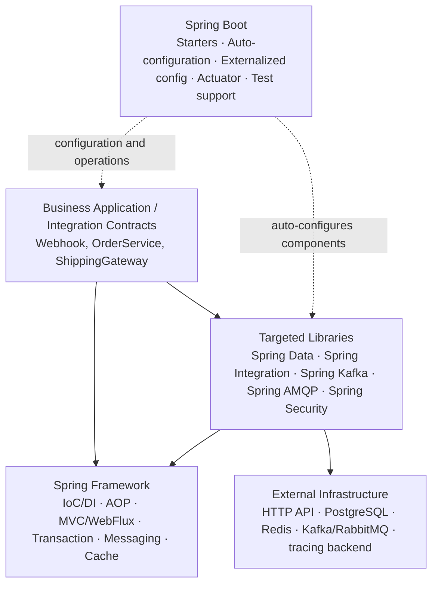
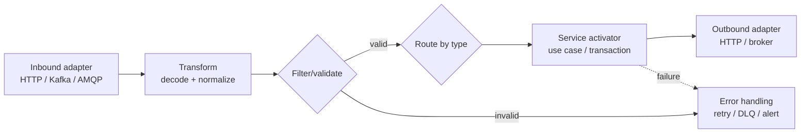
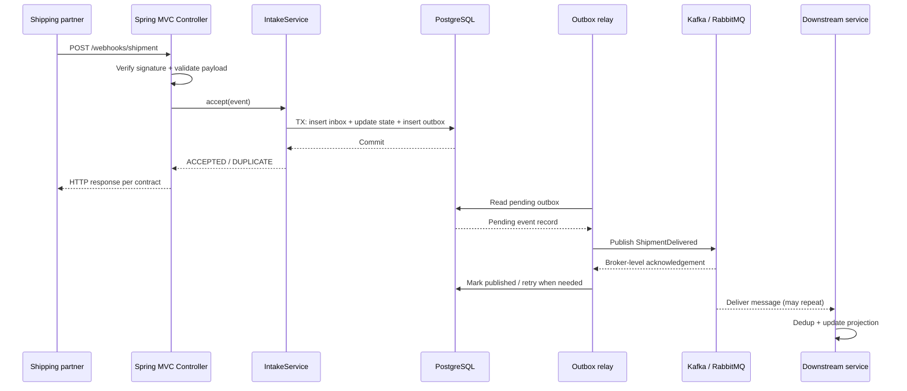

# Roles of Spring Boot, Spring Framework, and Integration Libraries

> **Chapter:** Integration Overview  
> **Module:** `SPRING_BOOT_INTEGRATION` — organizing system integration in Spring Boot via HTTP clients, databases, caches, message brokers, and Spring Integration adapters, focusing on configuration, data contracts, transactions, errors, duplicate handling, testing, and observing real-world flows.

## 1. Why Must We Distinguish the Technology Layers?

Imagine a service receiving webhooks from a shipping partner. The service must authenticate the request, validate the data, record an event in the database, update the order status, publish a notification via a message broker, and potentially refresh a cache. Such a flow involves several distinct concerns:

- **Application wiring:** creating objects, injecting dependencies into services, managing configuration and lifecycle.
- **Communication:** receiving/sending HTTP, converting JSON, publishing/consuming messages, connecting endpoints.
- **Data and consistency:** transactions, unique constraints, inbox/outbox, cache invalidation.
- **Reliability:** timeouts, retries, duplicate handling, backpressure, dead-lettering, and failure recovery.
- **Operations:** health checks, metrics, traces, logs, contract tests, and integration tests.

In the Spring ecosystem, those responsibilities are divided among **Spring Framework**, **Spring Boot**, and specialized **integration libraries**. Confusing their roles leads to false expectations: thinking that adding a starter automatically solves retries, assuming `@Transactional` covers the broker, or believing that using Spring Integration makes every message durable by default.

### Learning Objectives

After this lesson, you will be able to:

1. Explain what foundational abstractions Spring Framework provides and what Spring Boot adds.
2. Choose the right library for HTTP, databases, caches, brokers, and Spring Integration flows.
3. Distinguish between **mechanisms provided by the framework** and **business rules you must design yourself**.
4. Draw responsibility boundaries in an adapter–service–database–message broker architecture.
5. Configure dependencies, environment settings, transactions, timeouts, and observability at the right layer.
6. Build a testing strategy for a cross-system integration flow.

## 2. The Three-Layer Model: Framework, Boot, and Integration Libraries



The diagram represents responsibilities rather than an exact Maven dependency tree: Spring Boot **is built on Spring Framework**, while Spring libraries can be used with Boot or standalone. Boot reduces manual configuration; it does not replace the Framework's foundational APIs.

| Component | Primary Responsibility | Example in the Webhook Flow |
|---|---|---|
| **Spring Framework** | Bean container, dependency injection, lifecycle, AOP, web stack, transaction/message/cache abstractions | Inject `ShippingGateway`; handle `@Transactional`; accept HTTP via MVC |
| **Spring Boot** | Application bootstrapping, starter/dependency management, auto-configuration, environment-based config, health/metrics, test support | Create `RestClient.Builder` or a suitable datasource when conditions match; read config from env; bring Actuator into the app |
| **Integration Libraries** | APIs/adapters for a specific communication mechanism, persistence, or pattern | Spring Data writes to DB; Spring Kafka publishes events; Spring Integration coordinates messages across channels |
| **Project Business Code** | Contracts, ownership, state transition rules, deduplication keys, success/failure semantics | Accept only newer events; decide when to emit `ShipmentUpdated` |
| **Infrastructure** | Databases, brokers, caches, and external services enforcing their own physical guarantees | PostgreSQL unique constraints; Kafka retention/partitions; Redis TTL |

**Important note:** Spring Framework is not synonymous with Spring Boot, and Spring Integration is not synonymous with "every integration in Spring Boot". A REST API using only `RestClient` + Spring Data is already an integration flow; Spring Integration becomes useful when you need structured channels, routing, filters, transformers, gateways, and endpoint adapters.

## 3. Role of Spring Framework: The Foundational Building Blocks

Spring Framework provides the **programming model and abstractions** that let modules work together.

### 3.1. IoC Container and Dependency Injection

Spring manages objects called **beans** inside an `ApplicationContext`. Beans can be discovered via `@Component`/`@Service`/`@Repository`, or declared with `@Bean` in `@Configuration`. Constructor injection makes it easy to swap adapters, test with mocks, and keep services independent of how clients are constructed.

```java
import org.springframework.stereotype.Service;

@Service
public class ShipmentSyncService {
    private final ShippingGateway shippingGateway;

    public ShipmentSyncService(ShippingGateway shippingGateway) {
        this.shippingGateway = shippingGateway;
    }

    public void sync(ShipmentCommand command) {
        shippingGateway.send(command);
    }
}
```

`ShippingGateway` and `ShipmentCommand` here are **project-defined contracts**; the example only illustrates a service depending on a port rather than instantiating an HTTP client itself. `ShippingGateway` can be backed by a real HTTP adapter in production or a fake in tests.

Benefits: the controller does not need to know how the HTTP client is built, the business service does not care about broker configuration, and adapters can change without leaking details into the business domain.

### 3.2. AOP and Cross-Cutting Annotations

Spring uses mechanisms such as AOP/proxies to apply cross-cutting behavior: `@Transactional`, `@Async`, security checks, or custom interceptors. Because it relies on proxies, **self-invocation** (a method in the same bean calling another via `this`) in proxy mode typically bypasses advice.

For example, a `@Transactional` method called directly from another method in the same bean may not start a new transaction as intended. Designing clear service boundaries and testing call paths through the Spring context helps avoid false assumptions.

### 3.3. Web MVC, WebFlux, and HTTP Clients

Spring Framework provides:

- **Spring MVC:** servlet-based web programming; controllers typically return synchronous results or async types supported by MVC.
- **Spring WebFlux:** reactive model with `Mono`/`Flux`; suitable when the entire I/O path uses non-blocking APIs.
- **RestClient:** synchronous HTTP client with a fluent API; well-suited for Spring MVC services calling REST APIs.
- **WebClient:** reactive HTTP client supporting non-blocking communication when the connector and the entire flow are configured properly.
- **RestTemplate:** older synchronous HTTP API still seen in legacy systems; for new code, consider the guidance and version of the Framework in use.

Choosing `WebClient` does not automatically make JDBC or other libraries non-blocking. Conversely, calling `RestClient` on an `@Async` worker still occupies a thread while waiting for I/O.

### 3.4. Transaction Abstraction

Spring Framework provides abstractions such as `PlatformTransactionManager` for synchronous transactions and `ReactiveTransactionManager` for reactive transactions. `@Transactional` is only meaningful when a transaction manager matching the technology is present and the call goes through the interception mechanism.

Database transactions usually **do not cover** HTTP APIs, Redis, and brokers. When updating a database and publishing an event, a separate mechanism (such as an outbox) is required to avoid losing events after commit.

### 3.5. Messaging and Cache Abstractions

`org.springframework.messaging.Message<T>` models **payload + headers**. It is not a Kafka record or RabbitMQ delivery by default; an adapter maps it to the broker's format. Spring also provides the `CacheManager` abstraction and annotations like `@Cacheable` and `@CacheEvict`, while the implementation (in-memory, Redis...) and consistency policy are determined by configuration, the provider, and the application.

## 4. Role of Spring Boot: Assembly, Configuration, and Operations

Spring Boot is used to build Spring applications that are **easy to run and operate** with convention-over-configuration. It does not replace business services, does not prescribe architecture by itself, and does not guarantee retries or exactly-once semantics for integrations.

### 4.1. Starters and Dependency Version Management

A **starter** bundles common dependencies for a capability group, such as web, data, messaging, or actuator. The BOM/dependency management managed by the corresponding Spring Boot version helps select compatible library versions. In real projects, verify the BOM, Java baseline, and documentation for your version before adding adapters.

Example in Gradle Groovy DSL, selecting dependencies for an application receiving HTTP, writing to a database, and sending messages:

```gradle
dependencies {
    implementation("org.springframework.boot:spring-boot-starter-web")
    implementation("org.springframework.boot:spring-boot-starter-validation")
    implementation("org.springframework.boot:spring-boot-starter-data-jpa")
    implementation("org.springframework.kafka:spring-kafka")
    implementation("org.springframework.boot:spring-boot-starter-actuator")

    runtimeOnly("org.postgresql:postgresql")

    testImplementation("org.springframework.boot:spring-boot-starter-test")
    testImplementation("org.springframework.kafka:spring-kafka-test")
}
```

The example **intentionally omits version pins** assuming the build already applies Spring Boot dependency management. Add `spring-kafka` for a Kafka adapter, or replace it with AMQP/RabbitMQ or JMS if the project chooses a different broker. There is no need to install every starter in the ecosystem for every service.

### 4.2. Conditional Auto-Configuration

Spring Boot creates and configures common beans based on classpath dependencies, existing beans, and properties. For example, when the JDBC/JPA starter and valid datasource properties are present, Boot can provide the datasource, transaction manager, and required JPA components. When the corresponding Kafka starter/module and connection properties are present, Boot can conditionally configure `KafkaTemplate` or listener infrastructure.

**Auto-configuration is not magic:** declaring custom beans can alter default configuration; missing drivers, URLs, or authentication settings can prevent beans from being created or cause startup failures. Read startup errors, consult the auto-configuration report when needed, and inspect beans in the application context.

### 4.3. Externalized Configuration and Profiles

Partner addresses, credentials, databases, and brokers must live in environment-specific configuration rather than being hard-coded in services:

```yaml
integration:
  shipping:
    base-url: ${SHIPPING_BASE_URL}
    timeout: 5s

spring:
  datasource:
    url: ${DB_JDBC_URL}
    username: ${DB_USERNAME}
    password: ${DB_PASSWORD}
  kafka:
    bootstrap-servers: ${KAFKA_BOOTSTRAP_SERVERS}

management:
  endpoints:
    web:
      exposure:
        include: health,info,prometheus
```

This is an **illustrative** configuration and is not enough by itself to create every bean or configure every protocol. The property `integration.shipping.timeout` must be read by the application and **explicitly applied to the HTTP client**; placing it in YAML does not automatically enforce a network-layer timeout. The Prometheus endpoint requires a matching registry and exposure conditions, and management endpoints must be protected by deployment policies.

Spring Boot supports `@ConfigurationProperties` for type-safe binding, validation, and grouping of properties. `@Profile` and profile-specific files can support environment differences, but profiles should not be used to store secrets directly in source code. Credentials should come from a secret manager, environment variables, or a standardized secrets mechanism.

### 4.4. Actuator, Metrics, and Operational Status

Spring Boot Actuator provides health/info endpoints and integrates with Micrometer to export metrics based on configuration. From there, applications can monitor HTTP/DB pools, consumer lag, integration latency, retry queues, and outbox status. Business metrics are not included automatically: you must actively instrument events such as `webhook.accepted`, `outbox.pending`, or `partner.sync.failed`.

Health checks should only reflect designed criteria for "is the service healthy enough to serve traffic"; do not unconditionally turn an external partner outage into a liveness failure that causes continuous restarts.

## 5. Choosing the Right Library for Each Integration Type

Spring Framework provides the foundation, while each communication style typically needs a specialized adapter library or starter:

| Need | Common Library/API | Scope Notes |
|---|---|---|
| Receive REST/webhooks | Spring MVC or WebFlux | Controller receives requests; still needs auth, validation, idempotency, and response mapping |
| Synchronous HTTP calls | `RestClient` | Configure timeouts, auth, selective retries, and correlation ID |
| Reactive HTTP calls | `WebClient` | Keep the reactive chain intact; avoid blocking the event loop |
| Synchronous SQL/JPA | Spring Data JPA, Spring Data JDBC, or `JdbcTemplate` | Synchronous JDBC/transactions; separate migrations/connection pool |
| Reactive SQL | Spring Data R2DBC/`DatabaseClient` | `ConnectionFactory`, reactive transaction manager; not reactive JPA |
| Caching | Spring Cache, Spring Data Redis | Cache is not the default source of truth; needs TTL, keys, and invalidation |
| Kafka | Spring for Apache Kafka (`spring-kafka`) | `KafkaTemplate`, `@KafkaListener`, serializers, groups, retry/DLT |
| RabbitMQ/AMQP | Spring AMQP | `RabbitTemplate`, listeners, exchanges/queues/bindings/acks |
| JMS | Spring JMS | Suitable for JMS-compliant brokers; not synonymous with Kafka/AMQP |
| Multi-step message flows | Spring Integration | Channels, gateways, routers, filters, transformers, service activators, inbound/outbound adapters |
| Multi-binder stream abstraction | Spring Cloud Stream | Higher-level abstraction; choose only when its binding model and broker capabilities fit |
| Endpoint/client security | Spring Security, OAuth2 client/resource server | Authentication/authorization and tokens; does not replace TLS/secret management |
| Retry/circuit breaker | Spring Retry, Resilience4j, or client/broker mechanisms | Add-on libraries; require retry policies and idempotency |
| Observability | Micrometer, OpenTelemetry instrumentation, and Actuator | Tracing requires propagation, exporters/backends, and dedicated configuration |

These modules **do not all need to be installed at once**. First identify the protocol, reliability requirements, work semantics, and operational scale; then add the right library for each adapter.

### 5.1. Spring Data and Differences Between JPA, JDBC, and R2DBC

- **Spring Data JPA** provides repositories and ORM mapping via a JPA provider such as Hibernate. Suitable when entity relationships, a persistence context, and a synchronous transaction model are needed.
- **Spring Data JDBC** focuses on aggregates and SQL over JDBC, with a different mapping model from JPA.
- **Spring Data R2DBC** supports reactive relational queries via an R2DBC driver and `ConnectionFactory`; it does not provide full JPA semantics.
- **JdbcTemplate** and **DatabaseClient** allow fine-grained SQL control when integration logic needs upserts, unique constraints, or database-specific operations.

Just because an application uses WebFlux does not mean every data access must immediately switch to R2DBC. Mixing blocking and reactive code requires clear boundaries—never call JDBC directly on the event loop.

### 5.2. Spring Cache and Redis

`@Cacheable` can reduce repeated calls to a database or partner system for frequently read data, while `@CacheEvict` supports invalidation when data changes. However, **a cache is a potentially stale copy**: when receiving a `ProductPriceChanged` event, the consumer refreshing the cache may fail or receive the event late. Appropriate TTLs, idempotency, version/sequence rules for order-sensitive data, and fallback to the source of truth are needed.

### 5.3. Brokers Do Not Replace Business Orchestration

Kafka and RabbitMQ specialize in transporting messages under their own models and guarantees. Producers and consumers still must define **commands** (action requests), **events** (facts that occurred), **messages** (exchange units), schemas, idempotency keys, retries, dead-lettering, and ownership.

Do not assume Spring Kafka or Spring AMQP guarantees *exactly-once* semantics for all database/HTTP side effects. Each broker's transaction limits must be read according to its specific scope.

## 6. Spring Integration: Organizing Message Flows with Integration Patterns

Spring Integration implements many **Enterprise Integration Patterns** to describe how messages move through endpoints inside and outside the application. It is especially useful when a flow involves multiple normalization, classification, routing, and transport-bridging steps.

Core concepts:

| Concept | Role | Example |
|---|---|---|
| `Message<?>` | Payload and headers | Order data + correlation ID |
| `MessageChannel` | Connects producers to consumers inside the app | Passes messages to the next processing step |
| `Transformer` | Converts data format/type | Maps webhook JSON to an internal DTO |
| `Filter` | Drops or redirects messages failing a condition | Rejects payloads missing a partner code |
| `Router` | Selects a processing branch | Routes by event type or target system |
| `ServiceActivator` | Connects a message to a business method | Calls `OrderIntakeService` |
| `Gateway` | Hides messaging behind an interface | Service calls an interface instead of manipulating channels directly |
| `Inbound/Outbound Adapter` | Connects external systems into/out of a flow | HTTP, JMS, AMQP, Kafka, file, SFTP... depending on the adapter |
| `ErrorChannel` | Error-handling channel in the flow as configured | Captures errors, classifies them, and routes to the proper handling branch |

### 6.1. Structured Message Flow



This is an architectural diagram: transaction scope, threads, ACKs, and retries **do not magically appear** just because steps are linked by channels. `DirectChannel` typically invokes subscribers on the sender's thread; `ExecutorChannel` can hand off to an executor; queue channels, pub/sub channels, and adapters behave differently. Choose based on synchronicity, durability, and expected outcomes.

### 6.2. Small Example with a Channel and Service Activator

```java
import org.springframework.context.annotation.Bean;
import org.springframework.context.annotation.Configuration;
import org.springframework.integration.annotation.ServiceActivator;
import org.springframework.integration.channel.DirectChannel;
import org.springframework.messaging.MessageChannel;
import org.springframework.stereotype.Component;

@Configuration
class IntegrationChannels {

    @Bean
    MessageChannel inboundOrders() {
        return new DirectChannel();
    }
}

@Component
class OrderMessageHandler {

    private final OrderIntakeService orderIntakeService;

    OrderMessageHandler(OrderIntakeService orderIntakeService) {
        this.orderIntakeService = orderIntakeService;
    }

    @ServiceActivator(inputChannel = "inboundOrders")
    public void handle(OrderNotice notice) {
        orderIntakeService.accept(notice);
    }
}
```

This snippet illustrates an **internal channel + adapter calling a service**; `OrderIntakeService` and `OrderNotice` are application types you must define yourself. Appropriate Spring Integration infrastructure from dependencies/configuration is required. `DirectChannel` passes work synchronously within the same process—it is **not a durable queue**, and sending to the channel does not automatically publish a Kafka message. Talking to a real broker or HTTP endpoint requires adding the corresponding adapter, converters, authentication, and error handling.

Use Spring Integration when coordinating **multiple integration steps** and wanting an explicit flow. For a single HTTP endpoint calling one service and saving to a database, a plain controller/service can be simpler and easier to maintain.

## 7. End-to-End Illustration: Webhook → Database → Broker → Downstream Systems

A classic problem in `SPRING_BOOT_INTEGRATION`: a partner sends a `ShipmentDelivered` webhook; our service must record it once and notify other services.



Responsibility matrix:

| Stage | Spring Framework | Spring Boot | Specialized Library | Application Logic Must Define |
|---|---|---|---|---|
| Receive HTTP | Spring MVC/WebFlux | Web starter/auto-configuration | Security if needed | Webhook signature, validation, schema version |
| Save inbox & state | `@Transactional`/transaction manager | DataSource and conditional config | Spring Data/JDBC/JPA/R2DBC | Unique keys, state transitions, duplicate handling |
| Save outbox | Database transaction | DB config | JDBC/JPA/R2DBC | Event records, keys, publish status |
| Push to broker | Spring Messaging abstraction | Conditional template/listener auto-config | Spring Kafka/AMQP/JMS/Integration adapter | Routing, partition keys, retries, monitoring |
| Receive event | Container, bean lifecycle | Dependencies/config | Kafka/AMQP listener | Idempotent consumer, ordering, dead-lettering |
| Observability | Infrastructure abstractions | Actuator | Micrometer/tracing | Correlation IDs, business metrics, alerts |

### 7.1. Data Contract at the System Boundary

The webhook payload may differ from the internal domain model. An illustrative message structure:

```json
{
  "messageId": "msg-2026-001",
  "eventId": "ship-evt-88",
  "type": "shipment.delivered.v1",
  "occurredAt": "2026-11-21T02:00:00Z",
  "correlationId": "order-flow-42",
  "producer": "shipping-partner",
  "payload": {
    "orderId": "ord-42",
    "shipmentId": "shp-9",
    "deliveredAt": "2026-11-21T01:59:00Z"
  }
}
```

This is a **custom schema** for illustration, not a mandatory format of Spring, Kafka, or RabbitMQ. `eventId` must remain stable across redeliveries of the same event; `messageId` may represent the envelope/delivery depending on the contract; `correlationId` links steps across the same flow and must not be used as a deduplication key for every event.

Contracts should specify type/version, required fields, error classification, when the event actually occurred, timezones, payload size limits, and sensitive data policies. Do not expose JPA entities or unversioned internal DTOs directly across boundaries.

### 7.2. Example HTTP Adapter Configured by Boot

An example using `RestClient` provided by Spring Framework, configuring a bean with `RestClient.Builder` that Spring Boot can provide when auto-configuration conditions are met:

```java
import org.springframework.beans.factory.annotation.Value;
import org.springframework.context.annotation.Bean;
import org.springframework.context.annotation.Configuration;
import org.springframework.web.client.RestClient;

@Configuration
public class ShippingClientConfiguration {

    @Bean
    RestClient shippingRestClient(
            RestClient.Builder builder,
            @Value("${integration.shipping.base-url}") String baseUrl) {
        return builder.baseUrl(baseUrl).build();
    }
}
```

```java
import org.springframework.stereotype.Component;
import org.springframework.web.client.RestClient;

@Component
public class HttpShippingGateway implements ShippingGateway {

    private final RestClient shippingRestClient;

    public HttpShippingGateway(RestClient shippingRestClient) {
        this.shippingRestClient = shippingRestClient;
    }

    @Override
    public void send(ShipmentCommand command) {
        shippingRestClient.post()
            .uri("/shipments")
            .header("Idempotency-Key", command.commandId())
            .body(command)
            .retrieve()
            .toBodilessEntity();
    }
}
```

`ShippingGateway` and `ShipmentCommand` are application-defined interface/record types; `commandId()` is a stable idempotency key for the same request. The partner must also **support and honor** that key for the header to take effect. This illustrates separation of responsibilities and omits timeout/request factory setup, auth, retries, or HTTP error mapping; those parts must be added before production. If the application has multiple `RestClient` beans, use explicit qualifiers.

### 7.3. Example Writing Inbox/Outbox in the Same Transaction

Core idea at the service layer (the repositories below are **project-implemented APIs**, not built-in Spring classes):

```java
@Service
public class ShipmentIntakeService {

    private final InboxRepository inboxRepository;
    private final OutboxRepository outboxRepository;

    public ShipmentIntakeService(InboxRepository inboxRepository,
                                 OutboxRepository outboxRepository) {
        this.inboxRepository = inboxRepository;
        this.outboxRepository = outboxRepository;
    }

    @Transactional
    public IntakeResult accept(ShipmentDelivered incoming) {
        boolean inserted = inboxRepository.insertIfAbsent(
            incoming.partner(), incoming.eventId(), incoming
        );

        if (!inserted) {
            return IntakeResult.DUPLICATE;
        }

        // Business state can be updated in the same transaction.
        outboxRepository.insertEvent("shipment.delivered.v1", incoming);
        return IntakeResult.ACCEPTED;
    }
}
```

For this snippet to be atomic, both operations must participate in **the same transaction of the same database** with the appropriate transaction manager. `insertIfAbsent` should rely on a unique constraint over the stable key (`partner`, `eventId`) and handle conflicts per the specific SQL/database; doing `SELECT` then `INSERT` without a unique constraint can race under concurrent requests.

Use versioned migrations to create inbox/outbox schemas and standardize unique indexes. When the relay fails to publish after commit, the outbox retains the event for retries. The relay may still send the same event multiple times if the broker response is lost, so consumers also need deduplication.

### 7.4. Why Not Just Call KafkaTemplate Inside @Transactional?

Consider this simple sequence:

```text
BEGIN DB TRANSACTION
UPDATE shipment SET status = 'DELIVERED'
COMMIT
kafkaTemplate.send("shipment.events", event)
```

If the application crashes right after `COMMIT` and before sending to the broker, the event can be lost. Reversing the order to send to the broker before commit can cause consumers to observe an event for a state that rolled back.

**Transactional outbox** writes the business change and the outbox row in the same database transaction. The relay publishes afterward, handles retries, and may publish duplicates; consumers must be idempotent. This is an architectural pattern assembled by the application using database, Spring Data, and broker capabilities; **Boot does not automatically implement this entire pattern when you add a starter**.

## 8. Transaction Boundaries and Failure Models

### 8.1. Classifying Consistency Boundaries

| Boundary | What Can Be Managed | What Is Not Automatically Guaranteed |
|---|---|---|
| One JDBC/JPA transaction in one DB | Commit/rollback of multiple operations on the same datasource and transaction manager | HTTP calls and brokers outside DB scope |
| One suitable R2DBC transaction | Reactive transactions via `ConnectionFactory` and Reactor context | Transactions with JDBC/JPA or remote APIs by default |
| Configured Kafka producer transaction | Send/read behaviors within Kafka's supported mechanism scope | Exactly-once for external databases or HTTP services outside Kafka |
| Cache transaction/invalidation | Behavior per provider/cache manager | Atomic commit across cache and database |
| Multi-step Saga/workflow | Tracking state, compensation, and business progress | Atomic rollback across all services like a single DB transaction |

When making an HTTP call inside a database transaction, waiting on a partner can hold locks and connections for a long time; meanwhile, remote side effects do not roll back with the DB. Usually you should separate the transaction that records state/outbox work from the actual network send step.

### 8.2. Classified and Bounded Retries

- **Transient errors:** HTTP 503, network resets, broker unavailable, database timeouts; may retry with backoff, jitter, and limits.
- **Contract/business errors:** malformed data, 400 from validation, missing permissions, or rejected actions; do not retry blindly.
- **Unknown outcome errors:** timeout after the partner may have committed; query status or use an idempotency key before resending.
- **Serialization/schema errors:** message cannot be decoded; send to dead-letter/quarantine and fix the contract instead of retrying infinitely.

An ACK from the broker indicates receipt/handling status according to **transport rules**; it does not mean the customer received their delivery or the partner settled the payment.

### 8.3. Idempotency

A webhook may be delivered twice, or a consumer may redeliver a message when a process dies after DB commit but before ACK. Applications must rely on stable business keys (`partner + eventId`, `commandId`, or contract-specified keys) and unique constraints/state checks.

Do not use `correlationId` to deduplicate all events of a workflow: multiple valid events may share the same correlation ID.

## 9. Cross-System Configuration and Security

### 9.1. Configuration Management

Each adapter typically has its own configuration groups:

- HTTP: base URL, authentication, connect/read timeouts, connection pool, rate limits.
- Database: URL, credentials, pool size, migrations, and transaction timeouts.
- Cache: TTL, key naming, serializers, eviction, and refresh handling when delayed.
- Broker: bootstrap/host, serializers, security (TLS/SASL if needed), topics/queues, groups, ack/retry/dead-letter.
- Spring Integration: channel capacity, pollers, schedulers, executors, and error channels per flow.

With multiple instances, total database, HTTP, and broker connections scale with instance count. Plan **cluster-wide** limits, not just per-process thread/pool settings.

### 9.2. Security at Boundaries

Partner webhooks require signature/authentication verification and replay protection per contract; internal endpoints require authentication and authorization. HTTP clients must use environment-appropriate secrets. Brokers and databases need least-privilege ACLs. Logs and traces should record IDs, statuses, and latency; avoid printing tokens, payloads containing PII, or card data.

Spring Security supports many authentication/authorization mechanisms, but **does not automatically verify proprietary webhook signatures**. Engineering teams must implement the partner's contract and test invalid signatures, expired timestamps, and duplicate nonces/events.

## 10. Testing at the Right Layer and Boundary

Each layer enables a different kind of verification:

| Goal | Test Type | Common Tools/Approaches |
|---|---|---|
| Pure business logic | Unit test | JUnit, fake ports/adapters, state assertions |
| Bean wiring and configuration | Spring context test | `@SpringBootTest`, checking beans/properties/auto-config |
| REST controllers and validation | Web layer test | MockMvc/WebTestClient, 2xx/4xx/5xx cases |
| HTTP client with partners | Adapter/contract test | HTTP mock server, timeouts/errors/status mapping |
| Queries, unique constraints, transactions | Database integration test | Same DB engine as production, Testcontainers when appropriate |
| Producer/consumer, retries, DLQ | Broker integration test | Kafka/RabbitMQ test environment, Testcontainers |
| Spring Integration flow | Flow test | Send messages to channels, assert routing/transforms/filters and errors |
| Reliability under failure | Failure-injection test | Crash after DB commit, broker unavailable, duplicate/replay, out-of-order |
| Load and operations | Performance/observability test | Measure pools, queue depth, p95/p99, consumer lag, metrics/traces |

In particular, test the gaps between layers: database commit succeeds but publish fails, consumer dies after commit before ACK, HTTP response is lost after the partner executed, events arrive out of order, cache was not invalidated.

**Mocked tests are not enough** for transaction/unique constraint rules or broker behavior. For critical logic, prefer integration testing against the corresponding database/broker product with controlled state and cleanup.

## 11. Observing the Entire Integration Flow

In operations, a "successful" HTTP request may only mean it was accepted, not that background work has finished. You need a status and metric model reflecting each stage:

```text
RECEIVED -> VALIDATED -> PERSISTED -> PUBLISHED -> CONSUMED -> APPLIED
                           \-> RETRYING / DEAD_LETTER / MANUAL_REVIEW
```

These statuses are examples, not a Spring-provided enum. Depending on the flow, some steps may not exist or may occur in a different order; standardize the contract for business statuses.

Recommended signals:

1. **Correlation ID** across HTTP → database/outbox → broker → consumer; separate **event ID** for deduplication.
2. **Latency metrics** per adapter: HTTP client, query, publish, consumer, and end-to-end when possible.
3. **Error counters by cause:** validation, timeout, authentication, schema, retryable/non-retryable.
4. **Backlog:** unsent outbox records, consumer lag, retry job counts, dead-letter counts.
5. **Pools and concurrency:** active connections, queue sizes, thread saturation, timeouts/rejections.
6. **Trace/span propagation:** pass context via message headers according to the deployed instrumentation; do not assume it exists automatically for every adapter.
7. **Structured logs:** timestamp, service, operation, business ID, event ID, status, and error; never log secrets.

Spring Boot Actuator, Micrometer, and tracing tools can provide the foundation; business metrics and alert thresholds must be defined by the application and operations teams.

## 12. When to Use Spring Integration vs. Direct Libraries?

**Use libraries directly** when an endpoint calls one service with a straightforward adapter—for example, Spring MVC receiving a request, a service saving with Spring Data, and a publisher sending to Kafka. Direct code can be easier to read if the flow is simple.

**Consider Spring Integration** when one or more of these situations arise:

- Multiple transports exist—HTTP, file, SFTP, JMS, AMQP, Kafka, email...—and need to be chained into a clear pipeline.
- You need routing by header/type, filtering, transformation, splitter/aggregator, resequencer, or gateway patterns.
- Multiple error branches and retries need to be organized into dedicated flows.
- You want to decouple inbound/outbound adapters from business services and test flows at the message level.

**Consider Spring Cloud Stream** if the project wants a binder abstraction and adopts its message-binding model. It is not required if you are already using Spring Kafka or Spring Integration.

An application can combine technologies: WebFlux for inbound APIs, Spring Data R2DBC for persistence, Spring Integration for routing, and Spring Kafka for the broker. However, combining them requires clearly defining the thread model, transaction managers, backpressure, and runtime metrics; more abstractions do not automatically make an architecture more reliable.

## 13. Common Mistakes When Combining Libraries

| Mistake | Why It Is Dangerous | Remedy |
|---|---|---|
| "Adding a starter gives reliability." | Starters only provide dependencies/auto-config; lacking contracts/retries/idempotency | Design failure modes, unique keys, outbox, and tests |
| "`@Transactional` covers both HTTP and Kafka." | DB transactions usually do not cover external side effects | Outbox, saga, or explicitly scoped coordination |
| "Spring Integration channels are always async and durable." | `DirectChannel` is synchronous; in-memory queues are not durable | Choose appropriate channels/adapters and persist durably when needed |
| "Message sent successfully = business done." | Broker ACK differs from downstream processing outcome | Track command/event state and business feedback |
| "Spring Boot configures all HTTP timeouts automatically." | Custom properties do not apply to clients unless bound/applied | Configure request factories and test actual timeouts |
| "Using WebFlux makes everything non-blocking." | JDBC, blocking clients, or heavy CPU work can still block | Use proper drivers, isolate blocking work, and load-test |
| "Cache is always up to date after publishing an event." | Consumers may lag/fail or receive out-of-order messages | TTLs, versions/sequences, idempotent invalidation |
| "A consumer processes each message exactly once." | Retries, crashes, and rebalances can cause redeliveries | Deduplicate on business keys within transactions |
| "Tracing works automatically if Actuator is added." | Propagation/metrics depend on instrumentation and adapters | Verify end-to-end traces and add correlation IDs |
| "Changing internal DTOs won't affect consumers." | Integration contracts have independent lifecycles | Versioning, contract tests, backward compatibility |

## 14. Process for Selecting Technologies for a New Integration

Before picking starters or adapters, ask these questions in order:

1. **What are the source and destination?** HTTP, database, cache, Kafka, RabbitMQ, JMS, files, or another system?
2. **What is the business contract?** Action-requesting command, fact-reporting event, query/reply, or data synchronization?
3. **Who owns the state?** Which service updates it, what deduplication key applies, and when is an event allowed to be published?
4. **Synchronous or asynchronous?** Does the client wait for the result or receive a job ID and poll status later?
5. **What level of durability is required?** Can work be lost on crash; what outbox/job/broker and retry setup is needed?
6. **What are the transaction boundaries?** JDBC/JPA or R2DBC; which side effects fall outside the same transaction?
7. **Is multi-step routing/transformation needed?** If yes, Spring Integration can keep the flow manageable; if not, direct services/adapters suffice.
8. **What are the operational constraints?** Throughput, timeouts, pools, partner limits, security, metrics, traces, DLQ?
9. **How will it be tested?** Logic unit tests, contract tests, DB/broker integration tests, and failure injection?

### Example Stack Choices

| Scenario | Suggested Stack | Explanation |
|---|---|---|
| Spring MVC API calling a partner and saving to PostgreSQL | Spring Boot + MVC + RestClient + Spring Data JDBC/JPA | Relatively simple synchronous communication; focus on timeouts and transactions |
| WebFlux with high concurrent I/O and R2DBC-supported DB | Boot + WebFlux + WebClient + Spring Data R2DBC | Preserve end-to-end non-blocking; control pools/backpressure |
| Webhook sync guaranteeing no lost events for downstream | Boot + MVC/WebFlux + DB + inbox/outbox + Spring Kafka/AMQP | Deduplication, commit before publish, and safe retries |
| Multiple inputs/outputs, message-type routing, multi-step transforms | Boot + Spring Integration + matching adapters | Clear flow/endpoints; still need explicit durability design |
| Consuming events to update a distributed cache | Boot + Spring Kafka/AMQP + Spring Cache/Redis | Idempotent consumer, TTL, and stale/late event handling |

## 15. Self-Check Knowledge Quiz

**Q1:** Is an application using only `spring-boot-starter-web`, `RestClient`, and `JdbcTemplate` an integration application?  
**Answer:** Yes. Integration is about systems communicating and coordinating data, regardless of whether Spring Integration is used.

**Q2:** Does adding `spring-integration-core` guarantee every message runs off the caller thread and is persisted durably?  
**Answer:** No. Behavior depends on the channel, endpoint, executor, adapter, and transport. `DirectChannel` is typically synchronous; durability must be designed explicitly.

**Q3:** Do Spring Boot and Spring Framework both provide `@Transactional`?  
**Answer:** `@Transactional` is an abstraction belonging to Spring Framework; Boot helps configure the transaction manager based on dependencies and properties when conditions are met.

**Q4:** Why is committing to a database and then directly publishing to Kafka still risky?  
**Answer:** There is a window between the two operations where the process can crash; transactional outbox shrinks this gap, though consumers must still handle duplicate publishes/deliveries.

**Q5:** If an HTTP webhook is sent twice, does the framework automatically recognize it as the same event?  
**Answer:** No. The application must define a stable event key, a unique constraint, and duplicate-handling rules per the contract.

**Q6:** Does Actuator immediately provide an end-to-end metric like "order successfully updated at partner"?  
**Answer:** Not by default. That is a business metric; the application must instrument and correlate states using IDs/traces.

---

In the **Integration Overview** chapter of `SPRING_BOOT_INTEGRATION`, remember the three layers of responsibility: **Spring Framework** provides the foundational programming model, **Spring Boot** assembles and operates the application by convention, and **integration libraries** provide APIs and adapters for each communication mechanism. Defining contracts, data boundaries, reliability, error/duplicate handling, and observability remains the application's design responsibility.
