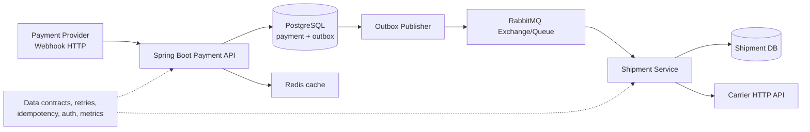
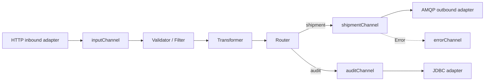
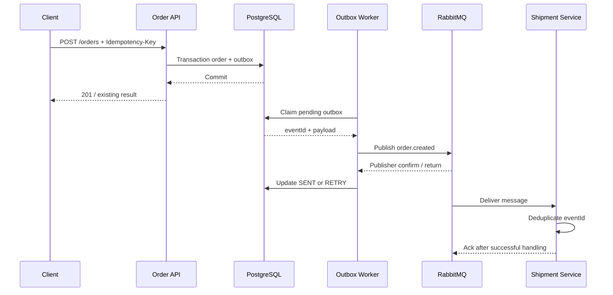
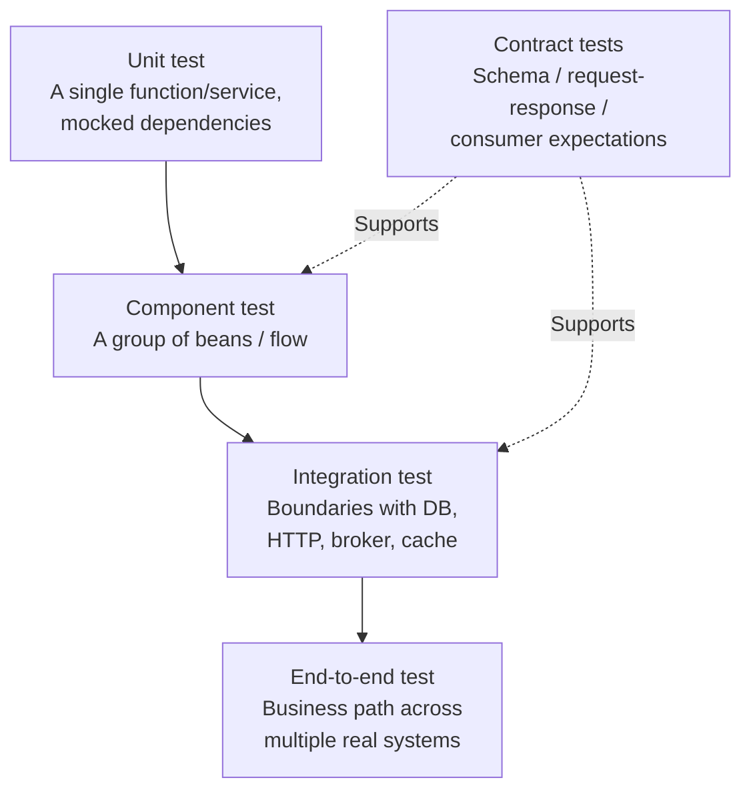
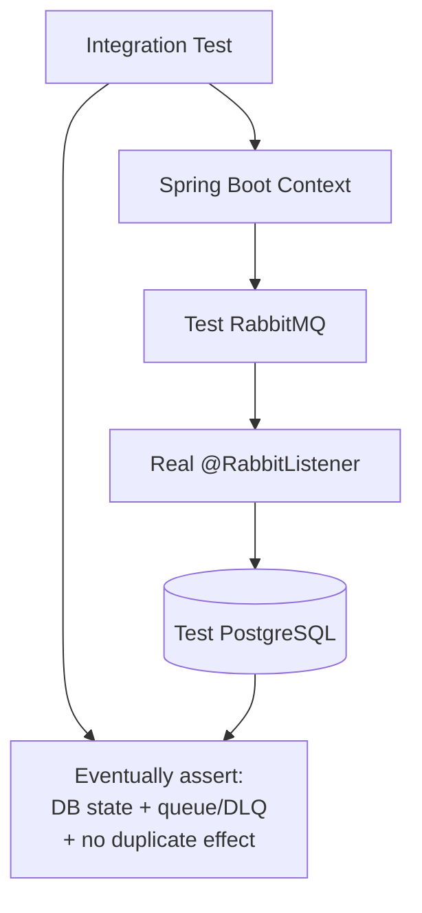

# Distinguishing System Integration from the Spring Integration Framework and Integration Testing

## 1. Three Easily Confused Uses of the Word "Integration"

In software engineering, "integration" can refer to an **architectural goal**, a **specific framework**, or a **testing level**. These three concepts are related, not synonymous:

1. **System integration**: designing, building, and operating interactions among systems, applications, services, or data sources that have separate boundaries.
2. **Spring Integration**: a framework in the Spring ecosystem that implements **Enterprise Integration Patterns (EIP)** such as message channels, routers, transformers, filters, gateways, and protocol adapters.
3. **Integration testing**: the activity of verifying that **multiple collaborating components** behave correctly at their boundaries; this can test HTTP, databases, brokers, Spring Integration flows, or other adapters.

For example, a Spring Boot service receiving webhooks from a payment partner, writing orders to PostgreSQL, and publishing events to RabbitMQ is a **system integration problem**. That service **might not use the Spring Integration framework at all** and still be an integrated system. A test that boots the application with real PostgreSQL and RabbitMQ to verify the full flow is **integration testing**, regardless of whether the source code uses Spring Integration.

In the **SPRING_BOOT_INTEGRATION** module, the learning goal is to organize connections via HTTP clients, databases, caches, message brokers, and Spring Integration adapters; the recurring focus is configuration, data contracts, transactions, errors, duplicate handling, testing, and observability. Distinguishing these three concepts helps you choose the right tool, design clear boundaries, and avoid a false sense of security when a small test passes.

### Learning Objectives

After this lesson, you will be able to:

- Explain **system integration** without tying its definition to any specific framework.
- Read a Spring Integration flow diagram and identify `Message`, `MessageChannel`, endpoints, gateways, adapters, and handlers.
- Decide when to use regular Spring Boot APIs, when to use Spring Integration DSL, and when to combine both.
- Distinguish unit tests, component tests, integration tests, contract tests, and end-to-end tests by the **boundary being verified**.
- Plan testing for an HTTP → database → broker/HTTP downstream flow with real data, network failures, retries, idempotency, and observability.

## 2. Quick Comparison Table

| Question | System Integration | Spring Integration | Integration Testing |
| --- | --- | --- | --- |
| **Nature** | Architectural and engineering discipline/activity | Framework for message-driven flows using EIP | Testing methodology/level |
| **Goal** | Systems collaborate safely, per contract, and reliably | Organize flows, channels, routing, transformation, adapters | Catch defects at real boundaries between components |
| **Scope** | HTTP, DB, cache, broker, files, email, scheduled jobs... | Message flows and adapters declared with Spring Integration | Any group of integrated components |
| **Requires Spring Integration?** | No | It is that framework | No |
| **Automatically guarantees transactions, exactly-once?** | No; must be designed | No; must be configured and coordinated with resources | No; only verifies properties that were designed |
| **Example** | Sending orders from an API to a shipping service | `IntegrationFlow` transforming an HTTP inbound message and sending to AMQP | Testing with a database and broker to confirm messages reach the right queue |

**Rule of thumb:** *System integration is the problem to solve; Spring Integration is one of the tools; integration testing is how you produce evidence that the solution works.*

## 3. System Integration Is a Problem of Crossing Boundaries

A system may have many internal layers and modules. System integration begins when components with **relatively independent contracts and lifecycles** need to exchange data or synchronize business effects.

Common boundaries include:

- **Network boundary:** two services communicate over HTTP, gRPC, RSocket, SMTP, or AMQP.
- **Data boundary:** service A and service B own separate databases, schemas, or caches.
- **Temporal boundary:** a producer may send before a consumer is ready; results arrive late or never arrive.
- **Reliability boundary:** one service may crash or time out while the other has already committed.
- **Contract boundary:** schemas, semantics, error codes, API versions, and compatibility rules managed by multiple teams.
- **Security boundary:** tokens, service identities, virtual hosts, database permissions, and data classification.

Illustrative example:



This flow must answer architectural questions before choosing code:

1. If the partner sends the webhook a second time with the same `eventId`, does it create two transactions?
2. If PostgreSQL commits but the app crashes before publishing, is the event lost?
3. If RabbitMQ receives the event but the producer loses connection before the confirm, how is it resent?
4. If the consumer calls the carrier API successfully but crashes before acking, is a shipment created twice?
5. If the payload version changes while old messages are still in the queue, can the consumer still read them?
6. Where is the latency measured from successful payment to order dispatch?

None of these questions is answered simply by adding a Spring Integration dependency to the project.

## 4. Typical Integration Styles in Spring Boot

| Boundary | Common Technology/API | Interaction Style | Key Design Concerns |
| --- | --- | --- | --- |
| HTTP outbound | `RestClient`, `WebClient`, or suitable HTTP client | Synchronous or reactive request/response | Timeouts, authentication, HTTP status, retries, circuit breaker |
| HTTP inbound | Spring MVC/WebFlux controller | Receive requests/webhooks | Signature validation, schema, idempotency, response semantics |
| Database | JDBC, JPA, R2DBC | Read/write state in local transactions | Ownership, migrations, transactions, optimistic locking |
| Cache | Spring Cache/Redis | Temporary data access | TTL, key schema, invalidation, cache stampede |
| Message broker | Spring AMQP, Spring Kafka | Asynchronous publish/consume | Confirm/ack, ordering, redelivery, DLQ, schema evolution |
| File, SFTP, email | Protocol libraries or Spring Integration adapters | Receive/send data via external systems | Polling, duplicate files, credentials, retries, partial transfers |
| Scheduling | `@Scheduled`, Quartz | Time-based triggers | Leader coordination, misfires, checkpoints, overlap |
| Message orchestration | Spring Integration | Chaining channels, filtering, transforming, routing, calling adapters | Message headers, error channel, lifecycle, backpressure/queues |

**Not every database connection is a "system integration" in the sense of connecting independent systems.** Within an application, database access may simply be internal persistence. However, when testing the application against a real database, it is still commonly called an **integration test** because application code and the persistence layer collaborate.

This distinction is important so you do not infer the architecture type or test type solely from a technology name.

## 5. Integration Is More Than Just "Being Connected"

A successful TCP connection or HTTP 200 is not enough to say an integration flow is correct. Integration quality usually needs evaluation across at least seven dimensions:

| Dimension | Technical Question |
| --- | --- |
| **Contract** | Are payloads, headers, error codes, versions, and business semantics agreed upon? |
| **Security** | Are identities, permission scopes, TLS, secret rotation, and data controls right? |
| **Reliability** | Are messages/requests preserved for retries during transient failures? |
| **Data consistency** | How are transactions and effects across systems coordinated? |
| **Duplicate handling** | Do replays, timeouts, redeliveries, or repeated callbacks cause double side effects? |
| **Performance** | Are timeouts, concurrency, backlogs, backpressure, and downstream capacity aligned? |
| **Observability** | Are trace/correlation IDs, metrics, logs, alerts, and status lookups available? |

In distributed systems, many failure points create **uncertain** states:

- A request timeout does not mean the server did not process it.
- A publisher not receiving a confirm does not mean the broker did not receive the message.
- SMTP relay acceptance does not mean the recipient read the email.
- A consumer ack does not prove all effects outside the database committed atomically.
- A passing test with mocks does not prove the same code operates correctly over real networks/TLS.

Therefore, choosing a framework only solves **part** of the problem; the rest lies in contracts, data models, error orchestration, transactions, and testing.

## 6. What Is the Spring Integration Framework?

**Spring Integration** is a framework for building message-driven applications based on Enterprise Integration Patterns (EIP). It helps compose a processing pipeline into structured steps rather than stuffing all reading, transformation, routing, and sending logic into one giant service method.

Some building blocks:

| Spring Integration Concept | Meaning | Must Distinguish From |
| --- | --- | --- |
| `Message<T>` | Payload and headers of a message | Does not mean a message is already on a broker |
| `MessageChannel` | Logical pipe between producer/consumer of a flow | Not a RabbitMQ/Kafka topic by default |
| `DirectChannel` | Point-to-point channel; usually invokes subscriber synchronously on the same thread | Not a durable queue |
| `QueueChannel` | Channel with an internal queue for polling receive | Not a durable broker queue by default |
| `PublishSubscribeChannel` | Broadcasts one message to multiple subscribers in a flow | Does not automatically mean a replayable topic |
| `MessageHandler` | Component that processes a message | May invoke a business service or adapter |
| **Transformer** | Converts payload/headers between contract shapes | Not ORM mapping |
| **Filter** | Accepts/rejects messages based on a predicate | Must design discard/error behavior |
| **Router** | Chooses a route based on content/headers | Does not replace broker exchange routing |
| **Gateway** | Façade turning an application call into a message exchange | Different from an HTTP API gateway/proxy |
| **Inbound/Outbound Adapter** | Connects external systems with the flow | Requires matching protocol dependencies |
| **Service Activator** | Invokes business logic from a message | Does not automatically wrap the whole flow in a transaction |
| `IntegrationFlow` | DSL declaring a chain of endpoints and processing steps | Not a test case |

Example:



Spring Integration shines at **orchestrating message flows and protocol adapters**. However, it does not automatically decide that a webhook must deduplicate by `eventId`, that a transaction has committed, or how many times an email adapter should retry. Those policies must still be defined by the application architecture.

## 7. How Does Spring Boot Differ from Spring Integration?

**Spring Boot** supports developing and operating Spring applications via dependency management, auto-configuration, externalized configuration, Actuator, and startup infrastructure. It can be used with Spring MVC, WebFlux, Data JDBC/JPA, AMQP, Kafka, Cache, Quartz, and **Spring Integration**.

**Spring Integration** is one framework in the Spring ecosystem, not the name for all system integration in Spring Boot.

Example of a Spring Boot application using:

```text
@SpringBootApplication
  ├─ @RestController receives webhook
  ├─ @Transactional + Spring Data JPA saves event
  ├─ RabbitTemplate sends to RabbitMQ
  ├─ @RabbitListener receives event
  └─ WebClient calls partner API
```

This is still a **system integration application**, even without any `IntegrationFlow`, `MessageChannel` bean, or `spring-integration-*` module.

### Dependencies Reflect Selected Capabilities

Maven, when only Spring MVC and RabbitMQ are needed:

```xml
<dependencies>
    <dependency>
        <groupId>org.springframework.boot</groupId>
        <artifactId>spring-boot-starter-web</artifactId>
    </dependency>
    <dependency>
        <groupId>org.springframework.boot</groupId>
        <artifactId>spring-boot-starter-amqp</artifactId>
    </dependency>
</dependencies>
```

If you want to declare flows using the Spring Integration DSL:

```xml
<dependency>
    <groupId>org.springframework.boot</groupId>
    <artifactId>spring-boot-starter-integration</artifactId>
</dependency>
```

When using specialized adapters, additional modules such as `spring-integration-amqp`, `spring-integration-http`, `spring-integration-jdbc`, or protocol modules matching your Spring Integration version may be needed. **The integration starter does not automatically install or configure every adapter**, nor does it automatically turn existing `@RabbitListener` methods into an IntegrationFlow.

Avoid adding every starter "just in case": new dependencies can pull in unintended auto-configurations, beans, and behaviors. Start from the communication contract and specific flow style first, then select the libraries.

## 8. When Should You Use vs. Not Use Spring Integration?

| Scenario | Usually Reasonable Choice | Why |
| --- | --- | --- |
| A service calls one REST endpoint with clear timeouts and error mapping | Direct `RestClient`/`WebClient` | Fewer components, easy to read and test |
| Receive webhook, write DB, publish one event | Spring MVC + JDBC/JPA + outbox + AMQP/Kafka | Flow can stay simple; DSL is not mandatory |
| Pull files from SFTP, filter, transform, split records, route to multiple targets | Spring Integration SFTP + flow DSL | EIP and protocol adapters express the pipeline cleanly |
| Need retries, error channels, and complex routing across multiple channels | Spring Integration combined with services/adapters | Structured flow with clear observation and control points |
| Sync two databases via one straightforward query | Service/repository or batch job | Flow framework may be unnecessary overhead |
| Detect and handle duplicate files via polling | Spring Integration file adapter with a persistent accept-once filter when suitable | Provides polling and filter patterns, though a persistent metadata store must be configured |
| Continuous streaming needing network demand/backpressure | RSocket/WebFlux or suitable adapter | Choose by protocol and data model, not framework name |

**The selection criterion** is not "whether the project does integration", but the number of endpoints, routing complexity, transformations, asynchronous boundaries, maintainability, and operational complexity.

Do not use a flow DSL to hide a very complex business service: validation, transactions, pricing rules, and idempotency should remain explicit, unit-testable business logic.

## 9. System Integration Example Without Spring Integration

Suppose an order service has this workflow:

1. Receive an HTTP POST to create an order.
2. Check `requestId` against duplicate submissions.
3. Within one PostgreSQL transaction, create the order and an outbox record.
4. A publisher worker sends the `order.created` event to RabbitMQ.
5. The shipping service receives the event and calls the partner's API.

Diagram:



Components such as `@RestController`, `@Transactional`, `RabbitTemplate`, and `@RabbitListener` are sufficient to implement the basic structure, provided the team properly implements transactions, retries, error mapping, observability, and idempotency. Nowhere is an `IntegrationFlow` strictly required.

### Sample Message Contract

```json
{
  "eventId": "evt-1001",
  "eventType": "order.created",
  "schemaVersion": 1,
  "orderId": "ORD-501",
  "occurredAt": "2026-11-21T03:00:00Z"
}
```

Regardless of the framework used, producer and consumer must agree on:

- The meaning of `eventId` and the condition for identifying duplicates.
- Required fields and allowed values.
- Compatibility policy when incrementing `schemaVersion`.
- Handling when data is missing, malformed, or transiently failing.
- Recovery mechanism when producer/consumer restarts.

That is the **integration contract**, independent of the Java class names used to implement it.

## 10. The Same Requirement as a Spring Integration Flow

When you need to route events through a pipeline with validation, routing, and handoff to multiple adapters, you can use Spring Integration. The following example is an **in-application flow**: a channel receives `OrderCreatedEvent`, and a `MessageHandler` forwards the payload to a service for processing.

**Data and business abstraction definitions:**

```java
public record OrderCreatedEvent(String eventId, String orderId) {}

public interface OrderEventHandler {
    void handle(OrderCreatedEvent event);
}
```

**Channel and IntegrationFlow definition:**

```java
import org.springframework.beans.factory.annotation.Qualifier;
import org.springframework.context.annotation.Bean;
import org.springframework.context.annotation.Configuration;
import org.springframework.integration.channel.DirectChannel;
import org.springframework.integration.dsl.IntegrationFlow;
import org.springframework.messaging.MessageChannel;
import org.springframework.messaging.MessageHandler;

@Configuration(proxyBeanMethods = false)
public class OrderIntegrationConfiguration {

    @Bean("orderInput")
    MessageChannel orderInput() {
        return new DirectChannel();
    }

    @Bean
    IntegrationFlow orderEventFlow(
            @Qualifier("orderInput") MessageChannel input,
            OrderEventHandler handler) {

        return IntegrationFlow.from(input)
            .handle((MessageHandler) message ->
                handler.handle(
                    (OrderCreatedEvent) message.getPayload()
                )
            )
            .get();
    }
}
```

**A service sending a message to the channel:**

```java
import org.springframework.beans.factory.annotation.Qualifier;
import org.springframework.messaging.MessageChannel;
import org.springframework.messaging.support.MessageBuilder;
import org.springframework.stereotype.Service;

@Service
public class InternalOrderEventGateway {

    private final MessageChannel input;

    public InternalOrderEventGateway(
            @Qualifier("orderInput") MessageChannel input) {
        this.input = input;
    }

    public void publish(OrderCreatedEvent event) {
        boolean accepted = input.send(
            MessageBuilder.withPayload(event)
                .setHeader("correlationId", event.eventId())
                .build()
        );
        if (!accepted) {
            throw new IllegalStateException(
                "Integration channel rejected event"
            );
        }
    }
}
```

This is a **basic message flow example**, not a solution for cross-process reliability:

- `DirectChannel` normally invokes the handler **synchronously** on the sender's thread; the message is not automatically persisted on RabbitMQ.
- The boolean returned by `send()` from the channel is not a broker publisher confirm.
- `OrderEventHandler` must have an implementation registered with Spring; it may call `RabbitTemplate` or another service if the business logic requires it.
- If the business handler throws an exception, a synchronous flow may propagate the error back to the caller; exact behavior depends on endpoint and error-handling configuration.
- With asynchronous channels, transaction propagation, error paths, and message lifecycles differ; do not assume all channels are durable queues.
- If a specific external adapter is needed, add the adapter module and configure endpoints/bindings explicitly.

**Lesson point:** a framework helps express pipelines clearly, but does not replace data and delivery design. When `OrderEventHandler` only calls a simple service, using `IntegrationFlow` may offer little advantage over a direct method call.

## 11. Does MessageChannel Equal a Message Broker?

No. This is a fairly common design misconception.

| Property | `DirectChannel` | Default `QueueChannel` | RabbitMQ Queue |
| --- | --- | --- | --- |
| Where data lives | On the handler call path | In-process/JVM queue | External RabbitMQ broker |
| Sync/asynchronous | Usually synchronous | Polling to retrieve messages | Consumer via AMQP |
| Survives app restart? | Does not store messages | No, unless backed by a suitable persistent MessageStore | Depends on queue type, durable/persistent flags, and broker |
| Separates producer/consumer across machines? | Not directly | Not directly | Yes |
| Who manages ack/retry? | Flow/handler | Poller/transaction/error flow | Broker + AMQP listener/ack policy |
| Guarantees business exactly-once? | No | No | No |

Spring Integration can **attach adapters to RabbitMQ**. An inbound AMQP adapter converts broker data into a Spring `Message` and places it onto a `MessageChannel`; an outbound adapter does the reverse. The two belong to **two different layers**: the broker stores/routes outside the process, while the channel connects endpoints inside the application flow.

Do not "fix" a durable delivery requirement simply by switching `DirectChannel` to `QueueChannel`. If recovery across restarts is required, configure a suitable persistent message store or use a broker/outbox with durability matching your goal.

## 12. What Is Integration Testing?

**Integration testing** verifies that components **collaborate across interfaces/contracts** in an environment that includes the dependencies under test. It is not the name of a single library, annotation, or test format.

In Spring Boot, an integration test might verify:

- Controller → validation → service → repository → real PostgreSQL.
- `RabbitTemplate` → RabbitMQ exchange/binding/queue → listener.
- HTTP client → socket-based HTTP mock server → serialization/error mapping.
- Spring Integration `MessageChannel` → transformer → router → handler.
- Outbox dispatcher → database → broker with publish confirms and retry status.
- Cache service → real Redis to verify TTL/serialization.

A `@SpringBootTest` test **is not automatically a meaningful integration test**: if it only checks that a bean is injected, it may verify no business boundary at all. Conversely, a test that boots a few beans with `@SpringJUnitConfig` and checks their collaboration can be a narrowly scoped integration test without needing the full application context.

### Distinguishing What Is Being Verified



This is a breakdown **by scope and dependency realism**, not an absolute hierarchy. Contract tests can run at multiple levels. An integration test may link two modules in the same process or cross a network; what matters is explicitly stating which boundaries remain real, which are replaced by fakes, and what conclusions the test actually supports.

## 13. Distinguishing Unit, Component, Integration, Contract, and E2E Tests

| Test Type | What Must Be Proven | Example | Limitation |
| --- | --- | --- | --- |
| **Unit test** | Isolated rule, dependencies mocked | Compute order status upon receiving an event | Does not prove real SQL, JSON, or broker behavior |
| **Component test** | Group of collaborating beans/modules | `IntegrationFlow` from input channel to a fake handler | Does not prove network adapters |
| **Integration test** | One or a few real boundaries | Spring Boot + PostgreSQL container; RabbitMQ broker test | Does not necessarily cover the entire product |
| **Contract test** | Producer/consumer share schema/semantics | JSON Schema, API contract, consumer-driven contract | Does not prove all dependencies are always available |
| **End-to-end test** | Business journey across multiple systems | Payment → shipping across test-environment services | Slow, hard to isolate root causes, complex test data |
| **Resilience/chaos test** | Fault tolerance and recovery | Drop broker after publish, restart consumer | Requires suitable environment and observability |

A single test can span multiple perspectives. For example, testing an HTTP API with a PostgreSQL container and a WireMock HTTP server is an **integration test** for persistence and HTTP client behavior, yet it does not prove that the real production HTTP partner will always honor its contract.

## 14. Testing a Spring Integration Flow vs. System Integration Testing

When code uses Spring Integration, you can test two distinct layers:

**Internal flow layer:**

- Which channel does a message enter?
- Does the filter accept or reject the message?
- Does the transformer convert payload/headers properly?
- Which branch does the router send the message to?
- Does the handler receive the expected message and propagate errors correctly?

**Adapter/external system layer:**

- How does the HTTP inbound adapter handle headers, authentication, decoding, and responses?
- Does the AMQP outbound adapter publish to the right exchange/routing key?
- Does the poller pick up files/JDBC records once or multiple times across restarts?
- How do transactions, retries, DLQ, deduplication, and monitoring behave?

**Passing internal flow tests does not prove external adapters work correctly.** Conversely, a passing smoke test on an external endpoint does not guarantee every router/filter branch is covered.

For a system using a complex IntegrationFlow, maintain both **component tests for business routing** and **integration tests with external resources**.

## 15. Component Test Example for a Spring Integration Flow

Let's test the flow from Section 10 using Spring Test, without RabbitMQ or PostgreSQL. To capture the handler invocation, create a recording implementation. The example uses the classes introduced in Section 10:

```java
import static org.assertj.core.api.Assertions.assertThat;

import java.util.List;
import java.util.concurrent.CopyOnWriteArrayList;

import org.junit.jupiter.api.Test;
import org.springframework.beans.factory.annotation.Autowired;
import org.springframework.beans.factory.annotation.Qualifier;
import org.springframework.context.annotation.Bean;
import org.springframework.context.annotation.Configuration;
import org.springframework.integration.config.EnableIntegration;
import org.springframework.messaging.MessageChannel;
import org.springframework.messaging.support.MessageBuilder;
import org.springframework.test.context.junit.jupiter.SpringJUnitConfig;

@SpringJUnitConfig(classes = {
    OrderIntegrationConfiguration.class,
    OrderIntegrationFlowTest.TestBeans.class
})
class OrderIntegrationFlowTest {

    @Autowired
    @Qualifier("orderInput")
    MessageChannel input;

    @Autowired
    RecordingHandler handler;

    @Test
    void forwardsPayloadToHandler() {
        OrderCreatedEvent event =
            new OrderCreatedEvent("evt-101", "ORD-501");

        boolean accepted = input.send(
            MessageBuilder.withPayload(event).build()
        );

        assertThat(accepted).isTrue();
        assertThat(handler.received)
            .containsExactly(event);
    }

    @Configuration(proxyBeanMethods = false)
    @EnableIntegration
    static class TestBeans {

        @Bean
        RecordingHandler recordingHandler() {
            return new RecordingHandler();
        }
    }

    static class RecordingHandler implements OrderEventHandler {
        final List<OrderCreatedEvent> received =
            new CopyOnWriteArrayList<>();

        @Override
        public void handle(OrderCreatedEvent event) {
            received.add(event);
        }
    }
}
```

The example uses JUnit Jupiter, AssertJ, and Spring Test (typically via `spring-boot-starter-test`) along with Spring Integration core. It proves that the **channel and handler wire together inside the application context**; it is not yet a RabbitMQ, HTTP, or database test.

Add tests for validation/filters/routers if the real flow includes them, and verify exceptions when the handler fails. When using asynchronous channels, wait for bounded conditions (e.g., Awaitility) rather than asserting immediately after `send()`.

## 16. Integration Testing with a Real Database

If an integration flow records inbox/outbox rows, deduplication state, or checkpoints in PostgreSQL, using a real database or matching container helps verify:

- SQL queries, dialects, indexes, unique constraints, and transactions.
- Schema migrations, seed data, and version compatibility.
- Behavior of `SELECT ... FOR UPDATE SKIP LOCKED` if used by the application.
- Lock contention, duplicate inserts, and rollbacks on error.
- Which datasource each repository/mapper actually targets in multi-datasource applications.

With Spring Boot, you can use `@SpringBootTest`, `@DataJpaTest`, or a narrowly scoped test configuration. Choose annotations based on which beans need to start, not based on the test's name.

Example **test scenarios** for an inbox table:

```sql
CREATE TABLE processed_event (
    partner_code VARCHAR(60) NOT NULL,
    event_id     VARCHAR(120) NOT NULL,
    processed_at TIMESTAMPTZ NOT NULL DEFAULT CURRENT_TIMESTAMP,
    PRIMARY KEY (partner_code, event_id)
);
```

Expected tests:

1. Call handler with `(partnerA, evt-001)`, transaction commits; business state increments exactly once.
2. Call again with **the same event ID**; handler detects it was already processed and does not apply the side effect a second time.
3. Call `(partnerB, evt-001)` if the contract allows separate namespaces; the system does not confuse them as the same event.
4. Throw an error between writing business data and the deduplication marker; verify the transaction rolls back so a retry can still process it.
5. Run two handlers concurrently with the same event; verify the unique constraint/locking prevents duplicate updates.

A mocked repository cannot prove PostgreSQL unique constraints or transactions. That is why **integration tests must choose the real boundaries that actually need verification**.

### What Role Does Testcontainers Play?

Testcontainers lets you run real databases, brokers, caches, or containerized dependencies in tests. It is not the Spring Integration framework. You must manage Docker/container runtimes, dependency versions, startup timeouts, test data, and cleanup according to your CI environment.

For environments running PostgreSQL in production, testing against PostgreSQL (instead of only H2) often uncovers SQL syntax, transaction, and locking differences. Testcontainers still does not prove production permissions, networks, and policies match the test environment; add staging verification.

## 17. Testing HTTP Clients: Mocking Methods Is Not Enough to Catch Wire-Format Bugs

A unit test can mock `PartnerClient` to return a DTO. But if the goal is to catch real HTTP issues, run a socket-based test server (such as WireMock or MockWebServer) and let the real `RestClient`/`WebClient` send requests.

Cases to verify:

| Case | What to Assert |
| --- | --- |
| 200 response + valid JSON | URL, method, headers, auth, body, and DTO mapping |
| 400/422 | Validation/business error mapping; no infinite retries |
| 401/403 | Authorization error; no leaked tokens or reckless retries |
| 429/503 | Bounded retries, backoff, request throttling, and final state |
| Read timeout | Client cancels/transitions state properly, recognizing the outcome may have occurred |
| Response payload missing fields | Schema validation and compatibility handling |
| Duplicate request ID | Client reuses the same idempotency key for the same operation |
| Non-standard JSON error response | Error mapper does not lose context or log sensitive data |

A **method-mocking test** will not catch a missing `Content-Type` header, wrong path, missing auth, unencoded query parameters, or wrong charset. A **socket-based HTTP test server** catches those protocol/serialization bugs without calling a real production partner.

With Spring MVC, `MockMvc` tests the controller/HTTP stack boundary **in-process**; if you want traffic over a real network port, choose `@SpringBootTest(webEnvironment = RANDOM_PORT)` and a suitable test HTTP client. Both test types provide different evidence and should not be conflated.

## 18. Testing Brokers: RabbitMQ/Kafka and Asynchronous Processing

To prove broker integration, an integration test can use real RabbitMQ/Kafka running in Testcontainers or an isolated test broker.

**Typical RabbitMQ testing steps:**

1. Create dedicated test exchanges, queues, and bindings; never touch production queues.
2. Start the application context with the connection factory pointing to the test broker.
3. Publish a message with the defined `eventId` and routing key.
4. Verify the message routes properly, the consumer processes it, and business state is persisted.
5. Simulate consumer errors: verify retries, requeue/dead-lettering, and DLQ operation.
6. Resend the same `eventId` to prove idempotency.
7. Verify publisher confirms/returns if the contract requires publish confirmation.



With asynchronous flows, avoid:

```java
publisher.publish(event);
assertThat(repository.findByEventId(event.id())).isPresent();
```

When a consumer runs in another thread or process, asserting **immediately** often creates flaky tests. Instead, wait on a bounded condition with a clear failure message:

```java
await().atMost(Duration.ofSeconds(10))
    .untilAsserted(() ->
        assertThat(repository.existsByEventId(event.id()))
            .isTrue()
    );
```

This snippet illustrates Awaitility (`org.awaitility.Awaitility.await`) and AssertJ; add the corresponding test dependency if not already present. Do not use `Thread.sleep(5000)` assuming the worker always finishes in 5 seconds.

When testing **publisher confirms**, wait for the actual confirm signal rather than only checking that `RabbitTemplate.convertAndSend` did not throw. When testing Kafka, check keys/partitions, consumer groups, offset commits, serialization, and ordering per contract; do not mechanically apply AMQP queue concepts to Kafka topics.

## 19. Contract Testing: Are Sender and Receiver Speaking the Same Language?

In system integration, many bugs stem from **two sides interpreting a payload differently**, even when both sides' unit tests are green.

For example, the producer sends:

```json
{
  "eventId": "evt-1001",
  "orderId": "ORD-501",
  "status": "CONFIRMED",
  "schemaVersion": 2
}
```

But an older consumer only accepts `status` values `PAID` or `CANCELLED`. That is a **semantic contract bug**, not a connectivity error.

Contract testing can verify:

- Are JSON/Avro/Protobuf structures or OpenAPI/AsyncAPI specs consistent?
- Which fields are required, nullable, have defaults, or can be added?
- Do new enum/error codes break older consumers?
- Are header/route/topic/routing-key names accurate?
- Does the producer honor expectations published by consumers?
- Are schema versions and backward/forward compatibility policies sound?

Depending on the organization, you can use schema validation, OpenAPI/AsyncAPI tooling, Pact, or consumer-driven contracts. A passing contract test does not replace integration tests against a real broker/server, because contracts typically do not test networking, TLS, ACLs, database transactions, or backlogs.

## 20. Transactions, Retries, and Idempotency: Don't Let Tests Hide Real Bugs

### No Single ACID Transaction Across All Systems

Example:

```java
@Transactional
public void confirmOrder(String orderId) {
    orderRepository.markConfirmed(orderId);
    rabbitTemplate.convertAndSend(
        "integration.orders.events",
        "order.confirmed",
        orderId
    );
}
```

`@Transactional` here typically manages a **database transaction**. It does **not** atomically commit the RabbitMQ publish alongside the database. If the broker receives the message and SQL rolls back, consumers may receive an event for an uncommitted change; if the DB commits and the publish was never confirmed, the event may need to be resent.

A practical solution is the **transactional outbox**: write business data and the outbox event in the same transaction, then have a worker publish with a correlation ID and update the send status. This gives verifiable retry capability, though duplicate publishes can still happen after crashes; consumers need idempotency.

### Error Classification

| Error Type | Example | Required Test |
| --- | --- | --- |
| Permanent validation error | Payload missing `orderId` | Reject/quarantine, no infinite retries |
| Transient network error | HTTP 503, broker reconnect | Bounded retries, backoff, no lost events |
| Unknown outcome | Timeout after remote commit | Resend with a stable idempotency key |
| Routing error | Routing key has no binding | Publisher return or equivalent detection |
| Legacy data error | Consumer receives unsupported schema version | Compatibility policy, DLQ/alert, and migration |
| Race condition error | Two workers process the same event | Unique constraint/lease/atomic state transition |
| Security error | Expired token, wrong vhost permission | Fail closed and log without leaking secrets |

**Never let unit tests that "assume all external calls succeed" replace integration tests for transient failures.** The hardest bugs usually happen **between two commands**: DB committed but broker hasn't confirmed, consumer sent HTTP but hasn't acked, lease expired while worker was still running.

## 21. Mocks, Fakes, Stubs, Emulators, and Real Resources: How to Choose?

| Test Dependency Type | Suitable for Verifying | What Should Not Be Claimed |
| --- | --- | --- |
| Interface mock (`Mockito`) | Business branching, verifying method calls | Real protocols, TLS, serialization, broker routing |
| In-memory fake repository | Fast domain rules, simulating simple states | PostgreSQL locking/SQL semantics, migrations, unique constraints |
| Socket-based HTTP stub server | Request/response bytes, headers, HTTP error mapping | Internal behavior of the production partner |
| Real broker container | Exchange/queue/topic semantics, acks, consumer integration | Stability of a production broker cluster |
| PostgreSQL/Redis container | Queries, transactions, cache serialization/TTL | Production IAM/network/HA configuration |
| Full staging environment | Cross-service flows, auth, deployment topology | All production failure modes; data/load differences remain |

Put **real boundaries where the test needs to prove real behavior**. For example, duplicate-event handling tests need a real PostgreSQL unique constraint; email rendering tests may only need a mocked `JavaMailSender`; SMTP transport tests need a socket-based fake SMTP server.

### Don't Confuse "Mocking an External System" with "No Longer an Integration Test"

If a test boots the Spring context, repositories, and a real database while replacing the payment provider with an HTTP stub, it is still a **scoped integration test**. It integrates the chosen real parts while treating the external provider as a contract double. When documenting tests, state clearly what **was verified and what was not verified**.

## 22. Test Strategy for a Spring Boot Integration Pipeline

Suppose a project has this architecture:

```text
HTTP Webhook
    |
    v
Validation -> Inbox/Idempotency (PostgreSQL)
    |
    v
Domain service -> Outbox (same DB transaction)
    |
    v
Outbox worker -> RabbitMQ -> Delivery consumer
    |
    v
HTTP carrier adapter / Redis cache
```

An effective test suite should be layered:

| Layer | Primary Focus | Resources |
| --- | --- | --- |
| Unit | Validation, mapping, retry decisions, dedup rules | Mockito/fakes, no servers needed |
| Component | Outbox dispatcher, internal transformers/routers/flows | Selected real beans, controlled fake adapters |
| Contract | Webhook JSON, `order.created`, carrier API responses | JSON Schema/OpenAPI, mock server |
| Integration DB | Commit order + inbox/outbox, unique constraints, claim/lease | PostgreSQL container |
| Integration broker | Routing, consumers, confirm/return, DLQ | RabbitMQ container |
| Integration HTTP | Timeouts, headers, auth, 4xx/429/503, mapping | HTTP stub server |
| End-to-end | HTTP webhook → final shipment outcome | Real services in an isolated environment |
| Resilience | Crash/restart at awkward moments, duplicate replays | Test harness/containers and state observation |

Not everything needs to run on every one-line documentation edit. In CI, fast unit/component/contract tests can run on pull requests, key integration tests in the pipeline, and full E2E/resilience tests on a schedule or before releases. However, never use speed as an excuse to skip essential tests for payment or fulfillment flows.

### Sample Acceptance Criteria

- A webhook with a new `eventId` creates exactly one transaction and one outbox record.
- Sending the same `eventId` twice applies the business change only once.
- When the DB is unavailable, the API does not report false success.
- When the broker is unavailable after DB commit, the outbox record stays `PENDING` or `RETRY`.
- When the publisher's confirm is unknown, retries may occur, yet consumers handle duplicates safely.
- Schema-invalid payloads are quarantined with error codes and correlation.
- Retries/timeouts do not exceed downstream load limits.
- Required IDs/traces appear across HTTP, DB, broker, and consumer.

## 23. Independence and Repeatability of Integration Tests

A good test isolates its data and does not depend on state left behind by previous runs.

- **Resource naming:** test queues, topics, schemas, or databases should use separate namespaces to avoid contention during parallel CI runs.
- **Migrations:** run Flyway/Liquibase just like the app when creating test databases; do not build tables with manual scripts that diverge from production and skip migrations.
- **Data:** use minimal, deterministic fixtures containing no real data or secrets.
- **Clock:** fix the clock when testing TTL/retry rules, yet still use realistic deadlines and eventual assertions for asynchronous systems.
- **Concurrency:** test race conditions explicitly with multiple real workers/transactions; sequential tests do not prove duplicate prevention.
- **Cleanup:** clean up created test resources; avoid corrupting shared data or accidentally deleting another app's queue.
- **Isolation:** never share a broker/vhost between production and CI; restrict test credentials to isolated resources.
- **Failure diagnostics:** on timeout, print ready/unacked queue counts, DB rows, error codes, and correlation IDs with sensitive data masked.

A test that passes three times locally and fails randomly in CI usually suffers from timing assumptions, shared state, missing isolation, or improper waiting on async systems. Do not fix flaky tests with longer `sleep` calls without finding the root cause.

## 24. Observability Is Part of Integration Design and Testing

A system can work fine under low load and fail when backlogs grow, downstream slows down, or the broker restarts. Correctness therefore requires observable signals.

| Point in Flow | Useful Logs/Metrics |
| --- | --- |
| HTTP ingress | Request ID, event ID, auth outcome, status code, latency |
| Inbox/outbox | Counts of `PENDING`/`RETRY`/`FAILED`, oldest event age |
| Broker publisher | Confirm ACK/NACK/timeout, return/unroutable, publish latency |
| Broker consumer | Ready/unacked, redeliveries, retries, DLQ depth |
| HTTP downstream | Response status, retry count, timeout, circuit breaker state |
| Spring Integration flow | Channel/endpoint ID, route, safe message headers, error channel |
| Final business outcome | Completed orders/shipments, dropped duplicates, end-to-end SLA |

Propagate correlation IDs or trace context across protocols when contracts permit. Avoid logging full payment payloads, tokens, user PII, or credentials. Sensitive data inside message headers must also be protected.

An integration test should verify the **business effect**, not just method call counts. For instance, send two duplicate messages and verify there is **one** shipment record, rather than merely checking that the listener was invoked twice.

## 25. Common Misconceptions

| Misconception | Accurate Understanding |
| --- | --- |
| "Using Spring Boot to call REST means using Spring Integration." | That is system integration, not necessarily the Spring Integration framework. |
| "Having `spring-boot-starter-integration` means all adapters are created automatically." | You still need protocol modules and explicit flow/endpoint configuration. |
| "Having a `MessageChannel` means having a message broker." | A channel can be an in-JVM mechanism and non-durable. |
| "Integration tests only test Spring Integration." | Integration testing applies to any combination of components, including DB or HTTP. |
| "`@SpringBootTest` guarantees the whole system is tested." | The annotation only boots the context per configuration; you still must assert real boundaries and behavior. |
| "Unit tests mocking repositories pass, so DB transactions must be right." | Must test against a real database/transaction manager. |
| "Publisher sending without exception means the consumer processed it." | Distinguish publish confirm, consumer ack, and business success. |
| "The broker has retries, so idempotency isn't needed." | Retries/redeliveries are themselves a major source of duplicate events. |
| "Spring Integration automatically guarantees exactly-once." | The framework cannot provide end-to-end exactly-once effects across external systems/transactions. |
| "End-to-end tests are enough; no need for unit/contract/integration tests." | E2E is slow and hard to diagnose; smaller test layers are needed to cover branches and contracts. |

## 26. Case Study Exercise

A team builds an order service with Spring Boot. The service receives HTTP requests, writes to PostgreSQL, uses Redis to look up latest status, publishes to RabbitMQ for the shipping service, and calls a partner's HTTP API. One team member proposes:

> "To do integration, we have to put everything into Spring Integration. Writing one `@SpringBootTest` that checks the context starts is enough, because that's an integration test."

Evaluate this proposal:

1. **Architectural scope:** This is already a system integration problem because it crosses HTTP, database, Redis, RabbitMQ, and downstream API boundaries, regardless of whether Spring Integration is used.
2. **Framework choice:** If flows are just a few direct adapters, controllers/services + Spring AMQP/JDBC/HTTP clients can be simpler. If there are many transformations, routing steps, pollers, and error channels, using IntegrationFlow can organize them cleanly.
3. **Bean testing:** Context startup only proves part of configuration/DI; it does not prove payloads route properly, transactions atomically protect the outbox, or consumers are idempotent.
4. **Boundary testing:** You need PostgreSQL tests for unique constraints/transactions, RabbitMQ tests for routing and listeners, an HTTP stub server for timeouts/status mapping, and Redis tests for TTL/serialization if critical.
5. **Contract:** Producer and consumer must agree on `eventId`, `schemaVersion`, status enums, and error semantics.
6. **Failure modes:** Test broker disconnection after DB commit, consumer crash before ack, downstream HTTP timeout after shipment creation, and replaying the same event.
7. **Conclusion:** Spring Integration can be used as **one tool** to organize pipelines; reliability design and clearly scoped testing are still required. You cannot judge integration quality merely by dependency or annotation names.

### Self-Check Questions

- Can an application using only `RestClient` and `JdbcTemplate` be a system integration application? **Yes**, if it coordinates systems or data sources across boundaries.
- Is a test checking that `MessageChannel` passes an event to a fake handler a RabbitMQ test? **No**, it tests an internal flow.
- Can a test using `@SpringBootTest` and a PostgreSQL container be an integration test if the project does not use Spring Integration? **Yes**.
- Can you guarantee data is never processed twice simply by enabling retries? **No**, you need idempotency/transactions and a stable identifier contract.
- Does a passing contract test prove the broker has production permissions, TLS, and queue bindings configured? **No**, operations and real adapters must be verified.

## 27. Implementation and Testing Checklist

Before releasing a **Spring Boot Integration** flow:

- [ ] Clearly state which system owns the data, which system receives it, and the final success condition.
- [ ] Define request/message contracts, `eventId`, versions, headers, and error semantics.
- [ ] Choose sync/async as required: HTTP, broker, database, cache, or adapters; do not pick a framework by name alone.
- [ ] If using Spring Integration, distinguish internal channels from brokers, and configure endpoints/adapters/error channels and transaction boundaries.
- [ ] Define idempotency, retries, timeouts, backoff, DLQ/quarantine, outbox/inbox, and replay capabilities.
- [ ] Have unit/component tests for logic and routing, and contract tests for data contracts.
- [ ] Have integration tests with real dependencies or clearly scoped test doubles.
- [ ] Verify transactions, migrations, concurrency, publisher confirms/consumer acks, and async errors.
- [ ] Have at least one end-to-end or staging verification for critical business flows.
- [ ] Control CI isolation, test data, secrets, ports, queues, and cleanup.
- [ ] Ensure observability shows correlation IDs, business completion, retries, backlogs, errors, and latency.
- [ ] Whenever a test passes, accurately describe **what is proven** and **what remains unverified**.

**Key takeaway:** **System integration** is the goal of making multiple components collaborate under reliable contracts. **Spring Integration** is a framework for building certain message-driven EIP flows. **Integration testing** is the practice of verifying boundaries between components, without requiring or assuming Spring Integration. System quality is determined by contracts, transactions, resilience, idempotency, security, testing, and end-to-end observability.

## References

- [Spring Integration Reference](https://docs.spring.io/spring-integration/reference/): Enterprise Integration Patterns, message channels, endpoints, adapters, testing, and flow DSL.
- [Spring Boot Reference – Testing](https://docs.spring.io/spring-boot/reference/testing/): application testing capabilities and auto-configuration in Spring Boot.
- [Spring Framework Reference – Integration Testing](https://docs.spring.io/spring-framework/reference/testing/integration.html): Spring TestContext Framework and JUnit integration.
- [Testcontainers](https://testcontainers.com/): testing with containerized databases, brokers, and services.
- [Enterprise Integration Patterns](https://www.enterpriseintegrationpatterns.com/): architectural patterns for messaging and system orchestration.

For framework examples and APIs, verify the documentation matching the exact Spring Boot/Spring Integration version your project uses before deploying to production.
