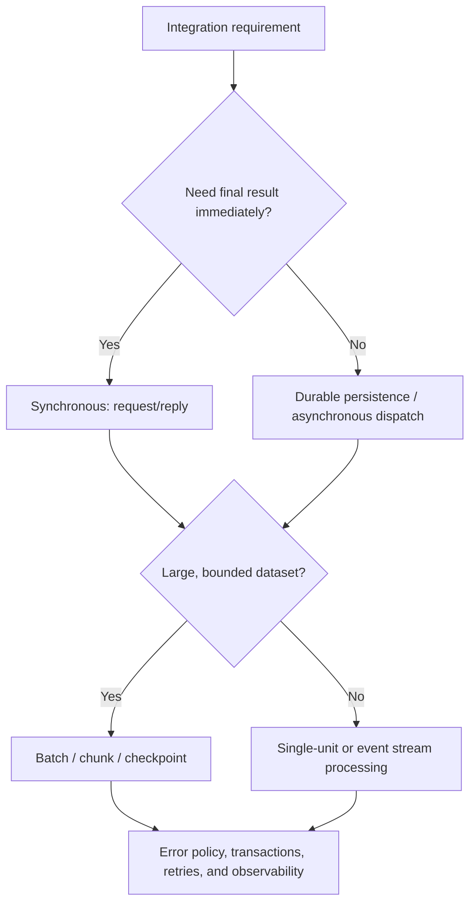
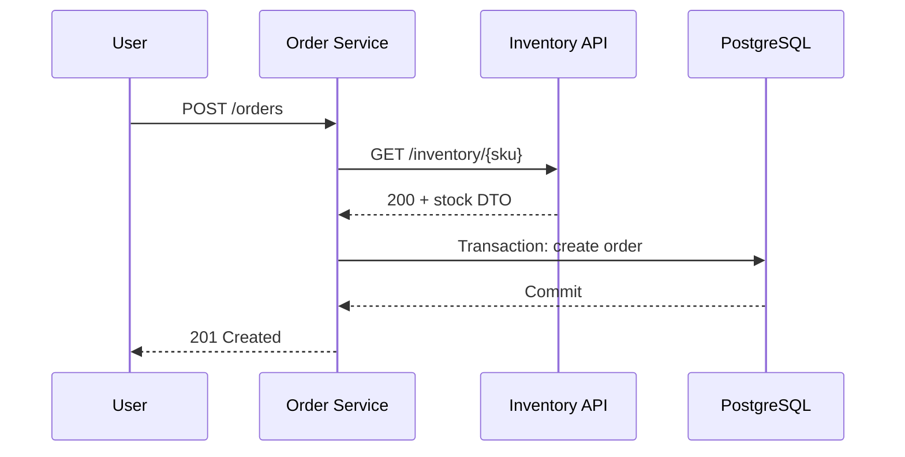
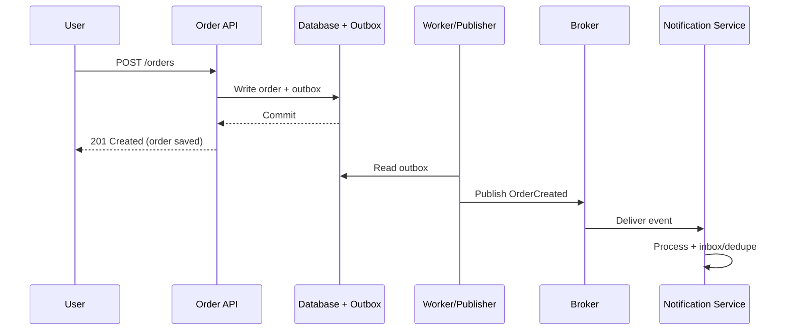
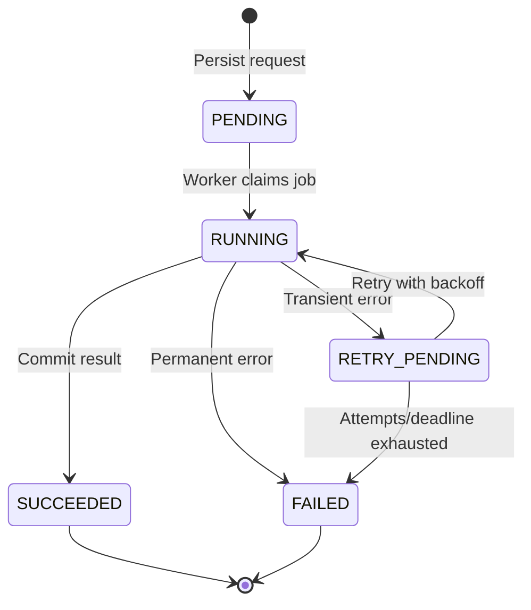
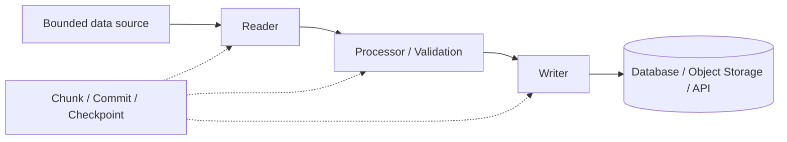
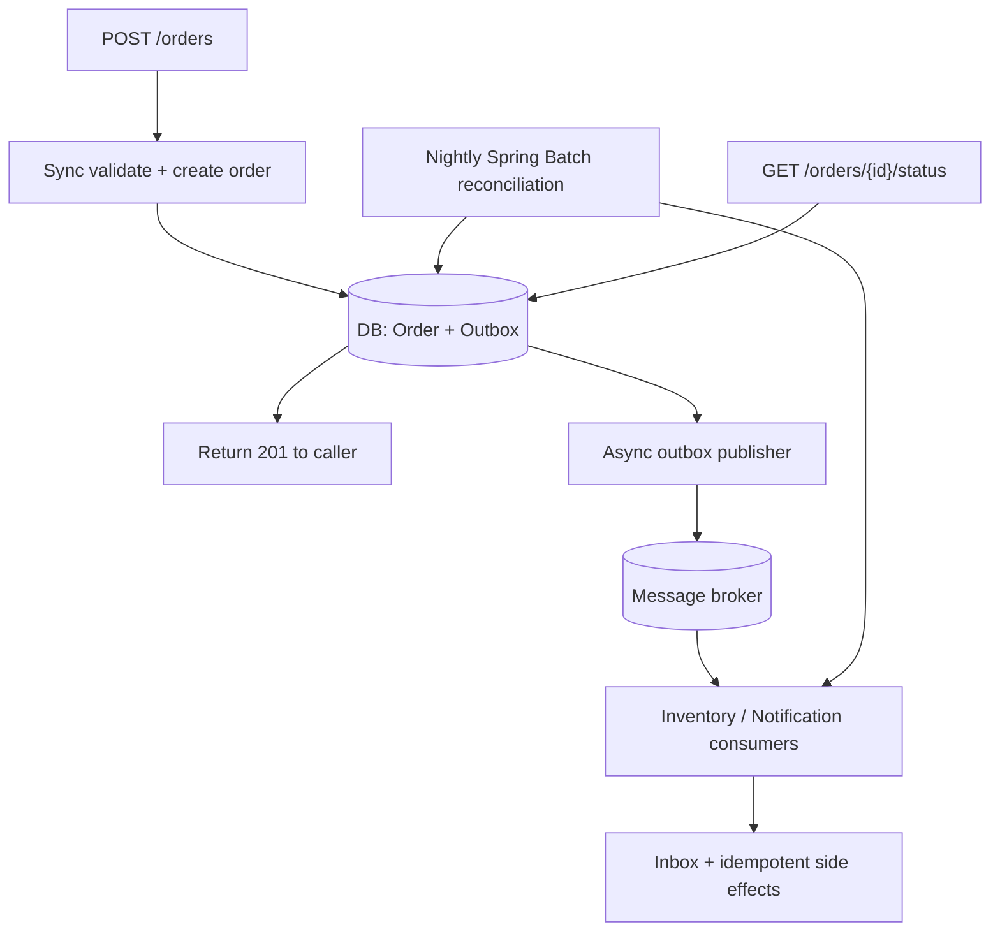
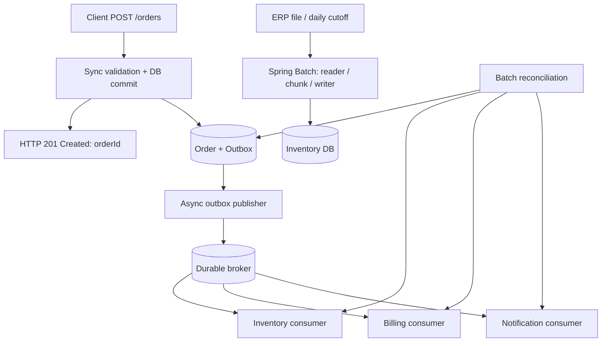

# Synchronous, Asynchronous, and Batch Processing Models

## 1. Three Models Are Three Ways to Organize Integration Timing and Results

In **SPRING_BOOT_INTEGRATION**, a single Spring Boot application might simultaneously:

- Call an HTTP API to authenticate a user, fetch pricing, or check inventory.
- Write data to PostgreSQL via JDBC/JPA and read from a Redis cache.
- Push `OrderCreated` to RabbitMQ/Kafka for other systems to process.
- Run order reconciliation jobs, resynchronize data, or import files on a schedule.
- Wire components together using Spring Integration gateways, channels, and adapters.

All of these tasks are **system integration**, yet they do not share the same requirements for when results are received. Some business flows must answer the caller immediately; others only need to record the request and finish later; and others should group thousands of records to process in parts.

Three common models:

1. **Synchronous**: the caller waits for a result or error within the same interaction, such as HTTP request–response.
2. **Asynchronous**: the sender can continue its work before the receiver finishes processing; results may arrive later via events, callbacks, job statuses, or reply messages.
3. **Batch**: processing a bounded set of many items, typically in chunks or runs; can be triggered on a schedule, on demand, or inside an asynchronous worker.

**Key point:** "synchronous/asynchronous" describes the **timing relationship and how results are received**; "batch" describes the **unit, cadence, and way data is processed**. They are not mutually exclusive. A synchronous HTTP endpoint can process a small batch; a large batch job is usually triggered asynchronously; a broker consumer may group messages into batches to optimize I/O.



This lesson focuses on **how to choose, combine, and operate these three models in Spring Boot**, along with the consequences for latency, transactions, data contracts, error handling, duplicate handling, testing, and observability.

The examples use **Spring Boot 3.x**, **Spring Framework 6.x**, **Spring Batch 5.x**, and compatible libraries. `RestClient` requires Spring Framework 6.1+/Spring Boot 3.2+; on older versions, choose `RestTemplate` or `WebClient` accordingly.

## 2. Design Axes That Must Be Distinguished

Before choosing a framework, answer four independent questions.

| Axis | Options | Question |
| --- | --- | --- |
| **Interaction** | Request–response / fire-and-forget / asynchronous request–reply / event notification | How does the sender learn the final outcome? |
| **Execution** | Same thread / executor / broker consumer / job runner | Where and when does the work run? |
| **Data granularity** | Single item / stream / bounded batch / chunk | How many items belong to one processing unit? |
| **Durability** | In-memory / database job store / durable broker / outbox | If the process dies, does the accepted work survive? |

Examples:

- `WebClient` returning `Mono<Stock>` is a reactive API, yet a controller can still **wait** for the Mono before returning the HTTP response. To the HTTP caller, that interaction is still synchronous request–response in terms of the **communication contract**.
- `ExecutorChannel` runs the handler on another thread; however, if a request–reply gateway still waits for the result, the caller is not necessarily freed from waiting.
- An internal `QueueChannel` decouples timing but **does not automatically provide broker-like durability** when the JVM shuts down.
- `POST /products/bulk` sending 100 products and waiting for HTTP 200 is a **synchronous batch**.
- `POST /imports` returning 202 and a `jobId`, followed by Spring Batch processing 1 million records, is an **asynchronous batch**.

### 2.1. Distinguishing "Accepting Work" from "Completing Work"

```text
Request accepted ≠ Worker started ≠ DB committed
                 ≠ Broker delivered ≠ Business succeeded
```

A successful `MessageChannel.send(message)` call or an HTTP `202 Accepted` does not by itself prove the business operation has completed. If the work is important, explicitly define what "accepted" means: persisted to a durable job/outbox table, published with confirmation, or merely queued in memory.

## 3. Quick Comparison Table of the Three Models

| Criterion | Synchronous | Asynchronous | Batch |
| --- | --- | --- | --- |
| How results are received | Usually in the same request/call | Reply/event/callback/status later | Per-chunk or whole-job result |
| Caller latency | Waits for processing/timeout | Can return early after accepting work | Depends on sync vs. async execution |
| Temporal coupling | High: downstream must respond within deadline | Lower with durable queues/stores | Can be decoupled from peak traffic hours |
| Processing unit | Usually one request | Message/command/event/job | Many records; split into chunks |
| Backpressure | Threads/connections/pools/rate limits | Queue depth, consumer concurrency, flow control | Chunk size, commit interval, reader/writer throughput |
| Primary failures | Timeouts, HTTP statuses, exceptions | Retries/redelivery, DLQ, job FAILED | Skip/retry/rollback, checkpoints, restarts |
| Progress state | Usually no job store needed | Needed if callers track status | Usually needs job/step execution state |
| Ordering | Follows caller call order, not guaranteed across concurrent requests | Depends on partitions/consumers/ordering | Depends on reader, partitioning, and writer |
| Operational cost | Simple initially | Needs brokers/workers/stores and reconciliation tools | Needs scheduling, batch metadata, and large-data controls |
| Examples | Fetching quotes, verifying tokens | Sending notifications, updating read models | Reconciliation, CSV imports, nightly syncs |

Do not conclude "async is always faster" or "batch is always cheaper". Async usually **reduces caller-observed latency** while adding queueing delay and operational overhead; batch optimizes throughput on bounded datasets while increasing the delay before new data becomes visible. Synchronous is simpler when immediacy is required and call chains are short.

## 4. Synchronous: Request–Response and Waiting Points

### 4.1. Model

In the synchronous model, the caller sends a request and waits for a **result or error** before deciding the next step.



Advantages: easy-to-understand contract and error control; the caller knows order creation committed when the success response arrives per API contract. Limitations: Order Service holds resources while waiting on Inventory and the database. If Inventory is slow, the HTTP request slows down or times out; errors propagate directly up the call stack/publisher to the controller.

**Synchronous does not mean all operations share the same transaction.** A PostgreSQL transaction in Order Service does not include Inventory API's internal transaction merely because both calls occur during one HTTP request.

### 4.2. RestClient Example in Spring Boot

Typical dependency for an MVC application:

```xml
<dependency>
    <groupId>org.springframework.boot</groupId>
    <artifactId>spring-boot-starter-web</artifactId>
</dependency>
```

Environment-based URL configuration:

```yaml
inventory:
  base-url: ${INVENTORY_URL:http://localhost:8081}
```

Create the client from the **Boot-managed builder**:

```java
import org.springframework.beans.factory.annotation.Value;
import org.springframework.context.annotation.Bean;
import org.springframework.context.annotation.Configuration;
import org.springframework.web.client.RestClient;

@Configuration
class InventoryHttpConfig {

    @Bean
    RestClient inventoryRestClient(
            RestClient.Builder builder,
            @Value("${inventory.base-url}") String baseUrl) {
        return builder.baseUrl(baseUrl).build();
    }
}
```

DTO and adapter:

```java
import org.springframework.stereotype.Component;
import org.springframework.web.client.RestClient;

public record StockResponse(String sku, Integer available) {}

@Component
public class InventoryHttpClient {

    private final RestClient client;

    public InventoryHttpClient(RestClient inventoryRestClient) {
        this.client = inventoryRestClient;
    }

    public StockResponse getStock(String sku) {
        StockResponse response = client.get()
            .uri("/api/v1/stocks/{sku}", sku)
            .retrieve()
            .body(StockResponse.class);

        if (response == null || response.available() == null) {
            throw new IllegalStateException(
                "Inventory returned incomplete stock data"
            );
        }
        return response;
    }
}
```

`retrieve()` treats HTTP 4xx/5xx as errors by default; DNS, TLS, connection, and decoding errors can arise separately. For a synchronous chain, decide which HTTP responses map to business errors, transient errors, or "not found" results.

### 4.3. When to Choose Synchronous?

Prefer synchronous when:

- The caller **needs the result immediately** to make a decision.
- The work is short, the deadline is measurable, and request volume fits system capacity.
- The response contains a value required to complete a transaction or render the UI.
- Downstream has sufficient SLAs and overload protection.

Do not place sending emails, generating hourly reports, or processing million-row files on the critical HTTP path just because synchronous code is easier to write.

## 5. Synchronous via WebClient Is Still Request–Response if the Caller Waits

`WebClient` uses Project Reactor and typically returns `Mono<T>` or `Flux<T>`:

```java
import org.springframework.web.reactive.function.client.WebClient;
import reactor.core.publisher.Mono;

public Mono<StockResponse> getStock(WebClient client, String sku) {
    return client.get()
        .uri("/api/v1/stocks/{sku}", sku)
        .retrieve()
        .bodyToMono(StockResponse.class);
}
```

If a WebFlux controller returns `Mono<StockResponse>` so the framework sends the response **after the upstream HTTP call finishes**, the caller still waits for a request–response. The difference is that thread resources are used under a reactive non-blocking model—not that the business work automatically moves off the response path.

Distinguish three cases:

| Usage | Caller Experience | Characteristics |
| --- | --- | --- |
| MVC + `RestClient.get()` | Waits for result | Blocking call |
| WebFlux controller returning `Mono<Stock>` from WebClient | Waits for result | Can be non-blocking end-to-end if all steps are non-blocking |
| Controller returns `202 + jobId` after durable enqueue, worker calls WebClient | Returns early | Async business workflow |

Never call `subscribe()` inside a service and return HTTP 200 as if the request succeeded. When the subscription fails after the controller returns, the caller has no error channel unless the application designs job status/callbacks/events.

### 5.1. Timeouts, Retries, and Circuit Breakers

A synchronous call must specify:

- Connect timeout/response timeout and an **overall deadline**.
- Retries only for recoverable errors and operations safe to retry.
- Circuit breakers/rate limiting/bulkheads if downstream is prone to overload.
- Fallbacks where allowed by contract; critical stock or price data should not silently fall back to 0 when the API fails.
- Correlation IDs/trace context across HTTP, without leaking sensitive tokens.

A client timeout **does not prove the server did not commit** a `POST` operation. If the caller retries, it needs a stable idempotency key/operation ID and deduplication at the target system.

## 6. Asynchronous: Separating Request Receipt from Processing Time

### 6.1. Message-Based Model

A producer sends a command/event to a broker or job store. A consumer/worker processes it later:



This model is **asynchronous for the notification step**, not forced to be asynchronous for the entire request. Order creation can happen synchronously; follow-up tasks run afterward.

**When immediate results are not needed**, this model allows smoothing processing rates and scaling consumers independently. However, the system must monitor queue depth, retry backlogs, and consumer errors—otherwise work can fail silently.

### 6.2. Commands vs. Events

| Message Type | Meaning | Example |
| --- | --- | --- |
| **Command** | Requests a target object/system to perform an action | `SendReceipt`, `ReserveInventory` |
| **Event** | Announces a business fact that has occurred | `OrderCreated`, `PaymentCaptured` |
| **Reply** | Result of an asynchronous command/request | `ReservationAccepted`, `ReservationRejected` |

An event may have many subscribers; do not assume publishing an event means all subscribers processed it successfully. A command usually has a clear owning handler, yet still needs timeouts, retries, and deduplication. Do not let consumers interpret an event as a mandatory command unless the contract defines it that way.

### 6.3. When Should You Use Asynchronous Processing?

- Tasks take significant time and the user does not need the final outcome in the initial response.
- Multiple independent consumers need to react to one business event.
- Traffic spikes need to be absorbed by a bounded queue/broker.
- Workers need independent retry policies or to pause during downstream maintenance.
- Work must survive crashes and resume via a durable store/acknowledgment mechanism.

**Simply switching threads does not automatically achieve these guarantees.** Consider broker durability, persistence, consumer acknowledgments, and job lifecycles.

## 7. In-JVM Async vs. Broker-Backed Async Are Not the Same

Spring Integration offers several channel types; thread boundaries and message durability differ across them.

| Mechanism | Where the Handler Runs | Durability on JVM Crash | Error Path |
| --- | --- | --- | --- |
| `DirectChannel` | Caller thread, usually synchronous | Not persisted automatically | Exceptions usually bubble back to caller |
| `ExecutorChannel` | Executor thread | Tasks in JVM queue can be lost | Worker error/error channel; submit rejections can be synchronous |
| In-memory `QueueChannel` | Poller/receiver fetches later | No default durability | Per poller/error flow |
| Broker adapter (RabbitMQ/Kafka/JMS) | Worker in another process or same app | Can be durable with proper broker and config | Ack/nack/redelivery, DLQ, and error handling |
| Durable job/outbox table | Worker reads database | Follows DB transactions/durability | Job state, retry scheduler, reconciliation |

### 7.1. ExecutorChannel Example

```java
import org.springframework.context.annotation.Bean;
import org.springframework.context.annotation.Configuration;
import org.springframework.integration.channel.ExecutorChannel;
import org.springframework.messaging.MessageChannel;
import org.springframework.scheduling.concurrent.ThreadPoolTaskExecutor;

@Configuration
public class LocalAsyncFlowConfig {

    @Bean
    ThreadPoolTaskExecutor integrationExecutor() {
        ThreadPoolTaskExecutor executor = new ThreadPoolTaskExecutor();
        executor.setCorePoolSize(2);
        executor.setMaxPoolSize(4);
        executor.setQueueCapacity(100);
        executor.setThreadNamePrefix("integration-");
        return executor;
    }

    @Bean("asyncWork")
    MessageChannel asyncWork(ThreadPoolTaskExecutor integrationExecutor) {
        return new ExecutorChannel(integrationExecutor);
    }
}
```

Handler:

```java
import org.springframework.integration.annotation.ServiceActivator;
import org.springframework.stereotype.Component;

@Component
public class LocalWorkHandler {

    @ServiceActivator(inputChannel = "asyncWork")
    public void handle(WorkCommand command) {
        // Runs on a worker thread when dispatched via ExecutorChannel.
        // Call business service; handle the error channel intentionally.
    }
}
```

`WorkCommand` is application-defined. If the executor's queue is full, tasks can be rejected **immediately during `send()`**. If a task is accepted and the handler fails, exceptions do not automatically propagate back to a caller that has already returned. If the caller had `@Transactional`, the transaction does not automatically carry over to the worker thread.

**Do not use `ExecutorChannel` as a durable job queue for payments, money transfers, or operations that must never be lost on application restart.** It fits lightweight/best-effort internal tasks or flows where durability is already guaranteed by another layer.

## 8. Asynchronous Broker Example in Spring Boot

### 8.1. AMQP Dependency and Message Contract

Example using RabbitMQ:

```xml
<dependency>
    <groupId>org.springframework.boot</groupId>
    <artifactId>spring-boot-starter-amqp</artifactId>
</dependency>
```

Event DTO:

```java
import java.time.Instant;

public record OrderCreatedEvent(
        String eventId,
        String orderId,
        Instant occurredAt,
        int schemaVersion) {
}
```

When using `RabbitTemplate.convertAndSend(...)` with Java objects, configure a **compatible message converter** (e.g., JSON/Jackson matching your Spring AMQP version) and agree on the schema on both producer and consumer sides. Never assume the default converter encodes DTOs into JSON readable by other services.

Example JSON converter configuration (Spring AMQP 3.x compatible API):

```java
import com.fasterxml.jackson.databind.ObjectMapper;
import org.springframework.amqp.support.converter.Jackson2JsonMessageConverter;
import org.springframework.amqp.support.converter.MessageConverter;
import org.springframework.context.annotation.Bean;
import org.springframework.context.annotation.Configuration;

@Configuration
public class AmqpJsonConfiguration {
    @Bean
    MessageConverter amqpMessageConverter(ObjectMapper mapper) {
        return new Jackson2JsonMessageConverter(mapper);
    }
}
```

Spring Boot can use a suitable converter bean to auto-configure `RabbitTemplate` and listener containers. In large projects, verify the actual converter on both sides instead of relying solely on the bean's existence.

### 8.2. Producer and Consumer

```java
import org.springframework.amqp.rabbit.core.RabbitTemplate;
import org.springframework.stereotype.Component;

@Component
public class OrderEventPublisher {
    private final RabbitTemplate rabbit;

    public OrderEventPublisher(RabbitTemplate rabbit) {
        this.rabbit = rabbit;
    }

    public void publish(OrderCreatedEvent event) {
        rabbit.convertAndSend(
            "orders.events",
            "order.created",
            event
        );
    }
}
```

```java
import org.springframework.amqp.rabbit.annotation.RabbitListener;
import org.springframework.stereotype.Component;

@Component
public class NotificationConsumer {

    @RabbitListener(queues = "notification.order-created")
    public void consume(OrderCreatedEvent event) {
        // Check inbox/deduplication by eventId.
        // Apply side effects only if the event has not been processed.
    }
}
```

The example **assumes** the `orders.events` exchange, `order.created` routing key, `notification.order-created` queue, and binding have already been declared/provisioned. `convertAndSend(...)` only represents the publish call; it **does not guarantee** the broker persisted the message, routed it to a queue, or that the consumer processed it. When reliability is required, configure publisher confirms/returns, durable topology, persistent messages, and an outbox as appropriate.

With listeners using common default acknowledgment modes, the container may ack when the handler completes normally and apply error/redelivery policies when the handler throws. Inspect listener container settings, concurrency, and error handlers; do not generalize that every throw triggers infinite retries.

### 8.3. Do Not Call the Broker Inside a DB Transaction and Treat It as Atomic

```text
@Transactional
  save(order)
  rabbitTemplate.convertAndSend(event)
COMMIT DB
```

This is **not** automatically an atomic transaction across PostgreSQL and RabbitMQ. The broker might receive the event while the DB rolls back, or the DB might commit while publishing fails. The **transactional outbox** pattern closes this gap by writing the business record and outbox record in **the same DB transaction**, and a separate publisher delivers it afterward.

## 9. HTTP 202 and Asynchronous Job Status

When an API only accepts work for later processing, you can design:

```http
POST /api/v1/reports
Content-Type: application/json

{"from":"2026-11-01","to":"2026-11-20"}
```

Response:

```http
HTTP/1.1 202 Accepted
Location: /api/v1/jobs/job-4821
Content-Type: application/json

{"jobId":"job-4821","status":"PENDING"}
```

The client then polls `GET /api/v1/jobs/job-4821` and receives `PENDING`, `RUNNING`, `SUCCEEDED`, or `FAILED`. If callbacks or event notifications are desired, define a separate contract and authentication scheme.



**Return 202 only after persisting the job under the advertised durability guarantee.** If the API returns 202 immediately after submitting to an in-memory executor queue, a JVM crash can lose the job; that violates a "guaranteed to process later" promise unless backed by a durable store or broker.

At minimum, a job needs a `jobId`, status, timestamps, attempt count, categorized error, and worker ownership tracking. With multiple workers, use claiming/leasing/locking so two workers do not execute the same job simultaneously without idempotency.

## 10. Batch Processing: Many Records, Bounded Unit of Work

**Batch processing** organizes work over a multi-item dataset, such as:

- Syncing 500,000 products from an ERP system to a catalog.
- Reconciling bank transactions against recorded ledger entries.
- Importing CSV or JSONL files and normalizing them before saving to a database.
- Reprocessing unpublished outbox events after an extended outage.
- Building a read model from event history.

Unlike a continuous event stream, a batch usually has **data boundaries or run boundaries**: by file, by business date, by ID range, or by closed snapshot.



### 10.1. How Does Batch Differ from "Sending an Array Over HTTP"?

`POST /bulk-update` with a 100-element JSON array can be considered a **batch request** at the API protocol level; however, it does not mean the application has **batch job restartability** infrastructure. If the request fails halfway through, the client needs to know which items committed, what partial success means, and whether retrying the whole array is safe.

Conversely, Spring Batch manages `Job`/`Step`/`JobExecution`, checkpoints, and run state, yet still requires designing safe source readers and side effects.

### 10.2. Chunk Processing

Suppose there are 10,000 records with chunk size 100:

```text
Chunk 1: items 1–100     -> process + write + commit
Chunk 2: items 101–200   -> process + write + commit
...
Chunk 100: items 9901–10000 -> commit
```

If chunk 36 fails and its transaction rolls back, previously committed chunks usually retain their results. Upon restart, the framework can use reader checkpoints/state and job metadata to resume as configured, though it **does not guarantee every reader/writer is restart-safe unless you implement them properly**.

Never run a single transaction over millions of rows only to roll back everything if one record fails. Size chunks according to database locks, memory, row size, business atomicity, and throughput. Larger chunk sizes reduce commit overhead while increasing rollback cost and memory footprint.

## 11. Spring Batch: Job, Step, and JobRepository

### 11.1. Core Components

| Concept | Responsibility |
| --- | --- |
| `Job` | One business batch run, e.g., daily reconciliation |
| `JobInstance` | Identifies a job by name and identifying job parameters |
| `JobExecution` | A specific execution attempt of a job instance |
| `Step` | A smaller unit of work within a job |
| `StepExecution` | Execution state of a step |
| `ItemReader<T>` | Reads items one by one per source and state |
| `ItemProcessor<I,O>` | Transforms/validates/filters items |
| `ItemWriter<O>` | Writes an entire chunk per contract |
| `JobRepository` | Persists metadata for job restarts and tracking |
| `JobLauncher` | Starts a job execution |

To use Spring Batch with Spring Boot (matching version and starter):

```xml
<dependency>
    <groupId>org.springframework.boot</groupId>
    <artifactId>spring-boot-starter-batch</artifactId>
</dependency>
```

A Batch job requires a datasource and proper `JobRepository` metadata configuration. When using a database repository, provision the version-matched metadata schema (via scripts or environment migrations). **Do not mechanically add `@EnableBatchProcessing`** when you want Boot auto-configuration to manage Batch; that annotation can alter auto-configuration conditions across Spring Boot versions.

### 11.2. Java Configuration Example for a Chunk-Based Step

```java
import org.springframework.batch.core.Job;
import org.springframework.batch.core.Step;
import org.springframework.batch.core.job.builder.JobBuilder;
import org.springframework.batch.core.repository.JobRepository;
import org.springframework.batch.core.step.builder.StepBuilder;
import org.springframework.batch.item.ItemProcessor;
import org.springframework.batch.item.ItemReader;
import org.springframework.batch.item.ItemWriter;
import org.springframework.beans.factory.annotation.Qualifier;
import org.springframework.context.annotation.Bean;
import org.springframework.context.annotation.Configuration;
import org.springframework.transaction.PlatformTransactionManager;

@Configuration
public class ReconciliationBatchConfiguration {

    @Bean
    Step reconcileStep(
            JobRepository jobRepository,
            PlatformTransactionManager transactionManager,
            ItemReader<LedgerRow> ledgerReader,
            ItemProcessor<LedgerRow, ReconciliationResult> processor,
            ItemWriter<ReconciliationResult> resultWriter) {

        return new StepBuilder("reconcileStep", jobRepository)
            .<LedgerRow, ReconciliationResult>chunk(
                100, transactionManager
            )
            .reader(ledgerReader)
            .processor(processor)
            .writer(resultWriter)
            .build();
    }

    @Bean
    Job reconcileJob(
            JobRepository jobRepository,
            @Qualifier("reconcileStep") Step step) {

        return new JobBuilder("reconcileJob", jobRepository)
            .start(step)
            .build();
    }
}
```

`LedgerRow` and `ReconciliationResult` are application-defined DTOs; the reader, processor, and writer beans must be supplied separately. This code demonstrates the **structure** of a Spring Batch 5.x job, not a standalone runnable example without configured data sources.

**Transaction note:** chunk transactions only protect resources enlisted in that transaction. If `ItemProcessor` calls a Payment API or `ItemWriter` sends an email, a database rollback **does not undo** HTTP/email side effects already executed. For sources/destinations outside the DB, maintain idempotency and per-item state.

## 12. Batch Scheduling, Restarts, and Multi-Instance Execution

Spring Batch provides job execution and restart semantics; `@Scheduled` is one way to **trigger** a job, not the batch engine itself.

Example scheduler running a daily job:

```java
import java.time.LocalDate;
import java.time.ZoneOffset;
import org.springframework.batch.core.Job;
import org.springframework.batch.core.JobParameters;
import org.springframework.batch.core.JobParametersBuilder;
import org.springframework.batch.core.launch.JobLauncher;
import org.springframework.beans.factory.annotation.Qualifier;
import org.springframework.scheduling.annotation.Scheduled;
import org.springframework.stereotype.Component;

@Component
public class DailyReconciliationScheduler {

    private final JobLauncher launcher;
    private final Job job;

    public DailyReconciliationScheduler(
            JobLauncher launcher,
            @Qualifier("reconcileJob") Job job) {
        this.launcher = launcher;
        this.job = job;
    }

    @Scheduled(cron = "0 0 2 * * *", zone = "UTC")
    public void run() throws Exception {
        String businessDate = LocalDate.now(ZoneOffset.UTC)
            .minusDays(1)
            .toString();

        JobParameters params = new JobParametersBuilder()
            .addString("businessDate", businessDate)
            .toJobParameters();

        launcher.run(job, params);
    }
}
```

This example requires `@EnableScheduling` in the application configuration, suitable `JobLauncher`/`JobRepository` beans, and the metadata database. With the same `businessDate` parameter, Spring Batch can refuse to rerun an already `COMPLETED` job instance per framework semantics; **restarting** a failed job differs from **running a new business occurrence**.

**Prevent unintended startup runs:** Spring Boot can automatically launch discovered `Job` beans on application startup. If you only want a scheduler or API to explicitly invoke `JobLauncher`, set `spring.batch.job.enabled=false` for that environment. That property disables **startup auto-execution**, without blocking explicit launches from code. Never inject a random parameter on every run just to bypass `COMPLETED` state, as that can accidentally reconcile the same business date twice.

### 12.1. Scheduler Pitfall Across Multiple Replicas

If three pods of Order Service all run `@Scheduled` at 02:00, **all three may trigger the same job** without coordination. Spring Batch metadata has constraints and job states, yet cannot replace concurrency protection for logic outside the DB.

Options:

- A dedicated single scheduler/worker owner.
- A centralized scheduler such as Kubernetes CronJob or an orchestration platform.
- A distributed lock/lease if running schedulers inside multiple replicas.
- Job partitioning with explicit work assignment when parallel execution is required.

Parallel batch execution can boost throughput while increasing lock contention, DB connection usage, and downstream API pressure. Each partition/chunk needs idempotent keys and restart capability.

### 12.2. Do Not Equate "Skip" and "Retry"

Spring Batch supports retry/skip when fault tolerance is configured. **Retry** reattempts the same item after a recoverable error; **skip** bypasses a failing item per policy and continues. Configure `retryLimit`/`skipLimit` and emit reports of skipped items—silently dropping records during reconciliation can create serious business discrepancies.

Poison records or schema errors should usually be written to a quarantine file/table with an error code for remediation rather than retried endlessly.

## 13. Comparing Batch with Streaming and Event-by-Event Processing

All three can handle a stream of data, each with distinct trade-offs:

| Characteristic | Event-by-Event | Streaming | Bounded Batch |
| --- | --- | --- | --- |
| Update latency | Low when consumer keeps up | Low, potentially continuous | Depends on schedule/cadence |
| Throughput | Depends on handler/concurrency | Good with optimized stream pipelines | Good with chunked reads/writes |
| Load control | Consumer concurrency, broker prefetch | Backpressure/buffering/windows | Chunks, partitions, schedules |
| Recovery | Offset/ack/redelivery | Checkpoints/offsets/reconnects | Job/step metadata, checkpoints |
| Single-item error | Retry/DLQ | Stream error-handling policy | Skip/retry/chunk rollback |
| Suitable for | Notifications, new orders | CDC, continuous events | Imports, reconciliation, large history |

**Streaming does not automatically mean durable asynchronous processing**: an HTTP SSE stream can lose data during reconnects if the server does not support replay. **Batch does not automatically mean strong transactions**: each chunk commits separately and external side effects may not roll back.

### 13.1. Micro-Batching

A consumer can buffer, say, up to 100 events or up to 500 ms and write to the DB in one operation. This is **micro-batching**: combining near-real-time responsiveness with batch I/O efficiency. You must handle:

- Maximum buffer size and max wait timeout.
- Ordering, duplicates, and partial failures.
- Acknowledging only after the batch/chunk is durably persisted per contract.
- Splitting a batch when a poison event is present.
- Backpressure when the writer falls behind consumer speed.

In Reactor, you can use `bufferTimeout(...)`; in brokers, batch listener APIs vary by connector. Do not buffer indefinitely just to chase throughput, as memory usage and latency rise.

## 14. Hybrid Model: Synchronous to Accept, Asynchronous to Process, Batch to Reconcile

Real-world architectures rarely pick only one model.



- **Synchronous:** validate inputs, commit order creation to the database, and return the order ID.
- **Asynchronous:** emit events to other systems without holding the HTTP request for email or analytics.
- **Batch:** reconcile orders missing expected downstream events, repair drift, and report discrepancies.
- **Read models/caches:** can be updated asynchronously; the UI should know which data is eventually consistent.

The hybrid model avoids two extremes: waiting on every downstream system inside a single HTTP request (high latency, cascading failures), or dumping everything onto a broker so the user cannot even tell if the order was recorded.

### 14.1. State Boundaries Must Be Explicitly Published

A `201 Created` response after DB commit can assert that the order resource exists—it **does not** assert that the email was sent or that inventory in another system finished reserving. If the API only accepts a job, return `202 Accepted` after durable acceptance and return a job ID. Never reuse a single `SUCCESS` state for both accepting a request and finishing all downstream steps.

## 15. Transactions, Outbox, Inbox, and Consistency

### 15.1. There Is No "Free" Transaction Across HTTP, DB, and Broker

Standard `@Transactional` manages a single transaction manager and its enlisted resources; it does not turn WebClient, Redis, and RabbitMQ calls into one distributed atomic transaction.

Examples of failure points:

```text
DB COMMIT succeeds
Process dies before publishing event
→ Order exists, but downstream never learns about it.

Broker receives event
Consumer commits DB successfully
Consumer dies before ack
→ Event is redelivered; side effects risk repeating.

Downstream HTTP POST succeeds
Response is lost
→ Retry risks executing twice.
```

That is why designers target two distinct goals:

- **At-least-once delivery + idempotent processing**: accept that messages can repeat while side effects remain controlled.
- **Reconciliation**: detect and repair uncertain states, missing messages, or delays exceeding SLAs.

### 15.2. Writing Order and Outbox in the Same Transaction

Illustrative code (application-defined repositories/entities):

```java
import org.springframework.stereotype.Service;
import org.springframework.transaction.annotation.Transactional;

@Service
public class OrderCreationService {

    private final OrderRepository orders;
    private final OutboxRepository outbox;

    public OrderCreationService(
            OrderRepository orders,
            OutboxRepository outbox) {
        this.orders = orders;
        this.outbox = outbox;
    }

    @Transactional
    public String create(CreateOrderRequest request) {
        OrderEntity order = orders.save(
            OrderEntity.from(request)
        );

        outbox.save(
            OutboxRecord.orderCreated(order)
        );

        return order.getId();
    }
}
```

`OrderRepository`, `OutboxRepository`, `OrderEntity`, `CreateOrderRequest`, and `OutboxRecord` here are hypothetical application components. `@Transactional` is only safe when **both repositories participate in the same database transaction** and are invoked properly through a Spring proxy.

A separate publisher reads committed outbox rows, sends to the broker, awaits confirmation, and updates status; a retry cycle may republish. Consumers use a unique key on `(consumerName,eventId)` and a transaction wrapping inbox insert + business side effects in the same DB to prevent duplicates.

### 15.3. Batch Needs Idempotency Too

A batch import restarted after processing 70% should not recreate the first 70% under new IDs. You can use natural/business keys and `UPSERT` or unique constraints, checking the contract if source data changes. For downstream APIs without idempotency support, checkpoint at the item level and reconcile status rather than blindly retrying the whole batch.

## 16. Error Handling and Retries per Model

| Model | Error Seen by Caller | Recovery Policy |
| --- | --- | --- |
| Synchronous HTTP | 4xx/5xx, timeouts, transport errors | Error mapping, deadlines, bounded retries, circuit breaker |
| In-memory executor | Dispatch rejection can be immediate; worker errors occur later | Error channel, explicit state; never pretend durability |
| Broker consumer | Original caller is usually no longer waiting | Ack/nack, backoff, redelivery, DLQ, inbox |
| Spring Batch | Job/Step FAILED, read/write/skip item counts | Checkpoint/restart, chunk rollback, bounded skip/retry |
| Hybrid | Each stage's errors surface in different places | Correlation ID, job status, outbox/inbox, reconciliation |

### 16.1. Do Not Retry Permanent Errors

- HTTP 400/422 due to schema mismatch: fix the data/contract.
- Bad Redis ACL/credentials: fix infrastructure, do not increase retries.
- Broker poison message: isolate to DLQ to avoid blocking consumers.
- Malformed batch record: quarantine/skip with reporting or fail the job based on criticality.

Transient errors like 503, timeouts, or DB deadlocks can be retried **when the operation is safe and budget remains**. Use exponential backoff with jitter and a cap, factoring in deadlines and system load. For side-effecting steps, retries must rely on a stable idempotency/correlation key.

### 16.2. Do Not Use "Async" to Hide Errors

If an HTTP API returns immediately and the worker fails, humans or other systems must be able to tell:

1. Persist `FAILED`/`RETRY_PENDING` in a durable job store if the API exposes a job ID.
2. Emit status events or callbacks under a separate contract.
3. Route exhausted messages to a DLQ with a triage/quarantine workflow.
4. Alert on backlog age/error budgets rather than just logging stack traces.

An in-memory error channel or a log line **does not replace** durable state and reprocessing ownership when SLAs require completion.

### 16.3. Poison Batches and Partial Success

When one record fails mid-chunk, the transaction can roll back the chunk; reprocessing must isolate bad items and decide whether to skip or fail the job. If a batch calls multiple HTTP endpoints, one error response must not be assumed to roll back earlier items. Define a **per-item success/failure** contract or idempotent group operations when partial success occurs.

## 17. System Load: Latency, Throughput, Queues, and Backpressure

Evaluate models by **resource budgets**, not just controller response times.

### 17.1. Synchronous: Resources Wait for Results

With synchronous blocking requests:

- Each request can hold a thread, connection pool slot, and memory while waiting.
- Downstream p99 spikes can grow the inbound server's request queue.
- Unbounded retries can amplify 1 request into multiple outbound calls.
- Connection pools, thread pools, and rate limiters must match downstream capacity.

Reactive non-blocking avoids holding threads while waiting on I/O, yet still faces connection, memory, and downstream throughput limits. Calling blocking JDBC on an event loop forfeits non-blocking benefits.

### 17.2. Asynchronous: Queues Only Move Backlog Elsewhere

Durable queues absorb bursts without making consumers arbitrarily faster. If producers emit 1,000 messages/second while consumers process 600, backlog grows by roughly 400/second. Eventually queue storage, message age, or SLAs breach limits.

Measure:

- Producer rate and consumer completion rate.
- Queue depth, oldest message age, and consumer lag.
- In-flight messages, concurrency, prefetch, and redelivery counts.
- Growth of retry queues/DLQs.
- Time **from accepted to completed**, not just handler execution time.

### 17.3. Batch: Optimize Commits and I/O Without Oversized Batches

Tune chunk size, page size, and concurrency based on:

- Reader speed, DB fetch size, item size, and memory.
- DB connection/lock limits and rollback cost.
- API quotas and file/object storage throughput.
- Total runtime before the business deadline.
- Restartability/partitioning and ordering guarantees.

**One 100,000-item batch is not necessarily faster than 1,000 batches of 100 items**, especially when calling rate-limited APIs or when one failing item rolls back the entire batch. Benchmark under production-like conditions.

## 18. Data Contracts, Security, and Observability Across Models

### 18.1. Contracts Do Not Disappear When Switching to Brokers or Batch

| Case | Contract Details to Define |
| --- | --- |
| Synchronous HTTP | Method/path, status, headers, JSON schema, timeouts, error bodies |
| Async broker | Topic/exchange/queue, routing key, schema version, event ID, ack/redelivery |
| Job API | Job ID, statuses, status endpoint, retention, cancellation/retry |
| Batch import | Input schema, format, encoding, deduplication key, partial failure reports |
| Outbox/inbox | Stable event ID, unique constraints, versions, and lifecycle |

Moving from request–response to event-driven **does not mean skipping contract testing**. Providers and consumers must verify schema compatibility; old events can linger in brokers longer than deployment rollouts. For batch imports, externally supplied files must be validated before writing data or emitting events.

### 18.2. Security Context Does Not Automatically Cross Threads or Processes

A worker thread does not automatically inherit every `ThreadLocal`/MDC value from the HTTP caller; broker messages should not carry raw access tokens or serialized Java security contexts for other services to reuse. Instead:

- Propagate standard correlation IDs/trace context and allowlisted metadata.
- Authenticate message producers/consumers using dedicated service credentials.
- Include tenant/user IDs **only when necessary** and permitted by the data contract.
- Redact PII, bearer tokens, passwords, and payment details in logs and DLQs.
- Apply TTL/retention policies to job payloads, events, and batch files.

### 18.3. Tracing One Logical Operation Across Multiple Stages

```text
HTTP POST /orders (trace/correlation)
  -> DB commit + outbox(eventId)
  -> publisher attempt #1/#2
  -> broker record / offset
  -> consumer inbox + side effect
  -> reconciliation job if states do not match
```

One business operation can spawn multiple spans, jobs, and message IDs. `eventId`/`jobId` must be stable enough for reconciliation; trace IDs serve observability and must not replace deduplication business keys.

## 19. Testing Strategy Across the Three Models

### 19.1. Testing Synchronous Integrations

Goals:

- Client sends the expected HTTP method, path, headers, and payload.
- Statuses 200/201/204/404/409/429/503 are handled properly.
- Timeouts, bounded retries, and idempotency keys are accurate.
- Local transactions commit/roll back properly at boundaries.
- DTO validation catches nulls/schema drift.

Use `MockRestServiceServer`, WireMock/MockWebServer, or test servers; contract verification is needed on the provider side, not just consumer fixtures.

Example testing mock HTTP with `RestClient`:

```java
import static org.assertj.core.api.Assertions.assertThat;
import static org.springframework.test.web.client.match.MockRestRequestMatchers.requestTo;
import static org.springframework.test.web.client.response.MockRestResponseCreators.withSuccess;

import org.junit.jupiter.api.Test;
import org.springframework.http.MediaType;
import org.springframework.test.web.client.MockRestServiceServer;
import org.springframework.web.client.RestClient;

class InventoryContractTest {

    @Test
    void readsStock() {
        RestClient.Builder builder = RestClient.builder()
            .baseUrl("https://inventory.test");

        MockRestServiceServer server =
            MockRestServiceServer.bindTo(builder).build();

        server.expect(requestTo(
                "https://inventory.test/api/v1/stocks/sku-1"
            ))
            .andRespond(withSuccess(
                "{\"sku\":\"sku-1\",\"available\":7}",
                MediaType.APPLICATION_JSON
            ));

        StockResponse response = builder.build()
            .get()
            .uri("/api/v1/stocks/{sku}", "sku-1")
            .retrieve()
            .body(StockResponse.class);

        assertThat(response.available()).isEqualTo(7);
        server.verify();
    }
}
```

The test uses a plain builder to isolate the HTTP contract; real applications should also have context tests verifying that the Boot-managed builder receives the expected filters, observation, SSL, and base URL. The project's serializer configuration must recognize the `StockResponse` DTO shown in Section 4.

### 19.2. Testing Asynchronous Integrations

Goals:

1. Producer sets the right event ID and schema version.
2. Publisher failures do not lose outbox records.
3. Consumer handles repeated events without repeating side effects.
4. Poison messages route to DLQ after bounded attempts.
5. Delayed events do not cause HTTP callers to falsely assume "completed".
6. When the broker goes down and back up, workers recover and backlog drains.
7. Executor rejections and worker errors follow the proper error/status paths.

Use a real broker in integration tests via Testcontainers or a matching test environment; mocking `RabbitTemplate` only verifies method calls—it **does not verify routing, serialization, confirms, or redelivery**.

### 19.3. Testing Batch Integrations

Goals:

- `JobParameters` properly distinguish business dates/file sources.
- All data is read; writers neither drop nor duplicate items.
- Chunks roll back on error; checkpoint/restart resumes per policy.
- Schema-invalid items follow the skip/quarantine contract.
- Transient error retries are bounded; permanent errors are not retried.
- Concurrent runs/multiple replicas do not unintentionally process the same business batch.
- External side effects are idempotent across job restarts.

Spring Batch Test (`spring-batch-test`) provides utilities for testing jobs/steps; run tests with a containerized database to verify real metadata and transactions. Do not assert only `COMPLETED`: check read, written, filtered, skipped counts, and final business state.

## 20. Observability and SLAs per Model

A good dashboard reflects **final business state**, not just technical errors on a single hop.

| Model | Recommended Metrics | Alert Conditions |
| --- | --- | --- |
| Synchronous HTTP | Request latency p50/p95/p99, 4xx/5xx, timeouts, outbound pool saturation | Error budget or deadline breaches SLA |
| Asynchronous broker | Publish/consume rates, queue depth, oldest event age, redeliveries, DLQ | Backlog age or completion delay rises |
| Internal executor | Active threads, queue capacity, rejections, handler errors | Saturation, risk of task loss |
| Job API | PENDING/RUNNING/SUCCEEDED/FAILED counts, job age, retry attempts | Stuck jobs or rising failure rate |
| Spring Batch | Job/Step duration, read/write/skip/retry counts, last success | Not finished before cut-off time |
| Hybrid | End-to-end accepted-to-completed latency, reconciliation mismatches | Latency or inconsistency exceeds threshold |

Watching only the HTTP 202 rate might show 100% "success" while every worker is `FAILED`. Watching only job `COMPLETED` might miss 20% skipped records. Watching only queue depth might miss consumers that acked without applying business logic properly.

**Design metrics around business SLOs** such as "99% of orders have invoices issued within 5 minutes" or "day D reconciliation job completes before 06:00 on D+1", and then allocate technical metrics across HTTP, brokers, databases, and batch steps.

## 21. Synthesis Scenario: Order Intake, Downstream Processing, and Reconciliation

Suppose a commerce platform must:

- Accept order creation requests from customers via REST.
- Validate order rules and save the order to the database.
- Notify Inventory, Billing, and Notification.
- Import an inventory adjustment file from the ERP every night.
- Reconcile saved orders missing completed billing or notification.

### 21.1. Splitting Models by Responsibility



**Synchronous path:** perform only the steps requiring immediate confirmation. If inventory reservation is mandatory for an order to be valid, call the reservation endpoint synchronously **with idempotency**, or design the order in `PENDING` state and confirm asynchronously; the choice depends on the user contract.

**Asynchronous path:** after DB commit, the publisher emits events with `eventId`. Each consumer executes its own business logic, records its inbox row, and publishes status. Returning `201` does not promise the email was already sent.

**Batch path:** the ERP import job processes in chunks with checkpoints; the reconciliation job finds orders missing downstream outcomes to re-enqueue events or open operational tickets. Jobs need business dates/IDs to avoid processing the wrong dataset.

### 21.2. Four Mandatory Failure Scenarios to Test

| Scenario | Risk | Mitigation |
| --- | --- | --- |
| HTTP client times out after Reserve API commits | Reservation created twice | Stable idempotency key and status query |
| DB commits but service crashes before publish | Downstream unaware order was created | Transactional outbox |
| Consumer commits then dies before ack | Event redelivered, side effect repeats | Inbox/unique constraint and idempotent handler |
| Batch import fails mid-file | Previously committed records duplicated on rerun | Checkpoints + upsert/business keys + partial failure report |

### 21.3. Selection Process for a New Use Case

1. **Identify the final result the caller needs.** If immediate, choose request–response with realistic deadlines; otherwise provide a job ID/event contract.
2. **Determine durability.** In-memory executors are only for disposable or reconstructible tasks; critical business work needs durable stores/brokers.
3. **Determine data size and rate.** Single record, continuous stream, or bounded large set; for large sets consider chunks, partitions, and checkpoints.
4. **Draw transaction boundaries and failure windows.** Every database, HTTP API, and broker is an independent boundary.
5. **Design idempotency before retries.** Base it on stable business keys/event IDs, not random per-attempt UUIDs.
6. **Define status and recovery.** How will accepted-but-incomplete work be observed and repaired?
7. **Bound load and time.** Rates, pools, queue depths, concurrency, chunk sizes, deadlines, backoff, and retry budgets.
8. **Test at the right layers.** HTTP contracts, broker redelivery/serialization, batch restarts/partial failures, and end-to-end reconciliation.

### 21.4. Pre-Implementation Checklist

- [ ] Have synchronous/asynchronous interactions been distinguished from batch processing?
- [ ] Do HTTP responses accurately reflect committed state, job acceptance, or full completion?
- [ ] Do channels/queues/job stores provide appropriate durability if the process crashes?
- [ ] Are event schemas, headers, correlation IDs, event IDs, and contract versions explicit?
- [ ] Is there no assumption that `@Transactional` covers HTTP/brokers/Redis outside the DB?
- [ ] Are outbox/inbox/idempotency mechanisms in place for publishes, redeliveries, and side-effect retries?
- [ ] Are deadlines, retry budgets, backoff/jitter, DLQ/quarantine, or FAILED states defined?
- [ ] Do batch jobs have checkpoints, restarts, chunk/partition limits, and partial failure reports?
- [ ] Are concurrency, post-commit timeouts, broker outages, duplicate events, and batch restarts tested?
- [ ] Are dashboards tracking **business completion** rather than only request/message receipt?

**Conclusion:** synchronous, asynchronous, and batch processing are **complementary tools** for organizing integration flows in Spring Boot. Synchronous fits when the caller needs a result within the same interaction; asynchronous decouples intake from execution while requiring status tracking and recovery; batch optimizes multi-record processing via chunks, checkpoints, and restarts. A reliable system chooses models based on **business contracts, latency, durability, transactions, idempotency, load limits, testing, and observability**—not merely on whether a framework offers `Mono`, queues, or `@Scheduled`.
