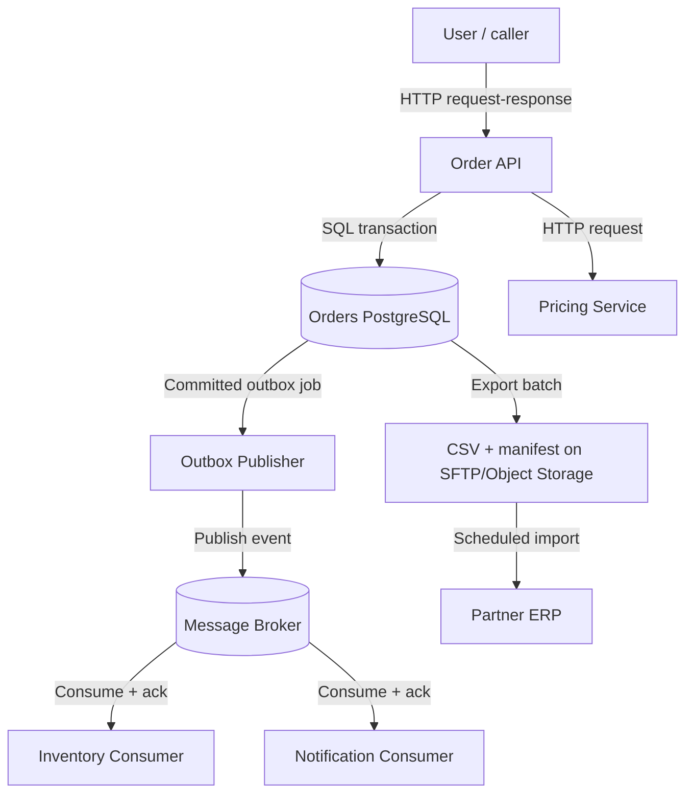
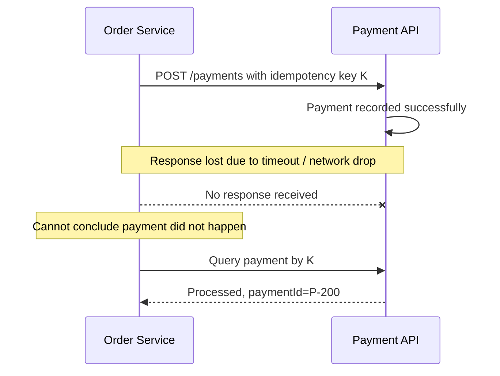
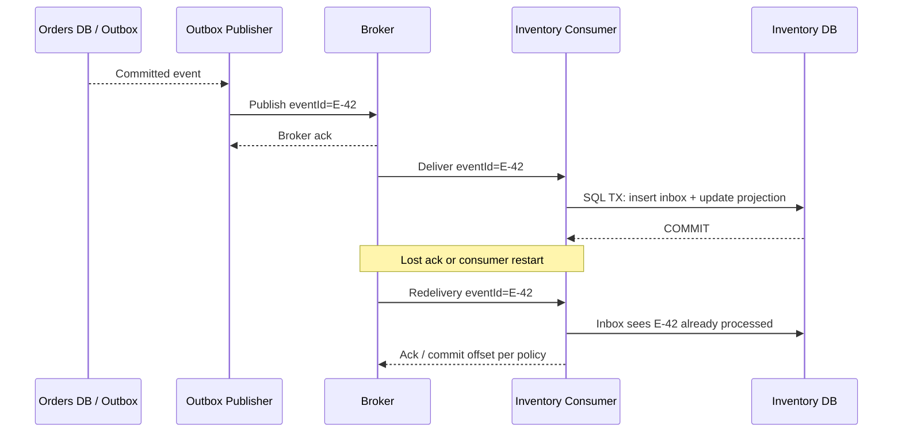
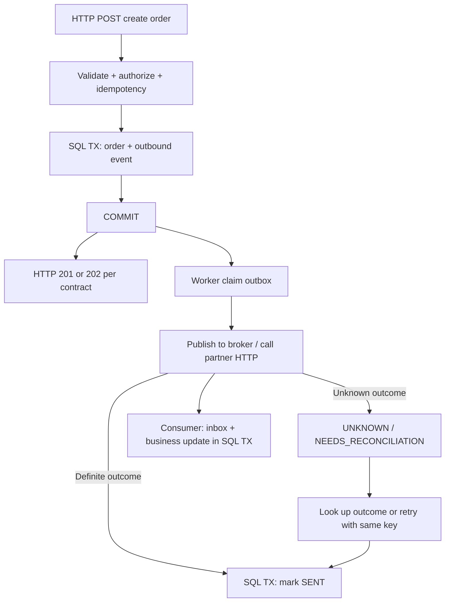
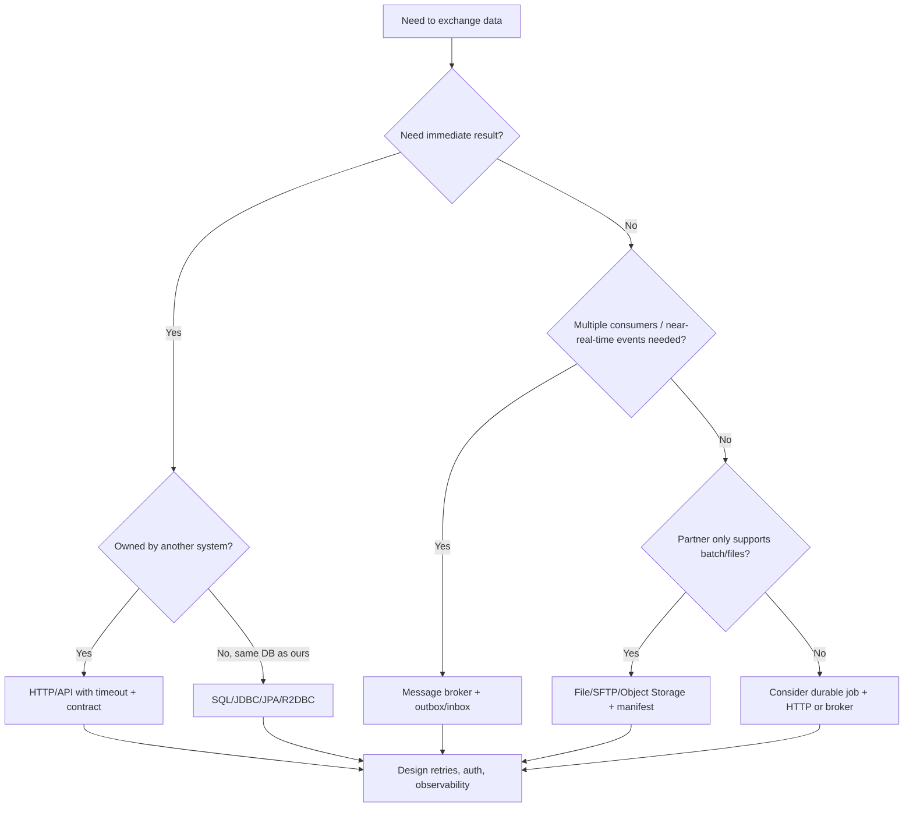
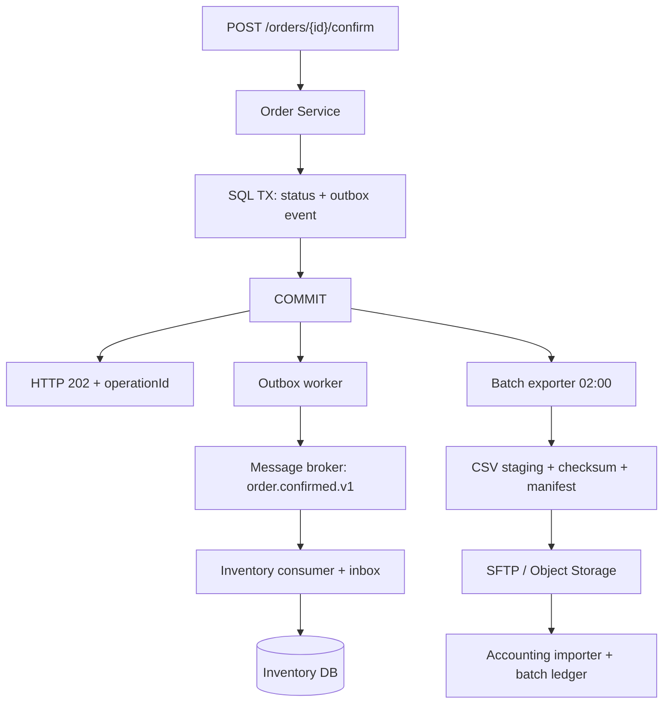

# Distinguishing Communication via HTTP, Databases, Messaging, and Files

> **Chapter:** Integration Overview  
> **Scope:** In the **SPRING_BOOT_INTEGRATION** module, Spring Boot connects systems using HTTP clients, databases, caches, message brokers, and Spring Integration adapters. This lesson compares **HTTP**, **databases**, **messaging**, and **files**: how they transfer data, coupling between parties, resilience, data contracts, transactions, errors, duplicates, testing, and observability. It helps you pick the right mechanism for each step of an integration flow instead of assuming one technology fits every problem.

## 1. What Is System Integration?

**System integration** is the process of enabling independent applications to exchange information or coordinate to complete a business workflow. For example, an order created in a sales application needs to:

1. Persist its state in PostgreSQL.
2. Call a shipping-fee calculation service.
3. Emit events for inventory and accounting systems.
4. Export a reconciliation file for a partner that only accepts data nightly.

All four steps exchange data, yet **they do not share the same timing contracts, failure modes, or transaction boundaries**. Therefore, the first question is not "which Spring class should I use?", but:

- Does the caller **need an immediate result** to respond to the user?
- Must the receiver be **online at the exact same time** as the sender?
- Where should data be **durably stored**, and for how long?
- Who owns the **source of truth** for the data?
- When the network drops or a process crashes, who **retries** and how do we prevent double processing?
- When both sides mutate state, is **immediate consistency** required or is **eventual consistency** acceptable?
- Is the unit of exchange **a request**, **a data transaction**, **an event**, or **a file batch**?

**Important note:** "Synchronous" and "asynchronous" describe how an operation awaits a result; HTTP, SQL, brokers, and files are **integration mechanisms**. HTTP commonly uses synchronous request–response, yet can return `202 Accepted` for asynchronous processing. Brokers commonly decouple send/receive timing, yet a producer can still wait for a publish confirmation. SQL queries can use blocking or reactive APIs; files can be transferred over a direct connection and processed in batches later.

## 2. Big Picture: Four Ways to Exchange Data

| Criterion | HTTP/API | Database | Broker Messaging | File Exchange |
| --- | --- | --- | --- | --- |
| **Unit of exchange** | Request and response | Row, statement, query, transaction | Message/event/command | File or data batch |
| **Common pattern** | Request–response | Read/write persisted state | Queue or publish–subscribe | Producer creates file, consumer ingests file |
| **Expected latency** | Typically low, near real-time | Typically low, depends on queries/locks | Near real-time or deferred | Scheduled/batch, can be high |
| **Temporal dependency** | Server usually needs to be available at call time | Database needs to be available at operation time | Broker needs to be available to accept; consumer can be offline if durable | Consumer can pick up after the file is complete and durably stored |
| **Connection type** | HTTP/TLS, TCP | JDBC/R2DBC to DB | Client protocol to Kafka/RabbitMQ/JMS broker | Local filesystem, SFTP, object storage, or shared storage |
| **Source of truth** | Typically controlled by the owning API | Database of the domain owning the data | Typically publisher/consumer systems; broker stores messages/logs per policy | Defined in contract: source file, manifest, or target system |
| **Buffering capability** | No built-in durable queue for business jobs | Durable storage and transactions inside DB | Depends on broker, acks, persistence, retention | Depends on filesystem/storage, publish convention, retention |
| **Transactions** | Does not join JDBC transactions by default | ACID within the appropriate transaction manager/database | Separate broker transactions/acks; does not automatically share a transaction with SQL | No shared ACID transaction across files and DB |
| **Typical failures** | 4xx/5xx, timeouts, TLS, lost responses | Constraints, locks, deadlocks, timeouts, dropped connections | Nack/redelivery, poison messages, consumer lag | Missing files, partial writes, schema errors, duplicate uploads, lost files |
| **Hardest challenges** | Unknown remote outcome after timeout | Schema coupling, locks, transaction scope | At-least-once, ordering, idempotency, DLQ | Determining file completion, preventing duplicate imports, integrity checks |
| **Best fit** | Price lookups, stock checks, requests needing immediate answers | Persisting and querying owned business data | Order events, background work, fan-out | Daily reports, reconciliation, high-volume import/export |

There is no single "fastest" or "safest" option overall. A misconfigured database can stall the whole system on locks; a broker missing persistence settings can lose messages; a half-written file can corrupt a batch run; an HTTP timeout can happen **after the server has already committed**.

### 2.1. Diagram of Four Boundaries in One System



An order can traverse **multiple mechanisms**. What matters is clearly stating *which step is the source of truth*, *which step only transports information*, and *how failure in one step affects the others*.

## 3. HTTP: Query–Reply and Calling a Service That Owns Business Logic

**HTTP** fits well when the caller needs to request **a specific action** or query information managed by the receiver. Spring Boot offers several options:

| Client | Characteristics | When to Use |
| --- | --- | --- |
| `RestClient` | Synchronous HTTP client with a fluent API (Spring Framework 6.1+, Boot 3.2+) | MVC apps, imperative workers, standard request–response integrations |
| `WebClient` | Reactive HTTP client based on `Mono`/`Flux` | Non-blocking/reactive pipelines, controlled request fan-out |
| `@HttpExchange` + proxy | Interface describing an HTTP contract; requires an adapter/proxy factory bound to a client | Decouple interface contracts from call sites and simplify stubbing/testing |
| Spring Integration HTTP outbound gateway | Receives a Spring Message, sends HTTP, returns a reply Message | When HTTP is one step inside an IntegrationFlow with routers, transformers, and error channels |

### 3.1. An HTTP Contract Is More Than a URL

Example inventory lookup API:

```http
GET /api/v1/inventory/SKU-42 HTTP/1.1
Accept: application/json
X-Correlation-Id: corr-501
```

```json
{
  "sku": "SKU-42",
  "available": 17,
  "warehouseId": "WH-A",
  "asOf": "2026-11-21T03:00:00Z"
}
```

The contract must define **path, method, authentication, request/response schemas, status codes, freshness, timeouts, and retries**. The `asOf` field tells the caller when the count was computed; however, `available=17` does not guarantee 17 units will still be available when the order is actually committed.

**HTTP status does not equal business status:**

- `200 OK`: the HTTP request succeeded per the endpoint contract.
- `201 Created`: the resource was created per API semantics.
- `202 Accepted`: the request was accepted for further processing; **not confirmed complete**.
- `404`: the resource may not exist, or it may stem from routing/paths or an information-hiding policy.
- `409`: conflict; the contract must distinguish valid duplicates, version conflicts, and mismatches.
- `429` and `5xx`: do not retry indefinitely; enforce backoff, caps, and observability.

### 3.2. RestClient Example in Spring Boot

```java
package com.example.integration.http;

import java.time.Duration;
import org.springframework.beans.factory.annotation.Value;
import org.springframework.context.annotation.Bean;
import org.springframework.context.annotation.Configuration;
import org.springframework.http.client.SimpleClientHttpRequestFactory;
import org.springframework.web.client.RestClient;

@Configuration
class InventoryHttpConfiguration {
    @Bean("inventoryRestClient")
    RestClient inventoryRestClient(
            RestClient.Builder builder,
            @Value("${inventory.base-url}") String baseUrl) {

        var factory = new SimpleClientHttpRequestFactory();
        factory.setConnectTimeout(Duration.ofSeconds(2));
        factory.setReadTimeout(Duration.ofSeconds(4));

        return builder.clone()
                .baseUrl(baseUrl)
                .requestFactory(factory)
                .build();
    }
}
```

```java
package com.example.integration.http;

import org.springframework.beans.factory.annotation.Qualifier;
import org.springframework.stereotype.Component;
import org.springframework.web.client.RestClient;

record InventoryView(String sku, int available, String warehouseId) {}

@Component
class InventoryClient {
    private final RestClient client;

    InventoryClient(
            @Qualifier("inventoryRestClient") RestClient client) {
        this.client = client;
    }

    InventoryView getInventory(String sku) {
        return client.get()
                .uri("/api/v1/inventory/{sku}", sku)
                .retrieve()
                .body(InventoryView.class);
    }
}
```

This is a **read-only** example. You still need authentication/authorization, `sku` validation, 4xx/5xx handling, null/empty response handling, metrics, and contract-driven retries. The sample timeouts apply to the specific client/request factory; production setups should evaluate connection pooling, TLS/proxies, and overall request limits.

### 3.3. Timeouts and Outcome Ambiguity



**Note:** An HTTP timeout means **the caller did not receive a response in time**; it does not prove the server did not execute the side effect. For critical write commands, use a key fixed per business operation, store the payload/fingerprint, and support status lookups. Never generate a new key on each retry.

## 4. Databases: Sharing State or Creating Direct Coupling?

**Database integration** usually takes two very different forms:

1. **An application owns its own database** using JDBC/JPA/R2DBC to store durable state, while other systems interact through the application's APIs/events.
2. **Two systems directly read/write the same database or schema** to exchange data.

The second form can be convenient for legacy integration, BI, or data migrations, yet creates **tight coupling** across schemas, SQL permissions, transactions/locks, upgrade schedules, and data ownership. One service updating another service's tables directly can bypass business validation, auditing, and invariants enforced by the owning application.

### 4.1. SQL Access Technologies in Spring Boot

| Tool | Purpose | Boundaries to Know |
| --- | --- | --- |
| `JdbcTemplate` / `NamedParameterJdbcTemplate` | Manual SQL, query and batch optimization | Blocking JDBC, local SQL transactions |
| Spring Data JPA / Hibernate | Entity mapping, persistence context, repositories | Blocking, flush/lazy loading, EntityManager-scoped transactions |
| jOOQ | Type-safe SQL with dialect-aware DSL | Must bind to the right DataSource/transaction manager |
| Spring Data R2DBC / `DatabaseClient` | Relational DB access with Reactor | Reactive transactions via Reactor context, not automatically JDBC/JPA |
| Flyway / Liquibase | Schema migration management | Must run against the right database/schema with granted privileges |

A **database transaction** can make multiple changes atomic **within the scope of the appropriate database/transaction manager**. It does not bundle an HTTP POST, a Redis operation, a Kafka publish, or a file upload into the same ACID transaction.

### 4.2. SQL Transaction Example Containing Both State and Event Intent

```sql
CREATE TABLE orders (
    id UUID PRIMARY KEY,
    status VARCHAR(24) NOT NULL
);

CREATE TABLE outbound_events (
    event_id UUID PRIMARY KEY,
    order_id UUID NOT NULL REFERENCES orders(id),
    event_type VARCHAR(80) NOT NULL,
    payload_json JSONB NOT NULL,
    status VARCHAR(24) NOT NULL DEFAULT 'PENDING',
    created_at TIMESTAMPTZ NOT NULL DEFAULT CURRENT_TIMESTAMP
);
```

A Spring JDBC service executes **two SQL statements in one transaction**:

```java
package com.example.integration.orders;

import java.util.UUID;
import org.springframework.jdbc.core.JdbcTemplate;
import org.springframework.stereotype.Service;
import org.springframework.transaction.annotation.Transactional;

@Service
class ConfirmOrderService {
    private final JdbcTemplate jdbc;

    ConfirmOrderService(JdbcTemplate jdbc) {
        this.jdbc = jdbc;
    }

    @Transactional
    public void confirm(UUID orderId) {
        int changed = jdbc.update("""
            UPDATE orders SET status = 'CONFIRMED'
             WHERE id = ? AND status = 'NEW'
            """, orderId);
        if (changed != 1) {
            throw new IllegalStateException("Order is not NEW");
        }

        UUID eventId = UUID.randomUUID();
        jdbc.update("""
            INSERT INTO outbound_events
                (event_id, order_id, event_type, payload_json)
            VALUES (?, ?, 'order.confirmed',
                    jsonb_build_object('orderId', ?::text))
            """, eventId, orderId, orderId);
    }
}
```

If inserting into `outbound_events` fails and an exception escapes, the transaction rolls back the `orders` update as well. After commit, an **independent outbox worker** reads `PENDING` events and sends them to the broker/HTTP; do not make remote calls inside this `@Transactional` method.

**Sample assumptions:** a matching `DataSource`/transaction manager, invocation through a Spring proxy, an existing `orders` row, and `status = 'NEW'`. When using multiple DataSources, specify the exact `JdbcTemplate` and `@Transactional(transactionManager = "...")`.

### 4.3. What Makes Direct Database Access an Integration Risk?

- **Schema coupling:** renaming columns, changing constraints, or normalizing tables can break other systems.
- **Ownership coupling:** a second system can write invalid states while bypassing domain validation.
- **Lock coupling:** reporting queries or long transactions cause lock waits that degrade primary requests.
- **Deployment coupling:** schema migrations require all readers/writers to remain compatible.
- **Security coupling:** overly broad SQL permissions widen data-leak exposure.
- **Availability coupling:** multiple systems depend on one DB and share connection limits.

If the requirement is simply near-real-time reporting, consider **read models/read replicas, CDC, event streaming, or data exports** with clear ownership. Never assume opening service A's entire DB to service B is the best integration approach.

## 5. Messaging: Broker Communication and Decoupled Timing

A **message broker** frees producers and consumers from executing business logic together in a single synchronous call. Producers publish messages; the broker routes/stores them per policy; consumers receive, process, and acknowledge them.

Two common patterns:

- **Queue/work distribution:** competing workers process jobs from a queue according to broker semantics.
- **Publish–subscribe/event:** an event can be independently observed and processed by different consumer groups/subscriptions.

Spring Boot commonly integrates with **Kafka**, **RabbitMQ/AMQP**, **JMS** (ActiveMQ Classic/Artemis), or Spring Integration adapters. Despite technological differences, similar questions apply: publish acknowledgments, retention, retries, consumer acks/offsets, ordering, DLQs, and idempotency.

### 5.1. Commands vs. Events

| Message Type | Example | Meaning | What Is the Receiver Responsible For? |
| --- | --- | --- | --- |
| **Command** | `ReserveStock(orderId)` | Requests a handler to execute an action | Validate and return/record command outcome; define retries/idempotency |
| **Event** | `OrderConfirmed(eventId, orderId)` | A business fact that already occurred | Multiple consumers may update read models, send emails, compute metrics |

Message names should reflect facts or intent. `OrderConfirmed` should not be emitted before the database commits order confirmation (unless the contract explicitly defines provisional states). Consumers must not assume one event reflects the entire current state if newer events may already have been processed.



### 5.2. At-Least-Once Is Not Cross-System Exactly-Once

Brokers can **redeliver** the same message when a consumer finishes processing but its ack/offset commit is not recorded. Kafka offers transaction and exactly-once processing mechanisms within specific Kafka scopes, yet **does not automatically make a SQL transaction and external HTTP call exactly-once**. RabbitMQ/JMS likewise have their own acknowledgment/transaction mechanisms that do not commit atomically with a database.

Consumers must be designed to be **idempotent**:

```sql
CREATE TABLE integration_inbox (
    consumer_name VARCHAR(80) NOT NULL,
    event_id VARCHAR(160) NOT NULL,
    processed_at TIMESTAMPTZ NOT NULL DEFAULT CURRENT_TIMESTAMP,
    PRIMARY KEY (consumer_name, event_id)
);
```

```java
package com.example.integration.messaging;

import org.springframework.jdbc.core.JdbcTemplate;
import org.springframework.stereotype.Service;
import org.springframework.transaction.annotation.Transactional;

record OrderConfirmed(String eventId, String orderId) {}

@Service
class InventoryProjectionService {
    private final JdbcTemplate jdbc;

    InventoryProjectionService(JdbcTemplate jdbc) {
        this.jdbc = jdbc;
    }

    @Transactional
    public void applyOnce(OrderConfirmed event) {
        int claimed = jdbc.update("""
            INSERT INTO integration_inbox (consumer_name, event_id)
            VALUES ('inventory-projection', ?)
            ON CONFLICT DO NOTHING
            """, event.eventId());

        if (claimed == 0) {
            return; // Already committed this event in a previous delivery.
        }

        jdbc.update("""
            UPDATE inventory_orders
               SET confirmed = TRUE
             WHERE order_id = ?
            """, event.orderId());
    }
}
```

This example assumes `inventory_orders(order_id, confirmed)` exists and the message is validated before invocation. Inbox and business updates share **the same SQL transaction**. If the update fails, the inbox row also rolls back so the event can be reprocessed. If the order ID does not exist yet in the table, the application must pick a wait/retry/reconcile policy instead of silently treating it as a success. Add a unique business key if producers can emit **two different event IDs for the same intent**.

### 5.3. Illustrative Listener with Kafka

```java
package com.example.integration.messaging;

import org.springframework.kafka.annotation.KafkaListener;
import org.springframework.stereotype.Component;

@Component
class OrderConfirmedListener {
    private final InventoryProjectionService service;

    OrderConfirmedListener(InventoryProjectionService service) {
        this.service = service;
    }

    @KafkaListener(
        topics = "orders.confirmed.v1",
        groupId = "inventory-projection")
    void onEvent(OrderConfirmed event) {
        service.applyOnce(event);
    }
}
```

For this example to work, you need the Spring Kafka dependency, broker configuration, topic setup, JSON deserializer, and a **trusted type/schema policy**. `@KafkaListener` does not automatically decode arbitrary JSON into Java records without proper converters/deserializers. When the service throws an exception, consumer error handler/retry/DLQ configuration must ensure the offset is not committed as if processing succeeded.

**Message durability depends on broker configuration**, acknowledgments, replication, retention, consumer offline duration, and storage. Never treat `send()` returning or a producer ack as proof that all consumers have finished processing.

## 6. Files: Batch Communication with a "Completion" Boundary

**File-based integration** fits when partners only accept **CSV, XML, JSON Lines, Excel, or binary files** over directories/SFTP/object storage, or when large volumes are processed on a schedule.

Never equate "a file is visible in the directory" with "the file has finished writing". A consumer might open the file while the producer is still writing and process **partial content**.

### 6.1. Designing a File Contract

Example partner receiving `orders_2026-11-21_batch-018.csv`:

```csv
order_id,amount_minor,currency,confirmed_at
ORD-42,125000,VND,2026-11-21T03:00:00Z
ORD-43,79000,VND,2026-11-21T03:01:00Z
```

A file contract should specify:

| Item | Examples to Agree Upon |
| --- | --- |
| **Filename** | `orders_<date>_<batchId>.csv`, never reuse names once published |
| **Encoding** | UTF-8, with or without BOM, CRLF/LF newlines |
| **Schema** | Required columns, order, data types, version, delimiter, quoting/escaping |
| **Volume** | Maximum size, row count, batch splitting rules |
| **Completion status** | Write temp file then atomic rename, or publish manifest/done marker |
| **Integrity** | SHA-256 checksum, row count, manifest, file size |
| **Batch identity** | Stable ID to prevent duplicate imports |
| **Acknowledgment** | Ack/result/quarantine file or import status API |
| **Retention** | Retention window, archiving, delete permissions, replay permissions |
| **Security** | SFTP/SSH or TLS, encryption-at-rest, ACLs, PII minimization |

### 6.2. Writing a Temporary File Before Publishing

On filesystems that support atomic moves **within the same compatible filesystem scope**, a producer can write a `.tmp` file and rename it upon completion:

```java
package com.example.integration.files;

import java.io.IOException;
import java.nio.charset.StandardCharsets;
import java.nio.file.Files;
import java.nio.file.Path;
import java.nio.file.StandardCopyOption;
import java.nio.file.StandardOpenOption;

class BatchFilePublisher {
    void publish(Path directory, String batchId, String csv)
            throws IOException {
        // batchId must be allowlist-validated; do not accept arbitrary paths.
        if (!batchId.matches("[A-Za-z0-9_-]{1,80}")) {
            throw new IllegalArgumentException("Invalid batchId");
        }

        Path temporary = directory.resolve("orders_" + batchId + ".tmp");
        Path published = directory.resolve("orders_" + batchId + ".csv");

        Files.writeString(temporary, csv, StandardCharsets.UTF_8,
                StandardOpenOption.CREATE_NEW,
                StandardOpenOption.WRITE);

        Files.move(temporary, published, StandardCopyOption.ATOMIC_MOVE);
    }
}
```

This is an illustrative pattern for a **local filesystem**. `ATOMIC_MOVE` may be unsupported or behave differently across filesystems, mounted volumes, network shares, or object storage. When unsupported, code should **fail and adopt a different publishing protocol**, rather than silently falling back to a non-atomic move and assuming the upload was atomic.

If power-loss durability is required, also consider file/directory metadata flush/fsync per filesystem/OS. On SFTP or object storage, use staging + rename/manifest/commit markers matching the storage service's capabilities; do not assume `Files.move(ATOMIC_MOVE)` applies to every storage backend.

### 6.3. Inbound File Adapter in Spring Integration

Spring Integration provides a file inbound adapter to poll a directory, wrap files into messages, and pass them to handlers:

```java
package com.example.integration.files;

import java.io.File;
import java.time.Duration;
import org.springframework.context.annotation.Bean;
import org.springframework.context.annotation.Configuration;
import org.springframework.integration.dsl.IntegrationFlow;
import org.springframework.integration.dsl.Pollers;
import org.springframework.integration.file.dsl.Files;

@Configuration
class FileImportFlowConfiguration {
    @Bean
    IntegrationFlow importOrders(FileImportService importer) {
        return IntegrationFlow
                .from(
                    Files.inboundAdapter(new File("/data/incoming"))
                         .patternFilter("*.csv"),
                    endpoint -> endpoint.poller(
                        Pollers.fixedDelay(Duration.ofSeconds(5))))
                .handle(File.class, (file, headers) -> {
                    importer.importOnce(file);
                    return null; // One-way handler, no business reply.
                })
                .get();
    }
}
```

`FileImportService` is implemented by the application: validating schemas, checksums, and batch IDs, importing into SQL transactionally, recording outcomes, and archiving/quarantining. This adapter **does not guarantee the upload is complete, does not commit file+SQL atomically, and does not prevent duplicate imports across restarts**. Pair it with a completion convention, a **persistent accept-once filter or an import ledger table with a unique key**, plus error handling and retries.

### 6.4. Example Import Ledger Design

```sql
CREATE TABLE file_imports (
    source_system VARCHAR(80) NOT NULL,
    batch_id VARCHAR(120) NOT NULL,
    checksum_sha256 VARCHAR(64) NOT NULL,
    status VARCHAR(24) NOT NULL,
    imported_at TIMESTAMPTZ,
    PRIMARY KEY (source_system, batch_id)
);
```

If **the same batch ID arrives with a different checksum**, do not silently ignore or overwrite it: that is a **conflict** requiring investigation. If a file is partially imported before failing, define batch/chunk transactions, staging tables, and resume behavior. A ledger table with a unique constraint enforces control, yet **must be updated in the same transaction as the imported rows** to guarantee idempotency for a unit of work.

**CSV files also carry security risks:** huge file sizes, unusual escaping/delimiters, and spreadsheet formula injection starting with `=`/`+`/`-`/`@`. When exporting CSVs for users to open in spreadsheets, enforce policies against CSV formula injection; when importing, validate formats, paths, and resource limits.

## 7. How Do the Four Mechanisms Interact with Transactions Differently?

This fundamental difference explains why many integration flows seem right until the system crashes.

### 7.1. Transaction Boundaries

| Activity | Can It Fit in **One** Single JDBC Transaction? | Notes |
| --- | --- | --- |
| Update two tables in the same PostgreSQL via one DataSource/manager | **Yes** | Subject to isolation, constraints, errors, and proxy invocation |
| Write PostgreSQL then send HTTP POST | **No, by default** | HTTP may already execute even if SQL rolls back |
| Write PostgreSQL then publish to Kafka | **No, by default** | Needs outbox or specialized coordination |
| Write PostgreSQL then write an SFTP file | **No** | Remote file upload does not join JDBC transactions |
| Write two independent databases | **No, via a single local transaction manager** | Needs distributed/reconciliation strategy if atomicity is required |
| Consumer receives broker message then writes SQL | **Two separate boundaries** | SQL commit can succeed before broker ack, causing redelivery |
| R2DBC SQL and JDBC SQL | **Do not share a transaction automatically** | Different APIs/managers/contexts; requires explicit design |

### 7.2. General Solution Pattern: Transactional Outbox + Inbox

A durable flow going from HTTP to SQL and out to a broker or HTTP:



In the same SQL transaction, persist **the source state and the outbound intent record**. After commit, a worker sends the data through the appropriate channel. If the worker dies after the external system accepted it but before marking `SENT`, retries may resend. Hence side effects must be identified by a **stable business operation ID/event ID/idempotency key**, and consumers must deduplicate.

**Outbox does not create end-to-end exactly-once automatically.** It ensures outbound intent is not lost due to crashes after SQL commit, provided transactions and polling/publishing are implemented correctly; duplicates at delivery time must still be handled.

## 8. Comparing Coupling Levels Across Systems

Coupling has multiple dimensions beyond "this service knows that service's URL".

| Coupling Dimension | HTTP | Shared Database | Broker | File |
| --- | --- | --- | --- | --- |
| **Temporal** | Caller typically waits for server to be online | App waits for DB to be online | Producer and consumer can run at different times if broker persists messages | Producer/consumer usually run on separate schedules |
| **Location/Address** | Caller needs endpoint/service discovery | Needs DB endpoint and schema | Needs broker/topic/queue | Needs storage path/bucket/SFTP endpoint |
| **Schema** | API DTOs, status codes, versions | Tables/columns/constraints; very tight coupling with shared DBs | Event schemas, topics, keys, and versions | File format/manifest/filename |
| **Deployment** | Both sides need compatible contracts | Migrations must stay compatible for all readers/writers | Producer/consumer deploy independently if schemas stay compatible | Producer/consumer upgrade along batch schedules |
| **Error handling** | Returned directly; caller decides | SQL errors directly inside transactions | Error handling and retries on consumer/broker | Quarantine, ack files, and batch reports |

**Brokers reduce temporal coupling**, while increasing the need to manage schema compatibility, consumer lag, replays, and eventual consistency. **Files reduce simultaneous connectivity requirements**, while increasing batch management, integrity checks, and file lifecycle overhead. **Shared databases simplify immediate data access**, yet quickly erode ownership boundaries between services.

## 9. Decision Table Based on Business Requirements

| Need | Usually Suitable Choice | Why? |
| --- | --- | --- |
| Caller needs shipping fee before confirming the screen | **HTTP request–response** | Immediate answer needed, bounded timeouts and clear fallback |
| Update order, payment status, and outbox atomically in one DB | **SQL transaction** | Needs source-data constraints and atomicity |
| Emit `OrderConfirmed` to multiple independent consumers | **Message broker/events** | Fan-out, temporal decoupling, each consumer scales to its capacity |
| Import 2 million rows from a partner every night | **Files + manifest/staging** | Batch processing, file streaming, batch-level retries |
| Low-latency lookup of infrequently changing catalog data | **HTTP/SQL + cache** | Cache improves performance without replacing source of truth |
| Emit events after SQL commit without losing messages on app crash | **SQL outbox → broker/HTTP** | Ties source state and publish intent in the same transaction |
| Partner only provides SFTP, no API | **File integration** | Respects target capabilities, uses checksums and import acknowledgments |
| Two apps want to write directly to the same business table | **Prefer owned API/events** | Avoids bypassing invariants, locks, and tight schema coupling |

### 9.1. Simple Decision Flow



This flowchart is an **initial selection heuristic**. In practice, a single business flow may combine multiple channels. Evaluate traffic, desired resilience, operational budget, compliance, and partner constraints before finalizing architecture.

## 10. Error Handling Differs per Mechanism

| Incident | How to Detect | Required Behavior |
| --- | --- | --- |
| HTTP 400/422 | Validation/business rejection response | Fix the request; do not retry blindly |
| HTTP timeout after POST | No response received | Check idempotency key/status lookup; **never assume remote did not act** |
| SQL duplicate key | Unique constraint violation | Reconcile existing record and business fingerprint; do not bypass constraints |
| SQL deadlock/serialization failure | Dialect-specific SQL exception | Retry small, bounded transaction when business rules allow |
| Broker redelivers message | Same event ID or delivery metadata | Inbox/dedup + ack after durable side effect |
| Broker poison message | Repeated parse/schema errors | DLQ/quarantine, alert, controlled replay |
| Partially uploaded file | Size/checksum mismatch or missing publish marker | Do not import; wait for complete file |
| File resent with same batch ID | Ledger unique key/checksum | Return previous result or report conflict if checksum differs |
| Backend unavailable for hours | Queue lag, connection timeouts, import backlog | Bound retries/concurrency, alert, and execute recovery runbook |

### 10.1. One Retry Policy per Business Intent

If an HTTP caller retries three times, a gateway retries three times, and a worker retries three times, one intent can trigger very many calls. Assign a clear **retry owner**, bound attempt counts/duration, and use backoff with jitter. Preserve the **same business operation ID** across attempts.

Separate errors:

- **Permanent:** invalid schema, missing permissions, final business rejection → do not retry infinitely.
- **Transient:** temporary disconnect, rate limiting, retryable deadlock → bounded retries with monitoring.
- **Unknown outcome:** remote side effect may have occurred → prefer reconciliation/status lookup before risky retries.

## 11. Consistency, Ordering, and Freshness

**HTTP** reads a snapshot at the moment the API responds; the result may already be stale immediately afterward. **SQL** has specific isolation levels, yet queries from two different transactions do not automatically share the same snapshot. **Brokers** can preserve ordering per partition/queue within defined boundaries, though multiple consumers and retries can alter observed processing order. **Files** carry batch snapshots; data may be stale before import begins.

Therefore, data contracts should include:

| Element | Purpose |
| --- | --- |
| `eventId` / `operationId` / `batchId` | Deduplication for the properly scoped business unit |
| `occurredAt` / `asOf` | Represents when the event occurred or snapshot was taken |
| `schemaVersion` | Allows consumers to identify contract versions |
| `aggregateVersion` / `sequence` | Detects stale/out-of-order events or overwritten updates |
| `sourceSystem` / `tenantId` | Distinguishes sources and identifier scopes |
| Checksum/fingerprint | Detects modified payloads under the same key |
| Correlation/trace ID | Links logs across steps (does not replace idempotency key) |

**Do not use timestamps as the sole deduplication key.** Clocks across machines can drift; two valid events can share the same timestamp. Do not use a workflow-wide correlation ID as a business ID if the workflow contains multiple distinct commands.

### 11.1. Embedding Versions in Contracts

Example DTO/event:

```json
{
  "eventId": "evt-20261121-481",
  "sourceSystem": "orders",
  "schemaVersion": 1,
  "orderId": "ORD-42",
  "aggregateVersion": 7,
  "occurredAt": "2026-11-21T03:00:00Z",
  "status": "CONFIRMED"
}
```

If a producer adds a new field, you cannot assume older consumers will ignore it; test **backward/forward compatibility** for HTTP DTOs, message schemas, and file schemas. Changes that break field semantics may require new routes/topics/file-format versions and a parallel transition period.

## 12. Security: Each Channel Has Its Own Trust Boundary

| Channel | Connection Security | Authorization | Special Risks |
| --- | --- | --- | --- |
| **HTTP** | TLS/mTLS, certificate validation, tokens/service credentials | OAuth2 scopes, per-tenant/resource API authorization | SSRF on dynamic URLs, forwarding tokens to wrong partners, leaking error details |
| **Database** | Driver/server TLS, accounts and secret rotation | Roles/schemas/tables, principle of least privilege | SQL injection, over-broad shared schema rights, queries stalling the DB |
| **Broker** | Protocol-specific TLS/SASL/credentials | Topic/queue/exchange permissions, consumer/producer ACLs | Payload injection, PII inside DLQs, untrusted message schemas |
| **File/SFTP** | SSH host-key verification or TLS/encryption | Folder/bucket ACLs, read/write/delete rights | Path traversal, partial files, zip bombs, CSV formula injection |

General rules:

1. Authenticate **the caller** before allowing reads or writes.
2. Never trust caller-supplied `tenantId` or `role` without tying it to an authenticated identity.
3. Limit body/message/file sizes, record counts, parse depth, concurrency, and deadlines.
4. Never write raw sensitive payloads, passwords, or tokens into logs/DLQs.
5. Encrypt and manage retention/access rights for data stored in SQL, brokers, Redis, and storage.
6. Apply dedicated policies when transferring data across organizational boundaries or handling PII.

## 13. Observing an Integration Flow End to End

An order-creation request can succeed in SQL and fail at the broker; or an outbound HTTP call can time out even though the partner processed it. Checking a single "200 OK" log is not enough.

| Metric/Trace | What It Reveals |
| --- | --- |
| HTTP request rate, P95/P99 latency, statuses, timeouts | API is slow or returning errors |
| DB connection pool, lock waits, transaction duration | SQL contention, overly long transactions |
| Outbox pending count and oldest age | Committed event publish commands are stalled |
| Broker publish failures, consumer lag, redeliveries, DLQ depth | Messages are backing up, repeating, or poisoned |
| File upload duration, checksum mismatches, import batch status | Missing/corrupted files or slow imports |
| Inbox duplicate count and idempotency conflicts | Unusual retries/redeliveries or improper key reuse |
| Reconciliation pending count | Side effects with unknown outcomes needing resolution |

These metrics are **recommended categories**, not all available out of the box in Spring Boot. Spring Boot Actuator, Micrometer, OpenTelemetry/tracing, and broker/storage metrics can be combined depending on the system. Metric tags should only use **low-cardinality** labels such as operation, endpoint template, consumer group, destination, and error class; never use order IDs, event IDs, unique filenames, or tokens as metric tags.

### 13.1. Correlation Does Not Replace Idempotency

Example trace journey:

```text
traceId=corr-824  step=http-inbound  order=ORD-42  status=accepted
traceId=corr-824  step=sql-commit    order=ORD-42  eventId=evt-481
traceId=corr-824  step=outbox-send   eventId=evt-481 status=published
traceId=corr-824  step=consumer      eventId=evt-481 status=processed
traceId=corr-824  step=file-export   batchId=batch-018 status=published
```

`traceId` connects logs and spans; `eventId` prevents duplicate event processing; `batchId` prevents duplicate batch imports; they are related yet **not interchangeable**. Apply appropriate redaction/log access controls if IDs can identify users or sensitive data.

## 14. Testing: Verify the Real Boundaries, Not Just Mocked Methods

| Integration Type | What Unit Tests Help With | What Integration Tests Must Prove |
| --- | --- | --- |
| **HTTP** | DTO mapping, retry/status logic | MockWebServer/WireMock receives exact request bytes, headers; timeouts and 4xx/5xx are classified |
| **SQL** | Business rules, unit-testable SQL mapping | Real PostgreSQL/Testcontainers proves transactions, unique keys, rollbacks, locks, and migrations |
| **Broker** | Handler mapping and validation | Real test broker: publish/consume, offsets/acks, redelivery, DLQ, concurrency |
| **File** | CSV/JSONL parser, checksums, and validation | Temporary directory/SFTP/object storage tests: partial files, rename/markers, duplicate batches, archive/quarantine |

### 14.1. Four Mandatory Failure Scenarios

**Scenario A — HTTP:** mock partner records the POST but drops the response. Verify the caller **does not** conclude the remote did not act; retrying with the same idempotency key creates no second side effect.

**Scenario B — SQL:** outbox insert fails after updating the order. Verify both roll back in one SQL transaction—no "confirmed order with lost event" row exists.

**Scenario C — Broker:** consumer commits SQL then loses its ack/offset. Broker redelivers; inbox detects the duplicate and does not execute side effects twice.

**Scenario D — File:** consumer sees a `.tmp` file or a file lacking a manifest/marker and refuses to process it; once complete, it imports only once by batch ID/checksum even if re-uploaded.

For these tests, mocked repositories or fake brokers alone do not prove full transaction/ack semantics. Use small fixtures, bounded deadlines, clean resource teardown, and assert state **after transactions/acks have completed**.

### 14.2. Questions When Testing a Complete Flow

- If the process dies **before commit**, is any data or message emitted externally?
- If the process dies **after commit before publish**, does the outbox remain and can the worker recover?
- If the process dies **after a remote side effect before local status update**, is there deduplication/status lookup?
- When the consumer receives **the same event twice**, does a durable constraint prevent duplicate side effects?
- When an import receives **the same batch ID with a different checksum**, does the system report a conflict or silently overwrite?
- When schemas/versions change, can older producers and consumers still communicate safely?

## 15. Comprehensive Practice Exercise

### Problem Statement: Orders, Inventory, Accounting, and Reconciliation

A sales system has these requirements:

1. Users click "Confirm Order"; the API must respond quickly with a tracking ID.
2. The order and inventory-update intent must be saved even if the broker is down.
3. Inventory may be offline during sales hours yet must receive events once back online.
4. Accounting only accepts a CSV file at 02:00 daily.
5. Some HTTP requests or messages are retried after timeouts.

**Proposed design:**



A proper implementation must specify **when 202 is returned**, **event/batch deduplication keys**, **how workers retry**, and **stale-data SLAs**. If HTTP POST needed to confirm inventory was already reserved before returning 201, that requirement differs significantly from the 202 + eventual consistency model above.

### Extension Exercises

1. Add `GET /operations/{operationId}` so callers can check status after receiving 202.
2. Design `outbound_events` and `integration_inbox` tables with unique constraints, retry counts, and reconciliation state.
3. Add an `OrderCancelled` event and define how to protect ordering when `OrderConfirmed`/`OrderCancelled` arrive out of order.
4. Include a JSON manifest with `batchId`, row count, SHA-256, and schema version in the file exchange.
5. Simulate the broker down for 10 minutes; verify orders still commit, backlog grows, and then recovers.
6. Simulate a file re-uploaded under the same batch ID with a different payload; define the quarantine workflow.

## 16. Common Misconceptions

1. **"HTTP is always synchronous, messaging is always asynchronous."** False: HTTP supports 202/async jobs; broker producers can also wait for publish acks.
2. **"One SQL transaction covers HTTP, broker, and files."** False: there is no default distributed transaction.
3. **"Sharing one database makes two microservices more independent."** Usually false: schema, permission, and migration coupling rises sharply.
4. **"Publish succeeded means the consumer processed it."** False: producer/broker ack and consumer business completion are two different milestones.
5. **"The broker guarantees messages are processed once in SQL."** False: idempotent consumers and matching transactions/inbox tables are required.
6. **"A file appearing in a directory means it can be imported."** False: a completion convention, checksum, or manifest is required.
7. **"An HTTP timeout means no side effect happened."** False: the remote side may have committed.
8. **"Matching file checksums alone are enough for deduplication."** Not necessarily: you also need source/batch scoping and rules for valid re-runs.
9. **"Having Redis cache gives you a durable idempotency ledger."** False: cache eviction/TTLs do not guarantee permanent retention.
10. **"No exceptions thrown means data is consistent across all systems."** False: you must verify commit boundaries, publishes/acks, and reconciliation results.
11. **"Sharing one Java DTO across HTTP, events, and files is easiest to manage."** Easily causes version coupling; each channel contract may need its own model/schema.
12. **"Increasing concurrency cures every backlog."** False: SQL, brokers, file storage, and partners all have resource limits.

## 17. Checklist for Choosing an Integration Mechanism

1. **Identify the data owner:** which system is authorized to decide final state?
2. **Identify timing requirements:** does the caller need an immediate result or just a tracking ID?
3. **Identify the exchange unit:** request, transaction, event, or batch?
4. **Select the right channel(s):** HTTP, SQL, broker, file, or a combination.
5. **Define the contract:** schema/version, IDs, timestamps, status/error models, nullable fields, and semantics.
6. **Lock down transaction boundaries:** which SQL statements are atomic; do cross-boundary steps need outbox/reconciliation?
7. **Design retries/idempotency:** stable keys, scopes, fingerprints, retention, backoff, and attempt caps.
8. **Manage storage:** broker retention, file archiving, DB constraints, DLQ/quarantine, and cache TTLs.
9. **Security:** service authentication, TLS, least privilege, PII controls, input limits, and access rights.
10. **Testing/observability:** integration tests with real backends, crash points, duplicates, timeouts, metrics, and tracing.

### Self-Check Questions

1. Why does the transport mechanism not equal the synchronous/asynchronous model?
2. When shipping fees must be queried immediately within a request, what advantages does HTTP have over files or brokers?
3. When does directly reading another service's database become an architectural risk?
4. Why is saving an order and an outbox row in the same SQL transaction better than writing SQL and immediately calling HTTP?
5. How does a broker publish ack differ from consumer processing completion?
6. Why does a consumer need an inbox/unique constraint even when the producer intends to publish only once?
7. Why shouldn't you import a file as soon as `orders.csv` appears in a directory?
8. When a file arrives with the same batch ID but a different checksum, what situation should it be treated as?
9. Can a timed-out HTTP POST already have created side effects on the partner's side?
10. When should you return 202 Accepted + a status API instead of holding an HTTP request open for the entire workflow?
11. How do you detect stale or out-of-order events when multiple consumers process concurrently?
12. Which tests prove an SQL → broker → file flow can recover after a crash?

## 18. References

- [Spring Boot — Integration](https://docs.spring.io/spring-boot/reference/messaging.html): messaging integration groups by version.
- [Spring Framework — REST Clients](https://docs.spring.io/spring-framework/reference/integration/rest-clients.html): `RestClient`, `WebClient`, and HTTP interfaces.
- [Spring Framework — Transaction Management](https://docs.spring.io/spring-framework/reference/data-access/transaction.html): transaction boundaries and resource management.
- [Spring Integration Reference](https://docs.spring.io/spring-integration/reference/): message channels, gateways, adapters, and flows.
- [Spring Integration — File Support](https://docs.spring.io/spring-integration/reference/file.html): inbound/outbound file adapters, filters, and polling.
- [Spring for Apache Kafka](https://docs.spring.io/spring-kafka/reference/): listeners, offsets, retries, DLT, and Kafka-scoped transactions.

**Key takeaway:** **HTTP** fits request–response interactions and contracts needing explicit synchronous feedback; **SQL** fits persisting source state with local transactions; **brokers** support temporal decoupling and message fan-out yet require acks/redelivery/idempotency; **files** fit batches and API-limited partners yet require completion conventions, checksums, and import ledgers. No single channel guarantees atomicity across other systems. A reliable Spring Boot integration flow often combines multiple channels while managing **data contracts, transaction boundaries, retries/deduplication, security, observability, and recovery** at every step.
